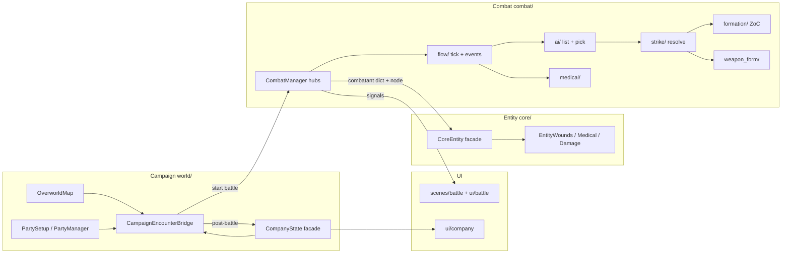

# Architecture (Fallen Paths)

Godot **4.7** (Forward Plus) · tactical combat + mercenary campaign.

Follows [Godot project organization](https://docs.godotengine.org/en/stable/tutorials/best_practices/project_organization.html), [scene organization](https://docs.godotengine.org/en/stable/tutorials/best_practices/scene_organization.html), and [autoloads vs nodes](https://docs.godotengine.org/en/stable/tutorials/best_practices/autoloads_versus_regular_nodes.html).

## Folder map (roles)

| Path | Role |
|------|------|
| `assets/` | Imported art (tiles, branding) |
| `scenes/` | Entry / actor / battle scenes (`.tscn`) |
| `resources/` | Designer data (`.tres` + weapon/armor/species scripts) |
| `combat/` `world/` `core/` | Domain logic packages |
| `ui/battle/` `ui/company/` | UI scripts (presentation helpers) |
| `harness/` | Headless regression / soak (not production) |
| `tools/ci/` | Phase 0 / CI shell + company checks |
| `tools/combat_tuning/` | Local tuning UI only — never production preload |
| `addons/` | Reserved for third-party plugins |
| `docs/` | Planning / agent entry |

## Boot

- **Campaign F5:** `project.godot` → `res://scenes/campaign/main.tscn`
- **Tuning:** CLI `--tuning` or open `tools/combat_tuning/combat_tuning.tscn` (not the default main scene)

## Autoload policy

**No Autoloads required for combat/campaign.** Prefer:

- `class_name` modules with static helpers (`CombatConstants`, `CompanyState`, `CombatantEntityAccess`)
- Scene-owned nodes (`CombatManager` under battle)
- Signals across UI / manager / bridge
- Resources for shared data

Do **not** Autoload CombatManager / CompanyState to pass references. Bridge: [`BRIDGE_CONTRACT.md`](BRIDGE_CONTRACT.md).

## Naming

- **Folders / new scenes / assets:** `snake_case` (export-safe)
- **Existing `class_name` scripts:** PascalCase filenames (`CombatManager.gd`) — intentional hybrid; do not mass-rename
- **Signals:** past-tense / event nouns (`died`, `combatant_health_changed`, `health_changed`)
- **Combatant dict keys:** via `CombatConstants` / `DataKeys` — never raw string sprawl for new keys

## Scene wiring

- Prefer `@export` / `PackedScene` / `Resource` refs over deep `get_node` chains for cross-scene deps
- Entry scenes under `scenes/`; logic scripts under domain packages; UI helpers under `ui/`
- Keep game bootout of `tools/` — production code must not preload `tools/combat_tuning`

## Signals

- Prefer typed signals between manager ↔ battle UI ↔ campaign bridge
- Do not replace call contracts in [`BRIDGE_CONTRACT.md`](BRIDGE_CONTRACT.md) with Autoload singletons

## Domain pipeline

## Layer rules

| Layer | May call | Must not |
|-------|----------|----------|
| `world/` campaign | Bridge helpers, Company\* modules | Strike/defense internals, raw combatant dict writers |
| `combat/` packages | `CombatantEntityAccess`, `CombatConstants`, specialist pack APIs | Company disk save / day tick (except via Bridge); `tools/combat_tuning` |
| `core/` entity | Tissue / wound / armor math | Formation doctrine, WF auto-switch |
| `ui/` | Formatters + signals from manager / CompanyState | Event-queue mutation, damage apply |
| `harness/` | Everything (tests only) | Be imported by production packs |
| `tools/` | CI / tuning only | Production game logic |

## Finding code

1. [`AGENTS_API#canonical-apis`](AGENTS_API.md#canonical-apis)
2. [`combat/README.md`](../combat/README.md)
3. [`BRIDGE_CONTRACT`](BRIDGE_CONTRACT.md)
4. Paths: [`core/ResourcePaths.gd`](../core/ResourcePaths.gd)

Session budget: ≤1 doc section + ≤3 owning `.gd` before first edit.
