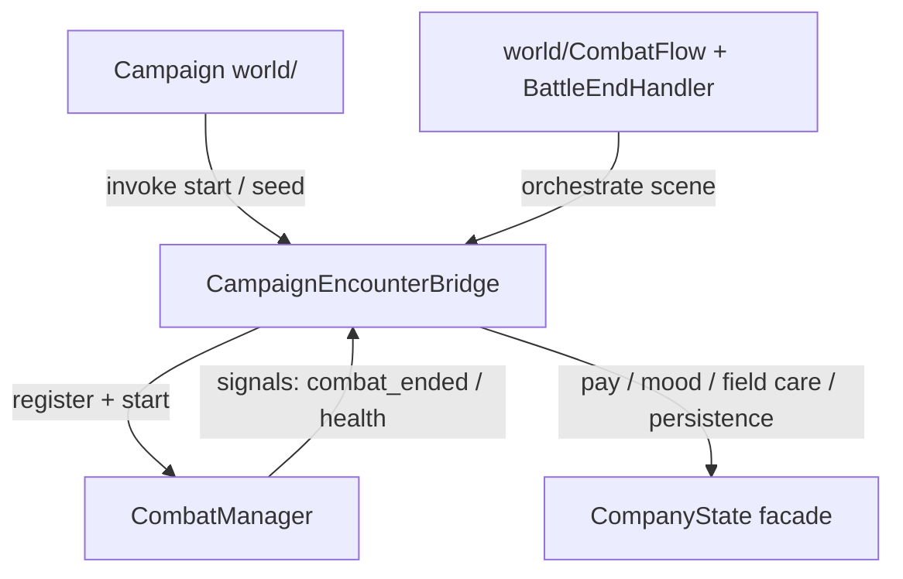

# Campaign ↔ combat bridge contract

Single ownership edge between `world/` and `combat/`. Shared files: one agent at a time ([`PLANNING#file-ownership`](PLANNING.md#file-ownership)).

## Direction

| Allowed | Owner |
|---------|-------|
| Start encounter, seed formations / doctrine overlays | Bridge + `CombatFormationSetup` |
| Stamp party / enemy leader flags on register | `CombatManager.register` via entity node props |
| Apply campaign mood → stance preference / WF bias | Bridge (`apply_campaign_mood_stance_preferences`) |
| Read overworld tile math | Bridge `overworld_tile_*` only |
| Post-victory afflictions / pay / burial | Company\* via Bridge / BattleEndHandler |
| Map field care (hemorrhage) after fight | `MapFieldCare` + CompanyCamp formatters |

| Forbidden without a Bridge (or Flow) method |
|---------------------------------------------|
| New `world/` → `combat/strike/*` or `combat/ai/*` imports for gameplay |
| Combat packages writing Company disk save / day index / gold directly |
| UI calling `CombatManager._get_by_id` (use `CombatantEntityAccess`) |
| Duplicating untreated-wound / tile helpers outside Bridge / EntityAccess |

## Boot / teardown

1. Campaign sets encounter meta + formations on the world  
2. `CombatFlow` / scene wires `CombatManager` and registers combatants  
3. `start(player_formation, enemy_formation)` seeds doctrine / ZoC  
4. On end: manager emits; BattleEndHandler / Bridge apply campaign outcomes  
5. Medical fast-forward on exit stays on manager; campaign only consumes results via Bridge

## Persistence

- EA / P2 gates: `CompanyState.read_stub_persistence_mode` · `CampaignPersistence.*`  
- Combat must not invent a second save channel for roster health

## Change rule

New cross-stream needs → add one Bridge (or Flow) API, document it in [`AGENTS_API#canonical-apis`](AGENTS_API.md#canonical-apis), keep production call sites on that name.
