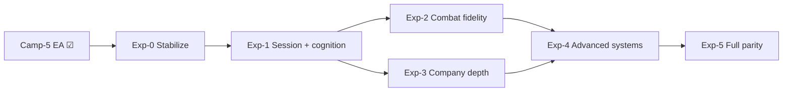

# Expansion plan — post-EA combat & campaign

**Purpose:** Sequenced roadmap from **Camp-5 EA (2026-06-07 ☑)** toward fuller Battle Brothers–like merc loop depth and POST Phase 3/4 combat integration.

**Canonical detail (do not duplicate here):**
[`PLANNING.md`](PLANNING.md) · [`SHIP_PLAN.md`](SHIP_PLAN.md) · [`LIVE_PATHS.md`](LIVE_PATHS.md) · [`CAMPAIGN_DECISION_GUIDE.md`](CAMPAIGN_DECISION_GUIDE.md) · [`CURSOR.md`](CURSOR.md) · agent prompts [`scripts/cursor/README.md`](../scripts/cursor/README.md)

**Milestone prefix:** **`Exp-*`** = expansion phase (this doc). Combat rows keep **`III-*` / `IV-*` / `P4*` / `MS-L*`** IDs. Campaign expansion rows use **`XCamp-*`** (not closed EA **`Camp-*`** gates).

---

<a id="north-star"></a>

## 1. North star

| Horizon | Player experience | Engineering signal |
|---------|-------------------|-------------------|
| **Now (EA ☑)** | 2–4 h session, session-only save, 3×3 map, finite contract deck | Camp-5 human + Phase 0 green |
| **Exp-1 target** | 4–6 h with **P2** autosave; fewer “lost progress” complaints | Settlement continue restores company + wounds |
| **Exp-2 target** | Combat reads “complete” in outnumber, depth, guard/interpose | IV-4/5 ☑ · IV-6 ☑ · MS-L5–L6 · **III-6 ☑** |
| **Exp-3 target** | Company arc: hire replacements, larger map, richer afflictions | Roster growth + map scale without new combat tiers |
| **Exp-4+ target** | 8–12 h runs; armor/initiative/gap-column where designed | **IV-7 ☑** · **IV-8 ☑** · IV-9 (last) · optional town layer |

**Design locks (unchanged):** AI picks moves and targets via mental stack + weights — **no** per-click target UI ([`SHIP_PLAN` §9b](SHIP_PLAN.md#combat-mental-stack-shipped)). Bleed retune · BMI (**F1**) · organ surgery · IV-INTR removed.

---

<a id="principles"></a>

## 2. Operating principles

1. **Gate every session** — `.\scripts\run_all_combat_checks.ps1` → **`PHASE0: PASS`** + **`CAMPAIGN_SHIP_AUDIT: PASS (headless)`**.
2. **One row per Expand PR** — one **`III-*` / `IV-*` / `P4*` / `MS-L*`** + optional **`FEATURE_*`** ([`SHIP_PLAN` §9c](SHIP_PLAN.md#combat-expand-registry)).
3. **Smallest module owner** — extend existing `combat/*.gd` / `world/*.gd`; no new subfolders without cause ([`PLANNING#file-ownership`](PLANNING.md#file-ownership)).
4. **New campaign product gates** — research in [guide appendix](CAMPAIGN_DECISION_GUIDE.md#gate-research-appendix) → **`CompanyState`** const + `read_stub_*()` → one line in [decision log](SHIP_PLAN.md#decision-log).
5. **Parallel default** — **Combat** chat + optional **Expand** or **Playtest**; **Campaign** when touching bridge / economy / save ([`PLANNING#parallel-agents`](PLANNING.md#parallel-agents)).

---

<a id="phase-overview"></a>

## 3. Phase overview (indicative bands)

Calendar dates are **not** commitments — bands assume ~1 Expand row or ~1 Campaign slice per week with Phase 0 discipline (same order of magnitude as the historical 10-week Camp build).



| Phase | Indicative band | Theme | Primary stream |
|-------|-----------------|-------|----------------|
| [**Exp-0**](#exp-0-stabilize) | Weeks 1–2 | Maintain EA; close optional F5 gaps | Combat · Playtest |
| [**Exp-1**](#exp-1-session--cognition) | Weeks 3–6 | Longer sessions + stack completion | Campaign · Expand |
| [**Exp-2**](#exp-2-combat-fidelity) | Weeks 5–12 | Guards, depth, surround, deflect loop | Expand · Combat |
| [**Exp-3**](#exp-3-company-depth) | Weeks 6–14 | Hire, map, afflictions, economy UX | Campaign |
| [**Exp-4**](#exp-4-advanced-systems) | Weeks 12–24 | Armor burden, initiative, gap-column | Expand |
| [**Exp-5**](#exp-5-full-parity) | Ongoing | Town UI, inventory, meta | Campaign + design |

**Exp-2** and **Exp-3** may run in parallel when files do not overlap (Campaign `world/*` vs Expand `combat/*`).

---

<a id="exp-0-stabilize"></a>

## Exp-0 — Stabilize (post-EA hygiene)

**Goal:** EA baseline stays green; optional validator tracks documented.

| ID | Work | Stream | Exit |
|----|------|--------|------|
| Exp-0.1 | Phase 0 + mental stack / III-4 **3e** maintain | Combat | `PHASE0: PASS` |
| Exp-0.2 ☑ | Optional F5 §8 steps 4, 8–10 (field care action, paid loss, wage/desertion, triage) | Playtest | `validate_f5_soak_log` optional `[camp_*]` tracks |
| Exp-0.3 | Economy UX bugs from human play (HUD copy, settlement edge cases) | Campaign | Headless company checks green |

**Not in Exp-0:** new `FEATURE_*`, bleed retune, new D-* gates.

---

<a id="exp-1-session--cognition"></a>

## Exp-1 — Session length & cognition

**Goal:** Support **4–6 h** play without crash anxiety; finish mental-stack layers that affect every fight.

### Campaign (`XCamp-*`)

| ID | Deliverable | Gate / notes | Modules |
|----|-------------|--------------|---------|
| **XCamp-1.1** | **P2** single-slot autosave on settlement continue | **D-persistence P2** — [guide](CAMPAIGN_DECISION_GUIDE.md#d-persistence); flip `PERSISTENCE_MODE` | `CampaignPersistence`, `CompanyState`, `SettlementPanel` |
| **XCamp-1.2** | Load / continue UX (slot label, corrupt guard, camp boot `clear_slot` rules) | Harness roundtrip in `run_company_state_checks` | `main.gd`, `PartyMenu` |
| **XCamp-1.3** | Wage / desertion warning polish (if playtests missed step 9) | No new gate — §12 tuning | `CompanyHud`, `PartyMenu` |

### Combat (Expand)

| ID | Deliverable | Harness / flag | Modules |
|----|-------------|----------------|---------|
|| **MS-L5** ☑ | Formation plug / vacancy forward when line breaks | `_run_mental_stack_*` plug row | `MentalStackDecider`, `CombatFormationVacancyPlugs` — shipped 2026-06-08 |
|| **MS-L6** ☑ | Rout / cohesion → flee / fall_back priority | AttentionFootworkTail | `MentalStackDecider`, `CombatFormationRout` — shipped 2026-06-08 |
|| **p4a** ☑ | MS-L7 tunnel 0.50 + offense damp ramp | **ii4d** | `CombatExhaustion` — shipped 2026-06-08 |
|| **p4f** ☑ | Dedicated flee formation UX + AI | `CombatRegressionHarnessFleeTail` | `CombatFormationFlee`, `CombatFormationRout` — shipped 2026-06-08 |
|| **p4g** ☑ | Bind-exchange flurry depth suite | `_run_p4g_flurry_bind_depth_suite` | `CombatFlurryBind` — shipped 2026-06-08 |
|| **p4b** ☑ | Formation duration UI copy | **`p4b_formation_duration_ui_copy_line`** | `CombatFormationMoveDuration` — shipped 2026-06-08 |
|| **p4d** ☑ | Parry/bind doc ↔ code sync | **`p4d_parry_bind_doc_sync_line`** | calibration audit + **ii2b** worksheet — shipped 2026-06-08 |

**Phase exit:** P2 save restores gold, supplies, roster wounds, map position; one 4–6 h human session without restart. (MS-L5–L6 shipped.)

**Suggested parallel:** Campaign **XCamp-1.1** (P2 autosave) — standalone, no combat overlap.

---

<a id="exp-2-combat-fidelity"></a>

## Exp-2 — Combat fidelity (deepen shipped sim)

**Goal:** Fights at unequal width, depth ranks, and guard geometry match design intent — building on III-4 Track A ☑.

**Dependency order:** III-2 → **IV-4/5 ☑** → III-1 · III-6 · III-3 · III-5 · III-8.

### Priority queue (one PR each)

| Order | ID | Status (2026-06-08) | Intent | Primary modules |
|------:|-----|---------------------|--------|-----------------|
| 1 | **IV-4** | **Shipped ☑** | Flank **`guard_cardinal_for_attack_path`** + **`guard_zone_part_for_line`** | `CombatGuardLines`, `CombatConstants.get_attack_path` — `_run_iv4_guard_matrix_suite` |
| 1b | **IV-6** | **Shipped ☑** | Octant zone-first attack paths | **`FEATURE_IV6_ATTACK_PATH_OCTANT`** · `_run_iv6_attack_path_octant_suite` |
| 2 | **MS-L6** | **Shipped ☑** | Rout mental-stack layer · **`FEATURE_MS_L6_ROUT`** | `MentalStackDecider`, `CombatFormationRout` |
| 3 | **III-6** | **Shipped ☑** | Back-rank depth recheck on wind-up start/abort · depth-lane skip timing | `AttackWindUpStarter`, `CombatEventScheduler`, `CounterTempo` |
| 4 | **III-1** | **Shipped ☑** | Surround sector + multi-incoming parry target tie-break | `TacticalCombat`, `CombatIncomingParryChoice` — `_run_iii1_incoming_parry_sector_tiebreak` |
| 5 | **III-3** | **Shipped ☑** | Deflect/bind calibration loop | **`_run_iii3_deflect_bind_calibration_suite`** · Playtest **ii2b** / Q2 maintain |
| 6 | **III-5** | **Shipped ☑** | Pack wound depth vs research (channel success mult) | `EntityMedical.packing_channel_success_mult` — `_run_iii5_packing_channel_success_depth` |
| 7 | **III-8** | **Shipped ☑** | Recovery-cause → readiness / footwork mult parity | `PassiveParryContext`, `CombatConstants` |
| 8 | **MS-MID** | **Shipped ☑** | Mid-fight ally medical listing + L1 coordination | **`FEATURE_MS_MID_INFIGHT_MED`** · **`_run_ms_mid_infight_med_depth_suite`** ☑ 2026-06-08 |
| 9 | **p4c** | **Shipped ☑** | Auto-doctrine numeric outnumber pinch | **`numeric_superiority_for_pinch`** · **`_run_p4c_numeric_superiority_auto_pinch`** ☑ 2026-06-08 |
| 10 | **p4e** | **Shipped ☑** | Feint listing ↔ reveal progress parity | `CombatRegressionHarnessFeintTempoTail` |
|| **p4g** ☑ | Bind-exchange flurry depth suite | `_run_p4g_flurry_bind_depth_suite` | `CombatFlurryBind` — shipped 2026-06-08 |
| 12 | **p4h** | **Shipped ☑** | Bind riposte balance soak | **`_run_p4h_bind_riposte_balance_suite`** · **`_run_bind_riposte_*`** · **ii2b** / **Q2** maintain ☑ 2026-06-08 |
|| **p4d** ☑ | Parry/bind doc ↔ code sync | **`p4d_parry_bind_doc_sync_line`** | calibration audit + **ii2b** worksheet — shipped 2026-06-08 |
|| **p4b** ☑ | Formation duration UI copy | **`p4b_formation_duration_ui_copy_line`** | `CombatFormationMoveDuration` — shipped 2026-06-08 |

**WF maintain (no new tiers):** WF-T1/T2 ☑ · Tier 4.4 spatial slices 1–3 ☑ — keep **`WeaponFormTail`** + **ii5c** green + **`_run_t44_spatial_*`**; P4 playbook **p4a–p4h ☑** · combat-side Expand registry **complete** — default **Combat maintain** per [`CURSOR.md`](CURSOR.md).

**Phase exit:** F5 **ii_envelop** + depth-heavy contract feel OK; Q2 deflect soak stable; no long wing **`rotate_file`** / **`wait`** loops on 7v3+ (III-4 **3e** maintain).

---

<a id="exp-3-company-depth"></a>

## Exp-3 — Company depth (merc loop)

**Goal:** Move from “finite deck on 3×3” toward a **replaceable roster** and **explorable map** without rewriting combat core.

### Campaign rows

| ID | Deliverable | New gate? | Modules / notes |
|----|-------------|-----------|-----------------|
| **XCamp-3.1** ☑ | **Hire at inn** (camp tile or new marker) — gold cost, rookie stats | Optional **D-hire** | `PartySetup`, `PartyMenu`, `CompanyState` |
| **XCamp-3.2** ☑ | **Larger overworld** (5×5) + contract density | No gate — layout | `OverworldMap`, `main.gd`, spawners |
| **XCamp-3.3** ☑ | **Rolling contract deck** refresh on wave clear | Optional **D-encounter R4** variant | `ContractSpawner`, `SettlementPanel` |
| **XCamp-3.4** ☑ | **Full affliction catalog** + settlement display | Extend **D-affliction** data only | `CampaignAfflictions`, `SettlementPanel` |
| **XCamp-3.5** ☑ | **Camp tavern mood** (+1 rest) | No gate — [guide mood table](CAMPAIGN_DECISION_GUIDE.md#user-bundle-2026-05-22) | `CompanyState.try_camp_heal` |
| **XCamp-3.6** ☑ | **Provisions** (not fed → mood −1) | Optional **D-provisions** | `CompanyState.on_day_tick` |
| **XCamp-3.7** ☑ | **Burial / replacement costs** (soft gold sink) | §12 tuning | `SettlementPanel`, `CompanyState` |
| **XCamp-3.8** ☑ | **MS-CAMP** bridge — campaign mood → **`stance_preference`** at spawn | Meta only | `CampaignEncounterBridge` |

**Bridge discipline:** **`CampaignEncounterBridge`** + **`CombatFlow`** — Campaign leads; Combat read-only unless encounter keys change ([`PLANNING#bridge-rows`](PLANNING.md#bridge-rows-camp-2)).

**Phase exit:** Player can hire after losses, complete **≥6 contracts** on expanded map in one P2 save; afflictions and mood visible in Party/settlement.

**Economy UX maintain (2026-06-08):** Exp-3 rows shipped — ongoing work is **copy/surfacing only** via `CompanyState.format_*` helpers (End day wage+food suffixes, HUD hint strip, settlement burial/deck hints, desertion footer, hire tooltips). See [`AGENTS.md`](../AGENTS.md) economy UX row · [`agent_campaign.md`](../scripts/cursor/agent_campaign.md). Harness: **`CompanyStateChecks` (406 tests)** · P2 uses `CampaignPersistence.begin_harness_isolated_save`.

**Suggested build order:** **XCamp-3.1** hire → **XCamp-3.2** map → **XCamp-3.3** deck → **XCamp-3.4** afflictions → polish rows.

---

<a id="exp-4-advanced-systems"></a>

## Exp-4 — Advanced combat systems (Phase 4)

**Goal:** Initiative, armor burden, subregions, and optional gap-column topology — **after** Exp-2 guard/depth work.

**Dependency chain** ([`LIVE_PATHS` IV table](LIVE_PATHS.md#phase-4--new-systems-formal-tracks)): **IV-1…13 ☑** (2026-06-08) — combat-side Expand registry **complete**.

| Order | ID | Intent | Risk | Flag |
|------:|-----|--------|------|------|
| 1 | **IV-7** | **Shipped ☑** | Armor burden on **`action_ready`** + passive readiness | **`FEATURE_ARMOR_BURDEN`** · `PassiveParryContext` · `_run_iv7_armor_burden_*` |
| 2 | **IV-7b** | **Shipped ☑** | Stamina engage floor for AI offense | **`AI_STAMINA_ENGAGE_FLOOR_RATIO`** · **`_run_iv7b_stamina_engage_floor_suite`** ☑ 2026-06-08 |
| 3 | **IV-8** | **Shipped ☑** | Combat-start initiative ordering | **`FEATURE_INITIATIVE_ORDER`** · **`_run_iv8_initiative_order_*`** |
| 4 | **IV-10** | **Shipped ☑** | Subregion combat multipliers | **`FEATURE_SUBREGION_COMBAT_MULT`** · **`_run_iv10_subregion_combat_mult_*`** |
| 5 | **IV-1** | **Archived ☑** | Plug vs incursion contest review — removed (D-008); harness deleted |
| 6 | **IV-11** | **Shipped ☑** | Leader formation commands + bridge roster | **`FEATURE_LEADER_FORMATION_COMMAND`** · slices 1–10 (player + enemy commander · pinch outnumber AI · F5 trace) · **`_run_iv11_*`** ☑ 2026-06-08 |
| 6b | **IV-3** | **Shipped ☑** | True-duel classifier edge cases | **`iv3_doc_sync_line`** · **`_run_iv3_true_duel_classifier_suite`** ☑ 2026-06-08 |
| 7 | **IV-9** | **Shipped ☑** | Gap-column slot topology (III-4 Track B) | **`FEATURE_GAP_COLUMN_TOPOLOGY`** default off · **`_run_iv9_gap_column_*`** ☑ 2026-06-08 |
| 8 | **IV-13** | **Shipped ☑** | ZoC weapon-reach bonus at weak front | **`FEATURE_IV13_WEAPON_REACH_ZOC`** · **`_run_iv13_weapon_reach_zoc_*`** ☑ 2026-06-08 |
| 9 | **IV-12** | **Shipped ☑** | Co-located slot distraction + AI bias | **`FEATURE_IV12_SLOT_DISTRACTION`** · formation **slot cell** grouping · **`drag_back`** dual-occ (slice 3) · **`_run_iv12_*`** ☑ 2026-06-08 |

**IV-9 ☑:** gap-column shipped behind flag (default off) — enable for playtest when ready; see [III-4 Track B](LIVE_PATHS.md#iii-4--engagement-geometry-audit).

**Tier 4.4 spatial Expand ☑ (2026-06-08):** slices 1–3 shipped behind **`FEATURE_T44_SPATIAL_*`** (default on) — [`#wf-footing-improvement-backlog`](LIVE_PATHS.md#wf-footing-improvement-backlog) · harness **`_run_t44_spatial_*`**. **Still deferred:** world-position locomotion / file shuffle tied to blade line — anchor [#tier-44-spatial-footwork-deferred](#tier-44-spatial-footwork-deferred).

**Phase exit ☑ (2026-06-08):** IV-7/8 + IV-9–13 harness green; flag-gated rows default **off** until playtest enable.

---

<a id="exp-5-full-parity"></a>

## Exp-5 — Full parity (long horizon)

**Not scheduled.** Requires product decisions beyond current closed gates.

| Bucket | Examples | Notes |
|--------|----------|-------|
| **Town layer** | Hiring hall UI, inventory grid, shop, crafting | Explicitly out of EA scope |
| **Persistence** | **P3** save at camp + after each contract | [D-persistence](CAMPAIGN_DECISION_GUIDE.md#d-persistence) |
| **Medical depth** | Organ surgery, cardiac chains | Wontfix unless asked |
| **Narrative** | Event chains, faction rep | New gates + content pipeline |
| **Meta** | Roguelike unlocks, Steam stats | Out of scope for sim-first roadmap |

Treat Exp-5 as a **backlog pool** — pull items only after Exp-3 company loop feels BB-like in playtests.

---

<a id="recommended-parallel"></a>

## 4. Recommended parallel recipes

| Week band | Agent A (Combat) | Agent B (optional) | Gate |
|-----------|------------------|--------------------|------|
| Exp-0 | III-4 **3e** / harness maintain | Playtest — F5 optional tracks | Phase 0 both |
|| Exp-1a ☑ | ~~MS-L5 harness~~ (shipped) | Campaign **XCamp-1.1** P2 | Phase 0 both |
|| Exp-1b ☑ | ~~MS-L6 + p4a~~ (shipped) | ~~p4f flee~~ (shipped) / Playtest | Phase 0 both |
| Exp-2a | **IV-4** finish | Expand **III-6** back-rank | Phase 0 both |
| Exp-2b | **IV-5** interpose | Combat maintain III-3 soak | Phase 0 both |
| Exp-3a | Combat maintain | Campaign **XCamp-3.1** hire | Phase 0 both |
| Exp-3b | **MS-CAMP** bridge (Combat split if trait rules) | Campaign **XCamp-3.2** map | Coordinate `CampaignEncounterBridge` |
| Exp-4 | One IV row | Campaign economy polish only | No dual Expand |

**Never parallel:** two Expand agents on overlapping files · bleed retune · two agents on `.f5_soak_in.txt`.

---

<a id="tracking"></a>

## 5. Tracking & exit criteria

| Phase | Headless | Human | Doc update |
|-------|----------|-------|------------|
| Exp-0 | Phase 0 + ship audit | Optional §8 gaps | — |
| Exp-1 | + P2 roundtrip harness | 4–6 h saved session | Decision log if **P2** |
| Exp-2 | + new `_run_*` rows | F5 **ii_envelop**, Q2 | LIVE_PATHS row → Done |
| Exp-3 | + company hire/deck tests | 6+ contract arc | New gates → guide + §19 |
| Exp-4 | dual-mode IV harness | Feel pass armor/initiative | One line per IV in decision log |

**Status column:** maintain in this file’s phase tables (change **Open → ☑** when merged); canonical combat status remains [`LIVE_PATHS`](LIVE_PATHS.md) · campaign gates [`CAMPAIGN_DECISION_GUIDE`](CAMPAIGN_DECISION_GUIDE.md).

---

<a id="wontfix"></a>

## 6. Frozen / wontfix (unless user asks)

- Player per-target picking
- **IV-INTR** (removed — line crash/D-008)
- P3b material sim expansion
- Bleed / **`BleedingConstants`** retune
- BMI **F1**
- New **`FEATURE_*`** on WF-1 maintain path
- Neurotrauma-style surgery chains

---

<a id="agent-entry"></a>

## 7. Agent entry (parallel bundle)

Copy prompts from [`scripts/cursor/README.md#parallel-expansion-bundle`](../scripts/cursor/README.md#parallel-expansion-bundle) (Combat · Playtest · Campaign) · Expand reopen: [`README#expand-reopen`](../scripts/cursor/README.md#expand-reopen). Index: [`AGENTS.md`](../AGENTS.md#agent-task-prompts-copypaste).

**Shipped rows:** this file · [`LIVE_PATHS.md`](LIVE_PATHS.md) · [`PLANNING#work-streams`](PLANNING.md#work-streams)

---

<a id="decision-log"></a>

## 8. Decision log (expansion)

Log new product gates and completed phases here; mirror campaign gates in [`SHIP_PLAN` decision log](SHIP_PLAN.md#decision-log).

```markdown
# Template
- YYYY-MM-DD — Exp-N — <phase exit or gate> → <choice> — <modules>
- YYYY-MM-DD — XCamp-3.x — D-* → <choice> — <const name>
- YYYY-MM-DD — IV-N / MS-LN — shipped — <harness row>
```

**Entries:**

- **2026-06-08** — **Exp-3 ☑** — XCamp-3.1–3.8 shipped (hire, 5×5 map, deck refresh, affliction catalog, tavern mood, provisions, burial, MS-CAMP mood→form); `CompanyStateChecks` **406** — Campaign stream maintain (economy UX copy).
- **2026-06-08** — **Exp-0.2** ☑ — optional Camp §8 F5 tracks (steps 4, 8–10) PASS on Camp-5 human paste + `validate_camp_optional_smokes.ps1` 8/8; `human_signoff: READY` — Playtest stream.
- **2026-06-08** — **Exp plan** — post-EA roadmap published; EA baseline Camp-5 ☑ 2026-06-07. IV-1 / D-008 harness and sync line removed (archived wontfix).
- **2026-06-08** — **III-3** ☑ deflect/bind calibration harness — **`_run_iii3_deflect_bind_calibration_suite`** · Playtest **ii2b** maintain — Expand stream.
- **2026-06-08** — **p4d** ☑ parry/bind doc ↔ code sync — **`p4d_parry_bind_doc_sync_line`** · **`_run_p4d_parry_bind_doc_code_parity_suite`** — Expand stream.
- **2026-06-08** — **p4c** ☑ numeric auto-pinch — **`numeric_superiority_for_pinch`** · **`_run_p4c_numeric_superiority_auto_pinch`** — Expand stream.
- **2026-06-08** — **IV-7b** ☑ stamina engage floor — **`ai_offense_stamina_weight_mult`** · **`_run_iv7b_stamina_engage_floor_suite`** — Expand stream.
- **2026-06-08** — **MS-MID** ☑ mid-fight ally medical — **`FEATURE_MS_MID_INFIGHT_MED`** · **`_run_ms_mid_infight_med_depth_suite`** — Expand stream.
- **2026-06-08** — **p4f** ☑ dedicated flee formation UX + AI — `CombatRegressionHarnessFleeTail` — [`LIVE_PATHS#tier-62`](LIVE_PATHS.md#tier-62-dedicated-flee-formation-action).
- **2026-06-08** — **IV-6** ☑ octant attack-path merge — **`FEATURE_IV6_ATTACK_PATH_OCTANT`** · `_run_iv6_attack_path_octant_suite` — [`SHIP_PLAN` §9c](SHIP_PLAN.md#combat-expand-registry).
- **2026-06-08** — **IV-4** ☑ guard matrix closeout — flank path + zone — see [`SHIP_PLAN` §9c](SHIP_PLAN.md#combat-expand-registry).
- **2026-06-07** — **WF-T1** ☑ · **2026-06-08** — **WF-T2** ☑ · **IV-5** ☑ arm interpose — see [`SHIP_PLAN` §9c](SHIP_PLAN.md#combat-expand-registry).
