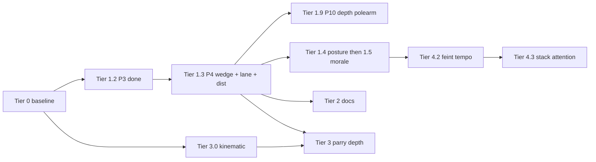

# Combat implementation plan (Fallen Paths)

**Purpose:** One **logical plan** from baseline → active work → later tiers. **Implementation phase:** execute **top to bottom**; within Tier 1, follow **numbered steps** in order unless a step is marked optional.

**Single source of truth (avoid forking):** Milestone **Status**, **Development gate**, and **dependency chain** live **only** in this file. **`docs/README.md`** is a **topic index** (no parallel status column). **`ENGAGEMENT_LINE_COHESION_INTRUSION_PLAN.md`** §2 **mirrors** Tier 1 **Status** from the [milestone summary](#milestone-summary) here. **`docs/COMBAT_ROADMAP_AND_STAMINA.md`** — legacy **IMPLEMENTATION_OUTLINE** Parts **1–3** are **collapsed** in `
`; **Part 3** phase checklists remain **historical** — if they disagree with this plan, **this file wins**.

**Last verified (code + `CombatRegressionHarness.run_all()`):** 2026-05-16 (Tier **5.1** **Done** (exit-gated §5.1 **[x]**; optional long-tail **[ ]**) — kinematic + oblique penetration + **`compute_and_apply_damage`** pen integration + **`strike_mods`** pen + damage-shape orthogonality incl. partial parry + **`get_line_alignment_with_deflect`** + **`get_deflected_angle_bilateral`** / quadrant line-angle harnesses + **`get_deflected_line_from_angles`** same-line bind + **`angle_diff_deg`** / **`get_alignment_from_angles`** + damage-flow + mult isolation; Tier **4.2** **`feint_windup_duration_mult`** + **`feint_target_reveal_at_progress`** + **`DefenseChoiceResolver._feint_readiness_reveal_mult`** (**`parry_readiness`**, guard-angle wobble, dodge telegraph, guard-zone) + **`FEINT_TELEGRAPH_DODGE_EVAL_BIAS`** / **`choose_defense`** dodge telegraph + **`CombatConstants.COMMITMENT_FRACTION_FEINT`** / **`commitment_fraction_for_pending_attack`** (non-empty **`feint_part`**) + pair **`distance_to`** **`DEFENSE_SPACING_*`** (**`_run_defense_spacing_band_modulates_parry_and_dodge`**, **`_run_defense_footwork_recovering_boosts_dodge_vs_waiting`**, **`_run_defense_footwork_recovery_cause_orders_recovering_dodge_mult`**, **`_run_defense_footwork_recovering_dodge_stacks_with_spacing_long_and_close`**, **`_run_defense_footwork_waiting_boosts_dodge_when_settled_vs_off_balance`**, **`_run_defense_footwork_waiting_dodge_stacks_with_spacing_long_and_close`**, **`_run_feint_move_listing_settled_waiting_footwork_dampens_vs_off_balance`**, **`_run_feint_move_listing_recovering_footwork_dampens_vs_settled_waiting`**, **`_run_feint_move_listing_recovery_cause_orders_recovering_footwork_mult`**, **`_run_feint_telegraph_spacing_*`**, **`_run_feint_move_listing_spacing_*`**, **`_run_feint_guard_zone_readthrough_spacing_*`**) + **`CombatConstants.passive_parry_readiness_incoming_contact_mult`** (**`_run_passive_parry_readiness_incoming_contact_stab_scales_vs_cut`**, **`_run_defender_low_stamina_scales_passive_parry_readiness_in_choose_defense`**, **`_run_feint_move_listing_incoming_contact_stab_feint_dampens_vs_cut_feint`**, **`_run_feint_move_listing_defender_low_stamina_scales_read_m_vs_full_stamina`**, **`_run_feint_move_listing_defender_and_attacker_stamina_multiply_orthogonally`**, **`WeaponConstants`** **`thrust_feint`**) + **`CombatConstants.AI_IS_FEINT_MOVE_LISTING_WEIGHT_MULT`** + **`AI_FEINT_LISTING_DEFENDER_READINESS_TOP_MULT`** + **`AI_FEINT_LISTING_STAMINA_GATE`** + **`AI_FEINT_LISTING_DOCTRINE_PROBING_MULT`** / **`AI_FEINT_LISTING_DOCTRINE_PINCH_CENTER_MULT`** / **`AI_FEINT_LISTING_DOCTRINE_HOLD_LANE_MULT`** / **`STANCE_MOD_AI_FEINT_LISTING`** / **`AI_FEINT_LISTING_DEFENDER_OFF_BALANCE_MULT`** / **`CombatAIActionPicker._get_action_weight`** + harnesses **`_run_feint_windup_duration_mult_extends_state_duration_vs_oberhau`**, **`_run_feint_windup_duration_mult_extends_state_duration_vs_thrust`**, **`_run_feint_target_reveal_progress_scales_readiness_mult`**, **`_run_feint_windup_options_stamp_pa_and_telegraph_guard_zone`**, **`_run_feint_windup_options_stamp_pa_and_telegraph_guard_zone_thrust`**, **`_run_feint_windup_target_only_sets_defender_guard_zone_to_target_thrust`**, **`_run_feint_move_ai_distinct_feint_and_target_parts_thrust`**, **`_run_feint_move_listing_weight_mult_prefers_feint_over_plain_thrust`**, **`_run_feint_commitment_fraction_shortens_effective_wind_up_for_late_parry_thrust`**, **`_run_feint_telegraph_biases_dodge_eval_part_when_not_readthrough`**, **`_run_feint_commitment_fraction_shortens_effective_wind_up_for_late_parry`**, **`_run_defense_spacing_band_modulates_parry_and_dodge`**, **`_run_feint_move_listing_weight_mult_prefers_feint_over_plain_oberhau`**, **`_run_feint_move_listing_readiness_scales_feint_weight_high_guard_vs_low_guard`**, **`_run_feint_move_listing_readiness_scales_feint_weight_high_guard_vs_low_guard_thrust`**, **`_run_feint_move_listing_readiness_recovery_curve_when_defender_recovering`**, **`_run_feint_move_listing_stamina_low_dampens_feint_weight`**, **`_run_feint_move_listing_stamina_low_stacks_with_hold_lane_doctrine_damp`**, **`_run_feint_move_listing_stamina_low_stacks_with_probing_doctrine_mult`**, **`_run_feint_move_listing_stamina_low_stacks_with_pinch_center_doctrine_mult`**, **`_run_feint_move_listing_doctrine_probing_multiplies_feint_weight`**, **`_run_feint_move_listing_doctrine_pinch_center_multiplies_feint_weight`**, **`_run_feint_move_listing_doctrine_hold_lane_dampens_feint_weight_vs_default`**, **`_run_feint_move_listing_recent_opp_parry_deflect_boosts_feint_weight`**, **`_run_feint_move_listing_defender_off_balance_boosts_feint_weight`**, **`_run_feint_move_listing_settled_waiting_footwork_dampens_vs_off_balance`**, **`_run_feint_move_listing_recovering_footwork_dampens_vs_settled_waiting`**, **`_run_feint_move_listing_recovery_cause_orders_recovering_footwork_mult`**, **`_run_feint_move_listing_recovering_footwork_and_spacing_stack_orthogonally`**, **`_run_feint_move_listing_stance_ai_feint_mult_ordering`**) — `combat/*.gd`, `ui/BattleScene.gd`, `world/CombatFlow.gd`, `weapon/WeaponDamageHelper.gd`, `WeaponConstants.gd`; **Godot 4.6**; **`.vscode/settings.json`** → **`godotTools.editorPath.godot4`** (VS Code task **Run Combat Regression Harness (headless)**); CLI `godot -s res://scripts/run_combat_regression_harness.gd`. **`FEATURE_LINE_CRASH_INTRUSION`** default **off** → [Development gate](#development-gate-line-crash--intrusions-temporary).

**Documentation pass:** 2026-05-12 — reduced cross-file duplication only; **re-run the harness** before treating any date as a fresh code pass.

**What shipped (pointers):** Intruder geometry via **`formation_id_for_zone_geometry`** / **`formation_dict_for_zone_geometry`** (ZoC, targeting, parry). Tier **1.8** invalid melee/close resolve counters + telemetry harnesses. Formation pair moves: parry preserves **`swap_rank`** / **`falling_back`**; stale **`swap_rank_resolve`** cleared; pair abort logging — see **`CombatRegressionHarness`** **`_run_parry_preserves_formation_pair_state`**, **`_run_cancel_stale_swap_rank_resolve_events`**, **`_run_swap_rank_resolve_completes_rank_swap`**. Tier **3.0** **`kinematic_delivery`** → [Tier 3](#tier-3--melee-depth-parry--weapon--guards) + [dependency chain](#dependency-chain-execution-logic) item **12**. Tier **3.1** strike measure + stamped pair geometry → [§Tier 3.1](#tier-31-strike-measure-stamped-geometry) + [Changelog](#changelog) **(m)–(af)**, **(cg)**. Tier **3.2** parry/bind/deflect + **`parry_clash_context`** → [§Tier 3.2](#tier-32-parry-bind-deflect) + [Changelog](#changelog) (weapon-part + clash rows). Tier **3.3** guard line / afterblow — **Done** → [§Tier 3.3](#tier-33-guard-line-afterblow) + [Changelog](#changelog) **2026-05-13 (f)**, **(g)**, **(h)**, **(i)**, **(j)**, **(k)**. **Tier 4.1** posture + stance on AI listing weights — **Done** → [§Tier 4.1](#tier-41-posture--stance-weights-ai-listing) + [Changelog](#changelog) **(l)**. **Tier 4.2** Feint D (wind-up **`guard_zone`** + **`incoming_attack_telegraph_part`**, **`CombatManager.start`** scrub, **`DefenseChoiceResolver._guard_zone_modifier`** + passive feint read-through + **`choose_defense`** telegraph **`dodge_eval_part`** bias, pair **`distance_to`** **`DEFENSE_SPACING_*`** on passive parry/dodge eval, AI **`feint_part`** / **`opts_from_choice`**, move **`feint_windup_duration_mult`**, **`COMMITMENT_FRACTION_FEINT`** / **`commitment_fraction_for_pending_attack`** (passive-parry **`effective_wind_up`**), **`AI_IS_FEINT_MOVE_LISTING_WEIGHT_MULT`** × defender-readiness lerp × attacker **`get_stance_modifier(..., "ai_feint_listing")`** × low-stamina feint dampening × **`probing`** / **`pinch_center`** / **`hold_lane`** doctrine (**`AI_FEINT_LISTING_DOCTRINE_PROBING_MULT`**, **`AI_FEINT_LISTING_DOCTRINE_PINCH_CENTER_MULT`**, **`AI_FEINT_LISTING_DOCTRINE_HOLD_LANE_MULT`**) on feint moves in **`_get_action_weight`**) — **Partial** → [§Tier 4.2](#tier-42-feint-d-telegraph-ai) + [Changelog](#changelog) **(m)**, **(u)**, **(v)**, **(w)**, **(x)**, **(y)**, **(z)**, **(qb)**, **(qc)**, **(qd)**, **(qe)**, **(qf)**, **(qg)**, **(qh)**, **(ql)**, **(qm)**, **(qn)**, **(qo)**, **(qp)**, **(qq)**, **(qzr)**, **(qr)**, **(qs)**, **(qt)**, **(qu)**, **(qv)**, **(qw)**, **(qi)**, **(qj)**, **(qk)**. **(qx)** feint **distance_to** spacing harnesses; **Tier 5.1** kinematic delivery + mixed KE / velocity brackets + continuous-angle helpers — **Done** → [§Tier 5.1](#tier-51-angles-damage-flow-audits) + [Changelog](#changelog) **(n)**, **(o)**, **(aa)**, **(ac)**, **(ad)**, **(ae)**, **(af)**, **(pu)**, **(ag)**, **(ah)**, **(an)**, **(as)**, **(pt)**, **(ps)**, **(pr)**, **(pq)**, **(ba)**, **(bc)**, **(be)**, **(bg)**, **(bh)**, **(bi)**, **(bk)**, **(bl)**, **(bm)**, **(bn)**, **(bo)**, **(bp)**, **(pv)**, **(pw)**, **(px)**, **(pz)**, **(py)**, **(pp)**, **(po)**, **(pi)**, **(pj)**, **(pk)**, **(pl)**, **(pm)**, **(pn)**, **(ph)**, **(pc)**, **(pd)**, **(pe)**, **(pf)**, **(pg)**, **(qa)**. Front-rank **MID** melee when `melee_range >= effective_pair_eff_dist`. Depth spear + listed-hostile harness names: **[Tier 1.9 harness map](#tier-19--p10-depth-rank-polearm-reach--spear-lanes)** + [`REGRESSION_HARNESS_MAP_TIER19.md`](REGRESSION_HARNESS_MAP_TIER19.md) + **[Changelog](#changelog)** (2026-05-11 **(f)–(l)**, **(m)–(cq)**; surround **(af)**). **`is_feature_sector_surround_load`** default **off**.
### Development gate: line crash / intrusions (temporary)

**Flag:** `CombatConstants.FEATURE_LINE_CRASH_INTRUSION` (**default `false`**).

**Behavior while false:** No **new** line-crash intrusions — crash is not offered in `AvailableActionsBuilder`, `CombatEngagementMode.incursion_allowed` is always false, and `resolve_crash_attempt` resolves as `crash_failed` with reason `intrusion_disabled`. **Engagement mode** (duel / skirmish / formation) still classifies as before; cohesion, posture, wedge fields, vacancy plugs, and intruder-related **code** remain in the repo for saves and future work.

**Plan focus until this flag is set `true`:** Tier **4.4** deferred footwork or Tier **5.1** optional long-tail — [Tier 4.3](#tier-43-mental-stack--combat-attention) **Done**; tune **`ATTENTION_*`** / **`FOCUS_*`** / yomi in playtests as needed. Tier **3** — **3.0** shipped; **3.1** / **3.2** / **3.3** **Done** (guard / afterblow harnesses + **`_run_hit_applier_sets_defender_guard_low_after_hit`** — [Tier 3.3 exit criteria](#tier-33-guard-line-afterblow); **`GUARDS_LINES_AFTERBLOW.md`** **Reading guide** + **Live path** summary — [Changelog](#changelog) **(k)**). **Tier 4.1** **Done** — [Tier 4.1 exit criteria](#tier-41-posture--stance-weights-ai-listing); **Tier 4.2** **Done** — [Tier 4.2 exit criteria](#tier-42-feint-d-telegraph-ai) (Feint D harnesses incl. **`feint_windup_duration_mult`**, **`choose_defense`** telegraph **`dodge_eval_part`**, **`AI_IS_FEINT_MOVE_LISTING_WEIGHT_MULT`** + defender-readiness lerp + attacker **`ai_feint_listing`** stance + low-stamina feint dampening + **`probing`** / **`pinch_center`** / **`hold_lane`** doctrine feint mults + recent **`parry_deflect`** → feint listing (**`(qo)`**); defender **`off_balance_until`** / **`is_off_balance`** → feint listing (**`(qp)`**); pair **`distance_to`** **`DEFENSE_SPACING_*`** **(qq)**; incoming **`contact_type`** passive readiness **(qr)**; defender stamina on **`choose_defense`** / feint listing **(qs)(qt)**; feint stamina orthogonality **(qu)**; shared stamina curve **`CombatConstants.defender_passive_readiness_stamina_mult_from_ratio`** **(qv)**; feint **`COMMITMENT_FRACTION_FEINT`** / passive-parry **`effective_wind_up`** **(qw)** — [Changelog](#changelog) **(m)**, **(qb)**, **(qc)**, **(qd)**, **(qe)**, **(qf)**, **(qg)**, **(qh)**, **(ql)**, **(qm)**, **(qn)**, **(qo)**, **(qp)**, **(qq)**, **(qr)**, **(qs)**, **(qt)**, **(qu)**, **(qv)**, **(qw)**, **(qi)**, **(qj)**, **(qk)**). **Tier 5.1** **Done** — [Tier 5.1](#tier-51-angles-damage-flow-audits) (`WeaponDamageHelper` kinematic + damage-flow harnesses + mult cross-coupling + **`AttackResolver.penetration_oblique_angle_factor`** harness **(pm)** + **`compute_and_apply_damage`** oblique pen integration **(pn)** + **`strike_mods`** pen + damage-shape orthogonality **(ph)**, **(pc)**, **(pd)** + **`CombatConstants.get_line_alignment_with_deflect`** branches **(pe)** + **`get_deflected_angle_bilateral`** / quadrant helpers **(pf)** + **`get_deflected_line_from_angles`** same-line bind **(pg)** + **`angle_diff_deg`** / **`get_alignment_from_angles`** **(qa)** — [Changelog](#changelog) **(n)**, **(o)**, **(aa)**, **(ac)**, **(ad)**, **(ae)**, **(af)**, **(pu)**, **(ag)**, **(ah)**, **(an)**, **(as)**, **(pt)**, **(ps)**, **(pr)**, **(pq)**, **(ba)**, **(bc)**, **(be)**, **(bg)**, **(bh)**, **(bi)**, **(bk)**, **(bl)**, **(bm)**, **(bn)**, **(bo)**, **(bp)**, **(pv)**, **(pw)**, **(px)**, **(pz)**, **(py)**, **(pp)**, **(po)**, **(pi)**, **(pj)**, **(pk)**, **(pl)**, **(pm)**, **(pn)**, **(ph)**, **(pc)**, **(pd)**, **(pe)**, **(pf)**, **(pg)**, **(qa)**). Balance/docs that do **not** require live intrusion playtests. **Tier 1.9** depth polearm is **Done** for shipped exit criteria (**`auto`** spear lane = wedge + **`effective_line_discipline`** + **`density`** + **`engagement_posture`** in **`AvailableActionsBuilder.depth_polearm_lane_allows_low_targets`** — harness **`_run_depth_polearm_auto_lane_discipline_posture`**); optional longer scheduled UI soaks remain. **Tier 1.6** (**Done**): optional extra **`CombatTargetScoring`** coupling remains exploratory. **Defer:** intrusion-centric verification passes, Tier **2.1** prose that exists mainly to teach wedge/intruder fiction, and re-baselining any test that assumes crash success in formation — do those **after** flipping the flag and dedicating time to intrusion polish.

**When setting the flag `true`:** Run `CombatRegressionHarness.run_all()`, exercise formation-line crash in playtests, refresh `docs/ENGAGEMENT_LINE_COHESION_INTRUSION_PLAN.md` §2 verification rows if needed, and complete Tier **2.1** intrusion language in `TACTICAL_ZONES_BREACH_MOVEMENT.md`.

**Historical milestone notes (2026-04 → 2026-05):** [Changelog](#changelog). **Current** Tier 1 facts → [milestone summary](#milestone-summary) **Status** + [dependency chain](#dependency-chain-execution-logic) only.

**Depth references (not sequencing):** Stamina, HEMA research, parry bind math, long ZoC investigations — see [Plan inventory](#plan-inventory-all-combat-markdown) and `docs/README.md`.

---

## Document map (read order)

| Section | Use |
|---------|-----|
| [Dependency chain](#dependency-chain-execution-logic) | Why Tier 1.3 blocks Tier 3, Tier **4.3** after **4.2**, etc. |
| [Tier 4.3 (mental stack + attention)](#tier-43-mental-stack--combat-attention) | Focus / salience / AI layers / yomi — **next** Tier **4** track |
| [Tier 0](#tier-0--baseline-shipped--maintain) | What is already shipped; module anchors |
| [Tier 1 expanded](#tier-1--engagement-geometry-active-track) | [Milestone summary](#milestone-summary) — authoritative **Status** for **1.1–1.9** (see top **Single source of truth**). Expanded P-steps below = reference / regressions. |
| [Tier 3.1 (strike measure + stamped `pa`)](#tier-31-strike-measure-stamped-geometry) | **Done** — exit **[x]** + harness grep index for distance/parry stack (**`STRIKE_MEASURE_*`**, **`effective_pair_*`**, flank parry spacing, optional sector surround) |
| [Tier 3.2 (parry / bind / deflect)](#tier-32-parry-bind-deflect) | **Done** — exit **[x]** + harness grep index (**`_run_parry_*`**, **`_run_bind_riposte_*`**, **`_run_weapon_*`**, **`_run_guard_line_*`**, **`PARRY_CLASH_CONTEXT_KEYS_FULL_STOP`**) |
| [Tier 3.3 (guard line / afterblow)](#tier-33-guard-line-afterblow) | **Done** — **`_run_guard_from_move_*`**, **`_run_afterblow_*`**, **`_run_hit_applier_sets_defender_guard_low_after_hit`** (seeds **0/1/2** on mid/execute afterblow paths); **`GUARDS_LINES_AFTERBLOW.md`** **Shipped / code anchors** |
| [Tier 5.1 (angles / damage-flow audits — kinematic harness)](#tier-51-angles-damage-flow-audits) | **Done** — **`_run_kinematic_delivery_*`**; **`PHYSICS_DAMAGE_AND_FLOW.md`** ([Kinematic audit](PHYSICS_DAMAGE_AND_FLOW.md#tier-51-kinematic-audit), [Angles / pipeline remaining](PHYSICS_DAMAGE_AND_FLOW.md#tier-51-angles-pipeline-remaining) checklist **checked** in plan **(pl)**); optional long-tail exit still **[ ]** |
| [Implementation phase gate](#implementation-phase-gate) | Checklists before Tier **1.2** and (recommended) Tier **1.3** code |
| [Tiers 2–7](#tier-2--tactical-docs--zoc-narrative-sync) | Everything after engagement geometry |
| [Plan inventory](#plan-inventory-all-combat-markdown) | Where design depth lives |

---

## Dependency chain (execution logic)

Work must respect this ordering (later items assume earlier ones):

1. **Formation truth** — `slots`, `rank`/`file`, death plug (`CombatFormationFlow`), ZoC + `incursion_pressure` (`ZoneOfControl`, `TacticalCombat`).
2. **Cohesion & posture (telemetry)** — `line_cohesion`, `engagement_posture`, UI, `engagement_state_changed` (**shipped**).
3. **Crash / breach** — `BreachResolver`, neighbor hold (`CombatIntrusionGeometry`), skirmish breach clog (`FormationBreachRules`) (**shipped**).
4. **Intrusion flags** — `engagement_role`, host/anchor on crash success (**shipped**).
5. **Intrusion geometry (slots)** — empty attacker home slot, intruder on defender, vacancy plug ≠ death plug → **Tier 1.2** (P3) **shipped** in repo (2026-04-13).
6. **Intrusion wedge (formation)** — `intrusion_wedge_by_file` written/updated on crash success, decay/clear on heal/death; **authoritative** breach sector for stress, cohesion, ZoC, distance, UI → **Tier 1.3** (P4; depends on 1.2) (**shipped**).
7. **Lane metric offsets + pair distance** — per-combatant `lane_offset` (defaults + **wedge seam** bias + repack rules) feeds **`AvailableActionsBuilder.effective_pair_eff_dist`**; `CombatDistanceBands` / crash / targeting **read wedge + offsets** → **Tier 1.3** (P4; depends on 1.2) (**shipped**).
8. **Posture + morale** — **Tier 1.4** hysteresis, encounter/discipline tags, asymmetric posture (**shipped**). **Tier 1.5** — **`CombatMoraleCohesion`** → `morale_cohesion_factor` (**shipped**; encounter + combatant inputs — see milestone table).
9. **AI / tests** → **Tier 1.6** (**Done** — optional broader **`CombatTargetScoring`** coupling / baselines later).
10. **Doc sync (Tier 2.1)** → **`TACTICAL_ZONES_BREACH_MOVEMENT.md`** narrative vs code — after **1.3+** so copy matches **wedge + slots + `lane_offset` / distance** (not only P3 slots). **Tier 2.2** (`TACTICAL_FORMATIONS_FF4.md` intruder/vacancy blurb) may still ship **after 1.2**; see Tier 2 table.
11. **Depth-rank polearm reach (P10)** → **Tier 1.9** — second-and-deeper ranks with **qualifying reach** may melee **through** a living same-file rank-0 ally under **lane rules**; **`CombatDistanceBands`** and **`AvailableActionsBuilder`** must agree on `distance_to` + `can_melee` + opponent rank filters. Depends on **1.3** (stable `effective_pair_eff_dist`). **Recommended:** ship **before** Tier **3.2** if spear lanes change preferred parts / parry geometry.
12. **Kinematic delivery (Tier 3.0)** — thrust vs swing **abstract** velocity + KE (`WeaponConstants` `kinematic_delivery`, `WeaponDamageHelper`, `WeaponSwingPhysics` for swing); no unit world positions. **Lock before Tier 3.2** parry/bind energy calibration so thrust tip speed and rotational cut KE stay consistent.
13. **Parry / melee depth** → **Tier 3** (after **1.3** so range work is not redone; after **1.9** if parry must account for depth thrusts; after **3.0** when tuning strike energy against parries).
14. **Salience probes (who matters now)** — **`CombatAttention`** helpers: **`is_being_wind_up_targeted`**, **`has_counter_tempo_window`**, ally peril (existing **`MedicalPhaseController`**) → **Tier 4.3.1** (no new focus state yet; unlocks AI layer conditions).
15. **Combat attention state** — per-combatant **`focus_part`** + **`focus_intensity`** (and optional **`attention_load`**) unify **`guard_zone`**, passive readiness, feint read-through, and UI → **Tier 4.3.2** (depends **4.2** Feint D + counter-tempo telegraph keys; **defense before AI stack** so player + defender math share one model).
16. **AI mental stack** — prioritized layers in **`CombatAIActionPicker.pick`** (medical → counter → defend vs incoming → attack utility → fallback **`pick_weighted_action`**) → **Tier 4.3.3** (depends **4.3.1** probes + **4.1** listing weights; **4.3.2** optional for layer “focus steal” penalties).
17. **Yomi / guard tendency** — per-opponent memory (guard line, parry habit, feint vulnerability) feeds focus drift + feint listing → **Tier 4.3.4** (depends **4.3.2** + **4.3.3** + **4.2** explicit feints).
18. **Deferred (not 4.3):** probabilistic plain-attack feint (investigation Approach B — **rejected** as primary mechanic); **`STATE_IN_FLURRY`** / bind expansion (needs engagement contract); full **position-angle** footwork (Tier **4.4** or Tier **5** optional); stamina-as-gauge overhaul → **`COMBAT_ROADMAP_AND_STAMINA.md`**.

**While `FEATURE_LINE_CRASH_INTRUSION` is false:** Items **3–7** are **dependency / shipped-code** relationships (what already exists and what consumes it), **not** a mandate to implement more intrusion surface area now. Do **not** start **new** intrusion features (extra wedge rules, new crash outcomes, slot/plug extensions, UI devoted to live breach play) or Tier **2.1** / **2.2** copy that mainly teaches intruder fiction until the flag is **true** and you are explicitly resuming that track (see [Development gate](#development-gate-line-crash--intrusions-temporary)).

---

## Tier 0 — Baseline (shipped / maintain)

**Meaning:** Current playable stack — **extend**, do not replace. Historical phase checklists live in `docs/COMBAT_ROADMAP_AND_STAMINA.md` (optional / archaeology); they do **not** override this plan’s order.

**Code anchors (non-exhaustive):**

| Area | Primary modules |
|------|-----------------|
| Orchestration | `CombatManager.gd`, `CombatProcessTick.gd`, `CombatEventScheduler.gd`, `CombatEventDispatch.gd` |
| Formations | `CombatFormationSetup.gd`, `CombatFormationFlow.gd`, `FormationSlots.gd`, `FormationPreset.gd` |
| Actions / targeting | `AvailableActionsBuilder.gd` (`effective_pair_*`, `strike_measure_ratio_*`; **`CombatConstants.STRIKE_MEASURE_*`**), `CombatResolveAction.gd`, `CombatEngagementResolver.gd`, `CombatTargetScoring.gd`, `CombatAIActionPicker.gd`, `CombatDoctrine.gd` — regression harness names for listed weights / depth polearm: [Tier 1.9 harness map](#tier-19--p10-depth-rank-polearm-reach--spear-lanes) + [`REGRESSION_HARNESS_MAP_TIER19.md`](REGRESSION_HARNESS_MAP_TIER19.md) |
| Distance bands / ZoC | `CombatDistanceBands.gd` (**`depth_polearm_lane_open_by_combatant_id`** + **`update_distance_to_from_formations`**), `ZoneOfControl.gd` (`formation_id_for_zone_geometry`, `formation_dict_for_zone_geometry`), `TacticalCombat.gd` |
| Breach / crash | `BreachResolver.gd`, `FormationBreachRules.gd` |
| Engagement v1 | `CombatFormationEngagement.gd`, `CombatIntrusionGeometry.gd` |
| Medical | `MedicalPhaseController.gd`, `CombatMedicalCoordination.gd` (and related) |
| Weapons / impact (abstract) | `WeaponConstants.gd`, `WeaponDamageHelper.gd`, `ImpactVelocityModel.gd`, `WeaponSwingPhysics.gd`; optional mirror **`tools/simulate_weapon_ke_velocity.py`** (intensity / KE vs Tier **3.0**) |
| UI | `ui/BattleScene.gd`, `BattleUIUpdater.gd`, formation diagram builders |

**Rule:** Prefer the **smallest owning module** (`AGENTS.md`, `.cursor/rules/fallen-paths.mdc`).

---

## Tier 1 — Engagement geometry (active track)

**Spec depth (field names, plug taxonomy, tuning):** `docs/ENGAGEMENT_LINE_COHESION_INTRUSION_PLAN.md` §4–§6.

### Milestone summary

| Step | Phase | Deliverable | Status |
|------|-------|-------------|:------:|
| 1.1 | P0–P2 | Cohesion, posture, UI, neighbor crash hold, intruder **flags** | **Done** |
| 1.2 | **P3** | Vacancy plug (≠ death plug) + attacker slot release + intruder on defender | **Done** |
| 1.3 | **P4** | **`intrusion_wedge_by_file`** (canonical) + `lane_offset` (wedge seam projection) + `effective_pair_eff_dist` (+ callers); cohesion / lane stress / ZoC / UI **consume wedge** | **Done** |
| 1.4 | **P5** | LINE↔OPEN hysteresis; encounter / discipline tags; opponent-relative asymmetric posture | **Done** (`POSTURE_ASYMMETRY_COH_COUPLE_STRENGTH` + encounter `posture_asymmetry_strength`; optional richer encounter-only tags remain data-driven) |
| 1.5 | **P6** | Morale → `morale_cohesion_factor` | **Done** (`CombatMoraleCohesion`; encounter overrides + combatant `morale_cohesion` mean) |
| 1.6 | **P7** | AI posture hooks; harness / tests; optional | **Done** — `CombatAIActionPicker` / `CombatTargetScoring`: crash + listed hostile weights (posture, cohesion, doctrine pinch/hold/probing, commitment, distributed pressure, engagement-mode cache, file-opposed sort, soft geometry, **`opponent_breach_file_targeting_mult`**, intruder **`formation_id_for_zone_geometry`** / **`formation_dict_for_zone_geometry`**); **`_crash_weight_posture_mult`** + **`crash_line_cohesion_weight_mult`** harnesses (**`_run_crash_ai_posture_mult_with_cached_fd`**, **`_run_crash_ai_cohesion_weight_monotone`**). Further non-crash coupling optional. **Harnesses:** [Tier 1.9 harness map](#tier-19--p10-depth-rank-polearm-reach--spear-lanes) + [`REGRESSION_HARNESS_MAP_TIER19.md`](REGRESSION_HARNESS_MAP_TIER19.md) (Tier **1.6** rows); `CombatRegressionHarness.gd` — prefixes **`_run_targeting_`**, **`_run_hostile_pair_`**, **`_run_ally_pressure_`**, **`_run_ai_targeting_`**, **`_run_crash_ai_`**. |
| 1.7 | **P8** | Engagement mode realism **Option 2** (historical count bands + front/fill/hysteresis gate) | **Done** (classifier + **active-count exhaustive** + **mode cache reset on `start()`** + cold `resolved`⇔`can_enter` in harness; `_run_engagement_scenarios` small/medium/large + tactical snapshot; optional longer UI soak still open) |
| 1.8 | **P9** | Post-P8 soak/regression + telemetry lock before doctrine expansion | **Done** (telemetry counters + snapshot sync + **multi-seed** classifier / attrition / **cold-start telemetry lock** in `CombatRegressionHarness`; long UI soak optional) |
| 1.9 | **P10** | Depth-rank polearm reach + spear lanes (Option C + Part 7) | **Done** — lanes + bands + actions + AI + **`spear_lane_profile`** presets + **auto** mix (**`depth_polearm_lane_allows_low_targets`**: wedge, discipline, density, **OPEN**/**DUEL** posture — **`_run_depth_polearm_auto_lane_discipline_posture`**); **`pa["depth_polearm_lane_type"]`**; **`StrikePhysics.depth_polearm_thrust_closing_factor`**; doctrine stab/cut listing weights + encounter/preset **`depth_polearm_ai_doctrine_mults`**. Optional: longer scheduled UI soaks / balance sweeps only. **Harnesses:** [Tier 1.9 harness map](#tier-19--p10-depth-rank-polearm-reach--spear-lanes) + [`REGRESSION_HARNESS_MAP_TIER19.md`](REGRESSION_HARNESS_MAP_TIER19.md); `CombatRegressionHarness.gd` — prefix **`_run_depth_polearm`**, **`_run_weapon_depth`**, **`_run_spear_lane`**, **`_run_stamp_attack_pair_geometry_depth`**, **`_run_front_rank_pair_melee_listed`**. |

**Status column (Tier 1):** Same rule as **Single source of truth** (top). When you ship, edit this table first, then **`ENGAGEMENT_*`** §2 rows (mirror).

**Next coding step (while `FEATURE_LINE_CRASH_INTRUSION` is false):** Tier **4.4** playtest + optional **`set_feature_position_angle_footwork_load(true)`** default-on sign-off, or Tier **5.1** optional long-tail — [§Tier 4.3](#tier-43-mental-stack--combat-attention) **Done**; **Tier 4.2** **Done** — [§Tier 4.2](#tier-42-feint-d-telegraph-ai). **Tier 5.1** exit-gated work is **Done** (optional long-tail + **Contents** scan remains **[ ]** in [§5.1](#tier-51-angles-damage-flow-audits)). If RNG behavior changes on another engine build, refresh afterblow harness seeds **0 / 1 / 2** (**`CombatRegressionHarness._AFTERBLOW_*_SEED`**). Keep **`run_all()`** green. **Tier 3.2** anchors: [§Tier 3.2](#tier-32-parry-bind-deflect) + **[Changelog](#changelog)**. **Parry distance (3.1):** [§Tier 3.1](#tier-31-strike-measure-stamped-geometry). **Flag true:** Tier **2.1** prose + intrusion verification (gate above). **Sector surround (3.1, default off):** **`is_feature_sector_surround_load`** — [Changelog](#changelog) **(af)**.

**Telemetry lock:** counters + tactical↔harness snapshot checks + **`CombatRegressionHarness`** multi-seed (**classifier**, **attrition monotone**, **cold-start telemetry** vs resolved mode) are in place; long scheduled UI soak / playtest passes remain optional before Option 4.

**After 1.3 (and after `FEATURE_LINE_CRASH_INTRUSION` is true):** Tier **2.1** — align `TACTICAL_ZONES_BREACH_MOVEMENT.md` with implemented intrusion + **wedge + `lane_offset` / distance** language (see dependency chain item 10).

---

### Tier 1.1 — Shipped (maintain only)

No sequencing work unless fixing regressions. Shipped includes: skirmish-aware `breach_blocks_open_lane_moves`; `CombatFormationEngagement.recompute_all`; `CombatIntrusionGeometry.crash_neighbor_hold_support`; crash success sets `engagement_role` / `intrusion_host_fid` / `intrusion_anchor_file`; `BattleScene` cohesion/posture labels.

---

### Tier 1.2 — P3: Slots, intruder on defender, vacancy plug

**Goal:** Formation truth matches **intrusion fiction**: attacker home rank-0 can be empty; intruder has a **defender-side** cell; **vacancy plug** runs when rank-0 is empty **without** death (distinct from `on_combatant_died`).

**Primary modules:** `CombatFormationFlow.gd`, `FormationSlots.gd`, `CombatEngagementResolver.gd`, `CombatManager.gd`; constants in `CombatConstants.gd`.

**Shipped (audit / regressions only):** Intruder in defender **`slots`**; clear attacker home on crash success; **`intrusion_*`** fields consistent with occupancy; **vacancy vs death** plug order (slot writes first — spec in **`ENGAGEMENT_LINE_COHESION_INTRUSION_PLAN.md`** §4 + `CombatFormationFlow` comments); **`notify_formation_changed`** / **`reconcile_vacancy_plugs_*`** then ZoC + bands + cohesion. Extend **`IncursionBreachTest`** when changing this surface.

**Exit criteria (all required):**

- [x] Intruder does not occupy attacker home slot after successful intrusion resolution.
- [x] Intruder represented on defender side per §4 contract.
- [x] Vacancy plug implemented and ordered vs death plug (documented in `CombatFormationFlow` or helper).
- [x] No desync between `slots`, `engagement_role`, and host/anchor fields after recompute.

---

### Tier 1.3 — P4: Intrusion wedge, lane metric offsets, intruder distance & targeting

**Depends on:** 1.2 complete (**Done** in repo as of 2026-04-13).

**Primary modules:** `CombatFormationSetup.gd` (init empty `intrusion_wedge_by_file`), `CombatManager.gd` (register defaults / reset), `CombatFormationFlow.gd` (wedge upsert/clear with intrusion + plugs), `CombatEngagementResolver.gd` (crash success → wedge + offset), `TacticalCombat.gd` / `ZoneOfControl.gd` / `CombatFormationEngagement.gd` (read wedge for stress / ZoC / cohesion), `AvailableActionsBuilder.gd` (**defines** `effective_pair_eff_dist`; also used by `BreachResolver`), `CombatDistanceBands.gd`, `CombatResolveAction.gd` (as needed), `CombatConstants.gd` (tuning), `ui/FormationDiagramBuilder.gd` or `BattleScene.gd` (optional wedge affordance).

**Shipped (audit / regressions only):** **`intrusion_wedge_by_file`** = canonical breach sector; **`slots`** = occupancy only; **`lane_offset`** seam bias + repack (§4.2); **`effective_pair_eff_dist`** = `|Δfile|` + lateral + wedge term + intruder host geometry (**`ENGAGEMENT_*` §4.1–§4.2**). Writers on crash success; consumers across cohesion, lane stress, ZoC, bands, actions, optional UI. No gap-column **`slots`** in P4.

**Exit criteria:**

- [x] `intrusion_wedge_by_file` exists on each formation dict, bounded writers, cleared on reset; crash success produces expected wedge at anchor.
- [x] `lane_offset` exists on every combatant dict, bounded; crash + plugs do not leave NaNs or out-of-range values.
- [x] `CombatFormationEngagement`, `TacticalCombat` lane stress, and (where applicable) `ZoneOfControl` **read wedge** per spec.
- [x] `AvailableActionsBuilder.effective_pair_eff_dist` uses `|Δfile|` + offsets + wedge term; path accounts for `CombatConstants.ENGAGEMENT_ROLE_INTRUDED`.
- [x] `CombatDistanceBands` and `BreachResolver` behave coherently (no deadlocks / all-mid artifacts in smoke scenarios).
- [x] `AvailableActionsBuilder` does not offer impossible melee due to wrong band for intruders.

---

### Tier 1.4 — P5: Posture polish

**Depends on:** 1.3 recommended (stable geometry for playtest).

- Constants for LINE↔OPEN **hysteresis** (`L_in` > `L_out`) + optional stored band on formation dict — **Done** (`CombatConstants.LINE_COHESION_POSTURE_ENTER_LINE_MIN` / `LINE_COHESION_POSTURE_LEAVE_LINE_BELOW`; prior posture read from formation dict each tick in `CombatFormationEngagement._compute_posture`).
- **Encounter / discipline tags** bias thresholds — **Done:** posture enter/leave deltas, `line_discipline` + `CombatConstants.line_discipline_posture_extra_deltas` (encounter default + formation preset override).
- **Per-side asymmetric posture** — **Done:** `CombatFormationEngagement` computes both cohesions first, then applies `delta = strength × (our_coh − opp_coh)` to `L_in`/`L_out` (`CombatConstants.POSTURE_ASYMMETRY_COH_COUPLE_STRENGTH`; encounter **`posture_asymmetry_strength`** to override or set **0** to disable). Stronger line (higher cohesion) leans LINE; weaker leans OPEN.

**Exit criteria:** Posture does not flip every tick at threshold edge; tags read from agreed encounter hook; mirrored battles keep matching postures (`CombatRegressionHarness._run_posture_mirror_symmetric`).

---

### Tier 1.5 — P6: Morale → cohesion

- **`CombatMoraleCohesion.apply_to_formations`** runs at the start of **`CombatFormationEngagement.recompute_all`**: writes each formation’s **`morale_cohesion_factor`** (clamped **`MORALE_COHESION_FACTOR_MIN`..1**).
- **Encounter** (per-side override, wins over combatants): **`morale_cohesion_player`**, **`morale_cohesion_enemy`** (`CombatConstants.ENCOUNTER_KEY_*`).
- **Combatants:** dict **`morale_cohesion`** 0..1 (default **1.0**); **`CombatManager.register`** seeds from **`node.morale_cohesion`** when present. Side **mean** over alive, non-incapacitated fighters when encounter key absent.

**Exit criteria:** Changing morale inputs changes `line_cohesion` without breaking defaults; **`CombatRegressionHarness._run_morale_cohesion_affects_line_cohesion`** passes.

---

### Tier 1.6 — P7: AI & tests (optional)

- **`CombatAIActionPicker`** + **`CombatTargetScoring`:** crash weights vs posture / **`line_cohesion`** (**`crash_line_cohesion_weight_mult`**, **`_crash_weight_posture_mult`**, formation dict via **`ZoneOfControl.formation_id_for_zone_geometry`** for intruders); listed-hostile path (**`hostile_pair_targeting_weight_mult`**, cached **`engagement_mode_targeting_mult`**, **`file_opposed_mult`**, **`ordered_melee_opponents`**, optional **`formation_dict_cache`** on posture / opponent / breach mults, **`ally_pressure_count`** gated on **`_melee_pair_rank_allowed`** + **`depth_polearm_valid_line_threat`**, **`wing_lacks_file_opposed`** / **`pinch_score_mult`** vs **`depth_polearm_lane_open`**, **`opponent_breach_file_targeting_mult`**, **`AI_TARGETING_INCAP_HOSTILE_MULT`**, **`pick`** + **`ai_targeting_weight_mult(..., skip_prune)`**). **Harness names:** [Tier 1.9 harness map](#tier-19--p10-depth-rank-polearm-reach--spear-lanes) + [`REGRESSION_HARNESS_MAP_TIER19.md`](REGRESSION_HARNESS_MAP_TIER19.md) (Tier **1.6** bullets); crash posture + cohesion: **`_run_crash_ai_posture_mult_with_cached_fd`**, **`_run_crash_ai_cohesion_weight_monotone`**; `CombatRegressionHarness.gd` — prefixes **`_run_targeting_`**, **`_run_hostile_pair_`**, **`_run_ally_pressure_`**, **`_run_ai_targeting_`**, **`_run_crash_ai_`**.
- Broader `CombatTargetScoring` / non-crash coupling remains optional. Re-baseline editor scene tests if assertions pin `p_win`. Doc sync: engagement plan §2.8 ↔ Tier 2.

---

### Tier 1.7 — P8: Engagement mode realism baseline (ship Option 2)

**Goal:** Enforce historically plausible mode minimums without losing transition stability already built in.

**Implementation rule:** Use **total active combatants per side** for baseline eligibility (historical numbers), then require existing **front/fill + hysteresis** checks before `formation` becomes active.

**Required behavior contract:**

- `duel` cap when either side remains in very low-count bands (historical small engagement).
- `skirmish` default for medium counts and mixed frontage.
- `formation` allowed only when both sides satisfy historical count minimums **and** front/fill thresholds.
- Keep current **active intrusion grace** so mode does not snap mid-incursion unless line collapses to zero-front or duel floor.

**Exit criteria:**

- [x] No test case yields `formation` while historical count minimum is unmet (`CombatRegressionHarness._run_engagement_active_count_gate_exhaustive` + classifier cold `resolved` ⇒ `can_enter_formation_from_snapshot`).
- [x] Transition hysteresis assertions pass (no mode jitter at threshold edges) (`_run_engagement_attrition_monotone` + idempotent `engagement_mode` in classifier fuzz).
- [x] Crash/incursion gating remains consistent (`incursion_allowed` only when resolved mode is formation) (classifier fuzz + `_run_no_crash_actions_when_intrusion_disabled` when flag false).
- [x] Intrusion / vacancy / plug regression path: **`CombatRegressionHarness.run_all()`** — **`_run_vacancy_reconcile_follow_up_regression`**, **`_run_vacancy_reconcile_after_front_death`**, **`_run_intruder_zone_id_uses_host_grid`**, **`_run_intruder_death_obstacle_on_host_formation`**, plus intrusion notes under [harness map](REGRESSION_HARNESS_MAP_TIER19.md) bullet **5** (historical editor **`IncursionBreachTest`** name = run headless harness when touching formation flow).

---

### Tier 1.8 — P9: Soak, telemetry lock, regression gate (before Option 4)

**Goal:** Validate P8 in long-running, mixed-size battles before adding doctrine complexity.

**Required checks:**

1. Multi-seed soak runs show no mode flip-flop jitter.
2. UI strips/labels remain consistent during rapid attrition and intrusion clear.
3. Crash availability never leaks outside legal mode/rank rules.
4. Tactical and harness mode snapshots stay identical at same tick.

**Exit criteria:**

- [x] P8 metrics stable across representative scenarios (small, medium, large engagements): **`CombatRegressionHarness._run_engagement_scenarios`** (1v1 duel, 3v3 skirmish wide front, 4v4 formation + **`_assert_tactical_snapshot_matches`**) plus **`_run_engagement_classifier_multi_seed`**, **`_run_engagement_active_count_gate_exhaustive`**, **`_run_engagement_attrition_monotone`**, **`_run_telemetry_lock_multi_seed`**.
- [x] No unresolved regressions in automated formation / intrusion assertions: same harness suite as Tier **1.7** exit item (editor **`IncursionBreachTest`** superseded by headless **`run_all()`** for CI).
- [x] Debug telemetry fields present and documented: **`TacticalCombat._new_combat_telemetry_dict`** keys (`engagement_mode_transitions`, `invalid_*`, `automatic_doctrine_pinch_count`, …); locked by **`_run_telemetry_lock_multi_seed`**, **`_run_combat_telemetry_crash_blocked`**, **`_run_telemetry_invalid_melee_resolve_blocked`**, **`_run_telemetry_invalid_close_resolve_blocked`**, **`_run_telemetry_automatic_doctrine_pinch_record`**.

---

### Tier 1.9 — P10: Depth-rank polearm reach + spear lanes

**Goal:** Units in **rank ≥ 1** on their **home** formation can contribute **melee** against eligible enemies when they wield a **depth-capable** weapon (polearm / long reach), **through** a **living same-file rank-0** ally, using abstract **lanes** (over-shoulder vs open) that constrain targeting and parts — per `docs/COMBAT_ROADMAP_AND_STAMINA.md` Part 6 Option C and Part 7 (this tier **replaces** the obsolete checklist line “rank 0 melee; rank 1 ranged/support”).

**Depends on:** Tier **1.3** (P4) — `effective_pair_eff_dist`, wedge, `lane_offset`, band consumers.

**Primary modules:** `AvailableActionsBuilder.gd` (`can_melee`, `_opp_matches_melee_rank_target`, `_append_melee_vs_enemy_line_rank`, **`depth_polearm_lane_allows_low_targets`** + **`spear_lane_profile`**, **`depth_polearm_targetable_parts_filter`**, **`stamp_attack_pair_geometry_on_dict`** — sets **`depth_polearm_lane_type`** on **`pa`**), `CombatFormationSetup.gd` (preset → formation dict), `CombatDistanceBands.gd` (rank>0 → **`DISTANCE_LONG`** unless **`depth_polearm_lane_open`**; lane predicate **cached once per combatant** per `update_distance_to_from_formations` pass), `WeaponConstants.gd` / `Weapon.gd` (explicit **depth_melee_eligible** flag or threshold vs `REACH_MID_MIN` + weapon family), `AttackResolver.gd` / hit-part path (depth polearm part filter + **`pa`** geometry flags), `CombatConstants.gd` (tuning). **Auto** profile (default empty / **`normalize_spear_lane_profile`** → auto): wedge gap + **`CombatFormationEngagement.effective_line_discipline`** + **`density`** + **`engagement_posture`** (**OPEN** / **DUEL** allow lows under tight when not strict-blocked) — locked by **`_run_depth_polearm_auto_lane_discipline_posture`**.

**Design + shipped path:** Field names, plug rules, lane resolver order, and verification rows live in **`ENGAGEMENT_LINE_COHESION_INTRUSION_PLAN.md`** §2.5 + §4–§6; design tables in **`COMBAT_ROADMAP_AND_STAMINA.md`** Part 6–7. **What landed when** → **[Changelog](#changelog)** (depth polearm / **`pa["depth_polearm_lane_type"]`** / bands / AI — **(f)–(l)** onward). **Regression names** → [`REGRESSION_HARNESS_MAP_TIER19.md`](REGRESSION_HARNESS_MAP_TIER19.md).

**Exit criteria:**

- [x] Depth polearm in rank ≥ 1 receives listed melee vs eligible enemy rank 0 with living same-file rank 0: **`_run_depth_polearm`**, **`_run_depth_polearm_band_vs_actions_fuzz`**, **`_run_front_rank_pair_melee_listed`**.
- [x] Non-polearm depth ranks unchanged: **`_run_depth_polearm`** (rank-1 sword vs rank-0 line), **`_run_depth_polearm_lane_open_false_for_non_eligible_weapon`**, **`_run_weapon_depth_melee_eligible_fixture`**.
- [x] `distance_to` and `get_available_actions` / **`can_melee_threaten`** stay consistent: **`_run_depth_polearm`**, **`_run_depth_polearm_reciprocal_distance_bands`**, **`_run_windup_pending_attack_pair_geometry`**, **`_run_depth_polearm_can_melee_threaten_respects_valid_line_for_home_depth`**.
- [x] Part restrictions for tight vs open / wedge / **`spear_lane_profile`**: **`_run_depth_polearm`** (filter + profiles), **`_run_depth_polearm_parts_filter_*`**, **`_run_stamp_attack_pair_geometry_depth_lane_flags_consistent`**, **`_run_depth_spear_tight_lane_parry_mult_invariant`** (lane id vs parry).
- [x] Intruder targeting / host grid without rank-0 depth-lane abuse: **`_run_intruder_zone_id_uses_host_grid`**, **`_run_depth_polearm_lane_open_false_when_intruded`**, **`_run_depth_polearm_lane_open_zone_geometry_fid_round_trip`** (intruded branch).

**Regression index (grep-first):** `combat/CombatRegressionHarness.gd` — `_run_depth_polearm`, `_run_targeting_`, `_run_surround_`, `_run_encounter_formation_`, `_run_doctrine_`, `_run_parry_`, `_run_ai_targeting_`, `_run_crash_ai_`, `_run_telemetry_`.

**Headless harness map (`CombatRegressionHarness.run_all`):** Use **`godot --headless --path <project> -s res://scripts/run_combat_regression_harness.gd`**. **Exhaustive `_run_*` names** (depth polearm, Tier **1.6** targeting, doctrine, surround, intrusion harness notes) live in **[`REGRESSION_HARNESS_MAP_TIER19.md`](REGRESSION_HARNESS_MAP_TIER19.md)** — update that file when you add harness cases so this section stays short. **Grep in `combat/CombatRegressionHarness.gd`:** see **Regression index** above. Narrative + dated entries: **[Changelog](#changelog)**.

---

### Option 4 expansion timing (after Tier 1.8)

Doctrine-aware **Option 4** only after P9 stability: conservative defaults → one pilot flag → expand matrix after telemetry is clean (avoids early balance explosion).

---

### Data points to track (must-have before broad testing)

- Per-side **active alive count**; **front alive count** + **front fill ratio**; **resolved** vs **raw** mode (+ stable int codes `duel=0` / `skirmish=1` / `formation=2`).
- **`incursion_allowed`**, **active intrusion count**, mode transition events with snapshot payload.
- **`invalid_melee_resolve_blocked`** / **`invalid_close_resolve_blocked`** (`TacticalCombat.record_*`) when resolve paths violate **`can_melee_threaten`** / **`DISTANCE_LONG`**.

If these are complete and stable in logs/harness, you are moving on the correct data points.

---

### Tier 1 — Quick reference (fields & plugs)

Canonical plug taxonomy + data dictionary → **`ENGAGEMENT_LINE_COHESION_INTRUSION_PLAN.md`** §4–§6 (edit there; do not fork a second table in this file).

---

## Implementation phase gate

**P3 status:** Tier **1.2** is **Done** in repo (intrusion slot writes, vacancy plug, harness checks). Use the **Tier 1.2** checklist below only when **re-auditing or changing P3**; otherwise jump to **[Tier 1.3 gate](#tier-13-gate-p4)** for the next implementation work.

### Tier 1.2 gate (use when changing P3)

- [ ] Read **Tier 1.2** summary + **exit criteria** above and engagement plan **§4** (plug ordering).
- [ ] Confirm **Tier 0** module list matches your branch (no renamed files).
- [ ] Defender **occupancy** (intruder in host `slots`) still matches **`ENGAGEMENT_*` §4** + PR notes when you alter it; **canonical wedge** remains Tier **1.3** unless you intentionally merge milestones.
- [ ] Automated test path (`IncursionBreachTest` or new) still covers slot + vacancy after your change.

Then implement or adjust **P3** per **`ENGAGEMENT_*` §4** and `CombatFormationFlow` / `FormationSlots` comments.

### Tier 1.3 gate before coding P4 (recommended)

Wedges and offsets touch **register**, **reset**, **formation setup**, **intrusion**, **plugs**, **cohesion**, **lane stress**, **ZoC**, and **every `effective_pair_eff_dist` consumer**; mistakes desync bands and crash math.

- [ ] Read **Tier 1.3** summary + **exit criteria** above and engagement plan **§4.1** (wedge schema, writers, readers) and **§4.2** (lane offset: range, sign, coupling to wedge, repack, out-of-scope).
- [x] Freeze **`intrusion_wedge_by_file`** minimum keys and **`lane_offset` sign convention** + range in `CombatConstants.gd` + code comments (single source of truth) — **`CombatConstants.gd`** “Tier **1.3** P4 freeze” block; wedge key literals **`CombatIntrusionWedge.FIELD_*`**; **`ENGAGEMENT_LINE_COHESION_INTRUSION_PLAN.md`** §4.1–4.2 table rows point at **`LANE_OFFSET_ABS_MAX`** / sign.
- [x] **1.2 exit criteria** met on branch (slots / vacancy / flags); re-check this box only if you regress P3.

Then implement **P4** per **`ENGAGEMENT_*` §4.1–§4.2** and the **Tier 1.3** exit criteria above (no legacy step numbers).

### After you ship a Tier 1 step (no duplication / drift)

1. Set the step’s **Status** in the [milestone summary](#milestone-summary) table above to **Done** (if fully complete).
2. Update the corresponding rows in **`docs/ENGAGEMENT_LINE_COHESION_INTRUSION_PLAN.md` §2** so Done/Todo matches reality.
3. Check off **exit criteria** for that step in this file when all bullets are true.
4. **Tier 2** (`TACTICAL_ZONES_*`, `TACTICAL_FORMATIONS_FF4`): update only when this file’s Tier 2 table says so (e.g. **2.1** after **1.3+**, **2.2** after **1.2**) — do not maintain a parallel “next work” list there.

---

## Tier 2 — Tactical docs & ZoC narrative sync

| Step | Deliverable | Depends on |
|------|-------------|------------|
| 2.1 | Align `TACTICAL_ZONES_BREACH_MOVEMENT.md` with code (intrusion, neighbor hold, vacancy, intruder slots, **wedge**, `lane_offset` / distance language) | Tier 1.3+ |
| 2.2 | Short subsection in `TACTICAL_FORMATIONS_FF4.md`: intruder / vacancy extends rank×file | Tier 1.2 |

---

## Tier 3 — Melee depth (parry / weapon / guards)

**Plans:** `PARRY_BIND_AND_WEAPON_GEOMETRY.md`, `PARRY_DEFLECT_AND_CALIBRATION.md`, `GUARDS_LINES_AFTERBLOW.md`

| Step | Deliverable | Depends on |
|------|-------------|------------|
| 3.0 | Thrust vs swing **kinematic delivery** (archetype `kinematic_delivery` + optional `kinematic_mixed_blend`; `WeaponDamageHelper` velocity + KE paths; `WeaponSwingPhysics` for swing) | Tier 0 weapon stack (`WeaponConstants`, `ImpactVelocityModel`) |
| 3.1 | Stable **distance + targeting** for parry/bands after P4 + **1.9** depth lanes: stamped **`effective_pair_*`**, **`strike_measure_ratio`**, pack flank parry spacing, optional sector surround (default **off**), depth-spear parry/closing invariants | **Done** — [Tier 3.1 exit criteria](#tier-31-strike-measure-stamped-geometry); Changelog **(m)–(af)**, **(cg)**; [`REGRESSION_HARNESS_MAP_TIER19.md`](REGRESSION_HARNESS_MAP_TIER19.md) (surround + wind-up / depth overlap). Optional: longer UI soaks; enable **`is_feature_sector_surround_load`** in production when signed off. | Tier 1.3; chain **11**; **Tier 4.1** / **4.2** **Done**; **4.3** next (**Tier 5.1** **Done**; optional long-tail **[ ]**) |
| 3.2 | Parry / bind / deflect: weapon parts + contact modifiers, bind-riposte sets, opposite-line deflect thresholds, **`parry_clash_context`** (incl. **3.0** kinematics + **3.1** **`strike_measure_ratio`**), guard-line deflect severity, formation pair moves | **Done** — [Tier 3.2 exit criteria](#tier-32-parry-bind-deflect); historical detail in Changelog **2026-05-10**–**(cg)**. Optional: broader balance soaks after **3.0** strike-energy lock for production tuning. | 3.1; **3.0** before final production bind-energy tuning |
| 3.3 | Guard line / afterblow — **Done** — [exit criteria](#tier-33-guard-line-afterblow): **`set_guard_from_move`** + **`AfterblowHandler`** harnesses + **`_run_hit_applier_sets_defender_guard_low_after_hit`**. | 3.2 |

### Tier 3.1 — Strike measure + stamped pair geometry (parry / distance consumers)

**Goal:** Parry, distance bands, and calibration read the same **wedge/lane-aware** pair metrics as listing and resolve: stamped **`effective_pair_eff_dist`**, **`effective_pair_file_spacing_equivalent`**, **`strike_measure_ratio`**, depth-spear **`pa`** lane keys; optional **sector** surround path behind **`CombatConstants.is_feature_sector_surround_load`** (default **false**).

**Primary modules:** `AvailableActionsBuilder.gd`, `AttackWindUpStarter.gd`, `AttackResolver.gd`, `CombatDistanceBands.gd`, `ZoneOfControl.gd`, `TacticalCombat.gd`, `DefenseChoiceResolver.gd`, `StrikePhysics.gd`, `DefenseResolutionHandler.gd`, `CombatConstants.gd`.

**Exit criteria:**

- [x] Wind-up **`pending_attack`** geometry keys match live builder (**`_run_windup_pending_attack_pair_geometry`**).
- [x] **`STRIKE_MEASURE_*`** formula + post-stamp **`strike_measure_ratio`** on rank-0 and depth paths (**`_run_strike_measure_constants_sanity`**, wind-up harness rows; **`AttackResolver`** / wind-up stamp order after **`stamp_attack_pair_geometry_on_dict`**).
- [x] Pack flank parry uses **`effective_pair_file_spacing_equivalent`** vs **`PARRY_FLANK_EFFECTIVE_FILES_MIN`** (**`_run_parry_pack_flank_effective_spacing`**).
- [x] Sector surround harnesses + runtime toggle (**`_run_surround_*`**, **`_run_sector_surround_feature_flag_respects_runtime_toggle`** — Changelog **(af)**).
- [x] Depth-spear parry / thrust closing invariants vs stamped **`pa`** (**`_run_depth_spear_*`**, **`_run_stamp_attack_pair_geometry_depth_*`** — Tier **1.9** [harness map](#tier-19--p10-depth-rank-polearm-reach--spear-lanes) overlap).

**Regression index (grep-first):** `combat/CombatRegressionHarness.gd` — **`_run_windup_pending_attack_pair_geometry`**, **`_run_strike_measure_constants_sanity`**, **`_run_parry_pack_flank_effective_spacing`**, **`_run_surround_`**, **`_run_sector_surround_`**, **`_run_depth_spear_`**, **`_run_stamp_attack_pair_geometry_depth`**. Narrative + dated entries: **[Changelog](#changelog)** **(m)–(af)**, **(cg)**; surround + Tier **1.9** depth names in **[`REGRESSION_HARNESS_MAP_TIER19.md`](REGRESSION_HARNESS_MAP_TIER19.md)**.

**Optional:** longer scheduled UI soaks; flip **`is_feature_sector_surround_load`** in production when design signs off.

### Tier 3.2 — Parry / bind / deflect (calibration + clash payloads)

**Goal:** Weapon-part mass and contact model, bind-riposte contact data, deflect thresholds, defender-vs-attack modifiers, and **`parry_clash_context`** (full-stop + partial) carry stable calibration fields including Tier **3.0** strike kinematics and Tier **3.1** **`strike_measure_ratio`** when stamped; guard-line deflect blends follow margin severity; formation pair moves survive parry.

**Primary modules:** `DefenseResolutionHandler.gd`, `DefenseChoiceResolver.gd`, `WeaponDamageHelper.gd`, `StrikeRealismProfile.gd`, `Weapon.gd` / `WeaponConstants.gd`, `GuardLineUpdater.gd`, `CombatLogFormatter.gd`, `AttackResolver.gd`, `AttackResultApplier.gd`, `CombatFormationFlow.gd` (pair moves).

**Exit criteria:**

- [x] Weapon part mass fractions, parry-part fallback, striking-part mass, blade strong fraction (**`_run_weapon_part_mass_model_normalized`**, **`_run_weapon_parry_part_selection_fallbacks`**, **`_run_weapon_striking_part_mass_model`**, **`_run_weapon_blade_strong_fraction`**).
- [x] Bind-riposte contact sets + speed multipliers (**`_run_bind_riposte_contact_types_normalized`**, **`_run_bind_riposte_contact_multipliers`**).
- [x] Opposite-line deflect thresholds + defender weapon × attack contact modifiers (**`_run_parry_opposite_deflect_thresholds`**, **`_run_parry_defender_vs_attack_modifiers`**).
- [x] **`parry_clash_context`** full-stop + partial key sets vs resolver + **3.0** / **3.1** fields (**`_run_parry_clash_context_calibration_fields`**, **`_run_parry_partial_clash_context_calibration_fields`**, **`_run_parry_deflect_formatter_clash_context_branches`**, **`_run_parry_partial_formatter_clash_context_branches`**).
- [x] **`action_resolved`** payloads + **`hit`** clears stale calibration (**`_run_action_resolved_parry_deflect_payload_includes_clash_context`**, **`_run_action_resolved_parry_partial_payload_includes_clash_context`**, **`_run_hit_clears_attacker_parry_calibration_fields`**).
- [x] Bind-riposte alignment flags vs **`parry_control`** (**`_run_parry_partial_bind_riposte_flags_when_aligned`**).
- [x] **`CombatConstants.parry_control_for_bind_deflect`** formula (**`_run_parry_control_bind_deflect_formula`**).
- [x] **`GuardLineUpdater.set_guard_deflected`** severity from margin ratio (**`_run_guard_line_deflected_severity_from_margin_ratio`**).
- [x] Formation pair / swap-rank invariants with parry (**`_run_parry_preserves_formation_pair_state`**, **`_run_cancel_stale_swap_rank_resolve_events`**, **`_run_swap_rank_resolve_completes_rank_swap`**).

**Regression index (grep-first):** `combat/CombatRegressionHarness.gd` — **`_run_parry_`**, **`_run_bind_riposte_`**, **`_run_weapon_part_mass_model_normalized`**, **`_run_weapon_parry_part_selection_fallbacks`**, **`_run_weapon_striking_part_mass_model`**, **`_run_weapon_blade_strong_fraction`**, **`_run_guard_line_deflected_severity_from_margin_ratio`**, **`_run_action_resolved_parry_`**, **`_run_hit_clears_attacker_parry_calibration_fields`**. Full-stop key list: **`PARRY_CLASH_CONTEXT_KEYS_FULL_STOP`** in this file. Narrative: **[Changelog](#changelog)** (search **parry**, **bind**, **clash**, **weapon part**).

**Optional:** longer balance soaks; final strike-energy production tuning after **3.0** lock-in for bind/deflect feel.

### Tier 3.3 — Guard line dynamics + afterblow (shipped paths + harness)

**Goal:** `GuardLineUpdater` keeps **`guard_line`** / **`guard_zone`** aligned with move outcomes; **`AfterblowHandler`** gates completing a defender’s **`pending_attack`** after being hit (`AttackResultApplier` → **`try_afterblow`**), using hybrid hindrance vs **`AFTERBLOW_*`** constants.

**Primary modules:** `GuardLineUpdater.gd`, `AfterblowHandler.gd`, `AttackResultApplier.gd`, `AttackResolver.gd` (**`afterblow_damage_mult`**), `CombatConstants.gd` (**`AFTERBLOW_*`**, **`LINE_TO_DEFAULT_PART`**).

**Exit criteria:**

- [x] **`GuardLineUpdater.set_guard_from_move`** stamps **`guard_line`** from move **`attack_line`** and syncs **`guard_zone`** (**`_run_guard_from_move_sets_guard_line_and_zone`**).
- [x] **`AfterblowHandler.try_afterblow`** early outs: empty **`pending_attack`**, non-**`wind_up`** state (**`_run_afterblow_no_pending_returns_false`**, **`_run_afterblow_wrong_state_returns_false`**).
- [x] **`deflected`** → **`_execute_afterblow`** (**hindrance 0**, **`afterblow_damage_mult` 1.0**) → **`CombatManager._execute_attack`** through **`AttackResolver`** / **`AttackResultApplier`** — harness **`_run_afterblow_deflected_triggers_full_resolve_hit`** (**`seed(1)`**, **`recovery_cause` == `attack_hit`**, meta **`_harness_last_afterblow_damage_mult`**).
- [x] Low hindrance (**≤ `AFTERBLOW_HINDRANCE_ALLOW`**) allow branch → **`_execute_afterblow`** with **hindrance > 0** (stamps **`afterblow_damage_mult` 0.8** before resolve) — harness **`_run_afterblow_low_hindrance_allow_triggers_resolve_hit`** (same fixed seed + **`attack_hit`** + meta assert).
- [x] Middle hindrance (**`AFTERBLOW_HINDRANCE_ALLOW` < h < `AFTERBLOW_HINDRANCE_BLOCK`**) + **`randf() < hindrance`** → **`_cancel_pending`**, **`try_afterblow` false** — **`_run_afterblow_mid_hindrance_rand_cancel`** (**`seed(2)`**, chest **`final_cut` 11.25** → **h = 0.45**).
- [x] Same middle hindrance + **`randf() ≥ hindrance`** → **`_execute_afterblow`** (**`afterblow_damage_mult` 0.55**) + **`attack_hit`** — **`_run_afterblow_mid_hindrance_rand_executes_hit`** (**`seed(0)`**).
- [x] Hindrance ≥ **`AFTERBLOW_HINDRANCE_BLOCK`** clears **`pending_attack`**, sets **`STATE_RECOVERING`**, **`state_duration`** = **`AFTERBLOW_CANCELLED_RECOVERY_S`** (**`_run_afterblow_hindrance_block_cancels_pending`** — no **`_execute_attack`** on this branch).
- [x] Hit reaction sets defender guard low via **`GuardLineUpdater.set_guard_from_line`** in **`AttackResultApplier`** — harness **`_run_hit_applier_sets_defender_guard_low_after_hit`**.

**Regression index (grep-first):** `combat/CombatRegressionHarness.gd` — **`_run_guard_from_move_`**, **`_run_afterblow_`**, **`_run_hit_applier_sets_defender_guard_low_after_hit`**, plus **`_run_guard_line_deflected_severity_from_margin_ratio`** (Tier **3.2** deflect blend). Narrative: **`GUARDS_LINES_AFTERBLOW.md`** (top **Reading guide** / **Live path**) + [Changelog](#changelog) **2026-05-13 (f)**, **(g)**, **(h)**, **(i)**, **(j)**, **(k)**.

**Optional:** if Godot / RNG changes break fixed seeds **`CombatRegressionHarness._AFTERBLOW_MID_HINDRANCE_RAND_EXECUTE_SEED`** (**0**), **`_AFTERBLOW_EXECUTE_HIT_SEED`** (**1**), or **`_AFTERBLOW_MID_HINDRANCE_RAND_CANCEL_SEED`** (**2**), re-pick **`seed(n)`** (or temporarily restore a bounded seed search in the harness).

---

## Tier 4 — AI & stance

**Plan:** `docs/AI_ENGAGEMENT_STANCE_AND_FEINTS.md`

| Step | Deliverable | Depends on |
|------|-------------|------------|
| 4.1 | **Done** — [exit criteria](#tier-41-posture--stance-weights-ai-listing): formation **posture** + **line cohesion** on our listed-hostile weights (**`CombatTargetScoring.posture_cohesion_targeting_mult`**); **opponent** formation posture+cohesion; combatant **stance** **`ai_melee_focus`** → **`stance_ai_targeting_mult`**; crash intrusion listing × **`CombatAIActionPicker._crash_weight_posture_mult`**. Harnesses **`_run_ai_targeting_stance_mult_ordering`**, **`_run_crash_ai_posture_mult_with_cached_fd`** ([registry](REGRESSION_HARNESS_MAP_TIER19.md)). | After **1.4**; **1.5** optional before tuning |
| 4.2 | **Done** — [exit criteria](#tier-42-feint-d-telegraph-ai): Feint D wind-up **`feint_part`** / **`target_part`** on **`pending_attack`** + defender **`guard_zone`** + **`incoming_attack_telegraph_part`** (cleared when pending ends); **`DefenseChoiceResolver._guard_zone_modifier`** bait vs readjust + passive read-through vs telegraph (**`FEINT_GUARD_ZONE_READTHROUGH_THRESHOLD`**, stance **`feint_readthrough`**); **`DefenseChoiceResolver.choose_defense`** may bias **`dodge_eval_part`** toward **`feint_part`** when defender does not read through (**`FEINT_TELEGRAPH_DODGE_EVAL_BIAS`**, harness **`CombatConstants.PA_KEY_HARNESS_FEINT_DODGE_EVAL_BIAS`**) — **`_run_feint_telegraph_biases_dodge_eval_part_when_not_readthrough`**; non-empty **`feint_part`** passive-parry **`effective_wind_up`** (**`CombatConstants.COMMITMENT_FRACTION_FEINT`**, **`commitment_fraction_for_pending_attack`** — **`_run_feint_commitment_fraction_shortens_effective_wind_up_for_late_parry`**); AI **`is_feint`** moves pick distinct **`feint_part`** vs **`target_part`** when multiple parts targetable; **`opts_from_choice`** + non-**`is_feint`** **`_add_attack_target_part`** guards; optional **`WeaponConstants`** move **`feint_windup_duration_mult`** on **`is_feint`** attacks (**`AttackWindUpStarter`** extends **`state_duration`** / **`pa.wind_up_duration`** — **`_run_feint_windup_duration_mult_extends_state_duration_vs_oberhau`**); **`CombatAIActionPicker._get_action_weight`** × **`CombatConstants.AI_IS_FEINT_MOVE_LISTING_WEIGHT_MULT`** × **`lerpf(1, AI_FEINT_LISTING_DEFENDER_READINESS_TOP_MULT, passive_parry_readiness × passive_parry_readiness_incoming_contact_mult)`** × **`get_stance_modifier(attacker, "ai_feint_listing")`** × low-stamina feint dampening (**`AI_FEINT_LISTING_STAMINA_GATE`**, **`AI_FEINT_LISTING_STAMINA_LOW_MULT_AT_ZERO`**) × **`probing`** / **`pinch_center`** / **`hold_lane`** doctrine (**`AI_FEINT_LISTING_DOCTRINE_PROBING_MULT`**, **`AI_FEINT_LISTING_DOCTRINE_PINCH_CENTER_MULT`**, **`AI_FEINT_LISTING_DOCTRINE_HOLD_LANE_MULT`**, **`CombatDoctrine.doctrine_for_fid`**) for **`WeaponConstants.is_feint_move`** attacks (not **`MOVE_ID_ATTEMPT_CLOSE`**) — **`_run_feint_move_listing_weight_mult_prefers_feint_over_plain_oberhau`**, **`_run_feint_move_listing_readiness_scales_feint_weight_high_guard_vs_low_guard`**, **`_run_feint_move_listing_readiness_recovery_curve_when_defender_recovering`**, **`_run_feint_move_listing_stamina_low_dampens_feint_weight`**, **`_run_feint_move_listing_stamina_low_stacks_with_hold_lane_doctrine_damp`**, **`_run_feint_move_listing_stamina_low_stacks_with_probing_doctrine_mult`**, **`_run_feint_move_listing_stamina_low_stacks_with_pinch_center_doctrine_mult`**, **`_run_feint_move_listing_doctrine_probing_multiplies_feint_weight`**, **`_run_feint_move_listing_doctrine_pinch_center_multiplies_feint_weight`**, **`_run_feint_move_listing_doctrine_hold_lane_dampens_feint_weight_vs_default`**, **`_run_feint_move_listing_recent_opp_parry_deflect_boosts_feint_weight`**, **`_run_feint_move_listing_defender_off_balance_boosts_feint_weight`**, **`_run_feint_move_listing_stance_ai_feint_mult_ordering`**. Harnesses (**`_run_passive_parry_readiness_incoming_contact_stab_scales_vs_cut`**, **`_run_feint_move_listing_incoming_contact_stab_feint_dampens_vs_cut_feint`**, **`_run_feint_windup_*`**, **`_run_feint_guard_zone_modifier_*`**, **`_run_feint_guard_zone_readthrough_*`**, **`_run_feint_move_ai_distinct_feint_and_target_parts`**, **`_run_feint_move_listing_weight_mult_prefers_feint_over_plain_oberhau`**, **`_run_feint_move_listing_readiness_scales_feint_weight_high_guard_vs_low_guard`**, **`_run_feint_move_listing_readiness_recovery_curve_when_defender_recovering`**, **`_run_feint_move_listing_stamina_low_dampens_feint_weight`**, **`_run_feint_move_listing_stamina_low_stacks_with_hold_lane_doctrine_damp`**, **`_run_feint_move_listing_stamina_low_stacks_with_probing_doctrine_mult`**, **`_run_feint_move_listing_stamina_low_stacks_with_pinch_center_doctrine_mult`**, **`_run_feint_move_listing_doctrine_probing_multiplies_feint_weight`**, **`_run_feint_move_listing_doctrine_pinch_center_multiplies_feint_weight`**, **`_run_feint_move_listing_doctrine_hold_lane_dampens_feint_weight_vs_default`**, **`_run_feint_move_listing_recent_opp_parry_deflect_boosts_feint_weight`**, **`_run_feint_move_listing_defender_off_balance_boosts_feint_weight`**, **`_run_feint_move_listing_stance_ai_feint_mult_ordering`**, **`_run_feint_opts_from_choice_and_non_feint_attack_no_feint_part`**). Counter-tempo + riposte + feint/footwork/spacing exits **(qq)–(rak)**. Investigations without exit rows → [Tier 4.3](#tier-43-mental-stack--combat-attention) + [Tier 4.4](#tier-44-spatial-footwork-deferred) (deferred). | 4.1 |
| 4.3 | **Done** — [exit criteria](#tier-43-mental-stack--combat-attention): salience probes → combat attention (**`focus_part`**, **`focus_intensity`**, load) → AI mental stack layers → yomi / guard tendency. Design depth: **`AI_ENGAGEMENT_STANCE_AND_FEINTS.md`** [mental stack investigation](#mental-stack-engagement-investigation) + [implementation comparison](#mental-stack-implementation-comparison). | **4.2** **Done**; **4.1**; Tier **3.3** afterblow (optional layer); medical (**Tier 6** independent) |
| 4.4 | **Deferred** — [Tier 4.4](#tier-44-spatial-footwork-deferred): symmetric **position-angle** footwork / step-on-attack (investigation FOOTWORK §3.3–3.4); not required for mental-stack pillar. | **4.3** recommended first; Tier **5** optional angle work |

### Tier 4.1 — Posture + stance weights (AI listing)

**Goal:** AI attack / close weights reflect formation line posture and cohesion, individual stance aggression, and (for crash) line posture — without duplicating Tier **1.6** hostile-pair geometry elsewhere.

**Primary modules:** `CombatTargetScoring.gd` (**`ai_targeting_weight_mult`**, **`posture_cohesion_targeting_mult`**, **`opponent_formation_targeting_mult`**, **`stance_ai_targeting_mult`**), `CombatAIActionPicker.gd` (**`_crash_weight_posture_mult`**, **`pick`** / **`_get_action_weight`**), `CombatConstants.gd` (**`STANCE_MOD_AI_MELEE_FOCUS`**, **`CRASH_AI_POSTURE_*_EXTRA_MULT`**, …).

**Exit criteria:**

- [x] **Our** formation posture + cohesion scale listed-hostile targeting (**`posture_cohesion_targeting_mult`** — Tier **1.6**; intruder-aware **`formation_dict_for_zone_geometry`**).
- [x] **Opponent** formation posture + cohesion hedge / press on listed weights (**`opponent_formation_targeting_mult`**).
- [x] **Stance** (**`ai_melee_focus`**) monotonic ordering defensive < balanced < aggressive (**`_run_ai_targeting_stance_mult_ordering`**).
- [x] Crash listing weight × posture mult vs **`CRASH_AI_POSTURE_*`** with cached formation dict (**`_run_crash_ai_posture_mult_with_cached_fd`**).

**Regression index (grep-first):** `combat/CombatRegressionHarness.gd` — **`_run_ai_targeting_stance_mult_ordering`**, **`_run_crash_ai_posture_mult_with_cached_fd`**; broader AI / targeting: **`_run_ai_targeting_`**, **`_run_targeting_`**, **`_run_crash_ai_`**. Narrative: **`AI_ENGAGEMENT_STANCE_AND_FEINTS.md`** (top **Shipped (4.1)**) + [Changelog](#changelog) **(l)**.

### Tier 4.2 — Feint D (telegraph) + AI feint picks

**Goal:** Defender reacts to the telegraphed part at wind-up start; **`is_feint`** attacks can carry a **`feint_part`** separate from the real **`target_part`**; AI assigns both when the move definition marks **`is_feint`**.

**Primary modules:** `CombatManager.gd` (**`start()`** scrubs **`COMBATANT_KEY_INCOMING_ATTACK_TELEGRAPH_PART`** and **`COMBATANT_KEY_AI_FEINT_OPP_LAST_PARRY_DEFLECT_TICK`** on every combatant), `AttackWindUpStarter.gd` (options → **`pending_attack`** + defender **`guard_zone`** + **`COMBATANT_KEY_INCOMING_ATTACK_TELEGRAPH_PART`**; optional **`feint_windup_duration_mult`** / **`feint_target_reveal_at_progress`** on **`is_feint`** moves; clear via **`clear_incoming_attack_telegraph_from_pa`** when **`pending_attack`** ends or is replaced), `DefenseChoiceResolver.gd` (**`choose_defense`** telegraph **`dodge_eval_part`** bias vs **`FEINT_TELEGRAPH_DODGE_EVAL_BIAS`**; incoming **`contact_type`** → **`CombatConstants.passive_parry_readiness_incoming_contact_mult`** on passive readiness after **`PassiveParryContext.get_passive_parry_readiness`**; defender **`stamina`** → **`CombatConstants.defender_passive_readiness_stamina_mult_from_ratio`** (**`DefenseChoiceResolver._defender_passive_readiness_stamina_mult`**) on reported **`parry_readiness`** / feint dodge telegraph / guard-zone passive paths (**`STAMINA_AT_ZERO_PARRY_MULT`** × **`stamina_factor`**, not folded into the **`pr_base`** factor in **`parry_c_d *= parry_capacity_mult * pr_base`**; reported **`parry_readiness`** and passive-parry guard-angle wobble share **`_feint_readiness_reveal_mult`** with dodge-telegraph / guard-zone feint paths); non-empty **`feint_part`** on **`pa`** → **`CombatConstants.commitment_fraction_for_pending_attack`** (**`COMMITMENT_FRACTION_FEINT`** vs **`COMMITMENT_FRACTION`**) for passive parry **`effective_wind_up`** (**`DefenseResolutionHandler`** parry-twist arc progress matches); pair **`distance_to[attacker]`** band → **`DEFENSE_SPACING_*`** on **`parry_c_d`** / **`dodge_chance`**; while **`STATE_RECOVERING`**, reported **`dodge_chance`** also × **`defense_footwork_recovering_dodge_mult_for_cause`** (**`DEFENSE_FOOTWORK_RECOVERING_DODGE_MULT_BY_CAUSE`**, after spacing; not **`parry_c_d`**); same band scales feint dodge telegraph **`dodge_eval_part`** bias (**`FEINT_TELEGRAPH_DODGE_EVAL_BIAS_SPACING_*`**, **`_feint_telegraph_dodge_spacing_mult`**; **`_feint_readiness_reveal_mult`** (early wind-up vs **`feint_target_reveal_at_progress`**); AI feint-move listing defender-readiness lerp (**`AI_FEINT_LISTING_DEFENDER_READINESS_SPACING_*`**, **`CombatConstants.ai_feint_listing_defender_readiness_spacing_mult`**); **`_guard_zone_modifier`** passive read-through gate vs pair spacing (**`FEINT_GUARD_ZONE_READINESS_SPACING_*`**, **`feint_guard_zone_readiness_spacing_mult`**, attacker id from **`choose_defense`**); **`_feint_guard_reads_real_line`** — feint bait vs readjusted **`guard_zone`** vs passive read-through from **`choose_defense`** readiness), `CombatConstants.gd` (**`FEINT_GUARD_ZONE_READTHROUGH_THRESHOLD`**, **`FEINT_PRE_REVEAL_READINESS_MULT`**, **`FEINT_TELEGRAPH_DODGE_EVAL_BIAS`**, **`PA_KEY_HARNESS_FEINT_DODGE_EVAL_BIAS`**, **`COMMITMENT_FRACTION`**, **`COMMITMENT_FRACTION_FEINT`**, **`commitment_fraction_for_pending_attack`**, **`DEFENSE_SPACING_PARRY_MULT_CLOSE`**, **`DEFENSE_SPACING_PARRY_MULT_LONG`**, **`DEFENSE_SPACING_DODGE_MULT_LONG`**, **`DEFENSE_SPACING_DODGE_MULT_CLOSE`**, **`DEFENSE_FOOTWORK_RECOVERING_DODGE_MULT`**, **`DEFENSE_FOOTWORK_RECOVERING_DODGE_MULT_BY_CAUSE`**, **`defense_footwork_recovering_dodge_mult_for_cause`**, **`DEFENSE_FOOTWORK_WAITING_DODGE_MULT`**, **`AI_FEINT_LISTING_DEFENDER_SETTLED_FOOTWORK_MULT`**, **`AI_FEINT_LISTING_DEFENDER_RECOVERING_FOOTWORK_MULT`**, **`ai_feint_listing_defender_recovering_footwork_mult_for_cause`**, **`FEINT_TELEGRAPH_DODGE_EVAL_BIAS_SPACING_CLOSE`**, **`FEINT_TELEGRAPH_DODGE_EVAL_BIAS_SPACING_LONG`**, **`AI_FEINT_LISTING_DEFENDER_READINESS_SPACING_CLOSE`**, **`AI_FEINT_LISTING_DEFENDER_READINESS_SPACING_LONG`**, **`FEINT_GUARD_ZONE_READINESS_SPACING_MULT_CLOSE`**, **`FEINT_GUARD_ZONE_READINESS_SPACING_MULT_LONG`**, **`defender_distance_band_to_attacker_id`**, **`PASSIVE_PARRY_READINESS_INCOMING_CUT_MULT`**, **`PASSIVE_PARRY_READINESS_INCOMING_STAB_MULT`**, **`PASSIVE_PARRY_READINESS_INCOMING_BLUNT_MULT`**, **`AI_IS_FEINT_MOVE_LISTING_WEIGHT_MULT`**, **`AI_FEINT_LISTING_DEFENDER_READINESS_TOP_MULT`**, **`AI_FEINT_LISTING_STAMINA_GATE`**, **`AI_FEINT_LISTING_STAMINA_LOW_MULT_AT_ZERO`**, **`AI_FEINT_LISTING_DOCTRINE_PROBING_MULT`**, **`AI_FEINT_LISTING_DOCTRINE_PINCH_CENTER_MULT`**, **`AI_FEINT_LISTING_DOCTRINE_HOLD_LANE_MULT`**, **`AI_FEINT_LISTING_OPP_PARRY_DEFLECT_PRESSURE_TOP_MULT`**, **`AI_FEINT_LISTING_OPP_PARRY_DEFLECT_RECENCY_TICKS`**, **`AI_FEINT_LISTING_DEFENDER_OFF_BALANCE_MULT`**, **`COMBATANT_KEY_AI_FEINT_OPP_LAST_PARRY_DEFLECT_TICK`**, **`STANCE_MOD_AI_FEINT_LISTING`**, **`STANCE_MOD_FEINT_READTHROUGH`**, **`get_stance_modifier(..., "feint_readthrough" | "ai_feint_listing")`**), `CombatAIActionPicker.gd` (**`_add_attack_target_part`**, **`_get_action_weight`** feint-move listing mult × **`PassiveParryContext.get_passive_parry_readiness`** × **`CombatConstants.passive_parry_readiness_incoming_contact_mult`** × **`CombatConstants.defender_passive_readiness_stamina_mult_from_ratio`** on target × attacker stance **`ai_feint_listing`** × low-stamina dampening × **`CombatDoctrine.doctrine_for_fid`** **`probing`** / **`pinch_center`** / **`hold_lane`** × defender footwork on feint listing (**`AI_FEINT_LISTING_DEFENDER_OFF_BALANCE_MULT`** / **`ai_feint_listing_defender_recovering_footwork_mult_for_cause`** / **`AI_FEINT_LISTING_DEFENDER_SETTLED_FOOTWORK_MULT`**) × recent **`parry_deflect`** pressure, `CombatDoctrine.gd` (**`doctrine_for_fid`**), `WeaponConstants.gd` (**`is_feint_move`**, **`oberhau_feint`**, **`thrust_feint`**, per-move **`feint_windup_duration_mult`**, **`feint_target_reveal_at_progress`**), `CombatResolveAction.gd` / **`opts_from_choice`** path (player + AI **`feint_part`** forwarding — existing), `AttackResultApplier.gd` / **`AttackResolver.gd`** / **`CombatStateHandlers.complete_recovery`** (pending clear + telegraph erase; **`parry_deflect`** / **`hit`** feint-memory hooks).

**Exit criteria:**

- [x] **`AttackWindUpStarter.start(..., move_id, { target_part, feint_part })`** stamps **`pending_attack.target_part`** / **`feint_part`** and sets defender **`guard_zone`** to **`feint_part`** when present — harnesses **`_run_feint_windup_options_stamp_pa_and_telegraph_guard_zone`** (cut **`oberhau_feint`**) + **`_run_feint_windup_options_stamp_pa_and_telegraph_guard_zone_thrust`** (stab **`thrust_feint`**, incl. **`feint_windup_duration_mult`** stamp) (**`CombatRegressionHarness._FEINT_WINDUP_HARNESS_SEED`** for stable upstream wind-up rolls).
- [x] **`AttackWindUpStarter.start`** with **`target_part`** only (no **`feint_part`**) sets defender **`guard_zone`** to **`target_part`** on non-feint cut — harness **`_run_feint_windup_target_only_sets_defender_guard_zone_to_target`** (**`_FEINT_WINDUP_TARGET_ONLY_HARNESS_SEED`**) + stab parallel **`_run_feint_windup_target_only_sets_defender_guard_zone_to_target_thrust`**.
- [x] **`WeaponConstants`** **`thrust_feint`** **`feint_windup_duration_mult`** extends **`AttackWindUpStarter.start`** wind-up vs honest **`thrust`** at the same seed; stamps **`pending_attack.feint_windup_duration_mult`** / **`feint_target_reveal_at_progress`** — harness **`_run_feint_windup_duration_mult_extends_state_duration_vs_thrust`** (**`_FEINT_WINDUP_HARNESS_SEED`**).
- [x] **`CombatAIActionPicker._add_attack_target_part`** on **`oberhau_feint`** yields non-empty **`feint_part` ≠ `target_part`** for some global seed in **0..4095** — harness **`_run_feint_move_ai_distinct_feint_and_target_parts`**; same for **`thrust_feint`** — **`_run_feint_move_ai_distinct_feint_and_target_parts_thrust`**.
- [x] **`CombatAIActionPicker.opts_from_choice`** includes **`feint_part`** only when non-empty; omits it for normal attacks and for empty string — harness **`_run_feint_opts_from_choice_and_non_feint_attack_no_feint_part`**.
- [x] **`CombatAIActionPicker._add_attack_target_part`** on non-**`is_feint`** **`oberhau`** does not set a non-empty **`feint_part`** — same harness.
- [x] **`DefenseChoiceResolver._guard_zone_modifier`**: feint telegraph mismatch → **`GUARD_ZONE_UNGUARDED_PENALTY`**; defender readjusts **`guard_zone`** to resolved line → bonus — harness **`_run_feint_guard_zone_modifier_telegraph_mismatch_penalty_and_readjust_bonus`** (asserts **`COMBATANT_KEY_INCOMING_ATTACK_TELEGRAPH_PART`** on wind-up harnesses).
- [x] Second **`AttackWindUpStarter.start`** without resolve clears prior defender telegraph before restamping **`pending_attack`** — harness **`_run_feint_second_windup_clears_prior_telegraph_before_restamp`**.
- [x] **`CombatManager.start`** scrubs **`COMBATANT_KEY_INCOMING_ATTACK_TELEGRAPH_PART`** on all combatants — harness **`_run_feint_telegraph_scrubbed_on_combat_manager_restart`**.
- [x] Passive feint read-through: high **`parry_readiness`** × stance **`feint_readthrough`** vs **`FEINT_GUARD_ZONE_READTHROUGH_THRESHOLD`** lets **`_guard_zone_modifier`** treat guard focus as the real hit line despite telegraph **`guard_zone`** — harness **`_run_feint_guard_zone_readthrough_par_bonus_when_readiness_high`** (omit readiness arg → legacy static / harness calls unchanged).
- [x] **`DefenseChoiceResolver.choose_defense`**: when **`feint_part`** is set and defender does not read through (**`PassiveParryContext.get_passive_parry_readiness`** × stance **`feint_readthrough` < `FEINT_GUARD_ZONE_READTHROUGH_THRESHOLD`**), **`dodge_eval_part`** may follow the telegraph at **`FEINT_TELEGRAPH_DODGE_EVAL_BIAS`** (harness **`CombatConstants.PA_KEY_HARNESS_FEINT_DODGE_EVAL_BIAS`** override) — harness **`_run_feint_telegraph_biases_dodge_eval_part_when_not_readthrough`** (**`(qc)`**).
- [x] **`CombatAIActionPicker._get_action_weight`**: for non-**`MOVE_ID_ATTEMPT_CLOSE`** actions where **`WeaponConstants.is_feint_move(move_id)`**, weight scales by **`CombatConstants.AI_IS_FEINT_MOVE_LISTING_WEIGHT_MULT`** vs same-target non-feint counterpart — harnesses **`_run_feint_move_listing_weight_mult_prefers_feint_over_plain_oberhau`**, **`_run_feint_move_listing_weight_mult_prefers_feint_over_plain_thrust`** (**`(qd)`**).
- [x] Same path: feint listing also scales by **`lerpf(1.0, CombatConstants.AI_FEINT_LISTING_DEFENDER_READINESS_TOP_MULT, pr_def)`** where **`pr_def`** = **`clampf(get_passive_parry_readiness(defender) × passive_parry_readiness_incoming_contact_mult(move contact_type) × CombatConstants.defender_passive_readiness_stamina_mult_from_ratio(stamina/STAMINA_MAX), 0, 1)`** (WAITING readiness from **`guard`**) — harnesses **`_run_feint_move_listing_readiness_scales_feint_weight_high_guard_vs_low_guard`** (**`oberhau`**) + **`_run_feint_move_listing_readiness_scales_feint_weight_high_guard_vs_low_guard_thrust`** (**`thrust`**) (**`(qe)`**).
- [x] Same path: attacker **`CombatConstants.get_stance_modifier(stance, "ai_feint_listing")`** (**`STANCE_MOD_AI_FEINT_LISTING`**) — controlling **>** defensive feint/plain ratio at pinned defender **`guard`** **0** — harness **`_run_feint_move_listing_stance_ai_feint_mult_ordering`** (**`(qf)`**).
- [x] Same path: defender **`STATE_RECOVERING`** — readiness from **`CombatConstants.READINESS_BY_CAUSE`** via **`PassiveParryContext.get_passive_parry_readiness`** — harness **`_run_feint_move_listing_readiness_recovery_curve_when_defender_recovering`** (**`(qg)`**).
- [x] Same path: low attacker **`stamina / STAMINA_MAX`** dampens feint listing only (**`AI_FEINT_LISTING_STAMINA_GATE`**, **`AI_FEINT_LISTING_STAMINA_LOW_MULT_AT_ZERO`**) — harness **`_run_feint_move_listing_stamina_low_dampens_feint_weight`** (**`(qh)`**).
- [x] Same path: low stamina stacks with **`hold_lane`** feint doctrine damp (**`AI_FEINT_LISTING_DOCTRINE_HOLD_LANE_MULT`**) — harness **`_run_feint_move_listing_stamina_low_stacks_with_hold_lane_doctrine_damp`** (**`(ql)`**).
- [x] Same path: low stamina stacks with **`probing`** feint doctrine mult (**`AI_FEINT_LISTING_DOCTRINE_PROBING_MULT`**) — harness **`_run_feint_move_listing_stamina_low_stacks_with_probing_doctrine_mult`** (**`(qm)`**).
- [x] Same path: low stamina stacks with **`pinch_center`** feint doctrine mult (**`AI_FEINT_LISTING_DOCTRINE_PINCH_CENTER_MULT`**) — harness **`_run_feint_move_listing_stamina_low_stacks_with_pinch_center_doctrine_mult`** (**`(qn)`**).
- [x] Same path: formation doctrine **`probing`** multiplies feint listing (**`AI_FEINT_LISTING_DOCTRINE_PROBING_MULT`**, **`CombatDoctrine.doctrine_for_fid`**) — harness **`_run_feint_move_listing_doctrine_probing_multiplies_feint_weight`** (**`(qi)`**).
- [x] Same path: formation doctrine **`pinch_center`** multiplies feint listing (**`AI_FEINT_LISTING_DOCTRINE_PINCH_CENTER_MULT`**, **`CombatDoctrine.doctrine_for_fid`**) — harness **`_run_feint_move_listing_doctrine_pinch_center_multiplies_feint_weight`** (**`(qj)`**).
- [x] Same path: formation doctrine **`hold_lane`** dampens feint listing (**`AI_FEINT_LISTING_DOCTRINE_HOLD_LANE_MULT`**, **`CombatDoctrine.doctrine_for_fid`**) — harnesses **`_run_feint_move_listing_doctrine_hold_lane_dampens_feint_weight_vs_default`**, probing/pinch second-phase **`hold_lane`** asserts (**`(qk)`**).
- [x] Same path: recent defender **`parry_deflect`** vs this attacker (**`AttackResultApplier`** → **`CombatAIActionPicker.record_opp_parry_deflect_for_feint_listing`**, **`CombatManager.get_combat_tick_index`**, **`AI_FEINT_LISTING_OPP_PARRY_DEFLECT_*`**, **`COMBATANT_KEY_AI_FEINT_OPP_LAST_PARRY_DEFLECT_TICK`**; **`hit`** clears via **`clear_feint_listing_opp_parry_deflect_for_target`**) — harness **`_run_feint_move_listing_recent_opp_parry_deflect_boosts_feint_weight`** (**`(qo)`**).
- [x] Same path: defender **`off_balance_until`** / **`PassiveParryContext.is_off_balance`** boosts feint-move listing vs that defender (**`AI_FEINT_LISTING_DEFENDER_OFF_BALANCE_MULT`**) — harness **`_run_feint_move_listing_defender_off_balance_boosts_feint_weight`** (**`(qp)`**).
- [x] Footwork / tempo — recovering defender (**`STATE_RECOVERING`**) gets **`CombatConstants.DEFENSE_FOOTWORK_RECOVERING_DODGE_MULT`** on reported **`dodge_chance`** in **`DefenseChoiceResolver.choose_defense`** (after pair **`distance_to`** spacing; orthogonal to passive-readiness curves on **`parry_c_d`**) — harness **`_run_defense_footwork_recovering_boosts_dodge_vs_waiting`** (**`(qzr)`**).
- [x] Footwork / tempo — **`recovery_cause`** selects **`CombatConstants.defense_footwork_recovering_dodge_mult_for_cause`** (**`DEFENSE_FOOTWORK_RECOVERING_DODGE_MULT_BY_CAUSE`**, fallback **`DEFENSE_FOOTWORK_RECOVERING_DODGE_MULT`**) on reported **`dodge_chance`** while **`STATE_RECOVERING`** — harness **`_run_defense_footwork_recovery_cause_orders_recovering_dodge_mult`** (**`(qzs)`**).
- [x] Footwork / tempo — **`STATE_RECOVERING`** + pair **`distance_to`**: **`DEFENSE_SPACING_DODGE_MULT_LONG`** / **`DEFENSE_SPACING_DODGE_MULT_CLOSE`** multiply reported **`dodge_chance`** before **`defense_footwork_recovering_dodge_mult_for_cause`** (same stack order as WAITING spacing) — harness **`_run_defense_footwork_recovering_dodge_stacks_with_spacing_long_and_close`** (**`(qzt)`**).
- [x] Footwork / pair spacing (reads **`CombatDistanceBands`** snapshot **`distance_to[attacker]`** on defender, no angle deltas): LONG damps passive **`parry_c_d`**, LONG boosts **`dodge_chance`**, CLOSE slightly buffs **`parry_c_d`** vs MID — **`DefenseChoiceResolver`** + **`CombatConstants.DEFENSE_SPACING_*`** — harness **`_run_defense_spacing_band_modulates_parry_and_dodge`** (**`(qq)`**).
- [x] Incoming **`contact_type`** (stab/cut/blunt) scales passive parry readiness after **`PassiveParryContext.get_passive_parry_readiness`** in **`DefenseChoiceResolver.choose_defense`** and feint-move listing readiness in **`CombatAIActionPicker._get_action_weight`** (**`CombatConstants.passive_parry_readiness_incoming_contact_mult`**, **`PASSIVE_PARRY_READINESS_INCOMING_*_MULT`**); **`WeaponConstants`** stab feint **`thrust_feint`** on **SWORD** — harnesses **`_run_passive_parry_readiness_incoming_contact_stab_scales_vs_cut`**, **`_run_feint_move_listing_incoming_contact_stab_feint_dampens_vs_cut_feint`** (**`(qr)`**).
- [x] Defender low **`stamina`**: passive-readiness **reporting** (**`parry_readiness`**, feint dodge telegraph path, guard-zone modifier) scales by **`CombatConstants.defender_passive_readiness_stamina_mult_from_ratio`** (**`DefenseChoiceResolver._defender_passive_readiness_stamina_mult`** delegates; **`lerpf(STAMINA_AT_ZERO_PARRY_MULT, 1.0, stamina_factor(ratio))`**) without applying stamina inside the **`pr_base`** term used in **`parry_c_d *= parry_capacity_mult * pr_base`** — harness **`_run_defender_low_stamina_scales_passive_parry_readiness_in_choose_defense`** (**`(qs)`**).
- [x] Feint-move listing: defender readiness lerp input uses **`CombatConstants.defender_passive_readiness_stamina_mult_from_ratio`** after passive × incoming **`contact_type`** (attacker **`AI_FEINT_LISTING_STAMINA_*`** dampening unchanged) — harness **`_run_feint_move_listing_defender_low_stamina_scales_read_m_vs_full_stamina`** (**`(qt)`**).
- [x] Same path: defender low stamina (**`read_m`**) × attacker low stamina (**`AI_FEINT_LISTING_STAMINA_*`**) multiply orthogonally on feint weight — harness **`_run_feint_move_listing_defender_and_attacker_stamina_multiply_orthogonally`** (**`(qu)`**).
- [x] **`DefenseChoiceResolver.choose_defense`** / **`DefenseResolutionHandler`**: non-empty **`feint_part`** on **`pa`** uses **`CombatConstants.COMMITMENT_FRACTION_FEINT`** via **`commitment_fraction_for_pending_attack`** — shorter passive-parry **`effective_wind_up`** than plain **`COMMITMENT_FRACTION`** at the same **`wind_up_duration`** — harnesses **`_run_feint_commitment_fraction_shortens_effective_wind_up_for_late_parry`** (**`oberhau`** / **`oberhau_feint`**) + **`_run_feint_commitment_fraction_shortens_effective_wind_up_for_late_parry_thrust`** (**`thrust`** / **`thrust_feint`**) (**`(qw)`**).
- [x] Pair **`distance_to[attacker]`** (via **`CombatConstants.defender_distance_band_to_attacker_id`**) also scales feint-specific paths beyond **`DEFENSE_SPACING_*`**: dodge telegraph **`dodge_eval_part`** bias (**`FEINT_TELEGRAPH_DODGE_EVAL_BIAS_SPACING_*`**, harnesses **`_run_feint_telegraph_spacing_*`**); AI feint-move listing defender-readiness lerp (**`AI_FEINT_LISTING_DEFENDER_READINESS_SPACING_*`**, harnesses **`_run_feint_move_listing_spacing_*`**); passive read-through gate inside **`_guard_zone_modifier`** (**`FEINT_GUARD_ZONE_READINESS_SPACING_*`**, harnesses **`_run_feint_guard_zone_readthrough_spacing_*`**) — (**`(qx)`**).
- [x] Feint listing spacing (**`AI_FEINT_LISTING_DEFENDER_READINESS_SPACING_*`**) applies when defender **`STATE_RECOVERING`** (**`READINESS_BY_CAUSE`**, same ratio math as WAITING) — harnesses **`_run_feint_move_listing_spacing_long_dampens_vs_mid_when_defender_recovering`**, **`_run_feint_move_listing_spacing_close_boosts_vs_mid_when_defender_recovering`** (**`(qzu)`**).
- [x] Footwork / tempo — settled **`STATE_WAITING`** (not off-balance) gets **`CombatConstants.DEFENSE_FOOTWORK_WAITING_DODGE_MULT`** on reported **`dodge_chance`** after spacing; recovering harness baselines use off-balance WAITING — harnesses **`_run_defense_footwork_waiting_boosts_dodge_when_settled_vs_off_balance`**, **`_run_defense_footwork_waiting_dodge_stacks_with_spacing_long_and_close`** (**`(qzv)`**).
- [x] Feint listing — settled **`STATE_WAITING`** (not off-balance) dampens feint-move listing (**`AI_FEINT_LISTING_DEFENDER_SETTLED_FOOTWORK_MULT`**, inverse pressure to defender dodge footwork; mutually exclusive with **`AI_FEINT_LISTING_DEFENDER_OFF_BALANCE_MULT`**) — harness **`_run_feint_move_listing_settled_waiting_footwork_dampens_vs_off_balance`** (**`(qzw)`**).
- [x] Feint listing — **`STATE_RECOVERING`** (not off-balance) dampens feint-move listing (**`AI_FEINT_LISTING_DEFENDER_RECOVERING_FOOTWORK_MULT`**, inverse pressure to base **`DEFENSE_FOOTWORK_RECOVERING_DODGE_MULT`** on dodge; mutually exclusive with off-balance / settled waiting footwork) — harness **`_run_feint_move_listing_recovering_footwork_dampens_vs_settled_waiting`** (**`(qzx)`**).
- [x] Feint listing — **`recovery_cause`** on **`STATE_RECOVERING`** selects **`CombatConstants.ai_feint_listing_defender_recovering_footwork_mult_for_cause`** (inverse of **`defense_footwork_recovering_dodge_mult_for_cause`**) — harness **`_run_feint_move_listing_recovery_cause_orders_recovering_footwork_mult`** (**`(qzy)`**).
- [x] Feint listing — recovering **`read_m`** (spacing in **`pr_def`**) × per-cause footwork multiply orthogonally on **`STATE_RECOVERING`** — harness **`_run_feint_move_listing_recovering_footwork_and_spacing_stack_orthogonally`** (**`(qzz)`**).
- [x] Counter-tempo pilot — incoming wind-up opens **`COMBATANT_KEY_COUNTER_WINDOW_UNTIL`**; defender melee at **`COUNTER_TEMPO_GAUGE_THRESHOLD`**+ spends **`COUNTER_TEMPO_GAUGE_COST`**, shorter wind-up (**`COUNTER_TEMPO_WINDUP_MULT`**), defers incoming **`EVENT_MELEE_ATTACK`** — harnesses **`_run_counter_tempo_window_opens_on_incoming_wind_up`**, **`_run_counter_tempo_lists_melee_actions_when_window_open`**, **`_run_counter_tempo_spend_gauge_subtracts_cost`**, **`_run_counter_tempo_defers_incoming_melee_until_after_counter_wind_up`**, **`_run_counter_tempo_abort_cancels_pending_incoming_melee`**, **`_run_counter_tempo_wind_up_stamps_pa_and_shortens_duration`** (**`(raa)`**–**(raf)`**).
- [x] Counter-tempo AI listing — **`CounterTempo.counter_tempo_listing_weight_mult`** on **`CombatAIActionPicker._get_action_weight`** (**`AI_COUNTER_TEMPO_LISTING_WEIGHT_MULT`**, incoming-target + feint damp) — harness **`_run_counter_tempo_ai_listing_boosts_counter_and_prefers_plain_over_feint`** (**`(rag)`**).
- [x] Riposte chain — **`CounterTempo.grant_riposte_chain`** on **`parry_deflect`**; next wind-up vs that attacker × **`RIPOSTE_CHAIN_WINDUP_MULT`** (**`AttackWindUpStarter`**, stamps **`pa.riposte_chain`**, consumes window) — harness **`_run_riposte_chain_after_parry_deflect_shortens_wind_up_vs_plain`** (**`(rah)`**).
- [x] Counter-tempo Approach B — **`COUNTER_TEMPO_MIN_INCOMING_WINDUP_PROGRESS`** gates **`can_act`** / listing until incoming wind-up is committed; **`process_waiting`** schedules ready + UI hint — harnesses **`_run_counter_tempo_progress_gate_blocks_can_act_until_half_wind_up`**, **`_run_counter_tempo_process_waiting_schedules_ready_when_progress_gate_met`**, **`_run_counter_tempo_ui_hint_winding_then_ready`** (**`(rai)`**–**(rak)`**).
- [x] Optional **telegraph delay** (Feint “C”): until attacker **`STATE_WIND_UP`** progress reaches per-move **`feint_target_reveal_at_progress`** (stamped on **`pa`**, **`WeaponConstants`** + **`AttackWindUpStarter`**), feint read-through / dodge telegraph / guard-zone bait / reported **`parry_readiness`** / passive-parry guard-angle wobble use readiness × **`lerp(FEINT_PRE_REVEAL_READINESS_MULT, 1, progress/reveal_at)`** via **`DefenseChoiceResolver._feint_readiness_reveal_mult`** (**`DefenseResolutionHandler`** clash wobble matches **`dc.parry_readiness`**) — harness **`_run_feint_target_reveal_progress_scales_readiness_mult`** (**`(qy)`**/**`(qzb)`**/**`(qzc)`** in [Changelog](#changelog)).
- [x] Broader investigations **re-homed** — mental stack + attention → [Tier 4.3](#tier-43-mental-stack--combat-attention); symmetric position footwork → [Tier 4.4](#tier-44-spatial-footwork-deferred); probabilistic plain-attack feint → **deferred / rejected** (see **4.3** design note).

**Optional:** if Godot / RNG changes break **`CombatRegressionHarness._FEINT_WINDUP_HARNESS_SEED`**, **`_FEINT_WINDUP_TARGET_ONLY_HARNESS_SEED`**, or the **0..4095** search in **`_run_feint_move_ai_distinct_feint_and_target_parts`**, re-pick seeds / widen the search bound. Feint harnesses call **`seed(_HARNESS_RESTORE_GLOBAL_SEED)`** before **`_free_manager`** so later **`run_all()`** tests do not inherit the scan’s final **`seed(s)`**.

**Regression index (grep-first):** `combat/CombatRegressionHarness.gd` — **`_run_feint_`**, **`_run_feint_windup_*`**, **`_run_feint_move_listing_*`**, **`_run_feint_guard_zone_*`**, **`_run_feint_telegraph_*`**, **`_run_defense_spacing_*`**, **`_run_defense_footwork_*`**, **`_run_counter_tempo_`**, **`_run_riposte_chain_*`**, **`_run_passive_parry_readiness_*`**, **`_run_feint_commitment_fraction_*`**, **`_run_feint_target_reveal_progress_scales_readiness_mult`**. Narrative: **`AI_ENGAGEMENT_STANCE_AND_FEINTS.md`** [Tier 4.2 live path](#tier-42-footwork--tempo--live-path-partial) + [Changelog](#changelog) **(m)**, **(qb)–(qw)**, **(qx)**, **(qi)–(qk)**, **(qq)**, **(qzr)–(qzz)**, **(raa)–(rak)**.

---

### Tier 4.3 — Mental stack & combat attention

**Status:** **Done** (exit **4.3.1–4.3.5** harnessed).

**North star:** Combatants manage **competing information** (who is winding up on me, ally peril, counter window, telegraphed line, real hit line). **Focus intensity** on one fact scales how strongly that fact drives **defense** and **AI** choices — mis-prioritization and mis-focus are the failure mode, not hidden RNG.

**Design depth (not sequencing):** `docs/AI_ENGAGEMENT_STANCE_AND_FEINTS.md` — [mental stack investigation](#mental-stack-engagement-investigation), [implementation comparison](#mental-stack-implementation-comparison). **Rejects as primary mechanic:** probabilistic plain-attack feint (investigation §1 Approach B) — undermines intentional Feint D + readable focus.

**Depends on:** [Tier 4.2](#tier-42-feint-d-telegraph-ai) **Done** (`feint_part`, telegraph, read-through, counter-tempo, riposte); [Tier 4.1](#tier-41-posture--stance-weights-ai-listing) (listing weights inside stack layer 4); Tier **3.3** afterblow (optional future “PRESSURING” layer); medical APIs (**`MedicalPhaseController`**, independent of Tier **6** extensions).

**Does not block:** Tier **5.1** optional long-tail; Tier **6** medical; Tier **7** research; intrusion work when flag flips.

#### Conceptual model (two coupled layers)

| Layer | Role | Player-visible? |
|-------|------|-----------------|
| **Mental stack (salience)** | Ordered **which problem am I solving first?** — medical → counter → incoming wind-up → peel → best attack | Optional debug UI |
| **Combat attention (focus)** | **How hard am I focusing on which fact?** — `focus_part` + `focus_intensity` (0–1), reduced by **attention_load** when multiple salient facts compete | Guard / focus UI on battle row |

**Existing code this subsumes (do not fork):**

| Today | Becomes |
|-------|---------|
| **`guard_zone`** / **`guard_line`** | Default **`focus_part`** when player/AI does not override; still synced by **`GuardLineUpdater`** |
| **`PassiveParryContext.get_passive_parry_readiness`** | Base alertness; × **`focus_intensity`** when evaluating incoming telegraph / feint |
| **`FEINT_GUARD_ZONE_READTHROUGH_THRESHOLD`** | Effective threshold scales with focus on **real** line vs telegraph |
| **`COMBATANT_KEY_INCOMING_ATTACK_TELEGRAPH_PART`** | Salience input + focus target candidate |
| **`CounterTempo`** window + progress gate | Stack layer **2**; counter actions steal focus from passive guard |
| **`CombatAIActionPicker`** feint listing mults | Layer **4** utility; yomi (**4.3.4**) biases feint vs commit |

#### Sub-step order (execute top → bottom)

| Step | Deliverable | Why this order |
|------|-------------|----------------|
| **4.3.1** | **Salience probes** — `CombatAttention.gd` (or `CombatSalience.gd`): **`is_being_wind_up_targeted(manager, id)`** (defender has telegraph or pending attacker targets me), **`has_actionable_counter_tempo`**, **`ally_immediate_peril`**, **`count_salient_threats`** → **`attention_load`** stub | Layer conditions + load formula need facts before focus keys exist; reuses **`CounterTempo.incoming_attacker_id`**, telegraph part, **`MedicalPhaseController.is_in_immediate_peril`** |
| **4.3.2** | **Combat attention state** — combatant keys (see schema below); **`focus_intensity_effective`** = base × load penalty; wire **`DefenseChoiceResolver`** + reported **`parry_readiness`** + **`_guard_zone_modifier`**; player guard move updates **`focus_part`** | Defense is the core “focus on a point” loop; AI can mirror keys before stack refactor |
| **4.3.3** | **AI mental stack** — **`MentalStackDecider.decide_action(actions, id, manager)`** called from **`CombatAIActionPicker.pick`**; prioritized layers (see table below); layer 4 = existing **`CombatTargetScoring`** / **`_get_action_weight`** on pruned subset | Halo-style overrides without float-tuning medical vs parry; **`get_available_actions`** unchanged |
| **4.3.4** | **Yomi / tendency** — per-attacker memory (guard line counts, recent parry/deflect, preferred target parts); focus drift (**4.3.6**) + feint listing / layer-4 weights | Needs feints + focus model so “they always cover high” is punishable |
| **4.3.5** | **Optional UI** — battle row focus indicator + debug stack trace (`COMBAT_EVENT_DEBUG`) | Polish after harnesses green |

#### Proposed combatant schema (`CombatConstants` keys)

| Key | Type | Writer | Readers |
|-----|------|--------|---------|
| **`COMBATANT_KEY_FOCUS_PART`** | `String` | Player guard / AI policy / yomi drift | **`DefenseChoiceResolver`**, UI |
| **`COMBATANT_KEY_FOCUS_INTENSITY`** | `float` 0–1 | Set on guard; decay under load; bump on counter-ready | Defense, feint read-through effective threshold |
| **`COMBATANT_KEY_ATTENTION_LOAD`** | `float` 0–1 | **`CombatAttention.recompute_load`** each tick or on salience change | Scales effective focus; caps read-through |
| **`COMBATANT_KEY_YOMI_BY_ATTACKER`** | `Dictionary` | **`AttackResultApplier`** on parry/hit; prune on death | **`CombatAIActionPicker`**, focus drift (**4.3.4**) |

**Load formula (tunable):** `attention_load = clampf(w_telegraph + w_peril + w_counter, 0, 1)` where each term is 0/1 from **4.3.1** probes × constants in **`CombatConstants`**.  
**Effective focus:** `focus_effective = focus_intensity * (1.0 - ATTENTION_LOAD_FOCUS_PENALTY * attention_load)`.

#### AI mental stack layers (default registry)

| Priority | Condition (4.3.1) | Decision |
|----------|-------------------|----------|
| 1 | Ally immediate peril + medical actions | Restrict to medical; existing medical weighting |
| 2 | Counter tempo actionable (**`CounterTempo.can_act`**) + counter in list | Prefer **`counter_tempo`** actions (existing mults) |
| 3 | Incoming wind-up on me + parry/dodge in list | Restrict to defense + counter; weight parry/dodge high |
| 4 | Attack options | **`pick_weighted_action`** on attacks with **`CombatTargetScoring`** / **`_get_action_weight`** |
| 5 | Fallback | Current **`pick_weighted_action`** on full list |

**Future (not 4.3 exit):** `ENGAGED` / flurry layer between 3 and 4 when exchange contract exists.

#### Primary modules (new + touch)

| Module | Responsibility |
|--------|----------------|
| **`combat/CombatAttention.gd`** (new) | Salience probes, load, focus effective helpers |
| **`combat/MentalStackDecider.gd`** (new) | Layer registry + **`decide_action`** |
| **`combat/CombatConstants.gd`** | Keys + **`ATTENTION_*`** / **`MENTAL_STACK_*`** tuning |
| **`combat/DefenseChoiceResolver.gd`** | Multiply readiness / read-through by **`focus_effective`** |
| **`combat/CombatAIActionPicker.gd`** | **`pick`** → stack decider |
| **`combat/AttackResultApplier.gd`** | Yomi updates (**4.3.4**) |
| **`ui/BattleUIUpdater.gd`** | Optional focus display (**4.3.5**) |
| **`combat/CombatManager.gd`** | Scrub yomi/focus on **`start()`** (like telegraph scrub) |

#### Exit criteria

**4.3.1 — Salience probes**

- [x] **`CombatAttention.is_being_wind_up_targeted`** true when defender has **`COMBATANT_KEY_INCOMING_ATTACK_TELEGRAPH_PART`** from live incoming **`pending_attack`** — harness **`_run_attention_being_wind_up_targeted_when_telegraph_set`** (**`(ral)`**).
- [x] **`CombatAttention.has_actionable_counter_tempo`** matches **`CounterTempo.can_act`** after progress gate — harness **`_run_attention_counter_tempo_salience_matches_can_act`** (**`(ram)`**).
- [x] **`CombatAttention.attention_load`** increases when peril + telegraph both active — harness **`_run_attention_load_stacks_peril_and_incoming`** (**`(ran)`**).

**4.3.2 — Focus state + defense**

- [x] **`CombatManager.start()`** scrubs focus + yomi keys on all combatants (**`CombatAttention.clear_focus_and_yomi`**).
- [x] Wind-up telegraph sets **`focus_part`** + intensity; **`GuardLineUpdater`** seeds focus from **`guard_zone`** when unset.
- [x] Wrong-line focus on feint telegraph vs real line scales read-through — harness **`_run_focus_intensity_scales_feint_readthrough_and_guard_zone`** (**`(rao)`**).
- [x] High **`attention_load`** reduces **`focus_effective`** (and reported **`parry_readiness`** via **`focus_effective`**) — harness **`_run_attention_load_dampens_focus_effective_readiness`** (**`(rap)`**).

**4.3.3 — AI mental stack**

- [x] **`MentalStackDecider`** layer 1 chooses medical over attack when ally in peril — harness **`_run_mental_stack_medical_overrides_attack`** (**`(raq)`**).
- [x] Layer 3 restricts to counter or melee vs incoming attacker when wind-up targeted — harness **`_run_mental_stack_incoming_windup_prefers_defense`** (**`(rar)`**).
- [x] Layer 2 prefers counter when window open — harness **`_run_mental_stack_counter_over_plain_attack_when_window_open`** (**`(ras)`**).
- [x] No salience → **`try_pick`** empty; attack weights unchanged when stack disabled — harness **`_run_mental_stack_attack_layer_matches_legacy_weights`** (**`(rat)`**).

**4.3.4 — Yomi**

- [x] Repeated high-line attacks raise yomi feint listing mult — harness **`_run_yomi_guard_tendency_boosts_feint_after_repeated_high`** (**`(rau)`**); wind-up records **`target_part`** line toward defender.
- [x] **`parry_deflect`** increments yomi; **`hit`** clears attacker entry — harness **`_run_yomi_updates_on_parry_deflect_clears_on_hit`** (**`(rav)`**).

**4.3.5 — UI**

- [x] Battle row shows focus + load via **`COMBATANT_KEY_ATTENTION_UI_HINT`** (**`CombatAttention.refresh_for_waiting_tick`** in **`CombatStateHandlers.process_waiting`**, **`BattleUIUpdater`**) — harnesses **`_run_attention_ui_hint_formats_when_telegraph_set`**, **`_run_attention_refresh_waiting_tick_stamps_ui_hint`** (**`(raw)`**–**(rax)`**).

**4.3.6 — Yomi focus drift + guard/focus sync + stack debug (post-exit polish)**

- [x] **`CombatAttention.apply_yomi_focus_drift`** (AI non party-lead): habitual line → **`focus_part`**; mismatched feint telegraph keeps habit — harnesses **`_run_yomi_focus_drift_sets_habitual_part_on_ai`**, **`_run_yomi_focus_drift_keeps_habit_when_telegraph_line_mismatches`** (**`(ray)`**–**(raz)`**); called from **`refresh_for_waiting_tick`**.
- [x] **`GuardLineUpdater.set_guard_from_move` / `set_guard_from_line`** sync **`focus_part`** with guard line — harness **`_run_guard_from_move_syncs_focus_part_with_guard_line`** (**`(raa)`**).
- [x] **`MentalStackDecider`** stamps **`COMBATANT_KEY_MENTAL_STACK_LAYER`** + **`CombatDebug.flow_log`** when verbose — harness **`_run_mental_stack_stamps_layer_on_medical_pick`** (**`(rab)`**).

**4.3.7 — Player focus-line commands + yomi parry habit**

- [x] **`FOCUS_LINE_MOVE_IDS`** (`focus_high` / `low` / `left` / `right`) listed in **`AvailableActionsBuilder`**; **`CombatResolveAction`** → **`GuardLineUpdater.set_guard_from_line`** (syncs **`focus_part`**) — harnesses **`_run_focus_line_actions_listed_when_attention_enabled`**, **`_run_focus_line_resolve_sets_guard_and_focus`** (**`(rac)`**–**(rad)`**).
- [x] Party lead AI prefers telegraph-matching focus line — harness **`_run_focus_line_party_leader_prefers_telegraph_match`** (**`(rae)`**).
- [x] **`yomi_parry_deflect_feint_listing_mult`** on feint listing — harness **`_run_yomi_parry_deflect_boosts_feint_listing_mult`** (**`(raf)`**).

**4.3.8 — Yomi defense + stack UI polish**

- [x] **`yomi_defense_readiness_mult`** in **`DefenseChoiceResolver.choose_defense`** (reported **`parry_readiness`** + feint dodge telegraph path) — harness **`_run_yomi_defense_readiness_mult_boosts_after_parry_deflect`** (**`(raj)`**).
- [x] **`format_attention_ui_hint`** shows persistent **`COMBATANT_KEY_MENTAL_STACK_LAYER`** — harness **`_run_attention_ui_hint_includes_mental_stack_layer`** (**`(rak)`**); layer no longer cleared at start of each **`try_pick`**.

**Regression index (grep-first):** `combat/CombatRegressionHarness.gd` — **`_run_attention_`**, **`_run_focus_`**, **`_run_focus_line_`**, **`_run_mental_stack_`**, **`_run_yomi_`**. Add rows to [`REGRESSION_HARNESS_MAP_TIER19.md`](REGRESSION_HARNESS_MAP_TIER19.md) when first harness lands.

**Integration with shipped 4.2:** Do not replace Feint D; **`focus_part`** is the defender’s **belief**, **`guard_zone`** is **shown commitment**, telegraph is **attacker’s bait**. Read-through remains skill + **`focus_effective`** × stance **`feint_readthrough`**.

---

### Tier 4.4 — Spatial footwork

**Status:** **Partial** — **4.4.1–4.4.3** shipped (feature-flagged, default **off**); playtest / default-on deferred.

**Scope:** Investigation FOOTWORK §3.3–3.4 — **position-angle offset**, step-on-attack, symmetric defender step. **Note:** pair **`distance_to`** CLOSE/MID/LONG + **`DEFENSE_SPACING_*`** already shipped under **4.2**.

**Depends on:** **4.3** **Done**; optional overlap with Tier **5** angle audits.

#### 4.4.1 — Step-on-attack angle offset (pilot)

| Piece | Module |
|-------|--------|
| **`CombatFootwork.gd`** | **`apply_attack_step_on_windup`**, **`apply_offset_to_angle_deg`**, **`clear_position_offset`** |
| **`AttackWindUpStarter`** | Stamp offset from move **`attack_line`** |
| **`DefenseChoiceResolver`** | Parry contact **`attack_angle_deg`** += attacker offset |
| **`AttackResolver`** | Resolved **`pa.attack_angle_deg`** + **`pa.position_angle_offset_deg`** |
| **`AttackResultApplier`** / **`CombatManager.start()`** | Clear offset when attack ends / combat restarts |

**Flag:** **`CombatConstants.is_feature_position_angle_footwork_enabled()`** (default **`false`**; harness **`set_feature_position_angle_footwork_load`**).

**Exit criteria (4.4.1)**

- [x] Left-line wind-up stamps **`COMBATANT_KEY_POSITION_ANGLE_OFFSET_DEG`** — harness **`_run_footwork_attack_step_offset_stamped_on_windup`** (**`(saa)`**).
- [x] Offset shifts attack angle — harness **`_run_footwork_offset_shifts_attack_angle_deg`** (**`(sab)`**).
- [x] **`CombatManager.start()`** scrubs offset — harness **`_run_footwork_offset_scrubbed_on_combat_start`** (**`(sac)`**).

#### 4.4.2 — Defender step on parry/dodge

| Piece | Module |
|-------|--------|
| **`CombatFootwork.gd`** | **`apply_defender_step_on_parry`**, **`apply_defender_step_on_dodge`**, **`guard_angle_deg`** |
| **`DefenseChoiceResolver`** | Parry alignment uses **`guard_angle_deg`**; commits parry vs dodge step at defense pick |
| **`DefenseResolutionHandler`** / **`AttackResolver`** | Parry/hit alignment + clash context use footwork guard angle |
| **`AttackResultApplier`** | **`_clear_defender_footwork`** on dodge / parry_deflect / miss / hit |

**Exit criteria (4.4.2)**

- [x] Parry commits scaled offset from **`guard_line`** — harness **`_run_footwork_defender_parry_step_stamps_offset`** (**`(sad)`**).
- [x] Offset shifts guard angle — harness **`_run_footwork_defender_offset_shifts_guard_angle_deg`** (**`(sae)`**).
- [x] Dodge commits scaled offset from eval-part line — harness **`_run_footwork_defender_dodge_step_stamps_offset`** (**`(saf)`**).
- [x] Exchange end scrubs defender offset — harness **`_run_footwork_defender_offset_scrubbed_after_exchange`** (**`(sag)`**).

#### 4.4.3 — UI position display

| Piece | Module |
|-------|--------|
| **`CombatFootwork.gd`** | **`format_position_angle_ui_hint`**, **`refresh_ui_hint`** (stamped on step / clear) |
| **`BattleUIUpdater.gd`** | Appends hint on wind-up, recovering, waiting (with attention/tempo) |
| **`CombatCombatantsSnapshot.gd`** | Exposes **`position_angle_offset_deg`** + **`position_angle_ui_hint`** when flag on |

**Exit criteria (4.4.3)**

- [x] Offset formats signed degrees — harness **`_run_footwork_ui_hint_formats_offset`** (**`(sah)`**).
- [x] Clear offset clears hint key — harness **`_run_footwork_ui_hint_clears_on_clear_position_offset`** (**`(sai)`**).
- [x] Snapshot includes hint when enabled — harness **`_run_footwork_snapshot_includes_position_hint_when_enabled`** (**`(saj)`**).

**Deferred:** production default **on** after playtest.

**Regression index:** **`_run_footwork_*`** in `combat/CombatRegressionHarness.gd`.

---

## Tier 5 — Damage & physics polish

**Plan:** `docs/PHYSICS_DAMAGE_AND_FLOW.md`

| Step | Deliverable | Depends on |
|------|-------------|------------|
| 5.1 | **Done** — [exit criteria](#tier-51-angles-damage-flow-audits): **`WeaponDamageHelper.kinematic_delivery`** thrust/swing/mixed routing + **`kinematic_mixed_blend`** **0**/**1** KE and **`get_effective_velocity_m_s`** brackets + blend **0.5** velocity **`lerp`** + blend **0.5** KE **`lerp`** at blended **`v`** on **SWORD** **`oberhau`**, **AXE** **`diagonal_chop`**, and **DAGGER** **`quick_slash`** (**`_run_kinematic_delivery_override_and_mixed_ke_blend_brackets_thrust_swing`**); **`velocity_m_s_from_intensity`** bridges **`get_effective_velocity_m_s`** when **`velocity_m_s` < 0** + intensity monotonicity (**`_run_kinematic_delivery_velocity_from_intensity_bridges_get_effective_and_monotone`** — **SWORD** **`oberhau`**, **AXE** **`diagonal_chop`**, **DAGGER** **`quick_slash`**, **SPEAR** **`spear_thrust`**, **MACE** **`direct_blow`**); **`compute_pre_armor_cut`** ∝ **`sqrt(KE)`** (pinned **`v`** — **SWORD** **`oberhau`**, **AXE** **`diagonal_chop`**, **DAGGER** **`quick_slash`**) + **`compute_pre_armor_blunt`** rises with pinned **`v`** (**`_run_kinematic_delivery_pre_armor_cut_sqrt_ke_ratio_and_blunt_rises_with_speed`**); **`compute_penetration`** **SHARP** **`penetration_sharp`** ∝ **`(KE/J_BASE)^PENETRATION_EXPONENT`** (pinned **`v`** — **SWORD** **`oberhau`**, **AXE** **`diagonal_chop`**, **DAGGER** **`quick_slash`**) + **BLUNT** **`penetration_blunt_momentum_per_area`** vs pinned **`v`** (**`_run_kinematic_delivery_penetration_sharp_ke_exponent_and_blunt_mpa_rises`**); **`strike_energy_mult`** scales **`compute_kinetic_energy_j`** linearly and cut ratio **`sqrt(mult)`** at pinned swing (**SWORD** **`oberhau`**, **AXE** **`diagonal_chop`**, **DAGGER** **`quick_slash`**) (**`_run_kinematic_delivery_strike_energy_mult_scales_ke_and_pre_armor_cut_sqrt`** — incl. **`mixed`** **`kinematic_mixed_blend` 0.5** + derived **`v`** on **SWORD** **`oberhau`**, **AXE** **`diagonal_chop`**, **DAGGER** **`quick_slash`**); **`strike_momentum_mult`** scales **`compute_pre_armor_blunt`** and **BLUNT** **`penetration_blunt_momentum_per_area`** linearly at pinned **`v`** on **MACE** **`direct_blow`** and cut swing **SWORD** **`oberhau`**, **AXE** **`diagonal_chop`**, **DAGGER** **`quick_slash`** (**`_run_kinematic_delivery_strike_momentum_mult_scales_blunt_damage_and_mpa`**; **DAGGER** pinned **`v`** above **10** m/s so blunt clears **`BLUNT_DAMAGE_MIN`** / max clamps); **`strike_momentum_mult`** does not affect **`compute_kinetic_energy_j`**, **SHARP** **`penetration_sharp`**, or **`compute_pre_armor_cut`**; **`strike_energy_mult`** does not affect **`compute_pre_armor_blunt`** or **BLUNT** **`penetration_blunt_momentum_per_area`** (**`_run_kinematic_delivery_strike_mult_cross_coupling_ke_vs_blunt_isolated`**, incl. **`target_effective_mass_kg`** reduced-mass blunt pre-armor + **BLUNT** **`compute_penetration`** opts on **MACE** **`direct_blow`** and **SWORD** /**AXE** /**DAGGER** cut swing blunt contact; derived **`get_effective_velocity_m_s`** ⊥ **`strike_momentum_mult`** / **`strike_energy_mult`** when **`velocity_m_s` < 0** (**SWORD** /**AXE** /**DAGGER** swing + **MACE** inferred swing for blunt move + **SPEAR** **`spear_thrust`** thrust); pinned **`v`**: **`get_effective_velocity_m_s`** ⊥ **`strike_energy_mult`** / **`strike_momentum_mult`** (**SWORD** /**AXE** /**DAGGER** cut swing)). **`compute_kinetic_energy_j`** ⊥ **`strike_momentum_mult`** with derived **`v`** — same **`_run_kinematic_delivery_strike_mult_cross_coupling_ke_vs_blunt_isolated`**. **`strike_energy_mult`** ⊥ blunt pre-armor + **BLUNT** **`mpa`** with derived **`v`** (**MACE** **`mv_e_*`**, **SPEAR** **`sp_e_*`**, **SWORD** **`sv_e_*`**) — same harness. **SHARP** **`penetration_sharp`** + **`compute_pre_armor_cut`** ⊥ **`strike_momentum_mult`** with derived **`v`** — same harness. Narrative ([Kinematic audit](PHYSICS_DAMAGE_AND_FLOW.md#tier-51-kinematic-audit), [Angles / pipeline remaining](PHYSICS_DAMAGE_AND_FLOW.md#tier-51-angles-pipeline-remaining)) in **`PHYSICS_DAMAGE_AND_FLOW.md`**; narrative checklist **checked** in [exit criteria](#tier-51-angles-damage-flow-audits) (**(pl)**); §5.1 **exit-gated** rows **[x]** (incl. **(qa)** **`angle_diff_deg`** / **`get_alignment_from_angles`**). **Optional** long-tail + **Contents** reconciliation row **stays [ ]**. | Tier 3.2 (after **3.0** so KE / velocity audits match thrust vs swing) |

### Tier 5.1 — Angles, damage flow, audits

**Goal:** Lock abstract strike kinematics (**Tier 3.0**) into regression where they feed damage and parry calibration; extend angle / pipeline audits per **`PHYSICS_DAMAGE_AND_FLOW.md`**. Narrative damage-flow checklist + code read-through anchors: [Angles / pipeline remaining](PHYSICS_DAMAGE_AND_FLOW.md#tier-51-angles-pipeline-remaining) — [Changelog](#changelog) **(po)**–**(pk)**.

**Primary modules:** `WeaponDamageHelper.gd` (**`kinematic_delivery`**, **`velocity_m_s_from_intensity`**, **`get_effective_velocity_m_s`**, **`compute_kinetic_energy_j`** (+ **`strike_energy_mult`**), **`compute_pre_armor_cut`**, **`compute_pre_armor_blunt`** (+ **`strike_momentum_mult`**), **`compute_penetration`**), `WeaponConstants.gd` (**`KINEMATIC_DELIVERY_*`**, move **`contact_type`** inference), `AttackResolver.gd` / parry clash context (existing Tier **3.2** harnesses).

**Exit criteria:**

- [x] **`kinematic_delivery`**: empty archetype infers stab→thrust / cut→swing; archetype string overrides move inference; explicit **`mixed`** wins over stab inference — harness **`_run_kinematic_delivery_override_and_mixed_ke_blend_brackets_thrust_swing`** (prefix **`_run_kinematic_delivery_`**).
- [x] **`compute_kinetic_energy_j`** on a **SWORD** **`oberhau`** fixture: **`kinematic_mixed_blend` 0** matches pure **`kinematic_delivery: thrust`**; blend **1** matches pure **`swing`** at the same intensity; blend **0.5** = **`lerp`** of thrust vs swing KE **at the mixed effective `v`** (pinned-velocity decomposition), not **`lerp`** of each pure-mode KE — same harness.
- [x] **`get_effective_velocity_m_s`** on the same fixture: mixed blend **0**/**1** match thrust/swing speeds; blend **0.5** matches **`lerp`** of those speeds — same harness.
- [x] Same **`compute_kinetic_energy_j`** / **`get_effective_velocity_m_s`** mixed **0** / **0.5** / **1** bracket + pinned-**`v`** KE **`lerp`** invariants on **AXE** **`diagonal_chop`** — same harness (second weapon fixture).
- [x] Same mixed **0** / **0.5** / **1** bracket + pinned-**`v`** KE **`lerp`** invariants on **DAGGER** **`quick_slash`** — same harness (third weapon fixture; light-weapon coverage).
- [x] **`velocity_m_s_from_intensity`** matches **`get_effective_velocity_m_s`** when **`AttackInstance.velocity_m_s` < 0** (derived speed), and intensity **0.05 → 0.95** increases derived speed for inferred swing, thrust override, and mixed delivery on **SWORD** **`oberhau`**, **AXE** **`diagonal_chop`**, and **DAGGER** **`quick_slash`**, plus inferred thrust on **SPEAR** **`spear_thrust`** and blunt→swing on **MACE** **`direct_blow`** — harness **`_run_kinematic_delivery_velocity_from_intensity_bridges_get_effective_and_monotone`** ([Changelog](#changelog) **(ae)**, **(af)**, **(pu)**).
- [x] **`compute_pre_armor_cut`** ratio matches **`sqrt(KE_hi / KE_lo)`** (within tolerance) for pinned **`velocity_m_s`** and fixed strength/**`arm_mod`** on **SWORD** **`oberhau`**, **AXE** **`diagonal_chop`**, and **DAGGER** **`quick_slash`** (swing); **`compute_pre_armor_blunt`** increases with pinned speed on **MACE** **`direct_blow`** — harness **`_run_kinematic_delivery_pre_armor_cut_sqrt_ke_ratio_and_blunt_rises_with_speed`** ([Changelog](#changelog) **(ag)**, **(pw)**).
- [x] **`compute_penetration`**: **SHARP** **`penetration_sharp`** ratio matches **`(KE_hi/KE_lo)^PENETRATION_EXPONENT`** (within tolerance) for pinned **`v`** on **SWORD** **`oberhau`**, **AXE** **`diagonal_chop`**, and **DAGGER** **`quick_slash`** (swing, same **`v_lo`/`v_hi`** as **SWORD**); **BLUNT** **`penetration_blunt_momentum_per_area`** rises with pinned **`v`** on **MACE** **`direct_blow`** — harness **`_run_kinematic_delivery_penetration_sharp_ke_exponent_and_blunt_mpa_rises`** ([Changelog](#changelog) **(ah)**, **(pv)**).
- [x] **`strike_energy_mult`** scales **`compute_kinetic_energy_j`** linearly at fixed pinned **`v`** with **`compute_pre_armor_cut`** ≈ **`sqrt(strike_energy_mult)`** when only mult differs — **SWORD** **`oberhau`**, **AXE** **`diagonal_chop`**, **DAGGER** **`quick_slash`** (swing, same pinned **`v`** as **SWORD** block); same linear KE + **`sqrt(mult)`** cut scaling on **`mixed`** **`kinematic_mixed_blend` 0.5** with intensity-derived **`v`** (**`velocity_m_s` < 0**) — **SWORD** **`oberhau`**, **AXE** **`diagonal_chop`**, **DAGGER** **`quick_slash`** — harness **`_run_kinematic_delivery_strike_energy_mult_scales_ke_and_pre_armor_cut_sqrt`** ([Changelog](#changelog) **(px)**, **(pz)**, **(py)**).
- [x] **`strike_momentum_mult`** scales **`compute_pre_armor_blunt`** and **BLUNT** **`penetration_blunt_momentum_per_area`** linearly at fixed pinned **`v`** on **MACE** **`direct_blow`** and on cut swing **SWORD** **`oberhau`**, **AXE** **`diagonal_chop`**, **DAGGER** **`quick_slash`** (**`kinematic_delivery: swing`**; **SWORD** / **AXE** same pinned **`v`** as **MACE** block; **DAGGER** higher pinned **`v`** so blunt clears **`BLUNT_DAMAGE_MIN`** / stays off clamp ceilings) — harness **`_run_kinematic_delivery_strike_momentum_mult_scales_blunt_damage_and_mpa`** ([Changelog](#changelog) **(as)**, **(pt)**).
- [x] **`strike_momentum_mult`** does not change **`compute_kinetic_energy_j`** (also when **`velocity_m_s` < 0** — **`compute_kinetic_energy_j`** ⊥ **`strike_momentum_mult`** on **SWORD** / **AXE** / **DAGGER** swing, **MACE** blunt→swing, **SPEAR** thrust); **`strike_energy_mult`** does not change **`compute_pre_armor_blunt`** at fixed pinned **`v`** or with derived **`velocity_m_s` < 0** (also with **`target_effective_mass_kg`** reduced-mass blunt) or **BLUNT** **`penetration_blunt_momentum_per_area`** with opts **`target_effective_mass_kg`** — harness **`_run_kinematic_delivery_strike_mult_cross_coupling_ke_vs_blunt_isolated`** (also **SHARP** **`penetration_sharp`** ⊥ **`strike_momentum_mult`**; **`compute_pre_armor_cut`** ⊥ **`strike_momentum_mult`** — incl. derived **`v`** on **SWORD** / **AXE** / **DAGGER** / **MACE** / **SPEAR**; **BLUNT** **`penetration_blunt_momentum_per_area`** ⊥ **`strike_energy_mult`**; same blunt-channel ⊥ on **SWORD** **`oberhau`**, **AXE** **`diagonal_chop`**, **DAGGER** **`quick_slash`** (**DAGGER** pinned **`v` = 20** on **`strike_energy_mult`** ⊥ blunt rows); derived **`get_effective_velocity_m_s`** ⊥ both mults when **`velocity_m_s` < 0** — incl. **SPEAR** **`spear_thrust`** thrust; pinned **`v`**: **`get_effective_velocity_m_s`** ⊥ **`strike_energy_mult`** on **SWORD** / **AXE** / **DAGGER**; pinned **`v`**: **`get_effective_velocity_m_s`** ⊥ **`strike_momentum_mult`** on **SWORD** / **AXE** / **DAGGER** — [Changelog](#changelog) **(ps)**, **(pr)**, **(pq)**, **(ba)**, **(bc)**, **(be)**, **(bg)**, **(bh)**, **(bi)**, **(bk)**, **(bl)**, **(bm)**, **(bn)**, **(bo)**, **(bp)**).
- [x] **Tier 5.1 kinematic harness ↔ narrative audit:** invariant summary + cross-links in **`PHYSICS_DAMAGE_AND_FLOW.md`** ([Tier 5.1 — Kinematic audit](PHYSICS_DAMAGE_AND_FLOW.md#tier-51-kinematic-audit)) — [Changelog](#changelog) **(pp)**.
- [x] **Tier 5.1 narrative damage-flow checklist (angles / pipeline / penetration / entity):** **`PHYSICS_DAMAGE_AND_FLOW.md`** [Angles / pipeline remaining](PHYSICS_DAMAGE_AND_FLOW.md#tier-51-angles-pipeline-remaining) — table + read-through anchors; complements [Kinematic audit](PHYSICS_DAMAGE_AND_FLOW.md#tier-51-kinematic-audit). [Changelog](#changelog) **(po)**–**(pk)** (anchors), **(pl)** (exit split: checked vs optional tail).
- [x] **`angle_diff_deg`** (shortest arc **0–180°**) + **`get_alignment_from_angles`** (cos θ with **`PARRY_ALIGNMENT_FLOOR`**) — harness **`_run_kinematic_delivery_angle_diff_and_alignment_from_angles_helpers`** ([Changelog](#changelog) **(qa)**).
- [ ] Optional deeper angle integration + long-tail damage-flow work — new harnesses, editor soaks, line-by-line reconciliation of every embedded **Contents** investigation vs live code; not exit-gated here. **Examples:** **`_run_kinematic_delivery_penetration_oblique_angle_factor_attack_resolver`** (**`AttackResolver.penetration_oblique_angle_factor`**) — [Changelog](#changelog) **(pm)**; **`_run_kinematic_delivery_compute_damage_oblique_penetration_integration`** (**`compute_and_apply_damage`** + manager meta **`_harness_expose_penetration_applied`**) — **(pn)**; **`_run_kinematic_delivery_compute_damage_strike_mods_penetration_integration`** (**`strike_mods`** pen mults + **`cut_damage_mult`**/**`blunt_damage_mult`** ⊥ pens, incl. partial parry — **(ph)**, **(pc)**, **(pd)**); **`_run_kinematic_delivery_line_alignment_with_deflect_branches`** (**`CombatConstants.get_line_alignment_with_deflect`**) — **(pe)**; **`_run_kinematic_delivery_deflected_angle_bilateral_and_line_angle_helpers`** (**`get_deflected_angle_bilateral`**, **`angle_to_nearest_line`**, **`line_to_angle`**) — **(pf)**; **`_run_kinematic_delivery_deflected_line_from_angles_same_line_bind`** (**`get_deflected_line_from_angles`** same-line bind) — **(pg)**; **`_run_kinematic_delivery_angle_diff_and_alignment_from_angles_helpers`** — **(qa)**.

**Regression index (grep-first):** `combat/CombatRegressionHarness.gd` — **`_run_kinematic_delivery_`**. Narrative: **`PHYSICS_DAMAGE_AND_FLOW.md`** + [Changelog](#changelog) **(n)**, **(aa)**, **(ad)**, **(ae)**, **(af)**, **(pu)**, **(ag)**, **(ah)**, **(an)**, **(as)**, **(pt)**, **(ps)**, **(pr)**, **(pq)**, **(ba)**, **(bc)**, **(be)**, **(bg)**, **(bh)**, **(bi)**, **(bk)**, **(bl)**, **(bm)**, **(bn)**, **(bo)**, **(bp)**, **(pv)**, **(pw)**, **(px)**, **(pz)**, **(py)**, **(pp)**, **(po)**, **(pi)**, **(pj)**, **(pk)**, **(pl)**, **(pm)**, **(pn)**, **(ph)**, **(pc)**, **(pd)**, **(pe)**, **(pf)**, **(pg)**, **(qa)**.

---

## Tier 6 — Medical & pain extensions

**Plan:** `docs/MEDICAL_PAIN_INCAPACITATION.md`

| Step | Deliverable | Depends on |
|------|-------------|------------|
| 6.1 | Extensions as needed | Independent; avoid conflicting with formation busy states |

---

## Tier 7 — Research / fidelity (non-blocking)

**Plan:** `docs/HEMA_ROADMAP_AND_SOURCES.md` — does **not** gate tiers above.

---

## Plan inventory (all combat markdown)

| Document | Role |
|----------|------|
| **This file** | **Logical plan + execution order** |
| `README.md` | Index + by-task table (**not** milestone **Status**); **13** linked files in its file table (master plan + **11** merged bundles + **`REGRESSION_HARNESS_MAP_TIER19.md`**); bundles: **`Plan / code`** + **`Source:`** skim; IDE pointers → `AGENTS.md`, `.cursor/rules/fallen-paths.mdc` |
| `REGRESSION_HARNESS_MAP_TIER19.md` | Exhaustive **`CombatRegressionHarness`** `_run_*` registry for Tier **1.6–1.9** depth polearm + targeting + surround, plus Tier **3.3** guard/afterblow + **4.1** stance / crash posture + **4.2** feint/counter + **4.3** attention/stack/yomi (when added) + **5.1** kinematic harness names — linked from [Tier 1.9](#tier-19--p10-depth-rank-polearm-reach--spear-lanes), [Tier 3.3](#tier-33-guard-line-afterblow), [Tier 4.1](#tier-41-posture--stance-weights-ai-listing), [Tier 4.2](#tier-42-feint-d-telegraph-ai), [Tier 4.3](#tier-43-mental-stack--combat-attention), and [Tier 5.1](#tier-51-angles-damage-flow-audits); keep in sync when adding harnesses. **Discover in code** also names **`_run_feint_windup_options_stamp_pa_and_telegraph_guard_zone_thrust`**, **`_run_feint_windup_target_only_sets_defender_guard_zone_to_target_thrust`**, **`_run_feint_move_ai_distinct_feint_and_target_parts_thrust`**, **`_run_feint_move_listing_weight_mult_prefers_feint_over_plain_thrust`**, **`_run_feint_move_listing_readiness_scales_feint_weight_high_guard_vs_low_guard_thrust`**, **`_run_feint_windup_duration_mult_extends_state_duration_vs_thrust`**, **`_run_feint_commitment_fraction_shortens_effective_wind_up_for_late_parry_thrust`**, **`_run_feint_target_reveal_progress_scales_readiness_mult`** + **`_run_feint_commitment_fraction_shortens_effective_wind_up_for_late_parry`** (full Tier **4.2** set: grep **`_run_feint_`**) |
| `ENGAGEMENT_LINE_COHESION_INTRUSION_PLAN.md` | Tier 1 **spec**: §1 → master [dependency chain](IMPLEMENTATION_ORDER.md#dependency-chain-execution-logic); §2 mirror; §4–§6 plugs / dictionary / tuning |
| `COMBAT_ROADMAP_AND_STAMINA.md` | Historical phases, stamina, snapshot; top **Plan / code** — plan overrides checklists |
| `TACTICAL_ZONES_BREACH_MOVEMENT.md` | ZoC / breach narrative — **Tier 2.1**; top **Plan / code** + **Implementation status** |
| `TACTICAL_FORMATIONS_FF4.md` | FF4 formation model — Tier **2.2**; top **Plan / code** |
| `AI_ENGAGEMENT_STANCE_AND_FEINTS.md` | Tier **4**; **4.1** [**Done**](#tier-41-posture--stance-weights-ai-listing); **4.2** [**Done**](#tier-42-feint-d-telegraph-ai); **4.3** [**Not started**](#tier-43-mental-stack--combat-attention) (mental stack + focus — [investigation](#mental-stack-engagement-investigation)); **4.4** deferred spatial footwork; top **Plan / code** → Tier **4** vs Tier **1** |
| `PARRY_BIND_AND_WEAPON_GEOMETRY.md`, `PARRY_DEFLECT_AND_CALIBRATION.md` | Tier **3.1–3.2** (**Done** — [§3.1](IMPLEMENTATION_ORDER.md#tier-31-strike-measure-stamped-geometry) / [§3.2](IMPLEMENTATION_ORDER.md#tier-32-parry-bind-deflect)); top **Plan / code** → **3.0**; **`weapon/*.gd`** implements **3.0** |
| `GUARDS_LINES_AFTERBLOW.md` | Tier **3.3**; top **Plan / code** + **Shipped / code anchors** + **Reading guide** / **Live path** (live modules + harness grep) → Tier **3** + **3.0** |
| `PHYSICS_DAMAGE_AND_FLOW.md` | Tier **5**; **5.1** [**Done**](#tier-51-angles-damage-flow-audits) (kinematic harness + [Kinematic audit](PHYSICS_DAMAGE_AND_FLOW.md#tier-51-kinematic-audit) + [Angles / pipeline remaining](PHYSICS_DAMAGE_AND_FLOW.md#tier-51-angles-pipeline-remaining) checklist **checked** **(pl)**; optional long-tail **[ ]**); **`WeaponDamageHelper`** / **3.0** in flow; top **Plan / code** |
| `MEDICAL_PAIN_INCAPACITATION.md` | Tier **6**; top **Plan / code** |
| `HEMA_ROADMAP_AND_SOURCES.md` | Tier **7** (non-blocking); top **Plan / code** |

---

## Changelog

- **2026-05-16 (raw–rax):** **Tier 4.3 UI** — **`COMBATANT_KEY_ATTENTION_UI_HINT`**, **`CombatAttention.refresh_for_waiting_tick`**, **`BattleUIUpdater`** focus/load row text; harnesses **`_run_attention_ui_hint_formats_when_telegraph_set`**, **`_run_attention_refresh_waiting_tick_stamps_ui_hint`**. Tier **4.3** **Done**.
- **2026-05-16 (saa–sac):** **Tier 4.4.1** — **`CombatFootwork`** step-on-attack **`position_angle_offset_deg`** (flag default **off**); **`AttackWindUpStarter`**, **`DefenseChoiceResolver`**, **`AttackResolver`**, scrub on resolve/start; harnesses **`_run_footwork_*`**.
- **2026-05-16 (raj–rak):** **Tier 4.3.8** — **`yomi_defense_readiness_mult`** on **`choose_defense`**; mental-stack layer in attention UI hint; harnesses **`_run_yomi_defense_readiness_mult_boosts_after_parry_deflect`**, **`_run_attention_ui_hint_includes_mental_stack_layer`**.
- **2026-05-16 (rac–raf):** **Tier 4.3.7** — **`focus_*`** guard/focus retarget moves (**`AvailableActionsBuilder`**, **`CombatResolveAction`**, party-lead telegraph weight); **`yomi_parry_deflect_feint_listing_mult`** on feint listing; harnesses **`_run_focus_line_*`**, **`_run_yomi_parry_deflect_boosts_feint_listing_mult`**.
- **2026-05-16 (ray–rab):** **Tier 4.3.6** — **`CombatAttention.apply_yomi_focus_drift`** (AI non party-lead; habit vs mismatched telegraph); **`GuardLineUpdater`** explicit guard syncs **`focus_part`**; **`MentalStackDecider`** **`COMBATANT_KEY_MENTAL_STACK_LAYER`** + verbose **`flow_log`**; harnesses **`_run_yomi_focus_drift_*`**, **`_run_guard_from_move_syncs_focus_part_with_guard_line`**, **`_run_mental_stack_stamps_layer_on_medical_pick`**.
- **2026-05-16 (ral–rav):** **Tier 4.3 mental stack + combat attention** — **`CombatAttention.gd`**, **`MentalStackDecider.gd`**, focus/load/yomi keys in **`CombatConstants`**, **`DefenseChoiceResolver`** × **`focus_effective`** / **`focus_line_mult_for_feint`**, **`CombatAIActionPicker.pick`** → stack, yomi on feint listing, **`AttackWindUpStarter`** focus + yomi record, **`AttackResultApplier`** yomi hooks, **`CombatManager.start()`** scrub. Harnesses **`_run_attention_*`**, **`_run_focus_*`**, **`_run_mental_stack_*`**, **`_run_yomi_*`**. **`run_all()`** re-verified headless.
- **2026-05-16 (plan — Tier 4.3):** **Plan integration** — Tier **4.2** marked **Done** (investigations re-homed); new [Tier 4.3 mental stack + combat attention](#tier-43-mental-stack--combat-attention) (**4.3.1** salience → **4.3.2** focus/defense → **4.3.3** AI stack → **4.3.4** yomi → optional **4.3.5** UI); [Tier 4.4](#tier-44-spatial-footwork-deferred) deferred position footwork; dependency chain items **14–18**; dev gate **next coding step** → **4.3**. No gameplay code in this entry.
- **2026-05-16 (rai–rak):** **Tier 4.2 counter-tempo progress gate** — **`COUNTER_TEMPO_MIN_INCOMING_WINDUP_PROGRESS`** (0.5); deferred **`EVENT_ACTION_READY`** via **`process_waiting`**; battle row hints **Seize tempo…** / **Counter!**. Harnesses **`_run_counter_tempo_progress_gate_*`**, **`_run_counter_tempo_process_waiting_*`**, **`_run_counter_tempo_ui_hint_*`**. **`run_all()`** re-verified headless.
- **2026-05-16 (rag–rah):** **Tier 4.2 counter-tempo AI + riposte chain** — **`AI_COUNTER_TEMPO_*`** listing mults; **`RIPOSTE_CHAIN_*`** after **`parry_deflect`**. Harnesses **`_run_counter_tempo_ai_listing_boosts_counter_and_prefers_plain_over_feint`**, **`_run_riposte_chain_after_parry_deflect_shortens_wind_up_vs_plain`**. **`run_all()`** re-verified headless.
- **2026-05-16 (raa–raf):** **Tier 4.2 counter-tempo pilot** — **`CounterTempo.gd`**: window on incoming wind-up, partial-gauge melee listing (**`AvailableActionsBuilder`**), spend + shortened wind-up (**`AttackWindUpStarter`**), defer incoming **`EVENT_MELEE_ATTACK`** (**`CombatEventScheduler`**), abort on kill (**`AttackResultApplier`**). Harnesses **`_run_counter_tempo_*`**. **`run_all()`** re-verified headless.
- **2026-05-16 (qzz):** **Tier 4.2 footwork integration harness** — **`_run_feint_move_listing_recovering_footwork_and_spacing_stack_orthogonally`** locks recovering feint-listing **`read_m`** × per-cause footwork orthogonality. Plan exit **(qzz)**. **`run_all()`** re-verified headless.
- **2026-05-16 (qzy):** **Tier 4.2 feint listing + recovering footwork per cause** — **`ai_feint_listing_defender_recovering_footwork_mult_for_cause`** mirrors **`defense_footwork_recovering_dodge_mult_for_cause`** on feint-move listing. Harness **`_run_feint_move_listing_recovery_cause_orders_recovering_footwork_mult`**. Plan exit **(qzy)**. **`run_all()`** re-verified headless.
- **2026-05-16 (qzx):** **Tier 4.2 feint listing + recovering footwork** — **`AI_FEINT_LISTING_DEFENDER_RECOVERING_FOOTWORK_MULT`** (**`1.0 / DEFENSE_FOOTWORK_RECOVERING_DODGE_MULT`**) dampens feint-move listing vs **`STATE_RECOVERING`** (not off-balance); off-balance / settled waiting footwork branches unchanged in priority. Harness **`_run_feint_move_listing_recovering_footwork_dampens_vs_settled_waiting`**. Plan exit **(qzx)**. **`run_all()`** re-verified headless.
- **2026-05-16 (qzw):** **Tier 4.2 feint listing + settled footwork** — **`AI_FEINT_LISTING_DEFENDER_SETTLED_FOOTWORK_MULT`** dampens feint-move listing vs settled **`STATE_WAITING`** (not off-balance); mutually exclusive with **`AI_FEINT_LISTING_DEFENDER_OFF_BALANCE_MULT`**. Harness **`_run_feint_move_listing_settled_waiting_footwork_dampens_vs_off_balance`**; **`_run_feint_move_listing_defender_off_balance_boosts_feint_weight`** baseline accounts for settled damp. Plan exit **(qzw)**. **`run_all()`** re-verified headless.
- **2026-05-16 (qzv):** **Tier 4.2 waiting footwork** — settled **`STATE_WAITING`** (not off-balance) gets **`DEFENSE_FOOTWORK_WAITING_DODGE_MULT`** on reported **`dodge_chance`** after spacing in **`DefenseChoiceResolver.choose_defense`**; recovering/cause harness baselines use off-balance WAITING. Harnesses **`_run_defense_footwork_waiting_boosts_dodge_when_settled_vs_off_balance`**, **`_run_defense_footwork_waiting_dodge_stacks_with_spacing_long_and_close`**. Plan exit **(qzv)**. **`run_all()`** re-verified headless.
- **2026-05-16 (qzu):** **Tier 4.2 feint listing spacing + recovering** — harnesses **`_run_feint_move_listing_spacing_long_dampens_vs_mid_when_defender_recovering`**, **`_run_feint_move_listing_spacing_close_boosts_vs_mid_when_defender_recovering`** lock **`AI_FEINT_LISTING_DEFENDER_READINESS_SPACING_*`** on **`pr_def`** when defender **`STATE_RECOVERING`** (parity with WAITING spacing harnesses). Plan §[Tier 4.2](#tier-42-feint-d-telegraph-ai) exit **(qzu)** + **Regression index**; **`REGRESSION_HARNESS_MAP_TIER19.md`**; **`AI_ENGAGEMENT_STANCE_AND_FEINTS.md`** live-path table. **`run_all()`** re-verified headless.
- **2026-05-15 (qzq):** **Tier 4.2 thrust listing readiness (qe)** — harness **`_run_feint_move_listing_readiness_scales_feint_weight_high_guard_vs_low_guard_thrust`**; plan §[Tier 4.2](#tier-42-feint-d-telegraph-ai) exit **(qe)** + **Regression index** + **Last verified**; **`REGRESSION_HARNESS_MAP_TIER19.md`**; plan inventory **Discover**; **`.cursor/rules/fallen-paths.mdc`**. **`run_all()`** re-verified headless.
- **2026-05-15 (qzo):** **Tier 4.2 thrust commitment + opts** — harness **`_run_feint_commitment_fraction_shortens_effective_wind_up_for_late_parry_thrust`**; **`_run_feint_opts_from_choice_and_non_feint_attack_no_feint_part`** asserts **`thrust_feint`** **`feint_part`** forwarding; plan §[Tier 4.2](#tier-42-feint-d-telegraph-ai) exit **(qw)** + **Regression index** + **Last verified**; **`REGRESSION_HARNESS_MAP_TIER19.md`** Tier **4.2** + **Discover**; **`.cursor/rules/fallen-paths.mdc`**. **`run_all()`** re-verified headless.
- **2026-05-15 (qzm):** **Tier 4.2 thrust AI + listing parity** — harnesses **`_run_feint_windup_target_only_sets_defender_guard_zone_to_target_thrust`**, **`_run_feint_move_ai_distinct_feint_and_target_parts_thrust`**, **`_run_feint_move_listing_weight_mult_prefers_feint_over_plain_thrust`**; plan §[Tier 4.2](#tier-42-feint-d-telegraph-ai) exit + **Regression index** + **Last verified**; **`REGRESSION_HARNESS_MAP_TIER19.md`** Tier **4.2** + **Discover** + plan anchor; **`.cursor/rules/fallen-paths.mdc`**. **`run_all()`** re-verified headless.
- **2026-05-15 (qzk):** **Tier 4.2 thrust wind-up stamp** — harness **`_run_feint_windup_options_stamp_pa_and_telegraph_guard_zone_thrust`** (**`thrust_feint`** **`pending_attack`** + defender telegraph + **`feint_windup_duration_mult`** / **`feint_target_reveal_at_progress`**); plan §[Tier 4.2](#tier-42-feint-d-telegraph-ai) exit + **Regression index** + **Last verified**; **`REGRESSION_HARNESS_MAP_TIER19.md`** Tier **4.2** + **Discover** + plan anchor. **`run_all()`** re-verified headless.
- **2026-05-15 (qzj):** **Tier 4.2 stab feint wind-up** — **`WeaponConstants.thrust_feint`** **`feint_windup_duration_mult`** (**1.07**); harness **`_run_feint_windup_duration_mult_extends_state_duration_vs_thrust`**; plan §[Tier 4.2](#tier-42-feint-d-telegraph-ai) exit + **Regression index**; **`REGRESSION_HARNESS_MAP_TIER19.md`** Tier **4.2** + **Discover** lines. **`run_all()`** re-verified headless.
- **2026-05-15 (qzi):** **Plan inventory** — **`REGRESSION_HARNESS_MAP_TIER19.md`** row notes **Discover in code** explicit Tier **4.2** telegraph / commitment harness names (see **(qzg)**).
- **2026-05-15 (qzh):** **`CombatRegressionHarness.gd`** class header — fix corrupted **`**`** / merged **`).## Tier 3.3`** footwork harness line (Tier **4.2** doc comment + Tier **3.3** line restored).
- **2026-05-15 (qzg):** **`REGRESSION_HARNESS_MAP_TIER19.md`** — **Discover in code** adds explicit **`_run_feint_target_reveal_progress_scales_readiness_mult`**, **`_run_feint_commitment_fraction_shortens_effective_wind_up_for_late_parry`** (still grep **`_run_feint_`** for the full Tier **4.2** set).
- **2026-05-15 (qzf):** **Tier 4.2 plan + constants** — exit **(qy)** row documents reported **`parry_readiness`**, guard-angle wobble, **`DefenseResolutionHandler`** match; **Regression index** lists explicit **`_run_feint_windup_*`** harness names; **`CombatConstants.FEINT_PRE_REVEAL_READINESS_MULT`** comment ties consumers + feint **listing** omit.
- **2026-05-15 (qze):** **Tier 4.2 agent map** — **`AGENTS.md`** + **`.cursor/rules/fallen-paths.mdc`** Tier **4.2** bullets: **`feint_target_reveal_at_progress`**, **`_feint_readiness_reveal_mult`** on **`choose_defense`** (**`parry_readiness`**, guard wobble; feint **listing** skips); plan **Last verified** adds **`_run_feint_target_reveal_progress_scales_readiness_mult`**, **`_run_feint_windup_options_stamp_pa_and_telegraph_guard_zone`**. **`run_all()`** re-verified headless.
- **2026-05-15 (qzd):** **Tier 4.2 docs / comments** — **`AI_ENGAGEMENT_STANCE_AND_FEINTS.md`** §1 **Current** vs open items (Approach **C** partial); plan Tier **4.2** **Primary modules** sentence ties reported **`parry_readiness`** + guard-angle wobble to **`_feint_readiness_reveal_mult`**; **`CombatAIActionPicker`** class header notes feint **listing** omits reveal mult (defender-side only in **`choose_defense`** vs live **`pa`**).
- **2026-05-15 (qzc):** **Tier 4.2 telegraph delay** — **`DefenseChoiceResolver.choose_defense`** passive-parry **guard-angle wobble** uses **`pr_guard_feint`** / **`pr_guard_feint_late`** (readiness × **`_feint_readiness_reveal_mult`**) so alignment noise matches reported **`parry_readiness`** and **`DefenseResolutionHandler`** clash wobble. **`run_all()`** re-verified headless.
- **2026-05-15 (qzb):** **Tier 4.2 telegraph delay** — **`DefenseChoiceResolver.choose_defense`** reported **`parry_readiness`** × **`_feint_readiness_reveal_mult`** when **`feint_part`** non-empty and passive parry path applies; **`_run_feint_target_reveal_progress_scales_readiness_mult`** asserts early vs late wind-up ratio (**`choose_defense`** branch). **`run_all()`** re-verified headless.
- **2026-05-15 (qza):** **Tier 4.2 harness** — **`_run_feint_windup_options_stamp_pa_and_telegraph_guard_zone`** + **`_run_feint_windup_duration_mult_extends_state_duration_vs_oberhau`** assert **`pending_attack.feint_target_reveal_at_progress`** matches **`WeaponConstants`**; **`_run_feint_windup_target_only_sets_defender_guard_zone_to_target`** asserts plain **`oberhau`** omits it. **`run_all()`** re-verified headless.
- **2026-05-15 (qz):** **Tier 4.2** — **`thrust_feint`** **`feint_target_reveal_at_progress`** **0.4**; **`DefenseChoiceResolver._feint_readiness_reveal_mult`**: explicit **`pa["feint_target_reveal_at_progress"] ≤ 0`** disables delay (no move-def override); harness **`_run_feint_target_reveal_progress_scales_readiness_mult`** covers **`thrust_feint`**; **`.cursor/rules/fallen-paths.mdc`** Tier **4.2** grep + telegraph-delay bullets; **`CombatRegressionHarness`** class doc typo fix (footwork **`_run_feint_telegraph_*`** lines). **`run_all()`** re-verified headless.
- **2026-05-15 (qy):** **Tier 4.2 telegraph delay** — optional **`feint_target_reveal_at_progress`** on feint moves (**`WeaponConstants`**, stamped on **`pa`** in **`AttackWindUpStarter`**); **`DefenseChoiceResolver._feint_readiness_reveal_mult`** + **`CombatConstants.FEINT_PRE_REVEAL_READINESS_MULT`** damp feint read-through / dodge-telegraph / guard-zone readiness until attacker wind-up progress reaches the reveal fraction; **`oberhau_feint`** default **0.45**; harness **`_run_feint_target_reveal_progress_scales_readiness_mult`**. Plan §[Tier 4.2](#tier-42-feint-d-telegraph-ai) **Primary modules**; **`REGRESSION_HARNESS_MAP_TIER19.md`**. **`run_all()`** re-verified headless.
- **2026-05-15 (qzt):** **Tier 4.2 footwork / tempo** — recovering **`dodge_chance`** stacks pair **`distance_to`** (**`DEFENSE_SPACING_DODGE_MULT_LONG`** / **`DEFENSE_SPACING_DODGE_MULT_CLOSE`**) before **`defense_footwork_recovering_dodge_mult_for_cause`**; harness `_run_defense_footwork_recovering_dodge_stacks_with_spacing_long_and_close`. Plan exit + **Regression index**; `REGRESSION_HARNESS_MAP_TIER19.md`. `run_all()` re-verified headless.
- **2026-05-15 (qzs):** **Tier 4.2 footwork / tempo** — **`CombatConstants.DEFENSE_FOOTWORK_RECOVERING_DODGE_MULT_BY_CAUSE`** + **`defense_footwork_recovering_dodge_mult_for_cause`**; **`DefenseChoiceResolver.choose_defense`** applies per-**`recovery_cause`** recovering dodge mult on reported **`dodge_chance`** (after spacing; orthogonal to **`parry_c_d`** readiness). Harness **`_run_defense_footwork_recovery_cause_orders_recovering_dodge_mult`**. Plan §[Tier 4.2](#tier-42-feint-d-telegraph-ai) exit + **Regression index**; **`REGRESSION_HARNESS_MAP_TIER19.md`**; **`CombatRegressionHarness`** class header. **`run_all()`** re-verified headless.
- **2026-05-15 (qzr):** **Tier 4.2 footwork / tempo** — **`STATE_RECOVERING`** defender gets **`CombatConstants.DEFENSE_FOOTWORK_RECOVERING_DODGE_MULT`** on reported **`dodge_chance`** in **`DefenseChoiceResolver.choose_defense`** (after pair **`distance_to`** spacing; orthogonal to passive-readiness on **`parry_c_d`**). Harness **`_run_defense_footwork_recovering_boosts_dodge_vs_waiting`**. Plan §[Tier 4.2](#tier-42-feint-d-telegraph-ai) exit + **Regression index**; **`REGRESSION_HARNESS_MAP_TIER19.md`**; **`CombatRegressionHarness`** class header. **`run_all()`** re-verified headless.
- **2026-05-15 (qx):** **Tier 4.2 footwork** — pair **`distance_to[attacker]`** also scales feint dodge telegraph bias (**`FEINT_TELEGRAPH_DODGE_EVAL_BIAS_SPACING_*`**, **`_run_feint_telegraph_spacing_*`**), AI feint-listing defender-readiness (**`AI_FEINT_LISTING_DEFENDER_READINESS_SPACING_*`**, **`_run_feint_move_listing_spacing_*`**), and **`_guard_zone_modifier`** read-through readiness (**`FEINT_GUARD_ZONE_READINESS_SPACING_*`**, **`feint_guard_zone_readiness_spacing_mult`**, **`_run_feint_guard_zone_readthrough_spacing_*`**); **`CombatConstants.defender_distance_band_to_attacker_id`**. Plan §[Tier 4.2](#tier-42-feint-d-telegraph-ai) **Primary modules** + exit **(qx)** + **Regression index**; **`REGRESSION_HARNESS_MAP_TIER19.md`**; **`AI_ENGAGEMENT_STANCE_AND_FEINTS.md`** document-map row. **`run_all()`** re-verified headless.
- **2026-05-14 (qw):** **Tier 4.2 tempo** — **`CombatConstants.COMMITMENT_FRACTION_FEINT`** + **`commitment_fraction_for_pending_attack`**: non-empty **`feint_part`** shortens passive-parry **`effective_wind_up`** vs plain attacks; **`DefenseChoiceResolver.choose_defense`**, **`DefenseResolutionHandler`** (parry-twist arc **`eff_wind`**), harness **`_run_feint_commitment_fraction_shortens_effective_wind_up_for_late_parry`**; **`CombatRegressionHarness`** clash-context **`eff_wind`** matches. Plan §[Tier 4.2](#tier-42-feint-d-telegraph-ai) exit + **Primary modules** + **Regression index**; **`REGRESSION_HARNESS_MAP_TIER19.md`**. **`run_all()`** re-verified headless.
- **2026-05-14 (qv):** **Tier 4.2** — **`CombatConstants.defender_passive_readiness_stamina_mult_from_ratio`**: single curve for defender stamina on readiness reporting; **`DefenseChoiceResolver._defender_passive_readiness_stamina_mult`** delegates; **`CombatAIActionPicker`** feint listing calls **`CombatConstants`** directly (drops **`DefenseChoiceResolver`** preload for that term). Plan **Primary modules** §[Tier 4.2](#tier-42-feint-d-telegraph-ai); **`CombatConstants`** comments. **`run_all()`** re-verified headless.
- **2026-05-14 (qu):** **Tier 4.2** — harness **`_run_feint_move_listing_defender_and_attacker_stamina_multiply_orthogonally`**: feint listing defender **`read_m`** stamina and attacker **`AI_FEINT_LISTING_STAMINA_*`** dampening multiply independently (**`w_ll/w_ml` == `w_lm/w_mm`**). Plan §[Tier 4.2](#tier-42-feint-d-telegraph-ai) exit + **Regression index**; **`REGRESSION_HARNESS_MAP_TIER19.md`**; **`CombatRegressionHarness`** class header; **`AGENTS.md`**; **`.cursor/rules/fallen-paths.mdc`**. **`run_all()`** re-verified headless.
- **2026-05-14 (qt):** **Tier 4.2** — **`CombatAIActionPicker._get_action_weight`**: feint-move listing applies the same defender-stamina curve as **`choose_defense`** readiness reporting (after **`passive_parry_readiness_incoming_contact_mult`**) so tired defenders lift feint listing **`read_m`**. Harness **`_run_feint_move_listing_defender_low_stamina_scales_read_m_vs_full_stamina`**. Centralized on **`CombatConstants.defender_passive_readiness_stamina_mult_from_ratio`** in **(qv)**. Plan §[Tier 4.2](#tier-42-feint-d-telegraph-ai) exit + **Primary modules** + **Regression index**; **`CombatConstants`** passive-readiness comment; **`REGRESSION_HARNESS_MAP_TIER19.md`**; **`CombatRegressionHarness`** class header; **`AI_ENGAGEMENT_STANCE_AND_FEINTS.md`**; **`AGENTS.md`**; **`.cursor/rules/fallen-paths.mdc`**. **`run_all()`** re-verified headless.
- **2026-05-14 (qs):** **Tier 4.2 footwork / tempo** — **`DefenseChoiceResolver`**: defender **`stamina`** scales passive-readiness **reporting** (**`parry_readiness`**, feint **`dodge_eval_part`** telegraph bias, **`_guard_zone_modifier`** readiness) via **`CombatConstants.defender_passive_readiness_stamina_mult_from_ratio`** (**`DefenseChoiceResolver._defender_passive_readiness_stamina_mult`** delegates **`stamina / STAMINA_MAX`**; **`STAMINA_AT_ZERO_PARRY_MULT`**, **`stamina_factor`**) without multiplying stamina into the **`pr_base`** arm of **`parry_c_d *= parry_capacity_mult * pr_base`**. Harness **`_run_defender_low_stamina_scales_passive_parry_readiness_in_choose_defense`**. Plan §[Tier 4.2](#tier-42-feint-d-telegraph-ai) exit + **Primary modules** + **Regression index**; **`REGRESSION_HARNESS_MAP_TIER19.md`**; **`CombatRegressionHarness`** class header; **`What shipped`** **(qs)**; **`AI_ENGAGEMENT_STANCE_AND_FEINTS.md`**; **`AGENTS.md`**; **`.cursor/rules/fallen-paths.mdc`**. **`run_all()`** re-verified headless.
- **2026-05-14 (qr):** **Tier 4.2 footwork / tempo** — **`CombatConstants.passive_parry_readiness_incoming_contact_mult`** + **`PASSIVE_PARRY_READINESS_INCOMING_*_MULT`**: scales passive readiness after guard in **`DefenseChoiceResolver.choose_defense`** (incl. feint dodge telegraph path) and in **`CombatAIActionPicker._get_action_weight`** feint listing; **`WeaponConstants`** **`thrust_feint`** (**SWORD** move list). Harnesses **`_run_passive_parry_readiness_incoming_contact_stab_scales_vs_cut`**, **`_run_feint_move_listing_incoming_contact_stab_feint_dampens_vs_cut_feint`**. Plan §[Tier 4.2](#tier-42-feint-d-telegraph-ai) exit + **Regression index**; **`REGRESSION_HARNESS_MAP_TIER19.md`**; **`CombatRegressionHarness`** class header; **`AI_ENGAGEMENT_STANCE_AND_FEINTS.md`**. **`run_all()`** re-verified headless.
- **2026-05-14 (qq):** **Tier 4.2 footwork** — pair **`distance_to[attacker]`** on defender scales **`DefenseChoiceResolver.choose_defense`** **`parry_c_d`** (**`DEFENSE_SPACING_PARRY_MULT_CLOSE`** / **`DEFENSE_SPACING_PARRY_MULT_LONG`**) and **`dodge_chance`** at LONG (**`DEFENSE_SPACING_DODGE_MULT_LONG`**). Harness **`_run_defense_spacing_band_modulates_parry_and_dodge`**. Plan §[Tier 4.2](#tier-42-feint-d-telegraph-ai) exit + **Primary modules** + **Regression index**; **`REGRESSION_HARNESS_MAP_TIER19.md`**; **`CombatRegressionHarness`** class header. **`run_all()`** re-verified headless.
- **2026-05-13 (qa):** **Tier 5.1 → Done** (exit-gated checklist **[x]**; optional long-tail + **Contents** row **stays [ ]**) — harness **`_run_kinematic_delivery_angle_diff_and_alignment_from_angles_helpers`** (**`CombatConstants.angle_diff_deg`**, **`get_alignment_from_angles`**). Tier **5** table **5.1** **Partial**→**Done**; [Document map](#document-map-read-order) Tier **5.1** row; **What shipped** / **Plan focus** / regression index **(qa)**. **`REGRESSION_HARNESS_MAP_TIER19.md`**; **`PHYSICS_DAMAGE_AND_FLOW.md`** [Kinematic audit](PHYSICS_DAMAGE_AND_FLOW.md#tier-51-kinematic-audit). **`run_all()`** re-verified headless.
- **2026-05-13 (pg):** **Tier 5.1 optional harness** — **`_run_kinematic_delivery_deflected_line_from_angles_same_line_bind`**: **`CombatConstants.get_deflected_line_from_angles`** when **`angle_to_nearest_line(attack)` == `angle_to_nearest_line(guard)`** returns that line (bind; skips **`get_deflection_magnitude_deg`** RNG). **`REGRESSION_HARNESS_MAP_TIER19.md`**; **`PHYSICS_DAMAGE_AND_FLOW.md`** [Kinematic audit](PHYSICS_DAMAGE_AND_FLOW.md#tier-51-kinematic-audit); plan optional examples + regression index **(pg)**. **`run_all()`** re-verified headless.
- **2026-05-13 (pf):** **Tier 5.1 optional harness** — **`_run_kinematic_delivery_deflected_angle_bilateral_and_line_angle_helpers`**: deterministic **`CombatConstants.get_deflected_angle_bilateral`** (cw vs ccw by angular distance from guard) + **`angle_to_nearest_line`** / **`line_to_angle`** quadrant round-trips. **`REGRESSION_HARNESS_MAP_TIER19.md`**; **`PHYSICS_DAMAGE_AND_FLOW.md`** [Kinematic audit](PHYSICS_DAMAGE_AND_FLOW.md#tier-51-kinematic-audit); plan optional examples + regression index **(pf)**. **`run_all()`** re-verified headless.
- **2026-05-13 (pe):** **Tier 5.1 optional harness** — **`_run_kinematic_delivery_line_alignment_with_deflect_branches`**: **`CombatConstants.get_line_alignment_with_deflect`** — both angles (**`get_alignment_from_angles`** floor), attack-angle-only + **`get_guard_angle_deg`**, discrete **`get_line_alignment`**, **`guard_deflect_blend`** lerp. **`REGRESSION_HARNESS_MAP_TIER19.md`**; **`PHYSICS_DAMAGE_AND_FLOW.md`** [Kinematic audit](PHYSICS_DAMAGE_AND_FLOW.md#tier-51-kinematic-audit); plan optional examples + regression index **(pe)**. **`run_all()`** re-verified headless.
- **2026-05-13 (pd):** **Tier 5.1 optional harness (extend)** — **`_run_kinematic_delivery_compute_damage_strike_mods_penetration_integration`**: **`cut_damage_mult`** / **`blunt_damage_mult`** ⊥ applied pens under **partial parry** (**`parry_remaining_ratio` 0.5**) as well as full hit. Plan optional examples + regression index **(pd)**. **`run_all()`** re-verified headless.
- **2026-05-13 (pc):** **Tier 5.1 optional harness (extend)** — **`_run_kinematic_delivery_compute_damage_strike_mods_penetration_integration`**: **`cut_damage_mult`** / **`blunt_damage_mult`** do not change **`penetration_sharp_applied`** / **`penetration_blunt_mpa_applied`**. **`REGRESSION_HARNESS_MAP_TIER19.md`**; **`PHYSICS_DAMAGE_AND_FLOW.md`** [Kinematic audit](PHYSICS_DAMAGE_AND_FLOW.md#tier-51-kinematic-audit); plan optional examples + regression index **(pc)**. **`run_all()`** re-verified headless.
- **2026-05-13 (ph):** **Tier 5.1 optional harness** — **`CombatRegressionHarness._kin_dmg_pen_sample`** (shared **`compute_and_apply_damage`** + meta pens); **`_run_kinematic_delivery_compute_damage_strike_mods_penetration_integration`**: **`strike_mods`** **`sharp_penetration_mult`** / **`blunt_momentum_pa_mult`** orthogonal scaling on applied pens + compose after oblique parry. Refactor oblique integration to use **`_kin_dmg_pen_sample`**. **`REGRESSION_HARNESS_MAP_TIER19.md`**; **`PHYSICS_DAMAGE_AND_FLOW.md`** [Kinematic audit](PHYSICS_DAMAGE_AND_FLOW.md#tier-51-kinematic-audit); plan optional examples + regression index **(ph)**. **`run_all()`** re-verified headless.
- **2026-05-13 (pn):** **Tier 5.1 optional harness (integration)** — **`_run_kinematic_delivery_compute_damage_oblique_penetration_integration`**: **`compute_and_apply_damage`** SHARP/BLUNT penetration ratios vs **`penetration_oblique_angle_factor`** (pinned **`velocity_override`**, parry vs misaligned guard); **`velocity_override` < 0** ⇒ no pen scaling on partial parry. Manager meta **`_harness_expose_penetration_applied`** → **`result_dict`** **`penetration_sharp_applied`** / **`penetration_blunt_mpa_applied`** (harness-only). **`REGRESSION_HARNESS_MAP_TIER19.md`**; **`PHYSICS_DAMAGE_AND_FLOW.md`** [Kinematic audit](PHYSICS_DAMAGE_AND_FLOW.md#tier-51-kinematic-audit); plan optional bullet + regression index **(pn)**. **`run_all()`** re-verified headless.
- **2026-05-13 (pm):** **Tier 5.1 optional harness** — **`AttackResolver.penetration_oblique_angle_factor`** (extracted from **`compute_and_apply_damage`** oblique penetration block); **`_run_kinematic_delivery_penetration_oblique_angle_factor_attack_resolver`**. **`REGRESSION_HARNESS_MAP_TIER19.md`** Tier **5.1** paragraph; **`PHYSICS_DAMAGE_AND_FLOW.md`** [Kinematic audit](PHYSICS_DAMAGE_AND_FLOW.md#tier-51-kinematic-audit) table row; plan optional long-tail bullet + regression index **(pm)**. **`run_all()`** re-verified headless.
- **2026-05-13 (pl):** **Tier 5.1 plan exit split** — checked exit row for completed **`PHYSICS_DAMAGE_AND_FLOW.md`** [Angles / pipeline remaining](PHYSICS_DAMAGE_AND_FLOW.md#tier-51-angles-pipeline-remaining) checklist + read-through anchors (**(po)**–**(pk)**); new unchecked row for optional deeper angle / long-tail damage-flow work. **Goal** line + **What shipped** / **Plan focus** / regression index **(pl)**.
- **2026-05-13 (pk):** **Tier 5.1 doc audit (penetration / entity)** — **`PHYSICS_DAMAGE_AND_FLOW.md`** [Angles / pipeline remaining](PHYSICS_DAMAGE_AND_FLOW.md#tier-51-angles-pipeline-remaining): **`AttackResolver.compute_and_apply_damage`** SHARP/BLUNT **`compute_penetration`**, **`angle_factor`**, strike mod keys; **`take_damage_split`** → **`EntityDamage.apply_damage_split`**. Plan open bullet + **What shipped** / **Plan focus** / regression index **(pk)**.
- **2026-05-13 (pj):** **Tier 5.1 doc audit (angles / discrete)** — **`PHYSICS_DAMAGE_AND_FLOW.md`** [Angles / pipeline remaining](PHYSICS_DAMAGE_AND_FLOW.md#tier-51-angles-pipeline-remaining): **`CombatConstants.get_line_alignment_with_deflect`** branch summary + **`AttackPathResolver.resolve_hit_part`** **`angle_to_nearest_line`** / **`get_attack_path`** / alignment call; first table row points to anchors. Plan open bullet + **What shipped** / **Plan focus** / regression index **(pj)**.
- **2026-05-13 (pi):** **Tier 5.1 doc audit (angles / pipeline)** — **`PHYSICS_DAMAGE_AND_FLOW.md`** [Angles / pipeline remaining](PHYSICS_DAMAGE_AND_FLOW.md#tier-51-angles-pipeline-remaining): expand attack→damage row + **Production code anchors** (`DefenseChoiceResolver` **`v_intent`**, `AttackResolver.compute_and_apply_damage` **`velocity_m_s`** vs **`WeaponDamageHelper`**); link **`PARRY_DEFLECT_AND_CALIBRATION.md`**. Plan **What shipped** / **Plan focus** / regression index **(pi)**.
- **2026-05-13 (po):** **Tier 5.1 doc audit (open bullet)** — **`PHYSICS_DAMAGE_AND_FLOW.md`**: new [Angles / pipeline remaining](PHYSICS_DAMAGE_AND_FLOW.md#tier-51-angles-pipeline-remaining) section (Contents **13.**) — checklist table + links to in-file anchors + parry/guard doc pointers. Plan [Tier 5.1](#tier-51-angles-damage-flow-audits) open exit bullet + intro; **What shipped** / **Plan focus** / regression index **(po)**.
- **2026-05-13 (pp):** **Tier 5.1 doc audit** — **`PHYSICS_DAMAGE_AND_FLOW.md`**: intro cross-links harness prefix + **`REGRESSION_HARNESS_MAP_TIER19.md`**; new [Tier 5.1 — Kinematic audit](PHYSICS_DAMAGE_AND_FLOW.md#tier-51-kinematic-audit) (Contents **0.**) — invariant table aligned with **`_run_kinematic_delivery_*`**. Plan [Tier 5.1](#tier-51-angles-damage-flow-audits) new checked exit bullet + **What shipped** / **Plan focus** / regression index **(pp)**; open bullet narrowed (“beyond” kinematic anchor).
- **2026-05-13 (pq):** **Tier 5.1 harness (same `_run_*`)** — **`_run_kinematic_delivery_strike_mult_cross_coupling_ke_vs_blunt_isolated`**: pinned **`v`**: **`get_effective_velocity_m_s`** unchanged when only **`strike_momentum_mult`** differs (**SWORD** **`oberhau`**, **AXE** **`diagonal_chop`**, **DAGGER** **`quick_slash`** — complements **`(pr)`** energy-mult row). Plan §[Tier 5.1](#tier-51-angles-damage-flow-audits) exit bullet + **What shipped** / **Plan focus** / regression index; milestone **5.1** row; **`REGRESSION_HARNESS_MAP_TIER19.md`**. **`run_all()`** re-verified headless.
- **2026-05-13 (pr):** **Tier 5.1 harness (same `_run_*`)** — **`_run_kinematic_delivery_strike_mult_cross_coupling_ke_vs_blunt_isolated`**: pinned **`v`**: **`get_effective_velocity_m_s`** unchanged when only **`strike_energy_mult`** differs (**SWORD** **`oberhau`**, **AXE** **`diagonal_chop`**, **DAGGER** **`quick_slash`**). Plan §[Tier 5.1](#tier-51-angles-damage-flow-audits) exit bullet + **What shipped** / **Plan focus** / regression index; milestone **5.1** row; **`REGRESSION_HARNESS_MAP_TIER19.md`**. **`run_all()`** re-verified headless.
- **2026-05-13 (pu):** **Tier 5.1 harness (same `_run_*`)** — extend **`_run_kinematic_delivery_velocity_from_intensity_bridges_get_effective_and_monotone`**: **`velocity_m_s_from_intensity`** == **`get_effective_velocity_m_s`** + **0.05→0.95** monotonic spread (swing inferred, thrust override, mixed **0.35**) on **AXE** **`diagonal_chop`** and **DAGGER** **`quick_slash`**. Plan §[Tier 5.1](#tier-51-angles-damage-flow-audits) milestone **5.1** row + exit bullet + **What shipped** / **Plan focus** / regression index; **`REGRESSION_HARNESS_MAP_TIER19.md`**. **`run_all()`** re-verified headless.
- **2026-05-13 (pv):** **Tier 5.1 harness (same `_run_*`)** — extend **`_run_kinematic_delivery_penetration_sharp_ke_exponent_and_blunt_mpa_rises`**: **SHARP** **`penetration_sharp`** **`pen_hi/pen_lo`** ≈ **`(ke_hi/ke_lo)^PENETRATION_EXPONENT`** on pinned swing **AXE** **`diagonal_chop`** and **DAGGER** **`quick_slash`** (same **`v_lo`/`v_hi`** as **SWORD** **`oberhau`**). Plan §[Tier 5.1](#tier-51-angles-damage-flow-audits) milestone **5.1** row + exit bullet + **What shipped** / **Plan focus** / regression index; **`REGRESSION_HARNESS_MAP_TIER19.md`**. **`run_all()`** re-verified headless.
- **2026-05-13 (pw):** **Tier 5.1 harness (same `_run_*`)** — extend **`_run_kinematic_delivery_pre_armor_cut_sqrt_ke_ratio_and_blunt_rises_with_speed`**: **`compute_pre_armor_cut`** **`cut_hi/cut_lo`** ≈ **`sqrt(ke_hi/ke_lo)`** on pinned swing **AXE** **`diagonal_chop`** and **DAGGER** **`quick_slash`** (same **`v_lo`/`v_hi`** as **SWORD** **`oberhau`**). Plan §[Tier 5.1](#tier-51-angles-damage-flow-audits) milestone **5.1** row + exit bullet + **What shipped** / **Plan focus** / regression index; **`REGRESSION_HARNESS_MAP_TIER19.md`**. **`run_all()`** re-verified headless.
- **2026-05-13 (px):** **Tier 5.1 harness (same `_run_*`)** — extend **`_run_kinematic_delivery_strike_energy_mult_scales_ke_and_pre_armor_cut_sqrt`**: pinned swing **`strike_energy_mult`** KE + cut scaling on **AXE** **`diagonal_chop`** and **DAGGER** **`quick_slash`** (same pinned **`v`** as **SWORD** **`oberhau`**). Plan §[Tier 5.1](#tier-51-angles-damage-flow-audits) milestone **5.1** row + exit bullet + **What shipped** / **Plan focus** / regression index; **`REGRESSION_HARNESS_MAP_TIER19.md`**. **`run_all()`** re-verified headless.
- **2026-05-13 (py):** **Tier 5.1 harness (same `_run_*`)** — extend **`_run_kinematic_delivery_strike_energy_mult_scales_ke_and_pre_armor_cut_sqrt`**: repeat mixed **0.5** + derived-**`v`** **`strike_energy_mult`** KE + cut scaling on **AXE** **`diagonal_chop`** and **DAGGER** **`quick_slash`**. Plan §[Tier 5.1](#tier-51-angles-damage-flow-audits) milestone **5.1** row + exit bullet + **What shipped** / **Plan focus** / regression index; **`REGRESSION_HARNESS_MAP_TIER19.md`**. **`run_all()`** re-verified headless.
- **2026-05-13 (pt):** **Tier 5.1 harness (same `_run_*`)** — extend **`_run_kinematic_delivery_strike_momentum_mult_scales_blunt_damage_and_mpa`**: same **`strike_momentum_mult`** **1.65** vs **1.0** linear **`compute_pre_armor_blunt`** + **BLUNT** **`penetration_blunt_momentum_per_area`** ratio on cut swing **SWORD** **`oberhau`**, **AXE** **`diagonal_chop`**, **DAGGER** **`quick_slash`** (**`kinematic_delivery: swing`**; **SWORD** / **AXE** pinned **`v`** **10** m/s; **DAGGER** **20** m/s so blunt clears **`BLUNT_DAMAGE_MIN`** — narrow blade + low speed otherwise clamps both mults to the floor). Plan §[Tier 5.1](#tier-51-angles-damage-flow-audits) milestone **5.1** row + exit bullet + **What shipped** / **Plan focus** / regression index; **`REGRESSION_HARNESS_MAP_TIER19.md`**. **`run_all()`** re-verified headless.
- **2026-05-13 (ps):** **Tier 5.1 harness (same `_run_*`)** — extend **`_run_kinematic_delivery_strike_mult_cross_coupling_ke_vs_blunt_isolated`**: **AXE** **`diagonal_chop`** + **DAGGER** **`quick_slash`** repeat **SWORD**-class pinned **`v`** + derived swing (**`ax_p_*`**, **`dg_p_*`**) asserts (**`strike_momentum_mult`** ⊥ **KE**, **SHARP** **`penetration_sharp`**, **`compute_pre_armor_cut`**, **`get_effective_velocity_m_s`**); **`strike_energy_mult`** ⊥ blunt/**`mpa`** (+ reduced mass + opts) incl. **`ax_sv_e_*`** / **`dg_sv_e_*`** (**DAGGER** pinned **`v` = 20** on energy-mult blunt rows). Plan §[Tier 5.1](#tier-51-angles-damage-flow-audits) milestone **5.1** row + exit bullet + **What shipped** / **Plan focus** / regression index; **`REGRESSION_HARNESS_MAP_TIER19.md`**. **`run_all()`** re-verified headless.
- **2026-05-13 (pz):** **Tier 5.1 harness** — extend **`_run_kinematic_delivery_strike_energy_mult_scales_ke_and_pre_armor_cut_sqrt`**: **`strike_energy_mult`** scales **`compute_kinetic_energy_j`** linearly and **`compute_pre_armor_cut`** tracks **`sqrt(mult)`** on **SWORD** **`oberhau`** with **`mixed`** **`kinematic_mixed_blend` 0.5** and intensity-derived **`v`** (**`velocity_m_s` < 0**). Plan §[Tier 5.1](#tier-51-angles-damage-flow-audits) milestone **5.1** row + exit bullet + **What shipped** / **Plan focus** / regression index; **`REGRESSION_HARNESS_MAP_TIER19.md`**. **`run_all()`** re-verified headless.
- **2026-05-13 (bp):** **Tier 5.1 harness (same `_run_*`)** — extend **`_run_kinematic_delivery_strike_mult_cross_coupling_ke_vs_blunt_isolated`**: **SHARP** **`penetration_sharp`** + **`compute_pre_armor_cut`** ⊥ **`strike_momentum_mult`** when **`velocity_m_s` < 0** (**SWORD** **`sv_p_*`**, **SPEAR** **`sp_p_*`**, **MACE** **`mv_p_*`**). Plan §[Tier 5.1](#tier-51-angles-damage-flow-audits) milestone **5.1** row + exit bullet + **What shipped** / **Plan focus** / regression index; **`REGRESSION_HARNESS_MAP_TIER19.md`**. **`run_all()`** re-verified headless.
- **2026-05-13 (bo):** **Tier 5.1 harness (same `_run_*`)** — extend **`_run_kinematic_delivery_strike_mult_cross_coupling_ke_vs_blunt_isolated`**: **`strike_energy_mult`** ⊥ **`compute_pre_armor_blunt`** / **BLUNT** **`penetration_blunt_momentum_per_area`** (incl. reduced mass + **`target_effective_mass_kg`** opts) when **`velocity_m_s` < 0** — **MACE** **`mv_e_*`**, **SPEAR** **`sp_e_*`**, **SWORD** **`sv_e_*`**. Plan §[Tier 5.1](#tier-51-angles-damage-flow-audits) milestone **5.1** row + exit bullet + **What shipped** / **Plan focus** / regression index; **`REGRESSION_HARNESS_MAP_TIER19.md`**. **`run_all()`** re-verified headless.
- **2026-05-13 (bn):** **Tier 5.1 harness (same `_run_*`)** — extend **`_run_kinematic_delivery_strike_mult_cross_coupling_ke_vs_blunt_isolated`**: **`compute_kinetic_energy_j`** ⊥ **`strike_momentum_mult`** when **`velocity_m_s` < 0** (**SWORD** **`oberhau`** swing, **MACE** **`direct_blow`**, **SPEAR** **`spear_thrust`** thrust — reuses same derived-**`v`** pairs as velocity asserts). Plan §[Tier 5.1](#tier-51-angles-damage-flow-audits) milestone **5.1** row + exit bullet + **What shipped** / **Plan focus** / regression index; **`REGRESSION_HARNESS_MAP_TIER19.md`**. **`run_all()`** re-verified headless.
- **2026-05-13 (bm):** **Tier 5.1 harness (same `_run_*`)** — extend **`_run_kinematic_delivery_strike_mult_cross_coupling_ke_vs_blunt_isolated`**: derived **`get_effective_velocity_m_s`** ⊥ **`strike_momentum_mult`** / **`strike_energy_mult`** on **SPEAR** **`spear_thrust`** (thrust inference, **`velocity_m_s` < 0**). Plan §[Tier 5.1](#tier-51-angles-damage-flow-audits) milestone **5.1** row + exit bullet + **What shipped** / **Plan focus** / regression index; **`REGRESSION_HARNESS_MAP_TIER19.md`**. **`run_all()`** re-verified headless.
- **2026-05-13 (bl):** **Tier 5.1 harness (same `_run_*`)** — extend **`_run_kinematic_delivery_strike_mult_cross_coupling_ke_vs_blunt_isolated`**: derived **`get_effective_velocity_m_s`** also ignores **`strike_momentum_mult`** on **MACE** **`direct_blow`** (blunt→swing inference, **`velocity_m_s` < 0**). Plan §[Tier 5.1](#tier-51-angles-damage-flow-audits) milestone **5.1** row + exit bullet + **What shipped** / **Plan focus** / regression index; **`REGRESSION_HARNESS_MAP_TIER19.md`**. **`run_all()`** re-verified headless.
- **2026-05-13 (bk):** **Tier 5.1 harness (same `_run_*`)** — extend **`_run_kinematic_delivery_strike_mult_cross_coupling_ke_vs_blunt_isolated`**: derived **`get_effective_velocity_m_s`** (default **`velocity_m_s` < 0**) unchanged when only **`strike_momentum_mult`** or **`strike_energy_mult`** differs (**SWORD** **`oberhau`** swing + **MACE** **`direct_blow`**). Plan §[Tier 5.1](#tier-51-angles-damage-flow-audits) milestone **5.1** row + exit bullet + **What shipped** / **Plan focus** / regression index; **`REGRESSION_HARNESS_MAP_TIER19.md`**. **`run_all()`** re-verified headless.
- **2026-05-13 (bi):** **Tier 5.1 harness (same `_run_*`)** — extend **`_run_kinematic_delivery_strike_mult_cross_coupling_ke_vs_blunt_isolated`**: repeat **`strike_energy_mult`** ⊥ **`compute_pre_armor_blunt`** / **BLUNT** **`penetration_blunt_momentum_per_area`** (incl. reduced mass + **`target_effective_mass_kg`** opts) on **SWORD** **`oberhau`** (cut blunt contact path), not only **MACE** **`direct_blow`**. Plan §[Tier 5.1](#tier-51-angles-damage-flow-audits) milestone **5.1** row + exit bullet + **What shipped** / **Plan focus** / regression index; **`REGRESSION_HARNESS_MAP_TIER19.md`**. **`run_all()`** re-verified headless.
- **2026-05-13 (bh):** **Tier 5.1 harness (same `_run_*`)** — extend **`_run_kinematic_delivery_strike_mult_cross_coupling_ke_vs_blunt_isolated`**: **`strike_energy_mult`** still does not alter **`compute_pre_armor_blunt`** or **BLUNT** **`penetration_blunt_momentum_per_area`** when **`target_effective_mass_kg`** / reduced-mass paths are active (**MACE** **`direct_blow`**). Plan §[Tier 5.1](#tier-51-angles-damage-flow-audits) milestone **5.1** row + exit bullet + **What shipped** / **Plan focus** / regression index; **`REGRESSION_HARNESS_MAP_TIER19.md`**. **`run_all()`** re-verified headless.
- **2026-05-13 (bg):** **Tier 5.1 harness (same `_run_*`)** — extend **`_run_kinematic_delivery_strike_mult_cross_coupling_ke_vs_blunt_isolated`**: **`compute_pre_armor_cut`** unchanged when only **`strike_momentum_mult`** differs (**SWORD** **`oberhau`**). Plan §[Tier 5.1](#tier-51-angles-damage-flow-audits) milestone **5.1** row + exit bullet + **What shipped**; **`REGRESSION_HARNESS_MAP_TIER19.md`**. **`run_all()`** re-verified headless.
- **2026-05-13 (be):** **Tier 5.1 harness (same `_run_*`)** — extend **`_run_kinematic_delivery_strike_mult_cross_coupling_ke_vs_blunt_isolated`**: **BLUNT** **`penetration_blunt_momentum_per_area`** unchanged when only **`strike_energy_mult`** differs (**MACE** **`direct_blow`**). Plan §[Tier 5.1](#tier-51-angles-damage-flow-audits) milestone **5.1** row + exit bullet + **What shipped**; **`REGRESSION_HARNESS_MAP_TIER19.md`**. **`run_all()`** re-verified headless.
- **2026-05-13 (bc):** **Tier 5.1 harness (same `_run_*`)** — extend **`_run_kinematic_delivery_strike_mult_cross_coupling_ke_vs_blunt_isolated`**: **SHARP** **`penetration_sharp`** unchanged when only **`strike_momentum_mult`** differs (**SWORD** **`oberhau`**). Plan §[Tier 5.1](#tier-51-angles-damage-flow-audits) milestone **5.1** row + exit bullet + **What shipped**; **`REGRESSION_HARNESS_MAP_TIER19.md`**. **`run_all()`** re-verified headless.
- **2026-05-13 (ba):** **Tier 5.1 harness** — **`_run_kinematic_delivery_strike_mult_cross_coupling_ke_vs_blunt_isolated`**: **`strike_momentum_mult`** does not alter **`compute_kinetic_energy_j`** (**SWORD** **`oberhau`**); **`strike_energy_mult`** does not alter **`compute_pre_armor_blunt`** (**MACE** **`direct_blow`**). Plan §[Tier 5.1](#tier-51-angles-damage-flow-audits) exit + milestone **5.1** row + **What shipped**; **`REGRESSION_HARNESS_MAP_TIER19.md`**; **`PHYSICS_DAMAGE_AND_FLOW.md`**. **`run_all()`** re-verified headless.
- **2026-05-13 (as):** **Tier 5.1 harness** — **`_run_kinematic_delivery_strike_momentum_mult_scales_blunt_damage_and_mpa`**: **`strike_momentum_mult`** **1.65** vs **1.0** scales **`compute_pre_armor_blunt`** and **`compute_penetration`** **BLUNT** **`penetration_blunt_momentum_per_area`** linearly (**MACE** **`direct_blow`**, pinned **`v`**). Plan §[Tier 5.1](#tier-51-angles-damage-flow-audits) exit + milestone **5.1** row + **What shipped** + **Primary modules**; **`REGRESSION_HARNESS_MAP_TIER19.md`**; **`PHYSICS_DAMAGE_AND_FLOW.md`**. **`run_all()`** re-verified headless.
- **2026-05-13 (an):** **Tier 5.1 harness** — **`_run_kinematic_delivery_strike_energy_mult_scales_ke_and_pre_armor_cut_sqrt`**: **`strike_energy_mult`** **1.5625** vs **1.0** scales **`compute_kinetic_energy_j`** linearly (**SWORD** **`oberhau`**, pinned **`v`**); **`compute_pre_armor_cut`** ratio ≈ **`sqrt(1.5625)`**. Plan §[Tier 5.1](#tier-51-angles-damage-flow-audits) exit + milestone **5.1** row + **What shipped** + **Primary modules**; **`REGRESSION_HARNESS_MAP_TIER19.md`**; **`PHYSICS_DAMAGE_AND_FLOW.md`**. **`run_all()`** re-verified headless.
- **2026-05-13 (ah):** **Tier 5.1 harness** — **`_run_kinematic_delivery_penetration_sharp_ke_exponent_and_blunt_mpa_rises`**: **`compute_penetration`** **SHARP** **`penetration_sharp`** ratio ≈ **`(KE_hi/KE_lo)^PENETRATION_EXPONENT`** (**SWORD** **`oberhau`**, pinned **`v`**); **BLUNT** **`penetration_blunt_momentum_per_area`** rises with pinned **`v`** (**MACE** **`direct_blow`**). Plan §[Tier 5.1](#tier-51-angles-damage-flow-audits) exit + milestone **5.1** row + **What shipped** + **Primary modules**; **`REGRESSION_HARNESS_MAP_TIER19.md`**; **`PHYSICS_DAMAGE_AND_FLOW.md`**. **`run_all()`** re-verified headless.
- **2026-05-13 (ag):** **Tier 5.1 harness** — **`_run_kinematic_delivery_pre_armor_cut_sqrt_ke_ratio_and_blunt_rises_with_speed`**: **`compute_pre_armor_cut`** **`cut_hi/cut_lo`** ≈ **`sqrt(ke_hi/ke_lo)`** for **SWORD** **`oberhau`** with pinned **`velocity_m_s`**; **`compute_pre_armor_blunt`** rises with pinned **`v`** on **MACE** **`direct_blow`**. Plan §[Tier 5.1](#tier-51-angles-damage-flow-audits) exit + milestone **5.1** row + **What shipped** + **Primary modules**; **`REGRESSION_HARNESS_MAP_TIER19.md`**; **`PHYSICS_DAMAGE_AND_FLOW.md`** plan pointer. **`run_all()`** re-verified headless.
- **2026-05-13 (af):** **Tier 5.1 harness (same `_run_*`)** — extend **`_run_kinematic_delivery_velocity_from_intensity_bridges_get_effective_and_monotone`**: **SPEAR** **`spear_thrust`** (stab→thrust inference) and **MACE** **`direct_blow`** (blunt→swing path) bridge + **0.05→0.95** monotonic spread. Plan §[Tier 5.1](#tier-51-angles-damage-flow-audits) exit + milestone **5.1** row + **What shipped**; **`REGRESSION_HARNESS_MAP_TIER19.md`** Tier **5.1** line. **`run_all()`** re-verified headless.
- **2026-05-13 (ae):** **Tier 5.1 harness** — **`_run_kinematic_delivery_velocity_from_intensity_bridges_get_effective_and_monotone`**: **`velocity_m_s_from_intensity`** == **`get_effective_velocity_m_s`** when **`AttackInstance.velocity_m_s` < 0** (swing-inferred + thrust override + mixed **`kinematic_mixed_blend` 0.35** on **SWORD** **`oberhau`**); intensity **0.05 → 0.95** monotonic spread on those three delivery paths. Plan §[Tier 5.1](#tier-51-angles-damage-flow-audits) exit + milestone **5.1** row + **What shipped**; **`REGRESSION_HARNESS_MAP_TIER19.md`** Tier **5.1** line; **`PHYSICS_DAMAGE_AND_FLOW.md`** plan pointer. **`run_all()`** re-verified headless.
- **2026-05-13 (ad):** **Tier 5.1 harness** — **`_run_kinematic_delivery_override_and_mixed_ke_blend_brackets_thrust_swing`**: third cut fixture **DAGGER** **`quick_slash`** (same mixed **0** / **0.5** / **1** velocity + pinned-**`v`** KE **`lerp`** brackets as **SWORD** / **AXE**). Plan §[Tier 5.1](#tier-51-angles-damage-flow-audits) exit + milestone **5.1** row + **What shipped**; **`REGRESSION_HARNESS_MAP_TIER19.md`** Tier **5.1** line; harness function doc comment. **`run_all()`** re-verified headless.
- **2026-05-13 (qm):** **Tier 4.2 harness** — **`_run_feint_move_listing_stamina_low_stacks_with_probing_doctrine_mult`**: low **`stamina_ratio`** feint damp × **`probing`** **`AI_FEINT_LISTING_DOCTRINE_PROBING_MULT`** stacks on **`_get_action_weight`**. Plan §[Tier 4.2](#tier-42-feint-d-telegraph-ai) exit + **Regression index** + **Last verified**; **`REGRESSION_HARNESS_MAP_TIER19.md`**; **`CombatRegressionHarness`** class header **`_run_feint_*`**. **`run_all()`** re-verified headless.
- **2026-05-13 (qn):** **Tier 4.2 harness** — **`_run_feint_move_listing_stamina_low_stacks_with_pinch_center_doctrine_mult`**: low **`stamina_ratio`** feint damp × **`pinch_center`** **`AI_FEINT_LISTING_DOCTRINE_PINCH_CENTER_MULT`** stacks on **`_get_action_weight`**. Plan §[Tier 4.2](#tier-42-feint-d-telegraph-ai) exit + **Regression index** + **Last verified**; **`REGRESSION_HARNESS_MAP_TIER19.md`**; **`CombatRegressionHarness`** class header **`_run_feint_*`**. **`run_all()`** re-verified headless.
- **2026-05-13 (qp):** **Tier 4.2** — defender **`off_balance_until`** / **`PassiveParryContext.is_off_balance`**: **`CombatConstants.AI_FEINT_LISTING_DEFENDER_OFF_BALANCE_MULT`**; **`CombatAIActionPicker._get_action_weight`** multiplies feint-move listing vs that defender when off-balance. Harness **`_run_feint_move_listing_defender_off_balance_boosts_feint_weight`**. Plan §[Tier 4.2](#tier-42-feint-d-telegraph-ai) exit + **Primary modules** + **Last verified** + **Regression index** + **What shipped** + milestone **4.2** row; **`REGRESSION_HARNESS_MAP_TIER19.md`**; **`AGENTS.md`**; **`.cursor/rules/fallen-paths.mdc`**. **`run_all()`** re-verified headless.
- **2026-05-13 (qo):** **Tier 4.2** — recent defender **`parry_deflect`** vs this attacker: **`AttackResultApplier`** records tick via **`CombatAIActionPicker.record_opp_parry_deflect_for_feint_listing`** (**`COMBATANT_KEY_AI_FEINT_OPP_LAST_PARRY_DEFLECT_TICK`**, **`CombatManager.get_combat_tick_index`**); **`CombatAIActionPicker._get_action_weight`** applies **`AI_FEINT_LISTING_OPP_PARRY_DEFLECT_*`** recency lerp; **`hit`** clears via **`clear_feint_listing_opp_parry_deflect_for_target`**. Harness **`_run_feint_move_listing_recent_opp_parry_deflect_boosts_feint_weight`**. Plan §[Tier 4.2](#tier-42-feint-d-telegraph-ai) exit + **Primary modules** + **Regression index** + milestone **4.2** row; **`REGRESSION_HARNESS_MAP_TIER19.md`**; **`AI_ENGAGEMENT_STANCE_AND_FEINTS.md`**; **`AGENTS.md`**; **`.cursor/rules/fallen-paths.mdc`**; harness class header **`_run_feint_*`**. **`run_all()`** re-verified headless.
- **2026-05-13 (ql):** **Tier 4.2 harness** — **`_run_feint_move_listing_stamina_low_stacks_with_hold_lane_doctrine_damp`**: low **`stamina_ratio`** feint damp × **`hold_lane`** **`AI_FEINT_LISTING_DOCTRINE_HOLD_LANE_MULT`** stacks on **`_get_action_weight`**. Plan §[Tier 4.2](#tier-42-feint-d-telegraph-ai) exit + **Regression index** + **Last verified**; **`REGRESSION_HARNESS_MAP_TIER19.md`**; **`CombatRegressionHarness`** class header **`_run_feint_*`**. **`run_all()`** re-verified headless.
- **2026-05-13 (qk):** **Tier 4.2** — **`CombatConstants.AI_FEINT_LISTING_DOCTRINE_HOLD_LANE_MULT`**; **`CombatAIActionPicker._get_action_weight`** dampens feint-move listing under **`hold_lane`**; probing/pinch harness second phases expect **`hold_lane`** × damp; harness **`_run_feint_move_listing_doctrine_hold_lane_dampens_feint_weight_vs_default`**. Plan §[Tier 4.2](#tier-42-feint-d-telegraph-ai) exit + **Primary modules** + **Regression index** + milestone **4.2** row; **`REGRESSION_HARNESS_MAP_TIER19.md`**; **`AI_ENGAGEMENT_STANCE_AND_FEINTS.md`**; **`AGENTS.md`**; **`.cursor/rules/fallen-paths.mdc`**; harness class header **`_run_feint_*`**. **`run_all()`** re-verified headless.
- **2026-05-13 (qj):** **Tier 4.2** — **`CombatConstants.AI_FEINT_LISTING_DOCTRINE_PINCH_CENTER_MULT`**; **`CombatAIActionPicker._get_action_weight`** multiplies feint-move listing when **`CombatDoctrine.doctrine_for_fid`** is **`pinch_center`**; harness **`_run_feint_move_listing_doctrine_pinch_center_multiplies_feint_weight`**. Plan §[Tier 4.2](#tier-42-feint-d-telegraph-ai) exit + **Primary modules** + **What shipped** / **Plan focus** / **Last verified** + **Regression index** + milestone **4.2** row; **`REGRESSION_HARNESS_MAP_TIER19.md`**; **`AI_ENGAGEMENT_STANCE_AND_FEINTS.md`**; **`AGENTS.md`**; **`.cursor/rules/fallen-paths.mdc`**; harness class header **`_run_feint_*`**. **`run_all()`** re-verified headless.
- **2026-05-14 (ac):** **Harness** — **`run_all`**: **`seed(_HARNESS_RESTORE_GLOBAL_SEED)`** at start. **`_run_engagement_scenarios`**: fix inverted **`can_enter_formation_from_snapshot`** checks for **1v1** / **3v3** (duel/skirmish must **not** claim formation-eligible). Tier **4.2** feint guard-zone harnesses: scan PathResolver seeds + restore RNG; readthrough re-seeds per **`_guard_zone_modifier`** call. Tier **5.1** kinematic harness: second fixture **AXE** **`diagonal_chop`** ( **`spear_slash`** thrust/swing KE can match); drop brittle “KE must differ” on **SWORD**. **`run_all()`** re-verified headless.
- **2026-05-14 (aa):** **Tier 5.1 harness** — extend **`_run_kinematic_delivery_override_and_mixed_ke_blend_brackets_thrust_swing`**: repeat mixed **0** / **0.5** / **1** velocity + KE **`lerp`** (pinned **`v`**) on a second cut fixture (**later: AXE** **`diagonal_chop`** — see **(ac)**). Plan §[Tier 5.1](#tier-51-angles-damage-flow-audits) exit + milestone **5.1** row + **What shipped**; **`REGRESSION_HARNESS_MAP_TIER19.md`** Tier **5.1** line; harness function doc comment. **`run_all()`** re-verified headless.
- **2026-05-13 (qi):** **Tier 4.2** — **`CombatConstants.AI_FEINT_LISTING_DOCTRINE_PROBING_MULT`**; **`CombatAIActionPicker._get_action_weight`** multiplies feint-move listing when **`CombatDoctrine.doctrine_for_fid`** is **`probing`**; harness **`_run_feint_move_listing_doctrine_probing_multiplies_feint_weight`**. Plan §[Tier 4.2](#tier-42-feint-d-telegraph-ai) exit + **Primary modules** + **What shipped** / **Plan focus** / **Last verified** + **Regression index**; **`REGRESSION_HARNESS_MAP_TIER19.md`**; **`AI_ENGAGEMENT_STANCE_AND_FEINTS.md`**; **`AGENTS.md`**; **`.cursor/rules/fallen-paths.mdc`**; harness class header **`_run_feint_*`**. **`run_all()`** re-verified headless.
- **2026-05-13 (qh):** **Tier 4.2** — **`CombatConstants.AI_FEINT_LISTING_STAMINA_GATE`**, **`AI_FEINT_LISTING_STAMINA_LOW_MULT_AT_ZERO`**; **`CombatAIActionPicker._get_action_weight`** dampens feint-move listing when attacker **`stamina_ratio`** is below gate; harness **`_run_feint_move_listing_stamina_low_dampens_feint_weight`**. Plan §[Tier 4.2](#tier-42-feint-d-telegraph-ai) exit + **Primary modules** + **What shipped** / **Plan focus** / **Last verified** + **Regression index**; **`REGRESSION_HARNESS_MAP_TIER19.md`**; **`AI_ENGAGEMENT_STANCE_AND_FEINTS.md`**; **`AGENTS.md`**; **`.cursor/rules/fallen-paths.mdc`**; harness class header **`_run_feint_*`**. **`run_all()`** re-verified headless.
- **2026-05-13 (qg):** **Tier 4.2 harness** — **`_run_feint_move_listing_readiness_recovery_curve_when_defender_recovering`**: defender **`STATE_RECOVERING`** + **`READINESS_BY_CAUSE`** readiness drives feint listing (**`PassiveParryContext.get_passive_parry_readiness`**); plan §[Tier 4.2](#tier-42-feint-d-telegraph-ai) exit + **Regression index** + **Last verified**; **`REGRESSION_HARNESS_MAP_TIER19.md`**; **`CombatRegressionHarness`** class header **`_run_feint_*`**. **`run_all()`** re-verified headless.
- **2026-05-13 (qf):** **Tier 4.2** — **`CombatConstants.STANCE_MOD_AI_FEINT_LISTING`** + **`get_stance_modifier(..., "ai_feint_listing")`**; **`CombatAIActionPicker._get_action_weight`** applies attacker stance only to feint-move listing (× base × defender-readiness lerp); harness **`_run_feint_move_listing_stance_ai_feint_mult_ordering`**. Plan §[Tier 4.2](#tier-42-feint-d-telegraph-ai) exit + milestone **4.2** row + **Primary modules** + **What shipped** / **Plan focus** / **Last verified**; **`REGRESSION_HARNESS_MAP_TIER19.md`**; **`AI_ENGAGEMENT_STANCE_AND_FEINTS.md`**; **`AGENTS.md`**; **`.cursor/rules/fallen-paths.mdc`**. **`run_all()`** re-verified headless.
- **2026-05-13 (qe):** **Tier 4.2** — **`CombatConstants.AI_FEINT_LISTING_DEFENDER_READINESS_TOP_MULT`**; **`CombatAIActionPicker._get_action_weight`** multiplies feint hostile listing by **`lerpf(1, AI_FEINT_LISTING_DEFENDER_READINESS_TOP_MULT, PassiveParryContext.get_passive_parry_readiness(target))`** on top of **`AI_IS_FEINT_MOVE_LISTING_WEIGHT_MULT`**; harness **`_run_feint_move_listing_readiness_scales_feint_weight_high_guard_vs_low_guard`**; prior harness pins defender **`guard`** **0** for base-mult assert. Plan §[Tier 4.2](#tier-42-feint-d-telegraph-ai) exit + milestone **4.2** row + **Primary modules** + **What shipped** / **Plan focus** / **Last verified**; **`REGRESSION_HARNESS_MAP_TIER19.md`**; **`AI_ENGAGEMENT_STANCE_AND_FEINTS.md`**; **`AGENTS.md`**; **`.cursor/rules/fallen-paths.mdc`**. **`run_all()`** re-verified headless.
- **2026-05-13 (qd):** **Tier 4.2** — **`CombatConstants.AI_IS_FEINT_MOVE_LISTING_WEIGHT_MULT`**; **`CombatAIActionPicker._get_action_weight`** multiplies feint-move listing weight (excl. **`MOVE_ID_ATTEMPT_CLOSE`**) by mult; harness **`_run_feint_move_listing_weight_mult_prefers_feint_over_plain_oberhau`**; plan §[Tier 4.2](#tier-42-feint-d-telegraph-ai) exit + milestone **4.2** row + **Primary modules** + **What shipped** / **Plan focus** / **Last verified**; **`REGRESSION_HARNESS_MAP_TIER19.md`**; **`AI_ENGAGEMENT_STANCE_AND_FEINTS.md`**; **`AGENTS.md`**; **`.cursor/rules/fallen-paths.mdc`**. **`run_all()`** re-verified headless.
- **2026-05-13 (qc):** **Tier 4.2** — **`DefenseChoiceResolver.choose_defense`**: **`FEINT_TELEGRAPH_DODGE_EVAL_BIAS`** + **`CombatConstants.PA_KEY_HARNESS_FEINT_DODGE_EVAL_BIAS`** on **`pa`**; harness **`_run_feint_telegraph_biases_dodge_eval_part_when_not_readthrough`**; plan §[Tier 4.2](#tier-42-feint-d-telegraph-ai) exit + milestone **4.2** row + **Primary modules** + **What shipped** / **Plan focus** / **Last verified**; **`REGRESSION_HARNESS_MAP_TIER19.md`**; **`AI_ENGAGEMENT_STANCE_AND_FEINTS.md`**; **`AGENTS.md`**; **`.cursor/rules/fallen-paths.mdc`**. **`run_all()`** re-verified headless.
- **2026-05-13 (qb):** **Tier 4.2** — **`WeaponConstants`**: **`oberhau_feint`** **`feint_windup_duration_mult`**; **`AttackWindUpStarter`**: apply mult + stamp **`pa["feint_windup_duration_mult"]`**; harness **`_run_feint_windup_duration_mult_extends_state_duration_vs_oberhau`** (**`_FEINT_WINDUP_HARNESS_SEED`**); **`REGRESSION_HARNESS_MAP_TIER19.md`** Tier **4.2** line; plan §[Tier 4.2](#tier-42-feint-d-telegraph-ai) exit + milestone **4.2** row + **Primary modules** + **What shipped**; **`AI_ENGAGEMENT_STANCE_AND_FEINTS.md`** shipped partial line. **`run_all()`** re-verified headless.
- **2026-05-13 (z):** **Tier 4.2** — **`DefenseChoiceResolver`**: feint telegraph read-through in **`_guard_zone_modifier`** when **`choose_defense`** passes passive **`parry_readiness`** (stance **`STANCE_MOD_FEINT_READTHROUGH`**, threshold **`FEINT_GUARD_ZONE_READTHROUGH_THRESHOLD`** in **`CombatConstants`**); harness **`_run_feint_guard_zone_readthrough_par_bonus_when_readiness_high`**; **`REGRESSION_HARNESS_MAP_TIER19.md`** Tier **4.2** line; plan §[Tier 4.2](#tier-42-feint-d-telegraph-ai) exit + milestone **4.2** row + **What shipped** + **Primary modules**. **`run_all()`** re-verified headless.
- **2026-05-13 (y):** **Tier 4.2** — **`CombatManager.start`**: scrub **`COMBATANT_KEY_INCOMING_ATTACK_TELEGRAPH_PART`** on all combatants each **`start()`**; harness **`_run_feint_telegraph_scrubbed_on_combat_manager_restart`**; **`REGRESSION_HARNESS_MAP_TIER19.md`** Tier **4.2** line; plan **Primary modules** §[Tier 4.2](#tier-42-feint-d-telegraph-ai). **`run_all()`** re-verified headless.
- **2026-05-13 (x):** **Tier 4.2** — **`AttackWindUpStarter`**: clear defender telegraph from **prior** **`pending_attack`** before restamping a new wind-up; arm-skip early exit clears stale **`pending_attack`** telegraph. Harness **`_run_feint_second_windup_clears_prior_telegraph_before_restamp`**; **`REGRESSION_HARNESS_MAP_TIER19.md`** Tier **4.2** line. **`run_all()`** re-verified headless.
- **2026-05-13 (w):** **Tier 4.2 (Feint D follow-up)** — **`CombatConstants.COMBATANT_KEY_INCOMING_ATTACK_TELEGRAPH_PART`** on defender at wind-up; **`DefenseChoiceResolver._guard_zone_modifier`** explicit bait branch; clear telegraph when **`pending_attack`** clears (**`AttackResultApplier`**, **`AttackResolver`** hit, **`CombatStateHandlers.complete_recovery`** / optional **`enter_short_recovery(manager)`**); harness **`_run_feint_guard_zone_modifier_telegraph_mismatch_penalty_and_readjust_bonus`** + wind-up harness asserts on telegraph key. **`REGRESSION_HARNESS_MAP_TIER19.md`** Tier **4.2** line; plan §[Tier 4.2](#tier-42-feint-d-telegraph-ai) exit + milestone **4.2** row + **Primary modules**. **`run_all()`** re-verified headless.
- **2026-05-13 (v):** **Tier 4.2 harness** — **`CombatRegressionHarness._run_feint_windup_target_only_sets_defender_guard_zone_to_target`**: non-feint **`oberhau`** + **`target_part`** only → defender **`guard_zone`** = **`target_part`**; const **`_FEINT_WINDUP_TARGET_ONLY_HARNESS_SEED`**. Plan §[Tier 4.2](#tier-42-feint-d-telegraph-ai) exit + **Optional** seed note; milestone **4.2** row; **`REGRESSION_HARNESS_MAP_TIER19.md`**; harness header **`_run_feint_*`**. **`run_all()`** re-verified headless.
- **2026-05-13 (u):** **Tier 4.2 harness** — **`CombatRegressionHarness._run_feint_opts_from_choice_and_non_feint_attack_no_feint_part`**: **`CombatAIActionPicker.opts_from_choice`** omits empty **`feint_part`** / forwards non-empty; **`_add_attack_target_part`** on **`oberhau`** leaves no non-empty **`feint_part`**. Plan §[Tier 4.2](#tier-42-feint-d-telegraph-ai) exit bullets; **`REGRESSION_HARNESS_MAP_TIER19.md`** Tier **4.2** line; harness class header **`_run_feint_*`**. **`run_all()`** re-verified headless.
- **2026-05-13 (t):** **Tier 5.1 harness** — **`_run_kinematic_delivery_override_and_mixed_ke_blend_brackets_thrust_swing`**: assert mixed **`kinematic_mixed_blend` 0.5** KE = **`lerp(thrust_ke(v_mid), swing_ke(v_mid), 0.5)`** with **`velocity_m_s`** pinned to blended tip speed (matches **`WeaponDamageHelper.compute_kinetic_energy_j`** mixed branch). Plan §[Tier 5.1](#tier-51-angles-damage-flow-audits) KE exit bullet; harness header comment. **`run_all()`** re-verified headless.
- **2026-05-13 (s):** **Harness RNG (afterblow)** — **`_run_afterblow_deflected_triggers_full_resolve_hit`**, **`_run_afterblow_low_hindrance_allow_triggers_resolve_hit`**, **`_run_afterblow_mid_hindrance_rand_cancel`**, **`_run_afterblow_mid_hindrance_rand_executes_hit`**: teardown via **`_free_manager_restore_global_rng`** after fixed **`seed(0/1/2)`**; **`_free_manager_restore_global_rng`** doc lists afterblow seeds. **`run_all()`** re-verified headless.
- **2026-05-13 (r):** **Harness RNG (parry clash)** — **`CombatRegressionHarness`**: **`_free_manager_restore_global_rng`**; **`_run_parry_clash_context_calibration_fields`** / **`_run_parry_partial_clash_context_calibration_fields`** replace every **`_free_manager(mgr)`** / **`mgr2`** exit with restore-after-**`seed(3312/3313)`** teardown. **`run_all()`** re-verified headless.
- **2026-05-13 (q):** **Harness RNG hygiene (follow-up)** — **`_windup_duration_for_bind_test`**: **`seed(_HARNESS_RESTORE_GLOBAL_SEED)`** after **`AttackWindUpStarter.start`** (bind-riposte multiplier harness calls this helper six times). **`_run_parry_opposite_deflect_thresholds`**: restore after **`seed(1205)`** block. **`_HARNESS_RESTORE_GLOBAL_SEED`** doc comment. **`run_all()`** re-verified headless.
- **2026-05-13 (p):** **Tier 4.2 harness hygiene** — **`CombatRegressionHarness`**: **`_HARNESS_RESTORE_GLOBAL_SEED`** (**90210**); **`_run_feint_windup_options_stamp_pa_and_telegraph_guard_zone`** / **`_run_feint_move_ai_distinct_feint_and_target_parts`** restore global RNG before **`_free_manager`** (feint AI seed scan no longer leaves **`seed(s)`** for later **`run_all()`** entries). Plan §[Tier 4.2](#tier-42-feint-d-telegraph-ai) **Optional** note. **`run_all()`** re-verified headless.
- **2026-05-13 (o):** **Tier 5.1** — extend **`_run_kinematic_delivery_override_and_mixed_ke_blend_brackets_thrust_swing`**: **`get_effective_velocity_m_s`** mixed **0**/**1** brackets thrust/swing; mixed blend **0.5** velocity = **`lerp`**. Plan §[Tier 5.1](#tier-51-angles-damage-flow-audits) exit bullet; **`run_all()`** re-verified headless.
- **2026-05-13 (n):** **Tier 5.1 (Partial start)** — **`CombatRegressionHarness._run_kinematic_delivery_override_and_mixed_ke_blend_brackets_thrust_swing`**: **`WeaponDamageHelper.kinematic_delivery`** inference + overrides + mixed archetype; **`compute_kinetic_energy_j`** mixed **`kinematic_mixed_blend`** **0**/**1** matches pure thrust/swing KE on **SWORD** **`oberhau`**. Plan [Tier 5](#tier-5--damage--physics-polish) table **5.1** → **Partial**; new **§[Tier 5.1](#tier-51-angles-damage-flow-audits)** exit **[x]** / open bullet; **What shipped** / **Plan focus** / **Next coding step**; **`REGRESSION_HARNESS_MAP_TIER19.md`**; **`AGENTS.md`** grep prefix **`_run_kinematic_delivery_`**. **`run_all()`** re-verified headless.
- **2026-05-13 (m):** **Tier 4.2 (Partial)** — **`CombatRegressionHarness`**: **`_run_feint_windup_options_stamp_pa_and_telegraph_guard_zone`** (**`AttackWindUpStarter`** options → **`pending_attack`** + defender **`guard_zone`** telegraph; const **`_FEINT_WINDUP_HARNESS_SEED`**); **`_run_feint_move_ai_distinct_feint_and_target_parts`** (**`CombatAIActionPicker._add_attack_target_part`**, **`oberhau_feint`**, bounded **`seed(0..4095)`** search). Plan [Tier 4](#tier-4--ai--stance) table **4.2** → **Partial**; new **§[Tier 4.2](#tier-42-feint-d-telegraph-ai)** exit **[x]** / open bullet; **What shipped** / **Plan focus**; **`REGRESSION_HARNESS_MAP_TIER19.md`**; **`AI_ENGAGEMENT_*`**, **`README`**, **`AGENTS.md`**, **`.cursor/rules/fallen-paths.mdc`**. **`run_all()`** re-verified headless.
- **2026-05-13 (l):** **Tier 4.1** — Plan [Tier 4](#tier-4--ai--stance) + [Tier 4.1](#tier-41-posture--stance-weights-ai-listing) (exit **[x]** + regression index): documents shipped posture / cohesion / stance / crash posture weights already in **`CombatTargetScoring`** + **`CombatAIActionPicker`**; milestone table **4.1** → **Done**, **4.2** → **Todo**. **What shipped** / **Plan focus** / **Next coding step**; explicit anchors **`tier-4--ai--stance`**, **`tier-41-posture--stance-weights-ai-listing`**, **`tier-5--damage--physics-polish`**; **`REGRESSION_HARNESS_MAP_TIER19.md`** Tier **4.1** paragraph; **`AI_ENGAGEMENT_*`** document map; **`README`**, **`AGENTS.md`**, **`.cursor/rules/fallen-paths.mdc`**; harness comment **`_run_ai_targeting_stance_mult_ordering`**. **`run_all()`** re-verified headless.
- **2026-05-13 (k):** **`GUARDS_LINES_AFTERBLOW.md`** — **Reading guide** (contract = Shipped block + plan Tier **3.3**; merged sections below = non-normative investigation). **Live path (one screen)** summary aligned with **`AfterblowHandler.try_afterblow`** + **`AttackResultApplier`** **`hit`**. **Shipped / code anchors:** correct resolve order (**`try_afterblow`** before defender **`set_guard_from_line`** low); mention **`apply_formation_hit_reaction_if_needed`**. Plan **Plan focus** pointer; **`PARRY_DEFLECT_AND_CALIBRATION.md`** Tier **3.3** → [**Done**](IMPLEMENTATION_ORDER.md#tier-33-guard-line-afterblow) link.
- **2026-05-13 (j):** **Tier 3.3** — **`CombatRegressionHarness._run_hit_applier_sets_defender_guard_low_after_hit`**: **`AttackResultApplier`** **`hit`** → defender **`guard_line`** **`low`** + **`guard_zone`** from **`CombatConstants.LINE_TO_DEFAULT_PART`**. Milestone **3.3** → **Done**; plan **What shipped** / **Plan focus** / **Next coding step** / **Regression index**; **`REGRESSION_HARNESS_MAP_TIER19.md`**; **`GUARDS_LINES_AFTERBLOW.md`** **Shipped / code anchors** grep line; **`README`**, **`AGENTS.md`**, **`.cursor/rules/fallen-paths.mdc`**. **`run_all()`** re-verified headless.
- **2026-05-13 (i):** **Tier 3.3** — **`CombatRegressionHarness._run_afterblow_mid_hindrance_rand_executes_hit`**: middle hindrance (**`final_cut` 11.25** → **h = 0.45**) + **`randf() ≥ hindrance`** at **`seed(0)`** → **`afterblow_damage_mult` 0.55** + **`attack_hit`** (const **`_AFTERBLOW_MID_HINDRANCE_RAND_EXECUTE_SEED`**). **`GUARDS_LINES_AFTERBLOW.md`** — **Shipped / code anchors** paragraph (audit vs `GuardLineUpdater` / `AfterblowHandler` / `AttackResultApplier` / `AttackResolver`). Plan §[Tier 3.3](#tier-33-guard-line-afterblow) + **Regression index** **(i)**; **`REGRESSION_HARNESS_MAP_TIER19.md`**. **`run_all()`** re-verified headless.
- **2026-05-13 (h):** **Tier 3.3** — **`CombatRegressionHarness._run_afterblow_mid_hindrance_rand_cancel`**: fixed **`seed(2)`** + chest **`final_cut` 11.25** (hybrid **h = 0.45**) → **`try_afterblow` false**, **`_cancel_pending`** surface (**`STATE_RECOVERING`**, **`AFTERBLOW_CANCELLED_RECOVERY_S`**). Const **`_AFTERBLOW_MID_HINDRANCE_RAND_CANCEL_SEED`**. **`REGRESSION_HARNESS_MAP_TIER19.md`** Tier **3.3** line; plan §[Tier 3.3](#tier-33-guard-line-afterblow) + **Next coding step** (seed **2**). **`run_all()`** re-verified headless.
- **2026-05-13 (g):** **Tier 3.3** — **`CombatRegressionHarness`**: **`_run_afterblow_deflected_triggers_full_resolve_hit`**, **`_run_afterblow_low_hindrance_allow_triggers_resolve_hit`** (fixed global **`seed(1)`** + **`attack_hit`**; **`AfterblowHandler`** writes **`_harness_last_afterblow_damage_mult`** on the manager when **`_harness_record_afterblow_damage_mult`** is set — asserts **1.0** vs **0.8**). **`_afterblow_harness_seed_pending_cut`** fixture. Plan §[Tier 3.3](#tier-33-guard-line-afterblow) execute-path exit **[x]**; **`REGRESSION_HARNESS_MAP_TIER19.md`** Tier **3.3** line. **`run_all()`** re-verified headless.
- **2026-05-13 (f):** **Tier 3.3** — **`CombatRegressionHarness`**: **`_run_guard_from_move_sets_guard_line_and_zone`**, **`_run_afterblow_no_pending_returns_false`**, **`_run_afterblow_wrong_state_returns_false`**, **`_run_afterblow_hindrance_block_cancels_pending`**. Plan §[Tier 3.3](#tier-33-guard-line-afterblow) + milestone table **3.3** → **Partial**; **Document map** row; **Development gate** / **What shipped** pointers; **`REGRESSION_HARNESS_MAP_TIER19.md`** Tier **3.3** line. **`run_all()`** re-verified headless with this change set.
- **2026-01-28 (h):** **Tier 3.2** — milestone **3.2** → **Done**; plan §**[Tier 3.2](#tier-32-parry-bind-deflect)** (exit **[x]** + harness grep index: weapon parts, bind-riposte, **`parry_clash_context`**, guard-line deflect, formation pair moves). **Document map** row; **Development gate** + **Next coding step** → **3.3**; **What shipped** pointer. **`README`**, **`PARRY_DEFLECT_*`**, **`AGENTS.md`**, **`.cursor/rules/fallen-paths.mdc`**, **`REGRESSION_HARNESS_MAP_TIER19.md`** plan anchor. **`run_all()`** re-verified headless.
- **2026-01-28 (g):** **Tier 3.1** — milestone table **3.1** → **Done**; new plan §**[Tier 3.1](#tier-31-strike-measure-stamped-geometry)** (exit **[x]** + harness grep index: wind-up geometry, **`STRIKE_MEASURE_*`**, pack flank spacing, sector surround toggle, depth-spear invariants). **Development gate** + **Next coding step** (then aimed at **3.2**); **Document map** row. **`README`** / **`PARRY_DEFLECT_*`** plan/code line. **`run_all()`** re-verified headless. *(Superseded for “next step” by **2026-01-28 (h)**.)*
- **2026-01-28 (f):** **Tier 1.9** — milestone **1.9** → **Done** (all exit bullets were already **[x]**; optional longer UI soaks / balance sweeps only). **`CombatRegressionHarness._run_depth_polearm_auto_lane_discipline_posture`**: assert **DUEL** posture + tight + normal discipline allows legs (same branch as **OPEN**). Plan: development gate, milestone table, Tier **1.9** primary-modules paragraph, Tier **3.1** row wording; **`ENGAGEMENT_*`** §2.5 spear-lane row (**auto** path explicit); **`TACTICAL_ZONES_*`** Part 1 bullet; **`COMBAT_ROADMAP_*`** Phase 6 line cohesion row. **`run_all()`** re-verified headless.
- **2026-05-13 (e):** **Tier 1.6** — **`CombatRegressionHarness._run_crash_ai_posture_mult_with_cached_fd`**: **`CombatAIActionPicker._crash_weight_posture_mult`** vs **`CRASH_AI_POSTURE_*_EXTRA_MULT`** for **LINE** / **OPEN** / **DUEL** on duplicated formation dicts; **`fd_cached` null** matches live **`formation_dict_for_zone_geometry`**; unknown posture → **1.0**. **`IMPLEMENTATION_ORDER.md`** Tier **1.6** bullet + dependency chain item **9**; **`REGRESSION_HARNESS_MAP_TIER19.md`** Tier **1.6** paragraph; **`ENGAGEMENT_*`** §2.8 row → **Done** (crash harness names).
- **2026-05-13 (d):** **Tier 1.9 auto `spear_lane_profile`** — **`CombatRegressionHarness._run_depth_polearm_auto_lane_discipline_posture`** asserts **LINE** posture + **normal** discipline + **tight** density filters legs and **`stamp_attack_pair_geometry_on_dict`** stamps **`over_shoulder`** + **`allows_low` false**; **`AvailableActionsBuilder.depth_polearm_lane_allows_low_targets`** doc clarifies **LINE** vs **OPEN**/**DUEL** under auto.
- **2026-05-13 (c):** **Tier 1.3 gate (P4 freeze)** — **`CombatConstants.gd`** documents **`intrusion_wedge_by_file`** v1 minimum keys (→ **`CombatIntrusionWedge.FIELD_*`**) + **`lane_offset`** clamp range **`[-LANE_OFFSET_ABS_MAX, LANE_OFFSET_ABS_MAX]`** and **+file** sign; **`ENGAGEMENT_LINE_COHESION_INTRUSION_PLAN.md`** §4.1–4.2 tables point to constants. **`IMPLEMENTATION_ORDER.md`** Tier **1.3** implementation-gate freeze checkbox **[x]**.
- **2026-05-13 (b):** **Tier 1.7–1.9 plan exit criteria** — **`IMPLEMENTATION_ORDER.md`** §1.7–1.9 exit checkboxes tied to **`CombatRegressionHarness`** (vacancy / intruder / depth polearm / telemetry); milestone **1.7** / **1.8** → **Done**; **1.9** narrowed optional follow-ups. **`ENGAGEMENT_LINE_COHESION_INTRUSION_PLAN.md`** §2.5–2.8 mirror (depth melee, **`distance_to`**, spear lane gating → **Done**; engagement harness row → **Done**). **`CombatRegressionHarness._run_engagement_scenarios`**: medium **3v3** wide-front skirmish + **`_assert_tactical_snapshot_matches`** on small/large; **`TacticalCombat`** telemetry comment points to harness. **`run_all()`** re-verified headless.
- **2026-05-13:** **Tier 1.9** — optional per-side depth-spear **AI doctrine** multiplier overrides: encounter **`ENCOUNTER_KEY_DEPTH_POLEARM_AI_MULTS_PLAYER`** / **`ENCOUNTER_KEY_DEPTH_POLEARM_AI_MULTS_ENEMY`**, formation preset **`FORMATION_PRESET_KEY_DEPTH_POLEARM_AI_MULTS`** (preset wins on overlap); merged at **`CombatManager.start()`** into **`depth_polearm_ai_doctrine_mults_by_fid`** (clamp **`DEPTH_POLEARM_AI_MULT_OVERRIDE_*`**); read via **`CombatManager.get_depth_polearm_ai_doctrine_mult`**. **`CombatConstants`** — keys **`DEPTH_POLEARM_AI_MULT_KEY_*`**, **`merge_depth_polearm_ai_doctrine_mults`**, **`depth_polearm_ai_doctrine_mults_for_encounter_and_preset`**. **`CombatAIActionPicker._depth_polearm_action_weight_mult`** uses merged mults. **`BattleScene.start`** optional 5th arg **`p_encounter`** (else **`WORLD_META_COMBAT_ENCOUNTER`** on **`parent_scene`**); **`CombatFlow.start_combat`** passes world meta. Harness **`_run_depth_polearm_ai_doctrine_mults_encounter_preset`**; **Harness map** row already lists it. **`run_all()`** re-verified headless.
- **2026-05-12:** **Docs only** — `IMPLEMENTATION_ORDER` / `README` / `ENGAGEMENT_*` / `AGENTS` / `.cursor/rules/fallen-paths.mdc`: removed duplicate dependency narrative and stacked “Plan update” paragraph (history stays in dated Changelog bullets below); clarified **last code verification** vs **documentation** dates. **(b)** `README` task table header; `COMBAT_ROADMAP_*` / `TACTICAL_ZONES_*` / `TACTICAL_FORMATIONS_*` bundle headers + COMBAT duplicate doc-map line; Tier **1.9** section **grep-first** line (exhaustive `_run_*` names → **`REGRESSION_HARNESS_MAP_TIER19.md`** since **(f)**). **(c)** `AI_ENGAGEMENT_*`, `PHYSICS_*`, `MEDICAL_*`, `HEMA_*`, `GUARDS_*`, `PARRY_*` bundle tops — compact **Plan / code** + relative anchors to plan tiers + unified **`Source:`** provenance line. **(d)** `docs/README.md` — companion-bundle skim in **Start here**; drop duplicate “How to read” table row (Document map already linked); `docs/consolidate_docs.py` merge intro aligned to bundle convention (replaces obsolete “Consolidated documentation…” stub); plan inventory **`README`** row notes **`Plan / code`** skim. **(e)** `ENGAGEMENT_*` §2.5 **Partial** Notes for depth polearm / spear lanes → [Tier 1.9 harness map](IMPLEMENTATION_ORDER.md#tier-19--p10-depth-rank-polearm-reach--spear-lanes) instead of inline `_run_*` laundry lists; `COMBAT_ROADMAP_*` bundle second line matches **Consolidated sections** wording used by other merges. **(f)** Exhaustive Tier **1.9** harness name paragraph → **`REGRESSION_HARNESS_MAP_TIER19.md`** (plan §1.9 + inventory link); **What shipped** header shortened; **`COMBAT_ROADMAP_*`** — `
` wraps legacy **IMPLEMENTATION_OUTLINE** Parts **1–3**. **(g)** Plan: shipped **Tier 1.2/1.3** step-by-step → summaries + **`ENGAGEMENT_*` §4**; **Tier 1.9** design/steps → spec + Changelog; **Tier 1 quick reference** duplicate table → pointer to **`ENGAGEMENT_*` §4–§6**; **Option 4** + **data points** tightened; **`ENGAGEMENT_*` §7** older bullets → one **Earlier** line.
- **2026-05-11:** **Tier 1.6 breadth** — **`CombatTargetScoring.opponent_breach_file_targeting_mult`** scales hostile listed weights by defender-formation **`breached_files`** severity at the target’s **`file`** (lerp to **`AI_TARGETING_OPP_BREACH_FILE_MULT_MAX`**); **`ZoneOfControl.formation_dict_for_zone_geometry`** centralizes `formations[fid]` reads for **`formation_id_for_zone_geometry`** ( **`CombatTargetScoring`**, **`CombatAIActionPicker`** crash cohesion/posture); harness **`_run_ai_targeting_breach_file_mult`**. **`FormationBreachRules`** is not preloaded from **`CombatTargetScoring`** (avoids a **`CombatAIActionPicker`** preload cycle); severity matches **`FormationBreachRules.breached_file_severity`** via **`CombatFileKeyedDict.get_value`**. Harness / comments: “legacy” renamed where it meant **integer surround** or **historical** wording only. **Same-day (b):** **`ZoneOfControl`** ZoC assign / parry / reach helpers and **`AvailableActionsBuilder.depth_polearm_lane_allows_low_targets`** call **`formation_dict_for_zone_geometry`** (drop duplicate **`formation_record_read`** / **`formation_density_label`** round-trips). **(c):** **`AvailableActionsBuilder.effective_pair_*`**, **`CombatFormationFlow.on_combatant_died`**, **`CombatResolveAction`** formation moves, **`BreachResolver.contest_crash`**, **`CombatEngagementResolver.resolve_close_attempt`**, **`AttackResolver`** depth debug — same helper (no manual **`formations.get`** for defender/target geometry). **(d):** **`CombatEventScheduler`** rank/file snapshot + diff, **`CombatEngagementResolver`** crash log breached-files line, **`AvailableActionsBuilder`** wedge pull / wedge column pressure.
- **2026-05-11 (e):** **Tier 1.6** — **`formation_dict_for_zone_geometry`** optional cached **`fid`**; **`hostile_pair_targeting_weight_mult`** batches **`fd_atk`** + **`fd_opp`** ( **`posture_cohesion_targeting_mult`** + opponent formation/breach share reads); **`CombatAIActionPicker`** crash listing shares one formation dict for posture + cohesion mults; engagement parry + depth-polearm debug paths avoid duplicate **`formation_id`** / dict resolution where noted in changelog thread.
- **2026-05-11 (f):** **Tier 1.9 / 3.1** — **`depth_polearm_lane_allows_low_targets`** optional **`zone_geometry_fid`**, **`formation_dict_cache`**, **`assume_depth_lane_open`**; **`stamp_attack_pair_geometry_on_dict`** and **`depth_polearm_targetable_parts_filter`** reuse **`fid`/`fd`** and skip a second **`depth_polearm_lane_open`**; **`AttackResolver`** depth-part verbose branch reuses **`fid_atk_resolve`** for lane check + density log.
- **2026-05-11 (g):** **Tier 1.9 / 3.1** — **`CombatConstants.DEPTH_POLEARM_LANE_TYPE_OPEN`** / **`_OVER_SHOULDER`**; **`stamp_attack_pair_geometry_on_dict`** stamps **`pa["depth_polearm_lane_type"]`** (empty when not depth rank attack); **`AttackResolver`** passes it in **`strike_phys_ctx`**; **`DefenseChoiceResolver._depth_polearm_lane_is_open`** prefers **`lane_type`** with legacy **`depth_polearm_allows_low_targets`** fallback. Harness **`_run_windup_pending_attack_pair_geometry`** + depth-spear parry mult rows assert **`lane_type`** vs **`allows_low`**.
- **2026-05-11 (h):** **Tier 3.1** — **`StrikePhysics.depth_polearm_thrust_closing_factor`**: stamped **`over_shoulder`** lane id → **1.0** (no closing bonus; matches **`CombatConstants.DEPTH_POLEARM_LANE_TYPE_OVER_SHOULDER`**); open / legacy empty → **`DEPTH_SPEAR_THRUST_CLOSING_SPEED_MULT`**. **`CombatConstants`** comment notes tight-lane neutral. Harness **`_run_depth_spear_thrust_closing_factor_invariant`** covers open + tight. **`AttackResolver`** **`COMBAT_DEBUG`** depth-polearm tail prints **`lane=`** from **`strike_phys_ctx`**.
- **2026-05-11 (j):** **`DefenseChoiceResolver._depth_polearm_lane_is_open`** — do not branch on **`has("depth_polearm_lane_type")`** (stamper always sets the key, often **`""`**); empty / unknown lane id falls back to **`depth_polearm_allows_low_targets`** so parry mults align with **`StrikePhysics`** for legacy / partial **`pa`**. Harness **`_run_depth_spear_tight_lane_parry_mult_invariant`** extended (empty **`lane_type`** + **`allows_low`** matrix + stab **`p_a`**).
- **2026-05-11 (k):** **`strike_phys_ctx`** carries **`depth_polearm_allows_low_targets`**; **`StrikePhysics.depth_polearm_thrust_closing_factor`** — explicit **`open`** / **`over_shoulder`**, else empty / unknown lane uses **`allows_low`** (tight → **1.0** closing) so thrust closing matches defense lane semantics. Harness closing + parry explicit-**`open`** vs contradictory **`allows_low`**; closing asserts **`over_shoulder`** wins over contradictory **`allows_low=true`**.
- **2026-05-11 (l):** **Tier 1.9** — **`CombatDistanceBands.update_distance_to_from_formations`** builds a per-pass **`depth_polearm_lane_open`** map (alive, rank>0) so the nested opponent loop does not re-resolve the same lane predicate for every pair. Plan Tier **1.9** [exit criteria harness map](#tier-19--p10-depth-rank-polearm-reach--spear-lanes) + **Next coding step** wording (no duplicate calendar stub).
- **2026-05-11 (m):** **Tier 3.1 harness** — **`CombatRegressionHarness._run_windup_pending_attack_pair_geometry`** asserts **`pending_attack`** **`effective_pair_eff_dist`** and **`effective_pair_file_spacing_equivalent`** match live **`AvailableActionsBuilder`** calls (rank-0 pair; depth spear vs rank-0 on **1-file** and **3-wide** enemy lines).
- **2026-05-11 (n):** **Tier 3.1** — **`strike_measure_ratio`** is computed **after** **`stamp_attack_pair_geometry_on_dict`** on wind-up; **`AvailableActionsBuilder.strike_measure_ratio_for_attack_pair`** / **`strike_measure_ratio_for_weapon_eff_dist`** centralize reach÷**`effective_pair_eff_dist`** ( **`StrikeRealismProfile.measure_ratio`** delegates); **`AttackResolver`** uses stamped eff; harness asserts **`strike_measure_ratio`** vs stamped eff.
- **2026-05-11 (o):** **Tier 3.1 harness** — **`_run_parry_pack_flank_effective_spacing`** ties pack **flank** parry mult to **`effective_pair_file_spacing_equivalent`** vs **`PARRY_FLANK_EFFECTIVE_FILES_MIN`** (adjacent vs two-file gap) after **`_recompute_zoc_and_distance`**.
- **2026-05-11 (p):** **Tier 3.1 tuning** — **`CombatConstants`** **`STRIKE_MEASURE_EFF_DIST_FLOOR`**, **`STRIKE_MEASURE_RATIO_MIN`**, **`STRIKE_MEASURE_RATIO_MAX`**; **`AvailableActionsBuilder.strike_measure_ratio_for_weapon_eff_dist`** reads them (single source vs hard-coded clamp).
- **2026-05-11 (q):** **Tier 3.1 harness** — **`CombatRegressionHarness._run_strike_measure_constants_sanity`** locks **`strike_measure_ratio_for_weapon_eff_dist`** to the **`STRIKE_MEASURE_*`** formula (SWORD fixture).
- **2026-05-11 (r):** **`CombatRegressionHarness.run_all()`** verified **pass** headless (**Godot 4.6**); **`.vscode/tasks.json`** task **Run Combat Regression Harness (headless)** uses **`godotTools.editorPath.godot4`**. Same pass: **Next coding step** + Tier **3.1** table row refreshed; **`docs/README.md`** streamlined table + index sync point at harness task.
- **2026-05-11 (s):** **Tier 1.9 harness** — **`_run_doctrine_normalize_and_manager_roundtrip`**: **`CombatDoctrine.normalize`** aliases / unknown → default; **`doctrine_for_fid(null, …)`**; **`set_formation_doctrine`** / **`get_formation_doctrine`** round-trip. **Tier 1.6 harness** — **`_run_ai_targeting_incap_hostile_mult`**: non-file-opposed rank-0 pair + expect **`clampf(w_up × AI_TARGETING_INCAP_HOSTILE_MULT, DOCTRINE_AI_WEIGHT_MULT_MIN, DOCTRINE_AI_WEIGHT_MULT_MAX)`** (file-opposed clears when opp goes incap; raw product can sit below **MIN**). Tier **1.9** [harness map](#tier-19--p10-depth-rank-polearm-reach--spear-lanes) + Tier **3.1** row.
- **2026-05-11 (t):** **Tier 3.1 surround** — **`TacticalCombat.surround_defense_multiplier_from_pa_with_sector`** (explicit integer vs sector branch; production reads **`is_feature_sector_surround_load`** — see **(af)**). Harness **`_run_surround_defense_multiplier_from_pa_both_paths`**: int path = **`surround_defense_multiplier`**, sector path = weight-sum curve; mixed **`pa`** ( **`surround_threat_weight_sum`** below **2.0** while **`surround_threat_count`** is **2**) proves sector path can be milder than integer **n**=2. Tier **1.9** harness map + Tier **3.1** row.
- **2026-05-11 (u):** **Tier 3.1 surround harness** — **`_run_surround_live_weight_sum_matches_from_pa_sector_path`**: three-file adjacent threats; **`pa`** carries resolver-shaped **`surround_threat_count`** + **`surround_threat_weight_sum`**; sector **`from_pa`** matches **`surround_multiplier_from_weight_sum_for_harness`** at live **`wsum`**, strictly milder than integer **n**=2 path.
- **2026-05-11 (v):** **Tier 3.1 surround harness** — **`_run_surround_single_threat_int_and_sector_neutral`**: 1v1 melee threat; **`wsum`** stays within **`SURROUND_SECTOR_LOAD_FREE`**; integer and sector **`from_pa`** paths both **1.0** and match harness weight-sum reference.
- **2026-05-11 (w):** **Tier 1.6 harness** — **`_run_hostile_pair_distributed_pressure_ally_commit`**: two player front ranks vs one enemy; ally **`on_combat_commitment`** to the defender lowers **`distributed_pressure_mult`** and **`hostile_pair_targeting_weight_mult`** for the other attacker; clearing commit restores pressure mult. **Milestone 1.6** row + harness map.
- **2026-05-11 (y):** **Tier 1.6 harness** — **`_run_targeting_hold_lane_off_file_mult`**: **`hold_lane`** doctrine + rank-0 pair on different files → **`hold_lane_mult`** = **`DOCTRINE_HOLD_LANE_OFF_FILE_MULT`**; same file file-opposed → **1.0**; **`pinch_center`** / default → **1.0**. **Milestone 1.6** row + harness map.
- **2026-05-11 (z):** **Tier 1.6 harness** — **`_run_targeting_pinch_center_inward_bonus`**: **`pinch_center`** + **`wing_lacks_file_opposed`**; single enemy rank-0 at file **1** → line center **1.0**; player file **0** vs enemy file **1** → **`pinch_score_mult`** matches **`DOCTRINE_PINCH_INWARD_BIAS_PER_FILE`** formula; file-opposed / non-pinch doctrine → **1.0**. **Milestone 1.6** row + harness map.
- **2026-05-11 (aa):** **Tier 1.6 harness** — **`_run_targeting_commitment_match_mult`**: **`commitment_match_mult`** **1.0** without doctrine commit; **`on_combat_commitment`** → **`DOCTRINE_COMMIT_MATCH_WEIGHT_MULT`** vs committed target; wrong target id → **1.0**. **Milestone 1.6** row + harness map.
- **2026-05-11 (ab):** **Tier 1.6 harness** — **`_run_targeting_soft_geometry_eff_dist_formula`**: center-front player vs flanking enemies; **`soft_geometry_score`** matches **`1/(1+eff×k)`** for each pair; when **`effective_pair_eff_dist`** differs by **>0.02**, score order inverts (farther → lower). **Milestone 1.6** row + harness map.
- **2026-05-11 (ac):** **Tier 1.6 harness** — **`_run_targeting_prune_expired_doctrine_commitment`**: **`on_combat_commitment`** then advance **`combat_clock`** past **`doctrine_commit_until`**; **`prune_expired_commitments`** clears **`doctrine_target_commit_id`**; **`commitment_match_mult`** returns **1.0**. **Harness map**.
- **2026-05-11 (ad):** **Tier 1.6 harness** — **`_run_targeting_prune_commitment_when_target_dies`**: commit then set target **`alive`** false; **`prune_expired_commitments`** clears commit while clock still inside window. **Harness map** + **Next coding step** **(m)–(ad)**.
- **2026-05-11 (ae):** **Tier 1.6 harness** — **`_run_targeting_clear_all_state_for_dead_defender`**: two allies commit to the same defender + **`close_block_until_by_target_id`** rows keyed to that id; **`clear_all_targeting_state_for_dead_defender`** clears doctrine commits and close-block keys for both. **Harness map** + **Next coding step** **(m)–(ae)**.
- **2026-05-11 (af):** **Tier 3.1 surround toggle** — **`CombatConstants.is_feature_sector_surround_load`** / **`set_feature_sector_surround_load`** (backing **`_feature_sector_surround_load`**, default **false**); **`AttackResolver`** + **`TacticalCombat`** use the getter; harness **`_run_sector_surround_feature_flag_respects_runtime_toggle`** locks **`surround_defense_multiplier_from_pa`** when the flag is forced on vs off. **Harness map** + **Next coding step** **(m)–(af)**; **`AGENTS.md`** surround row; **`TACTICAL_ZONES_BREACH_MOVEMENT.md`** §4.6 / §10.3 B2 + migration line.
- **2026-05-11 (ag):** **Tier 1.6 harness** — **`_run_targeting_file_opposed_mult`**: **`CombatTargetScoring.file_opposed_mult`** = **`DOCTRINE_FILE_OPPOSED_WEIGHT_MULT`** for same-file rank-0 pairs and for **depth polearm** vs enemy when the same-file rank-0 ally is file-opposed; **1.0** when rank-0 is off-file or depth target is off-file from that ally. **Milestone 1.6** row + **Harness map**.
- **2026-05-11 (ah):** **Tier 1.6 harness** — **`_run_ordered_melee_opponents_file_opposed_sort`**: **`ordered_melee_opponents`** places the **file-opposed** rank-0 enemy **before** a lateral rank-0 enemy (sort key **`is_melee_file_opposed_priority`** ahead of weight). **Milestone 1.6** row + **Harness map**.
- **2026-05-11 (ai):** **Tier 1.6 harness** — **`_run_targeting_formation_dict_cache_matches_live`**: **`posture_cohesion_targeting_mult`**, **`opponent_formation_targeting_mult`**, **`opponent_breach_file_targeting_mult`** with explicit **`formation_dict_cache`** match live **`ZoneOfControl.formation_dict_for_zone_geometry`**. **Milestone 1.6** row + **Harness map**.
- **2026-05-11 (aj):** **Tier 1.6 harness** — **`_run_hostile_pair_cached_engagement_mode_matches_live`**: **`hostile_pair_targeting_weight_mult(..., engagement_mode_targeting_mult(mgr))`** matches the **null** overload on a **1v1** duel fixture. **Milestone 1.6** row + **Harness map**.
- **2026-05-11 (ak):** **Tier 1.9 harness** — **`_run_weapon_depth_melee_eligible_fixture`**: **`Weapon.create_from_definition("SPEAR")`** → **`depth_melee_eligible`** **true**; **SWORD** → **false** ( **`AvailableActionsBuilder.depth_polearm_lane_open`** gate). **Milestone 1.9** row + **Harness map** + **Next coding step** **(m)–(ak)**.
- **2026-05-11 (al):** **Tier 1.9 harness** — **`_run_depth_polearm_lane_open_false_for_non_eligible_weapon`**: two-rank **SWORD** file + enemy front → **`depth_polearm_lane_open`** **false** on rank-1 ( **`depth_melee_eligible`** gate). **Milestone 1.9** row + **Harness map** + **Next coding step** **(m)–(al)**.
- **2026-05-11 (am):** **Tier 1.9 harness** — **`_run_depth_polearm_lane_open_false_when_intruded`**: rank-1 **SPEAR** with **`engagement_role`** intruded on enemy host → **`depth_polearm_lane_open`** **false** (home depth lane not for intruders). **Milestone 1.9** row + **Harness map** + **Next coding step** **(m)–(am)**.
- **2026-05-11 (an):** **Tier 1.9 harness** — **`_run_depth_polearm_lane_open_false_at_rank_zero`**: lone rank-0 **SPEAR** → **`depth_polearm_lane_open`** **false** (**`rank` ≤ 0** guard). **Milestone 1.9** row + **Harness map** + **Next coding step** **(m)–(an)**.
- **2026-05-11 (ao):** **Tier 1.9 harness** — **`_run_depth_polearm_lane_open_false_without_living_same_file_rank0`**: **2-file** player line; kill rank-0 on file **1** → rank-1 **SPEAR** file **1** lane **false**; rank-1 **SPEAR** file **0** still **true** (living same-file rank-0). **Milestone 1.9** row + **Harness map** + **Next coding step** **(m)–(ao)**.
- **2026-05-11 (ap):** **Tier 1.9** — **`CombatDistanceBands.depth_polearm_lane_open_by_combatant_id`** extracted from **`update_distance_to_from_formations`** (single source for the per-pass lane map); harness **`_run_depth_polearm_lane_cache_matches_builder`** asserts cache vs live **`depth_polearm_lane_open`** ( **`formation_id_for_zone_geometry`** `fid` ) on **1-file** depth open + **2-wide** dead rank-0 fixtures. **Milestone 1.9** row + **Harness map** + **Next coding step** **(m)–(ap)**; **`AGENTS.md`** / **`.cursor/rules`** pointers.
- **2026-05-11 (aq):** **Tier 1.9 harness** — **`_run_depth_polearm_lane_open_false_when_same_file_rank0_incap`**: rank-0 **SWORD** **`consciousness`** low → incap; rank-1 **SPEAR** same file → **`depth_polearm_lane_open`** **false** + **`_run_depth_polearm_lane_cache_matches_builder`** slice **`depth_lane_cache:r0_incap`**. **Milestone 1.9** row + **Harness map** + **Next coding step** **(m)–(aq)**.
- **2026-05-11 (ar):** **Tier 1.9 harness** — **`_run_depth_polearm_lane_open_zone_geometry_fid_round_trip`**: for each **alive** combatant, **`depth_polearm_lane_open(mgr, c, "")`** == **`depth_polearm_lane_open(mgr, c, formation_id_for_zone_geometry(mgr, c))`**. **Milestone 1.9** row + **Harness map** + **Next coding step** **(m)–(ar)**.
- **2026-05-11 (as):** **Tier 1.9 harness** — same **`_run_depth_polearm_lane_open_zone_geometry_fid_round_trip`** extended with **intruded** rank-1 **SPEAR** on enemy host ( **`depth_lane_fid_rt_intr`** assert branch). **Harness map** + **Next coding step** **(m)–(as)**.
- **2026-05-11 (at):** **Tier 1.9 harness** — **`_run_depth_polearm_allows_low_targets_strict_tight_when_lane_open`**: **`depth_polearm_lane_allows_low_targets`** **false** for open lane + **strict** + **tight** + cleared wedge; **true** after **`spear_lane_profile`** **open** on same layout. **Milestone 1.9** row + **Harness map** + **Next coding step** **(m)–(at)**.
- **2026-05-11 (au):** **Tier 1.9 / 3.1 harness** — **`_run_stamp_attack_pair_geometry_depth_lane_flags_consistent`**: **`stamp_attack_pair_geometry_on_dict`** stamps **`depth_polearm_allows_low_targets`** and **`depth_polearm_lane_type`** to match **`depth_polearm_lane_allows_low_targets`** ( **`assume_depth_lane_open` true** ) before/after **`spear_lane_profile` open**. **Milestone 1.9** row + **Harness map** + **Next coding step** **(m)–(au)**.
- **2026-05-11 (av):** **Tier 1.9 / 3.1 harness** — **`_run_stamp_attack_pair_geometry_depth_defaults_non_depth_attack`**: **`stamp_attack_pair_geometry_on_dict`** — rank-0 **SPEAR** and rank-1 **SWORD** (lane closed) → **`depth_polearm_attack`** **false**, **`depth_polearm_allows_low_targets`** default **true**, **`depth_polearm_lane_type`** **`""`**. **Milestone 1.9** row + **Harness map** + **Next coding step** **(m)–(av)**.
- **2026-05-11 (aw):** **Tier 1.9 harness** — **`_run_depth_polearm_parts_filter_tracks_allows_low`**: **`depth_polearm_targetable_parts_filter`** strips legs under **strict**/**tight** + no **`spear_lane_profile` open**; keeps legs after **`spear_lane_profile` open** ( **`depth_polearm_lane_allows_low_targets`** gate). **Milestone 1.9** row + **Harness map** + **Next coding step** **(m)–(aw)**.
- **2026-05-11 (ax):** **Tier 1.9 harness** — **`_run_depth_polearm_parts_filter_wedge_opens_legs_strict_tight`**: **`_IntrusionWedge.upsert_from_intrusion`** at depth file → **`depth_polearm_lane_allows_low_targets`** **true** + leg parts survive **`depth_polearm_targetable_parts_filter`** (still **strict**/**tight**, no profile **open**). **Milestone 1.9** row + **Harness map** + **Next coding step** **(m)–(ax)**.
- **2026-05-11 (ay):** **Tier 1.9 harness** — **`_run_depth_polearm_restricted_profile_requires_wedge_for_allows_low`**: **`spear_lane_profile` restricted** + **loose** — no lows / legs filtered until wedge **upsert**; then **`allows_low`** + leg-preserving **filter**. **Milestone 1.9** row + **Harness map** + **Next coding step** **(m)–(ay)**.
- **2026-05-11 (az):** **Tier 1.9 harness** — **`_run_depth_polearm_allows_low_formation_dict_cache_matches_null`**: **`depth_polearm_lane_allows_low_targets`** with **`formation_dict_cache`** = **`formation_dict_for_zone_geometry(...).duplicate(true)`** matches **`null`** cache under **strict**/**tight** and again after **`spear_lane_profile` open**. **Milestone 1.9** row + **Harness map** + **Next coding step** **(m)–(az)**.
- **2026-05-11 (ba):** **Tier 1.9 harness** — **`_run_depth_polearm_parts_filter_pass_through_when_no_depth_lane_use`**: **`depth_polearm_targetable_parts_filter`** returns the input parts list unchanged for rank-0 **SPEAR** and for rank-1 **SWORD** when **`depth_polearm_lane_open`** is **false** (no leg stripping). **Milestone 1.9** row + **Harness map** + **Next coding step** **(m)–(ba)**.
- **2026-05-11 (bb):** **Tier 1.9 harness** — **`_run_depth_polearm_allows_low_assume_skips_closed_lane_guard`**: **`depth_polearm_lane_allows_low_targets`** with **`assume_depth_lane_open` false** returns **true** when **`depth_polearm_lane_open`** is **false** (depth lane N/A); with **`assume_depth_lane_open` true** on the same rank-1 **SWORD** + strict+tight formation, the full lane rule body runs → **false** (proves **`assume_depth_lane_open`** is not redundant). **Milestone 1.9** row + **Harness map** + **Next coding step** **(m)–(bb)**.
- **2026-05-11 (bc):** **Tier 1.9 harness** — **`_run_depth_polearm_allows_low_assume_agrees_when_lane_open`**: when **`depth_polearm_lane_open`** is **true**, **`depth_polearm_lane_allows_low_targets`** matches for **`assume_depth_lane_open` false** vs **true** under **strict**/**tight** and again with **`spear_lane_profile` open**. **Milestone 1.9** row + **Harness map** + **Next coding step** **(m)–(bc)**.
- **2026-05-11 (bd):** **Tier 1.9 harness** — **`_run_depth_polearm_allows_low_zone_geometry_fid_round_trip`**: **`depth_polearm_lane_allows_low_targets(manager, c, "", …)`** matches explicit **`formation_id_for_zone_geometry`** **`fid`** for **`assume_depth_lane_open` false + true** on every alive combatant (**home** + **intruded** host grid). **Milestone 1.9** row + **Harness map** + **Next coding step** **(m)–(bd)**.
- **2026-05-11 (bf):** **Tier 1.9 harness** — **`_run_depth_polearm_threatens_line_target_pure_guards`**: **`AvailableActionsBuilder.depth_polearm_threatens_line_target`** with minimal combatant dicts — empty ally/opp, same-side, enemy rank≠0, dead, **`abs(Δfile)`** within vs beyond **`DEPTH_POLEARM_MAX_THRUST_LATERAL_FILES`**. **Milestone 1.9** row + **Harness map** + **Next coding step** **(m)–(bf)**.
- **2026-05-11 (bg):** **Tier 1.9 harness** — **`_run_depth_polearm_valid_line_threat_false_when_lane_closed`**: **`depth_polearm_valid_line_threat`** **false** when **`depth_polearm_lane_open`** is **false** (rank-1 **SWORD** depth), even though **`depth_polearm_threatens_line_target`** is **true** for the same-file rank-0 vs enemy rank-0 pair. **Milestone 1.9** row + **Harness map** + **Next coding step** **(m)–(bg)**.
- **2026-05-11 (bh):** **Tier 1.9 harness** — **`_run_depth_polearm_valid_line_threat_agrees_with_threatens_when_lane_open`**: open lane **SPEAR** depth vs **3-wide** enemy line — for each living enemy, **`depth_polearm_valid_line_threat`** matches **`depth_polearm_threatens_line_target`** with **`same_file_living_rank0_ally`**. **Milestone 1.9** row + **Harness map** + **Next coding step** **(m)–(bh)**.
- **2026-05-11 (bi):** **Tier 1.9 harness** — **`_run_depth_polearm_opp_matches_rank0_agrees_with_valid_line_threat`**: same layout — for each living enemy, **`AvailableActionsBuilder._opp_matches_melee_rank_target(..., 0)`** matches **`depth_polearm_valid_line_threat`** ( **`build`** Phase 3 rank-0 opponent gate vs **`valid_line_threat`**). **Milestone 1.9** row + **Harness map** + **Next coding step** **(m)–(bi)**.
- **2026-05-11 (bj):** **Tier 1.9** — **`AvailableActionsBuilder._melee_pair_rank_allowed`** home-depth vs enemy rank-0 now delegates to **`depth_polearm_valid_line_threat`** (single gate vs duplicated **`depth_polearm_lane_open`** + **`depth_polearm_threatens_line_target`**); harness **`_run_depth_polearm_melee_pair_rank_allowed_agrees_with_valid_line_threat`** locks **`_melee_pair_rank_allowed`** = **`valid_line_threat`** on **3-wide** open lane + rank-1 **SWORD** closed lane. **Milestone 1.9** row + **Harness map** + **Next coding step** **(m)–(bj)**.
- **2026-05-11 (bk):** **Tier 1.9** — **`AvailableActionsBuilder._opp_matches_melee_rank_target`** depth branch (home rank > 0 vs enemy rank 0, not host intruder) now uses **`depth_polearm_valid_line_threat`** instead of duplicating **`depth_polearm_lane_open`** + **`depth_polearm_threatens_line_target`** ( **`build`** stalemate / rank-0 gate matches **`_melee_pair_rank_allowed`**). **Harness map** + **Next coding step** **(m)–(bk)**.
- **2026-05-11 (bl):** **Tier 1.9** — **`AvailableActionsBuilder._format_depth_polearm_melee_context`** (**`COMBAT_EVENT_DEBUG_VERBOSE`** `get_available_actions` tail): per-opponent **`line_ok`** now matches **`depth_polearm_valid_line_threat`** (same gate as listing / **`can_melee_threaten`** pair rule), not **`depth_polearm_threatens_line_target`** alone (which could read **true** when the depth lane was closed). **Next coding step** **(m)–(bl)**.
- **2026-05-11 (bm):** **Tier 1.9 / 3.0** — **`AttackResolver.compute_and_apply_damage`** **`COMBAT_DEBUG`** hit-line depth suffix: gate on **`AvailableActionsBuilder._melee_pair_rank_allowed`** (includes intruder melee paths + **`depth_polearm_valid_line_threat`** for home depth vs rank-0) instead of **`depth_polearm_lane_open`** alone (lane could read **true** while the pair was not a legal depth-line strike). **Next coding step** **(m)–(bm)**.
- **2026-05-11 (bn):** **Tier 1.9 harness** — **`_run_depth_polearm_can_melee_threaten_respects_valid_line_for_home_depth`**: open **3-wide** **SPEAR** depth — for each living enemy rank 0 not on the actor’s host as intruder, **`can_melee_threaten`** ⇒ **`depth_polearm_valid_line_threat`**; rank-1 **SWORD** closed lane vs sole rank-0 → **`can_melee_threaten`** **false**. **Milestone 1.9** row + **Harness map** + **Next coding step** **(m)–(bn)**.
- **2026-05-11 (bo):** **Tier 1.9** — **`AvailableActionsBuilder.depth_polearm_has_valid_line_threat_to_any_rank0_hostile`** + **`CombatAIActionPicker._depth_polearm_action_weight_mult`** only applies depth stab / **`attempt_close`** nudges when **≥1** valid-line rank-0 hostile exists (lane open alone is insufficient); harness **`_run_depth_polearm_ai_weight_mult_requires_valid_line_to_any_rank0`**. **Milestone 1.9** row + **Harness map** + **Next coding step** **(m)–(bo)**.
- **2026-05-11 (bp):** **Tier 1.6 / 1.9** — **`CombatTargetScoring.ally_pressure_count`**: committed rank>0 allies count toward **`distributed_pressure_mult`** only when **`AvailableActionsBuilder._melee_pair_rank_allowed`** to that defender (replaces **`depth_polearm_lane_open`** alone); harness **`_run_ally_pressure_count_depth_uses_melee_pair_to_defender`**. **Milestone 1.6** row + **Harness map** + **Next coding step** **(m)–(bp)**.
- **2026-05-11 (bq):** **Tier 1.9** — **`CombatConstants.DOCTRINE_PROBING`** + depth-spear listing multipliers **`DEPTH_POLEARM_AI_DOCTRINE_PROBING_*`** (between pinch and hold); **`CombatDoctrine.normalize`** (`probing`); **`CombatAIActionPicker._depth_polearm_action_weight_mult`**; harnesses **`_run_depth_polearm_doctrine_action_weights`**, **`_run_doctrine_normalize_and_manager_roundtrip`** (probing round-trip). **Milestone 1.9** row + **Next coding step** **(m)–(bq)**.
- **2026-05-11 (bu):** **Tier 3.2** — **`CombatConstants.parry_control_for_bind_deflect`** centralizes **`parry_deflect`** full-stop **`parry_control`** (same inputs as **`parry_clash_context`**); **`DefenseResolutionHandler`** delegates; harnesses **`_run_parry_control_bind_deflect_formula`** + **`_run_parry_clash_context_calibration_fields`** asserts **`parry_control`** vs formula (both resolve branches).
- **2026-05-11 (bv):** **Tier 3.2** — **`CombatConstants.parry_deflect_severity_from_margin_ratio`** (`parry_clash_context.severity` / deflect blend); **`DefenseResolutionHandler`** delegates; harness **`_run_parry_control_bind_deflect_formula`** + **`_run_parry_clash_context_calibration_fields`** severity vs **`margin_ratio`**.
- **2026-05-11 (bw):** **Tier 3.2** — **`CombatConstants.parry_deflect_margin_ratio`** centralizes **`c_d_final / maxf(parry_p_a * PARRY_DEFLECT_THRESHOLD, 0.01)`** for **`parry_control_for_bind_deflect`**, **`parry_deflect_severity_from_margin_ratio`**, and **`parry_clash_context.margin_ratio`**; **`DefenseResolutionHandler`** uses the helper; harness **`_run_parry_control_bind_deflect_formula`** asserts helper vs explicit formula.
- **2026-05-11 (bx):** **Tier 3.2** — **`GuardLineUpdater.set_guard_deflected`**: if **`clash_context`** lacks **`severity`** but has **`margin_ratio`**, **`guard_deflect_blend`** uses **`CombatConstants.parry_deflect_severity_from_margin_ratio`**; explicit **`severity`** still wins when both keys exist. Harness **`_run_guard_line_deflected_severity_from_margin_ratio`**.
- **2026-05-11 (by):** **Tier 1.9** — **`CombatConstants.ENCOUNTER_KEY_FORMATION_DOCTRINE_PLAYER_ALT`** / **`ENCOUNTER_KEY_FORMATION_DOCTRINE_ENEMY_ALT`** (`doctrine_player`, `doctrine_enemy`): **`CombatManager.start()`** reads them when the canonical encounter doctrine string is empty; canonical still wins when non-empty. Default encounter dict includes empty placeholders. Harness **`_run_encounter_formation_doctrine_on_start`** (alt-only + canonical-over-alt).
- **2026-05-11 (bz):** **Tier 1.9** — **`CombatConstants.encounter_formation_doctrine_string`** centralizes canonical + alt encounter doctrine read (**`strip_edges`**); **`CombatConstants.formation_doctrine_string_from_dict`** (shared implementation; encounter delegates); **`CombatManager.start()`** delegates encounter path; harness **`_run_encounter_formation_doctrine_string_helper`**.
- **2026-05-11 (ca):** **Tier 1.9** — **`CombatConstants.FORMATION_PRESET_KEY_DOCTRINE_ALT`** (`doctrine`) on **`start()`** preset dicts when **`FORMATION_PRESET_KEY_DOCTRINE`** is empty; preset doctrine read uses **`formation_doctrine_string_from_dict`**. Harness **`_run_encounter_formation_doctrine_on_start`** (mgr7/mgr8) + **`_run_encounter_formation_doctrine_string_helper`** (preset dict cases).
- **2026-05-11 (cb):** **Tier 3.2 harness** — **`_run_parry_clash_context_calibration_fields`** asserts **`parry_clash_context`** **`attack_type`**, **`contact_type`** (**`WeaponConstants.contact_type_for_move_id`**), and **`effective_attack_line`** (both resolve branches). **`BattleScene.start`** doc lists preset **`FORMATION_PRESET_KEY_DOCTRINE_ALT`**.
- **2026-05-11 (cc):** **Tier 3.2 harness** — **`_run_parry_clash_context_calibration_fields`** also locks **`defender_guard_line`**, **`archetype_id`**, **`attack_angle_deg`** (arc progress vs **`COMMITMENT_FRACTION`** wind-up), **`guard_angle_deg`** (readiness + mass wobble; ±0.25°).
- **2026-05-11 (cd):** **Tier 3.2 harness** — **`_run_parry_clash_context_calibration_fields`** asserts **`alignment`** matches **`CombatConstants.get_line_alignment_with_deflect`** from the same arc / guard-angle context as **`DefenseResolutionHandler._resolve_parry`** (both branches).
- **2026-05-11 (ce):** **Tier 3.2 harness** — **`CombatRegressionHarness.PARRY_CLASH_CONTEXT_KEYS_FULL_STOP`** locks the **`parry_clash_context`** key set for **`parry_deflect`** full-stop (both branches).
- **2026-05-11 (cf):** **Tier 3.2 + 3.0** — **`DefenseResolutionHandler`** full-stop **`parry_clash_context`** carries **`kinematic_delivery`** (**`WeaponDamageHelper.kinematic_delivery`**), **`strike_velocity_m_s`** (band speed × **`StrikeRealismProfile.velocity_intent_mult_from_pa`**), **`strike_kinetic_energy_j`** (**`WeaponDamageHelper.compute_kinetic_energy_j`** after stamping intent velocity on **`AttackInstance`**). Harness **`_parry_clash_context_expected_strike_kinematics`** + extended **`PARRY_CLASH_CONTEXT_KEYS_FULL_STOP`**.
- **2026-05-11 (cg):** **Tier 3.1 + 3.2** — Full-stop **`parry_clash_context.strike_measure_ratio`** copies **`float(pa["strike_measure_ratio"])`** when present, else **-1**; harness stamps geometry + **`strike_measure_ratio_for_attack_pair`** before both **`DefenseResolutionHandler.resolve`** branches and asserts parity.
- **2026-05-11 (ch):** **Tier 3.2 harness** — **`_run_parry_clash_context_calibration_fields`** runs an unstamped **`pa`** **`resolve`** first (expect **`strike_measure_ratio`** **-1** on clash), then **`seed(3312)`** again so the stamped fixture’s RNG matches the prior single-seed baseline.
- **2026-05-11 (ci):** **`AttackResultApplier`** includes **`parry_clash_context`** on **`action_resolved`** for **`parry_deflect`**; **`CombatLogFormatter`** appends clash **`kinematic_delivery`** / **`strike_measure_ratio`** / **`parry_control`** when **`COMBAT_DEBUG_CALIBRATION`**; harness unstamped branch asserts every **`PARRY_CLASH_CONTEXT_KEYS_FULL_STOP`** key.
- **2026-05-11 (cj):** Harness **`_run_parry_deflect_formatter_clash_context_branches`** — **`parry_deflect`** log line unchanged when **`COMBAT_DEBUG_CALIBRATION`** is **false** (non-empty vs missing **`parry_clash_context`**, empty dict); when calibration **true**, expects **`thrust`** / **`meas=`** / **`bind=`** substrings.
- **2026-05-11 (ck):** Harness **`_run_action_resolved_parry_deflect_payload_includes_clash_context`** — **`action_resolved`** first id is defender (**parrier**), second is attacker; payload includes **`parry_clash_context`** (**`outcome`**, **`kinematic_delivery`**, **`strike_measure_ratio`**, **`parry_control`**). **`AttackResultApplier`** header comment documents emit order vs **`BattleScene`** slot naming.
- **2026-05-11 (cl):** **`parry_partial`** — **`DefenseResolutionHandler`** attaches **`parry_clash_context`** (full-stop keys + **`remaining_ratio`** / **`geometric_leak`**; partial KE from reduced strike speed). **`AttackResultApplier`** stashes **`parry_clash_context`** + **`defender_guard_line_at_parry`** on the attacker (follow-through **`_execute_attack`**). Harness **`_run_parry_partial_clash_context_calibration_fields`**. **`_run_parry_clash_context_calibration_fields`** stamps **`impact_blade_station`** before **`resolve`** (stable **`velocity_intent_mult_from_pa`** vs post-resolve kinematics); late-branch **`alignment`** assertion replays from stored clash angles (avoids second **`get_guard_angle_deg`** **`randf_range`**).
- **2026-05-11 (cm):** **`parry_partial`** **`action_resolved`** (same defender-first slot order as **`parry_deflect`**) before nested **`_execute_attack`**; **`CombatLogFormatter`** **`parry_partial`** line + calibration suffix (**`rem=`**); harness **`_run_parry_partial_formatter_clash_context_branches`**.
- **2026-05-11 (cn):** Harness **`_run_action_resolved_parry_partial_payload_includes_clash_context`** — first **`action_resolved`** after **`parry_partial`** **`apply_result`**: defender / attacker order + **`parry_clash_context`** (**`remaining_ratio`**); **`AttackResultApplier`** **`hit`** path erases attacker **`parry_clash_context`** + **`defender_guard_line_at_parry`** (stale calibration after follow-through).
- **2026-05-11 (cq):** Harness **`_run_parry_partial_bind_riposte_flags_when_aligned`** — asserts misaligned partial **`erase`**s **`parry_was_bind`** (vs explicit **false** when aligned, low **`parry_control`**); fourth case seeds stale **`parry_was_bind`** / **`parry_against_id`** / **`parry_bonus_until`** then misaligned **`apply_result`**. **Next coding step** **(m)–(cq)**.
- **2026-05-11 (cp):** **`parry_partial`** — **`AttackResultApplier`** sets defender **`parry_was_bind`** / **`parry_against_id`** / **`parry_bonus_until`** when blade alignment meets **`PARRY_PARTIAL_GUARD_ALIGNMENT_THRESHOLD`** and clash **`parry_control`** meets **`PARRY_BIND_CONTROL_THRESHOLD`** (same **`ARCHETYPES_NEVER_BIND`** gate as **`parry_deflect`**); misaligned or low-control partial clears stale bind keys. Harness **`_run_parry_partial_bind_riposte_flags_when_aligned`**.
- **2026-05-11 (co):** Harness **`_run_hit_clears_attacker_parry_calibration_fields`** — direct **`hit`** **`apply_result`** strips attacker **`parry_clash_context`** + **`defender_guard_line_at_parry`**.
- **2026-05-11 (bt):** **Tier 1.9 preset doctrine** — **`CombatConstants.FORMATION_PRESET_KEY_DOCTRINE`** on **`CombatManager.start`** preset dicts; applied **after** encounter doctrine keys so preset **wins** per side; **`FormationPreset`** module comment. Harness **`_run_encounter_formation_doctrine_on_start`** extended (preset overrides encounter + enemy-only preset alias).
- **2026-05-11 (bs):** **Tier 1.9 encounter wiring** — **`CombatConstants.ENCOUNTER_KEY_FORMATION_DOCTRINE_PLAYER`** / **`ENCOUNTER_KEY_FORMATION_DOCTRINE_ENEMY`**; **`CombatManager.start()`** applies non-empty stripped strings via **`set_formation_doctrine`** after default **`formation_doctrine`** init; default encounter dict includes empty placeholders. Harness **`_run_encounter_formation_doctrine_on_start`** (probing + hold alias + whitespace-only → default).
- **2026-05-11 (br):** **Tier 3.2 harness** — **`_run_parry_clash_context_calibration_fields`** asserts **`parry_time_to_react`**, **`parry_readiness`**, **`late_parry`**, **`parry_off_balance`**, **`is_block_parry`** on **`parry_clash_context`**; second fixture (late + off-balance) uses a fresh **`pa`** duplicate so **`passive_parry_attempted`** does not route into twist follow-through.
- **2026-05-10 (ab):** **Tier 3.2** — **`DefenseResolutionHandler`** now carries raw parry calibration values into **`parry_clash_context`** (`parry_p_a`, `parry_c_d`, `c_d_final`, `m_a_parry`, `m_d_parry`, `m_a_velocity`) so recovery-time guard deflection and bind/deflect tuning can inspect the exact momentum/capacity inputs. Harness **`_run_parry_clash_context_calibration_fields`** locks field propagation and the `margin_ratio` relation to `c_d_final / parry_p_a`.
- **2026-05-10 (aa):** **Tier 3.2** — **`CombatConstants.get_deflected_line_from_angles`** now applies **opposite-line severity thresholds by contact type** (`stab` easiest to drive full opposite, `blunt` hardest) while preserving adjacent-line caps; harness **`_run_parry_opposite_deflect_thresholds`** locks weak cut / strong cut / thrust / blunt / adjacent-guard cases. **`_run_bind_riposte_contact_multipliers`** also locks axe spike override eligibility and default spear-slash non-eligibility. **`DefenseChoiceResolver._compute_parry_c_d`** reads defender weapon type through the `Weapon` object, normalizes contact keys, and harness **`_run_parry_defender_vs_attack_modifiers`** locks dagger/stab, mace/blunt, and spear/cut modifiers.
- **2026-05-10 (z):** **Tier 3.2** — normalized **SPEAR** part mass fractions so shaft parry uses the intended 85% weapon mass; **`Weapon.get_striking_part_mass_kg`** normalizes contact / part ids and includes shaft as a blunt fallback; **`Weapon.get_parry_strong_fraction`** normalizes part ids; **`Weapon.create_from_definition`** normalizes bind-riposte contact sets and **`Weapon.parry_part_id_from_parts`** fallback (preferred eligible → first eligible → largest mass); harnesses **`_run_weapon_part_mass_model_normalized`**, **`_run_weapon_parry_part_selection_fallbacks`**, **`_run_weapon_striking_part_mass_model`**, **`_run_weapon_blade_strong_fraction`**, **`_run_bind_riposte_contact_types_normalized`**, and **`_run_bind_riposte_contact_multipliers`** lock part totals, spear shaft contact, parry-part fallback, striking masses, blade strong fractions, contact sets, and bind-riposte parry-part × contact-type wind-up ratios.
- **2026-05-10 (y):** **Harness** — **`_run_crash_failed_formatter_reason_branches`** locks **`CombatLogFormatter`** substrings for **`crash_failed`** **`reason`** values (`repelled`, **`engagement_mode_*`**, intrusion pre-checks).
- **2026-05-10 (x):** **Crash contest** — `BreachResolver.contest_crash` failure path emits **`reason: repelled`** on `action_resolved`; **`CombatLogFormatter`** lines for **`repelled`**, **`engagement_mode_*`**, **`light_armor`**, **`low_breach_power`**, **`intruder_cap`** (intrusion-enabled pre-check reasons).
- **2026-05-10 (w):** **Guards** — **`resolve_close_attempt`** / **`resolve_crash_attempt`** no-op when attacker is not alive, or either combatant is incapacitated (matches “no hostile close” listing). Harnesses **`_run_close_contest_failed_emits_reason`**, **`_run_resolve_close_no_emit_when_target_incap`**, **`_run_resolve_crash_no_emit_when_target_incap`**.
- **2026-05-10 (v):** **Close contest** — failed pressure-vs-evasion closes emit **`reason: contest_failed`** (`CombatEngagementResolver`); **`CombatLogFormatter`** line distinct from **`not_long`** / generic fallback.
- **2026-05-10 (u):** **Harness** — **`_run_stalemate_melee_rank1_when_rank0_incap`**: rank-0 enemy incap → no **`_opp_matches`** rank0; no actions vs incap rank0; at least one action vs rank-1 enemy (stalemate pass / band geometry).
- **2026-05-10 (t):** **Bugfix** — incapacitated rank-0 enemies no longer satisfy **`_opp_matches_melee_rank_target`** / **`can_melee_threaten`** (fixes **`any_enemy_rank0`** vs stalemate rank-1 pass and ZoC “threat” reads); redundant skip removed from **`_append_melee_vs_enemy_line_rank`** (single gate in `_opp_matches`).
- **2026-05-10 (s):** **Tier 1.6** — **`AvailableActionsBuilder._append_melee_vs_enemy_line_rank`** skips incapacitated opponents (no hostile melee / close / crash rows). Harness **`_run_no_hostile_actions_listed_vs_incap_enemy`**.
- **2026-05-10 (r):** **Tier 1.8** — **`invalid_close_resolve_blocked`** + **`CombatEngagementResolver.resolve_close_attempt`** early-outs at MID/CLOSE (emit **`close_failed`** `reason=not_long`); harness **`_run_telemetry_invalid_close_resolve_blocked`**; cold-start telemetry lock asserts the new key.
- **2026-05-10 (q):** **Tier 1.6** — **`CombatTargetScoring.hostile_pair_targeting_weight_mult`** applies **`AI_TARGETING_INCAP_HOSTILE_MULT`** vs **`CombatantEntityAccess.is_incapacitated`** defenders (listed hostile weights + `ordered_melee_opponents` sort). Harness **`_run_ai_targeting_incap_hostile_mult`**.
- **2026-05-10 (p):** **Tier 1.8** — combat telemetry adds **`invalid_melee_resolve_blocked`**; **`AttackResolver.resolve_attack`** aborts (skip + miss-class recovery) when a melee weapon resolves but **`AvailableActionsBuilder.can_melee_threaten`** is false (band/reach drift vs listed actions). **`TacticalCombat._new_combat_telemetry_dict`** dedupes default keys. Harness **`_run_telemetry_invalid_melee_resolve_blocked`**.
- **2026-05-10 (n):** **Death + close + vacancy slot scan** — **`CombatFormationFlow.on_combatant_died`**: strip **`slots`** before formation lookup; **`slot_obstacles`** + death micro-plug + **`notify` / `_reschedule_back_rank_turns`** on **`formation_id_for_zone_geometry`** (host) and home when they differ; **`_combatant_from_slot_primary_living`** + **`_formation_has_blocking_formation_motion_for_compact`** use geometry fid. **`CombatEngagementResolver.resolve_close_attempt`**: defender density from host formation. Harness still green.
- **2026-05-10 (m):** **Scheduler + actions + resolve** — **`CombatEventScheduler`**: **`reschedule_back_rank_turns`**, **`snapshot_rank_file_placements`**, **`ids_with_changed_rank_file_since_snapshot`** use **`formation_id_for_zone_geometry`** (intruder back-rank recheck on host `notify`). **`AvailableActionsBuilder`**: swap-rank ally filter, **`our_formation`** / **`depth_polearm_lane_allows_low_targets`** fid, **`same_file_living_rank0_ally`**, depth debug density. **`CombatResolveAction`** formation-move **`fid_mv`**. **`AttackResolver`** depth density log. Harness **`_run_reschedule_back_rank_includes_intruder_on_host`**.
- **2026-05-10 (l):** **Crash hold / neighbor support** — **`BreachResolver.contest_crash`** uses **`formation_id_for_zone_geometry(defender)`** for **`formation_def`** (ZoC front, density) and **`defender_formation_id`** output (matches **`intrusion_host_fid`** / `formations` keys). **`CombatIntrusionGeometry.crash_neighbor_hold_support`** iterates neighbors by **host** geometry fid. Harness **`_run_crash_neighbor_hold_uses_host_line_for_intruder`**.
- **2026-05-10 (k):** **`ZoneOfControl.count_alive_in_zone`** — zone-strength tallies use **`formation_id_for_zone_geometry`** so **intruders on the host grid** contribute to **host** `zone_control` (same rule as **`assign_combatant_zones`**). Harness **`_run_zoc_count_alive_includes_intruder_on_host`**.
- **2026-05-10 (j):** **`CombatRegressionHarness`** — **`_run_intruder_zone_id_uses_host_grid`** locks **`assign_combatant_zones`** to host **`files`** for intruders (left / center / right on 3-wide enemy line vs 1-wide home). **`_run_depth_polearm`**: set **`line_discipline`** **`strict`** before tight-density leg filter (default **duel** posture opens lows per Tier **1.9** auto lane rules).
- **2026-05-10 (i):** **Legacy / doc alignment** — **`ZoneOfControl`** module comment documents **`assign_combatant_zones`** + ZoC engagement parry using **`formation_id_for_zone_geometry`**. **`TACTICAL_ZONES_BREACH_MOVEMENT.md`**: surround toggle named **`FEATURE_SECTOR_SURROUND_LOAD`** (§4.5 / §10.3 B2 / migration); reserve-depth bullet notes **Tier 1.9** depth polearm melee. **`COMBAT_ROADMAP_AND_STAMINA.md`**: hybrid **`gauge`** wording (not “legacy widget”).
- **2026-05-10 (h):** **Doc / IDE sync** for targeting + doctrine — **`AGENTS.md`**, **`.cursor/rules/fallen-paths.mdc`**, **`docs/README.md`** index note, **`COMBAT_ROADMAP_AND_STAMINA.md`** architecture snapshot row, **`AI_ENGAGEMENT_STANCE_AND_FEINTS.md`** Tier 4.1 pointer, **`TACTICAL_ZONES_BREACH_MOVEMENT.md`** implementation-status blurb + **Last reviewed**, **`ENGAGEMENT_LINE_COHESION_INTRUSION_PLAN.md`** (banner + §1 step 7 + §2.5 spear row + §2.8 AI table); Tier **0** actions row + Tier **1.6** expanded bullets; adds **`CombatTargetScoring`**, **`CombatAIActionPicker`**, **`CombatDoctrine`** to Tier 0 table.
- **2026-05-10 (g):** **Tier 1.9** — depth spear **`CombatAIActionPicker._depth_polearm_action_weight_mult`** × **`formation_doctrine`** (`pinch_center` / `hold_lane` stab + non-stab mults in **`CombatConstants`**); harness **`_run_depth_polearm_doctrine_action_weights`**. **`CombatAIActionPicker.pick`**: single `prune_expired_commitments` + **`ai_targeting_weight_mult(..., skip_prune)`** to avoid redundant prunes per action. **Targeting review:** posture / opponent formation / crash cohesion use **`ZoneOfControl.formation_id_for_zone_geometry`** for intruders; **`ordered_melee_opponents`** caches engagement-mode mult for sort.
- **2026-05-10 (f):** **Tier 1.6 / 1.7** — **`CombatTargetScoring.engagement_mode_targeting_mult`**: resolved **`CombatEngagementMode.engagement_mode`** scales hostile listed weights (duel / skirmish / formation constants); harness **`_run_ai_targeting_engagement_mode_mult`**. **Tier 1.6** (same pass / prior) — **`opponent_formation_targeting_mult`** vs target formation posture + cohesion; harness **`_run_ai_targeting_opponent_formation_mult`**.
- **2026-05-10 (e):** **Tier 3.1** — `AttackResolver` stores **`effective_pair_file_spacing_equivalent`** on pending attack params (parry / calibration). **Tier 3.1** — optional sector surround (**`is_feature_sector_surround_load`**; was documented as **`FEATURE_SECTOR_SURROUND_LOAD`**): sector threat weight sum + `1/(1+k·excess)` path in **`TacticalCombat`** / **`DefenseChoiceResolver`** / **`AttackResolver`**; harness **`_run_surround_*`**. **Tier 1.6** — **`CombatTargetScoring.posture_cohesion_targeting_mult`** (formation posture + line cohesion on **`ai_targeting_weight_mult`**). **Tier 4.1** — **`STANCE_MOD_AI_MELEE_FOCUS`** + **`stance_ai_targeting_mult`** on hostile targeting; harness **`_run_ai_targeting_stance_mult_ordering`**.
- **2026-05-10 (d):** **Tier 1.9 auto** — discipline uses **`CombatFormationEngagement.effective_line_discipline`** (encounter fallback when formation field empty). **Tier 1.6** — null-safe **`wing_lacks_file_opposed`**, **`ally_pressure_count`**, **`pinch_score_mult`**. Harness: encounter-only strict case in **`_run_depth_polearm_auto_lane_discipline_posture`**.
- **2026-05-10 (c):** **Tier 1.9 auto** — **`depth_polearm_lane_allows_low_targets`** reads formation **`line_discipline`** (**`strict`** blocks lows unless wedge; **`loose`** opens) and **`engagement_posture`** (**`open`/`duel`** opens on tight). **Tier 1.6** — **`CombatTargetScoring.wing_lacks_file_opposed`** uses same-file rank-0 partner when **`depth_polearm_lane_open`**. Harness: **`_run_depth_polearm_auto_lane_discipline_posture`**, **`_run_wing_lacks_depth_polearm`**.
- **2026-05-10 (b):** **Tier 1.9** — optional formation **`spear_lane_profile`** (preset → `CombatFormationSetup`; normalized aliases via **`CombatConstants.normalize_spear_lane_profile`**). **`open`** / **`restricted`** override auto density+wedge part filtering in **`AvailableActionsBuilder.depth_polearm_lane_allows_low_targets`**. Harness: depth-polearm profile cases + **`_run_spear_lane_profile_preset_normalized`**.
- **2026-05-10:** **Tier 3.1 (partial)** — pack / protection-circle **flank parry** uses `effective_pair_file_spacing_equivalent` (wedge / `lane_offset`–aware) vs `PARRY_FLANK_EFFECTIVE_FILES_MIN`, with integer |Δfile|≥2 fallback (`ZoneOfControl`, `CombatConstants`). **Tier 1.6** — `CombatTargetScoring.ally_pressure_count` includes committed **depth polearm** ranks (`depth_polearm_lane_open`). Harness: `_run_parry_pack_flank_effective_spacing`.
- **2026-05-09:** **Tier 3.0** — thrust vs swing kinematic delivery in weapon helpers; dependency chain item **12** + renumber **13** (parry track); **Tier 3** table row **3.0**; **3.2** depends note references **3.0** for parry energy calibration; Tier **0** table row **Weapons / impact**.
- **2026-05-09 (b):** Doc dedup — `docs/README.md` defers status to this file; `ENGAGEMENT_LINE_COHESION_INTRUSION_PLAN.md` banner defers **Tier 3** numbering; plan inventory row for **Tier 3** vs **`weapon/`**; `PHYSICS_DAMAGE_AND_FLOW.md` + `AGENTS.md` + `.cursor/rules/fallen-paths.mdc` cross-refs for **3.0**.
- **2026-05-09 (c):** Dependency chain item **8** — **1.4** + **1.5** morale (**shipped**), not “morale pending”; items **6–7** marked **shipped**. [Document map](#document-map-read-order) Tier 1 row defers to milestone table (fix stale “1.4 partial” / “1.9 Todo”). **Archival note** after stacked plan updates (avoid reading old morale-at-1.0 sentence as current).
- **2026-05-09 (d):** **Tier 1.9** — engagement spec **Status** banner + `TACTICAL_ZONES_BREACH_MOVEMENT.md` no longer claim full **Todo**; match **Partial** + §2.5; **2026-05-01** [changelog](#changelog) row notes **1.9** status drift.
- **2026-05-09 (e):** Tier **3.1** row — “when **1.9** ships” replaced with milestone **Status** language (**Partial** is valid).
- **2026-05-09 (f):** `TACTICAL_ZONES_BREACH_MOVEMENT.md` implementation-status block — **1.9 Partial** pointer; **Last reviewed** 2026-05-09; `ENGAGEMENT` §7 single **2026-05-09** changelog bullet; **`AGENTS.md`** trims duplicate P3–P6 prose.
- **2026-05-09 (g):** `.cursor/rules/fallen-paths.mdc` — plan-only milestone status; `ENGAGEMENT` §2.8 tactical sync note + §3 **1.1–1.9** wording; `COMBAT_ROADMAP` Phase 6 line cohesion bullet; `docs/README.md` IDE row; plan inventory **`README`** row IDE pointer.
- **2026-05-09 (h):** Development gate **plan focus** — **1.5** no longer listed as open hook; Tier **0** weapons row + optional **`tools/simulate_weapon_ke_velocity.py`**; engagement §4 plug header (**P3–P4 shipped**); `PARRY_*` bundles — **Plan / code** anchors for **3.0**; plan inventory **`PARRY_*`** row; `docs/README.md` **PARRY_*** topic blurbs.
- **2026-05-09 (i):** **`GUARDS_LINES_AFTERBLOW`**, **`PHYSICS_DAMAGE_AND_FLOW`**, **`AI_ENGAGEMENT_STANCE`** — top **Plan / code** blurbs; plan inventory split (**PARRY** vs **GUARDS** vs **PHYSICS** / **AI**); `docs/README.md` topic rows.
- **2026-05-09 (j):** **`COMBAT_ROADMAP`**, **`TACTICAL_ZONES`**, **`TACTICAL_FORMATIONS_FF4`**, **`MEDICAL_*`**, **`HEMA_*`** — top **Plan / code**; plan inventory + `docs/README.md` file-table blurbs.
- **2026-05-09 (k):** **`ENGAGEMENT_LINE_COHESION_INTRUSION_PLAN`** — **Plan / code** anchor (Tier 1 spec vs plan + `weapon/` **3.0** + intrusion gate); plan inventory + `docs/README.md` engagement row.
- **2026-05-09 (l):** Dedup + ordering — plan **Single source of truth** paragraph; **`ENGAGEMENT_*`** banner defers milestone detail to plan [milestone summary](IMPLEMENTATION_ORDER.md#milestone-summary); §1 tie-breaker → dependency chain; **`docs/README.md`** Document map pointer + file table reordered to plan inventory; **`AGENTS.md`** / **`.cursor/rules/fallen-paths.mdc`** stop mirroring Tier 1 status bullets.
- **2026-05-09 (m):** **`COMBAT_ROADMAP`** — merged duplicate “master order” block into opening **Implementation sequencing**; removed **`TACTICAL_ZONES`** duplicate plan/spec URLs in **Implementation status**; **`ENGAGEMENT`** §2 blockquote shortened; plan **Document map** / **Archival note** / **Status column** cross-reference **Single source of truth**; **`README`** notes streamlined table ≠ plan section order.
- **2026-05-09 (n):** **`ENGAGEMENT_*`** header — one **Plan / code** block (dropped redundant **Execution plan** / **This file’s role**); **`TACTICAL_ZONES`** — replace meta **Authority** paragraph with one **Status** pointer line; **`README`** — intrusion gate row in streamlined table (no duplicate paragraph); **`COMBAT_ROADMAP`** **Doc map** reordered to plan-inventory tier flow.
- **2026-05-09 (o):** Tier **1.8–1.9** harness — `CombatRegressionHarness` adds multi-seed **telemetry lock** (`META_COMBAT_TELEMETRY` + snapshot embed vs `engagement_mode`, zero transitions on cold start) and **depth polearm** `can_melee_threaten` ⇒ band + listed weapon strike; milestone table + telemetry-lock note updated.
- **2026-05-09 (p):** Tier **1.6** — `CombatAIActionPicker` crash weight × **`crash_line_cohesion_weight_mult`** (`CRASH_AI_COHESION_*`); harness monotone check. Tier **1.9** — **`DEPTH_SPEAR_WEDGE_OPEN_LANE_MIN`** + `depth_polearm_lane_allows_low_targets` / part filter uses wedge at file; harness asserts wedge opens legs in tight lane.
- **2026-05-09 (q):** Tier **1.7** — `CombatEngagementMode.clear_resolved_mode_cache` + `CombatManager.start()`; harness **active-count exhaustive** (neither side may be raw/resolved `formation` below `ENGAGEMENT_FORMATION_MIN_ACTIVE_PER_SIDE`), **second `start()` duel** regression, classifier cold `resolved formation` ⇒ `can_enter_formation_from_snapshot`.
- **2026-05-01:** **Tier 1.9 (P10)** — depth-rank polearm reach + spear lanes; milestone **1.9** opened *(changelog then said **Todo**; **current** status **Partial** — [milestone table](#tier-1--engagement-geometry-active-track))*; Tier **3.1** wording; Tier 0 **`Distance bands / ZoC`** row; **Plan update 2026-05-01**; cross-links to engagement §2.5, roadmap, README, tactical ZoC. *(Historical: dependency items **11–12**; **2026-05-09** inserted kinematic as item **12** — use current [dependency chain](#dependency-chain-execution-logic) **11–13**.)*
- **2026-04-13 (c):** **Wedge-first P4** — dependency chain items **6–7** (wedge, then lane+dist); mermaid **T13** label; milestone **1.3** deliverable; Tier **1.3** title, design intent, ordered steps **1.3.1–1.3.12**, exit criteria, gate, quick-reference **per formation** field, Tier **2.1** / **3.1** / plan inventory wording; top **Plan update** paragraph. Engagement plan §4.1–§4.2 mirror (separate file).
- **2026-04-13 (b):** Milestone **1.2 → Done** (P3 shipped in code); Tier **1.2** exit criteria checked; **Next coding** callout → Tier **1.3**; implementation gate split (**P3 re-audit** vs **P4 gate**); plug table + dependency item 5 + Tier 1.3 “depends on” aligned. Engagement §2 mirror updated same pass.
- **2026-04-13:** Dependency chain item **9** + mermaid: **Tier 2.1** doc sync follows **1.3+** (not 1.2 alone); **`T13 --> T2`** edge replaces `T12 --> T2`. Added **recommended gate before Tier 1.3** (§4.1, sign convention, P2 exit). Plan inventory + roadmap/tactical bundle cross-notes aligned.
- **2026-04-07 (readiness):** Milestone “single status column” note; **After you ship** checklist to keep engagement §2 aligned; roadmap “next” pointers aim at `IMPLEMENTATION_ORDER` Tier 1.2–1.3; README engagement row = spec mirror wording.
- **2026-04-07 (pre–1.2 audit):** Tier 1.3 module list + steps corrected so **`effective_pair_eff_dist`** is attributed to **`AvailableActionsBuilder.gd`**; recompute chain step names `CombatManager` / signal contract; quick-reference note for distance ownership.
- **2026-04-07:** Renamed to **combat implementation plan**; added document map, dependency chain + mermaid, Tier 1 **expanded** steps (P3–P7), quick-reference tables, **implementation phase gate**; inventory roles clarified; verified against codebase (Tier 0 table, Tier 4 dependency wording, plan inventory + README from earlier pass same day).
- **Initial:** Master order; Tier 1 aligned with engagement plan P0–P7.
