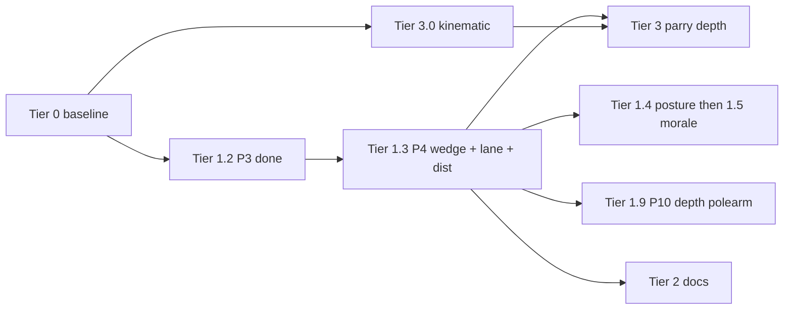

# Combat implementation plan (Fallen Paths)

**Purpose:** One **logical plan** from baseline → active work → later tiers. **Implementation phase:** execute **top to bottom**; within Tier 1, follow **numbered steps** in order unless a step is marked optional.

**Single source of truth (avoid forking):** Milestone **Status**, **Development gate**, and **dependency chain** live **only** in this file. **`docs/README.md`** is a **topic index** (no parallel status column). **`ENGAGEMENT_LINE_COHESION_INTRUSION_PLAN.md`** §2 **mirrors** Tier 1 **Status** from the [milestone summary](#milestone-summary) here. **`docs/COMBAT_ROADMAP_AND_STAMINA.md`** Part 3 phase checklists are **historical** — if they disagree with this plan, **this file wins**.

**Last verified against repo:** 2026-05-11 (combat `*.gd` + `ui/BattleScene.gd` + weapon `WeaponDamageHelper.gd` / `WeaponConstants.gd`; **`FEATURE_LINE_CRASH_INTRUSION`** default **off** — see development gate below). **Headless harness:** **`CombatRegressionHarness.run_all()`** passes with **Godot 4.6** using the project **`.vscode/settings.json`** key **`godotTools.editorPath.godot4`** (VS Code / Cursor task **Run Combat Regression Harness (headless)**). **Tier 1.6 breadth:** **`CombatTargetScoring.opponent_breach_file_targeting_mult`** + **`AI_TARGETING_OPP_BREACH_FILE_MULT_MAX`**; harness **`_run_ai_targeting_breach_file_mult`**; **`ZoneOfControl.formation_dict_for_zone_geometry`** (single formation-record read for ZoC-line consumers, incl. **`CombatTargetScoring`** + **`CombatAIActionPicker`** crash weights). **Tier 1.8 telemetry:** **`invalid_melee_resolve_blocked`**, **`invalid_close_resolve_blocked`**, harnesses **`_run_telemetry_invalid_melee_resolve_blocked`** / **`_run_telemetry_invalid_close_resolve_blocked`**. **Formation pair moves:** parry outcomes no longer force defenders out of `swap_rank` / `falling_back`; stale `swap_rank_resolve` queue entries for the same pair are cleared when a new paired move starts; sub-threshold HP chip hits report outcome **`negligible`** in `AttackResolver`. **`CombatRegressionHarness`:** `_run_parry_preserves_formation_pair_state`, `_run_cancel_stale_swap_rank_resolve_events`, `_run_swap_rank_resolve_completes_rank_swap`. Verbose **`formation_pair abort`** lines include a **`reason=`** tag (`CombatFormationFlow.abort_pair`). **ZoC:** **`assign_combatant_zones`** + engagement parry ZoC branch use **`formation_id_for_zone_geometry`** (intruders on host grid). **`CombatRegressionHarness.run_all()`** passes headless (`godot -s res://scripts/run_combat_regression_harness.gd`). **Tier 3.0:** thrust vs swing kinematic delivery (`kinematic_delivery`, velocity + KE split) is implemented and listed in [Tier 3](#tier-3--melee-depth-parry--weapon--guards) + [dependency chain](#dependency-chain-execution-logic) item **12**. **Front-rank MID melee:** strikes are listed when `melee_range >= effective_pair_eff_dist` (not only weapons ≥ `REACH_MID_MIN`); `REACH_MID_MIN` remains the depth-polearm / AI bias threshold. **Tier 1.9 / 3.1 (depth spear):** **`CombatDistanceBands`** (**`depth_polearm_lane_open_by_combatant_id`**) precomputes **`depth_polearm_lane_open`** once per alive rank>0 combatant each **`update_distance_to_from_formations`** pass (harness **`_run_depth_polearm_lane_cache_matches_builder`** vs **`AvailableActionsBuilder`**); **`depth_polearm_lane_allows_low_targets`** optional **`zone_geometry_fid`** / **`formation_dict_cache`** / **`assume_depth_lane_open`** on **`AvailableActionsBuilder`** stamp + part filter + **`AttackResolver`** verbose resolve; stamped **`pa`** carries **`depth_polearm_lane_type`** (`CombatConstants` **`open`** / **`over_shoulder`**, empty when not depth) for **`DefenseChoiceResolver`** depth-spear parry mults + **`strike_phys_ctx`**; **`StrikePhysics.depth_polearm_thrust_closing_factor`** returns **1.0** for tight lane depth stabs (**`CombatConstants`** **`over_shoulder`** id), else **`DEPTH_SPEAR_THRUST_CLOSING_SPEED_MULT`**; **`COMBAT_DEBUG`** hit lines print **`lane=`** from **`strike_phys_ctx`**. **Tier 3.1 sector surround:** **`is_feature_sector_surround_load`** / **`set_feature_sector_surround_load`** + harness **`_run_sector_surround_feature_flag_respects_runtime_toggle`**. **Pre–Tier 1.2 doc audit:** Tier 1.1 claims and module paths cross-checked against current `combat/` + `ui/BattleScene.gd` (distance helper ownership corrected below).

### Development gate: line crash / intrusions (temporary)

**Flag:** `CombatConstants.FEATURE_LINE_CRASH_INTRUSION` (**default `false`**).

**Behavior while false:** No **new** line-crash intrusions — crash is not offered in `AvailableActionsBuilder`, `CombatEngagementMode.incursion_allowed` is always false, and `resolve_crash_attempt` resolves as `crash_failed` with reason `intrusion_disabled`. **Engagement mode** (duel / skirmish / formation) still classifies as before; cohesion, posture, wedge fields, vacancy plugs, and intruder-related **code** remain in the repo for saves and future work.

**Plan focus until this flag is set `true`:** Tier **1.6–1.9** (see [milestone table](#tier-1--engagement-geometry-active-track) — **1.5** morale is **Done**; remaining work is AI, soak/telemetry, depth polearm **Partial**, etc.), Tier **3** (**3.0** weapon kinematic delivery **shipped** in code; **3.1–3.3** parry / guards depth), and general balance/docs that do **not** require live intrusion playtests. **Defer:** intrusion-centric verification passes, Tier **2.1** prose that exists mainly to teach wedge/intruder fiction, and re-baselining any test that assumes crash success in formation — do those **after** flipping the flag and dedicating time to intrusion polish.

**When setting the flag `true`:** Run `CombatRegressionHarness.run_all()`, exercise formation-line crash in playtests, refresh `docs/ENGAGEMENT_LINE_COHESION_INTRUSION_PLAN.md` §2 verification rows if needed, and complete Tier **2.1** intrusion language in `TACTICAL_ZONES_BREACH_MOVEMENT.md`.

**Plan update 2026-04-13:** Tier **1.3 (P4)** — **`intrusion_wedge_by_file`**, **`lane_offset`**, **`effective_pair_eff_dist`**, wedge consumers (cohesion, lane stress, ZoC, bands, UI). **Plan update 2026-04-27:** Tier **1.4 (P5)** — LINE↔OPEN **hysteresis**, encounter + formation **posture deltas**, **`line_discipline`** / `ENCOUNTER_KEY_LINE_DISCIPLINE`; **`morale_cohesion_factor`** stays **1.0** in data until **Tier 1.5** (no encounter morale baseline wired). **Tier 1.6** partial: **`CombatAIActionPicker`** crash weight scales with side **`engagement_posture`**. **Plan update 2026-05-01:** Tier **1.9 (P10)** — depth-rank **polearm reach** + **spear lanes** (roadmap Option C + Part 7); canonical spec steps in this file §**Tier 1.9** and engagement plan §**2.5** (new rows). Spec: `docs/ENGAGEMENT_LINE_COHESION_INTRUSION_PLAN.md` §4–§6. **Plan update 2026-05-09:** **Tier 3.0** — thrust vs swing **kinematic delivery** in `WeaponConstants` / `WeaponDamageHelper` / `WeaponSwingPhysics`; dependency chain + Tier 3 table + Tier 0 weapon row (see [Changelog](#changelog)).

**Archival note:** Stacked **Plan update 20xx** lines are historical (targets may be outdated). **Current** Tier 1 facts → [milestone summary](#milestone-summary) **Status** + [dependency chain](#dependency-chain-execution-logic) — same scope as **Single source of truth** at top.

**Depth references (not sequencing):** Stamina, HEMA research, parry bind math, long ZoC investigations — see [Plan inventory](#plan-inventory-all-combat-markdown) and `docs/README.md`.

---

## Document map (read order)

| Section | Use |
|---------|-----|
| [Dependency chain](#dependency-chain-execution-logic) | Why Tier 1.3 blocks Tier 3, etc. |
| [Tier 0](#tier-0--baseline-shipped--maintain) | What is already shipped; module anchors |
| [Tier 1 expanded](#tier-1--engagement-geometry-active-track) | [Milestone summary](#milestone-summary) — authoritative **Status** for **1.1–1.9** (see top **Single source of truth**). Expanded P-steps below = reference / regressions. |
| [Implementation phase gate](#implementation-phase-gate) | Checklists before Tier **1.2** and (recommended) Tier **1.3** code |
| [Tiers 2–7](#tier-2--tactical-docs--zoc-narrative-sync) | Everything after engagement geometry |
| [Plan inventory](#plan-inventory-all-combat-markdown) | Where design depth lives |

---

## Dependency chain (execution logic)

Work must respect this ordering (later items assume earlier ones):

1. **Formation truth** — `slots`, `rank`/`file`, death plug (`CombatFormationFlow`), ZoC + `incursion_pressure` (`ZoneOfControl`, `TacticalCombat`).
2. **Cohesion & posture (telemetry)** — `line_cohesion`, `engagement_posture`, UI, `engagement_state_changed` (**shipped**).
3. **Crash / breach** — `BreachResolver`, neighbor hold (`CombatIntrusionGeometry`), skirmish breach clog (`FormationBreachRules`) (**shipped**).
4. **Intrusion flags** — `engagement_role`, host/anchor on crash success (**shipped**).
5. **Intrusion geometry (slots)** — empty attacker home slot, intruder on defender, vacancy plug ≠ death plug → **Tier 1.2** (P3) **shipped** in repo (2026-04-13).
6. **Intrusion wedge (formation)** — `intrusion_wedge_by_file` written/updated on crash success, decay/clear on heal/death; **authoritative** breach sector for stress, cohesion, ZoC, distance, UI → **Tier 1.3** (P4; depends on 1.2) (**shipped**).
7. **Lane metric offsets + pair distance** — per-combatant `lane_offset` (defaults + **wedge seam** bias + repack rules) feeds **`AvailableActionsBuilder.effective_pair_eff_dist`**; `CombatDistanceBands` / crash / targeting **read wedge + offsets** → **Tier 1.3** (P4; depends on 1.2) (**shipped**).
8. **Posture + morale** — **Tier 1.4** hysteresis, encounter/discipline tags, asymmetric posture (**shipped**). **Tier 1.5** — **`CombatMoraleCohesion`** → `morale_cohesion_factor` (**shipped**; encounter + combatant inputs — see milestone table).
9. **AI / tests** → **Tier 1.6** (optional; partial: crash AI vs posture; broader weights + harness baselines later).
10. **Doc sync (Tier 2.1)** → **`TACTICAL_ZONES_BREACH_MOVEMENT.md`** narrative vs code — after **1.3+** so copy matches **wedge + slots + `lane_offset` / distance** (not only P3 slots). **Tier 2.2** (`TACTICAL_FORMATIONS_FF4.md` intruder/vacancy blurb) may still ship **after 1.2**; see Tier 2 table.
11. **Depth-rank polearm reach (P10)** → **Tier 1.9** — second-and-deeper ranks with **qualifying reach** may melee **through** a living same-file rank-0 ally under **lane rules**; **`CombatDistanceBands`** and **`AvailableActionsBuilder`** must agree on `distance_to` + `can_melee` + opponent rank filters. Depends on **1.3** (stable `effective_pair_eff_dist`). **Recommended:** ship **before** Tier **3.2** if spear lanes change preferred parts / parry geometry.
12. **Kinematic delivery (Tier 3.0)** — thrust vs swing **abstract** velocity + KE (`WeaponConstants` `kinematic_delivery`, `WeaponDamageHelper`, `WeaponSwingPhysics` for swing); no unit world positions. **Lock before Tier 3.2** parry/bind energy calibration so thrust tip speed and rotational cut KE stay consistent.
13. **Parry / melee depth** → **Tier 3** (after **1.3** so range work is not redone; after **1.9** if parry must account for depth thrusts; after **3.0** when tuning strike energy against parries).

**While `FEATURE_LINE_CRASH_INTRUSION` is false:** Items **3–7** are **dependency / shipped-code** relationships (what already exists and what consumes it), **not** a mandate to implement more intrusion surface area now. Do **not** start **new** intrusion features (extra wedge rules, new crash outcomes, slot/plug extensions, UI devoted to live breach play) or Tier **2.1** / **2.2** copy that mainly teaches intruder fiction until the flag is **true** and you are explicitly resuming that track (see [Development gate](#development-gate-line-crash--intrusions-temporary)).

---

## Tier 0 — Baseline (shipped / maintain)

**Meaning:** Current playable stack — **extend**, do not replace. Historical phase checklists live in `docs/COMBAT_ROADMAP_AND_STAMINA.md` (optional / archaeology); they do **not** override this plan’s order.

**Code anchors (non-exhaustive):**

| Area | Primary modules |
|------|-----------------|
| Orchestration | `CombatManager.gd`, `CombatProcessTick.gd`, `CombatEventScheduler.gd`, `CombatEventDispatch.gd` |
| Formations | `CombatFormationSetup.gd`, `CombatFormationFlow.gd`, `FormationSlots.gd`, `FormationPreset.gd` |
| Actions / targeting | `AvailableActionsBuilder.gd` (`effective_pair_*`, `strike_measure_ratio_*`; **`CombatConstants.STRIKE_MEASURE_*`**), `CombatResolveAction.gd`, `CombatEngagementResolver.gd`, `CombatTargetScoring.gd` (**`distributed_pressure_mult`** / **`ally_pressure_count`** — **`_run_hostile_pair_distributed_pressure_ally_commit`**, **`_run_ally_pressure_count_depth_uses_melee_pair_to_defender`**; **`hold_lane_mult`** — **`_run_targeting_hold_lane_off_file_mult`**; **`pinch_score_mult`** — **`_run_targeting_pinch_center_inward_bonus`**; **`commitment_match_mult`** / **`prune_expired_commitments`** — **`_run_targeting_commitment_match_mult`**, **`_run_targeting_prune_expired_doctrine_commitment`**, **`_run_targeting_prune_commitment_when_target_dies`**; **`clear_all_targeting_state_for_dead_defender`** — **`_run_targeting_clear_all_state_for_dead_defender`**; **`soft_geometry_score`** — **`_run_targeting_soft_geometry_eff_dist_formula`**), `CombatAIActionPicker.gd`, `CombatDoctrine.gd` |
| Distance bands / ZoC | `CombatDistanceBands.gd` (**`depth_polearm_lane_open_by_combatant_id`** + **`update_distance_to_from_formations`**), `ZoneOfControl.gd` (`formation_id_for_zone_geometry`, `formation_dict_for_zone_geometry`), `TacticalCombat.gd` |
| Breach / crash | `BreachResolver.gd`, `FormationBreachRules.gd` |
| Engagement v1 | `CombatFormationEngagement.gd`, `CombatIntrusionGeometry.gd` |
| Medical | `MedicalPhaseController.gd`, `CombatMedicalCoordination.gd` (and related) |
| Weapons / impact (abstract) | `WeaponConstants.gd`, `WeaponDamageHelper.gd`, `ImpactVelocityModel.gd`, `WeaponSwingPhysics.gd`; optional mirror **`tools/simulate_weapon_ke_velocity.py`** (intensity / KE vs Tier **3.0**) |
| UI | `ui/BattleScene.gd`, `BattleUIUpdater.gd`, formation diagram builders |

**Rule:** Prefer the **smallest owning module** (`AGENTS.md`, `.cursor/rules/fallen-paths.mdc`).

---

## Tier 1 — Engagement geometry (active track)

**Spec depth (field names, plug taxonomy, tuning):** `docs/ENGAGEMENT_LINE_COHESION_INTRUSION_PLAN.md` §4–§6.

### Milestone summary

| Step | Phase | Deliverable | Status |
|------|-------|-------------|:------:|
| 1.1 | P0–P2 | Cohesion, posture, UI, neighbor crash hold, intruder **flags** | **Done** |
| 1.2 | **P3** | Vacancy plug (≠ death plug) + attacker slot release + intruder on defender | **Done** |
| 1.3 | **P4** | **`intrusion_wedge_by_file`** (canonical) + `lane_offset` (wedge seam projection) + `effective_pair_eff_dist` (+ callers); cohesion / lane stress / ZoC / UI **consume wedge** | **Done** |
| 1.4 | **P5** | LINE↔OPEN hysteresis; encounter / discipline tags; opponent-relative asymmetric posture | **Done** (`POSTURE_ASYMMETRY_COH_COUPLE_STRENGTH` + encounter `posture_asymmetry_strength`; optional richer encounter-only tags remain data-driven) |
| 1.5 | **P6** | Morale → `morale_cohesion_factor` | **Done** (`CombatMoraleCohesion`; encounter overrides + combatant `morale_cohesion` mean) |
| 1.6 | **P7** | AI posture hooks; harness / tests; optional | **Partial** (crash weight vs `engagement_posture` + **`line_cohesion`**; **`CombatTargetScoring`** depth-spear pressure + **`wing_lacks_file_opposed`** + **`distributed_pressure_mult`** / **`ally_pressure_count`** harnesses **`_run_hostile_pair_distributed_pressure_ally_commit`**, **`_run_ally_pressure_count_depth_uses_melee_pair_to_defender`**; **`hostile_pair_targeting_weight_mult`** engagement-mode cache harness **`_run_hostile_pair_cached_engagement_mode_matches_live`**; **`file_opposed_mult`** harness **`_run_targeting_file_opposed_mult`**; **`ordered_melee_opponents`** file-opposed sort harness **`_run_ordered_melee_opponents_file_opposed_sort`**; **`formation_dict_cache`** round-trip harness **`_run_targeting_formation_dict_cache_matches_live`**; **`hold_lane_mult`** harness **`_run_targeting_hold_lane_off_file_mult`**; **`pinch_score_mult`** harness **`_run_targeting_pinch_center_inward_bonus`**; **`commitment_match_mult`** harness **`_run_targeting_commitment_match_mult`**; **`soft_geometry_score`** harness **`_run_targeting_soft_geometry_eff_dist_formula`**; **`prune_expired_commitments`** harnesses **`_run_targeting_prune_expired_doctrine_commitment`**, **`_run_targeting_prune_commitment_when_target_dies`**; **`clear_all_targeting_state_for_dead_defender`** harness **`_run_targeting_clear_all_state_for_dead_defender`**; **`posture_cohesion_targeting_mult`**; **opponent** formation + **`opponent_breach_file_targeting_mult`** (`breached_files` at target **`file`**, ZoC geometry) + **resolved `engagement_mode`** on hostile listed weights; harness **`_run_ai_targeting_breach_file_mult`**; further optional coupling remains) |
| 1.7 | **P8** | Engagement mode realism **Option 2** (historical count bands + front/fill/hysteresis gate) | **Partial** (classifier + **active-count exhaustive** + **mode cache reset on `start()`** + cold `resolved`⇔`can_enter` in harness; optional wider soak still open) |
| 1.8 | **P9** | Post-P8 soak/regression + telemetry lock before doctrine expansion | **Partial** (telemetry counters + snapshot sync + **multi-seed** classifier / attrition / **cold-start telemetry lock** in `CombatRegressionHarness`; long UI soak optional) |
| 1.9 | **P10** | Depth-rank polearm reach + spear lanes (Option C + Part 7) | **Partial** (core + fuzz + wedge + AI stab + **`spear_lane_profile`** + **auto** lane mix from **`line_discipline`** / **`engagement_posture`** in `depth_polearm_lane_allows_low_targets`; **`pa["depth_polearm_lane_type"]`** stamped with lane id; depth spear **stab vs cut** listing weights × **`formation_doctrine`** (`pinch_center` / `hold_lane` / **`probing`**); **`CombatDistanceBands`** depth-lane gate cached per combatant per band pass; **`StrikePhysics`** thrust closing by lane id; harnesses **`_run_weapon_depth_melee_eligible_fixture`**, **`_run_depth_polearm_lane_open_false_for_non_eligible_weapon`**, **`_run_depth_polearm_lane_open_false_when_intruded`**, **`_run_depth_polearm_lane_open_false_at_rank_zero`**, **`_run_depth_polearm_lane_open_false_without_living_same_file_rank0`**, **`_run_depth_polearm_lane_cache_matches_builder`** (**`CombatDistanceBands.depth_polearm_lane_open_by_combatant_id`** vs builder), **`_run_depth_polearm_lane_open_false_when_same_file_rank0_incap`**, **`_run_depth_polearm_lane_open_zone_geometry_fid_round_trip`**, **`_run_depth_polearm_allows_low_targets_strict_tight_when_lane_open`**, **`_run_stamp_attack_pair_geometry_depth_lane_flags_consistent`**, **`_run_stamp_attack_pair_geometry_depth_defaults_non_depth_attack`**, **`_run_depth_polearm_parts_filter_tracks_allows_low`**, **`_run_depth_polearm_parts_filter_wedge_opens_legs_strict_tight`**, **`_run_depth_polearm_restricted_profile_requires_wedge_for_allows_low`**, **`_run_depth_polearm_allows_low_formation_dict_cache_matches_null`**, **`_run_depth_polearm_parts_filter_pass_through_when_no_depth_lane_use`**, **`_run_depth_polearm_allows_low_assume_skips_closed_lane_guard`**, **`_run_depth_polearm_allows_low_assume_agrees_when_lane_open`**, **`_run_depth_polearm_allows_low_zone_geometry_fid_round_trip`**, **`_run_depth_polearm_threatens_line_target_pure_guards`**, **`_run_depth_polearm_valid_line_threat_false_when_lane_closed`**, **`_run_depth_polearm_valid_line_threat_agrees_with_threatens_when_lane_open`**, **`_run_depth_polearm_opp_matches_rank0_agrees_with_valid_line_threat`**, **`_run_depth_polearm_melee_pair_rank_allowed_agrees_with_valid_line_threat`**, **`_run_depth_polearm_can_melee_threaten_respects_valid_line_for_home_depth`**, **`_run_depth_polearm_ai_weight_mult_requires_valid_line_to_any_rank0`**; further doctrine matrix / encounter presets optional) |

**Status column (Tier 1):** Same rule as **Single source of truth** (top). When you ship, edit this table first, then **`ENGAGEMENT_*`** §2 rows (mirror).

**Next coding step (while `FEATURE_LINE_CRASH_INTRUSION` is false):** **Tier 3.1** — shipped: **`STRIKE_MEASURE_*`** + **`strike_measure_ratio_for_attack_pair`** after **`stamp_attack_pair_geometry_on_dict`** (wind-up / resolve); pack-flank parry vs **`effective_pair_file_spacing_equivalent`** harness; **`CombatRegressionHarness.run_all()`** green + VS Code task (**[Changelog](#changelog)** (m)–(cq) — **(br)** extends **`_run_parry_clash_context_calibration_fields`** for **`parry_clash_context`** timing + defense-choice booleans; **(bs)** encounter seeds **`formation_doctrine`** at **`start()`**; **(bt)** preset **`FORMATION_PRESET_KEY_DOCTRINE`** overrides encounter per side; **(bu)** **`CombatConstants.parry_control_for_bind_deflect`** + clash **`parry_control`** agreement harnesses; **(bv)** **`parry_deflect_severity_from_margin_ratio`** + clash **`severity`** agreement; **(bw)** **`CombatConstants.parry_deflect_margin_ratio`** (single **`c_d_final` / (`parry_p_a * PARRY_DEFLECT_THRESHOLD`)** helper; **`DefenseResolutionHandler`** + formula harness); **(bx)** **`GuardLineUpdater.set_guard_deflected`** derives **`guard_deflect_blend`** from **`margin_ratio`** when **`severity`** is absent; harness **`_run_guard_line_deflected_severity_from_margin_ratio`**; **(by)** encounter doctrine aliases **`doctrine_player`** / **`doctrine_enemy`** when canonical keys empty; harness **`_run_encounter_formation_doctrine_on_start`** extended; **(bz)** **`CombatConstants.encounter_formation_doctrine_string`** + **`formation_doctrine_string_from_dict`** (encounter delegates); harness **`_run_encounter_formation_doctrine_string_helper`**; **(ca)** preset **`FORMATION_PRESET_KEY_DOCTRINE_ALT`** (`doctrine`) when **`formation_doctrine`** empty; **`CombatManager.start()`** preset read uses **`formation_doctrine_string_from_dict`**; harness **`_run_encounter_formation_doctrine_on_start`** + helper extended; **(cb)** **`_run_parry_clash_context_calibration_fields`** asserts **`parry_clash_context`** **`attack_type`** / **`contact_type`** / **`effective_attack_line`**; **(cc)** same harness — **`defender_guard_line`**, **`archetype_id`**, **`attack_angle_deg`**, **`guard_angle_deg`**; **(cd)** same harness — **`alignment`** vs **`get_line_alignment_with_deflect`** from recomputed arc + guard angles; **(ce)** **`CombatRegressionHarness.PARRY_CLASH_CONTEXT_KEYS_FULL_STOP`**; **(cf)** **`parry_clash_context`** Tier **3.0** fields (**`kinematic_delivery`**, **`strike_velocity_m_s`**, **`strike_kinetic_energy_j`**) + harness **`_parry_clash_context_expected_strike_kinematics`**; **(cg)** **`strike_measure_ratio`** echoes stamped **`pa`** (Tier **3.1**, **-1** when absent); **(ch)** harness unstamped **`pa`** branch + **`seed(3312)`** re-seed before stamped path (deterministic vs **`PARRY_TECHNIQUE_VARIANCE`**); **(ci)** **`AttackResultApplier`** forwards **`parry_clash_context`** on **`action_resolved`** for **`parry_deflect`**; **`CombatLogFormatter`** optional **`COMBAT_DEBUG_CALIBRATION`** clash suffix; harness unstamped asserts full **`PARRY_CLASH_CONTEXT_KEYS_FULL_STOP`**; **(cj)** harness **`_run_parry_deflect_formatter_clash_context_branches`** locks formatter vs non-empty / empty clash dict when calibration **off** (default); **(ck)** harness **`_run_action_resolved_parry_deflect_payload_includes_clash_context`** locks **`action_resolved`** order (**defender**, **attacker**) + **`parry_clash_context`** on emitted dict**; **(cl)** **`parry_partial`** — **`DefenseResolutionHandler`** returns the same clash key set as full-stop plus **`remaining_ratio`** / **`geometric_leak`**; Tier **3.0** **`strike_kinetic_energy_j`** uses reduced **`pa["velocity_m_s"]`**; **`AttackResultApplier`** copies context onto the **attacker** before **`_execute_attack`**; harness **`_run_parry_partial_clash_context_calibration_fields`**; **(cm)** **`parry_partial`** emits **`action_resolved`** (defender, attacker, **`parry_clash_context`**) before follow-through **`_execute_attack`**; **`CombatLogFormatter`** optional **`rem=`** clash suffix; harness **`_run_parry_partial_formatter_clash_context_branches`**; **(cn)** harness **`_run_action_resolved_parry_partial_payload_includes_clash_context`** (first **`action_resolved`** row; **`remaining_ratio`** on payload) + **`AttackResultApplier`** **`hit`** clears attacker **`parry_clash_context`** / **`defender_guard_line_at_parry`** after partial follow-through; **(co)** harness **`_run_hit_clears_attacker_parry_calibration_fields`**; **(cp)** **`parry_partial`** defender **`parry_was_bind`** / **`parry_against_id`** when alignment ≥ **`PARRY_PARTIAL_GUARD_ALIGNMENT_THRESHOLD`** and clash **`parry_control`** ≥ **`PARRY_BIND_CONTROL_THRESHOLD`** (**`AttackResultApplier`**); harness **`_run_parry_partial_bind_riposte_flags_when_aligned`**; **(cq)** same harness — misaligned partial **`erase`**s defender **`parry_was_bind`** (aligned low-control keeps key **false**) + stale-bind seed before misaligned **`apply_result`**). **Next:** longer harness / UI soaks; **1.6** further optional **`CombatTargetScoring`** coupling; **1.9** further **`formation_doctrine`** presets / encounter wiring (beyond pinch / hold / probing + auto pinch); Tier **1.9** [exit criteria harness map](#tier-19--p10-depth-rank-polearm-reach--spear-lanes). Then **Tier 3.2** parry/bind calibration (lock **3.0** strike energy first). **Flag true:** Tier **2.1** prose + intrusion / depth verification (see gate above). **Sector surround (optional):** **`is_feature_sector_surround_load`** (default **false**) + **`set_feature_sector_surround_load`**; harness **`_run_sector_surround_feature_flag_respects_runtime_toggle`** (see **(af)**).

**Telemetry lock:** counters + tactical↔harness snapshot checks + **`CombatRegressionHarness`** multi-seed (**classifier**, **attrition monotone**, **cold-start telemetry** vs resolved mode) are in place; long scheduled UI soak / playtest passes remain optional before Option 4.

**After 1.3 (and after `FEATURE_LINE_CRASH_INTRUSION` is true):** Tier **2.1** — align `TACTICAL_ZONES_BREACH_MOVEMENT.md` with implemented intrusion + **wedge + `lane_offset` / distance** language (see dependency chain item 10).

---

### Tier 1.1 — Shipped (maintain only)

No sequencing work unless fixing regressions. Shipped includes: skirmish-aware `breach_blocks_open_lane_moves`; `CombatFormationEngagement.recompute_all`; `CombatIntrusionGeometry.crash_neighbor_hold_support`; crash success sets `engagement_role` / `intrusion_host_fid` / `intrusion_anchor_file`; `BattleScene` cohesion/posture labels.

---

### Tier 1.2 — P3: Slots, intruder on defender, vacancy plug

**Goal:** Formation truth matches **intrusion fiction**: attacker home rank-0 can be empty; intruder has a **defender-side** cell; **vacancy plug** runs when rank-0 is empty **without** death (distinct from `on_combatant_died`).

**Primary modules:** `CombatFormationFlow.gd`, `FormationSlots.gd`, `CombatEngagementResolver.gd`, `CombatManager.gd`; constants in `CombatConstants.gd`.

**Ordered steps:**

1. **Representation decision** — Document in code comment + engagement plan §4: intruder in defender `slots` vs parallel structure; how `normalize_formation_slots` interacts.
2. **Clear attacker home** — On crash success (or equivalent), remove intruder from attacker formation `slots` at logical home `(rank 0, file)` so rank-0 hole is real for that file.
3. **Defender cell** — Write intruder into defender `slots` at anchor file / agreed rank rule (occupancy / plugs / diagram); keep `intrusion_host_fid` / `intrusion_anchor_file` consistent with `slots`. **Canonical breach geometry** (`intrusion_wedge_by_file`) is **Tier 1.3**, not 1.2.
4. **Combatant `rank`/`file`** — Keep coarse grid truth for `slots`, vacancy, and plugs. **`lane_offset`** and **wedge** are **Tier 1.3**; intruder `rank`/`file` stay consistent with host-side `slots`.
5. **Vacancy plug** — New path: empty rank-0, not death obstacle → promote from rank 1 same file (one pass per tick after slot writes). **Ordering:** slot writes for intrusion first, then vacancy promote; must not race death plug in same resolution step (spec: engagement plan §4 rule line).
6. **Recompute chain** — Callers often `_recompute_zoc_and_distance()` immediately after slot writes (safe if redundant). **`CombatManager.notify_formation_changed(formation_id)`** runs **`CombatFormationFlow.reconcile_vacancy_plugs_formation`** on **each** formation (every file column), then **`_recompute_zoc_and_distance()`** only if any promotion occurred, then emits **`formation_changed`** (and again for another formation if reconcile changed it). **`get_available_actions`** calls **`reconcile_vacancy_plugs_all_formations`** first for the same reason. Downstream chain unchanged: incursion → ZoC → `CombatDistanceBands.update_distance_to_from_formations` → `CombatFormationEngagement.recompute_all`.
7. **Verification** — Manual or `IncursionBreachTest` (extend harness): crash success → attacker file empty at rank 0; defender shows intruder; vacancy promotes when intruder leaves / scenario allows.

**Exit criteria (all required):**

- [x] Intruder does not occupy attacker home slot after successful intrusion resolution.
- [x] Intruder represented on defender side per §4 contract.
- [x] Vacancy plug implemented and ordered vs death plug (documented in `CombatFormationFlow` or helper).
- [x] No desync between `slots`, `engagement_role`, and host/anchor fields after recompute.

---

### Tier 1.3 — P4: Intrusion wedge, lane metric offsets, intruder distance & targeting

**Depends on:** 1.2 complete (**Done** in repo as of 2026-04-13).

**Primary modules:** `CombatFormationSetup.gd` (init empty `intrusion_wedge_by_file`), `CombatManager.gd` (register defaults / reset), `CombatFormationFlow.gd` (wedge upsert/clear with intrusion + plugs), `CombatEngagementResolver.gd` (crash success → wedge + offset), `TacticalCombat.gd` / `ZoneOfControl.gd` / `CombatFormationEngagement.gd` (read wedge for stress / ZoC / cohesion), `AvailableActionsBuilder.gd` (**defines** `effective_pair_eff_dist`; also used by `BreachResolver`), `CombatDistanceBands.gd`, `CombatResolveAction.gd` (as needed), `CombatConstants.gd` (tuning), `ui/FormationDiagramBuilder.gd` or `BattleScene.gd` (optional wedge affordance).

**Design intent:** **`intrusion_wedge_by_file`** is the **canonical** “gap through the line” (pressure, depth, intruder id, optional lateral half-width). **`slots`** stay **occupancy** for plugs, death/vacancy, and grid UI. **`lane_offset`** is the **per-combatant lateral metric**, **biased from the wedge seam** (engagement plan §4.1 wedge, §4.2 offset rules). **`effective_pair_eff_dist`** combines coarse `|Δfile|`, offset deltas, and a **wedge depth/pressure** term so consumers do not infer breach only from dual-cell occupancy. Do **not** add gap-column `slots` keys in P4.

**Ordered steps:**

1. **Spec + constants** — Lock **`intrusion_wedge_by_file`** schema (minimum keys per engagement plan §4.1), wedge tuning constants, **`lane_offset`** range/sign (§4.2), and single-writer rules vs `breached_files`; document in `CombatConstants.gd` + engagement plan.
2. **Formation init / reset** — Empty `intrusion_wedge_by_file` on formation setup; clear all wedges in `_reset_tactical_breach_state` (or equivalent) with intruder flags.
3. **Crash success writer** — Same tick as P3 slot writes: upsert wedge at anchor file (and optional neighbor falloff); set **`lane_offset`** seam bias for intruder ± anchor rank-0 nudges per spec; keep `breached_files` in sync or document deprecation path.
4. **Wedge consumers (throughout)** — **`CombatFormationEngagement`**: cohesion inputs use wedge (+ existing signals). **`TacticalCombat._recompute_lane_stress_by_file`**: add wedge-derived stress so solo deep intruder still stresses the lane. **`ZoneOfControl`**: thread wedge where lane stress / frontage matters. Verify no system assumes “breach == dual living only.”
5. **Clear / decay** — On intruder death, role clear, or scripted heal: decay or erase wedge entries; recompute chain unchanged.
6. **Field wiring (`lane_offset`)** — `CombatManager.register`: default **0.0**; reset with tactical state.
7. **Line maintenance** — On formation init / rank–file reassignment: default offsets for non-intruded; **repack/clamp** after plugs/pair resolve so offsets stay bounded (engagement plan §4.2).
8. **`effective_pair_eff_dist`** — Coarse file delta + **lateral term** from `lane_offset` + **wedge depth/pressure** when either combatant is in/near wedge. Intruder path: **host anchor** + wedge + offsets. Baseline: epsilon-tight when wedge absent and all offsets 0.
9. **`CombatDistanceBands` / `BreachResolver`** — Verify via `effective_pair_eff_dist`; smoke intruder + wedge cases.
10. **Action filtering** — Melee / close / crash eligibility coherent with new distances.
11. **Regression + harness** — Non-intruded battles unchanged; extend `IncursionBreachTest` (or focused tests) for **non-empty wedge** + optional non-zero `lane_offset`.
12. **UI (optional same tier)** — Diagram or label: wedge/shading or glyph by file; offset hint deferred OK.

**Exit criteria:**

- [x] `intrusion_wedge_by_file` exists on each formation dict, bounded writers, cleared on reset; crash success produces expected wedge at anchor.
- [x] `lane_offset` exists on every combatant dict, bounded; crash + plugs do not leave NaNs or out-of-range values.
- [x] `CombatFormationEngagement`, `TacticalCombat` lane stress, and (where applicable) `ZoneOfControl` **read wedge** per spec.
- [x] `AvailableActionsBuilder.effective_pair_eff_dist` uses `|Δfile|` + offsets + wedge term; path accounts for `CombatConstants.ENGAGEMENT_ROLE_INTRUDED`.
- [x] `CombatDistanceBands` and `BreachResolver` behave coherently (no deadlocks / all-mid artifacts in smoke scenarios).
- [x] `AvailableActionsBuilder` does not offer impossible melee due to wrong band for intruders.

---

### Tier 1.4 — P5: Posture polish

**Depends on:** 1.3 recommended (stable geometry for playtest).

- Constants for LINE↔OPEN **hysteresis** (`L_in` > `L_out`) + optional stored band on formation dict — **Done** (`CombatConstants.LINE_COHESION_POSTURE_ENTER_LINE_MIN` / `LINE_COHESION_POSTURE_LEAVE_LINE_BELOW`; prior posture read from formation dict each tick in `CombatFormationEngagement._compute_posture`).
- **Encounter / discipline tags** bias thresholds — **Done:** posture enter/leave deltas, `line_discipline` + `CombatConstants.line_discipline_posture_extra_deltas` (encounter default + formation preset override).
- **Per-side asymmetric posture** — **Done:** `CombatFormationEngagement` computes both cohesions first, then applies `delta = strength × (our_coh − opp_coh)` to `L_in`/`L_out` (`CombatConstants.POSTURE_ASYMMETRY_COH_COUPLE_STRENGTH`; encounter **`posture_asymmetry_strength`** to override or set **0** to disable). Stronger line (higher cohesion) leans LINE; weaker leans OPEN.

**Exit criteria:** Posture does not flip every tick at threshold edge; tags read from agreed encounter hook; mirrored battles keep matching postures (`CombatRegressionHarness._run_posture_mirror_symmetric`).

---

### Tier 1.5 — P6: Morale → cohesion

- **`CombatMoraleCohesion.apply_to_formations`** runs at the start of **`CombatFormationEngagement.recompute_all`**: writes each formation’s **`morale_cohesion_factor`** (clamped **`MORALE_COHESION_FACTOR_MIN`..1**).
- **Encounter** (per-side override, wins over combatants): **`morale_cohesion_player`**, **`morale_cohesion_enemy`** (`CombatConstants.ENCOUNTER_KEY_*`).
- **Combatants:** dict **`morale_cohesion`** 0..1 (default **1.0**); **`CombatManager.register`** seeds from **`node.morale_cohesion`** when present. Side **mean** over alive, non-incapacitated fighters when encounter key absent.

**Exit criteria:** Changing morale inputs changes `line_cohesion` without breaking defaults; **`CombatRegressionHarness._run_morale_cohesion_affects_line_cohesion`** passes.

---

### Tier 1.6 — P7: AI & tests (optional)

- `CombatAIActionPicker` weights from posture and formation **`line_cohesion`** (crash: **`crash_line_cohesion_weight_mult`** + **`_crash_weight_posture_mult`**, formation dict via **`ZoneOfControl.formation_id_for_zone_geometry`** for intruders); **`CombatTargetScoring`** — **`hostile_pair_targeting_weight_mult`** cached **`engagement_mode_targeting_mult`** (harness **`_run_hostile_pair_cached_engagement_mode_matches_live`**); **`file_opposed_mult`** (same-file rank-0 or depth polearm via same-file rank-0 ally vs line target; harness **`_run_targeting_file_opposed_mult`**); **`ordered_melee_opponents`** file-opposed-first sort (harness **`_run_ordered_melee_opponents_file_opposed_sort`**); optional **`formation_dict_cache`** on **`posture_cohesion_targeting_mult`** / **`opponent_formation_targeting_mult`** / **`opponent_breach_file_targeting_mult`** (harness **`_run_targeting_formation_dict_cache_matches_live`**); **`ally_pressure_count`** rank>0: counts only when **`AvailableActionsBuilder._melee_pair_rank_allowed`** to the committed defender ( **`depth_polearm_valid_line_threat`** for home depth vs rank-0; intruder melee paths); harness **`_run_ally_pressure_count_depth_uses_melee_pair_to_defender`**; **`wing_lacks_file_opposed`** (pinch / `pinch_score_mult`) uses same-file rank-0 ref when **`depth_polearm_lane_open`**; **`posture_cohesion_targeting_mult`** / **`opponent_formation_targeting_mult`** / **`opponent_breach_file_targeting_mult`** (same ZoC rule; breach uses **`CombatFileKeyedDict`**-compatible **`breached_files`** severity at defender **`file`**); **`engagement_mode_targeting_mult`**; **`hostile_pair_targeting_weight_mult`** × **`AI_TARGETING_INCAP_HOSTILE_MULT`** vs incapacitated defenders; **`AvailableActionsBuilder._append_melee_vs_enemy_line_rank`** skips incapacitated opponents (no listed melee / **`attempt_close`** / crash); **`ordered_melee_opponents`** caches engagement-mode mult per sort; **`pick`** + **`ai_targeting_weight_mult(..., skip_prune)`**.
- Broader `CombatTargetScoring` / non-crash coupling optional ( **`distributed_pressure_mult`** + **`ally_pressure_count`** regression: **`CombatRegressionHarness._run_hostile_pair_distributed_pressure_ally_commit`**, **`_run_ally_pressure_count_depth_uses_melee_pair_to_defender`** ).
- Re-baseline `IncursionBreachTest` / harness if assertions pin `p_win`.
- Doc sync item: engagement plan §2.8 cross-ref Tier 2.

---

### Tier 1.7 — P8: Engagement mode realism baseline (ship Option 2)

**Goal:** Enforce historically plausible mode minimums without losing transition stability already built in.

**Implementation rule:** Use **total active combatants per side** for baseline eligibility (historical numbers), then require existing **front/fill + hysteresis** checks before `formation` becomes active.

**Required behavior contract:**

- `duel` cap when either side remains in very low-count bands (historical small engagement).
- `skirmish` default for medium counts and mixed frontage.
- `formation` allowed only when both sides satisfy historical count minimums **and** front/fill thresholds.
- Keep current **active intrusion grace** so mode does not snap mid-incursion unless line collapses to zero-front or duel floor.

**Exit criteria:**

- [x] No test case yields `formation` while historical count minimum is unmet (`CombatRegressionHarness._run_engagement_active_count_gate_exhaustive` + classifier cold `resolved` ⇒ `can_enter_formation_from_snapshot`).
- [x] Transition hysteresis assertions pass (no mode jitter at threshold edges) (`_run_engagement_attrition_monotone` + idempotent `engagement_mode` in classifier fuzz).
- [x] Crash/incursion gating remains consistent (`incursion_allowed` only when resolved mode is formation) (classifier fuzz + `_run_no_crash_actions_when_intrusion_disabled` when flag false).
- [ ] Existing intrusion/vacancy/plug tests remain green (run `IncursionBreachTest` / full harness in editor when touching formation flow).

---

### Tier 1.8 — P9: Soak, telemetry lock, regression gate (before Option 4)

**Goal:** Validate P8 in long-running, mixed-size battles before adding doctrine complexity.

**Required checks:**

1. Multi-seed soak runs show no mode flip-flop jitter.
2. UI strips/labels remain consistent during rapid attrition and intrusion clear.
3. Crash availability never leaks outside legal mode/rank rules.
4. Tactical and harness mode snapshots stay identical at same tick.

**Exit criteria:**

- [ ] P8 metrics stable across representative scenarios (small, medium, large engagements).
- [ ] No unresolved regressions in `IncursionBreachTest` harness assertions.
- [ ] Debug telemetry fields required for balancing are present and readable.

---

### Tier 1.9 — P10: Depth-rank polearm reach + spear lanes

**Goal:** Units in **rank ≥ 1** on their **home** formation can contribute **melee** against eligible enemies when they wield a **depth-capable** weapon (polearm / long reach), **through** a **living same-file rank-0** ally, using abstract **lanes** (over-shoulder vs open) that constrain targeting and parts — per `docs/COMBAT_ROADMAP_AND_STAMINA.md` Part 6 Option C and Part 7 (this tier **replaces** the obsolete checklist line “rank 0 melee; rank 1 ranged/support”).

**Depends on:** Tier **1.3** (P4) — `effective_pair_eff_dist`, wedge, `lane_offset`, band consumers.

**Primary modules:** `AvailableActionsBuilder.gd` (`can_melee`, `_opp_matches_melee_rank_target`, `_append_melee_vs_enemy_line_rank`, **`depth_polearm_lane_allows_low_targets`** + **`spear_lane_profile`**, **`depth_polearm_targetable_parts_filter`**, **`stamp_attack_pair_geometry_on_dict`** — sets **`depth_polearm_lane_type`** on **`pa`**), `CombatFormationSetup.gd` (preset → formation dict), `CombatDistanceBands.gd` (rank>0 → **`DISTANCE_LONG`** unless **`depth_polearm_lane_open`**; lane predicate **cached once per combatant** per `update_distance_to_from_formations` pass), `WeaponConstants.gd` / `Weapon.gd` (explicit **depth_melee_eligible** flag or threshold vs `REACH_MID_MIN` + weapon family), `AttackResolver.gd` / hit-part path (depth polearm part filter + **`pa`** geometry flags), `CombatConstants.gd` (tuning). Optional: derive lane mix from `density` + `line_discipline` + `engagement_posture` when **`spear_lane_profile`** is **auto** (default).

**Design contract (v1 — refine in code comments):**

1. **Depth melee eligible:** Only weapons marked or inferred as polearms (e.g. `melee_range >= REACH_MID_MIN` is necessary but not sufficient — use explicit list or `weapon_type` tag to avoid longsword edge cases).
2. **Same file:** Depth striker’s `file` matches a **living** ally at `rank == 0` in the same `formation_id` (front rank “opens” the lane). If front is empty, vacancy/death plug already promotes — depth should not bypass plugs.
3. **Opponent targeting:** Enemy **rank 0** in an opposing **frontage** pair (same rules as today for “who is on the line”), unless intruder rules already widen targets; no extra reach to arbitrary files until lane math allows (defer multi-file thrusts if needed).
4. **Lanes:** **Over-shoulder** → restrict preferred / allowed parts (upper body); **open** → full part table (see roadmap Part 7 table). Resolver order in **`depth_polearm_lane_allows_low_targets`:** profile **`open`** → always open; **`restricted`** → wedge only; **auto** → wedge first; else **`CombatFormationEngagement.effective_line_discipline`** **`strict`** → over-shoulder; else loose **density** or discipline **`loose`** or **`engagement_posture` `open`/`duel`** → open; else over-shoulder.
5. **Distance bands:** For eligible depth pairs, compute `distance_to` so **MID** is achievable when geometry + reach match (remove or narrow the blanket `our_rank > 0 → LONG` branch for this case only).
6. **Safety:** Optional obstruction / friendly-risk hook stays **off** in v1 unless trivial; document follow-up in roadmap §6.6.

**Ordered steps:**

1. **Spec lock** — Add §2.5 rows in `ENGAGEMENT_LINE_COHESION_INTRUSION_PLAN.md` (verification mirror); define `depth_melee_eligible` in one place (`WeaponConstants` or `CombatConstants`).
2. **`CombatDistanceBands`** — Conditional path: home rank ≥ 1 + depth-eligible weapon + same-file living rank-0 → run normal band logic vs line opponents; otherwise keep current LONG shortcut. **Shipped refinement:** precompute **`depth_polearm_lane_open`** once per alive combatant per pass (avoids O(n²) duplicate lane resolution).
3. **`AvailableActionsBuilder`** — Extend `can_melee` and `_opp_matches_melee_rank_target` (and `_melee_pair_rank_allowed` if needed) so depth polearms may target enemy rank 0 under the same-file rule; keep intrusion / intruder exceptions from double-counting.
4. **Spear lane → parts** — Thread lane type into attack resolution (minimal: `allowed_parts` filter on thrust/stab for depth rank); align with `TacticalCombat` / UI only if required for playtest.
5. **AI** — `CombatAIActionPicker`: weight depth thrust targets when new actions appear; avoid always-on crash into friendlies; optional **doctrine** nudge on depth-rank stab vs cut **listing** weights (`DEPTH_POLEARM_AI_DOCTRINE_*`).
6. **Tests** — Harness or unit-style scenario: two-rank file, spear in rank 1, enemy rank 0 front — expects non-empty melee actions and MID/CLOSE band consistent with reach. **See [exit criteria harness map](#tier-19--p10-depth-rank-polearm-reach--spear-lanes)** under Tier **1.9** for `CombatRegressionHarness` function names.

**Exit criteria:**

- [ ] Depth polearm in rank ≥ 1 receives melee strike actions vs eligible enemy rank 0 when same-file rank 0 is living.
- [ ] Non-polearm depth ranks unchanged (reserve / swap / intrusion-only melee as today).
- [ ] `distance_to` and `get_available_actions` stay consistent (no LONG band + listed strikes mismatch).
- [ ] Part restrictions apply for over-shoulder vs open lane (logged or asserted in test).
- [ ] `IncursionBreachTest` / intrusion scenarios still pass (no regression on intruder targeting).

**Headless harness map (`CombatRegressionHarness.run_all`):** Use **`godot --headless --path <project> -s res://scripts/run_combat_regression_harness.gd`**. Bullets **1–4** are locked by **`_run_depth_polearm`**, **`_run_depth_polearm_reciprocal_distance_bands`**, **`_run_depth_polearm_only_file_opposed_line`**, **`_run_depth_polearm_threatens_line_target_pure_guards`** (**`depth_polearm_threatens_line_target`** empty / same-side / rank / dead / lateral max), **`_run_depth_polearm_valid_line_threat_false_when_lane_closed`** (**`depth_polearm_valid_line_threat`** **false** when lane closed despite **`depth_polearm_threatens_line_target` true**), **`_run_depth_polearm_valid_line_threat_agrees_with_threatens_when_lane_open`** (lane open → **`valid_line_threat`** = **`threatens_line_target(front, opp)`** per enemy), **`_run_depth_polearm_opp_matches_rank0_agrees_with_valid_line_threat`** (**`_opp_matches_melee_rank_target(..., 0)`** = **`depth_polearm_valid_line_threat`** vs **3-wide** front), **`_run_depth_polearm_melee_pair_rank_allowed_agrees_with_valid_line_threat`** (**`_melee_pair_rank_allowed`** = **`valid_line_threat`** open + closed lane), **`_run_depth_polearm_can_melee_threaten_respects_valid_line_for_home_depth`** (**`can_melee_threaten`** ⇒ **`valid_line_threat`** vs rank-0 line; closed-lane **false**), **`_run_depth_polearm_ai_weight_mult_requires_valid_line_to_any_rank0`** (**`CombatAIActionPicker`** depth listing weights require **`depth_polearm_has_valid_line_threat_to_any_rank0_hostile`**), **`_run_depth_polearm_layout_fuzz`**, **`_run_depth_polearm_band_vs_actions_fuzz`**, **`_run_spear_lane_profile_preset_normalized`**, **`_run_weapon_depth_melee_eligible_fixture`** (**`Weapon.create_from_definition`**: **SPEAR** **`depth_melee_eligible`**, **SWORD** default **false** — gates **`depth_polearm_lane_open`** / depth melee), **`_run_depth_polearm_lane_open_false_for_non_eligible_weapon`** (rank-1 **SWORD** + rank-0 ally → lane **false**), **`_run_depth_polearm_lane_open_false_when_intruded`** (**`ENGAGEMENT_ROLE_INTRUDED`** rank-1 **SPEAR** on host → lane **false**), **`_run_depth_polearm_lane_open_false_at_rank_zero`** (rank-0 **SPEAR** alone → lane **false**), **`_run_depth_polearm_lane_open_false_without_living_same_file_rank0`** (2-wide: dead same-file rank-0 → lane **false**; living control file → lane **true**), **`_run_depth_polearm_lane_cache_matches_builder`** (**`CombatDistanceBands.depth_polearm_lane_open_by_combatant_id`** = **`AvailableActionsBuilder.depth_polearm_lane_open`** on 1-file + 2-wide-dead fixtures), **`_run_depth_polearm_lane_open_false_when_same_file_rank0_incap`** ( **`same_file_living_rank0_ally`** excludes incap rank-0; cache assert), **`_run_depth_polearm_lane_open_zone_geometry_fid_round_trip`** (**`depth_polearm_lane_open`** **`""`** vs explicit **`fid`** — home + **intruded** host grid), **`_run_depth_polearm_allows_low_zone_geometry_fid_round_trip`** (**`depth_polearm_lane_allows_low_targets`** **`""`** vs **`fid`**, **`assume_depth_lane_open` false + true** — home + intruded), **`_run_depth_polearm_allows_low_targets_strict_tight_when_lane_open`** (**`depth_polearm_lane_allows_low_targets`**: strict+tight vs **`spear_lane_profile` open**), **`_run_stamp_attack_pair_geometry_depth_lane_flags_consistent`** (**`stamp_attack_pair_geometry_on_dict`** **`depth_polearm_allows_low_targets`** / **`depth_polearm_lane_type`** vs live helpers), **`_run_stamp_attack_pair_geometry_depth_defaults_non_depth_attack`** (rank **0** or no depth lane → default **`pa`** depth keys), **`_run_depth_polearm_parts_filter_tracks_allows_low`** (**`depth_polearm_targetable_parts_filter`** vs **`depth_polearm_lane_allows_low_targets`**), **`_run_depth_polearm_parts_filter_wedge_opens_legs_strict_tight`** (**`intrusion_wedge_by_file`** opens legs under strict+tight), **`_run_depth_polearm_restricted_profile_requires_wedge_for_allows_low`** (**`spear_lane_profile` restricted** = wedge-only lows), **`_run_depth_polearm_allows_low_formation_dict_cache_matches_null`** (**`formation_dict_cache`** vs **`null`** on **`depth_polearm_lane_allows_low_targets`**), **`_run_depth_polearm_parts_filter_pass_through_when_no_depth_lane_use`** (rank-0 or lane closed / non-depth weapon → **filter** unchanged), **`_run_depth_polearm_allows_low_assume_skips_closed_lane_guard`** (**`assume_depth_lane_open`** **false** → **true** when lane closed; **true** → strict+tight body runs → **false** without open profile), **`_run_depth_polearm_allows_low_assume_agrees_when_lane_open`** (lane open → assume **false** vs **true** same result; strict+tight + **`spear_lane_profile` open**), **`_run_depth_polearm_auto_lane_discipline_posture`**, **`_run_depth_polearm_doctrine_action_weights`**, **`_run_depth_spear_thrust_closing_factor_invariant`**, **`_run_depth_spear_tight_lane_parry_mult_invariant`**, **`_run_windup_pending_attack_pair_geometry`** (stamped **`effective_pair_eff_dist`** / **`effective_pair_file_spacing_equivalent`** vs live builder — rank-0, depth 1-file, depth vs **3-wide** enemy), plus **`_run_front_rank_pair_melee_listed`** (MID-listed melee without polearm-only gate). **`_run_doctrine_normalize_and_manager_roundtrip`** locks **`CombatDoctrine.normalize`** + **`CombatManager.set_formation_doctrine`** / **`get_formation_doctrine`** / **`doctrine_for_fid(null, …)`**. Tier **1.6** hostile incap weight: **`_run_ai_targeting_incap_hostile_mult`** uses a **non-file-opposed** rank-0 pair and expects **`clampf`** vs **`DOCTRINE_AI_WEIGHT_MULT_*`** (file-opposed drop + raw product below min were false failures). **Tier 1.6 distributed pressure:** **`_run_hostile_pair_distributed_pressure_ally_commit`** (**`CombatTargetScoring.distributed_pressure_mult`** drops when an ally **`on_combat_commitment`** targets the same defender); **`_run_ally_pressure_count_depth_uses_melee_pair_to_defender`** (**`ally_pressure_count`** depth rank counts only with **`_melee_pair_rank_allowed`** to the committed defender). **Tier 1.6 hold lane:** **`_run_targeting_hold_lane_off_file_mult`** (**`CombatTargetScoring.hold_lane_mult`** vs **`DOCTRINE_HOLD_LANE_OFF_FILE_MULT`** / file-opposed neutral / non-**`hold_lane`** doctrine). **Tier 1.6 pinch:** **`_run_targeting_pinch_center_inward_bonus`** (**`pinch_score_mult`** + **`wing_lacks_file_opposed`** + **`DOCTRINE_PINCH_INWARD_BIAS_PER_FILE`**). **Tier 1.6 commitment:** **`_run_targeting_commitment_match_mult`** (**`commitment_match_mult`** + **`on_combat_commitment`** / **`DOCTRINE_COMMIT_MATCH_WEIGHT_MULT`**). **Tier 1.6 soft geometry:** **`_run_targeting_soft_geometry_eff_dist_formula`** (**`soft_geometry_score`** vs **`DOCTRINE_SOFT_DISTANCE_SCALE`** + **`effective_pair_eff_dist`**). **Tier 1.6 doctrine prune:** **`_run_targeting_prune_expired_doctrine_commitment`** (**`prune_expired_commitments`** vs **`doctrine_commit_until`**); dead committed target → **`_run_targeting_prune_commitment_when_target_dies`**; death hook **`clear_all_targeting_state_for_dead_defender`** (allies + **`close_block_until_by_target_id`**) → **`_run_targeting_clear_all_state_for_dead_defender`**. **Tier 1.6 file-opposed:** **`_run_targeting_file_opposed_mult`** (**`CombatTargetScoring.file_opposed_mult`** vs **`DOCTRINE_FILE_OPPOSED_WEIGHT_MULT`**; rank-0 same file vs off file; depth spear via same-file rank-0 ally). **Tier 1.6 melee order:** **`_run_ordered_melee_opponents_file_opposed_sort`** (**`ordered_melee_opponents`** file-opposed key before weight). **Tier 1.6 targeting cache:** **`_run_targeting_formation_dict_cache_matches_live`** (**`formation_dict_cache`** vs live read on **`posture_cohesion_targeting_mult`**, **`opponent_formation_targeting_mult`**, **`opponent_breach_file_targeting_mult`**). **Tier 1.6 hostile pair:** **`_run_hostile_pair_cached_engagement_mode_matches_live`** (**`hostile_pair_targeting_weight_mult`** cached **`engagement_mode_targeting_mult`** vs **null** overload). **Tier 3.1 surround:** **`_run_surround_sector_load_formula`**, **`_run_surround_threat_weight_sum_three_file_line`**, **`_run_surround_defense_multiplier_from_pa_both_paths`**, **`_run_surround_live_weight_sum_matches_from_pa_sector_path`**, **`_run_surround_single_threat_int_and_sector_neutral`**, **`_run_sector_surround_feature_flag_respects_runtime_toggle`** (**`TacticalCombat.surround_defense_multiplier_from_pa_with_sector`** + live **`compute_surround_threat_weight_sum`**; production reads **`is_feature_sector_surround_load`**, default **false**). **Bullet 5** needs **`FEATURE_LINE_CRASH_INTRUSION` true** and editor / manual intrusion passes (or a dedicated harness that enables `CombatConstants.set_incursion_breach_harness_active` and drives crash success); headless **`_run_intruder_*`**, **`_run_crash_neighbor_hold_*`**, **`_run_zoc_count_alive_includes_intruder_on_host`**, etc. cover intruder geometry but not full depth-rank + live crash listing in one scripted suite today.

---

### Option 4 expansion timing (after Tier 1.8)

Implement full doctrine-aware mode behavior (**Option 4**) only after P9 stability:

1. Add doctrine metadata with conservative defaults (no behavior change when unset).
2. Pilot one doctrine variant behind a feature flag.
3. Expand doctrine matrix after telemetry confirms no classifier regressions.

This keeps realism gains from Option 2 while avoiding early balance explosion.

---

### Data points to track (must-have before broad testing)

- Per-side **active alive count** (baseline historical band input).
- Per-side **front alive count** and **front fill ratio** (activation + hysteresis input).
- **Resolved mode** vs **raw mode** at tick time.
- **Resolved mode code** vs **raw mode code** (`duel=0`, `skirmish=1`, `formation=2`) for stable harness/UI assertions.
- **`incursion_allowed`** boolean and **active intrusion count**.
- Mode transition event (`prev -> next`) with same-tick snapshot payload.
- Invalid-action guard counters (e.g., crash offered/used outside legal mode or rank; **`invalid_melee_resolve_blocked`** when **`AttackResolver.resolve_attack`** runs for a melee weapon while **`can_melee_threaten`** is false — `TacticalCombat.record_invalid_melee_resolve_blocked`; **`invalid_close_resolve_blocked`** when **`CombatEngagementResolver.resolve_close_attempt`** runs while the pair is not **`DISTANCE_LONG`** — `TacticalCombat.record_invalid_close_resolve_blocked`).

If these are complete and stable in logs/harness, you are moving on the correct data points.

---

### Tier 1 — Quick reference (fields & plugs)

**Per formation** (`manager.formations[fid]`): `line_cohesion`, `engagement_posture` (strings = `CombatConstants.ENGAGEMENT_POSTURE_*`), `morale_cohesion_factor`, `breached_files`, **`intrusion_wedge_by_file`** (P4: canonical breach per file; engagement plan §4.1), plus standard `slots`, `slot_obstacles`, `zone_control`, `incursion_pressure`, etc.

**Per combatant:** `engagement_role`, `intrusion_host_fid`, `intrusion_anchor_file`, `intrusion_source_file` (home column when intruded; death/vacancy), `lane_offset` (P4: lateral metric; **wedge seam bias**; engagement plan §4.2), `tactical_penetration_depth` (see engagement plan §5 for full table).

**Distance:** Pair effective distance is **`AvailableActionsBuilder.effective_pair_eff_dist`** (called from `CombatDistanceBands`, `BreachResolver`, etc.) — Tier 1.3 edits land here first.

**Plug taxonomy:**

| Kind | Trigger | Owner |
|------|---------|-------|
| Death plug | Ally dies → column gap | `CombatFormationFlow.on_combatant_died` (existing) |
| Vacancy plug | Empty rank-0 **without** death (e.g. intruder left home) | `CombatFormationFlow.apply_vacancy_plug_same_file` — **Tier 1.2 (shipped)** |
| Pair formation resolve | Swap / rotate / fall back complete | `CombatFormationFlow` (existing) |

---

## Implementation phase gate

**P3 status:** Tier **1.2** is **Done** in repo (intrusion slot writes, vacancy plug, harness checks). Use the **Tier 1.2** checklist below only when **re-auditing or changing P3**; otherwise jump to **[Tier 1.3 gate](#tier-13-gate-p4)** for the next implementation work.

### Tier 1.2 gate (use when changing P3)

- [ ] Read **Tier 1.2** steps + **exit criteria** above and engagement plan **§4** (plug ordering).
- [ ] Confirm **Tier 0** module list matches your branch (no renamed files).
- [ ] Defender **occupancy** (intruder in host `slots`) still matches step 1.2.1 + PR notes when you alter it; **canonical wedge** remains Tier **1.3** unless you intentionally merge milestones.
- [ ] Automated test path (`IncursionBreachTest` or new) still covers slot + vacancy after your change.

Then implement or adjust **1.2.1 → 1.2.7** in order.

### Tier 1.3 gate before coding P4 (recommended)

Wedges and offsets touch **register**, **reset**, **formation setup**, **intrusion**, **plugs**, **cohesion**, **lane stress**, **ZoC**, and **every `effective_pair_eff_dist` consumer**; mistakes desync bands and crash math.

- [ ] Read **Tier 1.3** steps + **exit criteria** above and engagement plan **§4.1** (wedge schema, writers, readers) and **§4.2** (lane offset: range, sign, coupling to wedge, repack, out-of-scope).
- [ ] Freeze **`intrusion_wedge_by_file`** minimum keys and **`lane_offset` sign convention** + range in `CombatConstants.gd` + code comments (single source of truth).
- [x] **1.2 exit criteria** met on branch (slots / vacancy / flags); re-check this box only if you regress P3.

Then implement **1.3.1 → 1.3.12** in order (or the current numbered block in **Tier 1.3** above).

### After you ship a Tier 1 step (no duplication / drift)

1. Set the step’s **Status** in the [milestone summary](#milestone-summary) table above to **Done** (if fully complete).
2. Update the corresponding rows in **`docs/ENGAGEMENT_LINE_COHESION_INTRUSION_PLAN.md` §2** so Done/Todo matches reality.
3. Check off **exit criteria** for that step in this file when all bullets are true.
4. **Tier 2** (`TACTICAL_ZONES_*`, `TACTICAL_FORMATIONS_FF4`): update only when this file’s Tier 2 table says so (e.g. **2.1** after **1.3+**, **2.2** after **1.2**) — do not maintain a parallel “next work” list there.

---

## Tier 2 — Tactical docs & ZoC narrative sync

| Step | Deliverable | Depends on |
|------|-------------|------------|
| 2.1 | Align `TACTICAL_ZONES_BREACH_MOVEMENT.md` with code (intrusion, neighbor hold, vacancy, intruder slots, **wedge**, `lane_offset` / distance language) | Tier 1.3+ |
| 2.2 | Short subsection in `TACTICAL_FORMATIONS_FF4.md`: intruder / vacancy extends rank×file | Tier 1.2 |

---

## Tier 3 — Melee depth (parry / weapon / guards)

**Plans:** `PARRY_BIND_AND_WEAPON_GEOMETRY.md`, `PARRY_DEFLECT_AND_CALIBRATION.md`, `GUARDS_LINES_AFTERBLOW.md`

| Step | Deliverable | Depends on |
|------|-------------|------------|
| 3.0 | Thrust vs swing **kinematic delivery** (archetype `kinematic_delivery` + optional `kinematic_mixed_blend`; `WeaponDamageHelper` velocity + KE paths; `WeaponSwingPhysics` for swing) | Tier 0 weapon stack (`WeaponConstants`, `ImpactVelocityModel`) |
| 3.1 | Stable **distance + targeting** after intruder P4 (wedge + offsets) + depth-rank polearm / spear lanes per **Tier 1.9** [milestone](#tier-1--engagement-geometry-active-track) **Status** (currently **Partial** — do **not** wait on a fictional “**1.9** fully shipped”; finish what parry needs). **Partial (2026-05-10):** engagement **pack flank parry** reads `effective_pair_file_spacing_equivalent`; **attack `pa`** carries the same for logs/calibration; optional sector surround curve (**`is_feature_sector_surround_load`** / **`set_feature_sector_surround_load`**); **`ally_pressure_count`** depth rank uses **`_melee_pair_rank_allowed`** to the committed defender. **Partial (2026-05-11):** **`STRIKE_MEASURE_*`** + **`strike_measure_ratio_for_attack_pair`** post-stamp; **`_run_parry_pack_flank_effective_spacing`** asserts eff-spacing vs **`PARRY_FLANK_EFFECTIVE_FILES_MIN`**. **Harness (2026-05-11):** **`_run_windup_pending_attack_pair_geometry`**, **`_run_strike_measure_constants_sanity`**, **`_run_doctrine_normalize_and_manager_roundtrip`**; incap hostile mult baseline **`_run_ai_targeting_incap_hostile_mult`**; **`_run_surround_defense_multiplier_from_pa_both_paths`**, **`_run_surround_live_weight_sum_matches_from_pa_sector_path`**, **`_run_surround_single_threat_int_and_sector_neutral`**, **`_run_sector_surround_feature_flag_respects_runtime_toggle`**; **`run_all()`** green (see [Changelog](#changelog) (m)–(af)). | Tier 1.3; dependency chain item **11**; **1.9** before **3.2** if depth thrusts change parry geometry |
| 3.2 | Parry / bind / deflect per those docs. **Partial (2026-05-10):** weapon part model + parry contact modifiers are active; spear mass fractions normalized; parry-part fallback, striking-part mass lookup, and blade strong-fraction lookup normalized; bind-riposte contact sets / multipliers / eligibility locked in harness; opposite-line deflect severity uses contact-type thresholds; defender weapon type × normalized attack contact modifiers locked; parry clash context preserves raw calibration inputs (`parry_p_a`, `parry_c_d`, `c_d_final`, parry masses). **2026-05-11:** full-stop **`parry_clash_context`** also carries Tier **3.0** strike **`kinematic_delivery`**, **`strike_velocity_m_s`**, **`strike_kinetic_energy_j`** (harness-locked vs **`WeaponDamageHelper`**) and Tier **3.1** **`strike_measure_ratio`** from **`pa`** when stamped. | 3.1; **3.0** before final bind / strike-energy calibration |
| 3.3 | Guard line / afterblow | 3.2 |

---

## Tier 4 — AI & stance

**Plan:** `docs/AI_ENGAGEMENT_STANCE_AND_FEINTS.md`

| Step | Deliverable | Depends on |
|------|-------------|------------|
| 4.1 | Posture-aware weights (`CombatAIActionPicker`) | After **1.4**; **1.5** optional before tuning |
| 4.2 | Stance / feint / footwork per AI doc | 4.1 |

---

## Tier 5 — Damage & physics polish

**Plan:** `docs/PHYSICS_DAMAGE_AND_FLOW.md`

| Step | Deliverable | Depends on |
|------|-------------|------------|
| 5.1 | Angles, damage flow, audits | Tier 3.2 (after **3.0** so KE / velocity audits match thrust vs swing) |

---

## Tier 6 — Medical & pain extensions

**Plan:** `docs/MEDICAL_PAIN_INCAPACITATION.md`

| Step | Deliverable | Depends on |
|------|-------------|------------|
| 6.1 | Extensions as needed | Independent; avoid conflicting with formation busy states |

---

## Tier 7 — Research / fidelity (non-blocking)

**Plan:** `docs/HEMA_ROADMAP_AND_SOURCES.md` — does **not** gate tiers above.

---

## Plan inventory (all combat markdown)

| Document | Role |
|----------|------|
| **This file** | **Logical plan + execution order** |
| `README.md` | Index + file roles (**not** a second milestone/status column — use **this file**’s header + tables); IDE pointers → `AGENTS.md`, `.cursor/rules/fallen-paths.mdc` |
| `ENGAGEMENT_LINE_COHESION_INTRUSION_PLAN.md` | Tier 1 **spec**: plug taxonomy, data dictionary, tuning; top **Plan / code** |
| `COMBAT_ROADMAP_AND_STAMINA.md` | Historical phases, stamina, snapshot; top **Plan / code** — plan overrides checklists |
| `TACTICAL_ZONES_BREACH_MOVEMENT.md` | ZoC / breach narrative — **Tier 2.1**; top **Plan / code** + **Implementation status** |
| `TACTICAL_FORMATIONS_FF4.md` | FF4 formation model — Tier **2.2**; top **Plan / code** |
| `AI_ENGAGEMENT_STANCE_AND_FEINTS.md` | Tier **4**; top **Plan / code** → Tier **4** vs Tier **1** |
| `PARRY_BIND_AND_WEAPON_GEOMETRY.md`, `PARRY_DEFLECT_AND_CALIBRATION.md` | Tier **3.1–3.2** (see Tier 3 table); top **Plan / code** → **3.0**; **`weapon/*.gd`** implements **3.0** |
| `GUARDS_LINES_AFTERBLOW.md` | Tier **3.3**; top **Plan / code** → Tier **3** + **3.0** |
| `PHYSICS_DAMAGE_AND_FLOW.md` | Tier **5**; **`WeaponDamageHelper`** / **3.0** in flow; top **Plan / code** |
| `MEDICAL_PAIN_INCAPACITATION.md` | Tier **6**; top **Plan / code** |
| `HEMA_ROADMAP_AND_SOURCES.md` | Tier **7** (non-blocking); top **Plan / code** |

---

## Changelog

- **2026-05-11:** **Tier 1.6 breadth** — **`CombatTargetScoring.opponent_breach_file_targeting_mult`** scales hostile listed weights by defender-formation **`breached_files`** severity at the target’s **`file`** (lerp to **`AI_TARGETING_OPP_BREACH_FILE_MULT_MAX`**); **`ZoneOfControl.formation_dict_for_zone_geometry`** centralizes `formations[fid]` reads for **`formation_id_for_zone_geometry`** ( **`CombatTargetScoring`**, **`CombatAIActionPicker`** crash cohesion/posture); harness **`_run_ai_targeting_breach_file_mult`**. **`FormationBreachRules`** is not preloaded from **`CombatTargetScoring`** (avoids a **`CombatAIActionPicker`** preload cycle); severity matches **`FormationBreachRules.breached_file_severity`** via **`CombatFileKeyedDict.get_value`**. Harness / comments: “legacy” renamed where it meant **integer surround** or **historical** wording only. **Same-day (b):** **`ZoneOfControl`** ZoC assign / parry / reach helpers and **`AvailableActionsBuilder.depth_polearm_lane_allows_low_targets`** call **`formation_dict_for_zone_geometry`** (drop duplicate **`formation_record_read`** / **`formation_density_label`** round-trips). **(c):** **`AvailableActionsBuilder.effective_pair_*`**, **`CombatFormationFlow.on_combatant_died`**, **`CombatResolveAction`** formation moves, **`BreachResolver.contest_crash`**, **`CombatEngagementResolver.resolve_close_attempt`**, **`AttackResolver`** depth debug — same helper (no manual **`formations.get`** for defender/target geometry). **(d):** **`CombatEventScheduler`** rank/file snapshot + diff, **`CombatEngagementResolver`** crash log breached-files line, **`AvailableActionsBuilder`** wedge pull / wedge column pressure.
- **2026-05-11 (e):** **Tier 1.6** — **`formation_dict_for_zone_geometry`** optional cached **`fid`**; **`hostile_pair_targeting_weight_mult`** batches **`fd_atk`** + **`fd_opp`** ( **`posture_cohesion_targeting_mult`** + opponent formation/breach share reads); **`CombatAIActionPicker`** crash listing shares one formation dict for posture + cohesion mults; engagement parry + depth-polearm debug paths avoid duplicate **`formation_id`** / dict resolution where noted in changelog thread.
- **2026-05-11 (f):** **Tier 1.9 / 3.1** — **`depth_polearm_lane_allows_low_targets`** optional **`zone_geometry_fid`**, **`formation_dict_cache`**, **`assume_depth_lane_open`**; **`stamp_attack_pair_geometry_on_dict`** and **`depth_polearm_targetable_parts_filter`** reuse **`fid`/`fd`** and skip a second **`depth_polearm_lane_open`**; **`AttackResolver`** depth-part verbose branch reuses **`fid_atk_resolve`** for lane check + density log.
- **2026-05-11 (g):** **Tier 1.9 / 3.1** — **`CombatConstants.DEPTH_POLEARM_LANE_TYPE_OPEN`** / **`_OVER_SHOULDER`**; **`stamp_attack_pair_geometry_on_dict`** stamps **`pa["depth_polearm_lane_type"]`** (empty when not depth rank attack); **`AttackResolver`** passes it in **`strike_phys_ctx`**; **`DefenseChoiceResolver._depth_polearm_lane_is_open`** prefers **`lane_type`** with legacy **`depth_polearm_allows_low_targets`** fallback. Harness **`_run_windup_pending_attack_pair_geometry`** + depth-spear parry mult rows assert **`lane_type`** vs **`allows_low`**.
- **2026-05-11 (h):** **Tier 3.1** — **`StrikePhysics.depth_polearm_thrust_closing_factor`**: stamped **`over_shoulder`** lane id → **1.0** (no closing bonus; matches **`CombatConstants.DEPTH_POLEARM_LANE_TYPE_OVER_SHOULDER`**); open / legacy empty → **`DEPTH_SPEAR_THRUST_CLOSING_SPEED_MULT`**. **`CombatConstants`** comment notes tight-lane neutral. Harness **`_run_depth_spear_thrust_closing_factor_invariant`** covers open + tight. **`AttackResolver`** **`COMBAT_DEBUG`** depth-polearm tail prints **`lane=`** from **`strike_phys_ctx`**.
- **2026-05-11 (j):** **`DefenseChoiceResolver._depth_polearm_lane_is_open`** — do not branch on **`has("depth_polearm_lane_type")`** (stamper always sets the key, often **`""`**); empty / unknown lane id falls back to **`depth_polearm_allows_low_targets`** so parry mults align with **`StrikePhysics`** for legacy / partial **`pa`**. Harness **`_run_depth_spear_tight_lane_parry_mult_invariant`** extended (empty **`lane_type`** + **`allows_low`** matrix + stab **`p_a`**).
- **2026-05-11 (k):** **`strike_phys_ctx`** carries **`depth_polearm_allows_low_targets`**; **`StrikePhysics.depth_polearm_thrust_closing_factor`** — explicit **`open`** / **`over_shoulder`**, else empty / unknown lane uses **`allows_low`** (tight → **1.0** closing) so thrust closing matches defense lane semantics. Harness closing + parry explicit-**`open`** vs contradictory **`allows_low`**; closing asserts **`over_shoulder`** wins over contradictory **`allows_low=true`**.
- **2026-05-11 (l):** **Tier 1.9** — **`CombatDistanceBands.update_distance_to_from_formations`** builds a per-pass **`depth_polearm_lane_open`** map (alive, rank>0) so the nested opponent loop does not re-resolve the same lane predicate for every pair. Plan Tier **1.9** [exit criteria harness map](#tier-19--p10-depth-rank-polearm-reach--spear-lanes) + **Next coding step** wording (no duplicate calendar stub).
- **2026-05-11 (m):** **Tier 3.1 harness** — **`CombatRegressionHarness._run_windup_pending_attack_pair_geometry`** asserts **`pending_attack`** **`effective_pair_eff_dist`** and **`effective_pair_file_spacing_equivalent`** match live **`AvailableActionsBuilder`** calls (rank-0 pair; depth spear vs rank-0 on **1-file** and **3-wide** enemy lines).
- **2026-05-11 (n):** **Tier 3.1** — **`strike_measure_ratio`** is computed **after** **`stamp_attack_pair_geometry_on_dict`** on wind-up; **`AvailableActionsBuilder.strike_measure_ratio_for_attack_pair`** / **`strike_measure_ratio_for_weapon_eff_dist`** centralize reach÷**`effective_pair_eff_dist`** ( **`StrikeRealismProfile.measure_ratio`** delegates); **`AttackResolver`** uses stamped eff; harness asserts **`strike_measure_ratio`** vs stamped eff.
- **2026-05-11 (o):** **Tier 3.1 harness** — **`_run_parry_pack_flank_effective_spacing`** ties pack **flank** parry mult to **`effective_pair_file_spacing_equivalent`** vs **`PARRY_FLANK_EFFECTIVE_FILES_MIN`** (adjacent vs two-file gap) after **`_recompute_zoc_and_distance`**.
- **2026-05-11 (p):** **Tier 3.1 tuning** — **`CombatConstants`** **`STRIKE_MEASURE_EFF_DIST_FLOOR`**, **`STRIKE_MEASURE_RATIO_MIN`**, **`STRIKE_MEASURE_RATIO_MAX`**; **`AvailableActionsBuilder.strike_measure_ratio_for_weapon_eff_dist`** reads them (single source vs hard-coded clamp).
- **2026-05-11 (q):** **Tier 3.1 harness** — **`CombatRegressionHarness._run_strike_measure_constants_sanity`** locks **`strike_measure_ratio_for_weapon_eff_dist`** to the **`STRIKE_MEASURE_*`** formula (SWORD fixture).
- **2026-05-11 (r):** **`CombatRegressionHarness.run_all()`** verified **pass** headless (**Godot 4.6**); **`.vscode/tasks.json`** task **Run Combat Regression Harness (headless)** uses **`godotTools.editorPath.godot4`**. Same pass: **Next coding step** + Tier **3.1** table row refreshed; **`docs/README.md`** streamlined table + index sync point at harness task.
- **2026-05-11 (s):** **Tier 1.9 harness** — **`_run_doctrine_normalize_and_manager_roundtrip`**: **`CombatDoctrine.normalize`** aliases / unknown → default; **`doctrine_for_fid(null, …)`**; **`set_formation_doctrine`** / **`get_formation_doctrine`** round-trip. **Tier 1.6 harness** — **`_run_ai_targeting_incap_hostile_mult`**: non-file-opposed rank-0 pair + expect **`clampf(w_up × AI_TARGETING_INCAP_HOSTILE_MULT, DOCTRINE_AI_WEIGHT_MULT_MIN, DOCTRINE_AI_WEIGHT_MULT_MAX)`** (file-opposed clears when opp goes incap; raw product can sit below **MIN**). Tier **1.9** [harness map](#tier-19--p10-depth-rank-polearm-reach--spear-lanes) + Tier **3.1** row.
- **2026-05-11 (t):** **Tier 3.1 surround** — **`TacticalCombat.surround_defense_multiplier_from_pa_with_sector`** (explicit integer vs sector branch; production reads **`is_feature_sector_surround_load`** — see **(af)**). Harness **`_run_surround_defense_multiplier_from_pa_both_paths`**: int path = **`surround_defense_multiplier`**, sector path = weight-sum curve; mixed **`pa`** ( **`surround_threat_weight_sum`** below **2.0** while **`surround_threat_count`** is **2**) proves sector path can be milder than integer **n**=2. Tier **1.9** harness map + Tier **3.1** row.
- **2026-05-11 (u):** **Tier 3.1 surround harness** — **`_run_surround_live_weight_sum_matches_from_pa_sector_path`**: three-file adjacent threats; **`pa`** carries resolver-shaped **`surround_threat_count`** + **`surround_threat_weight_sum`**; sector **`from_pa`** matches **`surround_multiplier_from_weight_sum_for_harness`** at live **`wsum`**, strictly milder than integer **n**=2 path.
- **2026-05-11 (v):** **Tier 3.1 surround harness** — **`_run_surround_single_threat_int_and_sector_neutral`**: 1v1 melee threat; **`wsum`** stays within **`SURROUND_SECTOR_LOAD_FREE`**; integer and sector **`from_pa`** paths both **1.0** and match harness weight-sum reference.
- **2026-05-11 (w):** **Tier 1.6 harness** — **`_run_hostile_pair_distributed_pressure_ally_commit`**: two player front ranks vs one enemy; ally **`on_combat_commitment`** to the defender lowers **`distributed_pressure_mult`** and **`hostile_pair_targeting_weight_mult`** for the other attacker; clearing commit restores pressure mult. **Milestone 1.6** row + harness map.
- **2026-05-11 (y):** **Tier 1.6 harness** — **`_run_targeting_hold_lane_off_file_mult`**: **`hold_lane`** doctrine + rank-0 pair on different files → **`hold_lane_mult`** = **`DOCTRINE_HOLD_LANE_OFF_FILE_MULT`**; same file file-opposed → **1.0**; **`pinch_center`** / default → **1.0**. **Milestone 1.6** row + harness map.
- **2026-05-11 (z):** **Tier 1.6 harness** — **`_run_targeting_pinch_center_inward_bonus`**: **`pinch_center`** + **`wing_lacks_file_opposed`**; single enemy rank-0 at file **1** → line center **1.0**; player file **0** vs enemy file **1** → **`pinch_score_mult`** matches **`DOCTRINE_PINCH_INWARD_BIAS_PER_FILE`** formula; file-opposed / non-pinch doctrine → **1.0**. **Milestone 1.6** row + harness map.
- **2026-05-11 (aa):** **Tier 1.6 harness** — **`_run_targeting_commitment_match_mult`**: **`commitment_match_mult`** **1.0** without doctrine commit; **`on_combat_commitment`** → **`DOCTRINE_COMMIT_MATCH_WEIGHT_MULT`** vs committed target; wrong target id → **1.0**. **Milestone 1.6** row + harness map.
- **2026-05-11 (ab):** **Tier 1.6 harness** — **`_run_targeting_soft_geometry_eff_dist_formula`**: center-front player vs flanking enemies; **`soft_geometry_score`** matches **`1/(1+eff×k)`** for each pair; when **`effective_pair_eff_dist`** differs by **>0.02**, score order inverts (farther → lower). **Milestone 1.6** row + harness map.
- **2026-05-11 (ac):** **Tier 1.6 harness** — **`_run_targeting_prune_expired_doctrine_commitment`**: **`on_combat_commitment`** then advance **`combat_clock`** past **`doctrine_commit_until`**; **`prune_expired_commitments`** clears **`doctrine_target_commit_id`**; **`commitment_match_mult`** returns **1.0**. **Harness map**.
- **2026-05-11 (ad):** **Tier 1.6 harness** — **`_run_targeting_prune_commitment_when_target_dies`**: commit then set target **`alive`** false; **`prune_expired_commitments`** clears commit while clock still inside window. **Harness map** + **Next coding step** **(m)–(ad)**.
- **2026-05-11 (ae):** **Tier 1.6 harness** — **`_run_targeting_clear_all_state_for_dead_defender`**: two allies commit to the same defender + **`close_block_until_by_target_id`** rows keyed to that id; **`clear_all_targeting_state_for_dead_defender`** clears doctrine commits and close-block keys for both. **Harness map** + **Next coding step** **(m)–(ae)**.
- **2026-05-11 (af):** **Tier 3.1 surround toggle** — **`CombatConstants.is_feature_sector_surround_load`** / **`set_feature_sector_surround_load`** (backing **`_feature_sector_surround_load`**, default **false**); **`AttackResolver`** + **`TacticalCombat`** use the getter; harness **`_run_sector_surround_feature_flag_respects_runtime_toggle`** locks **`surround_defense_multiplier_from_pa`** when the flag is forced on vs off. **Harness map** + **Next coding step** **(m)–(af)**; **`AGENTS.md`** surround row; **`TACTICAL_ZONES_BREACH_MOVEMENT.md`** §4.6 / §10.3 B2 + migration line.
- **2026-05-11 (ag):** **Tier 1.6 harness** — **`_run_targeting_file_opposed_mult`**: **`CombatTargetScoring.file_opposed_mult`** = **`DOCTRINE_FILE_OPPOSED_WEIGHT_MULT`** for same-file rank-0 pairs and for **depth polearm** vs enemy when the same-file rank-0 ally is file-opposed; **1.0** when rank-0 is off-file or depth target is off-file from that ally. **Milestone 1.6** row + **Harness map**.
- **2026-05-11 (ah):** **Tier 1.6 harness** — **`_run_ordered_melee_opponents_file_opposed_sort`**: **`ordered_melee_opponents`** places the **file-opposed** rank-0 enemy **before** a lateral rank-0 enemy (sort key **`is_melee_file_opposed_priority`** ahead of weight). **Milestone 1.6** row + **Harness map**.
- **2026-05-11 (ai):** **Tier 1.6 harness** — **`_run_targeting_formation_dict_cache_matches_live`**: **`posture_cohesion_targeting_mult`**, **`opponent_formation_targeting_mult`**, **`opponent_breach_file_targeting_mult`** with explicit **`formation_dict_cache`** match live **`ZoneOfControl.formation_dict_for_zone_geometry`**. **Milestone 1.6** row + **Harness map**.
- **2026-05-11 (aj):** **Tier 1.6 harness** — **`_run_hostile_pair_cached_engagement_mode_matches_live`**: **`hostile_pair_targeting_weight_mult(..., engagement_mode_targeting_mult(mgr))`** matches the **null** overload on a **1v1** duel fixture. **Milestone 1.6** row + **Harness map**.
- **2026-05-11 (ak):** **Tier 1.9 harness** — **`_run_weapon_depth_melee_eligible_fixture`**: **`Weapon.create_from_definition("SPEAR")`** → **`depth_melee_eligible`** **true**; **SWORD** → **false** ( **`AvailableActionsBuilder.depth_polearm_lane_open`** gate). **Milestone 1.9** row + **Harness map** + **Next coding step** **(m)–(ak)**.
- **2026-05-11 (al):** **Tier 1.9 harness** — **`_run_depth_polearm_lane_open_false_for_non_eligible_weapon`**: two-rank **SWORD** file + enemy front → **`depth_polearm_lane_open`** **false** on rank-1 ( **`depth_melee_eligible`** gate). **Milestone 1.9** row + **Harness map** + **Next coding step** **(m)–(al)**.
- **2026-05-11 (am):** **Tier 1.9 harness** — **`_run_depth_polearm_lane_open_false_when_intruded`**: rank-1 **SPEAR** with **`engagement_role`** intruded on enemy host → **`depth_polearm_lane_open`** **false** (home depth lane not for intruders). **Milestone 1.9** row + **Harness map** + **Next coding step** **(m)–(am)**.
- **2026-05-11 (an):** **Tier 1.9 harness** — **`_run_depth_polearm_lane_open_false_at_rank_zero`**: lone rank-0 **SPEAR** → **`depth_polearm_lane_open`** **false** (**`rank` ≤ 0** guard). **Milestone 1.9** row + **Harness map** + **Next coding step** **(m)–(an)**.
- **2026-05-11 (ao):** **Tier 1.9 harness** — **`_run_depth_polearm_lane_open_false_without_living_same_file_rank0`**: **2-file** player line; kill rank-0 on file **1** → rank-1 **SPEAR** file **1** lane **false**; rank-1 **SPEAR** file **0** still **true** (living same-file rank-0). **Milestone 1.9** row + **Harness map** + **Next coding step** **(m)–(ao)**.
- **2026-05-11 (ap):** **Tier 1.9** — **`CombatDistanceBands.depth_polearm_lane_open_by_combatant_id`** extracted from **`update_distance_to_from_formations`** (single source for the per-pass lane map); harness **`_run_depth_polearm_lane_cache_matches_builder`** asserts cache vs live **`depth_polearm_lane_open`** ( **`formation_id_for_zone_geometry`** `fid` ) on **1-file** depth open + **2-wide** dead rank-0 fixtures. **Milestone 1.9** row + **Harness map** + **Next coding step** **(m)–(ap)**; **`AGENTS.md`** / **`.cursor/rules`** pointers.
- **2026-05-11 (aq):** **Tier 1.9 harness** — **`_run_depth_polearm_lane_open_false_when_same_file_rank0_incap`**: rank-0 **SWORD** **`consciousness`** low → incap; rank-1 **SPEAR** same file → **`depth_polearm_lane_open`** **false** + **`_run_depth_polearm_lane_cache_matches_builder`** slice **`depth_lane_cache:r0_incap`**. **Milestone 1.9** row + **Harness map** + **Next coding step** **(m)–(aq)**.
- **2026-05-11 (ar):** **Tier 1.9 harness** — **`_run_depth_polearm_lane_open_zone_geometry_fid_round_trip`**: for each **alive** combatant, **`depth_polearm_lane_open(mgr, c, "")`** == **`depth_polearm_lane_open(mgr, c, formation_id_for_zone_geometry(mgr, c))`**. **Milestone 1.9** row + **Harness map** + **Next coding step** **(m)–(ar)**.
- **2026-05-11 (as):** **Tier 1.9 harness** — same **`_run_depth_polearm_lane_open_zone_geometry_fid_round_trip`** extended with **intruded** rank-1 **SPEAR** on enemy host ( **`depth_lane_fid_rt_intr`** assert branch). **Harness map** + **Next coding step** **(m)–(as)**.
- **2026-05-11 (at):** **Tier 1.9 harness** — **`_run_depth_polearm_allows_low_targets_strict_tight_when_lane_open`**: **`depth_polearm_lane_allows_low_targets`** **false** for open lane + **strict** + **tight** + cleared wedge; **true** after **`spear_lane_profile`** **open** on same layout. **Milestone 1.9** row + **Harness map** + **Next coding step** **(m)–(at)**.
- **2026-05-11 (au):** **Tier 1.9 / 3.1 harness** — **`_run_stamp_attack_pair_geometry_depth_lane_flags_consistent`**: **`stamp_attack_pair_geometry_on_dict`** stamps **`depth_polearm_allows_low_targets`** and **`depth_polearm_lane_type`** to match **`depth_polearm_lane_allows_low_targets`** ( **`assume_depth_lane_open` true** ) before/after **`spear_lane_profile` open**. **Milestone 1.9** row + **Harness map** + **Next coding step** **(m)–(au)**.
- **2026-05-11 (av):** **Tier 1.9 / 3.1 harness** — **`_run_stamp_attack_pair_geometry_depth_defaults_non_depth_attack`**: **`stamp_attack_pair_geometry_on_dict`** — rank-0 **SPEAR** and rank-1 **SWORD** (lane closed) → **`depth_polearm_attack`** **false**, **`depth_polearm_allows_low_targets`** default **true**, **`depth_polearm_lane_type`** **`""`**. **Milestone 1.9** row + **Harness map** + **Next coding step** **(m)–(av)**.
- **2026-05-11 (aw):** **Tier 1.9 harness** — **`_run_depth_polearm_parts_filter_tracks_allows_low`**: **`depth_polearm_targetable_parts_filter`** strips legs under **strict**/**tight** + no **`spear_lane_profile` open**; keeps legs after **`spear_lane_profile` open** ( **`depth_polearm_lane_allows_low_targets`** gate). **Milestone 1.9** row + **Harness map** + **Next coding step** **(m)–(aw)**.
- **2026-05-11 (ax):** **Tier 1.9 harness** — **`_run_depth_polearm_parts_filter_wedge_opens_legs_strict_tight`**: **`_IntrusionWedge.upsert_from_intrusion`** at depth file → **`depth_polearm_lane_allows_low_targets`** **true** + leg parts survive **`depth_polearm_targetable_parts_filter`** (still **strict**/**tight**, no profile **open**). **Milestone 1.9** row + **Harness map** + **Next coding step** **(m)–(ax)**.
- **2026-05-11 (ay):** **Tier 1.9 harness** — **`_run_depth_polearm_restricted_profile_requires_wedge_for_allows_low`**: **`spear_lane_profile` restricted** + **loose** — no lows / legs filtered until wedge **upsert**; then **`allows_low`** + leg-preserving **filter**. **Milestone 1.9** row + **Harness map** + **Next coding step** **(m)–(ay)**.
- **2026-05-11 (az):** **Tier 1.9 harness** — **`_run_depth_polearm_allows_low_formation_dict_cache_matches_null`**: **`depth_polearm_lane_allows_low_targets`** with **`formation_dict_cache`** = **`formation_dict_for_zone_geometry(...).duplicate(true)`** matches **`null`** cache under **strict**/**tight** and again after **`spear_lane_profile` open**. **Milestone 1.9** row + **Harness map** + **Next coding step** **(m)–(az)**.
- **2026-05-11 (ba):** **Tier 1.9 harness** — **`_run_depth_polearm_parts_filter_pass_through_when_no_depth_lane_use`**: **`depth_polearm_targetable_parts_filter`** returns the input parts list unchanged for rank-0 **SPEAR** and for rank-1 **SWORD** when **`depth_polearm_lane_open`** is **false** (no leg stripping). **Milestone 1.9** row + **Harness map** + **Next coding step** **(m)–(ba)**.
- **2026-05-11 (bb):** **Tier 1.9 harness** — **`_run_depth_polearm_allows_low_assume_skips_closed_lane_guard`**: **`depth_polearm_lane_allows_low_targets`** with **`assume_depth_lane_open` false** returns **true** when **`depth_polearm_lane_open`** is **false** (depth lane N/A); with **`assume_depth_lane_open` true** on the same rank-1 **SWORD** + strict+tight formation, the full lane rule body runs → **false** (proves **`assume_depth_lane_open`** is not redundant). **Milestone 1.9** row + **Harness map** + **Next coding step** **(m)–(bb)**.
- **2026-05-11 (bc):** **Tier 1.9 harness** — **`_run_depth_polearm_allows_low_assume_agrees_when_lane_open`**: when **`depth_polearm_lane_open`** is **true**, **`depth_polearm_lane_allows_low_targets`** matches for **`assume_depth_lane_open` false** vs **true** under **strict**/**tight** and again with **`spear_lane_profile` open**. **Milestone 1.9** row + **Harness map** + **Next coding step** **(m)–(bc)**.
- **2026-05-11 (bd):** **Tier 1.9 harness** — **`_run_depth_polearm_allows_low_zone_geometry_fid_round_trip`**: **`depth_polearm_lane_allows_low_targets(manager, c, "", …)`** matches explicit **`formation_id_for_zone_geometry`** **`fid`** for **`assume_depth_lane_open` false + true** on every alive combatant (**home** + **intruded** host grid). **Milestone 1.9** row + **Harness map** + **Next coding step** **(m)–(bd)**.
- **2026-05-11 (bf):** **Tier 1.9 harness** — **`_run_depth_polearm_threatens_line_target_pure_guards`**: **`AvailableActionsBuilder.depth_polearm_threatens_line_target`** with minimal combatant dicts — empty ally/opp, same-side, enemy rank≠0, dead, **`abs(Δfile)`** within vs beyond **`DEPTH_POLEARM_MAX_THRUST_LATERAL_FILES`**. **Milestone 1.9** row + **Harness map** + **Next coding step** **(m)–(bf)**.
- **2026-05-11 (bg):** **Tier 1.9 harness** — **`_run_depth_polearm_valid_line_threat_false_when_lane_closed`**: **`depth_polearm_valid_line_threat`** **false** when **`depth_polearm_lane_open`** is **false** (rank-1 **SWORD** depth), even though **`depth_polearm_threatens_line_target`** is **true** for the same-file rank-0 vs enemy rank-0 pair. **Milestone 1.9** row + **Harness map** + **Next coding step** **(m)–(bg)**.
- **2026-05-11 (bh):** **Tier 1.9 harness** — **`_run_depth_polearm_valid_line_threat_agrees_with_threatens_when_lane_open`**: open lane **SPEAR** depth vs **3-wide** enemy line — for each living enemy, **`depth_polearm_valid_line_threat`** matches **`depth_polearm_threatens_line_target`** with **`same_file_living_rank0_ally`**. **Milestone 1.9** row + **Harness map** + **Next coding step** **(m)–(bh)**.
- **2026-05-11 (bi):** **Tier 1.9 harness** — **`_run_depth_polearm_opp_matches_rank0_agrees_with_valid_line_threat`**: same layout — for each living enemy, **`AvailableActionsBuilder._opp_matches_melee_rank_target(..., 0)`** matches **`depth_polearm_valid_line_threat`** ( **`build`** Phase 3 rank-0 opponent gate vs **`valid_line_threat`**). **Milestone 1.9** row + **Harness map** + **Next coding step** **(m)–(bi)**.
- **2026-05-11 (bj):** **Tier 1.9** — **`AvailableActionsBuilder._melee_pair_rank_allowed`** home-depth vs enemy rank-0 now delegates to **`depth_polearm_valid_line_threat`** (single gate vs duplicated **`depth_polearm_lane_open`** + **`depth_polearm_threatens_line_target`**); harness **`_run_depth_polearm_melee_pair_rank_allowed_agrees_with_valid_line_threat`** locks **`_melee_pair_rank_allowed`** = **`valid_line_threat`** on **3-wide** open lane + rank-1 **SWORD** closed lane. **Milestone 1.9** row + **Harness map** + **Next coding step** **(m)–(bj)**.
- **2026-05-11 (bk):** **Tier 1.9** — **`AvailableActionsBuilder._opp_matches_melee_rank_target`** depth branch (home rank > 0 vs enemy rank 0, not host intruder) now uses **`depth_polearm_valid_line_threat`** instead of duplicating **`depth_polearm_lane_open`** + **`depth_polearm_threatens_line_target`** ( **`build`** stalemate / rank-0 gate matches **`_melee_pair_rank_allowed`**). **Harness map** + **Next coding step** **(m)–(bk)**.
- **2026-05-11 (bl):** **Tier 1.9** — **`AvailableActionsBuilder._format_depth_polearm_melee_context`** (**`COMBAT_EVENT_DEBUG_VERBOSE`** `get_available_actions` tail): per-opponent **`line_ok`** now matches **`depth_polearm_valid_line_threat`** (same gate as listing / **`can_melee_threaten`** pair rule), not **`depth_polearm_threatens_line_target`** alone (which could read **true** when the depth lane was closed). **Next coding step** **(m)–(bl)**.
- **2026-05-11 (bm):** **Tier 1.9 / 3.0** — **`AttackResolver.compute_and_apply_damage`** **`COMBAT_DEBUG`** hit-line depth suffix: gate on **`AvailableActionsBuilder._melee_pair_rank_allowed`** (includes intruder melee paths + **`depth_polearm_valid_line_threat`** for home depth vs rank-0) instead of **`depth_polearm_lane_open`** alone (lane could read **true** while the pair was not a legal depth-line strike). **Next coding step** **(m)–(bm)**.
- **2026-05-11 (bn):** **Tier 1.9 harness** — **`_run_depth_polearm_can_melee_threaten_respects_valid_line_for_home_depth`**: open **3-wide** **SPEAR** depth — for each living enemy rank 0 not on the actor’s host as intruder, **`can_melee_threaten`** ⇒ **`depth_polearm_valid_line_threat`**; rank-1 **SWORD** closed lane vs sole rank-0 → **`can_melee_threaten`** **false**. **Milestone 1.9** row + **Harness map** + **Next coding step** **(m)–(bn)**.
- **2026-05-11 (bo):** **Tier 1.9** — **`AvailableActionsBuilder.depth_polearm_has_valid_line_threat_to_any_rank0_hostile`** + **`CombatAIActionPicker._depth_polearm_action_weight_mult`** only applies depth stab / **`attempt_close`** nudges when **≥1** valid-line rank-0 hostile exists (lane open alone is insufficient); harness **`_run_depth_polearm_ai_weight_mult_requires_valid_line_to_any_rank0`**. **Milestone 1.9** row + **Harness map** + **Next coding step** **(m)–(bo)**.
- **2026-05-11 (bp):** **Tier 1.6 / 1.9** — **`CombatTargetScoring.ally_pressure_count`**: committed rank>0 allies count toward **`distributed_pressure_mult`** only when **`AvailableActionsBuilder._melee_pair_rank_allowed`** to that defender (replaces **`depth_polearm_lane_open`** alone); harness **`_run_ally_pressure_count_depth_uses_melee_pair_to_defender`**. **Milestone 1.6** row + **Harness map** + **Next coding step** **(m)–(bp)**.
- **2026-05-11 (bq):** **Tier 1.9** — **`CombatConstants.DOCTRINE_PROBING`** + depth-spear listing multipliers **`DEPTH_POLEARM_AI_DOCTRINE_PROBING_*`** (between pinch and hold); **`CombatDoctrine.normalize`** (`probing`); **`CombatAIActionPicker._depth_polearm_action_weight_mult`**; harnesses **`_run_depth_polearm_doctrine_action_weights`**, **`_run_doctrine_normalize_and_manager_roundtrip`** (probing round-trip). **Milestone 1.9** row + **Next coding step** **(m)–(bq)**.
- **2026-05-11 (bu):** **Tier 3.2** — **`CombatConstants.parry_control_for_bind_deflect`** centralizes **`parry_deflect`** full-stop **`parry_control`** (same inputs as **`parry_clash_context`**); **`DefenseResolutionHandler`** delegates; harnesses **`_run_parry_control_bind_deflect_formula`** + **`_run_parry_clash_context_calibration_fields`** asserts **`parry_control`** vs formula (both resolve branches).
- **2026-05-11 (bv):** **Tier 3.2** — **`CombatConstants.parry_deflect_severity_from_margin_ratio`** (`parry_clash_context.severity` / deflect blend); **`DefenseResolutionHandler`** delegates; harness **`_run_parry_control_bind_deflect_formula`** + **`_run_parry_clash_context_calibration_fields`** severity vs **`margin_ratio`**.
- **2026-05-11 (bw):** **Tier 3.2** — **`CombatConstants.parry_deflect_margin_ratio`** centralizes **`c_d_final / maxf(parry_p_a * PARRY_DEFLECT_THRESHOLD, 0.01)`** for **`parry_control_for_bind_deflect`**, **`parry_deflect_severity_from_margin_ratio`**, and **`parry_clash_context.margin_ratio`**; **`DefenseResolutionHandler`** uses the helper; harness **`_run_parry_control_bind_deflect_formula`** asserts helper vs explicit formula.
- **2026-05-11 (bx):** **Tier 3.2** — **`GuardLineUpdater.set_guard_deflected`**: if **`clash_context`** lacks **`severity`** but has **`margin_ratio`**, **`guard_deflect_blend`** uses **`CombatConstants.parry_deflect_severity_from_margin_ratio`**; explicit **`severity`** still wins when both keys exist. Harness **`_run_guard_line_deflected_severity_from_margin_ratio`**.
- **2026-05-11 (by):** **Tier 1.9** — **`CombatConstants.ENCOUNTER_KEY_FORMATION_DOCTRINE_PLAYER_ALT`** / **`ENCOUNTER_KEY_FORMATION_DOCTRINE_ENEMY_ALT`** (`doctrine_player`, `doctrine_enemy`): **`CombatManager.start()`** reads them when the canonical encounter doctrine string is empty; canonical still wins when non-empty. Default encounter dict includes empty placeholders. Harness **`_run_encounter_formation_doctrine_on_start`** (alt-only + canonical-over-alt).
- **2026-05-11 (bz):** **Tier 1.9** — **`CombatConstants.encounter_formation_doctrine_string`** centralizes canonical + alt encounter doctrine read (**`strip_edges`**); **`CombatConstants.formation_doctrine_string_from_dict`** (shared implementation; encounter delegates); **`CombatManager.start()`** delegates encounter path; harness **`_run_encounter_formation_doctrine_string_helper`**.
- **2026-05-11 (ca):** **Tier 1.9** — **`CombatConstants.FORMATION_PRESET_KEY_DOCTRINE_ALT`** (`doctrine`) on **`start()`** preset dicts when **`FORMATION_PRESET_KEY_DOCTRINE`** is empty; preset doctrine read uses **`formation_doctrine_string_from_dict`**. Harness **`_run_encounter_formation_doctrine_on_start`** (mgr7/mgr8) + **`_run_encounter_formation_doctrine_string_helper`** (preset dict cases).
- **2026-05-11 (cb):** **Tier 3.2 harness** — **`_run_parry_clash_context_calibration_fields`** asserts **`parry_clash_context`** **`attack_type`**, **`contact_type`** (**`WeaponConstants.contact_type_for_move_id`**), and **`effective_attack_line`** (both resolve branches). **`BattleScene.start`** doc lists preset **`FORMATION_PRESET_KEY_DOCTRINE_ALT`**.
- **2026-05-11 (cc):** **Tier 3.2 harness** — **`_run_parry_clash_context_calibration_fields`** also locks **`defender_guard_line`**, **`archetype_id`**, **`attack_angle_deg`** (arc progress vs **`COMMITMENT_FRACTION`** wind-up), **`guard_angle_deg`** (readiness + mass wobble; ±0.25°).
- **2026-05-11 (cd):** **Tier 3.2 harness** — **`_run_parry_clash_context_calibration_fields`** asserts **`alignment`** matches **`CombatConstants.get_line_alignment_with_deflect`** from the same arc / guard-angle context as **`DefenseResolutionHandler._resolve_parry`** (both branches).
- **2026-05-11 (ce):** **Tier 3.2 harness** — **`CombatRegressionHarness.PARRY_CLASH_CONTEXT_KEYS_FULL_STOP`** locks the **`parry_clash_context`** key set for **`parry_deflect`** full-stop (both branches).
- **2026-05-11 (cf):** **Tier 3.2 + 3.0** — **`DefenseResolutionHandler`** full-stop **`parry_clash_context`** carries **`kinematic_delivery`** (**`WeaponDamageHelper.kinematic_delivery`**), **`strike_velocity_m_s`** (band speed × **`StrikeRealismProfile.velocity_intent_mult_from_pa`**), **`strike_kinetic_energy_j`** (**`WeaponDamageHelper.compute_kinetic_energy_j`** after stamping intent velocity on **`AttackInstance`**). Harness **`_parry_clash_context_expected_strike_kinematics`** + extended **`PARRY_CLASH_CONTEXT_KEYS_FULL_STOP`**.
- **2026-05-11 (cg):** **Tier 3.1 + 3.2** — Full-stop **`parry_clash_context.strike_measure_ratio`** copies **`float(pa["strike_measure_ratio"])`** when present, else **-1**; harness stamps geometry + **`strike_measure_ratio_for_attack_pair`** before both **`DefenseResolutionHandler.resolve`** branches and asserts parity.
- **2026-05-11 (ch):** **Tier 3.2 harness** — **`_run_parry_clash_context_calibration_fields`** runs an unstamped **`pa`** **`resolve`** first (expect **`strike_measure_ratio`** **-1** on clash), then **`seed(3312)`** again so the stamped fixture’s RNG matches the prior single-seed baseline.
- **2026-05-11 (ci):** **`AttackResultApplier`** includes **`parry_clash_context`** on **`action_resolved`** for **`parry_deflect`**; **`CombatLogFormatter`** appends clash **`kinematic_delivery`** / **`strike_measure_ratio`** / **`parry_control`** when **`COMBAT_DEBUG_CALIBRATION`**; harness unstamped branch asserts every **`PARRY_CLASH_CONTEXT_KEYS_FULL_STOP`** key.
- **2026-05-11 (cj):** Harness **`_run_parry_deflect_formatter_clash_context_branches`** — **`parry_deflect`** log line unchanged when **`COMBAT_DEBUG_CALIBRATION`** is **false** (non-empty vs missing **`parry_clash_context`**, empty dict); when calibration **true**, expects **`thrust`** / **`meas=`** / **`bind=`** substrings.
- **2026-05-11 (ck):** Harness **`_run_action_resolved_parry_deflect_payload_includes_clash_context`** — **`action_resolved`** first id is defender (**parrier**), second is attacker; payload includes **`parry_clash_context`** (**`outcome`**, **`kinematic_delivery`**, **`strike_measure_ratio`**, **`parry_control`**). **`AttackResultApplier`** header comment documents emit order vs **`BattleScene`** slot naming.
- **2026-05-11 (cl):** **`parry_partial`** — **`DefenseResolutionHandler`** attaches **`parry_clash_context`** (full-stop keys + **`remaining_ratio`** / **`geometric_leak`**; partial KE from reduced strike speed). **`AttackResultApplier`** stashes **`parry_clash_context`** + **`defender_guard_line_at_parry`** on the attacker (follow-through **`_execute_attack`**). Harness **`_run_parry_partial_clash_context_calibration_fields`**. **`_run_parry_clash_context_calibration_fields`** stamps **`impact_blade_station`** before **`resolve`** (stable **`velocity_intent_mult_from_pa`** vs post-resolve kinematics); late-branch **`alignment`** assertion replays from stored clash angles (avoids second **`get_guard_angle_deg`** **`randf_range`**).
- **2026-05-11 (cm):** **`parry_partial`** **`action_resolved`** (same defender-first slot order as **`parry_deflect`**) before nested **`_execute_attack`**; **`CombatLogFormatter`** **`parry_partial`** line + calibration suffix (**`rem=`**); harness **`_run_parry_partial_formatter_clash_context_branches`**.
- **2026-05-11 (cn):** Harness **`_run_action_resolved_parry_partial_payload_includes_clash_context`** — first **`action_resolved`** after **`parry_partial`** **`apply_result`**: defender / attacker order + **`parry_clash_context`** (**`remaining_ratio`**); **`AttackResultApplier`** **`hit`** path erases attacker **`parry_clash_context`** + **`defender_guard_line_at_parry`** (stale calibration after follow-through).
- **2026-05-11 (cq):** Harness **`_run_parry_partial_bind_riposte_flags_when_aligned`** — asserts misaligned partial **`erase`**s **`parry_was_bind`** (vs explicit **false** when aligned, low **`parry_control`**); fourth case seeds stale **`parry_was_bind`** / **`parry_against_id`** / **`parry_bonus_until`** then misaligned **`apply_result`**. **Next coding step** **(m)–(cq)**.
- **2026-05-11 (cp):** **`parry_partial`** — **`AttackResultApplier`** sets defender **`parry_was_bind`** / **`parry_against_id`** / **`parry_bonus_until`** when blade alignment meets **`PARRY_PARTIAL_GUARD_ALIGNMENT_THRESHOLD`** and clash **`parry_control`** meets **`PARRY_BIND_CONTROL_THRESHOLD`** (same **`ARCHETYPES_NEVER_BIND`** gate as **`parry_deflect`**); misaligned or low-control partial clears stale bind keys. Harness **`_run_parry_partial_bind_riposte_flags_when_aligned`**.
- **2026-05-11 (co):** Harness **`_run_hit_clears_attacker_parry_calibration_fields`** — direct **`hit`** **`apply_result`** strips attacker **`parry_clash_context`** + **`defender_guard_line_at_parry`**.
- **2026-05-11 (bt):** **Tier 1.9 preset doctrine** — **`CombatConstants.FORMATION_PRESET_KEY_DOCTRINE`** on **`CombatManager.start`** preset dicts; applied **after** encounter doctrine keys so preset **wins** per side; **`FormationPreset`** module comment. Harness **`_run_encounter_formation_doctrine_on_start`** extended (preset overrides encounter + enemy-only preset alias).
- **2026-05-11 (bs):** **Tier 1.9 encounter wiring** — **`CombatConstants.ENCOUNTER_KEY_FORMATION_DOCTRINE_PLAYER`** / **`ENCOUNTER_KEY_FORMATION_DOCTRINE_ENEMY`**; **`CombatManager.start()`** applies non-empty stripped strings via **`set_formation_doctrine`** after default **`formation_doctrine`** init; default encounter dict includes empty placeholders. Harness **`_run_encounter_formation_doctrine_on_start`** (probing + hold alias + whitespace-only → default).
- **2026-05-11 (br):** **Tier 3.2 harness** — **`_run_parry_clash_context_calibration_fields`** asserts **`parry_time_to_react`**, **`parry_readiness`**, **`late_parry`**, **`parry_off_balance`**, **`is_block_parry`** on **`parry_clash_context`**; second fixture (late + off-balance) uses a fresh **`pa`** duplicate so **`passive_parry_attempted`** does not route into twist follow-through.
- **2026-05-10 (ab):** **Tier 3.2** — **`DefenseResolutionHandler`** now carries raw parry calibration values into **`parry_clash_context`** (`parry_p_a`, `parry_c_d`, `c_d_final`, `m_a_parry`, `m_d_parry`, `m_a_velocity`) so recovery-time guard deflection and bind/deflect tuning can inspect the exact momentum/capacity inputs. Harness **`_run_parry_clash_context_calibration_fields`** locks field propagation and the `margin_ratio` relation to `c_d_final / parry_p_a`.
- **2026-05-10 (aa):** **Tier 3.2** — **`CombatConstants.get_deflected_line_from_angles`** now applies **opposite-line severity thresholds by contact type** (`stab` easiest to drive full opposite, `blunt` hardest) while preserving adjacent-line caps; harness **`_run_parry_opposite_deflect_thresholds`** locks weak cut / strong cut / thrust / blunt / adjacent-guard cases. **`_run_bind_riposte_contact_multipliers`** also locks axe spike override eligibility and default spear-slash non-eligibility. **`DefenseChoiceResolver._compute_parry_c_d`** reads defender weapon type through the `Weapon` object, normalizes contact keys, and harness **`_run_parry_defender_vs_attack_modifiers`** locks dagger/stab, mace/blunt, and spear/cut modifiers.
- **2026-05-10 (z):** **Tier 3.2** — normalized **SPEAR** part mass fractions so shaft parry uses the intended 85% weapon mass; **`Weapon.get_striking_part_mass_kg`** normalizes contact / part ids and includes shaft as a blunt fallback; **`Weapon.get_parry_strong_fraction`** normalizes part ids; **`Weapon.create_from_definition`** normalizes bind-riposte contact sets and **`Weapon.parry_part_id_from_parts`** fallback (preferred eligible → first eligible → largest mass); harnesses **`_run_weapon_part_mass_model_normalized`**, **`_run_weapon_parry_part_selection_fallbacks`**, **`_run_weapon_striking_part_mass_model`**, **`_run_weapon_blade_strong_fraction`**, **`_run_bind_riposte_contact_types_normalized`**, and **`_run_bind_riposte_contact_multipliers`** lock part totals, spear shaft contact, parry-part fallback, striking masses, blade strong fractions, contact sets, and bind-riposte parry-part × contact-type wind-up ratios.
- **2026-05-10 (y):** **Harness** — **`_run_crash_failed_formatter_reason_branches`** locks **`CombatLogFormatter`** substrings for **`crash_failed`** **`reason`** values (`repelled`, **`engagement_mode_*`**, intrusion pre-checks).
- **2026-05-10 (x):** **Crash contest** — `BreachResolver.contest_crash` failure path emits **`reason: repelled`** on `action_resolved`; **`CombatLogFormatter`** lines for **`repelled`**, **`engagement_mode_*`**, **`light_armor`**, **`low_breach_power`**, **`intruder_cap`** (intrusion-enabled pre-check reasons).
- **2026-05-10 (w):** **Guards** — **`resolve_close_attempt`** / **`resolve_crash_attempt`** no-op when attacker is not alive, or either combatant is incapacitated (matches “no hostile close” listing). Harnesses **`_run_close_contest_failed_emits_reason`**, **`_run_resolve_close_no_emit_when_target_incap`**, **`_run_resolve_crash_no_emit_when_target_incap`**.
- **2026-05-10 (v):** **Close contest** — failed pressure-vs-evasion closes emit **`reason: contest_failed`** (`CombatEngagementResolver`); **`CombatLogFormatter`** line distinct from **`not_long`** / generic fallback.
- **2026-05-10 (u):** **Harness** — **`_run_stalemate_melee_rank1_when_rank0_incap`**: rank-0 enemy incap → no **`_opp_matches`** rank0; no actions vs incap rank0; at least one action vs rank-1 enemy (stalemate pass / band geometry).
- **2026-05-10 (t):** **Bugfix** — incapacitated rank-0 enemies no longer satisfy **`_opp_matches_melee_rank_target`** / **`can_melee_threaten`** (fixes **`any_enemy_rank0`** vs stalemate rank-1 pass and ZoC “threat” reads); redundant skip removed from **`_append_melee_vs_enemy_line_rank`** (single gate in `_opp_matches`).
- **2026-05-10 (s):** **Tier 1.6** — **`AvailableActionsBuilder._append_melee_vs_enemy_line_rank`** skips incapacitated opponents (no hostile melee / close / crash rows). Harness **`_run_no_hostile_actions_listed_vs_incap_enemy`**.
- **2026-05-10 (r):** **Tier 1.8** — **`invalid_close_resolve_blocked`** + **`CombatEngagementResolver.resolve_close_attempt`** early-outs at MID/CLOSE (emit **`close_failed`** `reason=not_long`); harness **`_run_telemetry_invalid_close_resolve_blocked`**; cold-start telemetry lock asserts the new key.
- **2026-05-10 (q):** **Tier 1.6** — **`CombatTargetScoring.hostile_pair_targeting_weight_mult`** applies **`AI_TARGETING_INCAP_HOSTILE_MULT`** vs **`CombatantEntityAccess.is_incapacitated`** defenders (listed hostile weights + `ordered_melee_opponents` sort). Harness **`_run_ai_targeting_incap_hostile_mult`**.
- **2026-05-10 (p):** **Tier 1.8** — combat telemetry adds **`invalid_melee_resolve_blocked`**; **`AttackResolver.resolve_attack`** aborts (skip + miss-class recovery) when a melee weapon resolves but **`AvailableActionsBuilder.can_melee_threaten`** is false (band/reach drift vs listed actions). **`TacticalCombat._new_combat_telemetry_dict`** dedupes default keys. Harness **`_run_telemetry_invalid_melee_resolve_blocked`**.
- **2026-05-10 (n):** **Death + close + vacancy slot scan** — **`CombatFormationFlow.on_combatant_died`**: strip **`slots`** before formation lookup; **`slot_obstacles`** + death micro-plug + **`notify` / `_reschedule_back_rank_turns`** on **`formation_id_for_zone_geometry`** (host) and home when they differ; **`_combatant_from_slot_primary_living`** + **`_formation_has_blocking_formation_motion_for_compact`** use geometry fid. **`CombatEngagementResolver.resolve_close_attempt`**: defender density from host formation. Harness still green.
- **2026-05-10 (m):** **Scheduler + actions + resolve** — **`CombatEventScheduler`**: **`reschedule_back_rank_turns`**, **`snapshot_rank_file_placements`**, **`ids_with_changed_rank_file_since_snapshot`** use **`formation_id_for_zone_geometry`** (intruder back-rank recheck on host `notify`). **`AvailableActionsBuilder`**: swap-rank ally filter, **`our_formation`** / **`depth_polearm_lane_allows_low_targets`** fid, **`same_file_living_rank0_ally`**, depth debug density. **`CombatResolveAction`** formation-move **`fid_mv`**. **`AttackResolver`** depth density log. Harness **`_run_reschedule_back_rank_includes_intruder_on_host`**.
- **2026-05-10 (l):** **Crash hold / neighbor support** — **`BreachResolver.contest_crash`** uses **`formation_id_for_zone_geometry(defender)`** for **`formation_def`** (ZoC front, density) and **`defender_formation_id`** output (matches **`intrusion_host_fid`** / `formations` keys). **`CombatIntrusionGeometry.crash_neighbor_hold_support`** iterates neighbors by **host** geometry fid. Harness **`_run_crash_neighbor_hold_uses_host_line_for_intruder`**.
- **2026-05-10 (k):** **`ZoneOfControl.count_alive_in_zone`** — zone-strength tallies use **`formation_id_for_zone_geometry`** so **intruders on the host grid** contribute to **host** `zone_control` (same rule as **`assign_combatant_zones`**). Harness **`_run_zoc_count_alive_includes_intruder_on_host`**.
- **2026-05-10 (j):** **`CombatRegressionHarness`** — **`_run_intruder_zone_id_uses_host_grid`** locks **`assign_combatant_zones`** to host **`files`** for intruders (left / center / right on 3-wide enemy line vs 1-wide home). **`_run_depth_polearm`**: set **`line_discipline`** **`strict`** before tight-density leg filter (default **duel** posture opens lows per Tier **1.9** auto lane rules).
- **2026-05-10 (i):** **Legacy / doc alignment** — **`ZoneOfControl`** module comment documents **`assign_combatant_zones`** + ZoC engagement parry using **`formation_id_for_zone_geometry`**. **`TACTICAL_ZONES_BREACH_MOVEMENT.md`**: surround toggle named **`FEATURE_SECTOR_SURROUND_LOAD`** (§4.5 / §10.3 B2 / migration); reserve-depth bullet notes **Tier 1.9** depth polearm melee. **`COMBAT_ROADMAP_AND_STAMINA.md`**: hybrid **`gauge`** wording (not “legacy widget”).
- **2026-05-10 (h):** **Doc / IDE sync** for targeting + doctrine — **`AGENTS.md`**, **`.cursor/rules/fallen-paths.mdc`**, **`docs/README.md`** index note, **`COMBAT_ROADMAP_AND_STAMINA.md`** architecture snapshot row, **`AI_ENGAGEMENT_STANCE_AND_FEINTS.md`** Tier 4.1 pointer, **`TACTICAL_ZONES_BREACH_MOVEMENT.md`** implementation-status blurb + **Last reviewed**, **`ENGAGEMENT_LINE_COHESION_INTRUSION_PLAN.md`** (banner + §1 step 7 + §2.5 spear row + §2.8 AI table); Tier **0** actions row + Tier **1.6** expanded bullets; adds **`CombatTargetScoring`**, **`CombatAIActionPicker`**, **`CombatDoctrine`** to Tier 0 table.
- **2026-05-10 (g):** **Tier 1.9** — depth spear **`CombatAIActionPicker._depth_polearm_action_weight_mult`** × **`formation_doctrine`** (`pinch_center` / `hold_lane` stab + non-stab mults in **`CombatConstants`**); harness **`_run_depth_polearm_doctrine_action_weights`**. **`CombatAIActionPicker.pick`**: single `prune_expired_commitments` + **`ai_targeting_weight_mult(..., skip_prune)`** to avoid redundant prunes per action. **Targeting review:** posture / opponent formation / crash cohesion use **`ZoneOfControl.formation_id_for_zone_geometry`** for intruders; **`ordered_melee_opponents`** caches engagement-mode mult for sort.
- **2026-05-10 (f):** **Tier 1.6 / 1.7** — **`CombatTargetScoring.engagement_mode_targeting_mult`**: resolved **`CombatEngagementMode.engagement_mode`** scales hostile listed weights (duel / skirmish / formation constants); harness **`_run_ai_targeting_engagement_mode_mult`**. **Tier 1.6** (same pass / prior) — **`opponent_formation_targeting_mult`** vs target formation posture + cohesion; harness **`_run_ai_targeting_opponent_formation_mult`**.
- **2026-05-10 (e):** **Tier 3.1** — `AttackResolver` stores **`effective_pair_file_spacing_equivalent`** on pending attack params (parry / calibration). **Tier 3.1** — optional sector surround (**`is_feature_sector_surround_load`**; was documented as **`FEATURE_SECTOR_SURROUND_LOAD`**): sector threat weight sum + `1/(1+k·excess)` path in **`TacticalCombat`** / **`DefenseChoiceResolver`** / **`AttackResolver`**; harness **`_run_surround_*`**. **Tier 1.6** — **`CombatTargetScoring.posture_cohesion_targeting_mult`** (formation posture + line cohesion on **`ai_targeting_weight_mult`**). **Tier 4.1** — **`STANCE_MOD_AI_MELEE_FOCUS`** + **`stance_ai_targeting_mult`** on hostile targeting; harness **`_run_ai_targeting_stance_mult_ordering`**.
- **2026-05-10 (d):** **Tier 1.9 auto** — discipline uses **`CombatFormationEngagement.effective_line_discipline`** (encounter fallback when formation field empty). **Tier 1.6** — null-safe **`wing_lacks_file_opposed`**, **`ally_pressure_count`**, **`pinch_score_mult`**. Harness: encounter-only strict case in **`_run_depth_polearm_auto_lane_discipline_posture`**.
- **2026-05-10 (c):** **Tier 1.9 auto** — **`depth_polearm_lane_allows_low_targets`** reads formation **`line_discipline`** (**`strict`** blocks lows unless wedge; **`loose`** opens) and **`engagement_posture`** (**`open`/`duel`** opens on tight). **Tier 1.6** — **`CombatTargetScoring.wing_lacks_file_opposed`** uses same-file rank-0 partner when **`depth_polearm_lane_open`**. Harness: **`_run_depth_polearm_auto_lane_discipline_posture`**, **`_run_wing_lacks_depth_polearm`**.
- **2026-05-10 (b):** **Tier 1.9** — optional formation **`spear_lane_profile`** (preset → `CombatFormationSetup`; normalized aliases via **`CombatConstants.normalize_spear_lane_profile`**). **`open`** / **`restricted`** override auto density+wedge part filtering in **`AvailableActionsBuilder.depth_polearm_lane_allows_low_targets`**. Harness: depth-polearm profile cases + **`_run_spear_lane_profile_preset_normalized`**.
- **2026-05-10:** **Tier 3.1 (partial)** — pack / protection-circle **flank parry** uses `effective_pair_file_spacing_equivalent` (wedge / `lane_offset`–aware) vs `PARRY_FLANK_EFFECTIVE_FILES_MIN`, with integer |Δfile|≥2 fallback (`ZoneOfControl`, `CombatConstants`). **Tier 1.6** — `CombatTargetScoring.ally_pressure_count` includes committed **depth polearm** ranks (`depth_polearm_lane_open`). Harness: `_run_parry_pack_flank_effective_spacing`.
- **2026-05-09:** **Tier 3.0** — thrust vs swing kinematic delivery in weapon helpers; dependency chain item **12** + renumber **13** (parry track); **Tier 3** table row **3.0**; **3.2** depends note references **3.0** for parry energy calibration; Tier **0** table row **Weapons / impact**.
- **2026-05-09 (b):** Doc dedup — `docs/README.md` defers status to this file; `ENGAGEMENT_LINE_COHESION_INTRUSION_PLAN.md` banner defers **Tier 3** numbering; plan inventory row for **Tier 3** vs **`weapon/`**; `PHYSICS_DAMAGE_AND_FLOW.md` + `AGENTS.md` + `.cursor/rules/fallen-paths.mdc` cross-refs for **3.0**.
- **2026-05-09 (c):** Dependency chain item **8** — **1.4** + **1.5** morale (**shipped**), not “morale pending”; items **6–7** marked **shipped**. [Document map](#document-map-read-order) Tier 1 row defers to milestone table (fix stale “1.4 partial” / “1.9 Todo”). **Archival note** after stacked plan updates (avoid reading old morale-at-1.0 sentence as current).
- **2026-05-09 (d):** **Tier 1.9** — engagement spec **Status** banner + `TACTICAL_ZONES_BREACH_MOVEMENT.md` no longer claim full **Todo**; match **Partial** + §2.5; **2026-05-01** [changelog](#changelog) row notes **1.9** status drift.
- **2026-05-09 (e):** Tier **3.1** row — “when **1.9** ships” replaced with milestone **Status** language (**Partial** is valid).
- **2026-05-09 (f):** `TACTICAL_ZONES_BREACH_MOVEMENT.md` implementation-status block — **1.9 Partial** pointer; **Last reviewed** 2026-05-09; `ENGAGEMENT` §7 single **2026-05-09** changelog bullet; **`AGENTS.md`** trims duplicate P3–P6 prose.
- **2026-05-09 (g):** `.cursor/rules/fallen-paths.mdc` — plan-only milestone status; `ENGAGEMENT` §2.8 tactical sync note + §3 **1.1–1.9** wording; `COMBAT_ROADMAP` Phase 6 line cohesion bullet; `docs/README.md` IDE row; plan inventory **`README`** row IDE pointer.
- **2026-05-09 (h):** Development gate **plan focus** — **1.5** no longer listed as open hook; Tier **0** weapons row + optional **`tools/simulate_weapon_ke_velocity.py`**; engagement §4 plug header (**P3–P4 shipped**); `PARRY_*` bundles — **Plan / code** anchors for **3.0**; plan inventory **`PARRY_*`** row; `docs/README.md` **PARRY_*** topic blurbs.
- **2026-05-09 (i):** **`GUARDS_LINES_AFTERBLOW`**, **`PHYSICS_DAMAGE_AND_FLOW`**, **`AI_ENGAGEMENT_STANCE`** — top **Plan / code** blurbs; plan inventory split (**PARRY** vs **GUARDS** vs **PHYSICS** / **AI**); `docs/README.md` topic rows.
- **2026-05-09 (j):** **`COMBAT_ROADMAP`**, **`TACTICAL_ZONES`**, **`TACTICAL_FORMATIONS_FF4`**, **`MEDICAL_*`**, **`HEMA_*`** — top **Plan / code**; plan inventory + `docs/README.md` file-table blurbs.
- **2026-05-09 (k):** **`ENGAGEMENT_LINE_COHESION_INTRUSION_PLAN`** — **Plan / code** anchor (Tier 1 spec vs plan + `weapon/` **3.0** + intrusion gate); plan inventory + `docs/README.md` engagement row.
- **2026-05-09 (l):** Dedup + ordering — plan **Single source of truth** paragraph; **`ENGAGEMENT_*`** banner defers milestone detail to plan [milestone summary](IMPLEMENTATION_ORDER.md#milestone-summary); §1 tie-breaker → dependency chain; **`docs/README.md`** Document map pointer + file table reordered to plan inventory; **`AGENTS.md`** / **`.cursor/rules/fallen-paths.mdc`** stop mirroring Tier 1 status bullets.
- **2026-05-09 (m):** **`COMBAT_ROADMAP`** — merged duplicate “master order” block into opening **Implementation sequencing**; removed **`TACTICAL_ZONES`** duplicate plan/spec URLs in **Implementation status**; **`ENGAGEMENT`** §2 blockquote shortened; plan **Document map** / **Archival note** / **Status column** cross-reference **Single source of truth**; **`README`** notes streamlined table ≠ plan section order.
- **2026-05-09 (n):** **`ENGAGEMENT_*`** header — one **Plan / code** block (dropped redundant **Execution plan** / **This file’s role**); **`TACTICAL_ZONES`** — replace meta **Authority** paragraph with one **Status** pointer line; **`README`** — intrusion gate row in streamlined table (no duplicate paragraph); **`COMBAT_ROADMAP`** **Doc map** reordered to plan-inventory tier flow.
- **2026-05-09 (o):** Tier **1.8–1.9** harness — `CombatRegressionHarness` adds multi-seed **telemetry lock** (`META_COMBAT_TELEMETRY` + snapshot embed vs `engagement_mode`, zero transitions on cold start) and **depth polearm** `can_melee_threaten` ⇒ band + listed weapon strike; milestone table + telemetry-lock note updated.
- **2026-05-09 (p):** Tier **1.6** — `CombatAIActionPicker` crash weight × **`crash_line_cohesion_weight_mult`** (`CRASH_AI_COHESION_*`); harness monotone check. Tier **1.9** — **`DEPTH_SPEAR_WEDGE_OPEN_LANE_MIN`** + `depth_polearm_lane_allows_low_targets` / part filter uses wedge at file; harness asserts wedge opens legs in tight lane.
- **2026-05-09 (q):** Tier **1.7** — `CombatEngagementMode.clear_resolved_mode_cache` + `CombatManager.start()`; harness **active-count exhaustive** (neither side may be raw/resolved `formation` below `ENGAGEMENT_FORMATION_MIN_ACTIVE_PER_SIDE`), **second `start()` duel** regression, classifier cold `resolved formation` ⇒ `can_enter_formation_from_snapshot`.
- **2026-05-01:** **Tier 1.9 (P10)** — depth-rank polearm reach + spear lanes; milestone **1.9** opened *(changelog then said **Todo**; **current** status **Partial** — [milestone table](#tier-1--engagement-geometry-active-track))*; Tier **3.1** wording; Tier 0 **`Distance bands / ZoC`** row; **Plan update 2026-05-01**; cross-links to engagement §2.5, roadmap, README, tactical ZoC. *(Historical: dependency items **11–12**; **2026-05-09** inserted kinematic as item **12** — use current [dependency chain](#dependency-chain-execution-logic) **11–13**.)*
- **2026-04-13 (c):** **Wedge-first P4** — dependency chain items **6–7** (wedge, then lane+dist); mermaid **T13** label; milestone **1.3** deliverable; Tier **1.3** title, design intent, ordered steps **1.3.1–1.3.12**, exit criteria, gate, quick-reference **per formation** field, Tier **2.1** / **3.1** / plan inventory wording; top **Plan update** paragraph. Engagement plan §4.1–§4.2 mirror (separate file).
- **2026-04-13 (b):** Milestone **1.2 → Done** (P3 shipped in code); Tier **1.2** exit criteria checked; **Next coding** callout → Tier **1.3**; implementation gate split (**P3 re-audit** vs **P4 gate**); plug table + dependency item 5 + Tier 1.3 “depends on” aligned. Engagement §2 mirror updated same pass.
- **2026-04-13:** Dependency chain item **9** + mermaid: **Tier 2.1** doc sync follows **1.3+** (not 1.2 alone); **`T13 --> T2`** edge replaces `T12 --> T2`. Added **recommended gate before Tier 1.3** (§4.1, sign convention, P2 exit). Plan inventory + roadmap/tactical bundle cross-notes aligned.
- **2026-04-07 (readiness):** Milestone “single status column” note; **After you ship** checklist to keep engagement §2 aligned; roadmap “next” pointers aim at `IMPLEMENTATION_ORDER` Tier 1.2–1.3; README engagement row = spec mirror wording.
- **2026-04-07 (pre–1.2 audit):** Tier 1.3 module list + steps corrected so **`effective_pair_eff_dist`** is attributed to **`AvailableActionsBuilder.gd`**; recompute chain step names `CombatManager` / signal contract; quick-reference note for distance ownership.
- **2026-04-07:** Renamed to **combat implementation plan**; added document map, dependency chain + mermaid, Tier 1 **expanded** steps (P3–P7), quick-reference tables, **implementation phase gate**; inventory roles clarified; verified against codebase (Tier 0 table, Tier 4 dependency wording, plan inventory + README from earlier pass same day).
- **Initial:** Master order; Tier 1 aligned with engagement plan P0–P7.
