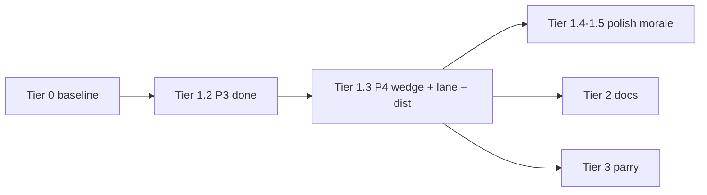

# Combat implementation plan (Fallen Paths)

**Purpose:** One **logical plan** from baseline → active work → later tiers. **Implementation phase:** execute **top to bottom**; within Tier 1, follow **numbered steps** in order unless a step is marked optional.

**Last verified against repo:** 2026-04-07 (combat `*.gd` + `ui/BattleScene.gd`; plan layout condensed same pass — single-document sequencing). **Pre–Tier 1.2 doc audit:** Tier 1.1 claims and module paths cross-checked against current `combat/` + `ui/BattleScene.gd` (distance helper ownership corrected below).

**Plan update 2026-04-13:** Tier **1.3 (P4)** expanded to include **per-combatant metric lane offsets** (`lane_offset`) alongside `effective_pair_eff_dist` / bands. **Plan update 2026-04-13 (c):** P4 is **wedge-first** — **`intrusion_wedge_by_file`** on each formation is the **canonical** breach corridor; **`lane_offset`** and **`effective_pair_eff_dist`** **project/consume the wedge throughout** (cohesion, lane stress, ZoC, bands, UI). Spec: `docs/ENGAGEMENT_LINE_COHESION_INTRUSION_PLAN.md` §4.1–§4.2. **Repo:** Tier **1.2 (P3)** intrusion slots + vacancy plug are **implemented** — milestone **1.2 = Done**; **next coding = Tier 1.3** (start at [Tier 1.3 gate](#tier-13-gate-p4)).

**Depth references (not sequencing):** Stamina, HEMA research, parry bind math, long ZoC investigations — see [Plan inventory](#plan-inventory-all-combat-markdown) and `docs/README.md`.

---

## Document map (read order)

| Section | Use |
|---------|-----|
| [Dependency chain](#dependency-chain-execution-logic) | Why Tier 1.3 blocks Tier 3, etc. |
| [Tier 0](#tier-0--baseline-shipped--maintain) | What is already shipped; module anchors |
| [Tier 1 expanded](#tier-1--engagement-geometry-active-track) | **Active:** Tier **1.3 (P4)**; P3 steps remain for reference / regressions |
| [Implementation phase gate](#implementation-phase-gate) | Checklists before Tier **1.2** and (recommended) Tier **1.3** code |
| [Tiers 2–7](#tier-2--tactical-docs--zoc-narrative-sync) | Everything after engagement geometry |
| [Plan inventory](#plan-inventory-all-combat-markdown) | Where design depth lives |

---

## Dependency chain (execution logic)

Work must respect this ordering (later items assume earlier ones):

1. **Formation truth** — `slots`, `rank`/`file`, death plug (`CombatFormationFlow`), ZoC + `incursion_pressure` (`ZoneOfControl`, `TacticalCombat`).
2. **Cohesion & posture (telemetry)** — `line_cohesion`, `engagement_posture`, UI, `engagement_state_changed` (**shipped**).
3. **Crash / breach** — `BreachResolver`, neighbor hold (`CombatIntrusionGeometry`), skirmish breach clog (`FormationBreachRules`) (**shipped**).
4. **Intrusion flags** — `engagement_role`, host/anchor on crash success (**shipped**).
5. **Intrusion geometry (slots)** — empty attacker home slot, intruder on defender, vacancy plug ≠ death plug → **Tier 1.2** (P3) **shipped** in repo (2026-04-13).
6. **Intrusion wedge (formation)** — `intrusion_wedge_by_file` written/updated on crash success, decay/clear on heal/death; **authoritative** breach sector for stress, cohesion, ZoC, distance, UI → **Tier 1.3** (P4; depends on 1.2).
7. **Lane metric offsets + pair distance** — per-combatant `lane_offset` (defaults + **wedge seam** bias + repack rules) feeds **`AvailableActionsBuilder.effective_pair_eff_dist`**; `CombatDistanceBands` / crash / targeting **read wedge + offsets** → **Tier 1.3** (P4; depends on 1.2).
8. **Posture polish & morale** — hysteresis, tags, `morale_cohesion_factor` → **Tier 1.4–1.5**.
9. **AI / tests** → **Tier 1.6** (optional; depends on stable posture rules).
10. **Doc sync (Tier 2.1)** → **`TACTICAL_ZONES_BREACH_MOVEMENT.md`** narrative vs code — after **1.3+** so copy matches **wedge + slots + `lane_offset` / distance** (not only P3 slots). **Tier 2.2** (`TACTICAL_FORMATIONS_FF4.md` intruder/vacancy blurb) may still ship **after 1.2**; see Tier 2 table.
11. **Parry / melee depth** → **Tier 3** (after **1.3** so range work is not redone).

---

## Tier 0 — Baseline (shipped / maintain)

**Meaning:** Current playable stack — **extend**, do not replace. Historical phase checklists live in `docs/COMBAT_ROADMAP_AND_STAMINA.md` (optional / archaeology); they do **not** override this plan’s order.

**Code anchors (non-exhaustive):**

| Area | Primary modules |
|------|-----------------|
| Orchestration | `CombatManager.gd`, `CombatProcessTick.gd`, `CombatEventScheduler.gd`, `CombatEventDispatch.gd` |
| Formations | `CombatFormationSetup.gd`, `CombatFormationFlow.gd`, `FormationSlots.gd`, `FormationPreset.gd` |
| Actions / targeting | `AvailableActionsBuilder.gd`, `CombatResolveAction.gd`, `CombatEngagementResolver.gd` |
| Distance / ZoC | `CombatDistanceBands.gd`, `ZoneOfControl.gd`, `TacticalCombat.gd` |
| Breach / crash | `BreachResolver.gd`, `FormationBreachRules.gd` |
| Engagement v1 | `CombatFormationEngagement.gd`, `CombatIntrusionGeometry.gd` |
| Medical | `MedicalPhaseController.gd`, `CombatMedicalCoordination.gd` (and related) |
| UI | `ui/BattleScene.gd`, `BattleUIUpdater.gd`, formation diagram builders |

**Rule:** Prefer the **smallest owning module** (`AGENTS.md`, `.cursor/rules/fallen-paths.mdc`).

---

## Tier 1 — Engagement geometry (active track)

**Spec depth (field names, plug taxonomy, tuning):** `docs/ENGAGEMENT_LINE_COHESION_INTRUSION_PLAN.md` §4–§6.

### Milestone summary

| Step | Phase | Deliverable | Status |
|------|-------|-------------|:------:|
| 1.1 | P0–P2 | Cohesion, posture, UI, neighbor crash hold, intruder **flags** | **Done** |
| 1.2 | **P3** | Vacancy plug (≠ death plug) + attacker slot release + intruder on defender | **Done** |
| 1.3 | **P4** | **`intrusion_wedge_by_file`** (canonical) + `lane_offset` (wedge seam projection) + `effective_pair_eff_dist` (+ callers); cohesion / lane stress / ZoC / UI **consume wedge** | **Todo** |
| 1.4 | **P5** | LINE↔OPEN hysteresis; encounter / discipline tags | **Todo** |
| 1.5 | **P6** | Morale → `morale_cohesion_factor` | **Todo** |
| 1.6 | **P7** | AI posture hooks; harness / tests; optional | **Todo** |

**Single status column (Tier 1):** The **Status** column here is authoritative for milestones **1.1–1.6**. When you ship a step, update this table first, then align the matching **Done/Todo** rows in `docs/ENGAGEMENT_LINE_COHESION_INTRUSION_PLAN.md` §2 (verification mirror only — same facts, no second sequence).

**Next coding step:** Tier **1.3 (P4)** — **`intrusion_wedge_by_file`** (schema, writers, readers), **`lane_offset`** (seam bias + repack), **`effective_pair_eff_dist`** + callers, refactor **lane stress / cohesion** to use wedge where appropriate, harness/assertions. Start with the **[Tier 1.3 gate](#tier-13-gate-p4)**, then ordered steps **1.3.1 → 1.3.n** in this file.

**After 1.3:** Tier **2.1** — align `TACTICAL_ZONES_BREACH_MOVEMENT.md` with implemented intrusion + **wedge + `lane_offset` / distance** language (see dependency chain item 10).

---

### Tier 1.1 — Shipped (maintain only)

No sequencing work unless fixing regressions. Shipped includes: skirmish-aware `breach_blocks_open_lane_moves`; `CombatFormationEngagement.recompute_all`; `CombatIntrusionGeometry.crash_neighbor_hold_support`; crash success sets `engagement_role` / `intrusion_host_fid` / `intrusion_anchor_file`; `BattleScene` cohesion/posture labels.

---

### Tier 1.2 — P3: Slots, intruder on defender, vacancy plug

**Goal:** Formation truth matches **intrusion fiction**: attacker home rank-0 can be empty; intruder has a **defender-side** cell; **vacancy plug** runs when rank-0 is empty **without** death (distinct from `on_combatant_died`).

**Primary modules:** `CombatFormationFlow.gd`, `FormationSlots.gd`, `CombatEngagementResolver.gd`, `CombatManager.gd`; constants in `CombatConstants.gd`.

**Ordered steps:**

1. **Representation decision** — Document in code comment + engagement plan §4: intruder in defender `slots` vs parallel structure; how `normalize_formation_slots` interacts.
2. **Clear attacker home** — On crash success (or equivalent), remove intruder from attacker formation `slots` at logical home `(rank 0, file)` so rank-0 hole is real for that file.
3. **Defender cell** — Write intruder into defender `slots` at anchor file / agreed rank rule (occupancy / plugs / diagram); keep `intrusion_host_fid` / `intrusion_anchor_file` consistent with `slots`. **Canonical breach geometry** (`intrusion_wedge_by_file`) is **Tier 1.3**, not 1.2.
4. **Combatant `rank`/`file`** — Keep coarse grid truth for `slots`, vacancy, and plugs. **`lane_offset`** and **wedge** are **Tier 1.3**; intruder `rank`/`file` stay consistent with host-side `slots`.
5. **Vacancy plug** — New path: empty rank-0, not death obstacle → promote from rank 1 same file (one pass per tick after slot writes). **Ordering:** slot writes for intrusion first, then vacancy promote; must not race death plug in same resolution step (spec: engagement plan §4 rule line).
6. **Recompute chain** — Callers often `_recompute_zoc_and_distance()` immediately after slot writes (safe if redundant). **`CombatManager.notify_formation_changed(formation_id)`** runs **`CombatFormationFlow.reconcile_vacancy_plugs_formation`** on **each** formation (every file column), then **`_recompute_zoc_and_distance()`** only if any promotion occurred, then emits **`formation_changed`** (and again for another formation if reconcile changed it). **`get_available_actions`** calls **`reconcile_vacancy_plugs_all_formations`** first for the same reason. Downstream chain unchanged: incursion → ZoC → `CombatDistanceBands.update_distance_to_from_formations` → `CombatFormationEngagement.recompute_all`.
7. **Verification** — Manual or `IncursionBreachTest` (extend harness): crash success → attacker file empty at rank 0; defender shows intruder; vacancy promotes when intruder leaves / scenario allows.

**Exit criteria (all required):**

- [x] Intruder does not occupy attacker home slot after successful intrusion resolution.
- [x] Intruder represented on defender side per §4 contract.
- [x] Vacancy plug implemented and ordered vs death plug (documented in `CombatFormationFlow` or helper).
- [x] No desync between `slots`, `engagement_role`, and host/anchor fields after recompute.

---

### Tier 1.3 — P4: Intrusion wedge, lane metric offsets, intruder distance & targeting

**Depends on:** 1.2 complete (**Done** in repo as of 2026-04-13).

**Primary modules:** `CombatFormationSetup.gd` (init empty `intrusion_wedge_by_file`), `CombatManager.gd` (register defaults / reset), `CombatFormationFlow.gd` (wedge upsert/clear with intrusion + plugs), `CombatEngagementResolver.gd` (crash success → wedge + offset), `TacticalCombat.gd` / `ZoneOfControl.gd` / `CombatFormationEngagement.gd` (read wedge for stress / ZoC / cohesion), `AvailableActionsBuilder.gd` (**defines** `effective_pair_eff_dist`; also used by `BreachResolver`), `CombatDistanceBands.gd`, `CombatResolveAction.gd` (as needed), `CombatConstants.gd` (tuning), `ui/FormationDiagramBuilder.gd` or `BattleScene.gd` (optional wedge affordance).

**Design intent:** **`intrusion_wedge_by_file`** is the **canonical** “gap through the line” (pressure, depth, intruder id, optional lateral half-width). **`slots`** stay **occupancy** for plugs, death/vacancy, and grid UI. **`lane_offset`** is the **per-combatant lateral metric**, **biased from the wedge seam** (engagement plan §4.1 wedge, §4.2 offset rules). **`effective_pair_eff_dist`** combines coarse `|Δfile|`, offset deltas, and a **wedge depth/pressure** term so consumers do not infer breach only from dual-cell occupancy. Do **not** add gap-column `slots` keys in P4.

**Ordered steps:**

1. **Spec + constants** — Lock **`intrusion_wedge_by_file`** schema (minimum keys per engagement plan §4.1), wedge tuning constants, **`lane_offset`** range/sign (§4.2), and single-writer rules vs `breached_files`; document in `CombatConstants.gd` + engagement plan.
2. **Formation init / reset** — Empty `intrusion_wedge_by_file` on formation setup; clear all wedges in `_reset_tactical_breach_state` (or equivalent) with intruder flags.
3. **Crash success writer** — Same tick as P3 slot writes: upsert wedge at anchor file (and optional neighbor falloff); set **`lane_offset`** seam bias for intruder ± anchor rank-0 nudges per spec; keep `breached_files` in sync or document deprecation path.
4. **Wedge consumers (throughout)** — **`CombatFormationEngagement`**: cohesion inputs use wedge (+ existing signals). **`TacticalCombat._recompute_lane_stress_by_file`**: add wedge-derived stress so solo deep intruder still stresses the lane. **`ZoneOfControl`**: thread wedge where lane stress / frontage matters. Verify no system assumes “breach == dual living only.”
5. **Clear / decay** — On intruder death, role clear, or scripted heal: decay or erase wedge entries; recompute chain unchanged.
6. **Field wiring (`lane_offset`)** — `CombatManager.register`: default **0.0**; reset with tactical state.
7. **Line maintenance** — On formation init / rank–file reassignment: default offsets for non-intruded; **repack/clamp** after plugs/pair resolve so offsets stay bounded (engagement plan §4.2).
8. **`effective_pair_eff_dist`** — Coarse file delta + **lateral term** from `lane_offset` + **wedge depth/pressure** when either combatant is in/near wedge. Intruder path: **host anchor** + wedge + offsets. Baseline: epsilon-tight when wedge absent and all offsets 0.
9. **`CombatDistanceBands` / `BreachResolver`** — Verify via `effective_pair_eff_dist`; smoke intruder + wedge cases.
10. **Action filtering** — Melee / close / crash eligibility coherent with new distances.
11. **Regression + harness** — Non-intruded battles unchanged; extend `IncursionBreachTest` (or focused tests) for **non-empty wedge** + optional non-zero `lane_offset`.
12. **UI (optional same tier)** — Diagram or label: wedge/shading or glyph by file; offset hint deferred OK.

**Exit criteria:**

- [ ] `intrusion_wedge_by_file` exists on each formation dict, bounded writers, cleared on reset; crash success produces expected wedge at anchor.
- [ ] `lane_offset` exists on every combatant dict, bounded; crash + plugs do not leave NaNs or out-of-range values.
- [ ] `CombatFormationEngagement`, `TacticalCombat` lane stress, and (where applicable) `ZoneOfControl` **read wedge** per spec.
- [ ] `AvailableActionsBuilder.effective_pair_eff_dist` uses `|Δfile|` + offsets + wedge term; path accounts for `CombatConstants.ENGAGEMENT_ROLE_INTRUDED`.
- [ ] `CombatDistanceBands` and `BreachResolver` behave coherently (no deadlocks / all-mid artifacts in smoke scenarios).
- [ ] `AvailableActionsBuilder` does not offer impossible melee due to wrong band for intruders.

---

### Tier 1.4 — P5: Posture polish

**Depends on:** 1.3 recommended (stable geometry for playtest).

- Constants for LINE↔OPEN **hysteresis** (`L_in` > `L_out`) + optional stored band on formation dict.
- **Encounter / discipline tags** bias thresholds or default posture (data on encounter or formation preset).

**Exit criteria:** Posture does not flip every tick at threshold edge; tags read from agreed encounter hook.

---

### Tier 1.5 — P6: Morale → cohesion

- Morale module (or minimal hook) drives **`morale_cohesion_factor`** (placeholder 1.0 until wired).

**Exit criteria:** Changing morale changes `line_cohesion` input path without breaking defaults.

---

### Tier 1.6 — P7: AI & tests (optional)

- `CombatAIActionPicker` weights from posture/cohesion when rules stable.
- Re-baseline `IncursionBreachTest` / harness if assertions pin `p_win`.
- Doc sync item: engagement plan §2.8 cross-ref Tier 2.

---

### Tier 1 — Quick reference (fields & plugs)

**Per formation** (`manager.formations[fid]`): `line_cohesion`, `engagement_posture` (strings = `CombatConstants.ENGAGEMENT_POSTURE_*`), `morale_cohesion_factor`, `breached_files`, **`intrusion_wedge_by_file`** (P4: canonical breach per file; engagement plan §4.1), plus standard `slots`, `slot_obstacles`, `zone_control`, `incursion_pressure`, etc.

**Per combatant:** `engagement_role`, `intrusion_host_fid`, `intrusion_anchor_file`, `intrusion_source_file` (home column when intruded; death/vacancy), `lane_offset` (P4: lateral metric; **wedge seam bias**; engagement plan §4.2), `tactical_penetration_depth` (see engagement plan §5 for full table).

**Distance:** Pair effective distance is **`AvailableActionsBuilder.effective_pair_eff_dist`** (called from `CombatDistanceBands`, `BreachResolver`, etc.) — Tier 1.3 edits land here first.

**Plug taxonomy:**

| Kind | Trigger | Owner |
|------|---------|-------|
| Death plug | Ally dies → column gap | `CombatFormationFlow.on_combatant_died` (existing) |
| Vacancy plug | Empty rank-0 **without** death (e.g. intruder left home) | `CombatFormationFlow.apply_vacancy_plug_same_file` — **Tier 1.2 (shipped)** |
| Pair formation resolve | Swap / rotate / fall back complete | `CombatFormationFlow` (existing) |

---

## Implementation phase gate

**P3 status:** Tier **1.2** is **Done** in repo (intrusion slot writes, vacancy plug, harness checks). Use the **Tier 1.2** checklist below only when **re-auditing or changing P3**; otherwise jump to **[Tier 1.3 gate](#tier-13-gate-p4)** for the next implementation work.

### Tier 1.2 gate (use when changing P3)

- [ ] Read **Tier 1.2** steps + **exit criteria** above and engagement plan **§4** (plug ordering).
- [ ] Confirm **Tier 0** module list matches your branch (no renamed files).
- [ ] Defender **occupancy** (intruder in host `slots`) still matches step 1.2.1 + PR notes when you alter it; **canonical wedge** remains Tier **1.3** unless you intentionally merge milestones.
- [ ] Automated test path (`IncursionBreachTest` or new) still covers slot + vacancy after your change.

Then implement or adjust **1.2.1 → 1.2.7** in order.

### Tier 1.3 gate before coding P4 (recommended)

Wedges and offsets touch **register**, **reset**, **formation setup**, **intrusion**, **plugs**, **cohesion**, **lane stress**, **ZoC**, and **every `effective_pair_eff_dist` consumer**; mistakes desync bands and crash math.

- [ ] Read **Tier 1.3** steps + **exit criteria** above and engagement plan **§4.1** (wedge schema, writers, readers) and **§4.2** (lane offset: range, sign, coupling to wedge, repack, out-of-scope).
- [ ] Freeze **`intrusion_wedge_by_file`** minimum keys and **`lane_offset` sign convention** + range in `CombatConstants.gd` + code comments (single source of truth).
- [x] **1.2 exit criteria** met on branch (slots / vacancy / flags); re-check this box only if you regress P3.

Then implement **1.3.1 → 1.3.12** in order (or the current numbered block in **Tier 1.3** above).

### After you ship a Tier 1 step (no duplication / drift)

1. Set the step’s **Status** in the [milestone summary](#milestone-summary) table above to **Done** (if fully complete).
2. Update the corresponding rows in **`docs/ENGAGEMENT_LINE_COHESION_INTRUSION_PLAN.md` §2** so Done/Todo matches reality.
3. Check off **exit criteria** for that step in this file when all bullets are true.
4. **Tier 2** (`TACTICAL_ZONES_*`, `TACTICAL_FORMATIONS_FF4`): update only when this file’s Tier 2 table says so (e.g. **2.1** after **1.3+**, **2.2** after **1.2**) — do not maintain a parallel “next work” list there.

---

## Tier 2 — Tactical docs & ZoC narrative sync

| Step | Deliverable | Depends on |
|------|-------------|------------|
| 2.1 | Align `TACTICAL_ZONES_BREACH_MOVEMENT.md` with code (intrusion, neighbor hold, vacancy, intruder slots, **wedge**, `lane_offset` / distance language) | Tier 1.3+ |
| 2.2 | Short subsection in `TACTICAL_FORMATIONS_FF4.md`: intruder / vacancy extends rank×file | Tier 1.2 |

---

## Tier 3 — Melee depth (parry / weapon / guards)

**Plans:** `PARRY_BIND_AND_WEAPON_GEOMETRY.md`, `PARRY_DEFLECT_AND_CALIBRATION.md`, `GUARDS_LINES_AFTERBLOW.md`

| Step | Deliverable | Depends on |
|------|-------------|------------|
| 3.1 | Stable **distance + targeting** after intruder P4 (wedge + offsets) | Tier 1.3 |
| 3.2 | Parry / bind / deflect per those docs | 3.1 |
| 3.3 | Guard line / afterblow | 3.2 |

---

## Tier 4 — AI & stance

**Plan:** `docs/AI_ENGAGEMENT_STANCE_AND_FEINTS.md`

| Step | Deliverable | Depends on |
|------|-------------|------------|
| 4.1 | Posture-aware weights (`CombatAIActionPicker`) | After **1.4**; **1.5** optional before tuning |
| 4.2 | Stance / feint / footwork per AI doc | 4.1 |

---

## Tier 5 — Damage & physics polish

**Plan:** `docs/PHYSICS_DAMAGE_AND_FLOW.md`

| Step | Deliverable | Depends on |
|------|-------------|------------|
| 5.1 | Angles, damage flow, audits | Tier 3.2 |

---

## Tier 6 — Medical & pain extensions

**Plan:** `docs/MEDICAL_PAIN_INCAPACITATION.md`

| Step | Deliverable | Depends on |
|------|-------------|------------|
| 6.1 | Extensions as needed | Independent; avoid conflicting with formation busy states |

---

## Tier 7 — Research / fidelity (non-blocking)

**Plan:** `docs/HEMA_ROADMAP_AND_SOURCES.md` — does **not** gate tiers above.

---

## Plan inventory (all combat markdown)

| Document | Role |
|----------|------|
| **This file** | **Logical plan + execution order** |
| `README.md` | Index + quick reading paths |
| `ENGAGEMENT_LINE_COHESION_INTRUSION_PLAN.md` | Tier 1 **spec**: plug taxonomy, data dictionary, tuning |
| `COMBAT_ROADMAP_AND_STAMINA.md` | Historical phases, stamina investigations, architecture snapshot |
| `TACTICAL_ZONES_BREACH_MOVEMENT.md` | ZoC / breach narrative — **Tier 2.1** sync **after 1.3+** (wedge + slots + `lane_offset` / distance) |
| `TACTICAL_FORMATIONS_FF4.md` | FF4 formation model — extend at Tier 2.2 |
| `AI_ENGAGEMENT_STANCE_AND_FEINTS.md` | Tier 4 |
| `PARRY_*`, `GUARDS_LINES_AFTERBLOW.md` | Tier 3 |
| `PHYSICS_DAMAGE_AND_FLOW.md` | Tier 5 |
| `MEDICAL_PAIN_INCAPACITATION.md` | Tier 6 |
| `HEMA_ROADMAP_AND_SOURCES.md` | Tier 7 |

---

## Changelog

- **2026-04-13 (c):** **Wedge-first P4** — dependency chain items **6–7** (wedge, then lane+dist); mermaid **T13** label; milestone **1.3** deliverable; Tier **1.3** title, design intent, ordered steps **1.3.1–1.3.12**, exit criteria, gate, quick-reference **per formation** field, Tier **2.1** / **3.1** / plan inventory wording; top **Plan update** paragraph. Engagement plan §4.1–§4.2 mirror (separate file).
- **2026-04-13 (b):** Milestone **1.2 → Done** (P3 shipped in code); Tier **1.2** exit criteria checked; **Next coding** callout → Tier **1.3**; implementation gate split (**P3 re-audit** vs **P4 gate**); plug table + dependency item 5 + Tier 1.3 “depends on” aligned. Engagement §2 mirror updated same pass.
- **2026-04-13:** Dependency chain item **9** + mermaid: **Tier 2.1** doc sync follows **1.3+** (not 1.2 alone); **`T13 --> T2`** edge replaces `T12 --> T2`. Added **recommended gate before Tier 1.3** (§4.1, sign convention, P2 exit). Plan inventory + roadmap/tactical bundle cross-notes aligned.
- **2026-04-07 (readiness):** Milestone “single status column” note; **After you ship** checklist to keep engagement §2 aligned; roadmap “next” pointers aim at `IMPLEMENTATION_ORDER` Tier 1.2–1.3; README engagement row = spec mirror wording.
- **2026-04-07 (pre–1.2 audit):** Tier 1.3 module list + steps corrected so **`effective_pair_eff_dist`** is attributed to **`AvailableActionsBuilder.gd`**; recompute chain step names `CombatManager` / signal contract; quick-reference note for distance ownership.
- **2026-04-07:** Renamed to **combat implementation plan**; added document map, dependency chain + mermaid, Tier 1 **expanded** steps (P3–P7), quick-reference tables, **implementation phase gate**; inventory roles clarified; verified against codebase (Tier 0 table, Tier 4 dependency wording, plan inventory + README from earlier pass same day).
- **Initial:** Master order; Tier 1 aligned with engagement plan P0–P7.
