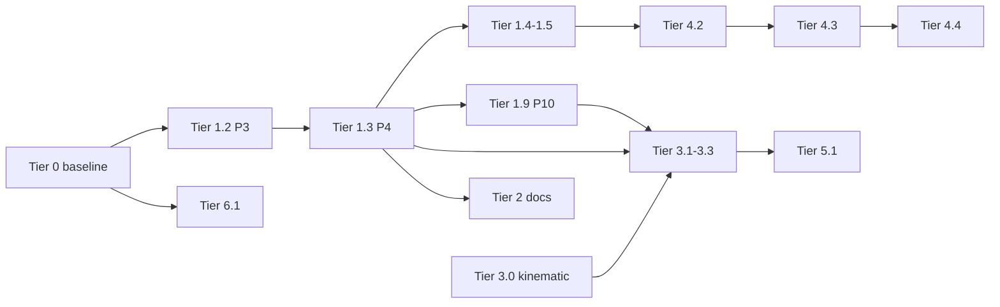

# Combat implementation plan (Fallen Paths)

**Purpose:** One **logical plan** from baseline → shipped milestones → **gated enablement** + doc sync + investigations. **Gameplay milestones** through Tier **7** + expansion **P4a–P4h** are **Done**. **Gates shipped:** [Phase A](#phase-a--sector-surround-enable-tier-31) (sector surround) + [Phase B](#phase-b--line-crash--intrusion-tier-2) (line crash / intrusion) + **`FEATURE_FLURRY_BIND_EXCHANGE`** (bind exchange). Active backlog: [next coding step](#next-coding-step) (**P0** maintain · **P1** editor soaks). **Historical build order:** [dependency chain §A](#dependency-chain-shipped-build-order) + Tier **1** P-steps (audit only, not new feature work).

**Single source of truth (avoid forking):** Milestone **Status**, **Development gate**, and **dependency chain** live **only** in this file. **`docs/README.md`** is a **topic index** (no parallel status column). **[All tiers at a glance](#all-tiers-at-a-glance)** is the cross-tier **Status** summary (Tier **1** detail in [milestone summary](#milestone-summary)). **`ENGAGEMENT_LINE_COHESION_INTRUSION_PLAN.md`** §2 **mirrors** Tier **1** verification rows from the milestone table here (Tier **2** doc-sync: §2.8 ↔ plan [Tier 2](#tier-2--tactical-docs--zoc-narrative-sync) — **Done** 2026-05-17). **`docs/COMBAT_ROADMAP_AND_STAMINA.md`** — legacy **IMPLEMENTATION_OUTLINE** Parts **1–3** are **collapsed** in `
`; **Part 3** phase checklists remain **historical** — if they disagree with this plan, **this file wins**.

**Last verified (code + `CombatRegressionHarness.run_all()`):** 2026-05-18 (ambient pain shock; formation duration UI; **`COMBAT_DEV_VERBOSE`**; P1 [soak checklist](#p1-editor-soak-checklist)) — **Godot 4.6**; harness via VS Code task **Run Combat Regression Harness (headless)** or `godot -s res://scripts/run_combat_regression_harness.gd` (bash: **`scripts/run_combat_regression_harness.sh`**). Shipped-tier pointers → [milestone summary](#milestone-summary) + per-tier exit criteria (grep harness names in [`REGRESSION_HARNESS_MAP_TIER19.md`](REGRESSION_HARNESS_MAP_TIER19.md), not duplicated here). Feature gates: both production **on** — [sector surround](#development-gate-sector-surround-load-temporary) + [line crash / intrusions](#development-gate-line-crash--intrusions-temporary).

**Documentation pass:** 2026-05-17 (**doc-m**) — [Next implementation phase](#next-implementation-phase) playbook; dependency chain **§A shipped** / **§B remaining**; backlog **P2a** / **P1′**; Tier **2.2** split from intrusion-gated **2.1**. **(doc-l)** mirror fixes · **(doc-k)** at-a-glance + gates · **(doc-j)** post-milestone backlog.

### Development gate: line crash / intrusions (temporary)

**Flag:** `CombatConstants.FEATURE_LINE_CRASH_INTRUSION` (**default `true`** — [Phase B](#phase-b--line-crash--intrusion-tier-2) shipped 2026-05-17).

**Behavior while true (production):** Formation engagement lists **breach rush** when `CombatEngagementMode.incursion_allowed` (mode **formation** + flag), attacker passes **`crash_intrusion_attacker_allowed`** (heavy kit ≈ **17+ kg**, breach viability, caps), and pair geometry is MID/CLOSE in swing range. `resolve_crash_attempt` contests via **`BreachResolver`** and may apply intruder slots + wedge on success.

**When setting the flag `false`:** No **new** intrusions — crash not listed; `incursion_allowed` false; `resolve_crash_attempt` → `intrusion_disabled`. Run **`run_all()`** before re-shipping **true**.

### Development gate: sector-weighted surround load (temporary)

**Flag:** `CombatConstants.is_feature_sector_surround_load()` / **`set_feature_sector_surround_load`** (backing **`_feature_sector_surround_load`**, default **`true`** — [Phase A](#phase-a--sector-surround-enable-tier-31) shipped 2026-05-17).

**Behavior while true (production):** Parry/dodge surround uses sector **`surround_threat_weight_sum`** + `1/(1+k·excess)` in **`TacticalCombat`** / **`DefenseChoiceResolver`** / **`AttackResolver`** (`AttackResolver` stamps weight sum on **`pa`**).

**When setting the flag `false`:** Integer **`surround_threat_count`** path only (legacy compare / soak). Run **`run_all()`** (grep **`_run_surround_`**, **`_run_sector_surround_feature_flag_*`**) before shipping a default flip.

**Historical milestone notes (2026-04 → 2026-05):** [Changelog](#changelog). **Current** Tier 1 facts → [milestone summary](#milestone-summary) **Status** + [dependency chain](#dependency-chain-execution-logic) only.

**Depth references (not sequencing):** Stamina, HEMA research, parry bind math, long ZoC investigations — see [Plan inventory](#plan-inventory-all-combat-markdown) and `docs/README.md`.

---

## Document map (read order)

| # | Section | Use |
|---|---------|-----|
| 1 | [Development gates](#development-gate-line-crash--intrusions-temporary) | Both default **true** — [line crash](#development-gate-line-crash--intrusions-temporary) · [sector surround](#development-gate-sector-surround-load-temporary) |
| 2 | [**Next implementation phase**](#next-implementation-phase) | **P0** maintain + optional editor soaks ([P1](#next-coding-step), [P1′](#next-coding-step)) |
| 3 | [Next coding step](#next-coding-step) | **P0–P3** maintain/soak · [P4 playbooks](#expansion-backlog-p4-playbooks) |
| 4 | [Dependency chain](#dependency-chain-execution-logic) | **§A** shipped build order · **§B** remaining enablement |
| 5 | [Milestone summary](#milestone-summary) | **Status** for Tier **1** + [all tiers at a glance](#all-tiers-at-a-glance) |
| 6 | [Tier 0](#tier-0--baseline-shipped--maintain) | Baseline modules — extend, do not replace |
| 7 | [Tier 1 expanded](#tier-1--engagement-geometry-shipped--maintain--gated-intrusion) | P-step detail + [ENGAGEMENT spec](ENGAGEMENT_LINE_COHESION_INTRUSION_PLAN.md) §4–§6 |
| 8 | [Tiers 2–7](#tier-2--tactical-docs--zoc-narrative-sync) | Doc sync · medical · research |
| 9 | **Tier 3** (**Done**) | Plan [§3.1–3.3](#tier-31-strike-measure-stamped-geometry) · live paths [3.1](PARRY_BIND_AND_WEAPON_GEOMETRY.md#tier-31-strike-measure-live-path) · [3.2](PARRY_BIND_AND_WEAPON_GEOMETRY.md#tier-32-parry-bind-live-path) · [3.3](GUARDS_LINES_AFTERBLOW.md#tier-33-guard-line-afterblow-live-path) |
| 10 | **Tier 4** | Plan [§4](#tier-4--ai--stance) (**Done**) · live paths [4.1](AI_ENGAGEMENT_STANCE_AND_FEINTS.md#tier-41-posture--stance-weights-ai-listing-live-path)–[4.4](AI_ENGAGEMENT_STANCE_AND_FEINTS.md#tier-44-position-angle-footwork-live-path) |
| 11 | [Tier 5.1](#tier-51-angles-damage-flow-audits) | **Done** · [kinematic audit](PHYSICS_DAMAGE_AND_FLOW.md#tier-51-kinematic-audit) |
| 12 | [Implementation phase gate](#implementation-phase-gate) | Tier **1** re-audit when changing slots/wedge · [P4 playbooks](#expansion-backlog-p4-playbooks) for new features |
| 13 | [Plan inventory](#plan-inventory-all-combat-markdown) | All `docs/*.md` bundles · [`REGRESSION_HARNESS_MAP_TIER19.md`](REGRESSION_HARNESS_MAP_TIER19.md) |

---

## Dependency chain (execution logic)

Two lists: **§A** = how the repo was built (**Done** — do not renumber milestones). **§B** = what to do next ([next implementation phase](#next-implementation-phase)).

### §A — Shipped build order

Later items assume earlier ones. **Do not** reorder milestone numbers.

1. **Formation truth** — `slots`, `rank`/`file`, death plug (`CombatFormationFlow`), ZoC + `incursion_pressure` (`ZoneOfControl`, `TacticalCombat`).
2. **Cohesion & posture** — `line_cohesion`, `engagement_posture`, UI (**Tier 1.1**).
3. **Crash / breach code** — `BreachResolver`, `CombatIntrusionGeometry`, `FormationBreachRules` (**shipped**; player crash listing gated — see §B).
4. **Intrusion flags** — `engagement_role`, host/anchor (**Tier 1.1**).
5. **Intrusion slots + vacancy plug** — **Tier 1.2** (P3).
6. **Intrusion wedge + `lane_offset` + `effective_pair_eff_dist`** — **Tier 1.3** (P4); **`CombatPairGeometry`** (+ `AvailableActionsBuilder` forward).
7. **Posture + morale** — **Tier 1.4–1.5**.
8. **AI listed-hostile + crash weights** — **Tier 1.6** (crash listing + posture weights; production intrusion **on** since Phase B).
9. **Engagement mode + telemetry** — **Tier 1.7–1.8**.
10. **Depth-rank polearm + spear lanes** — **Tier 1.9** (depends **1.3**; before **3.2** parry tuning).
11. **Kinematic delivery** — **Tier 3.0**.
12. **Tier 3 melee depth** — **3.1** strike measure + stamped `pa` (includes **sector surround**, flag default **true**) → **3.2** parry/bind → **3.3** guard/afterblow.
13. **Tier 4 AI stack** — **4.1** posture/stance → **4.2** feint/tempo/counter → **4.3** attention/yomi → **4.4** position footwork (default **on**).
14. **Tier 5.1** kinematic audits.
15. **Tier 6.1** medical mobility (parallel with **0** — no intrusion dependency).

### §B — Remaining work (enablement + docs)

| Order | Track | Plan anchor | Blocks on |
|:-----:|-------|-------------|-----------|
| **B0** | Harness green | [P0](#next-coding-step) | — |
| **B1** | Optional neutral **Tier 2.2** FF4 blurb | [P2a](#next-coding-step) | **Not** intrusion flag (no live crash fiction) |
| **B2** | ~~**Phase A:** sector surround **production on**~~ | [Phase A](#phase-a--sector-surround-enable-tier-31) | **Done** 2026-05-17 |
| **B3** | Optional surround soak | [P1′](#next-coding-step) | **B2** complete — editor multi-threat feel |
| **B4** | ~~**Phase B:** line crash + intrusion~~ | [Phase B](#phase-b--line-crash--intrusion-tier-2) | **Done** 2026-05-17 |
| **B5** | ~~Expansion playbooks~~ | [P4a→P4h](#expansion-backlog-p4-playbooks) | **Done** 2026-05-18 |

**Do not enable both gates in one pass** — tune surround defense before opening live intrusion play.

**Both gates shipped (2026-05-17):** Sector surround + line crash production **on**. Optional editor soaks: [P1′](#next-coding-step) (multi-threat surround), registry **bullet 5** (crash → wedge play).

*Diagram: **shipped** gameplay tiers and doc-sync fork (**Tier 2**). Both production gates default **on** (2026-05-17); optional editor soaks remain ([P1](#next-coding-step), [P1′](#next-coding-step), Phase B bullet **5**).*

---

## Tier 0 — Baseline (shipped / maintain)

**Meaning:** Current playable stack — **extend**, do not replace. Historical phase checklists live in `docs/COMBAT_ROADMAP_AND_STAMINA.md` (optional / archaeology); they do **not** override this plan’s order.

**Code anchors (non-exhaustive):**

| Area | Primary modules |
|------|-----------------|
| Orchestration | `CombatManager.gd`, `CombatProcessTick.gd`, `CombatEventScheduler.gd`, `CombatEventDispatch.gd` |
| Formations | `CombatFormationSetup.gd`, `CombatFormationFlow.gd`, `FormationSlots.gd`, `FormationPreset.gd`, `CombatFormationMoveDuration.gd` |
| Actions (orchestrate) | `AvailableActionsBuilder.gd` — **`build()`**; forwards geometry / strike; listing in submodules below |
| Action listing | `CombatMeleeListing.gd`, `CombatFormationMoveListing.gd`, `CombatMedicalActionListing.gd`, `CombatCrashActions.gd` |
| Pair / strike geometry | `CombatPairGeometry.gd`, `CombatStrikeStamping.gd`, `CombatMeleeRankTargeting.gd` — depth lanes: `CombatDepthPolearm.gd` ([§1.9](#tier-19--p10-depth-rank-polearm-reach--spear-lanes)) |
| Targeting / AI | `CombatTargetScoring.gd`, `CombatAIActionPicker.gd`, `MentalStackDecider.gd`, `CombatDoctrine.gd`, `CombatAttention.gd`, `CounterTempo.gd`, `CombatFootwork.gd` |
| Distance bands / ZoC | `CombatDistanceBands.gd` (**`depth_polearm_lane_open_by_combatant_id`** + **`update_distance_to_from_formations`**), `ZoneOfControl.gd`, `TacticalCombat.gd` |
| Mobility / retreat | `CombatMobilityRetreat.gd`, `CombatPlayerTurnHints.gd`, `CombatUiHints.gd` — Tier **6.1** [live path](MEDICAL_PAIN_INCAPACITATION.md#tier-61-mobility-pain-shock-live-path) |
| Breach / crash | `BreachResolver.gd`, `FormationBreachRules.gd` |
| Engagement v1 | `CombatFormationEngagement.gd`, `CombatIntrusionGeometry.gd` |
| Medical | `MedicalPhaseController.gd`, `CombatMedicalCoordination.gd` (**`medical_action_allowed`**, stack-assist, pick filter), `CombatMedicalActionListing.gd`, `MedicalActionStarter.gd`, `MedicalWindUpHandler.gd` — [§6.3 coordination live path](MEDICAL_PAIN_INCAPACITATION.md#tier-63-medical-phase-coordination-live-path) |
| Resolve / defense | `AttackResolver.gd`, `AttackWindUpStarter.gd`, `DefenseChoiceResolver.gd`, `DefenseResolutionHandler.gd`, `GuardLineUpdater.gd`, `AfterblowHandler.gd` — Tier **3** [live paths](PARRY_BIND_AND_WEAPON_GEOMETRY.md#tier-31-strike-measure-live-path) |
| Weapons / impact (abstract) | `WeaponConstants.gd`, `WeaponDamageHelper.gd`, `ImpactVelocityModel.gd`, `WeaponSwingPhysics.gd`; optional mirror **`tools/simulate_weapon_ke_velocity.py`** (intensity / KE vs Tier **3.0**) |
| UI | `ui/BattleScene.gd`, `BattleUIUpdater.gd`, formation diagram builders |

**Rule:** Prefer the **smallest owning module** (`AGENTS.md`, `.cursor/rules/fallen-paths.mdc`).

### Tier 0.1 — Formation move duration UI (optional)

**Status:** **Done** (2026-05-17; player log + gauge 2026-05-18) — playbook [P4b](#p4b--tier-01-formation-move-duration-ui). **`CombatFormationMoveDuration`** stamps **`formation_move_duration_hint`** on listed actions; diagram/gauge tooltips; **`CombatPlayerTurnHints`** → combat log + **`COMBATANT_KEY_FORMATION_MOVES_TURN_HINT`** (waiting/cowering only; cleared on resolve); harness **`_run_formation_move_duration_*`** including **`_run_formation_move_duration_gauge_tooltip_*`**.

### Tier 0.2 — Formation hit reaction, hit-cancel, incoming parry (shipped)

**Status:** **Done** (2026-05-18 audit; code from 2026-05-17). **`FEATURE_INCOMING_PARRY_CHOICE`** default **true**.

| Layer | Module | Role |
|-------|--------|------|
| Hit reaction / cancel | `CombatFormationFlow.gd` | **`apply_hit_reaction_if_needed`** — light hit extends pair/solo duration; **`intensity ≥ FORMATION_HIT_CANCEL_INTENSITY`** → **`cancel_formation_move_from_hit`** (abort swap/fall-back) |
| Live hook | `CombatManager.gd` | Calls **`apply_hit_reaction_if_needed`** on hit |
| Incoming parry | `CombatIncomingParryChoice.gd` | **`can_parry_all`** + **`choose_parry_target_attacker_id`**; stamps **`parry_choice_blocked`** / **`parry_all_incoming_batch`** on **`pa`** |
| Resolve | `AttackResolver.gd`, `DefenseChoiceResolver.gd` | **`stamp_parry_choice_on_pa`** before defense; skip parry when **`parry_choice_blocked`** |
| UI | `BattleUIUpdater.gd`, `CombatUiHints.gd`, `CombatFormationMoveDuration.gd` | Swap/fall-back gauge **· vulnerable**; tooltip hit-cancel risk |
| Armor duration | `CombatTiming.gd` | Heavy armor mult on formation move estimates (P4b) |

**Harness:** **`_run_formation_hit_reaction_*`**, **`_run_formation_hit_cancel_*`**, **`_run_incoming_parry_*`**, **`_run_formation_move_duration_heavy_armor_*`**.

---

## Tier 1 — Engagement geometry (shipped — maintain)

**Spec depth (field names, plug taxonomy, tuning):** `docs/ENGAGEMENT_LINE_COHESION_INTRUSION_PLAN.md` §4–§6. Milestones **1.1–1.9** are **Done**. Production intrusion + surround are **on**; optional editor soak: crash→wedge feel (Phase B bullet **5**).

### Milestone summary

| Step | Phase | Deliverable | Status |
|------|-------|-------------|:------:|
| 1.1 | P0–P2 | Cohesion, posture, UI, neighbor crash hold, intruder **flags** | **Done** |
| 1.2 | **P3** | Vacancy plug (≠ death plug) + attacker slot release + intruder on defender | **Done** |
| 1.3 | **P4** | **`intrusion_wedge_by_file`** (canonical) + `lane_offset` (wedge seam projection) + `effective_pair_eff_dist` (+ callers); cohesion / lane stress / ZoC / UI **consume wedge** | **Done** |
| 1.4 | **P5** | Posture hysteresis + encounter tags | **Done** |
| 1.5 | **P6** | Morale → `morale_cohesion_factor` | **Done** |
| 1.6 | **P7** | AI listed-hostile + crash weights | **Done** |
| 1.7 | **P8** | Engagement mode Option 2 | **Done** |
| 1.8 | **P9** | Telemetry lock + soak gate | **Done** |
| 1.9 | **P10** | Depth-rank polearm + spear lanes | **Done** — [§1.9 live path](#tier-19--p10-depth-rank-polearm-reach--spear-lanes) |

**Status column (Tier 1):** Same rule as **Single source of truth** (top). When you ship, edit this table first, then **`ENGAGEMENT_*`** §2 rows (mirror).

### All tiers at a glance

| Tier | Scope | Status | Active work |
|------|--------|:------:|-------------|
| **0** | Baseline modules | **Maintain** | **0.1–0.2** shipped — [Tier 0](#tier-0--baseline-shipped--maintain) · [0.2 live path](#tier-02-formation-hit-reaction-incoming-parry) |
| **1** | Engagement geometry **1.1–1.9** + **1.10** | **Done** | **1.10** automatic doctrine **on**; **`rotate_file`** listing wired; editor crash→wedge soak optional |
| **2** | Tactical doc sync | **Done** | Keep **`TACTICAL_*`** in sync when intrusion/surround behavior changes |
| **3** | Melee depth **3.0–3.3** | **Done** | Deflect calibration investigations → [`PARRY_DEFLECT`](PARRY_DEFLECT_AND_CALIBRATION.md) (not exit-gated) |
| **4** | AI / stance **4.1–4.5** + **4.2b** | **Done** | Editor bind-exchange soak optional |
| **5** | Physics **5.1** | **Done** | Kinematic tail + editor calibration — [audit](#tier-expansion-audit-2026-05-17) |
| **6** | Medical **6.1** + **6.2** flee + **6.3** coordination | **Done** | Wound-packing **depth** (research); flee-rate balance (playtest) |
| **7** | HEMA / fidelity | **Done** | **7.1–7.5** shipped — [Tier 7](#tier-7--research--fidelity-non-blocking); optional HEMA investigation depth in bundle only |

**Production feature toggles (summary):**

| Toggle | Default | Gate |
|--------|---------|------|
| `FEATURE_LINE_CRASH_INTRUSION` | **true** | [Line crash](#development-gate-line-crash--intrusions-temporary) — Phase B shipped |
| `is_feature_sector_surround_load()` | **true** | [Sector surround](#development-gate-sector-surround-load-temporary) — Phase A shipped |
| `is_feature_position_angle_footwork_enabled()` | **true** | Tier **4.4** (no off-by-default gate) |
| `FEATURE_AUTOMATIC_DOCTRINE` | **true** | [Tier 1.10](#tier-110-automatic-doctrine-pilot) — hollow-center → **pinch_center** when doctrine still **default** |
| `FEATURE_FLURRY_BIND_EXCHANGE` | **true** | [Tier 4.5](#tier-45-flurry-bind-exchange-deferred) — bind deflect → bounded exchange window ([P4g](#p4g--tier-45-flurry-pilot)) |

## Next implementation phase

**Gates shipped:** [Phase A](#phase-a--sector-surround-enable-tier-31) + [Phase B](#phase-b--line-crash--intrusion-tier-2) (2026-05-17). **Post-gate harness (2026-05-17):** bullet **5** scripted crash success + P1′ production surround mult. **Next:** [P0](#next-coding-step) maintain · optional editor [P1](#next-coding-step) (bind-exchange / bind-riposte feel).

**Prompt to implement Phase A:** *“Implement [Phase A — sector surround enable](IMPLEMENTATION_ORDER.md#phase-a--sector-surround-enable-tier-31) per the plan: P0 harness, then flip/tune `is_feature_sector_surround_load`, update docs, exit criteria.”*

### Phase A — Sector surround enable (Tier 3.1 production flag)

**Goal:** ~~Turn on sector-weighted surround load in production~~ **Shipped** 2026-05-17 (`_feature_sector_surround_load` default **true**). No formation intrusion, crash listing, or wedge changes.

**Depends on:** Tier **3.1** code **Done** ([§3.1 live path](PARRY_BIND_AND_WEAPON_GEOMETRY.md#tier-31-strike-measure-live-path)).

| Step | Action | Owner modules / constants |
|:----:|--------|-------------------------|
| A0 | **`CombatRegressionHarness.run_all()`** green (seeds **0 / 1 / 2** on afterblow if needed) | harness |
| A1 | Read [sector surround gate](#development-gate-sector-surround-load-temporary) + grep **`_run_surround_`**, **`_run_sector_surround_*`** | [`REGRESSION_HARNESS_MAP_TIER19.md`](REGRESSION_HARNESS_MAP_TIER19.md) Tier **3.1** |
| A2 | Tune in **`CombatConstants.gd`**: `SURROUND_SECTOR_LOAD_FREE`, `SURROUND_SECTOR_LOAD_K`, `SURROUND_SECTOR_WEIGHT_MIN`, `SURROUND_MAX_SPLIT_DIVISOR`, `SURROUND_AWARENESS_AT_LOW_PERCEPTION` (compare integer path when flag **false**) | `CombatConstants.gd` |
| A3 | Trace live path: **`TacticalCombat.compute_surround_threat_weight_sum`** → **`surround_defense_multiplier_from_pa_with_sector`** / **`surround_defense_multiplier_from_pa`** → **`DefenseChoiceResolver.choose_defense`** (`dodge_chance`, `parry_c_d`); **`AttackResolver`** stamps `pa` used by surround | `TacticalCombat.gd`, `DefenseChoiceResolver.gd`, `AttackResolver.gd` |
| A4 | Dev soak: `CombatConstants.set_feature_sector_surround_load(true)` (or flip default after tuning) — multi-threat same-file / flank fights | playtest |
| A5 | Doc: **`TACTICAL_ZONES_BREACH_MOVEMENT.md`** §4.5 / §10.3 B2 — sector path vs integer **`surround_threat_count`** | Tier **2.1** subset (no intrusion fiction required) |
| A6 | **`run_all()`** again; note date in plan **Last verified** | harness |

**Exit criteria (Phase A):** **[x]** (2026-05-17)

- [x] `run_all()` green with production flag **true** and harness toggle test (`_run_sector_surround_feature_flag_respects_runtime_toggle` forces **false**/**true**).
- [x] Harness: compressed two-flank **`wsum`** milder than integer **n**=2; single threat neutral; production path **`_run_surround_production_path_dampens_defense_vs_compressed_flanks`**. Editor feel → optional [P1′](#next-coding-step).
- [x] No change to crash listing, intrusion slots, or `FEATURE_LINE_CRASH_INTRUSION`.
- [x] Plan **Last verified** + **`TACTICAL_ZONES_BREACH_MOVEMENT.md`** §4.6 / §10.3 B2 updated.

**Ship checklist:** [x] **`_feature_sector_surround_load := true`** in `CombatConstants.gd`; changelog **(phase-a)** below.

### Phase B — Line crash + intrusion (Tier 2 + gate)

**Goal:** ~~Enable **`FEATURE_LINE_CRASH_INTRUSION`**~~ **Shipped** 2026-05-17.

| Step | Action |
|:----:|--------|
| B0 | **`run_all()`** green |
| B1 | **`FEATURE_LINE_CRASH_INTRUSION := true`** in `CombatConstants.gd` |
| B2 | **`CombatCrashActions`** / **`CombatMeleeListing`** + **`incursion_allowed`**; harness **`_run_crash_listed_when_intrusion_enabled_in_formation`** |
| B3 | Editor: crash → wedge → vacancy (optional — registry **bullet 5**) |
| B4 | **`TACTICAL_ZONES_BREACH_MOVEMENT.md`** live intrusion header |
| B5 | **`TACTICAL_FORMATIONS_FF4.md`** intruder/vacancy blurb |
| B6 | **`ENGAGEMENT_*`** §2.8 sync row **Done** |

**Exit criteria (Phase B):** **[x]** (2026-05-17)

- [x] `run_all()` green with intrusion flag **true**; **`_run_no_crash_actions_when_intrusion_disabled`** skips; **`_run_crash_listed_when_intrusion_enabled_in_formation`** passes.
- [x] **`CRASH_INTRUSION_MIN_ARMOR_MASS_KG`** tuned to full plate kit (~**17 kg**).
- [x] Tier **2** rows **Done**; docs synced.
- [x] Headless bullet **5**: **`_run_resolve_crash_success_applies_intruder_wedge_and_slots`**. [ ] Editor crash→wedge feel (optional).

**Ship checklist:** [x] flag **true**; changelog **(phase-b)** below.

---

### Next coding step (full backlog)

| Priority | Track | When | Actions |
|:--------:|-------|------|---------|
| **P0** | **Maintain** | Always (Phase A step **A0**) | **`run_all()`** green; afterblow seeds **0 / 1 / 2**; optional **`CombatRegressionHarnessKinematicTail`** |
| **P1** | **Editor soak (baseline)** | Ongoing | [**4.4**](#tier-44-spatial-footwork-deferred) footwork · [**6.1**](MEDICAL_PAIN_INCAPACITATION.md#tier-61-mobility-pain-shock-live-path) cowering · bind deflect → [4.5](#tier-45-flurry-bind-exchange-deferred) exchange · [3.2](PARRY_BIND_AND_WEAPON_GEOMETRY.md#tier-32-parry-bind-live-path) bind riposte · Phase B crash→wedge (bullet **5**) · [P1′](#next-coding-step) surround |
| **P2a** | ~~**Tier 2.2 doc (optional)**~~ | Phase B | **Done** 2026-05-17 — FF4 live blurb |
| **P2** | ~~**Phase A — sector surround**~~ | [Phase A](#phase-a--sector-surround-enable-tier-31) | **Done** 2026-05-17 |
| **P1′** | **Surround soak** | After **P2** | Harness **`_run_surround_production_path_dampens_defense_vs_compressed_flanks`**; editor multi-threat optional |
| **P3** | ~~**Phase B — line crash**~~ | [Phase B](#phase-b--line-crash--intrusion-tier-2) | **Done** 2026-05-17 |
| **P4** | ~~**Expansion (ordered)**~~ | 2026-05-18 | **Done** — [P4 playbooks](#expansion-backlog-p4-playbooks) **P4a–P4h** all **[x]** |

**Do not** re-gate both flags in one pass without separate harness + soak per gate.

#### P1 editor soak checklist (sign-off before new combat tiers)

Run in Godot F5 with production flags (**line crash**, **sector surround**, **flurry bind**, **incoming parry**, **ambient pain shock** on). Optional: **`COMBAT_DEV_VERBOSE := true`** in `CombatConstants.gd` for one fight.

| # | Scenario | Pass? | Notes |
|---|----------|:-----:|-------|
| 1 | Bind deflect → riposte → flurry exchange | ☐ | Gauge/bind suffix; exchanges feel readable |
| 2 | Crash success → wedge / intruder slot | ☐ | Breach line, heavy kit, crowded lane |
| 3 | Multi-threat surround (2+ front attackers) | ☐ | Defense feels damped, not instant death |
| 4 | Formation move (swap / fall-back) in crowded lane | ☐ | Duration on gauge hover + combat log on player turn |
| 5 | Mobile cowering → fall_back or flee | ☐ | [`MEDICAL` 6.1](MEDICAL_PAIN_INCAPACITATION.md#tier-61-mobility-pain-shock-live-path) |
| 6 | Wounded fighter, no new hits → ambient pain shock rare | ☐ | Toggle **`set_feature_ambient_pain_shock(false)`** to compare |
| 7 | Ally bandage in medical phase | ☐ | Log shows **bandage (ally)**, not bare `bandage_self` |

After soak: run VS Code task **Run Combat Regression Harness (headless)** or `godot -s res://scripts/run_combat_regression_harness.gd` (do not pipe to `grep`).

### Expansion backlog (P4 playbooks) — **complete** (2026-05-18)

Ordered work packages after gates **A** + **B** — all shipped. **Prompt template** (historical): *“Implement [P4x] per `IMPLEMENTATION_ORDER.md` expansion playbook.”* New feature work: use [before you add a new combat tier](#before-you-add-a-new-combat-tier) or **P1** editor soaks, not new P4 rows.

| ID | Track | Effort | Plan anchor |
|:--:|-------|--------|-------------|
| **P4b** | [0.1 formation duration UI](#p4b--tier-01-formation-move-duration-ui) | Small | Tier **0** — **done** 2026-05-17 |
| **P4c** | [1.10 automatic doctrine pilot](#p4c--tier-110-automatic-doctrine-pilot) | Small | Tier **1** — **done** 2026-05-17 |
| **P4a** | [7.2 stamina depletion](#p4a--tier-72-stamina-depletion-pacing) | Medium | Tier **7** — **done** 2026-05-17 |
| **P4d** | [3.2 doc sync](#p4d--tier-32-parry-bind-doc-sync) | Trivial | Tier **3** — **done** (live path + §1; 2026-05-17) |
| **P4e** | [4.2b feint listing parity](#p4e--tier-42b-feint-listing-reveal-parity) | Small | Tier **4** — **done** 2026-05-18 |
| **P4f** | [6.2 flee action](#p4f--tier-62-flee-formation-action) | Medium | Tier **6** — **done** 2026-05-18 |
| **P4g** | [4.5 flurry pilot](#p4g--tier-45-flurry-pilot) | Large | Tier **4** / **7.3** — **done** 2026-05-18 |
| **P4h** | [3.2 bind-riposte balance](#p4h--tier-32-bind-riposte-balance-soak) | Small | Tier **3** / **7.5** — **done** 2026-05-18 |

**Defer / investigations only:** eight diagonal guards; wound-packing depth; **`CombatRegressionHarnessKinematicTail`** maintenance (run in **P0**, not a milestone). **Ambient pain→shock** shipped (Tier **6.1** tick roll; hit path unchanged).

---

#### P4a — Tier 7.2 stamina depletion pacing

**Goal:** Intense sustained melee measurably drains stamina in ~2–3 minutes without making every fight tedious.

| Step | Action | Owner modules |
|:----:|--------|---------------|
| 1 | Tune **`STAMINA_REFILL_RATE`** and/or attack costs; document target pacing in **`CombatConstants.gd`** comments | `CombatConstants.gd` |
| 2 | Optional: intensity-scaled parry cost (mirror attack cost pattern) | `AttackResultApplier.gd`, `CombatConstants.gd` |
| 3 | Harness: scripted fight loop or fixed sequence asserts stamina drops below threshold after N heavy attacks at full refill | `CombatRegressionHarness.gd` |
| 4 | Reconcile [`COMBAT_ROADMAP`](COMBAT_ROADMAP_AND_STAMINA.md) Phase 2 open row (**~2 min depletion**) | docs — **[x]** 2026-05-18 |

**Exit criteria:** **[x]** **`_run_tier7_stamina_depletion_*`** · **`run_all()`** green · Tier **7.2** row **[x]** in [Tier 7 table](#tier-7--research--fidelity-non-blocking).

---

#### P4b — Tier 0.1 formation move duration UI

**Goal:** Player sees *why* swap / fall-back / rotate will take longer (crowded lane, pressure).

| Step | Action | Owner modules |
|:----:|--------|---------------|
| 1 | Expose helper: estimated duration mult or seconds from existing **`ZoneOfControl.get_formation_move_duration_multiplier`** (or inline call site in formation flow) | `ZoneOfControl.gd` or `CombatFormationFlow.gd` |
| 2 | Formation diagram tooltip and/or unit row subtitle: lane + pressure labels | `FormationDiagramBuilder.gd`, `BattleUIUpdater.gd` |
| 3 | Harness: mult matches lane obstacle count fixture (headless) | `CombatRegressionHarness.gd` |

**Exit criteria:** **[x]** UI + listed-action hints when lane crowded · harness **`_run_formation_move_duration_*`** · [Tier 0 audit](#tier-expansion-audit-2026-05-17) updated.

---

#### P4c — Tier 1.10 automatic doctrine pilot

**Goal:** Hollow enemy center can auto-apply **`pinch_center`** when formation doctrine is still **default** (telemetry already wired).

| Step | Action | Owner modules |
|:----:|--------|---------------|
| 1 | Editor soak: 4v4, confirm pinch only when hollow-center predicate true; no override of player **hold** / **pinch** | `CombatDoctrine.gd`, `CombatFormationEngagement.gd` |
| 2 | Set **`FEATURE_AUTOMATIC_DOCTRINE := true`** (or document runtime toggle policy) | `CombatConstants.gd` |
| 3 | Harness: extend **`_run_telemetry_automatic_doctrine_pinch_record`** with hollow-center fixture if missing | `CombatRegressionHarness.gd` |

**Exit criteria:** **[x]** Flag **on** · harness **`_run_automatic_doctrine_*`** · **`run_all()`** green · editor 4v4 soak optional.

---

#### P4d — Tier 3.2 parry-bind doc sync

**Goal:** Bundle text matches live path (parts, leverage, striking-part mass, bind riposte).

| Step | Action |
|:----:|--------|
| 1 | Update [`PARRY_BIND`](PARRY_BIND_AND_WEAPON_GEOMETRY.md#tier-32-parry-bind-live-path) live-path table + §1 summary (parts **shipped**, not “missing”) |
| 2 | Point investigations below to “historical / depth” — not milestone **Status** |

**Exit criteria:** **[x]** (2026-05-17 plan pass) §1 + [§3.2 live path](PARRY_BIND_AND_WEAPON_GEOMETRY.md#tier-32-parry-bind-live-path) updated · skim remaining investigation headers for “missing parts” wording when touching **3.2**.

---

#### P4e — Tier 4.2b feint listing reveal parity

**Goal:** AI feint-move **listing** weights use the same defender readiness curve as **`choose_defense`** when attacker has live **`pending_attack`** + reveal progress.

| Step | Action | Owner modules |
|:----:|--------|---------------|
| 1 | In **`CombatAIActionPicker._get_action_weight`**, apply **`DefenseChoiceResolver`**-equivalent reveal mult to **`pr_def`** (read attacker **`pa`** on wind-up target) | `CombatAIActionPicker.gd` |
| 2 | Harness: feint listing weight lower early wind-up vs after reveal threshold (mirror existing **`_run_feint_target_reveal_progress_*`**) | `CombatRegressionHarness.gd` |

**Exit criteria:** **[x]** **`_run_feint_move_listing_reveal_progress_dampens_early_wind_up`** · **`run_all()`** green · [`AI_ENGAGEMENT` §4.2](AI_ENGAGEMENT_STANCE_AND_FEINTS.md#tier-42-footwork--tempo--live-path-shipped) live-path row (2026-05-18).

---

#### P4f — Tier 6.2 flee formation action

**Goal:** Distinct **`flee`** (abandon engagement / combat exit policy) vs **`fall_back`** / disengage swap — gated by **`can_flee_or_fall_back`**.

| Step | Action | Owner modules |
|:----:|--------|---------------|
| 1 | Define **`MOVE_ID_FLEE`**, listing rules, resolve handler, AI weight | `CombatConstants.gd`, `CombatFormationMoveListing.gd`, `CombatResolveAction.gd`, `CombatAIActionPicker.gd` |
| 2 | Wire combat end or “left field” policy (align with [`TACTICAL_ZONES`](TACTICAL_ZONES_BREACH_MOVEMENT.md) + medical phase) | `CombatManager.gd`, `MedicalPhaseController.gd` as needed |
| 3 | Harness: mobile unit lists flee; immobile/unconscious does not; resolve clears formation slot or marks absent | `CombatRegressionHarness.gd` |
| 4 | Mark Tier **7.4** **[x]** or **deferred-duplicate** when **6.2** ships | plan |

**Exit criteria:** **[x]** grep **`_run_flee_*`**, **`_run_medical_mobility_cowering_lists_flee_in_formation_mode`**, **`_run_medical_phase_clears_fled_combatant_state`**, **`_run_combat_log_formatter_fled_outcome`** · [Tier 6.2](#tier-62-dedicated-flee-formation-action) **[x]** (2026-05-18).

---

#### P4g — Tier 4.5 flurry pilot

**Goal:** Minimal bind-exchange tempo without full KCD flurry UI — bounded exchanges after hard bind.

| Step | Action | Owner modules |
|:----:|--------|---------------|
| 1 | Spec slice in [`HEMA_ZONES`](HEMA_ROADMAP_AND_SOURCES.md#hema-zones-feints-flurries-investigation): window duration, stamina cost, max exchanges |
| 2 | Optional state or combatant keys: **`flurry_until`**, **`flurry_exchanges_left`**; listing reduced-cost bind attacks vs same **`parry_against_id`** | `CombatConstants.gd`, `AvailableActionsBuilder.gd`, `AttackWindUpStarter.gd` |
| 3 | Harness: bind → flurry window opens → second bind-listed action cheaper → window closes on timeout or hit | `CombatRegressionHarness.gd` |
| 4 | Mark Tier **7.3** duplicate when **4.5** ships | plan |

**Exit criteria:** **[x]** **`FEATURE_FLURRY_BIND_EXCHANGE`** default **true** · **`_run_flurry_*`** + **`_run_flurry_bind_feature_flag_respects_runtime_toggle`** · [Tier 4.5](#tier-45-flurry-bind-exchange-deferred) (2026-05-18).

---

#### P4h — Tier 3.2 bind-riposte balance soak

**Goal:** Per-archetype bind riposte *feel* pass (constants only, no new systems).

| Step | Action |
|:----:|--------|
| 1 | Editor: spear stab vs mace blunt bind riposte wind-up ratios vs plain attack |
| 2 | Adjust **`PARRY_BIND_RIPOSTE_BY_PART_CONTACT`** / weapon **`bind_riposte_contact_types`** if needed |
| 3 | Harness: keep **`_run_bind_riposte_contact_multipliers`** green after constant changes |

**Exit criteria:** **[x]** Constants locked in **`PARRY_BIND_RIPOSTE_BY_PART_CONTACT`** (stab **0.55** / cut **0.78** / blunt **0.90**); **`_run_bind_riposte_contact_multipliers`** + **`_run_bind_riposte_archetype_ordering_spear_faster_than_mace`**; table in [`PARRY_BIND` §3.2](PARRY_BIND_AND_WEAPON_GEOMETRY.md#tier-32-parry-bind-live-path) (2026-05-18).

---

### Before you add a new combat tier

1. Add a row to [all tiers at a glance](#all-tiers-at-a-glance) and the relevant tier section **here** (not a second plan file).
2. Extend [`REGRESSION_HARNESS_MAP_TIER19.md`](REGRESSION_HARNESS_MAP_TIER19.md) with new **`_run_*`** names.
3. Add or extend a bundle **live-path** table (`PARRY_BIND`, `AI_ENGAGEMENT`, `MEDICAL`, …).
4. If Tier **1** fields change, update **`ENGAGEMENT_*`** §4–§6 spec and §2 mirror **after** the milestone table.

---

### Tier 1.1 — Shipped (maintain only)

No sequencing work unless fixing regressions. Verification rows → [`ENGAGEMENT_*` §2.1–2.2](ENGAGEMENT_LINE_COHESION_INTRUSION_PLAN.md#21-foundation--visibility).

---

### Tier 1.2 — P3: Slots, intruder on defender, vacancy plug

**Goal:** Formation truth matches **intrusion fiction**: attacker home rank-0 can be empty; intruder has a **defender-side** cell; **vacancy plug** runs when rank-0 is empty **without** death (distinct from `on_combatant_died`).

**Primary modules:** `CombatFormationFlow.gd`, `FormationSlots.gd`, `CombatEngagementResolver.gd`, `CombatManager.gd`; constants in `CombatConstants.gd`.

**Shipped (audit / regressions only):** Intruder in defender **`slots`**; clear attacker home on crash success; **`intrusion_*`** fields consistent with occupancy; **vacancy vs death** plug order (slot writes first — spec in **`ENGAGEMENT_LINE_COHESION_INTRUSION_PLAN.md`** §4 + `CombatFormationFlow` comments); **`notify_formation_changed`** / **`reconcile_vacancy_plugs_*`** then ZoC + bands + cohesion. Extend **`IncursionBreachTest`** when changing this surface.

**Exit criteria:** **Done** **[x]** — [`ENGAGEMENT_*` §2.3–2.4](ENGAGEMENT_LINE_COHESION_INTRUSION_PLAN.md#23-intrusion-state-flags-only) + §4 plug rules; re-audit via [Tier 1.2 gate](#tier-12-gate-use-when-changing-p3) when changing P3.

---

### Tier 1.3 — P4: Intrusion wedge, lane metric offsets, intruder distance & targeting

**Depends on:** 1.2 complete (**Done** in repo as of 2026-04-13).

**Primary modules:** `CombatFormationSetup.gd` (init empty `intrusion_wedge_by_file`), `CombatManager.gd` (register defaults / reset), `CombatFormationFlow.gd` (wedge upsert/clear with intrusion + plugs), `CombatEngagementResolver.gd` (crash success → wedge + offset), `TacticalCombat.gd` / `ZoneOfControl.gd` / `CombatFormationEngagement.gd` (read wedge for stress / ZoC / cohesion), `AvailableActionsBuilder.gd` (**defines** `effective_pair_eff_dist`; also used by `BreachResolver`), `CombatDistanceBands.gd`, `CombatResolveAction.gd` (as needed), `CombatConstants.gd` (tuning), `ui/FormationDiagramBuilder.gd` or `BattleScene.gd` (optional wedge affordance).

**Shipped (audit / regressions only):** **`intrusion_wedge_by_file`** = canonical breach sector; **`slots`** = occupancy only; **`lane_offset`** seam bias + repack (§4.2); **`effective_pair_eff_dist`** = `|Δfile|` + lateral + wedge term + intruder host geometry (**`ENGAGEMENT_*` §4.1–§4.2**). Writers on crash success; consumers across cohesion, lane stress, ZoC, bands, actions, optional UI. No gap-column **`slots`** in P4.

**Exit criteria:** **Done** **[x]** — [`ENGAGEMENT_*` §2.5](ENGAGEMENT_LINE_COHESION_INTRUSION_PLAN.md#25-distance--targeting) + §4.1–4.2; re-audit via [Tier 1.3 gate](#tier-13-gate-p4) when changing P4.

---

### Tier 1.4–1.6 — Shipped (maintain)

**P5–P7** — [`ENGAGEMENT_*` §2.6–2.8](ENGAGEMENT_LINE_COHESION_INTRUSION_PLAN.md#26-cohesion--posture-refinement). Registry Tier **1.6** · grep **`_run_posture_`**, **`_run_morale_`**, **`_run_targeting_`**, **`_run_ai_targeting_`**, **`_run_crash_ai_`**. Broader non-crash AI coupling remains optional.

---

### Tier 1.7–1.8 — Shipped (maintain)

**P8–P9** — engagement mode Option 2 + telemetry lock. **Exit:** **Done** **[x]** — [`ENGAGEMENT_*` §2.0](ENGAGEMENT_LINE_COHESION_INTRUSION_PLAN.md#20-skirmish-vs-breach-clog-formation-moves) · registry Tier **1.7–1.8** · grep **`_run_engagement_`**, **`_run_telemetry_`**. Editor **`IncursionBreachTest`** optional; CI uses headless **`run_all()`**.

---

### Tier 1.9 — P10: Depth-rank polearm reach + spear lanes

**Goal:** Units in **rank ≥ 1** on their **home** formation can contribute **melee** against eligible enemies when they wield a **depth-capable** weapon (polearm / long reach), **through** a **living same-file rank-0** ally, using abstract **lanes** (over-shoulder vs open) that constrain targeting and parts — per `docs/COMBAT_ROADMAP_AND_STAMINA.md` Part 6 Option C and Part 7 (this tier **replaces** the obsolete checklist line “rank 0 melee; rank 1 ranged/support”).

**Depends on:** Tier **1.3** (P4).

| Layer | Module | Role |
|-------|--------|------|
| Depth lanes | `CombatDepthPolearm.gd` | `depth_polearm_lane_open`, `depth_polearm_lane_allows_low_targets`, line threat, part filter |
| Melee listing | `CombatMeleeListing.gd` | `can_melee_threaten`, depth rank gates, hostile melee menu rows |
| Bands | `CombatDistanceBands.gd` | `depth_polearm_lane_open_by_combatant_id` (must match **`CombatDepthPolearm`**), `distance_to` |
| Pair / stamp | `CombatPairGeometry.gd`, `CombatStrikeStamping.gd` | `effective_pair_eff_dist`, `stamp_attack_pair_geometry_on_dict` on **`pa`** |
| Orchestrate | `AvailableActionsBuilder.gd` | **`build()`**; thin forwards to listing + geometry modules |
| Weapons | `Weapon.gd` / `WeaponConstants` | `depth_melee_eligible` (**SPEAR**) |
| AI / resolve | `CombatAIActionPicker`, `AttackResolver`, `CombatTargetScoring` | doctrine mults, depth stab/cut weights, lane type on **`pa`** |

**Spec:** [`ENGAGEMENT_*` §2.5](ENGAGEMENT_LINE_COHESION_INTRUSION_PLAN.md#25-distance--targeting) · design tables **`COMBAT_ROADMAP_AND_STAMINA.md`** Part 6–7.

**Exit criteria:** **Done** **[x]** — grep **`_run_depth_polearm`**, **`_run_spear_lane_`** · [`REGRESSION_HARNESS_MAP_TIER19.md`](REGRESSION_HARNESS_MAP_TIER19.md) registry bullets **1–4**.

**Later (post–1.8):** doctrine Option 4 expansion only after telemetry harnesses stay clean. **Telemetry fields** locked by **`_run_engagement_*`** / **`_run_telemetry_*`** (`TacticalCombat` counters, mode snapshots).

---

### Tier 1 — Quick reference (fields & plugs)

Canonical plug taxonomy + data dictionary → **`ENGAGEMENT_LINE_COHESION_INTRUSION_PLAN.md`** §4–§6 (edit there; do not fork a second table in this file).

---

## Implementation phase gate

**Post-milestone mode:** Gates **A** + **B** shipped; expansion playbooks **P4a–P4h** **Done**. **Maintain** [P0](#next-coding-step); optional editor [P1](#next-coding-step). Use Tier **1.2** / **1.3** checklists when changing slots, wedge, or `lane_offset` consumers (audit only — not expansion).

### Tier 1.2 gate (use when changing P3)

- [ ] Read **Tier 1.2** summary + **exit criteria** above and engagement plan **§4** (plug ordering).
- [ ] Confirm **Tier 0** module list matches your branch (no renamed files).
- [ ] Defender **occupancy** (intruder in host `slots`) still matches **`ENGAGEMENT_*` §4** + PR notes when you alter it; **canonical wedge** remains Tier **1.3** unless you intentionally merge milestones.
- [ ] Automated test path (`IncursionBreachTest` or new) still covers slot + vacancy after your change.

Then adjust **P3** per **`ENGAGEMENT_*` §4** and `CombatFormationFlow` / `FormationSlots` comments; re-run slot/vacancy harnesses or `IncursionBreachTest`.

### Tier 1.3 gate (use when changing P4)

Wedges and offsets touch **register**, **reset**, **formation setup**, **intrusion**, **plugs**, **cohesion**, **lane stress**, **ZoC**, and **every `effective_pair_eff_dist` consumer**; mistakes desync bands and crash math.

- [ ] Read **Tier 1.3** summary + **exit criteria** above and engagement plan **§4.1** (wedge schema, writers, readers) and **§4.2** (lane offset: range, sign, coupling to wedge, repack, out-of-scope).
- [x] Freeze **`intrusion_wedge_by_file`** minimum keys and **`lane_offset` sign convention** + range in `CombatConstants.gd` + code comments (single source of truth) — **`CombatConstants.gd`** “Tier **1.3** P4 freeze” block; wedge key literals **`CombatIntrusionWedge.FIELD_*`**; **`ENGAGEMENT_LINE_COHESION_INTRUSION_PLAN.md`** §4.1–4.2 table rows point at **`LANE_OFFSET_ABS_MAX`** / sign.
- [x] **1.2 exit criteria** met on branch (slots / vacancy / flags); re-check this box only if you regress P3.

Then adjust **P4** per **`ENGAGEMENT_*` §4.1–§4.2** and the **Tier 1.3** exit criteria above; grep **`_run_intruder_*`**, **`_run_depth_polearm_*`**, **`_run_vacancy_*`** as appropriate.

### After you ship a Tier 1 step (no duplication / drift)

1. Set the step’s **Status** in the [milestone summary](#milestone-summary) table above to **Done** (if fully complete).
2. Update the corresponding rows in **`docs/ENGAGEMENT_LINE_COHESION_INTRUSION_PLAN.md` §2** so Done/Todo matches reality.
3. Mark **exit criteria** for that step **Done** **[x]** in this file when shipped.
4. **Tier 2** (`TACTICAL_ZONES_*`, `TACTICAL_FORMATIONS_FF4`): update only when this file’s Tier 2 table says so (e.g. **2.1** after **1.3+**, **2.2** after **1.2**) — do not maintain a parallel “next work” list there.

---

## Tier 2 — Tactical docs & ZoC narrative sync

**Status column lives here** (not in `README.md`). Code for intrusion / wedge / vacancy is **shipped** (Tier **1.2–1.3**); Tier **2** is **narrative sync** only.

| Step | Deliverable | Depends on | Status |
|------|-------------|------------|:------:|
| 2.1 | Align `TACTICAL_ZONES_BREACH_MOVEMENT.md` with code (intrusion, neighbor hold, vacancy, intruder slots, **wedge**, `lane_offset` / distance language) | Tier **1.3+** | **Done** — Phase B 2026-05-17 |
| 2.2 | Short subsection in `TACTICAL_FORMATIONS_FF4.md`: intruder / vacancy extends rank×file | Tier **1.2** | **Done** — Phase B 2026-05-17 |

**Exit criteria (Tier 2):** **[x]** (2026-05-17) — rows **2.1** / **2.2** **Done**; harness listing + scripted crash success; editor bullet **5** feel optional.

---

## Tier 3 — Melee depth (parry / weapon / guards)

| Step | Deliverable | Depends on | Status |
|------|-------------|------------|:------:|
| 3.0 | Thrust vs swing **kinematic delivery** (`WeaponConstants`, `WeaponDamageHelper`, `WeaponSwingPhysics`) | Tier **0** weapons | **Done** |
| 3.1 | Strike measure + stamped pair geometry · [exit](#tier-31-strike-measure-stamped-geometry) · [live path](PARRY_BIND_AND_WEAPON_GEOMETRY.md#tier-31-strike-measure-live-path) | **1.3**; chain **11** | **Done** |
| 3.2 | Parry / bind / deflect + **`parry_clash_context`** · [exit](#tier-32-parry-bind-deflect) · [live path](PARRY_BIND_AND_WEAPON_GEOMETRY.md#tier-32-parry-bind-live-path) | **3.1**; **3.0** | **Done** |
| 3.3 | Guard line / afterblow · [exit](#tier-33-guard-line-afterblow) · [live path](GUARDS_LINES_AFTERBLOW.md#tier-33-guard-line-afterblow-live-path) | **3.2** | **Done** |
| 3.x | Doc sync + balance | — | **Done** — [P4d](#p4d--tier-32-parry-bind-doc-sync) · [P4h](#p4h--tier-32-bind-riposte-balance-soak) |

### Tier 3.1 — Strike measure + stamped pair geometry

**Exit criteria:** **Done** **[x]** — [§3.1 live path](PARRY_BIND_AND_WEAPON_GEOMETRY.md#tier-31-strike-measure-live-path) · registry (surround + depth stamp rows).

### Tier 3.2 — Parry / bind / deflect

**Exit criteria:** **Done** **[x]** — [§3.2 live path](PARRY_BIND_AND_WEAPON_GEOMETRY.md#tier-32-parry-bind-live-path) · investigations → [`PARRY_DEFLECT_AND_CALIBRATION.md`](PARRY_DEFLECT_AND_CALIBRATION.md).

### Tier 3.3 — Guard line + afterblow

**Exit criteria:** **Done** **[x]** — [§3.3 live path](GUARDS_LINES_AFTERBLOW.md#tier-33-guard-line-afterblow-live-path) · registry Tier **3.3** (afterblow seeds **0 / 1 / 2** if RNG drifts).

---

## Tier 4 — AI & stance

**Plan:** `docs/AI_ENGAGEMENT_STANCE_AND_FEINTS.md`

| Step | Deliverable | Depends on | Status |
|------|-------------|------------|:------:|
| 4.1 | Posture + stance weights · [exit](#tier-41-posture--stance-weights-ai-listing) · [live path](AI_ENGAGEMENT_STANCE_AND_FEINTS.md#tier-41-posture--stance-weights-ai-listing-live-path) | After **1.4**; **1.5** optional | **Done** |
| 4.2 | Feint D + tempo · [exit](#tier-42-feint-d-telegraph-ai) · [live path](AI_ENGAGEMENT_STANCE_AND_FEINTS.md#tier-42-footwork--tempo--live-path-shipped) | **4.1** | **Done** |
| 4.2b | Feint listing × reveal parity · [P4e](#p4e--tier-42b-feint-listing-reveal-parity) | **4.2** | **Done** |
| 4.3 | Mental stack + attention · [exit](#tier-43-mental-stack--combat-attention) · [live path](AI_ENGAGEMENT_STANCE_AND_FEINTS.md#tier-43-mental-stack--combat-attention-live-path) | **4.2**; **4.1**; **6.1** independent | **Done** |
| 4.4 | Position-angle footwork · [exit](#tier-44-spatial-footwork-deferred) · [live path](AI_ENGAGEMENT_STANCE_AND_FEINTS.md#tier-44-position-angle-footwork-live-path) | **4.3**; Tier **5** optional | **Done** |
| 4.5 | Flurry / bind exchange · [live path](AI_ENGAGEMENT_STANCE_AND_FEINTS.md#tier-45-flurry-bind-exchange-live-path) | **4.2**; Tier **7.3** | **Done** |

### Tier 4.1 — Posture + stance weights (AI listing)

**Exit criteria:** **Done** **[x]** — [§4.1 live path](AI_ENGAGEMENT_STANCE_AND_FEINTS.md#tier-41-posture--stance-weights-ai-listing-live-path) · registry Tier **4.1** / **1.6**.

### Tier 4.2 — Feint D (telegraph) + AI feint picks

**Exit criteria:** **Done** **[x]** — [§4.2 live path](AI_ENGAGEMENT_STANCE_AND_FEINTS.md#tier-42-footwork--tempo--live-path-shipped) · registry Tier **4.2** · **4.2b** listing × reveal (**`_run_feint_move_listing_reveal_progress_dampens_early_wind_up`**). **Rejected:** probabilistic plain-attack feint. **Optional:** re-pick **`_FEINT_WINDUP_*_HARNESS_SEED`** if Godot RNG drifts.

---

### Tier 4.3 — Mental stack & combat attention

**North star:** Salience picks the AI layer; **focus** (`focus_part` + `focus_intensity`, damped by **`attention_load`**) scales defense read-through and reported readiness.

**Modules + design depth:** [§4.3 live path](AI_ENGAGEMENT_STANCE_AND_FEINTS.md#tier-43-mental-stack--combat-attention-live-path) · stack/schema prose → [`AI_ENGAGEMENT` investigations](AI_ENGAGEMENT_STANCE_AND_FEINTS.md#mental-stack-engagement-investigation) (not duplicated here).

**Depends on:** **4.2** **Done** · **4.1** (listing in stack layer 4). **Rejects:** probabilistic plain-attack feint (Feint D is explicit **`feint_part`**).

**Shipped sub-steps (historical build order):** **4.3.1** salience → **4.3.2** focus/defense → **4.3.3** mental stack → **4.3.4** yomi; **4.3.5** attention UI shipped with **4.3** + **4.4** gauge/diagram rows (grep **`_run_attention_ui_hint_*`**, **`_run_combat_ui_hints_attention_*`**).

**Exit criteria:** **Done** **[x]** — [§4.3 live path](AI_ENGAGEMENT_STANCE_AND_FEINTS.md#tier-43-mental-stack--combat-attention-live-path) · registry Tier **4.3** (+ UI harnesses under Tier **4.4** where shared).

---

### Tier 4.4 — Spatial footwork

**Scope:** **position-angle offset** (step-on-attack, defender parry/dodge step) — production flag default **on** (`is_feature_position_angle_footwork_enabled()`). **`clear_on_exchange_end`** on abort / recovery / medical halt / resolve; UI hints only in **`wind_up`** / **`recovering`**; diagonal resolve re-syncs offset to rolled **`effective_attack_line`**. Pair **`distance_to`** spacing lives under **4.2** ([live path](AI_ENGAGEMENT_STANCE_AND_FEINTS.md#tier-42-footwork--tempo--live-path-shipped)).

**Depends on:** **4.3** **Done**.

**Exit criteria:** **Done** **[x]** — [§4.4 live path](AI_ENGAGEMENT_STANCE_AND_FEINTS.md#tier-44-position-angle-footwork-live-path) · registry Tier **4.4** · grep **`_run_footwork_`** (incl. **`_run_footwork_abort_attacker_wind_up_clears_offset`**, **`_run_footwork_back_rank_abort_clears_depth_windup`**, **`_run_footwork_waiting_hides_stale_step_ui`**).

---

## Tier 5 — Damage & physics polish

**Plan:** `docs/PHYSICS_DAMAGE_AND_FLOW.md`

| Step | Deliverable | Depends on | Status |
|------|-------------|------------|:------:|
| 5.1 | Kinematic delivery + damage-flow audits · [exit](#tier-51-angles-damage-flow-audits) · [kinematic audit](PHYSICS_DAMAGE_AND_FLOW.md#tier-51-kinematic-audit) | **3.2**; **3.0** | **Done** |

### Tier 5.1 — Angles, damage flow, audits

**Exit criteria:** **Done** **[x]** — [Kinematic audit](PHYSICS_DAMAGE_AND_FLOW.md#tier-51-kinematic-audit) · [pipeline checklist](PHYSICS_DAMAGE_AND_FLOW.md#tier-51-angles-pipeline-remaining) · registry Tier **5.1**.

**Optional long-tail (not exit-gated):** **`CombatRegressionHarnessKinematicTail.gd`** rows; editor calibration soaks; investigation reconciliation in **`PHYSICS_DAMAGE_AND_FLOW.md`** — tracked under [next coding step](#next-coding-step) **P0** / **P1**, not a new milestone row.

---

## Tier 6 — Medical & pain extensions

**Plan:** `docs/MEDICAL_PAIN_INCAPACITATION.md`

| Step | Deliverable | Depends on | Status |
|------|-------------|------------|:------:|
| 6.1 | Mobility + cowering retreat + pain-shock susceptibility · [exit](#tier-61-mobility-pain-shock-extensions) · [live path](MEDICAL_PAIN_INCAPACITATION.md#tier-61-mobility-pain-shock-live-path) | Independent; avoid conflicting with formation busy states | **Done** |
| 6.2 | Dedicated flee formation action · [live path](MEDICAL_PAIN_INCAPACITATION.md#tier-62-flee-formation-action-live-path) | **6.1** | **Done** |
| 6.3 | Medical phase coordination (overlap + stack-assist) · [exit](#tier-63-medical-phase-coordination) · [live path](MEDICAL_PAIN_INCAPACITATION.md#tier-63-medical-phase-coordination-live-path) | **6.1** (TCCC pressure paths) | **Done** |

### Tier 6.1 — Mobility, cowering retreat, pain-shock susceptibility

**Scope:** Leg mobility gate for formation retreat; unconscious vs mobile cowering in ticks, scheduling, and action listing; Option C pain shock with total-pain **susceptibility** on chance only.

**Modules + harness grep:** [§6.1 live path](MEDICAL_PAIN_INCAPACITATION.md#tier-61-mobility-pain-shock-live-path) · registry Tier **6.1**.

**Exit criteria:** **Done** **[x]** — grep **`_run_medical_`** · **`run_all()`** green.

---

## Tier expansion audit (2026-05-18, pass 3)

Honest pass: **core milestones 0–7 and 3.x–4.5 live paths are shipped**; expansion **P4a–P4h** **Done**. Remaining backlog: **P1** editor soaks + investigation bundles (medical, eight guards). **Reopen a tier row** only when starting a numbered sub-step below.

| Tier | Verdict | Shipped (keep **Done**) | Expand next (code or doc) |
|------|---------|-------------------------|---------------------------|
| **0** | **Maintain** | **0.1** UI + **0.2** hit-cancel + incoming parry + armor duration | Editor soak only |
| **1** | **Done** | **1.1–1.9** + **1.10** + harness | **`rotate_file`** listing; close/rotate harness rows; editor crash soak optional |
| **2** | **Done** | Doc sync **2.1** / **2.2** | Re-sync **`TACTICAL_*`** when changing surround or intrusion tuning |
| **3** | **Done** (live paths) | **3.0–3.3** + parts/leverage + [bind-riposte table](PARRY_BIND_AND_WEAPON_GEOMETRY.md#tier-32-parry-bind-live-path) (P4h) | Deflect calibration soaks ([`PARRY_DEFLECT`](PARRY_DEFLECT_AND_CALIBRATION.md)); optional eight diagonal guards |
| **4** | **Done** (**4.1–4.5**, **4.2b**) | Feint D, counter-tempo, mental stack, footwork, bind-exchange flurry | Editor bind-exchange soak optional |
| **5** | **Done** (**5.1**) | Kinematic audit + main harness | **`CombatRegressionHarnessKinematicTail`**; editor calibration; [`PHYSICS_*`](PHYSICS_DAMAGE_AND_FLOW.md) investigation reconciliation |
| **6** | **Done** (**6.1**, **6.2**, **6.3**) | Cowering retreat, flee, TCCC pressure/pack, **multi-medic coordination**, stack-assist, hit + **ambient** pain shock | Wound-packing **depth** (medieval linen research); flee-rate balance (playtest) — investigations / tuning only |
| **7** | **Done** | **7.1–7.5** (stamina, flurry, flee, bind-riposte, full station catalog) | Optional HEMA investigation calibration only |

**Doc hygiene:** [`COMBAT_ROADMAP_AND_STAMINA.md`](COMBAT_ROADMAP_AND_STAMINA.md) Phase 1–3 stamina checklists — **7.2** depletion row + Phase **5** hit-interrupt note reconciled **2026-05-18**; legacy Phase **1–6** bullets remain historical (plan wins on conflicts).

### Additional improvements by tier (pass 2 — code vs docs vs harness)

Use when scoping [P4](#next-coding-step); **do not** re-mark a tier **Todo** unless starting a numbered sub-step.

| Tier | Already better than docs suggest | Worth expanding (code / harness / UI) |
|------|----------------------------------|--------------------------------------|
| **0** | **0.1** + **0.2** (duration UI, hit-cancel, **`can_parry_all`**, incoming parry choice) | Editor formation-move / dual-attacker soak |
| **1** | Wedge diagram; crash→wedge; **`rotate_file`** listing; automatic doctrine **on**; close/rotate harness | Editor crash→wedge feel (Phase B bullet **5**) |
| **2** | Gates on; tactical bundles updated for Phase A/B | Re-read **`TACTICAL_ZONES`** / **`TACTICAL_FORMATIONS_FF4`** when tuning surround or intrusion (not new tier work unless fiction drifts) |
| **3** | **3.2:** bind-riposte table + harness ordering (P4h); parts + leverage in parry | **`PARRY_DEFLECT_*`** calibration soaks; optional eight diagonal guard lines (HEMA) |
| **4** | Counter-tempo, riposte chain, mental stack, footwork, **4.5** **`CombatFlurryBind`** (flag **on**) | Editor bind-exchange feel optional |
| **5** | Large `_run_kinematic_delivery_*` + tail file | Run/maintain **`CombatRegressionHarnessKinematicTail`**; editor KE/penetration calibration; [`PHYSICS_*`](PHYSICS_DAMAGE_AND_FLOW.md) “pipeline remaining” = narrative audit only. **Subregion** multiplier audit in bundle — **no combat `subregion` code** (entity/wound layer if pursued) |
| **6** | **6.1** + **6.2** + **6.3** live paths (**`CombatFormationFlee`**, gauge **Fled**, TCCC pressure/pack, **multi-medic coordination**, stack-assist) | Wound-packing **depth** (research prose in medical bundle); hit shock uses this-hit pain + total-pain susceptibility per [`MEDICAL`](MEDICAL_PAIN_INCAPACITATION.md); flee-rate balance (playtest) |
| **7** | **7.1–7.5** full catalog + harness | Optional HEMA bundle calibration prose only |

**Quick wins (completed in P4):** automatic doctrine **on** · formation-move duration UI · feint listing × reveal · flee · flurry · bind-riposte table.

**Not recommended:** probabilistic plain-attack feint (Tier **4.2** rejected); re-gating sector surround + intrusion + flurry in one pass.

### Post-expansion backlog (no new P4 rows)

**Full forward plan (all systems, phases, investigations):** [`POST_MILESTONE_INTEGRATION_PLAN.md`](POST_MILESTONE_INTEGRATION_PLAN.md).

| Track | When | Actions |
|-------|------|---------|
| **P0** | Always | **`run_all()`** green; kinematic tail optional |
| **P1** | Editor | Bind deflect → riposte → optional flurry chain; crash→wedge; multi-threat surround ([P1′](#next-coding-step)) — checklist in integration plan **Phase 2** |
| **Defer** | Investigations | See integration plan **Phase 3–4** (guards, plug contest, close slots, armor burden, …) |

---

## Tier 7 — Research / fidelity (non-blocking)

**Plan:** [`HEMA_ROADMAP_AND_SOURCES.md`](HEMA_ROADMAP_AND_SOURCES.md) — does **not** gate tiers above.

| Step | Deliverable | Status |
|------|-------------|:------:|
| **7.1** | Stamina cost / turn delay / bind gauge bonus | **Done** — [live path](#tier-7-live-path) |
| **7.2** | Stamina economics (refill rate, depletion pacing) | **Done** — [P4a](#p4a--tier-72-stamina-depletion-pacing) · **`STAMINA_REFILL_RATE` 5.0** · **`_run_tier7_stamina_depletion_*`** |
| **7.3** | Flurry / bind exchange pilot | **Done** — [Tier **4.5**](#tier-45-flurry-bind-exchange-deferred) / [P4g](#p4g--tier-45-flurry-pilot) (2026-05-18) |
| **7.4** | Dedicated flee formation action | **Done** — [Tier **6.2**](#tier-62-dedicated-flee-formation-action) / [P4f](#p4f--tier-62-flee-formation-action) (2026-05-18) |
| **7.5** | Weapon part fidelity (bind-riposte balance + per-move stations) | **Done** — [P4h](#p4h--tier-32-bind-riposte-balance-soak); all move defs tagged + **`_run_impact_station_mean_*`** ([7.5 live path](#tier-75-weapon-part-fidelity-live-path)) |

Bind/deflect/riposte wind-up: **Tier 3.2** / **4.2** (not Tier **7**).

### Tier 7.1 live path (shipped)

| Item | Module / constant | Notes |
|------|-------------------|--------|
| Intensity-scaled attack stamina | **`CombatConstants.stamina_attack_cost_from_intensity`**, **`AttackResultApplier._stamina_attack_cost_for_attacker`** | `BASE + SCALE × intensity` (**12–20**) |
| Fatigue slows turn spacing | **`CombatConstants.action_ready_stamina_delay_mult`**, **`CombatEventScheduler.action_ready_cooldown`** | ×**1.35** at 0 stamina (event-driven gauge analogue) |
| Bind deflect gauge bonus | **`CombatConstants.apply_parry_bind_riposte_gauge_bonus`**, **`AttackResultApplier`** on bind **`parry_deflect`** | +**28** when **`parry_control ≥ PARRY_BIND_CONTROL_THRESHOLD`** |
| Already shipped (prior tiers) | Tier **3.2** bind/deflect, **`AttackWindUpStarter`** bind riposte mults, **`RIPOSTE_CHAIN_*`**, **`CounterTempo`** | See [`PARRY_BIND` §3.2](PARRY_BIND_AND_WEAPON_GEOMETRY.md#tier-32-parry-bind-live-path) |

**Harness:** grep **`_run_tier7_*`** in **`CombatRegressionHarness.gd`**.

**Exit criteria (Tier 7):** **Done** **[x]** — **`_run_tier7_*`** + **`_run_impact_station_mean_*`** · all move defs carry **`impact_station_mean`** · **`run_all()`** green.

### Tier 7.5 live path (shipped)

**Status:** **Done** (2026-05-18) — P4h bind-riposte table + weapon-part model + **full** move-def **`impact_station_mean`** catalog.

| Layer | Module | Shipped behavior |
|-------|--------|------------------|
| Part mass model | `Weapon.gd`, `WeaponConstants` | All archetypes expose **`parts`**; normalized mass fractions; spear shaft parry contact |
| Parry / strike mass | `Weapon.get_parry_part_mass_kg`, `get_striking_part_mass_kg(contact_type)` | `DefenseChoiceResolver` leverage + partial/deflect follow-through momentum |
| Bind riposte tempo | `AttackWindUpStarter`, `PARRY_BIND_RIPOSTE_BY_PART_CONTACT` | [P4h](#p4h--tier-32-bind-riposte-balance-soak) table — not repeated here |
| Extension / commit | `CombatWeaponPosition`, move **`weapon_extension_commit_fraction`** | Near-body vs extended parry capacity; wind-up stamps **`pa`** commit; inference for untagged thrusts |
| Blade station (kinematic) | `StrikeRealismProfile.blade_station_from_pa`, `roll_blade_station` | Uses stamped **`impact_blade_station`** when present; else weapon+move roll — feeds **`velocity_intent_mult_from_pa`** |
| Per-move station catalog | `WeaponConstants.get_all_move_ids()` + **`impact_station_mean`** / **`impact_station_spread`** | Every combat move def tagged (feints coiled vs honest, pole swing mid-shaft, pommel low, …) |
| Incoming parry geometry | `CombatIncomingParryChoice` | Multi-attacker **`can_parry_all`** (Tier **0.2**) uses same weapon-position + capacity path |

**Optional (not milestone):** deeper HEMA “Level-4” calibration prose in [`PARRY_BIND`](PARRY_BIND_AND_WEAPON_GEOMETRY.md#tier-32-parry-bind-live-path) investigations — live path wins.

**Harness (grep):** **`_run_impact_station_mean_*`** (incl. **`_run_impact_station_mean_every_move_def_tagged`**), **`_run_weapon_part_*`**, **`_run_bind_riposte_*`**, **`_run_weapon_commit_fraction_*`** · registry Tier **7.5** paragraph.

---

### Tier 4.5 — Flurry / bind exchange (shipped)

**Status:** **Done** (2026-05-18) — playbook [P4g](#p4g--tier-45-flurry-pilot). Counter-tempo (**4.2**) remains the primary riposte path; **4.5** adds **bounded bind exchanges** after hard bind deflect (see [`HEMA_ZONES`](HEMA_ROADMAP_AND_SOURCES.md#hema-zones-feints-flurries-investigation) for design depth).

| Deliverable | Modules |
|-------------|---------|
| Window keys | **`flurry_until`**, **`flurry_against_id`**, **`flurry_exchanges_left`** — **`CombatFlurryBind`** |
| Open on bind deflect | **`AttackResultApplier`** → **`open_pair_after_bind`** |
| Wind-up + stamina | **`AttackWindUpStarter`**, **`AttackResultApplier`** — **`FLURRY_BIND_WIND_UP_MULT`**, **`FLURRY_BIND_STAMINA_ATTACK_COST_MULT`** |
| Listing restrict | **`CombatMeleeListing`** — melee only vs bind partner while active |
| UI | **`CombatUiHints`**, **`BattleUIUpdater`** — “Bind exchange” gauge suffix |
| Flag | **`FEATURE_FLURRY_BIND_EXCHANGE`** default **true** |

**Live path:** [`AI_ENGAGEMENT` §4.5](AI_ENGAGEMENT_STANCE_AND_FEINTS.md#tier-45-flurry-bind-exchange-live-path) · harness grep **`_run_flurry_*`**.

**Exit criteria:** **[x]** [P4g](#p4g--tier-45-flurry-pilot) complete · Tier **7.3** **[x]**.

---

### Tier 6.2 — Dedicated flee formation action

**Status:** **Done** (2026-05-18) — playbook [P4f](#p4f--tier-62-flee-formation-action). Distinct **`flee`** vs in-line **`fall_back`**; mobile cowering lists flee in formation engagement when **`CombatFormationFlee.flee_action_legal`** passes.

| Deliverable | Modules |
|-------------|---------|
| **`MOVE_ID_FLEE`** + listing | `CombatConstants.gd`, `CombatFormationMoveListing.gd`, `CombatMobilityRetreat.gd` |
| Rout policy | **`CombatFormationRout.gd`** — cohesion + casualties + **`side_holding_field`**; **`rout_thresholds_by_fid`** at **`start()`** (encounter + preset) |
| Resolve + slot clear + winner | `CombatFormationFlee.gd`, `CombatResolveAction.gd`, `CombatManager._check_for_winner` |
| AI weight | `CombatAIActionPicker.gd` (**`flee_ai_pick_mult`**) |
| UI / log | `BattleUIUpdater.gd`, `CombatPlayerTurnHints.gd`, `CombatLogFormatter.gd` |
| Medical teardown | `MedicalPhaseController._reset_fled_and_combat_absent` |
| Live path | [`MEDICAL` §6.2](MEDICAL_PAIN_INCAPACITATION.md#tier-62-flee-formation-action-live-path) |
| Harness | grep **`_run_flee_*`** (incl. encounter/preset thresholds, holding-field, instant hint, AI mult) · **`_run_medical_mobility_cowering_lists_flee_in_formation_mode`** · **`_run_medical_phase_clears_fled_combatant_state`** · **`_run_combat_log_formatter_fled_outcome`** |

**Exit criteria:** **[x]** [P4f](#p4f--tier-62-flee-formation-action) complete · **`run_all()`** green.

---

### Tier 6.3 — Medical phase coordination

**Status:** **Done** (2026-05-18) — post-victory medical phase: no duplicate wind-up or pressure takeover on the same ally part; second medic may **stack-assist** only when **`EntityMedical.stack_assist_pressure_eligible`**.

| Deliverable | Modules |
|-------------|---------|
| Overlap API + pick filter | `CombatMedicalCoordination.gd` — **`medical_action_allowed`**, **`filter_actions_for_pick`** |
| Listing + resolve | `MedicalPhaseController.gd`, `CombatMedicalActionListing.gd`, `CombatResolveAction.gd`, `MedicalActionStarter.gd` |
| AI refresh before pick | `CombatAIActionPicker.gd` — **`MEDICAL_AI_WEIGHT_TREATMENT_ASSIST_PRESSURE`** |
| Entity gate | `EntityMedical.gd`, `CoreEntity.gd` — **`stack_assist_pressure_eligible`** |
| Victory telemetry | `CombatManager.gd` — **`phase_end`** **`standing_by_side`** + **`fled_by_side`** |
| Formation AI (related) | `CombatConstants.gd` — **`AI_FORMATION_MOVE_BLOCKED_LANE_MULT`** on blocked **`rotate_file`** |
| Live path | [`MEDICAL` §6.3](MEDICAL_PAIN_INCAPACITATION.md#tier-63-medical-phase-coordination-live-path) |
| Harness | **`_run_medical_coordination_*`** |

**Exit criteria:** **[x]** grep **`_run_medical_coordination_*`** · **`run_all()`** green · no medic-overlap **`pressure_rebound`** in soak.

---

### Tier 1.10 — Automatic doctrine pilot (optional)

**Status:** **Done** (2026-05-17) — playbook [P4c](#p4c--tier-110-automatic-doctrine-pilot). **`CombatDoctrine.evaluate_automatic_doctrine`** from **`CombatFormationEngagement.recompute_all`** · **`FEATURE_AUTOMATIC_DOCTRINE`** **true**.

**Exit criteria:** **[x]** Flag on · **`_run_automatic_doctrine_*`** · **`run_all()`** green.

---

## Plan inventory (all combat markdown)

| Document | Role |
|----------|------|
| **This file** | **Logical plan + execution order** (milestones **0–7** **Status** only here) |
| `POST_MILESTONE_INTEGRATION_PLAN.md` | **Forward plan** after milestones — doc reconciliation, soak, integration depth, new tracks; integration **Status** `[ ]`/`[x]` per track |
| `README.md` | Index + by-task table (**not** milestone **Status**); **14** linked files in its file table (master plan + integration plan + **11** merged bundles + **`REGRESSION_HARNESS_MAP_TIER19.md`**); bundles: **`Plan / code`** + **`Source:`** skim; IDE pointers → `AGENTS.md`, `.cursor/rules/fallen-paths.mdc` |
| `REGRESSION_HARNESS_MAP_TIER19.md` | Exhaustive **`_run_*` registry** + tier index → live paths — **keep in sync** when adding harnesses |
| `ENGAGEMENT_LINE_COHESION_INTRUSION_PLAN.md` | Tier 1 **spec**: §1 → master [dependency chain](IMPLEMENTATION_ORDER.md#dependency-chain-execution-logic); §2 mirror; §4–§6 plugs / dictionary / tuning |
| `COMBAT_ROADMAP_AND_STAMINA.md` | Historical phases, stamina, snapshot; top **Plan / code** — plan overrides checklists |
| `TACTICAL_ZONES_BREACH_MOVEMENT.md` | ZoC / breach narrative — **Tier 2.1** (sync when [line-crash gate](#development-gate-line-crash--intrusions-temporary) **true**; §4.5 / §10.3 also for [sector-surround gate](#development-gate-sector-surround-load-temporary)) |
| `TACTICAL_FORMATIONS_FF4.md` | FF4 formation model — Tier **2.2**; top **Plan / code** |
| `AI_ENGAGEMENT_STANCE_AND_FEINTS.md` | Tier **4** investigations + live-path tables [4.1](AI_ENGAGEMENT_STANCE_AND_FEINTS.md#tier-41-posture--stance-weights-ai-listing-live-path)–[4.4](AI_ENGAGEMENT_STANCE_AND_FEINTS.md#tier-44-position-angle-footwork-live-path); **Status** → plan §§ [4.1](#tier-41-posture--stance-weights-ai-listing)–[4.4](#tier-44-spatial-footwork-deferred) only |
| `PARRY_BIND_AND_WEAPON_GEOMETRY.md` | Tier **3.1–3.2** [live paths](PARRY_BIND_AND_WEAPON_GEOMETRY.md#tier-31-strike-measure-live-path); **`weapon/*.gd`** = **3.0** |
| `PARRY_DEFLECT_AND_CALIBRATION.md` | Deflect calibration investigations → [3.2 live path](PARRY_BIND_AND_WEAPON_GEOMETRY.md#tier-32-parry-bind-live-path) |
| `GUARDS_LINES_AFTERBLOW.md` | Tier **3.3** — [live path](GUARDS_LINES_AFTERBLOW.md#tier-33-guard-line-afterblow-live-path) at top; investigations below |
| `PHYSICS_DAMAGE_AND_FLOW.md` | Tier **5.1** — [kinematic audit](PHYSICS_DAMAGE_AND_FLOW.md#tier-51-kinematic-audit); investigations below |
| `MEDICAL_PAIN_INCAPACITATION.md` | Tier **6** [6.1](MEDICAL_PAIN_INCAPACITATION.md#tier-61-mobility-pain-shock-live-path) · [6.2 flee](MEDICAL_PAIN_INCAPACITATION.md#tier-62-flee-formation-action-live-path) · [6.3 coordination](MEDICAL_PAIN_INCAPACITATION.md#tier-63-medical-phase-coordination-live-path); investigations below |
| `HEMA_ROADMAP_AND_SOURCES.md` | Tier **7** (non-blocking); top **Plan / code** |

---

## Changelog

- **2026-05-19 (integration-plan-pass3):** Plan pass 3 audit — harness green; III-1/MXl/III-8 wording; Phase 0.5 flag API names; **I-G1** banner template.
- **2026-05-19 (integration-plan-pass2):** Integration plan pass 2 — I-8/III-5 fix, I-14, II-1e, II-3e, III-8, IV-7b, decision logs, phase exit gates (**55** master-inventory rows, **M7e** archived).
- **2026-05-19 (integration-plan):** New [`POST_MILESTONE_INTEGRATION_PLAN.md`](POST_MILESTONE_INTEGRATION_PLAN.md) — master inventory, Phases 0–5, per-bundle investigation appendix, tracks I/II/III/IV/V; README + plan inventory + `AGENTS.md` pointers; post-expansion backlog links here.
- **2026-05-18 (investigation-fix):** **`COMBAT_DEBUG`** / **`COMBAT_EVENT_DEBUG`** / **`COMBAT_EVENT_DEBUG_VERBOSE`** default **false**; **`CombatPlayerTurnHints`** formation duration on player turn-ready; **`AttackWindUpStarter`** rejects **`move_id`** not on weapon; **`.gitignore`** **`_harness*.txt`**; harness **`_run_formation_move_duration_player_turn_hint_from_listed_actions`**, **`_run_wind_up_rejects_move_not_on_weapon`**; **`COMBAT_ROADMAP`** Phase **5** duration/armor rows.
- **2026-05-18 (tier-75-catalog):** **`impact_station_mean`** on **all** move defs + **`WeaponConstants.get_all_move_ids()`**; harness **`_run_impact_station_mean_every_move_def_tagged`**, feint/pole ordering; Tier **7** + **7.5** → **Done**.
- **2026-05-18 (medical-coordination):** Tier **6.3** medical phase coordination — **`CombatMedicalCoordination.medical_action_allowed`**, stack-assist-only second medic (**`EntityMedical.stack_assist_pressure_eligible`**), medical-phase pick filter; **`phase_end`** logs **`standing_by_side`** + **`fled_by_side`**; **`AI_FORMATION_MOVE_BLOCKED_LANE_MULT`** on **`rotate_file`**; harness **`_run_medical_coordination_*`**; [`MEDICAL` §6.3](MEDICAL_PAIN_INCAPACITATION.md#tier-63-medical-phase-coordination-live-path) + registry.
- **2026-05-18 (tier-75-pilot):** Per-move **`impact_station_mean`** pilot on five moves; harness **`_run_impact_station_mean_*`**; [7.5 live path](#tier-75-weapon-part-fidelity-live-path) updated.
- **2026-05-18 (tier-75-scope):** [Tier **7.5** live path](#tier-75-weapon-part-fidelity-live-path) — shipped slice (parts, commit, blade station roll) vs deferred per-move catalog; audit table + plan header Tier **2** sync wording; registry Tier **7.5** harness paragraph.
- **2026-05-18 (roadmap-sync):** **`COMBAT_ROADMAP_AND_STAMINA.md`** — Phase **2** stamina economics **[x]** (Tier **7.2** / **P4a** step **4**); Phase **5** hit-interrupt → Tier **0.2**; **`REGRESSION_HARNESS_MAP`** Tier **7** depletion harness names.
- **2026-05-18 (tier-02):** Tier **0.2** marked **Done** — hit-cancel on pair/solo formation moves + **`CombatIncomingParryChoice`** **`can_parry_all`** batching already in code/harness; [0.2 live path](#tier-02-formation-hit-reaction-incoming-parry).
- **2026-05-18 (post-p4):** Tier expansion audit pass 3; **P4** backlog marked complete; **§B B5** **[x]**; [post-expansion backlog](#post-expansion-backlog); purpose line + **P1** soak list updated.
- **2026-05-18 (p4h):** **P4h** shipped — bind-riposte table locked (**stab 0.55** / **cut 0.78** / **blunt 0.90**); harness **`_run_bind_riposte_archetype_ordering_spear_faster_than_mace`**; [`PARRY_BIND` §3.2](PARRY_BIND_AND_WEAPON_GEOMETRY.md#tier-32-parry-bind-live-path) table; expansion backlog **P4a–P4h** complete.
- **2026-05-18 (p4g):** **P4g** shipped — **`FEATURE_FLURRY_BIND_EXCHANGE := true`**; **`consume_exchange_on_wind_up_start`** only when flurry mult applies; harness **`_run_flurry_bind_feature_flag_respects_runtime_toggle`**; Tier **4.5** / **7.3** **Done**; [§4.5 live path](AI_ENGAGEMENT_STANCE_AND_FEINTS.md#tier-45-flurry-bind-exchange-live-path).
- **2026-05-18 (p4e-p4f):** **P4e** + **P4f** shipped — feint listing × **`_feint_readiness_reveal_mult`** (**`_run_feint_move_listing_reveal_progress_dampens_early_wind_up`**); **`MOVE_ID_FLEE`** via **`CombatFormationFlee`** (**`_run_flee_*`**, cowering flee list, medical fled reset, combat log); Tier **4.2b** / **6.2** / **7.4** **Done**; [`MEDICAL` §6.2 live path](MEDICAL_PAIN_INCAPACITATION.md#tier-62-flee-formation-action-live-path); next expansion → **P4g** / **P4h**.
- **2026-05-17 (tier-0-2):** Tier **0.2** — armor duration hints, hit-reaction harness, **`CombatIncomingParryChoice`** pilot + **`_run_incoming_parry_*`** / **`_run_formation_hit_reaction_*`** / **`_run_formation_move_duration_heavy_armor_*`**.
- **2026-05-17 (tier-0-1):** Tier **0.1** + **1.10** + **7.2** marked **Done**; **`rotate_file`** listed in **`CombatFormationMoveListing`**; harness **`_run_rotate_file_*`**, **`_run_resolve_close_attempt_long_success_*`**, **`_run_automatic_doctrine_pinch_via_formation_recompute`**; **`FEATURE_AUTOMATIC_DOCTRINE`** default **true**.
- **2026-05-17 (plan-p4):** [Expansion backlog (P4 playbooks)](#expansion-backlog-p4-playbooks) **P4a–P4h** with step tables + exit criteria; Tier **0.1**, **1.10**, expanded **4.5** / **6.2**; §B **B5** → playbooks; README + doc map pointers.
- **2026-05-17 (tier-audit-2):** [Tier expansion audit](#tier-expansion-audit-2026-05-17) pass 2 — per-tier improvement table (automatic doctrine, formation UI, stale **`PARRY_BIND`** §1, feint listing parity, **7.5** scope); quick-win list.
- **2026-05-17 (tier-audit):** [Tier expansion audit](#tier-expansion-audit-2026-05-17) — Tier **7** → **Partial** (**7.1** done, **7.2–7.5** open); new **4.5** flurry + **6.2** flee stubs; at-a-glance + dependency chain / mermaid parity with gates **on**; **P4** points at expansion table.
- **2026-05-17 (tier-7):** Tier **7.1** shipped slice — intensity-scaled attack stamina (**`stamina_attack_cost_from_intensity`**), fatigued **`action_ready_cooldown`** mult, bind **`parry_deflect`** gauge bonus; harness **`_run_tier7_*`**; plan [live path](#tier-7-live-path) + milestone **Done**.
- **2026-05-17 (post-gate-c):** Post-gate harness — **`_run_resolve_crash_success_applies_intruder_wedge_and_slots`** (bullet **5** headless); **`_run_surround_production_path_dampens_defense_vs_compressed_flanks`** (P1′); helpers **`_harness_equip_heavy_crash_kit`**, **`_harness_find_living_at_rank_file`**.
- **2026-05-17 (phase-b):** **Phase B shipped** — **`FEATURE_LINE_CRASH_INTRUSION := true`**; **`CRASH_INTRUSION_MIN_ARMOR_MASS_KG`** **17.0** (matches six-piece plate kit mass); harness **`_run_crash_listed_when_intrusion_enabled_in_formation`**; Tier **2** **Done**; docs **`TACTICAL_ZONES`**, **`TACTICAL_FORMATIONS_FF4`**, **`ENGAGEMENT_*`** §2.8.
- **2026-05-17 (phase-a):** **Phase A shipped** — **`_feature_sector_surround_load := true`** in `CombatConstants.gd`; production stamps **`surround_threat_weight_sum`** on **`pa`** (`AttackResolver`); harness **`run_all()`** green; docs **`TACTICAL_ZONES`** §4.6 / §10.3 B2 + [Phase A exit](#phase-a--sector-surround-enable-tier-31) **[x]**; next phase → **B**.
- **2026-05-17 (doc-m):** [Next implementation phase](#next-implementation-phase) — **Phase A** (sector surround) + **Phase B** (line crash) playbooks with step tables and exit checklists; dependency chain **§A** / **§B**; backlog **P2a** / **P1′**; Tier **2** rows tied to phases.
- **2026-05-17 (doc-l):** Mirror fixes — **`ENGAGEMENT_*`** §2.8 **Todo** ↔ Tier **2**; §4 **`CombatPairGeometry`** readers; **COMBAT_ROADMAP** / **TACTICAL_FORMATIONS_FF4** status → [all tiers at a glance](#all-tiers-at-a-glance); Tier **0** resolve/defense row; **P2** independent of intrusion flag; changelog anchor alias **`tier-1--engagement-geometry-active-track`**.
- **2026-05-17 (doc-k):** Pre-forward pass — [all tiers at a glance](#all-tiers-at-a-glance); feature-toggle table; Tier **3–6** **Status** columns; post-milestone [implementation phase gate](#implementation-phase-gate); **before you add a new combat tier** checklist; dependency **10** = Tier **2 Todo**; line-crash gate lists **`CombatCrashActions`**; purpose line = maintain + gates (not “execute all tiers”).
- **2026-05-17 (doc-j):** Plan ordering pass — [sector surround gate](#development-gate-sector-surround-load-temporary); dependency chain **11–21** (**shipped** + sector surround + Tier **6.1**); expanded [next coding step](#next-coding-step) backlog table; Tier **0** / **1.9** module ownership; Tier **2** **Status** column; mermaid through **5.1** / **6.1**; Tier **4.3** sub-step note. Live paths: **`PARRY_BIND`** §3.1, **`MEDICAL`** §6.1, harness registry depth-polearm owner names.
- **2026-05-17 (6.1-done):** Tier **6.1** **Done** — mobility / cowering retreat live path in **`MEDICAL_PAIN_INCAPACITATION.md`**; **`handle_action_ready`** for mobile cowering; harness **`_run_medical_mobility_cowering_action_ready_fills_gauge_for_mobile`**; plan exit + registry.
- **2026-05-17 (6.1-fb):** Solo **`fall_back`** uses per-file frontline plug check (**`formation_has_frontline_fill_opportunity_at_file`**) so vacancy in another lane does not block cowering retreat; **`run_all()`** green.
- **2026-05-17 (harness-split):** **`CombatRegressionHarnessKinematicTail.gd`** — Tier **5.1** optional long-tail kinematic tests split from main harness (Godot compile size); **`run_all`** calls **`_KinematicTail.run`**.
- **2026-05-18 (4.4-scrub):** Stale reserve footwork UI — **`CombatFootwork.clear_on_exchange_end`** on **`CounterTempo.abort_attacker_wind_up`**, recovery, afterblow cancel, medical halt; **`offset_visible_for_ui_state`** gates gauge/diagram hints to **`wind_up`** / **`recovering`**; **`AttackResolver`** re-**`apply_attack_step_on_windup`** when diagonal C rolls **`effective_attack_line`**; harness **`_run_footwork_abort_attacker_wind_up_clears_offset`**, **`_run_footwork_back_rank_abort_clears_depth_windup`**, **`_run_footwork_waiting_hides_stale_step_ui`**; [§4.4 live path](AI_ENGAGEMENT_STANCE_AND_FEINTS.md#tier-44-position-angle-footwork-live-path) + registry updated.
- **2026-05-17 (4.4-ui3):** Diagram labels **`Name · +14°`** (**`get_diagram_label_suffix`**); **cowering** gauge footwork; diagram refresh when footwork flag off; gauge width **128**; death scrub + defeated tooltips; harness snapshot wiring + **`_run_footwork_diagram_label_suffix_compact`**, **`_run_footwork_ui_hint_stale_stamp_prefers_live_offset`**, **`_run_footwork_snapshot_omits_position_when_disabled`**.
- **2026-05-17 (4.4-ui):** Battle UI soak — **`BattleUIUpdater`** gauge tooltips (footwork / attention / counter-tempo), wider gauge label, footwork on swap/fall-back/**`status_override`**; **`FormationDiagramBuilder`** arc-step cell tooltips; **`BattleScene`** refreshes diagrams when footwork signature changes; **`CombatCombatantsSnapshot`** exports **`attention_ui_hint`** / **`counter_tempo_ui_hint`**; harness **`_run_combat_snapshot_exports_attention_ui_hint_when_stamped`**.
- **2026-05-17 (4.4-on):** Tier **4.4** production default **on** for **`is_feature_position_angle_footwork_enabled()`**; plan/registry **Done**; next coding step → Tier **5.1** optional / UI soak.
- **2026-05-17 (doc-i):** Seventh pass — merged Tier **1.4–1.8** shipped sections; milestone table grep removed; Tier **3**/**4**/**5.1** exit → live path + registry only; implementation gate points at **4.4**; **`ENGAGEMENT_*`** §2.5/§2.0/§2.8 shortened; bundle Contents order (**`PARRY_BIND`**, **`GUARDS`**, **`PHYSICS`**); registry discover line → tier index.
- **2026-05-17 (doc-h):** Sixth pass — slim milestone **1.4–1.9** + **4.3**/**4.4** plan bodies → live paths + registry; **§1.9** module table + merged telemetry note; **1.2**/**1.3** exit → ENGAGEMENT pointers; **`AI_ENGAGEMENT`** Contents before live paths; registry tier index table; **`README`** Tier **1.9** live-path row.
- **2026-05-17 (doc-g):** Cross-doc audit — fixed missing **`#tier-19--p10-depth-rank-polearm-reach--spear-lanes`** anchor; slim Tier **1.4–1.9** + **3.x** + **4.1** exit lists → live paths + registry; shortened **`ENGAGEMENT_*`** §2.5 / §2.8; collapsed **`PHYSICS`** pipeline read-through; deduped **`AGENTS.md`** / **`.cursor/rules`** harness/status blobs.
- **2026-05-17 (doc-f):** Fifth pass — reordered [document map](#document-map-read-order); removed **What shipped** block; fixed Tier **3** / **5** summary tables; slim **4.2** / **4.3** / **5.1** exit criteria → live paths + harness registry; **`GUARDS`** unified live path; deduped **`ENGAGEMENT`** header.
- **2026-05-17 (doc-e):** Fourth pass — fixed **`#implementation-phase-gate`** anchor; slim Tier **5.1** summary row; **`PARRY_BIND`** [3.1](PARRY_BIND_AND_WEAPON_GEOMETRY.md#tier-31-strike-measure-live-path) / [3.2](PARRY_BIND_AND_WEAPON_GEOMETRY.md#tier-32-parry-bind-live-path) live paths; dependency chain **18** clarifies **4.4** shipped vs deferred; **`PHYSICS`** / **`ENGAGEMENT`** / **`TACTICAL_ZONES`** wording; **`README`** plan+gate row merge.
- **2026-05-17 (doc-d):** Dedup — Tier **1** milestone rows **1.6–1.9** + Tier **4** summary table slimmed (details in exit criteria + live paths only); merged duplicate **Plan focus** into [#next-coding-step](#next-coding-step); added anchors **`milestone-summary`**, **`development-gate-line-crash--intrusions-temporary`**, **`next-coding-step`**; **`README`** link fixes.
- **2026-05-17 (doc-c):** Live-path parity — **`AI_ENGAGEMENT`** [4.1](AI_ENGAGEMENT_STANCE_AND_FEINTS.md#tier-41-posture--stance-weights-ai-listing-live-path); **`GUARDS_LINES_AFTERBLOW`** anchor **`tier-33-guard-line-afterblow-live-path`**; plan document map + Tier **3** intro; **`README`** / **`REGRESSION_HARNESS_MAP`** / **`PARRY_DEFLECT`** / **`COMBAT_ROADMAP`** headers.
- **2026-05-17 (doc-b):** **`AI_ENGAGEMENT_STANCE_AND_FEINTS.md`** [Tier 4.3 live path](AI_ENGAGEMENT_STANCE_AND_FEINTS.md#tier-43-mental-stack--combat-attention-live-path); plan document map + Tier **4.3** regression index; **`README`** live-path row includes **4.3**.
- **2026-05-17 (doc):** Doc pass — slim plan top blocks; **`AI_ENGAGEMENT_STANCE_AND_FEINTS.md`** [4.2](AI_ENGAGEMENT_STANCE_AND_FEINTS.md#tier-42-footwork--tempo--live-path-shipped) + [4.4](AI_ENGAGEMENT_STANCE_AND_FEINTS.md#tier-44-position-angle-footwork-live-path) live-path tables; **`REGRESSION_HARNESS_MAP_TIER19.md`** Tier **4** paragraphs reordered **4.1→4.2→4.3→4.4**; **`README`**, **`AGENTS.md`**, **`.cursor/rules/fallen-paths.mdc`**, **`PHYSICS_DAMAGE_AND_FLOW.md`** defer milestone **Status** to plan [milestone summary](#milestone-summary) (grep prefixes only).
- **2026-05-16 (raw–rax):** **Tier 4.3 UI** — **`COMBATANT_KEY_ATTENTION_UI_HINT`**, **`CombatAttention.refresh_for_waiting_tick`**, **`BattleUIUpdater`** focus/load row text; harnesses **`_run_attention_ui_hint_formats_when_telegraph_set`**, **`_run_attention_refresh_waiting_tick_stamps_ui_hint`**. Tier **4.3** **Done**.
- **2026-05-16 (saa–sac):** **Tier 4.4.1** — **`CombatFootwork`** step-on-attack **`position_angle_offset_deg`** (flag default **off**); **`AttackWindUpStarter`**, **`DefenseChoiceResolver`**, **`AttackResolver`**, scrub on resolve/start; harnesses **`_run_footwork_*`**.
- **2026-05-16 (raj–rak):** **Tier 4.3.8** — **`yomi_defense_readiness_mult`** on **`choose_defense`**; mental-stack layer in attention UI hint; harnesses **`_run_yomi_defense_readiness_mult_boosts_after_parry_deflect`**, **`_run_attention_ui_hint_includes_mental_stack_layer`**.
- **2026-05-16 (rac–raf):** **Tier 4.3.7** — **`focus_*`** guard/focus retarget moves (**`AvailableActionsBuilder`**, **`CombatResolveAction`**, party-lead telegraph weight); **`yomi_parry_deflect_feint_listing_mult`** on feint listing; harnesses **`_run_focus_line_*`**, **`_run_yomi_parry_deflect_boosts_feint_listing_mult`**.
- **2026-05-16 (ray–rab):** **Tier 4.3.6** — **`CombatAttention.apply_yomi_focus_drift`** (AI non party-lead; habit vs mismatched telegraph); **`GuardLineUpdater`** explicit guard syncs **`focus_part`**; **`MentalStackDecider`** **`COMBATANT_KEY_MENTAL_STACK_LAYER`** + verbose **`flow_log`**; harnesses **`_run_yomi_focus_drift_*`**, **`_run_guard_from_move_syncs_focus_part_with_guard_line`**, **`_run_mental_stack_stamps_layer_on_medical_pick`**.
- **2026-05-16 (ral–rav):** **Tier 4.3 mental stack + combat attention** — **`CombatAttention.gd`**, **`MentalStackDecider.gd`**, focus/load/yomi keys in **`CombatConstants`**, **`DefenseChoiceResolver`** × **`focus_effective`** / **`focus_line_mult_for_feint`**, **`CombatAIActionPicker.pick`** → stack, yomi on feint listing, **`AttackWindUpStarter`** focus + yomi record, **`AttackResultApplier`** yomi hooks, **`CombatManager.start()`** scrub. Harnesses **`_run_attention_*`**, **`_run_focus_*`**, **`_run_mental_stack_*`**, **`_run_yomi_*`**. **`run_all()`** re-verified headless.
- **2026-05-16 (plan — Tier 4.3):** **Plan integration** — Tier **4.2** marked **Done** (investigations re-homed); new [Tier 4.3 mental stack + combat attention](#tier-43-mental-stack--combat-attention) (**4.3.1** salience → **4.3.2** focus/defense → **4.3.3** AI stack → **4.3.4** yomi → optional **4.3.5** UI); [Tier 4.4](#tier-44-spatial-footwork-deferred) deferred position footwork; dependency chain items **14–18**; dev gate **next coding step** → **4.3**. No gameplay code in this entry.
- **2026-05-16 (rai–rak):** **Tier 4.2 counter-tempo progress gate** — **`COUNTER_TEMPO_MIN_INCOMING_WINDUP_PROGRESS`** (0.5); deferred **`EVENT_ACTION_READY`** via **`process_waiting`**; battle row hints **Seize tempo…** / **Counter!**. Harnesses **`_run_counter_tempo_progress_gate_*`**, **`_run_counter_tempo_process_waiting_*`**, **`_run_counter_tempo_ui_hint_*`**. **`run_all()`** re-verified headless.
- **2026-05-16 (rag–rah):** **Tier 4.2 counter-tempo AI + riposte chain** — **`AI_COUNTER_TEMPO_*`** listing mults; **`RIPOSTE_CHAIN_*`** after **`parry_deflect`**. Harnesses **`_run_counter_tempo_ai_listing_boosts_counter_and_prefers_plain_over_feint`**, **`_run_riposte_chain_after_parry_deflect_shortens_wind_up_vs_plain`**. **`run_all()`** re-verified headless.
- **2026-05-16 (raa–raf):** **Tier 4.2 counter-tempo pilot** — **`CounterTempo.gd`**: window on incoming wind-up, partial-gauge melee listing (**`AvailableActionsBuilder`**), spend + shortened wind-up (**`AttackWindUpStarter`**), defer incoming **`EVENT_MELEE_ATTACK`** (**`CombatEventScheduler`**), abort on kill (**`AttackResultApplier`**). Harnesses **`_run_counter_tempo_*`**. **`run_all()`** re-verified headless.
- **2026-05-16 (qzz):** **Tier 4.2 footwork integration harness** — **`_run_feint_move_listing_recovering_footwork_and_spacing_stack_orthogonally`** locks recovering feint-listing **`read_m`** × per-cause footwork orthogonality. Plan exit **(qzz)**. **`run_all()`** re-verified headless.
- **2026-05-16 (qzy):** **Tier 4.2 feint listing + recovering footwork per cause** — **`ai_feint_listing_defender_recovering_footwork_mult_for_cause`** mirrors **`defense_footwork_recovering_dodge_mult_for_cause`** on feint-move listing. Harness **`_run_feint_move_listing_recovery_cause_orders_recovering_footwork_mult`**. Plan exit **(qzy)**. **`run_all()`** re-verified headless.
- **2026-05-16 (qzx):** **Tier 4.2 feint listing + recovering footwork** — **`AI_FEINT_LISTING_DEFENDER_RECOVERING_FOOTWORK_MULT`** (**`1.0 / DEFENSE_FOOTWORK_RECOVERING_DODGE_MULT`**) dampens feint-move listing vs **`STATE_RECOVERING`** (not off-balance); off-balance / settled waiting footwork branches unchanged in priority. Harness **`_run_feint_move_listing_recovering_footwork_dampens_vs_settled_waiting`**. Plan exit **(qzx)**. **`run_all()`** re-verified headless.
- **2026-05-16 (qzw):** **Tier 4.2 feint listing + settled footwork** — **`AI_FEINT_LISTING_DEFENDER_SETTLED_FOOTWORK_MULT`** dampens feint-move listing vs settled **`STATE_WAITING`** (not off-balance); mutually exclusive with **`AI_FEINT_LISTING_DEFENDER_OFF_BALANCE_MULT`**. Harness **`_run_feint_move_listing_settled_waiting_footwork_dampens_vs_off_balance`**; **`_run_feint_move_listing_defender_off_balance_boosts_feint_weight`** baseline accounts for settled damp. Plan exit **(qzw)**. **`run_all()`** re-verified headless.
- **2026-05-16 (qzv):** **Tier 4.2 waiting footwork** — settled **`STATE_WAITING`** (not off-balance) gets **`DEFENSE_FOOTWORK_WAITING_DODGE_MULT`** on reported **`dodge_chance`** after spacing in **`DefenseChoiceResolver.choose_defense`**; recovering/cause harness baselines use off-balance WAITING. Harnesses **`_run_defense_footwork_waiting_boosts_dodge_when_settled_vs_off_balance`**, **`_run_defense_footwork_waiting_dodge_stacks_with_spacing_long_and_close`**. Plan exit **(qzv)**. **`run_all()`** re-verified headless.
- **2026-05-16 (qzu):** **Tier 4.2 feint listing spacing + recovering** — harnesses **`_run_feint_move_listing_spacing_long_dampens_vs_mid_when_defender_recovering`**, **`_run_feint_move_listing_spacing_close_boosts_vs_mid_when_defender_recovering`** lock **`AI_FEINT_LISTING_DEFENDER_READINESS_SPACING_*`** on **`pr_def`** when defender **`STATE_RECOVERING`** (parity with WAITING spacing harnesses). Plan §[Tier 4.2](#tier-42-feint-d-telegraph-ai) exit **(qzu)** + **Regression index**; **`REGRESSION_HARNESS_MAP_TIER19.md`**; **`AI_ENGAGEMENT_STANCE_AND_FEINTS.md`** live-path table. **`run_all()`** re-verified headless.
- **2026-05-15 (qzq):** **Tier 4.2 thrust listing readiness (qe)** — harness **`_run_feint_move_listing_readiness_scales_feint_weight_high_guard_vs_low_guard_thrust`**; plan §[Tier 4.2](#tier-42-feint-d-telegraph-ai) exit **(qe)** + **Regression index** + **Last verified**; **`REGRESSION_HARNESS_MAP_TIER19.md`**; plan inventory **Discover**; **`.cursor/rules/fallen-paths.mdc`**. **`run_all()`** re-verified headless.
- **2026-05-15 (qzo):** **Tier 4.2 thrust commitment + opts** — harness **`_run_feint_commitment_fraction_shortens_effective_wind_up_for_late_parry_thrust`**; **`_run_feint_opts_from_choice_and_non_feint_attack_no_feint_part`** asserts **`thrust_feint`** **`feint_part`** forwarding; plan §[Tier 4.2](#tier-42-feint-d-telegraph-ai) exit **(qw)** + **Regression index** + **Last verified**; **`REGRESSION_HARNESS_MAP_TIER19.md`** Tier **4.2** + **Discover**; **`.cursor/rules/fallen-paths.mdc`**. **`run_all()`** re-verified headless.
- **2026-05-15 (qzm):** **Tier 4.2 thrust AI + listing parity** — harnesses **`_run_feint_windup_target_only_sets_defender_guard_zone_to_target_thrust`**, **`_run_feint_move_ai_distinct_feint_and_target_parts_thrust`**, **`_run_feint_move_listing_weight_mult_prefers_feint_over_plain_thrust`**; plan §[Tier 4.2](#tier-42-feint-d-telegraph-ai) exit + **Regression index** + **Last verified**; **`REGRESSION_HARNESS_MAP_TIER19.md`** Tier **4.2** + **Discover** + plan anchor; **`.cursor/rules/fallen-paths.mdc`**. **`run_all()`** re-verified headless.
- **2026-05-15 (qzk):** **Tier 4.2 thrust wind-up stamp** — harness **`_run_feint_windup_options_stamp_pa_and_telegraph_guard_zone_thrust`** (**`thrust_feint`** **`pending_attack`** + defender telegraph + **`feint_windup_duration_mult`** / **`feint_target_reveal_at_progress`**); plan §[Tier 4.2](#tier-42-feint-d-telegraph-ai) exit + **Regression index** + **Last verified**; **`REGRESSION_HARNESS_MAP_TIER19.md`** Tier **4.2** + **Discover** + plan anchor. **`run_all()`** re-verified headless.
- **2026-05-15 (qzj):** **Tier 4.2 stab feint wind-up** — **`WeaponConstants.thrust_feint`** **`feint_windup_duration_mult`** (**1.07**); harness **`_run_feint_windup_duration_mult_extends_state_duration_vs_thrust`**; plan §[Tier 4.2](#tier-42-feint-d-telegraph-ai) exit + **Regression index**; **`REGRESSION_HARNESS_MAP_TIER19.md`** Tier **4.2** + **Discover** lines. **`run_all()`** re-verified headless.
- **2026-05-15 (qzi):** **Plan inventory** — **`REGRESSION_HARNESS_MAP_TIER19.md`** row notes **Discover in code** explicit Tier **4.2** telegraph / commitment harness names (see **(qzg)**).
- **2026-05-15 (qzh):** **`CombatRegressionHarness.gd`** class header — fix corrupted **`**`** / merged **`).## Tier 3.3`** footwork harness line (Tier **4.2** doc comment + Tier **3.3** line restored).
- **2026-05-15 (qzg):** **`REGRESSION_HARNESS_MAP_TIER19.md`** — **Discover in code** adds explicit **`_run_feint_target_reveal_progress_scales_readiness_mult`**, **`_run_feint_commitment_fraction_shortens_effective_wind_up_for_late_parry`** (still grep **`_run_feint_`** for the full Tier **4.2** set).
- **2026-05-15 (qzf):** **Tier 4.2 plan + constants** — exit **(qy)** row documents reported **`parry_readiness`**, guard-angle wobble, **`DefenseResolutionHandler`** match; **Regression index** lists explicit **`_run_feint_windup_*`** harness names; **`CombatConstants.FEINT_PRE_REVEAL_READINESS_MULT`** comment ties consumers + feint **listing** omit.
- **2026-05-15 (qze):** **Tier 4.2 agent map** — **`AGENTS.md`** + **`.cursor/rules/fallen-paths.mdc`** Tier **4.2** bullets: **`feint_target_reveal_at_progress`**, **`_feint_readiness_reveal_mult`** on **`choose_defense`** (**`parry_readiness`**, guard wobble; feint **listing** skips); plan **Last verified** adds **`_run_feint_target_reveal_progress_scales_readiness_mult`**, **`_run_feint_windup_options_stamp_pa_and_telegraph_guard_zone`**. **`run_all()`** re-verified headless.
- **2026-05-15 (qzd):** **Tier 4.2 docs / comments** — **`AI_ENGAGEMENT_STANCE_AND_FEINTS.md`** §1 **Current** vs open items (Approach **C** partial); plan Tier **4.2** **Primary modules** sentence ties reported **`parry_readiness`** + guard-angle wobble to **`_feint_readiness_reveal_mult`**; **`CombatAIActionPicker`** class header notes feint **listing** omits reveal mult (defender-side only in **`choose_defense`** vs live **`pa`**).
- **2026-05-15 (qzc):** **Tier 4.2 telegraph delay** — **`DefenseChoiceResolver.choose_defense`** passive-parry **guard-angle wobble** uses **`pr_guard_feint`** / **`pr_guard_feint_late`** (readiness × **`_feint_readiness_reveal_mult`**) so alignment noise matches reported **`parry_readiness`** and **`DefenseResolutionHandler`** clash wobble. **`run_all()`** re-verified headless.
- **2026-05-15 (qzb):** **Tier 4.2 telegraph delay** — **`DefenseChoiceResolver.choose_defense`** reported **`parry_readiness`** × **`_feint_readiness_reveal_mult`** when **`feint_part`** non-empty and passive parry path applies; **`_run_feint_target_reveal_progress_scales_readiness_mult`** asserts early vs late wind-up ratio (**`choose_defense`** branch). **`run_all()`** re-verified headless.
- **2026-05-15 (qza):** **Tier 4.2 harness** — **`_run_feint_windup_options_stamp_pa_and_telegraph_guard_zone`** + **`_run_feint_windup_duration_mult_extends_state_duration_vs_oberhau`** assert **`pending_attack.feint_target_reveal_at_progress`** matches **`WeaponConstants`**; **`_run_feint_windup_target_only_sets_defender_guard_zone_to_target`** asserts plain **`oberhau`** omits it. **`run_all()`** re-verified headless.
- **2026-05-15 (qz):** **Tier 4.2** — **`thrust_feint`** **`feint_target_reveal_at_progress`** **0.4**; **`DefenseChoiceResolver._feint_readiness_reveal_mult`**: explicit **`pa["feint_target_reveal_at_progress"] ≤ 0`** disables delay (no move-def override); harness **`_run_feint_target_reveal_progress_scales_readiness_mult`** covers **`thrust_feint`**; **`.cursor/rules/fallen-paths.mdc`** Tier **4.2** grep + telegraph-delay bullets; **`CombatRegressionHarness`** class doc typo fix (footwork **`_run_feint_telegraph_*`** lines). **`run_all()`** re-verified headless.
- **2026-05-15 (qy):** **Tier 4.2 telegraph delay** — optional **`feint_target_reveal_at_progress`** on feint moves (**`WeaponConstants`**, stamped on **`pa`** in **`AttackWindUpStarter`**); **`DefenseChoiceResolver._feint_readiness_reveal_mult`** + **`CombatConstants.FEINT_PRE_REVEAL_READINESS_MULT`** damp feint read-through / dodge-telegraph / guard-zone readiness until attacker wind-up progress reaches the reveal fraction; **`oberhau_feint`** default **0.45**; harness **`_run_feint_target_reveal_progress_scales_readiness_mult`**. Plan §[Tier 4.2](#tier-42-feint-d-telegraph-ai) **Primary modules**; **`REGRESSION_HARNESS_MAP_TIER19.md`**. **`run_all()`** re-verified headless.
- **2026-05-15 (qzt):** **Tier 4.2 footwork / tempo** — recovering **`dodge_chance`** stacks pair **`distance_to`** (**`DEFENSE_SPACING_DODGE_MULT_LONG`** / **`DEFENSE_SPACING_DODGE_MULT_CLOSE`**) before **`defense_footwork_recovering_dodge_mult_for_cause`**; harness `_run_defense_footwork_recovering_dodge_stacks_with_spacing_long_and_close`. Plan exit + **Regression index**; `REGRESSION_HARNESS_MAP_TIER19.md`. `run_all()` re-verified headless.
- **2026-05-15 (qzs):** **Tier 4.2 footwork / tempo** — **`CombatConstants.DEFENSE_FOOTWORK_RECOVERING_DODGE_MULT_BY_CAUSE`** + **`defense_footwork_recovering_dodge_mult_for_cause`**; **`DefenseChoiceResolver.choose_defense`** applies per-**`recovery_cause`** recovering dodge mult on reported **`dodge_chance`** (after spacing; orthogonal to **`parry_c_d`** readiness). Harness **`_run_defense_footwork_recovery_cause_orders_recovering_dodge_mult`**. Plan §[Tier 4.2](#tier-42-feint-d-telegraph-ai) exit + **Regression index**; **`REGRESSION_HARNESS_MAP_TIER19.md`**; **`CombatRegressionHarness`** class header. **`run_all()`** re-verified headless.
- **2026-05-15 (qzr):** **Tier 4.2 footwork / tempo** — **`STATE_RECOVERING`** defender gets **`CombatConstants.DEFENSE_FOOTWORK_RECOVERING_DODGE_MULT`** on reported **`dodge_chance`** in **`DefenseChoiceResolver.choose_defense`** (after pair **`distance_to`** spacing; orthogonal to passive-readiness on **`parry_c_d`**). Harness **`_run_defense_footwork_recovering_boosts_dodge_vs_waiting`**. Plan §[Tier 4.2](#tier-42-feint-d-telegraph-ai) exit + **Regression index**; **`REGRESSION_HARNESS_MAP_TIER19.md`**; **`CombatRegressionHarness`** class header. **`run_all()`** re-verified headless.
- **2026-05-15 (qx):** **Tier 4.2 footwork** — pair **`distance_to[attacker]`** also scales feint dodge telegraph bias (**`FEINT_TELEGRAPH_DODGE_EVAL_BIAS_SPACING_*`**, **`_run_feint_telegraph_spacing_*`**), AI feint-listing defender-readiness (**`AI_FEINT_LISTING_DEFENDER_READINESS_SPACING_*`**, **`_run_feint_move_listing_spacing_*`**), and **`_guard_zone_modifier`** read-through readiness (**`FEINT_GUARD_ZONE_READINESS_SPACING_*`**, **`feint_guard_zone_readiness_spacing_mult`**, **`_run_feint_guard_zone_readthrough_spacing_*`**); **`CombatConstants.defender_distance_band_to_attacker_id`**. Plan §[Tier 4.2](#tier-42-feint-d-telegraph-ai) **Primary modules** + exit **(qx)** + **Regression index**; **`REGRESSION_HARNESS_MAP_TIER19.md`**; **`AI_ENGAGEMENT_STANCE_AND_FEINTS.md`** document-map row. **`run_all()`** re-verified headless.
- **2026-05-14 (qw):** **Tier 4.2 tempo** — **`CombatConstants.COMMITMENT_FRACTION_FEINT`** + **`commitment_fraction_for_pending_attack`**: non-empty **`feint_part`** shortens passive-parry **`effective_wind_up`** vs plain attacks; **`DefenseChoiceResolver.choose_defense`**, **`DefenseResolutionHandler`** (parry-twist arc **`eff_wind`**), harness **`_run_feint_commitment_fraction_shortens_effective_wind_up_for_late_parry`**; **`CombatRegressionHarness`** clash-context **`eff_wind`** matches. Plan §[Tier 4.2](#tier-42-feint-d-telegraph-ai) exit + **Primary modules** + **Regression index**; **`REGRESSION_HARNESS_MAP_TIER19.md`**. **`run_all()`** re-verified headless.
- **2026-05-14 (qv):** **Tier 4.2** — **`CombatConstants.defender_passive_readiness_stamina_mult_from_ratio`**: single curve for defender stamina on readiness reporting; **`DefenseChoiceResolver._defender_passive_readiness_stamina_mult`** delegates; **`CombatAIActionPicker`** feint listing calls **`CombatConstants`** directly (drops **`DefenseChoiceResolver`** preload for that term). Plan **Primary modules** §[Tier 4.2](#tier-42-feint-d-telegraph-ai); **`CombatConstants`** comments. **`run_all()`** re-verified headless.
- **2026-05-14 (qu):** **Tier 4.2** — harness **`_run_feint_move_listing_defender_and_attacker_stamina_multiply_orthogonally`**: feint listing defender **`read_m`** stamina and attacker **`AI_FEINT_LISTING_STAMINA_*`** dampening multiply independently (**`w_ll/w_ml` == `w_lm/w_mm`**). Plan §[Tier 4.2](#tier-42-feint-d-telegraph-ai) exit + **Regression index**; **`REGRESSION_HARNESS_MAP_TIER19.md`**; **`CombatRegressionHarness`** class header; **`AGENTS.md`**; **`.cursor/rules/fallen-paths.mdc`**. **`run_all()`** re-verified headless.
- **2026-05-14 (qt):** **Tier 4.2** — **`CombatAIActionPicker._get_action_weight`**: feint-move listing applies the same defender-stamina curve as **`choose_defense`** readiness reporting (after **`passive_parry_readiness_incoming_contact_mult`**) so tired defenders lift feint listing **`read_m`**. Harness **`_run_feint_move_listing_defender_low_stamina_scales_read_m_vs_full_stamina`**. Centralized on **`CombatConstants.defender_passive_readiness_stamina_mult_from_ratio`** in **(qv)**. Plan §[Tier 4.2](#tier-42-feint-d-telegraph-ai) exit + **Primary modules** + **Regression index**; **`CombatConstants`** passive-readiness comment; **`REGRESSION_HARNESS_MAP_TIER19.md`**; **`CombatRegressionHarness`** class header; **`AI_ENGAGEMENT_STANCE_AND_FEINTS.md`**; **`AGENTS.md`**; **`.cursor/rules/fallen-paths.mdc`**. **`run_all()`** re-verified headless.
- **2026-05-14 (qs):** **Tier 4.2 footwork / tempo** — **`DefenseChoiceResolver`**: defender **`stamina`** scales passive-readiness **reporting** (**`parry_readiness`**, feint **`dodge_eval_part`** telegraph bias, **`_guard_zone_modifier`** readiness) via **`CombatConstants.defender_passive_readiness_stamina_mult_from_ratio`** (**`DefenseChoiceResolver._defender_passive_readiness_stamina_mult`** delegates **`stamina / STAMINA_MAX`**; **`STAMINA_AT_ZERO_PARRY_MULT`**, **`stamina_factor`**) without multiplying stamina into the **`pr_base`** arm of **`parry_c_d *= parry_capacity_mult * pr_base`**. Harness **`_run_defender_low_stamina_scales_passive_parry_readiness_in_choose_defense`**. Plan §[Tier 4.2](#tier-42-feint-d-telegraph-ai) exit + **Primary modules** + **Regression index**; **`REGRESSION_HARNESS_MAP_TIER19.md`**; **`CombatRegressionHarness`** class header; **`What shipped`** **(qs)**; **`AI_ENGAGEMENT_STANCE_AND_FEINTS.md`**; **`AGENTS.md`**; **`.cursor/rules/fallen-paths.mdc`**. **`run_all()`** re-verified headless.
- **2026-05-14 (qr):** **Tier 4.2 footwork / tempo** — **`CombatConstants.passive_parry_readiness_incoming_contact_mult`** + **`PASSIVE_PARRY_READINESS_INCOMING_*_MULT`**: scales passive readiness after guard in **`DefenseChoiceResolver.choose_defense`** (incl. feint dodge telegraph path) and in **`CombatAIActionPicker._get_action_weight`** feint listing; **`WeaponConstants`** **`thrust_feint`** (**SWORD** move list). Harnesses **`_run_passive_parry_readiness_incoming_contact_stab_scales_vs_cut`**, **`_run_feint_move_listing_incoming_contact_stab_feint_dampens_vs_cut_feint`**. Plan §[Tier 4.2](#tier-42-feint-d-telegraph-ai) exit + **Regression index**; **`REGRESSION_HARNESS_MAP_TIER19.md`**; **`CombatRegressionHarness`** class header; **`AI_ENGAGEMENT_STANCE_AND_FEINTS.md`**. **`run_all()`** re-verified headless.
- **2026-05-14 (qq):** **Tier 4.2 footwork** — pair **`distance_to[attacker]`** on defender scales **`DefenseChoiceResolver.choose_defense`** **`parry_c_d`** (**`DEFENSE_SPACING_PARRY_MULT_CLOSE`** / **`DEFENSE_SPACING_PARRY_MULT_LONG`**) and **`dodge_chance`** at LONG (**`DEFENSE_SPACING_DODGE_MULT_LONG`**). Harness **`_run_defense_spacing_band_modulates_parry_and_dodge`**. Plan §[Tier 4.2](#tier-42-feint-d-telegraph-ai) exit + **Primary modules** + **Regression index**; **`REGRESSION_HARNESS_MAP_TIER19.md`**; **`CombatRegressionHarness`** class header. **`run_all()`** re-verified headless.
- **2026-05-13 (qa):** **Tier 5.1 → Done** (exit-gated checklist **[x]**; optional long-tail + **Contents** row **stays [ ]**) — harness **`_run_kinematic_delivery_angle_diff_and_alignment_from_angles_helpers`** (**`CombatConstants.angle_diff_deg`**, **`get_alignment_from_angles`**). Tier **5** table **5.1** **Partial**→**Done**; [Document map](#document-map-read-order) Tier **5.1** row; **What shipped** / **Plan focus** / regression index **(qa)**. **`REGRESSION_HARNESS_MAP_TIER19.md`**; **`PHYSICS_DAMAGE_AND_FLOW.md`** [Kinematic audit](PHYSICS_DAMAGE_AND_FLOW.md#tier-51-kinematic-audit). **`run_all()`** re-verified headless.
- **2026-05-13 (pg):** **Tier 5.1 optional harness** — **`_run_kinematic_delivery_deflected_line_from_angles_same_line_bind`**: **`CombatConstants.get_deflected_line_from_angles`** when **`angle_to_nearest_line(attack)` == `angle_to_nearest_line(guard)`** returns that line (bind; skips **`get_deflection_magnitude_deg`** RNG). **`REGRESSION_HARNESS_MAP_TIER19.md`**; **`PHYSICS_DAMAGE_AND_FLOW.md`** [Kinematic audit](PHYSICS_DAMAGE_AND_FLOW.md#tier-51-kinematic-audit); plan optional examples + regression index **(pg)**. **`run_all()`** re-verified headless.
- **2026-05-13 (pf):** **Tier 5.1 optional harness** — **`_run_kinematic_delivery_deflected_angle_bilateral_and_line_angle_helpers`**: deterministic **`CombatConstants.get_deflected_angle_bilateral`** (cw vs ccw by angular distance from guard) + **`angle_to_nearest_line`** / **`line_to_angle`** quadrant round-trips. **`REGRESSION_HARNESS_MAP_TIER19.md`**; **`PHYSICS_DAMAGE_AND_FLOW.md`** [Kinematic audit](PHYSICS_DAMAGE_AND_FLOW.md#tier-51-kinematic-audit); plan optional examples + regression index **(pf)**. **`run_all()`** re-verified headless.
- **2026-05-13 (pe):** **Tier 5.1 optional harness** — **`_run_kinematic_delivery_line_alignment_with_deflect_branches`**: **`CombatConstants.get_line_alignment_with_deflect`** — both angles (**`get_alignment_from_angles`** floor), attack-angle-only + **`get_guard_angle_deg`**, discrete **`get_line_alignment`**, **`guard_deflect_blend`** lerp. **`REGRESSION_HARNESS_MAP_TIER19.md`**; **`PHYSICS_DAMAGE_AND_FLOW.md`** [Kinematic audit](PHYSICS_DAMAGE_AND_FLOW.md#tier-51-kinematic-audit); plan optional examples + regression index **(pe)**. **`run_all()`** re-verified headless.
- **2026-05-13 (pd):** **Tier 5.1 optional harness (extend)** — **`_run_kinematic_delivery_compute_damage_strike_mods_penetration_integration`**: **`cut_damage_mult`** / **`blunt_damage_mult`** ⊥ applied pens under **partial parry** (**`parry_remaining_ratio` 0.5**) as well as full hit. Plan optional examples + regression index **(pd)**. **`run_all()`** re-verified headless.
- **2026-05-13 (pc):** **Tier 5.1 optional harness (extend)** — **`_run_kinematic_delivery_compute_damage_strike_mods_penetration_integration`**: **`cut_damage_mult`** / **`blunt_damage_mult`** do not change **`penetration_sharp_applied`** / **`penetration_blunt_mpa_applied`**. **`REGRESSION_HARNESS_MAP_TIER19.md`**; **`PHYSICS_DAMAGE_AND_FLOW.md`** [Kinematic audit](PHYSICS_DAMAGE_AND_FLOW.md#tier-51-kinematic-audit); plan optional examples + regression index **(pc)**. **`run_all()`** re-verified headless.
- **2026-05-13 (ph):** **Tier 5.1 optional harness** — **`CombatRegressionHarness._kin_dmg_pen_sample`** (shared **`compute_and_apply_damage`** + meta pens); **`_run_kinematic_delivery_compute_damage_strike_mods_penetration_integration`**: **`strike_mods`** **`sharp_penetration_mult`** / **`blunt_momentum_pa_mult`** orthogonal scaling on applied pens + compose after oblique parry. Refactor oblique integration to use **`_kin_dmg_pen_sample`**. **`REGRESSION_HARNESS_MAP_TIER19.md`**; **`PHYSICS_DAMAGE_AND_FLOW.md`** [Kinematic audit](PHYSICS_DAMAGE_AND_FLOW.md#tier-51-kinematic-audit); plan optional examples + regression index **(ph)**. **`run_all()`** re-verified headless.
- **2026-05-13 (pn):** **Tier 5.1 optional harness (integration)** — **`_run_kinematic_delivery_compute_damage_oblique_penetration_integration`**: **`compute_and_apply_damage`** SHARP/BLUNT penetration ratios vs **`penetration_oblique_angle_factor`** (pinned **`velocity_override`**, parry vs misaligned guard); **`velocity_override` < 0** ⇒ no pen scaling on partial parry. Manager meta **`_harness_expose_penetration_applied`** → **`result_dict`** **`penetration_sharp_applied`** / **`penetration_blunt_mpa_applied`** (harness-only). **`REGRESSION_HARNESS_MAP_TIER19.md`**; **`PHYSICS_DAMAGE_AND_FLOW.md`** [Kinematic audit](PHYSICS_DAMAGE_AND_FLOW.md#tier-51-kinematic-audit); plan optional bullet + regression index **(pn)**. **`run_all()`** re-verified headless.
- **2026-05-13 (pm):** **Tier 5.1 optional harness** — **`AttackResolver.penetration_oblique_angle_factor`** (extracted from **`compute_and_apply_damage`** oblique penetration block); **`_run_kinematic_delivery_penetration_oblique_angle_factor_attack_resolver`**. **`REGRESSION_HARNESS_MAP_TIER19.md`** Tier **5.1** paragraph; **`PHYSICS_DAMAGE_AND_FLOW.md`** [Kinematic audit](PHYSICS_DAMAGE_AND_FLOW.md#tier-51-kinematic-audit) table row; plan optional long-tail bullet + regression index **(pm)**. **`run_all()`** re-verified headless.
- **2026-05-13 (pl):** **Tier 5.1 plan exit split** — checked exit row for completed **`PHYSICS_DAMAGE_AND_FLOW.md`** [Angles / pipeline remaining](PHYSICS_DAMAGE_AND_FLOW.md#tier-51-angles-pipeline-remaining) checklist + read-through anchors (**(po)**–**(pk)**); new unchecked row for optional deeper angle / long-tail damage-flow work. **Goal** line + **What shipped** / **Plan focus** / regression index **(pl)**.
- **2026-05-13 (pk):** **Tier 5.1 doc audit (penetration / entity)** — **`PHYSICS_DAMAGE_AND_FLOW.md`** [Angles / pipeline remaining](PHYSICS_DAMAGE_AND_FLOW.md#tier-51-angles-pipeline-remaining): **`AttackResolver.compute_and_apply_damage`** SHARP/BLUNT **`compute_penetration`**, **`angle_factor`**, strike mod keys; **`take_damage_split`** → **`EntityDamage.apply_damage_split`**. Plan open bullet + **What shipped** / **Plan focus** / regression index **(pk)**.
- **2026-05-13 (pj):** **Tier 5.1 doc audit (angles / discrete)** — **`PHYSICS_DAMAGE_AND_FLOW.md`** [Angles / pipeline remaining](PHYSICS_DAMAGE_AND_FLOW.md#tier-51-angles-pipeline-remaining): **`CombatConstants.get_line_alignment_with_deflect`** branch summary + **`AttackPathResolver.resolve_hit_part`** **`angle_to_nearest_line`** / **`get_attack_path`** / alignment call; first table row points to anchors. Plan open bullet + **What shipped** / **Plan focus** / regression index **(pj)**.
- **2026-05-13 (pi):** **Tier 5.1 doc audit (angles / pipeline)** — **`PHYSICS_DAMAGE_AND_FLOW.md`** [Angles / pipeline remaining](PHYSICS_DAMAGE_AND_FLOW.md#tier-51-angles-pipeline-remaining): expand attack→damage row + **Production code anchors** (`DefenseChoiceResolver` **`v_intent`**, `AttackResolver.compute_and_apply_damage` **`velocity_m_s`** vs **`WeaponDamageHelper`**); link **`PARRY_DEFLECT_AND_CALIBRATION.md`**. Plan **What shipped** / **Plan focus** / regression index **(pi)**.
- **2026-05-13 (po):** **Tier 5.1 doc audit (open bullet)** — **`PHYSICS_DAMAGE_AND_FLOW.md`**: new [Angles / pipeline remaining](PHYSICS_DAMAGE_AND_FLOW.md#tier-51-angles-pipeline-remaining) section (Contents **13.**) — checklist table + links to in-file anchors + parry/guard doc pointers. Plan [Tier 5.1](#tier-51-angles-damage-flow-audits) open exit bullet + intro; **What shipped** / **Plan focus** / regression index **(po)**.
- **2026-05-13 (pp):** **Tier 5.1 doc audit** — **`PHYSICS_DAMAGE_AND_FLOW.md`**: intro cross-links harness prefix + **`REGRESSION_HARNESS_MAP_TIER19.md`**; new [Tier 5.1 — Kinematic audit](PHYSICS_DAMAGE_AND_FLOW.md#tier-51-kinematic-audit) (Contents **0.**) — invariant table aligned with **`_run_kinematic_delivery_*`**. Plan [Tier 5.1](#tier-51-angles-damage-flow-audits) new checked exit bullet + **What shipped** / **Plan focus** / regression index **(pp)**; open bullet narrowed (“beyond” kinematic anchor).
- **2026-05-13 (pq):** **Tier 5.1 harness (same `_run_*`)** — **`_run_kinematic_delivery_strike_mult_cross_coupling_ke_vs_blunt_isolated`**: pinned **`v`**: **`get_effective_velocity_m_s`** unchanged when only **`strike_momentum_mult`** differs (**SWORD** **`oberhau`**, **AXE** **`diagonal_chop`**, **DAGGER** **`quick_slash`** — complements **`(pr)`** energy-mult row). Plan §[Tier 5.1](#tier-51-angles-damage-flow-audits) exit bullet + **What shipped** / **Plan focus** / regression index; milestone **5.1** row; **`REGRESSION_HARNESS_MAP_TIER19.md`**. **`run_all()`** re-verified headless.
- **2026-05-13 (pr):** **Tier 5.1 harness (same `_run_*`)** — **`_run_kinematic_delivery_strike_mult_cross_coupling_ke_vs_blunt_isolated`**: pinned **`v`**: **`get_effective_velocity_m_s`** unchanged when only **`strike_energy_mult`** differs (**SWORD** **`oberhau`**, **AXE** **`diagonal_chop`**, **DAGGER** **`quick_slash`**). Plan §[Tier 5.1](#tier-51-angles-damage-flow-audits) exit bullet + **What shipped** / **Plan focus** / regression index; milestone **5.1** row; **`REGRESSION_HARNESS_MAP_TIER19.md`**. **`run_all()`** re-verified headless.
- **2026-05-13 (pu):** **Tier 5.1 harness (same `_run_*`)** — extend **`_run_kinematic_delivery_velocity_from_intensity_bridges_get_effective_and_monotone`**: **`velocity_m_s_from_intensity`** == **`get_effective_velocity_m_s`** + **0.05→0.95** monotonic spread (swing inferred, thrust override, mixed **0.35**) on **AXE** **`diagonal_chop`** and **DAGGER** **`quick_slash`**. Plan §[Tier 5.1](#tier-51-angles-damage-flow-audits) milestone **5.1** row + exit bullet + **What shipped** / **Plan focus** / regression index; **`REGRESSION_HARNESS_MAP_TIER19.md`**. **`run_all()`** re-verified headless.
- **2026-05-13 (pv):** **Tier 5.1 harness (same `_run_*`)** — extend **`_run_kinematic_delivery_penetration_sharp_ke_exponent_and_blunt_mpa_rises`**: **SHARP** **`penetration_sharp`** **`pen_hi/pen_lo`** ≈ **`(ke_hi/ke_lo)^PENETRATION_EXPONENT`** on pinned swing **AXE** **`diagonal_chop`** and **DAGGER** **`quick_slash`** (same **`v_lo`/`v_hi`** as **SWORD** **`oberhau`**). Plan §[Tier 5.1](#tier-51-angles-damage-flow-audits) milestone **5.1** row + exit bullet + **What shipped** / **Plan focus** / regression index; **`REGRESSION_HARNESS_MAP_TIER19.md`**. **`run_all()`** re-verified headless.
- **2026-05-13 (pw):** **Tier 5.1 harness (same `_run_*`)** — extend **`_run_kinematic_delivery_pre_armor_cut_sqrt_ke_ratio_and_blunt_rises_with_speed`**: **`compute_pre_armor_cut`** **`cut_hi/cut_lo`** ≈ **`sqrt(ke_hi/ke_lo)`** on pinned swing **AXE** **`diagonal_chop`** and **DAGGER** **`quick_slash`** (same **`v_lo`/`v_hi`** as **SWORD** **`oberhau`**). Plan §[Tier 5.1](#tier-51-angles-damage-flow-audits) milestone **5.1** row + exit bullet + **What shipped** / **Plan focus** / regression index; **`REGRESSION_HARNESS_MAP_TIER19.md`**. **`run_all()`** re-verified headless.
- **2026-05-13 (px):** **Tier 5.1 harness (same `_run_*`)** — extend **`_run_kinematic_delivery_strike_energy_mult_scales_ke_and_pre_armor_cut_sqrt`**: pinned swing **`strike_energy_mult`** KE + cut scaling on **AXE** **`diagonal_chop`** and **DAGGER** **`quick_slash`** (same pinned **`v`** as **SWORD** **`oberhau`**). Plan §[Tier 5.1](#tier-51-angles-damage-flow-audits) milestone **5.1** row + exit bullet + **What shipped** / **Plan focus** / regression index; **`REGRESSION_HARNESS_MAP_TIER19.md`**. **`run_all()`** re-verified headless.
- **2026-05-13 (py):** **Tier 5.1 harness (same `_run_*`)** — extend **`_run_kinematic_delivery_strike_energy_mult_scales_ke_and_pre_armor_cut_sqrt`**: repeat mixed **0.5** + derived-**`v`** **`strike_energy_mult`** KE + cut scaling on **AXE** **`diagonal_chop`** and **DAGGER** **`quick_slash`**. Plan §[Tier 5.1](#tier-51-angles-damage-flow-audits) milestone **5.1** row + exit bullet + **What shipped** / **Plan focus** / regression index; **`REGRESSION_HARNESS_MAP_TIER19.md`**. **`run_all()`** re-verified headless.
- **2026-05-13 (pt):** **Tier 5.1 harness (same `_run_*`)** — extend **`_run_kinematic_delivery_strike_momentum_mult_scales_blunt_damage_and_mpa`**: same **`strike_momentum_mult`** **1.65** vs **1.0** linear **`compute_pre_armor_blunt`** + **BLUNT** **`penetration_blunt_momentum_per_area`** ratio on cut swing **SWORD** **`oberhau`**, **AXE** **`diagonal_chop`**, **DAGGER** **`quick_slash`** (**`kinematic_delivery: swing`**; **SWORD** / **AXE** pinned **`v`** **10** m/s; **DAGGER** **20** m/s so blunt clears **`BLUNT_DAMAGE_MIN`** — narrow blade + low speed otherwise clamps both mults to the floor). Plan §[Tier 5.1](#tier-51-angles-damage-flow-audits) milestone **5.1** row + exit bullet + **What shipped** / **Plan focus** / regression index; **`REGRESSION_HARNESS_MAP_TIER19.md`**. **`run_all()`** re-verified headless.
- **2026-05-13 (ps):** **Tier 5.1 harness (same `_run_*`)** — extend **`_run_kinematic_delivery_strike_mult_cross_coupling_ke_vs_blunt_isolated`**: **AXE** **`diagonal_chop`** + **DAGGER** **`quick_slash`** repeat **SWORD**-class pinned **`v`** + derived swing (**`ax_p_*`**, **`dg_p_*`**) asserts (**`strike_momentum_mult`** ⊥ **KE**, **SHARP** **`penetration_sharp`**, **`compute_pre_armor_cut`**, **`get_effective_velocity_m_s`**); **`strike_energy_mult`** ⊥ blunt/**`mpa`** (+ reduced mass + opts) incl. **`ax_sv_e_*`** / **`dg_sv_e_*`** (**DAGGER** pinned **`v` = 20** on energy-mult blunt rows). Plan §[Tier 5.1](#tier-51-angles-damage-flow-audits) milestone **5.1** row + exit bullet + **What shipped** / **Plan focus** / regression index; **`REGRESSION_HARNESS_MAP_TIER19.md`**. **`run_all()`** re-verified headless.
- **2026-05-13 (pz):** **Tier 5.1 harness** — extend **`_run_kinematic_delivery_strike_energy_mult_scales_ke_and_pre_armor_cut_sqrt`**: **`strike_energy_mult`** scales **`compute_kinetic_energy_j`** linearly and **`compute_pre_armor_cut`** tracks **`sqrt(mult)`** on **SWORD** **`oberhau`** with **`mixed`** **`kinematic_mixed_blend` 0.5** and intensity-derived **`v`** (**`velocity_m_s` < 0**). Plan §[Tier 5.1](#tier-51-angles-damage-flow-audits) milestone **5.1** row + exit bullet + **What shipped** / **Plan focus** / regression index; **`REGRESSION_HARNESS_MAP_TIER19.md`**. **`run_all()`** re-verified headless.
- **2026-05-13 (bp):** **Tier 5.1 harness (same `_run_*`)** — extend **`_run_kinematic_delivery_strike_mult_cross_coupling_ke_vs_blunt_isolated`**: **SHARP** **`penetration_sharp`** + **`compute_pre_armor_cut`** ⊥ **`strike_momentum_mult`** when **`velocity_m_s` < 0** (**SWORD** **`sv_p_*`**, **SPEAR** **`sp_p_*`**, **MACE** **`mv_p_*`**). Plan §[Tier 5.1](#tier-51-angles-damage-flow-audits) milestone **5.1** row + exit bullet + **What shipped** / **Plan focus** / regression index; **`REGRESSION_HARNESS_MAP_TIER19.md`**. **`run_all()`** re-verified headless.
- **2026-05-13 (bo):** **Tier 5.1 harness (same `_run_*`)** — extend **`_run_kinematic_delivery_strike_mult_cross_coupling_ke_vs_blunt_isolated`**: **`strike_energy_mult`** ⊥ **`compute_pre_armor_blunt`** / **BLUNT** **`penetration_blunt_momentum_per_area`** (incl. reduced mass + **`target_effective_mass_kg`** opts) when **`velocity_m_s` < 0** — **MACE** **`mv_e_*`**, **SPEAR** **`sp_e_*`**, **SWORD** **`sv_e_*`**. Plan §[Tier 5.1](#tier-51-angles-damage-flow-audits) milestone **5.1** row + exit bullet + **What shipped** / **Plan focus** / regression index; **`REGRESSION_HARNESS_MAP_TIER19.md`**. **`run_all()`** re-verified headless.
- **2026-05-13 (bn):** **Tier 5.1 harness (same `_run_*`)** — extend **`_run_kinematic_delivery_strike_mult_cross_coupling_ke_vs_blunt_isolated`**: **`compute_kinetic_energy_j`** ⊥ **`strike_momentum_mult`** when **`velocity_m_s` < 0** (**SWORD** **`oberhau`** swing, **MACE** **`direct_blow`**, **SPEAR** **`spear_thrust`** thrust — reuses same derived-**`v`** pairs as velocity asserts). Plan §[Tier 5.1](#tier-51-angles-damage-flow-audits) milestone **5.1** row + exit bullet + **What shipped** / **Plan focus** / regression index; **`REGRESSION_HARNESS_MAP_TIER19.md`**. **`run_all()`** re-verified headless.
- **2026-05-13 (bm):** **Tier 5.1 harness (same `_run_*`)** — extend **`_run_kinematic_delivery_strike_mult_cross_coupling_ke_vs_blunt_isolated`**: derived **`get_effective_velocity_m_s`** ⊥ **`strike_momentum_mult`** / **`strike_energy_mult`** on **SPEAR** **`spear_thrust`** (thrust inference, **`velocity_m_s` < 0**). Plan §[Tier 5.1](#tier-51-angles-damage-flow-audits) milestone **5.1** row + exit bullet + **What shipped** / **Plan focus** / regression index; **`REGRESSION_HARNESS_MAP_TIER19.md`**. **`run_all()`** re-verified headless.
- **2026-05-13 (bl):** **Tier 5.1 harness (same `_run_*`)** — extend **`_run_kinematic_delivery_strike_mult_cross_coupling_ke_vs_blunt_isolated`**: derived **`get_effective_velocity_m_s`** also ignores **`strike_momentum_mult`** on **MACE** **`direct_blow`** (blunt→swing inference, **`velocity_m_s` < 0**). Plan §[Tier 5.1](#tier-51-angles-damage-flow-audits) milestone **5.1** row + exit bullet + **What shipped** / **Plan focus** / regression index; **`REGRESSION_HARNESS_MAP_TIER19.md`**. **`run_all()`** re-verified headless.
- **2026-05-13 (bk):** **Tier 5.1 harness (same `_run_*`)** — extend **`_run_kinematic_delivery_strike_mult_cross_coupling_ke_vs_blunt_isolated`**: derived **`get_effective_velocity_m_s`** (default **`velocity_m_s` < 0**) unchanged when only **`strike_momentum_mult`** or **`strike_energy_mult`** differs (**SWORD** **`oberhau`** swing + **MACE** **`direct_blow`**). Plan §[Tier 5.1](#tier-51-angles-damage-flow-audits) milestone **5.1** row + exit bullet + **What shipped** / **Plan focus** / regression index; **`REGRESSION_HARNESS_MAP_TIER19.md`**. **`run_all()`** re-verified headless.
- **2026-05-13 (bi):** **Tier 5.1 harness (same `_run_*`)** — extend **`_run_kinematic_delivery_strike_mult_cross_coupling_ke_vs_blunt_isolated`**: repeat **`strike_energy_mult`** ⊥ **`compute_pre_armor_blunt`** / **BLUNT** **`penetration_blunt_momentum_per_area`** (incl. reduced mass + **`target_effective_mass_kg`** opts) on **SWORD** **`oberhau`** (cut blunt contact path), not only **MACE** **`direct_blow`**. Plan §[Tier 5.1](#tier-51-angles-damage-flow-audits) milestone **5.1** row + exit bullet + **What shipped** / **Plan focus** / regression index; **`REGRESSION_HARNESS_MAP_TIER19.md`**. **`run_all()`** re-verified headless.
- **2026-05-13 (bh):** **Tier 5.1 harness (same `_run_*`)** — extend **`_run_kinematic_delivery_strike_mult_cross_coupling_ke_vs_blunt_isolated`**: **`strike_energy_mult`** still does not alter **`compute_pre_armor_blunt`** or **BLUNT** **`penetration_blunt_momentum_per_area`** when **`target_effective_mass_kg`** / reduced-mass paths are active (**MACE** **`direct_blow`**). Plan §[Tier 5.1](#tier-51-angles-damage-flow-audits) milestone **5.1** row + exit bullet + **What shipped** / **Plan focus** / regression index; **`REGRESSION_HARNESS_MAP_TIER19.md`**. **`run_all()`** re-verified headless.
- **2026-05-13 (bg):** **Tier 5.1 harness (same `_run_*`)** — extend **`_run_kinematic_delivery_strike_mult_cross_coupling_ke_vs_blunt_isolated`**: **`compute_pre_armor_cut`** unchanged when only **`strike_momentum_mult`** differs (**SWORD** **`oberhau`**). Plan §[Tier 5.1](#tier-51-angles-damage-flow-audits) milestone **5.1** row + exit bullet + **What shipped**; **`REGRESSION_HARNESS_MAP_TIER19.md`**. **`run_all()`** re-verified headless.
- **2026-05-13 (be):** **Tier 5.1 harness (same `_run_*`)** — extend **`_run_kinematic_delivery_strike_mult_cross_coupling_ke_vs_blunt_isolated`**: **BLUNT** **`penetration_blunt_momentum_per_area`** unchanged when only **`strike_energy_mult`** differs (**MACE** **`direct_blow`**). Plan §[Tier 5.1](#tier-51-angles-damage-flow-audits) milestone **5.1** row + exit bullet + **What shipped**; **`REGRESSION_HARNESS_MAP_TIER19.md`**. **`run_all()`** re-verified headless.
- **2026-05-13 (bc):** **Tier 5.1 harness (same `_run_*`)** — extend **`_run_kinematic_delivery_strike_mult_cross_coupling_ke_vs_blunt_isolated`**: **SHARP** **`penetration_sharp`** unchanged when only **`strike_momentum_mult`** differs (**SWORD** **`oberhau`**). Plan §[Tier 5.1](#tier-51-angles-damage-flow-audits) milestone **5.1** row + exit bullet + **What shipped**; **`REGRESSION_HARNESS_MAP_TIER19.md`**. **`run_all()`** re-verified headless.
- **2026-05-13 (ba):** **Tier 5.1 harness** — **`_run_kinematic_delivery_strike_mult_cross_coupling_ke_vs_blunt_isolated`**: **`strike_momentum_mult`** does not alter **`compute_kinetic_energy_j`** (**SWORD** **`oberhau`**); **`strike_energy_mult`** does not alter **`compute_pre_armor_blunt`** (**MACE** **`direct_blow`**). Plan §[Tier 5.1](#tier-51-angles-damage-flow-audits) exit + milestone **5.1** row + **What shipped**; **`REGRESSION_HARNESS_MAP_TIER19.md`**; **`PHYSICS_DAMAGE_AND_FLOW.md`**. **`run_all()`** re-verified headless.
- **2026-05-13 (as):** **Tier 5.1 harness** — **`_run_kinematic_delivery_strike_momentum_mult_scales_blunt_damage_and_mpa`**: **`strike_momentum_mult`** **1.65** vs **1.0** scales **`compute_pre_armor_blunt`** and **`compute_penetration`** **BLUNT** **`penetration_blunt_momentum_per_area`** linearly (**MACE** **`direct_blow`**, pinned **`v`**). Plan §[Tier 5.1](#tier-51-angles-damage-flow-audits) exit + milestone **5.1** row + **What shipped** + **Primary modules**; **`REGRESSION_HARNESS_MAP_TIER19.md`**; **`PHYSICS_DAMAGE_AND_FLOW.md`**. **`run_all()`** re-verified headless.
- **2026-05-13 (an):** **Tier 5.1 harness** — **`_run_kinematic_delivery_strike_energy_mult_scales_ke_and_pre_armor_cut_sqrt`**: **`strike_energy_mult`** **1.5625** vs **1.0** scales **`compute_kinetic_energy_j`** linearly (**SWORD** **`oberhau`**, pinned **`v`**); **`compute_pre_armor_cut`** ratio ≈ **`sqrt(1.5625)`**. Plan §[Tier 5.1](#tier-51-angles-damage-flow-audits) exit + milestone **5.1** row + **What shipped** + **Primary modules**; **`REGRESSION_HARNESS_MAP_TIER19.md`**; **`PHYSICS_DAMAGE_AND_FLOW.md`**. **`run_all()`** re-verified headless.
- **2026-05-13 (ah):** **Tier 5.1 harness** — **`_run_kinematic_delivery_penetration_sharp_ke_exponent_and_blunt_mpa_rises`**: **`compute_penetration`** **SHARP** **`penetration_sharp`** ratio ≈ **`(KE_hi/KE_lo)^PENETRATION_EXPONENT`** (**SWORD** **`oberhau`**, pinned **`v`**); **BLUNT** **`penetration_blunt_momentum_per_area`** rises with pinned **`v`** (**MACE** **`direct_blow`**). Plan §[Tier 5.1](#tier-51-angles-damage-flow-audits) exit + milestone **5.1** row + **What shipped** + **Primary modules**; **`REGRESSION_HARNESS_MAP_TIER19.md`**; **`PHYSICS_DAMAGE_AND_FLOW.md`**. **`run_all()`** re-verified headless.
- **2026-05-13 (ag):** **Tier 5.1 harness** — **`_run_kinematic_delivery_pre_armor_cut_sqrt_ke_ratio_and_blunt_rises_with_speed`**: **`compute_pre_armor_cut`** **`cut_hi/cut_lo`** ≈ **`sqrt(ke_hi/ke_lo)`** for **SWORD** **`oberhau`** with pinned **`velocity_m_s`**; **`compute_pre_armor_blunt`** rises with pinned **`v`** on **MACE** **`direct_blow`**. Plan §[Tier 5.1](#tier-51-angles-damage-flow-audits) exit + milestone **5.1** row + **What shipped** + **Primary modules**; **`REGRESSION_HARNESS_MAP_TIER19.md`**; **`PHYSICS_DAMAGE_AND_FLOW.md`** plan pointer. **`run_all()`** re-verified headless.
- **2026-05-13 (af):** **Tier 5.1 harness (same `_run_*`)** — extend **`_run_kinematic_delivery_velocity_from_intensity_bridges_get_effective_and_monotone`**: **SPEAR** **`spear_thrust`** (stab→thrust inference) and **MACE** **`direct_blow`** (blunt→swing path) bridge + **0.05→0.95** monotonic spread. Plan §[Tier 5.1](#tier-51-angles-damage-flow-audits) exit + milestone **5.1** row + **What shipped**; **`REGRESSION_HARNESS_MAP_TIER19.md`** Tier **5.1** line. **`run_all()`** re-verified headless.
- **2026-05-13 (ae):** **Tier 5.1 harness** — **`_run_kinematic_delivery_velocity_from_intensity_bridges_get_effective_and_monotone`**: **`velocity_m_s_from_intensity`** == **`get_effective_velocity_m_s`** when **`AttackInstance.velocity_m_s` < 0** (swing-inferred + thrust override + mixed **`kinematic_mixed_blend` 0.35** on **SWORD** **`oberhau`**); intensity **0.05 → 0.95** monotonic spread on those three delivery paths. Plan §[Tier 5.1](#tier-51-angles-damage-flow-audits) exit + milestone **5.1** row + **What shipped**; **`REGRESSION_HARNESS_MAP_TIER19.md`** Tier **5.1** line; **`PHYSICS_DAMAGE_AND_FLOW.md`** plan pointer. **`run_all()`** re-verified headless.
- **2026-05-13 (ad):** **Tier 5.1 harness** — **`_run_kinematic_delivery_override_and_mixed_ke_blend_brackets_thrust_swing`**: third cut fixture **DAGGER** **`quick_slash`** (same mixed **0** / **0.5** / **1** velocity + pinned-**`v`** KE **`lerp`** brackets as **SWORD** / **AXE**). Plan §[Tier 5.1](#tier-51-angles-damage-flow-audits) exit + milestone **5.1** row + **What shipped**; **`REGRESSION_HARNESS_MAP_TIER19.md`** Tier **5.1** line; harness function doc comment. **`run_all()`** re-verified headless.
- **2026-05-13 (qm):** **Tier 4.2 harness** — **`_run_feint_move_listing_stamina_low_stacks_with_probing_doctrine_mult`**: low **`stamina_ratio`** feint damp × **`probing`** **`AI_FEINT_LISTING_DOCTRINE_PROBING_MULT`** stacks on **`_get_action_weight`**. Plan §[Tier 4.2](#tier-42-feint-d-telegraph-ai) exit + **Regression index** + **Last verified**; **`REGRESSION_HARNESS_MAP_TIER19.md`**; **`CombatRegressionHarness`** class header **`_run_feint_*`**. **`run_all()`** re-verified headless.
- **2026-05-13 (qn):** **Tier 4.2 harness** — **`_run_feint_move_listing_stamina_low_stacks_with_pinch_center_doctrine_mult`**: low **`stamina_ratio`** feint damp × **`pinch_center`** **`AI_FEINT_LISTING_DOCTRINE_PINCH_CENTER_MULT`** stacks on **`_get_action_weight`**. Plan §[Tier 4.2](#tier-42-feint-d-telegraph-ai) exit + **Regression index** + **Last verified**; **`REGRESSION_HARNESS_MAP_TIER19.md`**; **`CombatRegressionHarness`** class header **`_run_feint_*`**. **`run_all()`** re-verified headless.
- **2026-05-13 (qp):** **Tier 4.2** — defender **`off_balance_until`** / **`PassiveParryContext.is_off_balance`**: **`CombatConstants.AI_FEINT_LISTING_DEFENDER_OFF_BALANCE_MULT`**; **`CombatAIActionPicker._get_action_weight`** multiplies feint-move listing vs that defender when off-balance. Harness **`_run_feint_move_listing_defender_off_balance_boosts_feint_weight`**. Plan §[Tier 4.2](#tier-42-feint-d-telegraph-ai) exit + **Primary modules** + **Last verified** + **Regression index** + **What shipped** + milestone **4.2** row; **`REGRESSION_HARNESS_MAP_TIER19.md`**; **`AGENTS.md`**; **`.cursor/rules/fallen-paths.mdc`**. **`run_all()`** re-verified headless.
- **2026-05-13 (qo):** **Tier 4.2** — recent defender **`parry_deflect`** vs this attacker: **`AttackResultApplier`** records tick via **`CombatAIActionPicker.record_opp_parry_deflect_for_feint_listing`** (**`COMBATANT_KEY_AI_FEINT_OPP_LAST_PARRY_DEFLECT_TICK`**, **`CombatManager.get_combat_tick_index`**); **`CombatAIActionPicker._get_action_weight`** applies **`AI_FEINT_LISTING_OPP_PARRY_DEFLECT_*`** recency lerp; **`hit`** clears via **`clear_feint_listing_opp_parry_deflect_for_target`**. Harness **`_run_feint_move_listing_recent_opp_parry_deflect_boosts_feint_weight`**. Plan §[Tier 4.2](#tier-42-feint-d-telegraph-ai) exit + **Primary modules** + **Regression index** + milestone **4.2** row; **`REGRESSION_HARNESS_MAP_TIER19.md`**; **`AI_ENGAGEMENT_STANCE_AND_FEINTS.md`**; **`AGENTS.md`**; **`.cursor/rules/fallen-paths.mdc`**; harness class header **`_run_feint_*`**. **`run_all()`** re-verified headless.
- **2026-05-13 (ql):** **Tier 4.2 harness** — **`_run_feint_move_listing_stamina_low_stacks_with_hold_lane_doctrine_damp`**: low **`stamina_ratio`** feint damp × **`hold_lane`** **`AI_FEINT_LISTING_DOCTRINE_HOLD_LANE_MULT`** stacks on **`_get_action_weight`**. Plan §[Tier 4.2](#tier-42-feint-d-telegraph-ai) exit + **Regression index** + **Last verified**; **`REGRESSION_HARNESS_MAP_TIER19.md`**; **`CombatRegressionHarness`** class header **`_run_feint_*`**. **`run_all()`** re-verified headless.
- **2026-05-13 (qk):** **Tier 4.2** — **`CombatConstants.AI_FEINT_LISTING_DOCTRINE_HOLD_LANE_MULT`**; **`CombatAIActionPicker._get_action_weight`** dampens feint-move listing under **`hold_lane`**; probing/pinch harness second phases expect **`hold_lane`** × damp; harness **`_run_feint_move_listing_doctrine_hold_lane_dampens_feint_weight_vs_default`**. Plan §[Tier 4.2](#tier-42-feint-d-telegraph-ai) exit + **Primary modules** + **Regression index** + milestone **4.2** row; **`REGRESSION_HARNESS_MAP_TIER19.md`**; **`AI_ENGAGEMENT_STANCE_AND_FEINTS.md`**; **`AGENTS.md`**; **`.cursor/rules/fallen-paths.mdc`**; harness class header **`_run_feint_*`**. **`run_all()`** re-verified headless.
- **2026-05-13 (qj):** **Tier 4.2** — **`CombatConstants.AI_FEINT_LISTING_DOCTRINE_PINCH_CENTER_MULT`**; **`CombatAIActionPicker._get_action_weight`** multiplies feint-move listing when **`CombatDoctrine.doctrine_for_fid`** is **`pinch_center`**; harness **`_run_feint_move_listing_doctrine_pinch_center_multiplies_feint_weight`**. Plan §[Tier 4.2](#tier-42-feint-d-telegraph-ai) exit + **Primary modules** + **What shipped** / **Plan focus** / **Last verified** + **Regression index** + milestone **4.2** row; **`REGRESSION_HARNESS_MAP_TIER19.md`**; **`AI_ENGAGEMENT_STANCE_AND_FEINTS.md`**; **`AGENTS.md`**; **`.cursor/rules/fallen-paths.mdc`**; harness class header **`_run_feint_*`**. **`run_all()`** re-verified headless.
- **2026-05-14 (ac):** **Harness** — **`run_all`**: **`seed(_HARNESS_RESTORE_GLOBAL_SEED)`** at start. **`_run_engagement_scenarios`**: fix inverted **`can_enter_formation_from_snapshot`** checks for **1v1** / **3v3** (duel/skirmish must **not** claim formation-eligible). Tier **4.2** feint guard-zone harnesses: scan PathResolver seeds + restore RNG; readthrough re-seeds per **`_guard_zone_modifier`** call. Tier **5.1** kinematic harness: second fixture **AXE** **`diagonal_chop`** ( **`spear_slash`** thrust/swing KE can match); drop brittle “KE must differ” on **SWORD**. **`run_all()`** re-verified headless.
- **2026-05-14 (aa):** **Tier 5.1 harness** — extend **`_run_kinematic_delivery_override_and_mixed_ke_blend_brackets_thrust_swing`**: repeat mixed **0** / **0.5** / **1** velocity + KE **`lerp`** (pinned **`v`**) on a second cut fixture (**later: AXE** **`diagonal_chop`** — see **(ac)**). Plan §[Tier 5.1](#tier-51-angles-damage-flow-audits) exit + milestone **5.1** row + **What shipped**; **`REGRESSION_HARNESS_MAP_TIER19.md`** Tier **5.1** line; harness function doc comment. **`run_all()`** re-verified headless.
- **2026-05-13 (qi):** **Tier 4.2** — **`CombatConstants.AI_FEINT_LISTING_DOCTRINE_PROBING_MULT`**; **`CombatAIActionPicker._get_action_weight`** multiplies feint-move listing when **`CombatDoctrine.doctrine_for_fid`** is **`probing`**; harness **`_run_feint_move_listing_doctrine_probing_multiplies_feint_weight`**. Plan §[Tier 4.2](#tier-42-feint-d-telegraph-ai) exit + **Primary modules** + **What shipped** / **Plan focus** / **Last verified** + **Regression index**; **`REGRESSION_HARNESS_MAP_TIER19.md`**; **`AI_ENGAGEMENT_STANCE_AND_FEINTS.md`**; **`AGENTS.md`**; **`.cursor/rules/fallen-paths.mdc`**; harness class header **`_run_feint_*`**. **`run_all()`** re-verified headless.
- **2026-05-13 (qh):** **Tier 4.2** — **`CombatConstants.AI_FEINT_LISTING_STAMINA_GATE`**, **`AI_FEINT_LISTING_STAMINA_LOW_MULT_AT_ZERO`**; **`CombatAIActionPicker._get_action_weight`** dampens feint-move listing when attacker **`stamina_ratio`** is below gate; harness **`_run_feint_move_listing_stamina_low_dampens_feint_weight`**. Plan §[Tier 4.2](#tier-42-feint-d-telegraph-ai) exit + **Primary modules** + **What shipped** / **Plan focus** / **Last verified** + **Regression index**; **`REGRESSION_HARNESS_MAP_TIER19.md`**; **`AI_ENGAGEMENT_STANCE_AND_FEINTS.md`**; **`AGENTS.md`**; **`.cursor/rules/fallen-paths.mdc`**; harness class header **`_run_feint_*`**. **`run_all()`** re-verified headless.
- **2026-05-13 (qg):** **Tier 4.2 harness** — **`_run_feint_move_listing_readiness_recovery_curve_when_defender_recovering`**: defender **`STATE_RECOVERING`** + **`READINESS_BY_CAUSE`** readiness drives feint listing (**`PassiveParryContext.get_passive_parry_readiness`**); plan §[Tier 4.2](#tier-42-feint-d-telegraph-ai) exit + **Regression index** + **Last verified**; **`REGRESSION_HARNESS_MAP_TIER19.md`**; **`CombatRegressionHarness`** class header **`_run_feint_*`**. **`run_all()`** re-verified headless.
- **2026-05-13 (qf):** **Tier 4.2** — **`CombatConstants.STANCE_MOD_AI_FEINT_LISTING`** + **`get_stance_modifier(..., "ai_feint_listing")`**; **`CombatAIActionPicker._get_action_weight`** applies attacker stance only to feint-move listing (× base × defender-readiness lerp); harness **`_run_feint_move_listing_stance_ai_feint_mult_ordering`**. Plan §[Tier 4.2](#tier-42-feint-d-telegraph-ai) exit + milestone **4.2** row + **Primary modules** + **What shipped** / **Plan focus** / **Last verified**; **`REGRESSION_HARNESS_MAP_TIER19.md`**; **`AI_ENGAGEMENT_STANCE_AND_FEINTS.md`**; **`AGENTS.md`**; **`.cursor/rules/fallen-paths.mdc`**. **`run_all()`** re-verified headless.
- **2026-05-13 (qe):** **Tier 4.2** — **`CombatConstants.AI_FEINT_LISTING_DEFENDER_READINESS_TOP_MULT`**; **`CombatAIActionPicker._get_action_weight`** multiplies feint hostile listing by **`lerpf(1, AI_FEINT_LISTING_DEFENDER_READINESS_TOP_MULT, PassiveParryContext.get_passive_parry_readiness(target))`** on top of **`AI_IS_FEINT_MOVE_LISTING_WEIGHT_MULT`**; harness **`_run_feint_move_listing_readiness_scales_feint_weight_high_guard_vs_low_guard`**; prior harness pins defender **`guard`** **0** for base-mult assert. Plan §[Tier 4.2](#tier-42-feint-d-telegraph-ai) exit + milestone **4.2** row + **Primary modules** + **What shipped** / **Plan focus** / **Last verified**; **`REGRESSION_HARNESS_MAP_TIER19.md`**; **`AI_ENGAGEMENT_STANCE_AND_FEINTS.md`**; **`AGENTS.md`**; **`.cursor/rules/fallen-paths.mdc`**. **`run_all()`** re-verified headless.
- **2026-05-13 (qd):** **Tier 4.2** — **`CombatConstants.AI_IS_FEINT_MOVE_LISTING_WEIGHT_MULT`**; **`CombatAIActionPicker._get_action_weight`** multiplies feint-move listing weight (excl. **`MOVE_ID_ATTEMPT_CLOSE`**) by mult; harness **`_run_feint_move_listing_weight_mult_prefers_feint_over_plain_oberhau`**; plan §[Tier 4.2](#tier-42-feint-d-telegraph-ai) exit + milestone **4.2** row + **Primary modules** + **What shipped** / **Plan focus** / **Last verified**; **`REGRESSION_HARNESS_MAP_TIER19.md`**; **`AI_ENGAGEMENT_STANCE_AND_FEINTS.md`**; **`AGENTS.md`**; **`.cursor/rules/fallen-paths.mdc`**. **`run_all()`** re-verified headless.
- **2026-05-13 (qc):** **Tier 4.2** — **`DefenseChoiceResolver.choose_defense`**: **`FEINT_TELEGRAPH_DODGE_EVAL_BIAS`** + **`CombatConstants.PA_KEY_HARNESS_FEINT_DODGE_EVAL_BIAS`** on **`pa`**; harness **`_run_feint_telegraph_biases_dodge_eval_part_when_not_readthrough`**; plan §[Tier 4.2](#tier-42-feint-d-telegraph-ai) exit + milestone **4.2** row + **Primary modules** + **What shipped** / **Plan focus** / **Last verified**; **`REGRESSION_HARNESS_MAP_TIER19.md`**; **`AI_ENGAGEMENT_STANCE_AND_FEINTS.md`**; **`AGENTS.md`**; **`.cursor/rules/fallen-paths.mdc`**. **`run_all()`** re-verified headless.
- **2026-05-13 (qb):** **Tier 4.2** — **`WeaponConstants`**: **`oberhau_feint`** **`feint_windup_duration_mult`**; **`AttackWindUpStarter`**: apply mult + stamp **`pa["feint_windup_duration_mult"]`**; harness **`_run_feint_windup_duration_mult_extends_state_duration_vs_oberhau`** (**`_FEINT_WINDUP_HARNESS_SEED`**); **`REGRESSION_HARNESS_MAP_TIER19.md`** Tier **4.2** line; plan §[Tier 4.2](#tier-42-feint-d-telegraph-ai) exit + milestone **4.2** row + **Primary modules** + **What shipped**; **`AI_ENGAGEMENT_STANCE_AND_FEINTS.md`** shipped partial line. **`run_all()`** re-verified headless.
- **2026-05-13 (z):** **Tier 4.2** — **`DefenseChoiceResolver`**: feint telegraph read-through in **`_guard_zone_modifier`** when **`choose_defense`** passes passive **`parry_readiness`** (stance **`STANCE_MOD_FEINT_READTHROUGH`**, threshold **`FEINT_GUARD_ZONE_READTHROUGH_THRESHOLD`** in **`CombatConstants`**); harness **`_run_feint_guard_zone_readthrough_par_bonus_when_readiness_high`**; **`REGRESSION_HARNESS_MAP_TIER19.md`** Tier **4.2** line; plan §[Tier 4.2](#tier-42-feint-d-telegraph-ai) exit + milestone **4.2** row + **What shipped** + **Primary modules**. **`run_all()`** re-verified headless.
- **2026-05-13 (y):** **Tier 4.2** — **`CombatManager.start`**: scrub **`COMBATANT_KEY_INCOMING_ATTACK_TELEGRAPH_PART`** on all combatants each **`start()`**; harness **`_run_feint_telegraph_scrubbed_on_combat_manager_restart`**; **`REGRESSION_HARNESS_MAP_TIER19.md`** Tier **4.2** line; plan **Primary modules** §[Tier 4.2](#tier-42-feint-d-telegraph-ai). **`run_all()`** re-verified headless.
- **2026-05-13 (x):** **Tier 4.2** — **`AttackWindUpStarter`**: clear defender telegraph from **prior** **`pending_attack`** before restamping a new wind-up; arm-skip early exit clears stale **`pending_attack`** telegraph. Harness **`_run_feint_second_windup_clears_prior_telegraph_before_restamp`**; **`REGRESSION_HARNESS_MAP_TIER19.md`** Tier **4.2** line. **`run_all()`** re-verified headless.
- **2026-05-13 (w):** **Tier 4.2 (Feint D follow-up)** — **`CombatConstants.COMBATANT_KEY_INCOMING_ATTACK_TELEGRAPH_PART`** on defender at wind-up; **`DefenseChoiceResolver._guard_zone_modifier`** explicit bait branch; clear telegraph when **`pending_attack`** clears (**`AttackResultApplier`**, **`AttackResolver`** hit, **`CombatStateHandlers.complete_recovery`** / optional **`enter_short_recovery(manager)`**); harness **`_run_feint_guard_zone_modifier_telegraph_mismatch_penalty_and_readjust_bonus`** + wind-up harness asserts on telegraph key. **`REGRESSION_HARNESS_MAP_TIER19.md`** Tier **4.2** line; plan §[Tier 4.2](#tier-42-feint-d-telegraph-ai) exit + milestone **4.2** row + **Primary modules**. **`run_all()`** re-verified headless.
- **2026-05-13 (v):** **Tier 4.2 harness** — **`CombatRegressionHarness._run_feint_windup_target_only_sets_defender_guard_zone_to_target`**: non-feint **`oberhau`** + **`target_part`** only → defender **`guard_zone`** = **`target_part`**; const **`_FEINT_WINDUP_TARGET_ONLY_HARNESS_SEED`**. Plan §[Tier 4.2](#tier-42-feint-d-telegraph-ai) exit + **Optional** seed note; milestone **4.2** row; **`REGRESSION_HARNESS_MAP_TIER19.md`**; harness header **`_run_feint_*`**. **`run_all()`** re-verified headless.
- **2026-05-13 (u):** **Tier 4.2 harness** — **`CombatRegressionHarness._run_feint_opts_from_choice_and_non_feint_attack_no_feint_part`**: **`CombatAIActionPicker.opts_from_choice`** omits empty **`feint_part`** / forwards non-empty; **`_add_attack_target_part`** on **`oberhau`** leaves no non-empty **`feint_part`**. Plan §[Tier 4.2](#tier-42-feint-d-telegraph-ai) exit bullets; **`REGRESSION_HARNESS_MAP_TIER19.md`** Tier **4.2** line; harness class header **`_run_feint_*`**. **`run_all()`** re-verified headless.
- **2026-05-13 (t):** **Tier 5.1 harness** — **`_run_kinematic_delivery_override_and_mixed_ke_blend_brackets_thrust_swing`**: assert mixed **`kinematic_mixed_blend` 0.5** KE = **`lerp(thrust_ke(v_mid), swing_ke(v_mid), 0.5)`** with **`velocity_m_s`** pinned to blended tip speed (matches **`WeaponDamageHelper.compute_kinetic_energy_j`** mixed branch). Plan §[Tier 5.1](#tier-51-angles-damage-flow-audits) KE exit bullet; harness header comment. **`run_all()`** re-verified headless.
- **2026-05-13 (s):** **Harness RNG (afterblow)** — **`_run_afterblow_deflected_triggers_full_resolve_hit`**, **`_run_afterblow_low_hindrance_allow_triggers_resolve_hit`**, **`_run_afterblow_mid_hindrance_rand_cancel`**, **`_run_afterblow_mid_hindrance_rand_executes_hit`**: teardown via **`_free_manager_restore_global_rng`** after fixed **`seed(0/1/2)`**; **`_free_manager_restore_global_rng`** doc lists afterblow seeds. **`run_all()`** re-verified headless.
- **2026-05-13 (r):** **Harness RNG (parry clash)** — **`CombatRegressionHarness`**: **`_free_manager_restore_global_rng`**; **`_run_parry_clash_context_calibration_fields`** / **`_run_parry_partial_clash_context_calibration_fields`** replace every **`_free_manager(mgr)`** / **`mgr2`** exit with restore-after-**`seed(3312/3313)`** teardown. **`run_all()`** re-verified headless.
- **2026-05-13 (q):** **Harness RNG hygiene (follow-up)** — **`_windup_duration_for_bind_test`**: **`seed(_HARNESS_RESTORE_GLOBAL_SEED)`** after **`AttackWindUpStarter.start`** (bind-riposte multiplier harness calls this helper six times). **`_run_parry_opposite_deflect_thresholds`**: restore after **`seed(1205)`** block. **`_HARNESS_RESTORE_GLOBAL_SEED`** doc comment. **`run_all()`** re-verified headless.
- **2026-05-13 (p):** **Tier 4.2 harness hygiene** — **`CombatRegressionHarness`**: **`_HARNESS_RESTORE_GLOBAL_SEED`** (**90210**); **`_run_feint_windup_options_stamp_pa_and_telegraph_guard_zone`** / **`_run_feint_move_ai_distinct_feint_and_target_parts`** restore global RNG before **`_free_manager`** (feint AI seed scan no longer leaves **`seed(s)`** for later **`run_all()`** entries). Plan §[Tier 4.2](#tier-42-feint-d-telegraph-ai) **Optional** note. **`run_all()`** re-verified headless.
- **2026-05-13 (o):** **Tier 5.1** — extend **`_run_kinematic_delivery_override_and_mixed_ke_blend_brackets_thrust_swing`**: **`get_effective_velocity_m_s`** mixed **0**/**1** brackets thrust/swing; mixed blend **0.5** velocity = **`lerp`**. Plan §[Tier 5.1](#tier-51-angles-damage-flow-audits) exit bullet; **`run_all()`** re-verified headless.
- **2026-05-13 (n):** **Tier 5.1 (Partial start)** — **`CombatRegressionHarness._run_kinematic_delivery_override_and_mixed_ke_blend_brackets_thrust_swing`**: **`WeaponDamageHelper.kinematic_delivery`** inference + overrides + mixed archetype; **`compute_kinetic_energy_j`** mixed **`kinematic_mixed_blend`** **0**/**1** matches pure thrust/swing KE on **SWORD** **`oberhau`**. Plan [Tier 5](#tier-5--damage--physics-polish) table **5.1** → **Partial**; new **§[Tier 5.1](#tier-51-angles-damage-flow-audits)** exit **[x]** / open bullet; **What shipped** / **Plan focus** / **Next coding step**; **`REGRESSION_HARNESS_MAP_TIER19.md`**; **`AGENTS.md`** grep prefix **`_run_kinematic_delivery_`**. **`run_all()`** re-verified headless.
- **2026-05-13 (m):** **Tier 4.2 (Partial)** — **`CombatRegressionHarness`**: **`_run_feint_windup_options_stamp_pa_and_telegraph_guard_zone`** (**`AttackWindUpStarter`** options → **`pending_attack`** + defender **`guard_zone`** telegraph; const **`_FEINT_WINDUP_HARNESS_SEED`**); **`_run_feint_move_ai_distinct_feint_and_target_parts`** (**`CombatAIActionPicker._add_attack_target_part`**, **`oberhau_feint`**, bounded **`seed(0..4095)`** search). Plan [Tier 4](#tier-4--ai--stance) table **4.2** → **Partial**; new **§[Tier 4.2](#tier-42-feint-d-telegraph-ai)** exit **[x]** / open bullet; **What shipped** / **Plan focus**; **`REGRESSION_HARNESS_MAP_TIER19.md`**; **`AI_ENGAGEMENT_*`**, **`README`**, **`AGENTS.md`**, **`.cursor/rules/fallen-paths.mdc`**. **`run_all()`** re-verified headless.
- **2026-05-13 (l):** **Tier 4.1** — Plan [Tier 4](#tier-4--ai--stance) + [Tier 4.1](#tier-41-posture--stance-weights-ai-listing) (exit **[x]** + regression index): documents shipped posture / cohesion / stance / crash posture weights already in **`CombatTargetScoring`** + **`CombatAIActionPicker`**; milestone table **4.1** → **Done**, **4.2** → **Todo**. **What shipped** / **Plan focus** / **Next coding step**; explicit anchors **`tier-4--ai--stance`**, **`tier-41-posture--stance-weights-ai-listing`**, **`tier-5--damage--physics-polish`**; **`REGRESSION_HARNESS_MAP_TIER19.md`** Tier **4.1** paragraph; **`AI_ENGAGEMENT_*`** document map; **`README`**, **`AGENTS.md`**, **`.cursor/rules/fallen-paths.mdc`**; harness comment **`_run_ai_targeting_stance_mult_ordering`**. **`run_all()`** re-verified headless.
- **2026-05-13 (k):** **`GUARDS_LINES_AFTERBLOW.md`** — **Reading guide** (contract = Shipped block + plan Tier **3.3**; merged sections below = non-normative investigation). **Live path (one screen)** summary aligned with **`AfterblowHandler.try_afterblow`** + **`AttackResultApplier`** **`hit`**. **Shipped / code anchors:** correct resolve order (**`try_afterblow`** before defender **`set_guard_from_line`** low); mention **`apply_formation_hit_reaction_if_needed`**. Plan **Plan focus** pointer; **`PARRY_DEFLECT_AND_CALIBRATION.md`** Tier **3.3** → [**Done**](IMPLEMENTATION_ORDER.md#tier-33-guard-line-afterblow) link.
- **2026-05-13 (j):** **Tier 3.3** — **`CombatRegressionHarness._run_hit_applier_sets_defender_guard_low_after_hit`**: **`AttackResultApplier`** **`hit`** → defender **`guard_line`** **`low`** + **`guard_zone`** from **`CombatConstants.LINE_TO_DEFAULT_PART`**. Milestone **3.3** → **Done**; plan **What shipped** / **Plan focus** / **Next coding step** / **Regression index**; **`REGRESSION_HARNESS_MAP_TIER19.md`**; **`GUARDS_LINES_AFTERBLOW.md`** **Shipped / code anchors** grep line; **`README`**, **`AGENTS.md`**, **`.cursor/rules/fallen-paths.mdc`**. **`run_all()`** re-verified headless.
- **2026-05-13 (i):** **Tier 3.3** — **`CombatRegressionHarness._run_afterblow_mid_hindrance_rand_executes_hit`**: middle hindrance (**`final_cut` 11.25** → **h = 0.45**) + **`randf() ≥ hindrance`** at **`seed(0)`** → **`afterblow_damage_mult` 0.55** + **`attack_hit`** (const **`_AFTERBLOW_MID_HINDRANCE_RAND_EXECUTE_SEED`**). **`GUARDS_LINES_AFTERBLOW.md`** — **Shipped / code anchors** paragraph (audit vs `GuardLineUpdater` / `AfterblowHandler` / `AttackResultApplier` / `AttackResolver`). Plan §[Tier 3.3](#tier-33-guard-line-afterblow) + **Regression index** **(i)**; **`REGRESSION_HARNESS_MAP_TIER19.md`**. **`run_all()`** re-verified headless.
- **2026-05-13 (h):** **Tier 3.3** — **`CombatRegressionHarness._run_afterblow_mid_hindrance_rand_cancel`**: fixed **`seed(2)`** + chest **`final_cut` 11.25** (hybrid **h = 0.45**) → **`try_afterblow` false**, **`_cancel_pending`** surface (**`STATE_RECOVERING`**, **`AFTERBLOW_CANCELLED_RECOVERY_S`**). Const **`_AFTERBLOW_MID_HINDRANCE_RAND_CANCEL_SEED`**. **`REGRESSION_HARNESS_MAP_TIER19.md`** Tier **3.3** line; plan §[Tier 3.3](#tier-33-guard-line-afterblow) + **Next coding step** (seed **2**). **`run_all()`** re-verified headless.
- **2026-05-13 (g):** **Tier 3.3** — **`CombatRegressionHarness`**: **`_run_afterblow_deflected_triggers_full_resolve_hit`**, **`_run_afterblow_low_hindrance_allow_triggers_resolve_hit`** (fixed global **`seed(1)`** + **`attack_hit`**; **`AfterblowHandler`** writes **`_harness_last_afterblow_damage_mult`** on the manager when **`_harness_record_afterblow_damage_mult`** is set — asserts **1.0** vs **0.8**). **`_afterblow_harness_seed_pending_cut`** fixture. Plan §[Tier 3.3](#tier-33-guard-line-afterblow) execute-path exit **[x]**; **`REGRESSION_HARNESS_MAP_TIER19.md`** Tier **3.3** line. **`run_all()`** re-verified headless.
- **2026-05-13 (f):** **Tier 3.3** — **`CombatRegressionHarness`**: **`_run_guard_from_move_sets_guard_line_and_zone`**, **`_run_afterblow_no_pending_returns_false`**, **`_run_afterblow_wrong_state_returns_false`**, **`_run_afterblow_hindrance_block_cancels_pending`**. Plan §[Tier 3.3](#tier-33-guard-line-afterblow) + milestone table **3.3** → **Partial**; **Document map** row; **Development gate** / **What shipped** pointers; **`REGRESSION_HARNESS_MAP_TIER19.md`** Tier **3.3** line. **`run_all()`** re-verified headless with this change set.
- **2026-01-28 (h):** **Tier 3.2** — milestone **3.2** → **Done**; plan §**[Tier 3.2](#tier-32-parry-bind-deflect)** (exit **[x]** + harness grep index: weapon parts, bind-riposte, **`parry_clash_context`**, guard-line deflect, formation pair moves). **Document map** row; **Development gate** + **Next coding step** → **3.3**; **What shipped** pointer. **`README`**, **`PARRY_DEFLECT_*`**, **`AGENTS.md`**, **`.cursor/rules/fallen-paths.mdc`**, **`REGRESSION_HARNESS_MAP_TIER19.md`** plan anchor. **`run_all()`** re-verified headless.
- **2026-01-28 (g):** **Tier 3.1** — milestone table **3.1** → **Done**; new plan §**[Tier 3.1](#tier-31-strike-measure-stamped-geometry)** (exit **[x]** + harness grep index: wind-up geometry, **`STRIKE_MEASURE_*`**, pack flank spacing, sector surround toggle, depth-spear invariants). **Development gate** + **Next coding step** (then aimed at **3.2**); **Document map** row. **`README`** / **`PARRY_DEFLECT_*`** plan/code line. **`run_all()`** re-verified headless. *(Superseded for “next step” by **2026-01-28 (h)**.)*
- **2026-01-28 (f):** **Tier 1.9** — milestone **1.9** → **Done** (all exit bullets were already **[x]**; optional longer UI soaks / balance sweeps only). **`CombatRegressionHarness._run_depth_polearm_auto_lane_discipline_posture`**: assert **DUEL** posture + tight + normal discipline allows legs (same branch as **OPEN**). Plan: development gate, milestone table, Tier **1.9** primary-modules paragraph, Tier **3.1** row wording; **`ENGAGEMENT_*`** §2.5 spear-lane row (**auto** path explicit); **`TACTICAL_ZONES_*`** Part 1 bullet; **`COMBAT_ROADMAP_*`** Phase 6 line cohesion row. **`run_all()`** re-verified headless.
- **2026-05-13 (e):** **Tier 1.6** — **`CombatRegressionHarness._run_crash_ai_posture_mult_with_cached_fd`**: **`CombatAIActionPicker._crash_weight_posture_mult`** vs **`CRASH_AI_POSTURE_*_EXTRA_MULT`** for **LINE** / **OPEN** / **DUEL** on duplicated formation dicts; **`fd_cached` null** matches live **`formation_dict_for_zone_geometry`**; unknown posture → **1.0**. **`IMPLEMENTATION_ORDER.md`** Tier **1.6** bullet + dependency chain item **9**; **`REGRESSION_HARNESS_MAP_TIER19.md`** Tier **1.6** paragraph; **`ENGAGEMENT_*`** §2.8 row → **Done** (crash harness names).
- **2026-05-13 (d):** **Tier 1.9 auto `spear_lane_profile`** — **`CombatRegressionHarness._run_depth_polearm_auto_lane_discipline_posture`** asserts **LINE** posture + **normal** discipline + **tight** density filters legs and **`stamp_attack_pair_geometry_on_dict`** stamps **`over_shoulder`** + **`allows_low` false**; **`AvailableActionsBuilder.depth_polearm_lane_allows_low_targets`** doc clarifies **LINE** vs **OPEN**/**DUEL** under auto.
- **2026-05-13 (c):** **Tier 1.3 gate (P4 freeze)** — **`CombatConstants.gd`** documents **`intrusion_wedge_by_file`** v1 minimum keys (→ **`CombatIntrusionWedge.FIELD_*`**) + **`lane_offset`** clamp range **`[-LANE_OFFSET_ABS_MAX, LANE_OFFSET_ABS_MAX]`** and **+file** sign; **`ENGAGEMENT_LINE_COHESION_INTRUSION_PLAN.md`** §4.1–4.2 tables point to constants. **`IMPLEMENTATION_ORDER.md`** Tier **1.3** implementation-gate freeze checkbox **[x]**.
- **2026-05-13 (b):** **Tier 1.7–1.9 plan exit criteria** — **`IMPLEMENTATION_ORDER.md`** §1.7–1.9 exit checkboxes tied to **`CombatRegressionHarness`** (vacancy / intruder / depth polearm / telemetry); milestone **1.7** / **1.8** → **Done**; **1.9** narrowed optional follow-ups. **`ENGAGEMENT_LINE_COHESION_INTRUSION_PLAN.md`** §2.5–2.8 mirror (depth melee, **`distance_to`**, spear lane gating → **Done**; engagement harness row → **Done**). **`CombatRegressionHarness._run_engagement_scenarios`**: medium **3v3** wide-front skirmish + **`_assert_tactical_snapshot_matches`** on small/large; **`TacticalCombat`** telemetry comment points to harness. **`run_all()`** re-verified headless.
- **2026-05-13:** **Tier 1.9** — optional per-side depth-spear **AI doctrine** multiplier overrides: encounter **`ENCOUNTER_KEY_DEPTH_POLEARM_AI_MULTS_PLAYER`** / **`ENCOUNTER_KEY_DEPTH_POLEARM_AI_MULTS_ENEMY`**, formation preset **`FORMATION_PRESET_KEY_DEPTH_POLEARM_AI_MULTS`** (preset wins on overlap); merged at **`CombatManager.start()`** into **`depth_polearm_ai_doctrine_mults_by_fid`** (clamp **`DEPTH_POLEARM_AI_MULT_OVERRIDE_*`**); read via **`CombatManager.get_depth_polearm_ai_doctrine_mult`**. **`CombatConstants`** — keys **`DEPTH_POLEARM_AI_MULT_KEY_*`**, **`merge_depth_polearm_ai_doctrine_mults`**, **`depth_polearm_ai_doctrine_mults_for_encounter_and_preset`**. **`CombatAIActionPicker._depth_polearm_action_weight_mult`** uses merged mults. **`BattleScene.start`** optional 5th arg **`p_encounter`** (else **`WORLD_META_COMBAT_ENCOUNTER`** on **`parent_scene`**); **`CombatFlow.start_combat`** passes world meta. Harness **`_run_depth_polearm_ai_doctrine_mults_encounter_preset`**; **Harness map** row already lists it. **`run_all()`** re-verified headless.
- **2026-05-12:** **Docs only** — `IMPLEMENTATION_ORDER` / `README` / `ENGAGEMENT_*` / `AGENTS` / `.cursor/rules/fallen-paths.mdc`: removed duplicate dependency narrative and stacked “Plan update” paragraph (history stays in dated Changelog bullets below); clarified **last code verification** vs **documentation** dates. **(b)** `README` task table header; `COMBAT_ROADMAP_*` / `TACTICAL_ZONES_*` / `TACTICAL_FORMATIONS_*` bundle headers + COMBAT duplicate doc-map line; Tier **1.9** section **grep-first** line (exhaustive `_run_*` names → **`REGRESSION_HARNESS_MAP_TIER19.md`** since **(f)**). **(c)** `AI_ENGAGEMENT_*`, `PHYSICS_*`, `MEDICAL_*`, `HEMA_*`, `GUARDS_*`, `PARRY_*` bundle tops — compact **Plan / code** + relative anchors to plan tiers + unified **`Source:`** provenance line. **(d)** `docs/README.md` — companion-bundle skim in **Start here**; drop duplicate “How to read” table row (Document map already linked); `docs/consolidate_docs.py` merge intro aligned to bundle convention (replaces obsolete “Consolidated documentation…” stub); plan inventory **`README`** row notes **`Plan / code`** skim. **(e)** `ENGAGEMENT_*` §2.5 **Partial** Notes for depth polearm / spear lanes → [Tier 1.9 harness map](IMPLEMENTATION_ORDER.md#tier-19--p10-depth-rank-polearm-reach--spear-lanes) instead of inline `_run_*` laundry lists; `COMBAT_ROADMAP_*` bundle second line matches **Consolidated sections** wording used by other merges. **(f)** Exhaustive Tier **1.9** harness name paragraph → **`REGRESSION_HARNESS_MAP_TIER19.md`** (plan §1.9 + inventory link); **What shipped** header shortened; **`COMBAT_ROADMAP_*`** — `
` wraps legacy **IMPLEMENTATION_OUTLINE** Parts **1–3**. **(g)** Plan: shipped **Tier 1.2/1.3** step-by-step → summaries + **`ENGAGEMENT_*` §4**; **Tier 1.9** design/steps → spec + Changelog; **Tier 1 quick reference** duplicate table → pointer to **`ENGAGEMENT_*` §4–§6**; **Option 4** + **data points** tightened; **`ENGAGEMENT_*` §7** older bullets → one **Earlier** line.
- **2026-05-11:** **Tier 1.6 breadth** — **`CombatTargetScoring.opponent_breach_file_targeting_mult`** scales hostile listed weights by defender-formation **`breached_files`** severity at the target’s **`file`** (lerp to **`AI_TARGETING_OPP_BREACH_FILE_MULT_MAX`**); **`ZoneOfControl.formation_dict_for_zone_geometry`** centralizes `formations[fid]` reads for **`formation_id_for_zone_geometry`** ( **`CombatTargetScoring`**, **`CombatAIActionPicker`** crash cohesion/posture); harness **`_run_ai_targeting_breach_file_mult`**. **`FormationBreachRules`** is not preloaded from **`CombatTargetScoring`** (avoids a **`CombatAIActionPicker`** preload cycle); severity matches **`FormationBreachRules.breached_file_severity`** via **`CombatFileKeyedDict.get_value`**. Harness / comments: “legacy” renamed where it meant **integer surround** or **historical** wording only. **Same-day (b):** **`ZoneOfControl`** ZoC assign / parry / reach helpers and **`AvailableActionsBuilder.depth_polearm_lane_allows_low_targets`** call **`formation_dict_for_zone_geometry`** (drop duplicate **`formation_record_read`** / **`formation_density_label`** round-trips). **(c):** **`AvailableActionsBuilder.effective_pair_*`**, **`CombatFormationFlow.on_combatant_died`**, **`CombatResolveAction`** formation moves, **`BreachResolver.contest_crash`**, **`CombatEngagementResolver.resolve_close_attempt`**, **`AttackResolver`** depth debug — same helper (no manual **`formations.get`** for defender/target geometry). **(d):** **`CombatEventScheduler`** rank/file snapshot + diff, **`CombatEngagementResolver`** crash log breached-files line, **`AvailableActionsBuilder`** wedge pull / wedge column pressure.
- **2026-05-11 (e):** **Tier 1.6** — **`formation_dict_for_zone_geometry`** optional cached **`fid`**; **`hostile_pair_targeting_weight_mult`** batches **`fd_atk`** + **`fd_opp`** ( **`posture_cohesion_targeting_mult`** + opponent formation/breach share reads); **`CombatAIActionPicker`** crash listing shares one formation dict for posture + cohesion mults; engagement parry + depth-polearm debug paths avoid duplicate **`formation_id`** / dict resolution where noted in changelog thread.
- **2026-05-11 (f):** **Tier 1.9 / 3.1** — **`depth_polearm_lane_allows_low_targets`** optional **`zone_geometry_fid`**, **`formation_dict_cache`**, **`assume_depth_lane_open`**; **`stamp_attack_pair_geometry_on_dict`** and **`depth_polearm_targetable_parts_filter`** reuse **`fid`/`fd`** and skip a second **`depth_polearm_lane_open`**; **`AttackResolver`** depth-part verbose branch reuses **`fid_atk_resolve`** for lane check + density log.
- **2026-05-11 (g):** **Tier 1.9 / 3.1** — **`CombatConstants.DEPTH_POLEARM_LANE_TYPE_OPEN`** / **`_OVER_SHOULDER`**; **`stamp_attack_pair_geometry_on_dict`** stamps **`pa["depth_polearm_lane_type"]`** (empty when not depth rank attack); **`AttackResolver`** passes it in **`strike_phys_ctx`**; **`DefenseChoiceResolver._depth_polearm_lane_is_open`** prefers **`lane_type`** with legacy **`depth_polearm_allows_low_targets`** fallback. Harness **`_run_windup_pending_attack_pair_geometry`** + depth-spear parry mult rows assert **`lane_type`** vs **`allows_low`**.
- **2026-05-11 (h):** **Tier 3.1** — **`StrikePhysics.depth_polearm_thrust_closing_factor`**: stamped **`over_shoulder`** lane id → **1.0** (no closing bonus; matches **`CombatConstants.DEPTH_POLEARM_LANE_TYPE_OVER_SHOULDER`**); open / legacy empty → **`DEPTH_SPEAR_THRUST_CLOSING_SPEED_MULT`**. **`CombatConstants`** comment notes tight-lane neutral. Harness **`_run_depth_spear_thrust_closing_factor_invariant`** covers open + tight. **`AttackResolver`** **`COMBAT_DEBUG`** depth-polearm tail prints **`lane=`** from **`strike_phys_ctx`**.
- **2026-05-11 (j):** **`DefenseChoiceResolver._depth_polearm_lane_is_open`** — do not branch on **`has("depth_polearm_lane_type")`** (stamper always sets the key, often **`""`**); empty / unknown lane id falls back to **`depth_polearm_allows_low_targets`** so parry mults align with **`StrikePhysics`** for legacy / partial **`pa`**. Harness **`_run_depth_spear_tight_lane_parry_mult_invariant`** extended (empty **`lane_type`** + **`allows_low`** matrix + stab **`p_a`**).
- **2026-05-11 (k):** **`strike_phys_ctx`** carries **`depth_polearm_allows_low_targets`**; **`StrikePhysics.depth_polearm_thrust_closing_factor`** — explicit **`open`** / **`over_shoulder`**, else empty / unknown lane uses **`allows_low`** (tight → **1.0** closing) so thrust closing matches defense lane semantics. Harness closing + parry explicit-**`open`** vs contradictory **`allows_low`**; closing asserts **`over_shoulder`** wins over contradictory **`allows_low=true`**.
- **2026-05-11 (l):** **Tier 1.9** — **`CombatDistanceBands.update_distance_to_from_formations`** builds a per-pass **`depth_polearm_lane_open`** map (alive, rank>0) so the nested opponent loop does not re-resolve the same lane predicate for every pair. Plan Tier **1.9** [exit criteria harness map](#tier-19--p10-depth-rank-polearm-reach--spear-lanes) + **Next coding step** wording (no duplicate calendar stub).
- **2026-05-11 (m):** **Tier 3.1 harness** — **`CombatRegressionHarness._run_windup_pending_attack_pair_geometry`** asserts **`pending_attack`** **`effective_pair_eff_dist`** and **`effective_pair_file_spacing_equivalent`** match live **`AvailableActionsBuilder`** calls (rank-0 pair; depth spear vs rank-0 on **1-file** and **3-wide** enemy lines).
- **2026-05-11 (n):** **Tier 3.1** — **`strike_measure_ratio`** is computed **after** **`stamp_attack_pair_geometry_on_dict`** on wind-up; **`AvailableActionsBuilder.strike_measure_ratio_for_attack_pair`** / **`strike_measure_ratio_for_weapon_eff_dist`** centralize reach÷**`effective_pair_eff_dist`** ( **`StrikeRealismProfile.measure_ratio`** delegates); **`AttackResolver`** uses stamped eff; harness asserts **`strike_measure_ratio`** vs stamped eff.
- **2026-05-11 (o):** **Tier 3.1 harness** — **`_run_parry_pack_flank_effective_spacing`** ties pack **flank** parry mult to **`effective_pair_file_spacing_equivalent`** vs **`PARRY_FLANK_EFFECTIVE_FILES_MIN`** (adjacent vs two-file gap) after **`_recompute_zoc_and_distance`**.
- **2026-05-11 (p):** **Tier 3.1 tuning** — **`CombatConstants`** **`STRIKE_MEASURE_EFF_DIST_FLOOR`**, **`STRIKE_MEASURE_RATIO_MIN`**, **`STRIKE_MEASURE_RATIO_MAX`**; **`AvailableActionsBuilder.strike_measure_ratio_for_weapon_eff_dist`** reads them (single source vs hard-coded clamp).
- **2026-05-11 (q):** **Tier 3.1 harness** — **`CombatRegressionHarness._run_strike_measure_constants_sanity`** locks **`strike_measure_ratio_for_weapon_eff_dist`** to the **`STRIKE_MEASURE_*`** formula (SWORD fixture).
- **2026-05-11 (r):** **`CombatRegressionHarness.run_all()`** verified **pass** headless (**Godot 4.6**); **`.vscode/tasks.json`** task **Run Combat Regression Harness (headless)** uses **`godotTools.editorPath.godot4`**. Same pass: **Next coding step** + Tier **3.1** table row refreshed; **`docs/README.md`** streamlined table + index sync point at harness task.
- **2026-05-11 (s):** **Tier 1.9 harness** — **`_run_doctrine_normalize_and_manager_roundtrip`**: **`CombatDoctrine.normalize`** aliases / unknown → default; **`doctrine_for_fid(null, …)`**; **`set_formation_doctrine`** / **`get_formation_doctrine`** round-trip. **Tier 1.6 harness** — **`_run_ai_targeting_incap_hostile_mult`**: non-file-opposed rank-0 pair + expect **`clampf(w_up × AI_TARGETING_INCAP_HOSTILE_MULT, DOCTRINE_AI_WEIGHT_MULT_MIN, DOCTRINE_AI_WEIGHT_MULT_MAX)`** (file-opposed clears when opp goes incap; raw product can sit below **MIN**). Tier **1.9** [harness map](#tier-19--p10-depth-rank-polearm-reach--spear-lanes) + Tier **3.1** row.
- **2026-05-11 (t):** **Tier 3.1 surround** — **`TacticalCombat.surround_defense_multiplier_from_pa_with_sector`** (explicit integer vs sector branch; production reads **`is_feature_sector_surround_load`** — see **(af)**). Harness **`_run_surround_defense_multiplier_from_pa_both_paths`**: int path = **`surround_defense_multiplier`**, sector path = weight-sum curve; mixed **`pa`** ( **`surround_threat_weight_sum`** below **2.0** while **`surround_threat_count`** is **2**) proves sector path can be milder than integer **n**=2. Tier **1.9** harness map + Tier **3.1** row.
- **2026-05-11 (u):** **Tier 3.1 surround harness** — **`_run_surround_live_weight_sum_matches_from_pa_sector_path`**: three-file adjacent threats; **`pa`** carries resolver-shaped **`surround_threat_count`** + **`surround_threat_weight_sum`**; sector **`from_pa`** matches **`surround_multiplier_from_weight_sum_for_harness`** at live **`wsum`**, strictly milder than integer **n**=2 path.
- **2026-05-11 (v):** **Tier 3.1 surround harness** — **`_run_surround_single_threat_int_and_sector_neutral`**: 1v1 melee threat; **`wsum`** stays within **`SURROUND_SECTOR_LOAD_FREE`**; integer and sector **`from_pa`** paths both **1.0** and match harness weight-sum reference.
- **2026-05-11 (w):** **Tier 1.6 harness** — **`_run_hostile_pair_distributed_pressure_ally_commit`**: two player front ranks vs one enemy; ally **`on_combat_commitment`** to the defender lowers **`distributed_pressure_mult`** and **`hostile_pair_targeting_weight_mult`** for the other attacker; clearing commit restores pressure mult. **Milestone 1.6** row + harness map.
- **2026-05-11 (y):** **Tier 1.6 harness** — **`_run_targeting_hold_lane_off_file_mult`**: **`hold_lane`** doctrine + rank-0 pair on different files → **`hold_lane_mult`** = **`DOCTRINE_HOLD_LANE_OFF_FILE_MULT`**; same file file-opposed → **1.0**; **`pinch_center`** / default → **1.0**. **Milestone 1.6** row + harness map.
- **2026-05-11 (z):** **Tier 1.6 harness** — **`_run_targeting_pinch_center_inward_bonus`**: **`pinch_center`** + **`wing_lacks_file_opposed`**; single enemy rank-0 at file **1** → line center **1.0**; player file **0** vs enemy file **1** → **`pinch_score_mult`** matches **`DOCTRINE_PINCH_INWARD_BIAS_PER_FILE`** formula; file-opposed / non-pinch doctrine → **1.0**. **Milestone 1.6** row + harness map.
- **2026-05-11 (aa):** **Tier 1.6 harness** — **`_run_targeting_commitment_match_mult`**: **`commitment_match_mult`** **1.0** without doctrine commit; **`on_combat_commitment`** → **`DOCTRINE_COMMIT_MATCH_WEIGHT_MULT`** vs committed target; wrong target id → **1.0**. **Milestone 1.6** row + harness map.
- **2026-05-11 (ab):** **Tier 1.6 harness** — **`_run_targeting_soft_geometry_eff_dist_formula`**: center-front player vs flanking enemies; **`soft_geometry_score`** matches **`1/(1+eff×k)`** for each pair; when **`effective_pair_eff_dist`** differs by **>0.02**, score order inverts (farther → lower). **Milestone 1.6** row + harness map.
- **2026-05-11 (ac):** **Tier 1.6 harness** — **`_run_targeting_prune_expired_doctrine_commitment`**: **`on_combat_commitment`** then advance **`combat_clock`** past **`doctrine_commit_until`**; **`prune_expired_commitments`** clears **`doctrine_target_commit_id`**; **`commitment_match_mult`** returns **1.0**. **Harness map**.
- **2026-05-11 (ad):** **Tier 1.6 harness** — **`_run_targeting_prune_commitment_when_target_dies`**: commit then set target **`alive`** false; **`prune_expired_commitments`** clears commit while clock still inside window. **Harness map** + **Next coding step** **(m)–(ad)**.
- **2026-05-11 (ae):** **Tier 1.6 harness** — **`_run_targeting_clear_all_state_for_dead_defender`**: two allies commit to the same defender + **`close_block_until_by_target_id`** rows keyed to that id; **`clear_all_targeting_state_for_dead_defender`** clears doctrine commits and close-block keys for both. **Harness map** + **Next coding step** **(m)–(ae)**.
- **2026-05-11 (af):** **Tier 3.1 surround toggle** — **`CombatConstants.is_feature_sector_surround_load`** / **`set_feature_sector_surround_load`** (backing **`_feature_sector_surround_load`**, default **false**); **`AttackResolver`** + **`TacticalCombat`** use the getter; harness **`_run_sector_surround_feature_flag_respects_runtime_toggle`** locks **`surround_defense_multiplier_from_pa`** when the flag is forced on vs off. **Harness map** + **Next coding step** **(m)–(af)**; **`AGENTS.md`** surround row; **`TACTICAL_ZONES_BREACH_MOVEMENT.md`** §4.6 / §10.3 B2 + migration line.
- **2026-05-11 (ag):** **Tier 1.6 harness** — **`_run_targeting_file_opposed_mult`**: **`CombatTargetScoring.file_opposed_mult`** = **`DOCTRINE_FILE_OPPOSED_WEIGHT_MULT`** for same-file rank-0 pairs and for **depth polearm** vs enemy when the same-file rank-0 ally is file-opposed; **1.0** when rank-0 is off-file or depth target is off-file from that ally. **Milestone 1.6** row + **Harness map**.
- **2026-05-11 (ah):** **Tier 1.6 harness** — **`_run_ordered_melee_opponents_file_opposed_sort`**: **`ordered_melee_opponents`** places the **file-opposed** rank-0 enemy **before** a lateral rank-0 enemy (sort key **`is_melee_file_opposed_priority`** ahead of weight). **Milestone 1.6** row + **Harness map**.
- **2026-05-11 (ai):** **Tier 1.6 harness** — **`_run_targeting_formation_dict_cache_matches_live`**: **`posture_cohesion_targeting_mult`**, **`opponent_formation_targeting_mult`**, **`opponent_breach_file_targeting_mult`** with explicit **`formation_dict_cache`** match live **`ZoneOfControl.formation_dict_for_zone_geometry`**. **Milestone 1.6** row + **Harness map**.
- **2026-05-11 (aj):** **Tier 1.6 harness** — **`_run_hostile_pair_cached_engagement_mode_matches_live`**: **`hostile_pair_targeting_weight_mult(..., engagement_mode_targeting_mult(mgr))`** matches the **null** overload on a **1v1** duel fixture. **Milestone 1.6** row + **Harness map**.
- **2026-05-11 (ak):** **Tier 1.9 harness** — **`_run_weapon_depth_melee_eligible_fixture`**: **`Weapon.create_from_definition("SPEAR")`** → **`depth_melee_eligible`** **true**; **SWORD** → **false** ( **`AvailableActionsBuilder.depth_polearm_lane_open`** gate). **Milestone 1.9** row + **Harness map** + **Next coding step** **(m)–(ak)**.
- **2026-05-11 (al):** **Tier 1.9 harness** — **`_run_depth_polearm_lane_open_false_for_non_eligible_weapon`**: two-rank **SWORD** file + enemy front → **`depth_polearm_lane_open`** **false** on rank-1 ( **`depth_melee_eligible`** gate). **Milestone 1.9** row + **Harness map** + **Next coding step** **(m)–(al)**.
- **2026-05-11 (am):** **Tier 1.9 harness** — **`_run_depth_polearm_lane_open_false_when_intruded`**: rank-1 **SPEAR** with **`engagement_role`** intruded on enemy host → **`depth_polearm_lane_open`** **false** (home depth lane not for intruders). **Milestone 1.9** row + **Harness map** + **Next coding step** **(m)–(am)**.
- **2026-05-11 (an):** **Tier 1.9 harness** — **`_run_depth_polearm_lane_open_false_at_rank_zero`**: lone rank-0 **SPEAR** → **`depth_polearm_lane_open`** **false** (**`rank` ≤ 0** guard). **Milestone 1.9** row + **Harness map** + **Next coding step** **(m)–(an)**.
- **2026-05-11 (ao):** **Tier 1.9 harness** — **`_run_depth_polearm_lane_open_false_without_living_same_file_rank0`**: **2-file** player line; kill rank-0 on file **1** → rank-1 **SPEAR** file **1** lane **false**; rank-1 **SPEAR** file **0** still **true** (living same-file rank-0). **Milestone 1.9** row + **Harness map** + **Next coding step** **(m)–(ao)**.
- **2026-05-11 (ap):** **Tier 1.9** — **`CombatDistanceBands.depth_polearm_lane_open_by_combatant_id`** extracted from **`update_distance_to_from_formations`** (single source for the per-pass lane map); harness **`_run_depth_polearm_lane_cache_matches_builder`** asserts cache vs live **`depth_polearm_lane_open`** ( **`formation_id_for_zone_geometry`** `fid` ) on **1-file** depth open + **2-wide** dead rank-0 fixtures. **Milestone 1.9** row + **Harness map** + **Next coding step** **(m)–(ap)**; **`AGENTS.md`** / **`.cursor/rules`** pointers.
- **2026-05-11 (aq):** **Tier 1.9 harness** — **`_run_depth_polearm_lane_open_false_when_same_file_rank0_incap`**: rank-0 **SWORD** **`consciousness`** low → incap; rank-1 **SPEAR** same file → **`depth_polearm_lane_open`** **false** + **`_run_depth_polearm_lane_cache_matches_builder`** slice **`depth_lane_cache:r0_incap`**. **Milestone 1.9** row + **Harness map** + **Next coding step** **(m)–(aq)**.
- **2026-05-11 (ar):** **Tier 1.9 harness** — **`_run_depth_polearm_lane_open_zone_geometry_fid_round_trip`**: for each **alive** combatant, **`depth_polearm_lane_open(mgr, c, "")`** == **`depth_polearm_lane_open(mgr, c, formation_id_for_zone_geometry(mgr, c))`**. **Milestone 1.9** row + **Harness map** + **Next coding step** **(m)–(ar)**.
- **2026-05-11 (as):** **Tier 1.9 harness** — same **`_run_depth_polearm_lane_open_zone_geometry_fid_round_trip`** extended with **intruded** rank-1 **SPEAR** on enemy host ( **`depth_lane_fid_rt_intr`** assert branch). **Harness map** + **Next coding step** **(m)–(as)**.
- **2026-05-11 (at):** **Tier 1.9 harness** — **`_run_depth_polearm_allows_low_targets_strict_tight_when_lane_open`**: **`depth_polearm_lane_allows_low_targets`** **false** for open lane + **strict** + **tight** + cleared wedge; **true** after **`spear_lane_profile`** **open** on same layout. **Milestone 1.9** row + **Harness map** + **Next coding step** **(m)–(at)**.
- **2026-05-11 (au):** **Tier 1.9 / 3.1 harness** — **`_run_stamp_attack_pair_geometry_depth_lane_flags_consistent`**: **`stamp_attack_pair_geometry_on_dict`** stamps **`depth_polearm_allows_low_targets`** and **`depth_polearm_lane_type`** to match **`depth_polearm_lane_allows_low_targets`** ( **`assume_depth_lane_open` true** ) before/after **`spear_lane_profile` open**. **Milestone 1.9** row + **Harness map** + **Next coding step** **(m)–(au)**.
- **2026-05-11 (av):** **Tier 1.9 / 3.1 harness** — **`_run_stamp_attack_pair_geometry_depth_defaults_non_depth_attack`**: **`stamp_attack_pair_geometry_on_dict`** — rank-0 **SPEAR** and rank-1 **SWORD** (lane closed) → **`depth_polearm_attack`** **false**, **`depth_polearm_allows_low_targets`** default **true**, **`depth_polearm_lane_type`** **`""`**. **Milestone 1.9** row + **Harness map** + **Next coding step** **(m)–(av)**.
- **2026-05-11 (aw):** **Tier 1.9 harness** — **`_run_depth_polearm_parts_filter_tracks_allows_low`**: **`depth_polearm_targetable_parts_filter`** strips legs under **strict**/**tight** + no **`spear_lane_profile` open**; keeps legs after **`spear_lane_profile` open** ( **`depth_polearm_lane_allows_low_targets`** gate). **Milestone 1.9** row + **Harness map** + **Next coding step** **(m)–(aw)**.
- **2026-05-11 (ax):** **Tier 1.9 harness** — **`_run_depth_polearm_parts_filter_wedge_opens_legs_strict_tight`**: **`_IntrusionWedge.upsert_from_intrusion`** at depth file → **`depth_polearm_lane_allows_low_targets`** **true** + leg parts survive **`depth_polearm_targetable_parts_filter`** (still **strict**/**tight**, no profile **open**). **Milestone 1.9** row + **Harness map** + **Next coding step** **(m)–(ax)**.
- **2026-05-11 (ay):** **Tier 1.9 harness** — **`_run_depth_polearm_restricted_profile_requires_wedge_for_allows_low`**: **`spear_lane_profile` restricted** + **loose** — no lows / legs filtered until wedge **upsert**; then **`allows_low`** + leg-preserving **filter**. **Milestone 1.9** row + **Harness map** + **Next coding step** **(m)–(ay)**.
- **2026-05-11 (az):** **Tier 1.9 harness** — **`_run_depth_polearm_allows_low_formation_dict_cache_matches_null`**: **`depth_polearm_lane_allows_low_targets`** with **`formation_dict_cache`** = **`formation_dict_for_zone_geometry(...).duplicate(true)`** matches **`null`** cache under **strict**/**tight** and again after **`spear_lane_profile` open**. **Milestone 1.9** row + **Harness map** + **Next coding step** **(m)–(az)**.
- **2026-05-11 (ba):** **Tier 1.9 harness** — **`_run_depth_polearm_parts_filter_pass_through_when_no_depth_lane_use`**: **`depth_polearm_targetable_parts_filter`** returns the input parts list unchanged for rank-0 **SPEAR** and for rank-1 **SWORD** when **`depth_polearm_lane_open`** is **false** (no leg stripping). **Milestone 1.9** row + **Harness map** + **Next coding step** **(m)–(ba)**.
- **2026-05-11 (bb):** **Tier 1.9 harness** — **`_run_depth_polearm_allows_low_assume_skips_closed_lane_guard`**: **`depth_polearm_lane_allows_low_targets`** with **`assume_depth_lane_open` false** returns **true** when **`depth_polearm_lane_open`** is **false** (depth lane N/A); with **`assume_depth_lane_open` true** on the same rank-1 **SWORD** + strict+tight formation, the full lane rule body runs → **false** (proves **`assume_depth_lane_open`** is not redundant). **Milestone 1.9** row + **Harness map** + **Next coding step** **(m)–(bb)**.
- **2026-05-11 (bc):** **Tier 1.9 harness** — **`_run_depth_polearm_allows_low_assume_agrees_when_lane_open`**: when **`depth_polearm_lane_open`** is **true**, **`depth_polearm_lane_allows_low_targets`** matches for **`assume_depth_lane_open` false** vs **true** under **strict**/**tight** and again with **`spear_lane_profile` open**. **Milestone 1.9** row + **Harness map** + **Next coding step** **(m)–(bc)**.
- **2026-05-11 (bd):** **Tier 1.9 harness** — **`_run_depth_polearm_allows_low_zone_geometry_fid_round_trip`**: **`depth_polearm_lane_allows_low_targets(manager, c, "", …)`** matches explicit **`formation_id_for_zone_geometry`** **`fid`** for **`assume_depth_lane_open` false + true** on every alive combatant (**home** + **intruded** host grid). **Milestone 1.9** row + **Harness map** + **Next coding step** **(m)–(bd)**.
- **2026-05-11 (bf):** **Tier 1.9 harness** — **`_run_depth_polearm_threatens_line_target_pure_guards`**: **`AvailableActionsBuilder.depth_polearm_threatens_line_target`** with minimal combatant dicts — empty ally/opp, same-side, enemy rank≠0, dead, **`abs(Δfile)`** within vs beyond **`DEPTH_POLEARM_MAX_THRUST_LATERAL_FILES`**. **Milestone 1.9** row + **Harness map** + **Next coding step** **(m)–(bf)**.
- **2026-05-11 (bg):** **Tier 1.9 harness** — **`_run_depth_polearm_valid_line_threat_false_when_lane_closed`**: **`depth_polearm_valid_line_threat`** **false** when **`depth_polearm_lane_open`** is **false** (rank-1 **SWORD** depth), even though **`depth_polearm_threatens_line_target`** is **true** for the same-file rank-0 vs enemy rank-0 pair. **Milestone 1.9** row + **Harness map** + **Next coding step** **(m)–(bg)**.
- **2026-05-11 (bh):** **Tier 1.9 harness** — **`_run_depth_polearm_valid_line_threat_agrees_with_threatens_when_lane_open`**: open lane **SPEAR** depth vs **3-wide** enemy line — for each living enemy, **`depth_polearm_valid_line_threat`** matches **`depth_polearm_threatens_line_target`** with **`same_file_living_rank0_ally`**. **Milestone 1.9** row + **Harness map** + **Next coding step** **(m)–(bh)**.
- **2026-05-11 (bi):** **Tier 1.9 harness** — **`_run_depth_polearm_opp_matches_rank0_agrees_with_valid_line_threat`**: same layout — for each living enemy, **`AvailableActionsBuilder._opp_matches_melee_rank_target(..., 0)`** matches **`depth_polearm_valid_line_threat`** ( **`build`** Phase 3 rank-0 opponent gate vs **`valid_line_threat`**). **Milestone 1.9** row + **Harness map** + **Next coding step** **(m)–(bi)**.
- **2026-05-11 (bj):** **Tier 1.9** — **`AvailableActionsBuilder._melee_pair_rank_allowed`** home-depth vs enemy rank-0 now delegates to **`depth_polearm_valid_line_threat`** (single gate vs duplicated **`depth_polearm_lane_open`** + **`depth_polearm_threatens_line_target`**); harness **`_run_depth_polearm_melee_pair_rank_allowed_agrees_with_valid_line_threat`** locks **`_melee_pair_rank_allowed`** = **`valid_line_threat`** on **3-wide** open lane + rank-1 **SWORD** closed lane. **Milestone 1.9** row + **Harness map** + **Next coding step** **(m)–(bj)**.
- **2026-05-11 (bk):** **Tier 1.9** — **`AvailableActionsBuilder._opp_matches_melee_rank_target`** depth branch (home rank > 0 vs enemy rank 0, not host intruder) now uses **`depth_polearm_valid_line_threat`** instead of duplicating **`depth_polearm_lane_open`** + **`depth_polearm_threatens_line_target`** ( **`build`** stalemate / rank-0 gate matches **`_melee_pair_rank_allowed`**). **Harness map** + **Next coding step** **(m)–(bk)**.
- **2026-05-11 (bl):** **Tier 1.9** — **`AvailableActionsBuilder._format_depth_polearm_melee_context`** (**`COMBAT_EVENT_DEBUG_VERBOSE`** `get_available_actions` tail): per-opponent **`line_ok`** now matches **`depth_polearm_valid_line_threat`** (same gate as listing / **`can_melee_threaten`** pair rule), not **`depth_polearm_threatens_line_target`** alone (which could read **true** when the depth lane was closed). **Next coding step** **(m)–(bl)**.
- **2026-05-11 (bm):** **Tier 1.9 / 3.0** — **`AttackResolver.compute_and_apply_damage`** **`COMBAT_DEBUG`** hit-line depth suffix: gate on **`AvailableActionsBuilder._melee_pair_rank_allowed`** (includes intruder melee paths + **`depth_polearm_valid_line_threat`** for home depth vs rank-0) instead of **`depth_polearm_lane_open`** alone (lane could read **true** while the pair was not a legal depth-line strike). **Next coding step** **(m)–(bm)**.
- **2026-05-11 (bn):** **Tier 1.9 harness** — **`_run_depth_polearm_can_melee_threaten_respects_valid_line_for_home_depth`**: open **3-wide** **SPEAR** depth — for each living enemy rank 0 not on the actor’s host as intruder, **`can_melee_threaten`** ⇒ **`depth_polearm_valid_line_threat`**; rank-1 **SWORD** closed lane vs sole rank-0 → **`can_melee_threaten`** **false**. **Milestone 1.9** row + **Harness map** + **Next coding step** **(m)–(bn)**.
- **2026-05-11 (bo):** **Tier 1.9** — **`AvailableActionsBuilder.depth_polearm_has_valid_line_threat_to_any_rank0_hostile`** + **`CombatAIActionPicker._depth_polearm_action_weight_mult`** only applies depth stab / **`attempt_close`** nudges when **≥1** valid-line rank-0 hostile exists (lane open alone is insufficient); harness **`_run_depth_polearm_ai_weight_mult_requires_valid_line_to_any_rank0`**. **Milestone 1.9** row + **Harness map** + **Next coding step** **(m)–(bo)**.
- **2026-05-11 (bp):** **Tier 1.6 / 1.9** — **`CombatTargetScoring.ally_pressure_count`**: committed rank>0 allies count toward **`distributed_pressure_mult`** only when **`AvailableActionsBuilder._melee_pair_rank_allowed`** to that defender (replaces **`depth_polearm_lane_open`** alone); harness **`_run_ally_pressure_count_depth_uses_melee_pair_to_defender`**. **Milestone 1.6** row + **Harness map** + **Next coding step** **(m)–(bp)**.
- **2026-05-11 (bq):** **Tier 1.9** — **`CombatConstants.DOCTRINE_PROBING`** + depth-spear listing multipliers **`DEPTH_POLEARM_AI_DOCTRINE_PROBING_*`** (between pinch and hold); **`CombatDoctrine.normalize`** (`probing`); **`CombatAIActionPicker._depth_polearm_action_weight_mult`**; harnesses **`_run_depth_polearm_doctrine_action_weights`**, **`_run_doctrine_normalize_and_manager_roundtrip`** (probing round-trip). **Milestone 1.9** row + **Next coding step** **(m)–(bq)**.
- **2026-05-11 (bu):** **Tier 3.2** — **`CombatConstants.parry_control_for_bind_deflect`** centralizes **`parry_deflect`** full-stop **`parry_control`** (same inputs as **`parry_clash_context`**); **`DefenseResolutionHandler`** delegates; harnesses **`_run_parry_control_bind_deflect_formula`** + **`_run_parry_clash_context_calibration_fields`** asserts **`parry_control`** vs formula (both resolve branches).
- **2026-05-11 (bv):** **Tier 3.2** — **`CombatConstants.parry_deflect_severity_from_margin_ratio`** (`parry_clash_context.severity` / deflect blend); **`DefenseResolutionHandler`** delegates; harness **`_run_parry_control_bind_deflect_formula`** + **`_run_parry_clash_context_calibration_fields`** severity vs **`margin_ratio`**.
- **2026-05-11 (bw):** **Tier 3.2** — **`CombatConstants.parry_deflect_margin_ratio`** centralizes **`c_d_final / maxf(parry_p_a * PARRY_DEFLECT_THRESHOLD, 0.01)`** for **`parry_control_for_bind_deflect`**, **`parry_deflect_severity_from_margin_ratio`**, and **`parry_clash_context.margin_ratio`**; **`DefenseResolutionHandler`** uses the helper; harness **`_run_parry_control_bind_deflect_formula`** asserts helper vs explicit formula.
- **2026-05-11 (bx):** **Tier 3.2** — **`GuardLineUpdater.set_guard_deflected`**: if **`clash_context`** lacks **`severity`** but has **`margin_ratio`**, **`guard_deflect_blend`** uses **`CombatConstants.parry_deflect_severity_from_margin_ratio`**; explicit **`severity`** still wins when both keys exist. Harness **`_run_guard_line_deflected_severity_from_margin_ratio`**.
- **2026-05-11 (by):** **Tier 1.9** — **`CombatConstants.ENCOUNTER_KEY_FORMATION_DOCTRINE_PLAYER_ALT`** / **`ENCOUNTER_KEY_FORMATION_DOCTRINE_ENEMY_ALT`** (`doctrine_player`, `doctrine_enemy`): **`CombatManager.start()`** reads them when the canonical encounter doctrine string is empty; canonical still wins when non-empty. Default encounter dict includes empty placeholders. Harness **`_run_encounter_formation_doctrine_on_start`** (alt-only + canonical-over-alt).
- **2026-05-11 (bz):** **Tier 1.9** — **`CombatConstants.encounter_formation_doctrine_string`** centralizes canonical + alt encounter doctrine read (**`strip_edges`**); **`CombatConstants.formation_doctrine_string_from_dict`** (shared implementation; encounter delegates); **`CombatManager.start()`** delegates encounter path; harness **`_run_encounter_formation_doctrine_string_helper`**.
- **2026-05-11 (ca):** **Tier 1.9** — **`CombatConstants.FORMATION_PRESET_KEY_DOCTRINE_ALT`** (`doctrine`) on **`start()`** preset dicts when **`FORMATION_PRESET_KEY_DOCTRINE`** is empty; preset doctrine read uses **`formation_doctrine_string_from_dict`**. Harness **`_run_encounter_formation_doctrine_on_start`** (mgr7/mgr8) + **`_run_encounter_formation_doctrine_string_helper`** (preset dict cases).
- **2026-05-11 (cb):** **Tier 3.2 harness** — **`_run_parry_clash_context_calibration_fields`** asserts **`parry_clash_context`** **`attack_type`**, **`contact_type`** (**`WeaponConstants.contact_type_for_move_id`**), and **`effective_attack_line`** (both resolve branches). **`BattleScene.start`** doc lists preset **`FORMATION_PRESET_KEY_DOCTRINE_ALT`**.
- **2026-05-11 (cc):** **Tier 3.2 harness** — **`_run_parry_clash_context_calibration_fields`** also locks **`defender_guard_line`**, **`archetype_id`**, **`attack_angle_deg`** (arc progress vs **`COMMITMENT_FRACTION`** wind-up), **`guard_angle_deg`** (readiness + mass wobble; ±0.25°).
- **2026-05-11 (cd):** **Tier 3.2 harness** — **`_run_parry_clash_context_calibration_fields`** asserts **`alignment`** matches **`CombatConstants.get_line_alignment_with_deflect`** from the same arc / guard-angle context as **`DefenseResolutionHandler._resolve_parry`** (both branches).
- **2026-05-11 (ce):** **Tier 3.2 harness** — **`CombatRegressionHarness.PARRY_CLASH_CONTEXT_KEYS_FULL_STOP`** locks the **`parry_clash_context`** key set for **`parry_deflect`** full-stop (both branches).
- **2026-05-11 (cf):** **Tier 3.2 + 3.0** — **`DefenseResolutionHandler`** full-stop **`parry_clash_context`** carries **`kinematic_delivery`** (**`WeaponDamageHelper.kinematic_delivery`**), **`strike_velocity_m_s`** (band speed × **`StrikeRealismProfile.velocity_intent_mult_from_pa`**), **`strike_kinetic_energy_j`** (**`WeaponDamageHelper.compute_kinetic_energy_j`** after stamping intent velocity on **`AttackInstance`**). Harness **`_parry_clash_context_expected_strike_kinematics`** + extended **`PARRY_CLASH_CONTEXT_KEYS_FULL_STOP`**.
- **2026-05-11 (cg):** **Tier 3.1 + 3.2** — Full-stop **`parry_clash_context.strike_measure_ratio`** copies **`float(pa["strike_measure_ratio"])`** when present, else **-1**; harness stamps geometry + **`strike_measure_ratio_for_attack_pair`** before both **`DefenseResolutionHandler.resolve`** branches and asserts parity.
- **2026-05-11 (ch):** **Tier 3.2 harness** — **`_run_parry_clash_context_calibration_fields`** runs an unstamped **`pa`** **`resolve`** first (expect **`strike_measure_ratio`** **-1** on clash), then **`seed(3312)`** again so the stamped fixture’s RNG matches the prior single-seed baseline.
- **2026-05-11 (ci):** **`AttackResultApplier`** includes **`parry_clash_context`** on **`action_resolved`** for **`parry_deflect`**; **`CombatLogFormatter`** appends clash **`kinematic_delivery`** / **`strike_measure_ratio`** / **`parry_control`** when **`COMBAT_DEBUG_CALIBRATION`**; harness unstamped branch asserts every **`PARRY_CLASH_CONTEXT_KEYS_FULL_STOP`** key.
- **2026-05-11 (cj):** Harness **`_run_parry_deflect_formatter_clash_context_branches`** — **`parry_deflect`** log line unchanged when **`COMBAT_DEBUG_CALIBRATION`** is **false** (non-empty vs missing **`parry_clash_context`**, empty dict); when calibration **true**, expects **`thrust`** / **`meas=`** / **`bind=`** substrings.
- **2026-05-11 (ck):** Harness **`_run_action_resolved_parry_deflect_payload_includes_clash_context`** — **`action_resolved`** first id is defender (**parrier**), second is attacker; payload includes **`parry_clash_context`** (**`outcome`**, **`kinematic_delivery`**, **`strike_measure_ratio`**, **`parry_control`**). **`AttackResultApplier`** header comment documents emit order vs **`BattleScene`** slot naming.
- **2026-05-11 (cl):** **`parry_partial`** — **`DefenseResolutionHandler`** attaches **`parry_clash_context`** (full-stop keys + **`remaining_ratio`** / **`geometric_leak`**; partial KE from reduced strike speed). **`AttackResultApplier`** stashes **`parry_clash_context`** + **`defender_guard_line_at_parry`** on the attacker (follow-through **`_execute_attack`**). Harness **`_run_parry_partial_clash_context_calibration_fields`**. **`_run_parry_clash_context_calibration_fields`** stamps **`impact_blade_station`** before **`resolve`** (stable **`velocity_intent_mult_from_pa`** vs post-resolve kinematics); late-branch **`alignment`** assertion replays from stored clash angles (avoids second **`get_guard_angle_deg`** **`randf_range`**).
- **2026-05-11 (cm):** **`parry_partial`** **`action_resolved`** (same defender-first slot order as **`parry_deflect`**) before nested **`_execute_attack`**; **`CombatLogFormatter`** **`parry_partial`** line + calibration suffix (**`rem=`**); harness **`_run_parry_partial_formatter_clash_context_branches`**.
- **2026-05-11 (cn):** Harness **`_run_action_resolved_parry_partial_payload_includes_clash_context`** — first **`action_resolved`** after **`parry_partial`** **`apply_result`**: defender / attacker order + **`parry_clash_context`** (**`remaining_ratio`**); **`AttackResultApplier`** **`hit`** path erases attacker **`parry_clash_context`** + **`defender_guard_line_at_parry`** (stale calibration after follow-through).
- **2026-05-11 (cq):** Harness **`_run_parry_partial_bind_riposte_flags_when_aligned`** — asserts misaligned partial **`erase`**s **`parry_was_bind`** (vs explicit **false** when aligned, low **`parry_control`**); fourth case seeds stale **`parry_was_bind`** / **`parry_against_id`** / **`parry_bonus_until`** then misaligned **`apply_result`**. **Next coding step** **(m)–(cq)**.
- **2026-05-11 (cp):** **`parry_partial`** — **`AttackResultApplier`** sets defender **`parry_was_bind`** / **`parry_against_id`** / **`parry_bonus_until`** when blade alignment meets **`PARRY_PARTIAL_GUARD_ALIGNMENT_THRESHOLD`** and clash **`parry_control`** meets **`PARRY_BIND_CONTROL_THRESHOLD`** (same **`ARCHETYPES_NEVER_BIND`** gate as **`parry_deflect`**); misaligned or low-control partial clears stale bind keys. Harness **`_run_parry_partial_bind_riposte_flags_when_aligned`**.
- **2026-05-11 (co):** Harness **`_run_hit_clears_attacker_parry_calibration_fields`** — direct **`hit`** **`apply_result`** strips attacker **`parry_clash_context`** + **`defender_guard_line_at_parry`**.
- **2026-05-11 (bt):** **Tier 1.9 preset doctrine** — **`CombatConstants.FORMATION_PRESET_KEY_DOCTRINE`** on **`CombatManager.start`** preset dicts; applied **after** encounter doctrine keys so preset **wins** per side; **`FormationPreset`** module comment. Harness **`_run_encounter_formation_doctrine_on_start`** extended (preset overrides encounter + enemy-only preset alias).
- **2026-05-11 (bs):** **Tier 1.9 encounter wiring** — **`CombatConstants.ENCOUNTER_KEY_FORMATION_DOCTRINE_PLAYER`** / **`ENCOUNTER_KEY_FORMATION_DOCTRINE_ENEMY`**; **`CombatManager.start()`** applies non-empty stripped strings via **`set_formation_doctrine`** after default **`formation_doctrine`** init; default encounter dict includes empty placeholders. Harness **`_run_encounter_formation_doctrine_on_start`** (probing + hold alias + whitespace-only → default).
- **2026-05-11 (br):** **Tier 3.2 harness** — **`_run_parry_clash_context_calibration_fields`** asserts **`parry_time_to_react`**, **`parry_readiness`**, **`late_parry`**, **`parry_off_balance`**, **`is_block_parry`** on **`parry_clash_context`**; second fixture (late + off-balance) uses a fresh **`pa`** duplicate so **`passive_parry_attempted`** does not route into twist follow-through.
- **2026-05-10 (ab):** **Tier 3.2** — **`DefenseResolutionHandler`** now carries raw parry calibration values into **`parry_clash_context`** (`parry_p_a`, `parry_c_d`, `c_d_final`, `m_a_parry`, `m_d_parry`, `m_a_velocity`) so recovery-time guard deflection and bind/deflect tuning can inspect the exact momentum/capacity inputs. Harness **`_run_parry_clash_context_calibration_fields`** locks field propagation and the `margin_ratio` relation to `c_d_final / parry_p_a`.
- **2026-05-10 (aa):** **Tier 3.2** — **`CombatConstants.get_deflected_line_from_angles`** now applies **opposite-line severity thresholds by contact type** (`stab` easiest to drive full opposite, `blunt` hardest) while preserving adjacent-line caps; harness **`_run_parry_opposite_deflect_thresholds`** locks weak cut / strong cut / thrust / blunt / adjacent-guard cases. **`_run_bind_riposte_contact_multipliers`** also locks axe spike override eligibility and default spear-slash non-eligibility. **`DefenseChoiceResolver._compute_parry_c_d`** reads defender weapon type through the `Weapon` object, normalizes contact keys, and harness **`_run_parry_defender_vs_attack_modifiers`** locks dagger/stab, mace/blunt, and spear/cut modifiers.
- **2026-05-10 (z):** **Tier 3.2** — normalized **SPEAR** part mass fractions so shaft parry uses the intended 85% weapon mass; **`Weapon.get_striking_part_mass_kg`** normalizes contact / part ids and includes shaft as a blunt fallback; **`Weapon.get_parry_strong_fraction`** normalizes part ids; **`Weapon.create_from_definition`** normalizes bind-riposte contact sets and **`Weapon.parry_part_id_from_parts`** fallback (preferred eligible → first eligible → largest mass); harnesses **`_run_weapon_part_mass_model_normalized`**, **`_run_weapon_parry_part_selection_fallbacks`**, **`_run_weapon_striking_part_mass_model`**, **`_run_weapon_blade_strong_fraction`**, **`_run_bind_riposte_contact_types_normalized`**, and **`_run_bind_riposte_contact_multipliers`** lock part totals, spear shaft contact, parry-part fallback, striking masses, blade strong fractions, contact sets, and bind-riposte parry-part × contact-type wind-up ratios.
- **2026-05-10 (y):** **Harness** — **`_run_crash_failed_formatter_reason_branches`** locks **`CombatLogFormatter`** substrings for **`crash_failed`** **`reason`** values (`repelled`, **`engagement_mode_*`**, intrusion pre-checks).
- **2026-05-10 (x):** **Crash contest** — `BreachResolver.contest_crash` failure path emits **`reason: repelled`** on `action_resolved`; **`CombatLogFormatter`** lines for **`repelled`**, **`engagement_mode_*`**, **`light_armor`**, **`low_breach_power`**, **`intruder_cap`** (intrusion-enabled pre-check reasons).
- **2026-05-10 (w):** **Guards** — **`resolve_close_attempt`** / **`resolve_crash_attempt`** no-op when attacker is not alive, or either combatant is incapacitated (matches “no hostile close” listing). Harnesses **`_run_close_contest_failed_emits_reason`**, **`_run_resolve_close_no_emit_when_target_incap`**, **`_run_resolve_crash_no_emit_when_target_incap`**.
- **2026-05-10 (v):** **Close contest** — failed pressure-vs-evasion closes emit **`reason: contest_failed`** (`CombatEngagementResolver`); **`CombatLogFormatter`** line distinct from **`not_long`** / generic fallback.
- **2026-05-10 (u):** **Harness** — **`_run_stalemate_melee_rank1_when_rank0_incap`**: rank-0 enemy incap → no **`_opp_matches`** rank0; no actions vs incap rank0; at least one action vs rank-1 enemy (stalemate pass / band geometry).
- **2026-05-10 (t):** **Bugfix** — incapacitated rank-0 enemies no longer satisfy **`_opp_matches_melee_rank_target`** / **`can_melee_threaten`** (fixes **`any_enemy_rank0`** vs stalemate rank-1 pass and ZoC “threat” reads); redundant skip removed from **`_append_melee_vs_enemy_line_rank`** (single gate in `_opp_matches`).
- **2026-05-10 (s):** **Tier 1.6** — **`AvailableActionsBuilder._append_melee_vs_enemy_line_rank`** skips incapacitated opponents (no hostile melee / close / crash rows). Harness **`_run_no_hostile_actions_listed_vs_incap_enemy`**.
- **2026-05-10 (r):** **Tier 1.8** — **`invalid_close_resolve_blocked`** + **`CombatEngagementResolver.resolve_close_attempt`** early-outs at MID/CLOSE (emit **`close_failed`** `reason=not_long`); harness **`_run_telemetry_invalid_close_resolve_blocked`**; cold-start telemetry lock asserts the new key.
- **2026-05-10 (q):** **Tier 1.6** — **`CombatTargetScoring.hostile_pair_targeting_weight_mult`** applies **`AI_TARGETING_INCAP_HOSTILE_MULT`** vs **`CombatantEntityAccess.is_incapacitated`** defenders (listed hostile weights + `ordered_melee_opponents` sort). Harness **`_run_ai_targeting_incap_hostile_mult`**.
- **2026-05-10 (p):** **Tier 1.8** — combat telemetry adds **`invalid_melee_resolve_blocked`**; **`AttackResolver.resolve_attack`** aborts (skip + miss-class recovery) when a melee weapon resolves but **`AvailableActionsBuilder.can_melee_threaten`** is false (band/reach drift vs listed actions). **`TacticalCombat._new_combat_telemetry_dict`** dedupes default keys. Harness **`_run_telemetry_invalid_melee_resolve_blocked`**.
- **2026-05-10 (n):** **Death + close + vacancy slot scan** — **`CombatFormationFlow.on_combatant_died`**: strip **`slots`** before formation lookup; **`slot_obstacles`** + death micro-plug + **`notify` / `_reschedule_back_rank_turns`** on **`formation_id_for_zone_geometry`** (host) and home when they differ; **`_combatant_from_slot_primary_living`** + **`_formation_has_blocking_formation_motion_for_compact`** use geometry fid. **`CombatEngagementResolver.resolve_close_attempt`**: defender density from host formation. Harness still green.
- **2026-05-10 (m):** **Scheduler + actions + resolve** — **`CombatEventScheduler`**: **`reschedule_back_rank_turns`**, **`snapshot_rank_file_placements`**, **`ids_with_changed_rank_file_since_snapshot`** use **`formation_id_for_zone_geometry`** (intruder back-rank recheck on host `notify`). **`AvailableActionsBuilder`**: swap-rank ally filter, **`our_formation`** / **`depth_polearm_lane_allows_low_targets`** fid, **`same_file_living_rank0_ally`**, depth debug density. **`CombatResolveAction`** formation-move **`fid_mv`**. **`AttackResolver`** depth density log. Harness **`_run_reschedule_back_rank_includes_intruder_on_host`**.
- **2026-05-10 (l):** **Crash hold / neighbor support** — **`BreachResolver.contest_crash`** uses **`formation_id_for_zone_geometry(defender)`** for **`formation_def`** (ZoC front, density) and **`defender_formation_id`** output (matches **`intrusion_host_fid`** / `formations` keys). **`CombatIntrusionGeometry.crash_neighbor_hold_support`** iterates neighbors by **host** geometry fid. Harness **`_run_crash_neighbor_hold_uses_host_line_for_intruder`**.
- **2026-05-10 (k):** **`ZoneOfControl.count_alive_in_zone`** — zone-strength tallies use **`formation_id_for_zone_geometry`** so **intruders on the host grid** contribute to **host** `zone_control` (same rule as **`assign_combatant_zones`**). Harness **`_run_zoc_count_alive_includes_intruder_on_host`**.
- **2026-05-10 (j):** **`CombatRegressionHarness`** — **`_run_intruder_zone_id_uses_host_grid`** locks **`assign_combatant_zones`** to host **`files`** for intruders (left / center / right on 3-wide enemy line vs 1-wide home). **`_run_depth_polearm`**: set **`line_discipline`** **`strict`** before tight-density leg filter (default **duel** posture opens lows per Tier **1.9** auto lane rules).
- **2026-05-10 (i):** **Legacy / doc alignment** — **`ZoneOfControl`** module comment documents **`assign_combatant_zones`** + ZoC engagement parry using **`formation_id_for_zone_geometry`**. **`TACTICAL_ZONES_BREACH_MOVEMENT.md`**: surround toggle named **`FEATURE_SECTOR_SURROUND_LOAD`** (§4.5 / §10.3 B2 / migration); reserve-depth bullet notes **Tier 1.9** depth polearm melee. **`COMBAT_ROADMAP_AND_STAMINA.md`**: hybrid **`gauge`** wording (not “legacy widget”).
- **2026-05-10 (h):** **Doc / IDE sync** for targeting + doctrine — **`AGENTS.md`**, **`.cursor/rules/fallen-paths.mdc`**, **`docs/README.md`** index note, **`COMBAT_ROADMAP_AND_STAMINA.md`** architecture snapshot row, **`AI_ENGAGEMENT_STANCE_AND_FEINTS.md`** Tier 4.1 pointer, **`TACTICAL_ZONES_BREACH_MOVEMENT.md`** implementation-status blurb + **Last reviewed**, **`ENGAGEMENT_LINE_COHESION_INTRUSION_PLAN.md`** (banner + §1 step 7 + §2.5 spear row + §2.8 AI table); Tier **0** actions row + Tier **1.6** expanded bullets; adds **`CombatTargetScoring`**, **`CombatAIActionPicker`**, **`CombatDoctrine`** to Tier 0 table.
- **2026-05-10 (g):** **Tier 1.9** — depth spear **`CombatAIActionPicker._depth_polearm_action_weight_mult`** × **`formation_doctrine`** (`pinch_center` / `hold_lane` stab + non-stab mults in **`CombatConstants`**); harness **`_run_depth_polearm_doctrine_action_weights`**. **`CombatAIActionPicker.pick`**: single `prune_expired_commitments` + **`ai_targeting_weight_mult(..., skip_prune)`** to avoid redundant prunes per action. **Targeting review:** posture / opponent formation / crash cohesion use **`ZoneOfControl.formation_id_for_zone_geometry`** for intruders; **`ordered_melee_opponents`** caches engagement-mode mult for sort.
- **2026-05-10 (f):** **Tier 1.6 / 1.7** — **`CombatTargetScoring.engagement_mode_targeting_mult`**: resolved **`CombatEngagementMode.engagement_mode`** scales hostile listed weights (duel / skirmish / formation constants); harness **`_run_ai_targeting_engagement_mode_mult`**. **Tier 1.6** (same pass / prior) — **`opponent_formation_targeting_mult`** vs target formation posture + cohesion; harness **`_run_ai_targeting_opponent_formation_mult`**.
- **2026-05-10 (e):** **Tier 3.1** — `AttackResolver` stores **`effective_pair_file_spacing_equivalent`** on pending attack params (parry / calibration). **Tier 3.1** — optional sector surround (**`is_feature_sector_surround_load`**; was documented as **`FEATURE_SECTOR_SURROUND_LOAD`**): sector threat weight sum + `1/(1+k·excess)` path in **`TacticalCombat`** / **`DefenseChoiceResolver`** / **`AttackResolver`**; harness **`_run_surround_*`**. **Tier 1.6** — **`CombatTargetScoring.posture_cohesion_targeting_mult`** (formation posture + line cohesion on **`ai_targeting_weight_mult`**). **Tier 4.1** — **`STANCE_MOD_AI_MELEE_FOCUS`** + **`stance_ai_targeting_mult`** on hostile targeting; harness **`_run_ai_targeting_stance_mult_ordering`**.
- **2026-05-10 (d):** **Tier 1.9 auto** — discipline uses **`CombatFormationEngagement.effective_line_discipline`** (encounter fallback when formation field empty). **Tier 1.6** — null-safe **`wing_lacks_file_opposed`**, **`ally_pressure_count`**, **`pinch_score_mult`**. Harness: encounter-only strict case in **`_run_depth_polearm_auto_lane_discipline_posture`**.
- **2026-05-10 (c):** **Tier 1.9 auto** — **`depth_polearm_lane_allows_low_targets`** reads formation **`line_discipline`** (**`strict`** blocks lows unless wedge; **`loose`** opens) and **`engagement_posture`** (**`open`/`duel`** opens on tight). **Tier 1.6** — **`CombatTargetScoring.wing_lacks_file_opposed`** uses same-file rank-0 partner when **`depth_polearm_lane_open`**. Harness: **`_run_depth_polearm_auto_lane_discipline_posture`**, **`_run_wing_lacks_depth_polearm`**.
- **2026-05-10 (b):** **Tier 1.9** — optional formation **`spear_lane_profile`** (preset → `CombatFormationSetup`; normalized aliases via **`CombatConstants.normalize_spear_lane_profile`**). **`open`** / **`restricted`** override auto density+wedge part filtering in **`AvailableActionsBuilder.depth_polearm_lane_allows_low_targets`**. Harness: depth-polearm profile cases + **`_run_spear_lane_profile_preset_normalized`**.
- **2026-05-10:** **Tier 3.1 (partial)** — pack / protection-circle **flank parry** uses `effective_pair_file_spacing_equivalent` (wedge / `lane_offset`–aware) vs `PARRY_FLANK_EFFECTIVE_FILES_MIN`, with integer |Δfile|≥2 fallback (`ZoneOfControl`, `CombatConstants`). **Tier 1.6** — `CombatTargetScoring.ally_pressure_count` includes committed **depth polearm** ranks (`depth_polearm_lane_open`). Harness: `_run_parry_pack_flank_effective_spacing`.
- **2026-05-09:** **Tier 3.0** — thrust vs swing kinematic delivery in weapon helpers; dependency chain item **12** + renumber **13** (parry track); **Tier 3** table row **3.0**; **3.2** depends note references **3.0** for parry energy calibration; Tier **0** table row **Weapons / impact**.
- **2026-05-09 (b):** Doc dedup — `docs/README.md` defers status to this file; `ENGAGEMENT_LINE_COHESION_INTRUSION_PLAN.md` banner defers **Tier 3** numbering; plan inventory row for **Tier 3** vs **`weapon/`**; `PHYSICS_DAMAGE_AND_FLOW.md` + `AGENTS.md` + `.cursor/rules/fallen-paths.mdc` cross-refs for **3.0**.
- **2026-05-09 (c):** Dependency chain item **8** — **1.4** + **1.5** morale (**shipped**), not “morale pending”; items **6–7** marked **shipped**. [Document map](#document-map-read-order) Tier 1 row defers to milestone table (fix stale “1.4 partial” / “1.9 Todo”). **Archival note** after stacked plan updates (avoid reading old morale-at-1.0 sentence as current).
- **2026-05-09 (d):** **Tier 1.9** — engagement spec **Status** banner + `TACTICAL_ZONES_BREACH_MOVEMENT.md` no longer claim full **Todo**; match **Partial** + §2.5; **2026-05-01** [changelog](#changelog) row notes **1.9** status drift.
- **2026-05-09 (e):** Tier **3.1** row — “when **1.9** ships” replaced with milestone **Status** language (**Partial** is valid).
- **2026-05-09 (f):** `TACTICAL_ZONES_BREACH_MOVEMENT.md` implementation-status block — **1.9 Partial** pointer; **Last reviewed** 2026-05-09; `ENGAGEMENT` §7 single **2026-05-09** changelog bullet; **`AGENTS.md`** trims duplicate P3–P6 prose.
- **2026-05-09 (g):** `.cursor/rules/fallen-paths.mdc` — plan-only milestone status; `ENGAGEMENT` §2.8 tactical sync note + §3 **1.1–1.9** wording; `COMBAT_ROADMAP` Phase 6 line cohesion bullet; `docs/README.md` IDE row; plan inventory **`README`** row IDE pointer.
- **2026-05-09 (h):** Development gate **plan focus** — **1.5** no longer listed as open hook; Tier **0** weapons row + optional **`tools/simulate_weapon_ke_velocity.py`**; engagement §4 plug header (**P3–P4 shipped**); `PARRY_*` bundles — **Plan / code** anchors for **3.0**; plan inventory **`PARRY_*`** row; `docs/README.md` **PARRY_*** topic blurbs.
- **2026-05-09 (i):** **`GUARDS_LINES_AFTERBLOW`**, **`PHYSICS_DAMAGE_AND_FLOW`**, **`AI_ENGAGEMENT_STANCE`** — top **Plan / code** blurbs; plan inventory split (**PARRY** vs **GUARDS** vs **PHYSICS** / **AI**); `docs/README.md` topic rows.
- **2026-05-09 (j):** **`COMBAT_ROADMAP`**, **`TACTICAL_ZONES`**, **`TACTICAL_FORMATIONS_FF4`**, **`MEDICAL_*`**, **`HEMA_*`** — top **Plan / code**; plan inventory + `docs/README.md` file-table blurbs.
- **2026-05-09 (k):** **`ENGAGEMENT_LINE_COHESION_INTRUSION_PLAN`** — **Plan / code** anchor (Tier 1 spec vs plan + `weapon/` **3.0** + intrusion gate); plan inventory + `docs/README.md` engagement row.
- **2026-05-09 (l):** Dedup + ordering — plan **Single source of truth** paragraph; **`ENGAGEMENT_*`** banner defers milestone detail to plan [milestone summary](IMPLEMENTATION_ORDER.md#milestone-summary); §1 tie-breaker → dependency chain; **`docs/README.md`** Document map pointer + file table reordered to plan inventory; **`AGENTS.md`** / **`.cursor/rules/fallen-paths.mdc`** stop mirroring Tier 1 status bullets.
- **2026-05-09 (m):** **`COMBAT_ROADMAP`** — merged duplicate “master order” block into opening **Implementation sequencing**; removed **`TACTICAL_ZONES`** duplicate plan/spec URLs in **Implementation status**; **`ENGAGEMENT`** §2 blockquote shortened; plan **Document map** / **Archival note** / **Status column** cross-reference **Single source of truth**; **`README`** notes streamlined table ≠ plan section order.
- **2026-05-09 (n):** **`ENGAGEMENT_*`** header — one **Plan / code** block (dropped redundant **Execution plan** / **This file’s role**); **`TACTICAL_ZONES`** — replace meta **Authority** paragraph with one **Status** pointer line; **`README`** — intrusion gate row in streamlined table (no duplicate paragraph); **`COMBAT_ROADMAP`** **Doc map** reordered to plan-inventory tier flow.
- **2026-05-09 (o):** Tier **1.8–1.9** harness — `CombatRegressionHarness` adds multi-seed **telemetry lock** (`META_COMBAT_TELEMETRY` + snapshot embed vs `engagement_mode`, zero transitions on cold start) and **depth polearm** `can_melee_threaten` ⇒ band + listed weapon strike; milestone table + telemetry-lock note updated.
- **2026-05-09 (p):** Tier **1.6** — `CombatAIActionPicker` crash weight × **`crash_line_cohesion_weight_mult`** (`CRASH_AI_COHESION_*`); harness monotone check. Tier **1.9** — **`DEPTH_SPEAR_WEDGE_OPEN_LANE_MIN`** + `depth_polearm_lane_allows_low_targets` / part filter uses wedge at file; harness asserts wedge opens legs in tight lane.
- **2026-05-09 (q):** Tier **1.7** — `CombatEngagementMode.clear_resolved_mode_cache` + `CombatManager.start()`; harness **active-count exhaustive** (neither side may be raw/resolved `formation` below `ENGAGEMENT_FORMATION_MIN_ACTIVE_PER_SIDE`), **second `start()` duel** regression, classifier cold `resolved formation` ⇒ `can_enter_formation_from_snapshot`.
- **2026-05-01:** **Tier 1.9 (P10)** — depth-rank polearm reach + spear lanes; milestone **1.9** opened *(changelog then said **Todo**; **current** status **Partial** — [milestone table](#tier-1--engagement-geometry-active-track))*; Tier **3.1** wording; Tier 0 **`Distance bands / ZoC`** row; **Plan update 2026-05-01**; cross-links to engagement §2.5, roadmap, README, tactical ZoC. *(Historical: dependency items **11–12**; **2026-05-09** inserted kinematic as item **12** — use current [dependency chain](#dependency-chain-execution-logic) **11–13**.)*
- **2026-04-13 (c):** **Wedge-first P4** — dependency chain items **6–7** (wedge, then lane+dist); mermaid **T13** label; milestone **1.3** deliverable; Tier **1.3** title, design intent, ordered steps **1.3.1–1.3.12**, exit criteria, gate, quick-reference **per formation** field, Tier **2.1** / **3.1** / plan inventory wording; top **Plan update** paragraph. Engagement plan §4.1–§4.2 mirror (separate file).
- **2026-04-13 (b):** Milestone **1.2 → Done** (P3 shipped in code); Tier **1.2** exit criteria checked; **Next coding** callout → Tier **1.3**; implementation gate split (**P3 re-audit** vs **P4 gate**); plug table + dependency item 5 + Tier 1.3 “depends on” aligned. Engagement §2 mirror updated same pass.
- **2026-04-13:** Dependency chain item **9** + mermaid: **Tier 2.1** doc sync follows **1.3+** (not 1.2 alone); **`T13 --> T2`** edge replaces `T12 --> T2`. Added **recommended gate before Tier 1.3** (§4.1, sign convention, P2 exit). Plan inventory + roadmap/tactical bundle cross-notes aligned.
- **2026-04-07 (readiness):** Milestone “single status column” note; **After you ship** checklist to keep engagement §2 aligned; roadmap “next” pointers aim at `IMPLEMENTATION_ORDER` Tier 1.2–1.3; README engagement row = spec mirror wording.
- **2026-04-07 (pre–1.2 audit):** Tier 1.3 module list + steps corrected so **`effective_pair_eff_dist`** is attributed to **`AvailableActionsBuilder.gd`**; recompute chain step names `CombatManager` / signal contract; quick-reference note for distance ownership.
- **2026-04-07:** Renamed to **combat implementation plan**; added document map, dependency chain + mermaid, Tier 1 **expanded** steps (P3–P7), quick-reference tables, **implementation phase gate**; inventory roles clarified; verified against codebase (Tier 0 table, Tier 4 dependency wording, plan inventory + README from earlier pass same day).
- **Initial:** Master order; Tier 1 aligned with engagement plan P0–P7.
