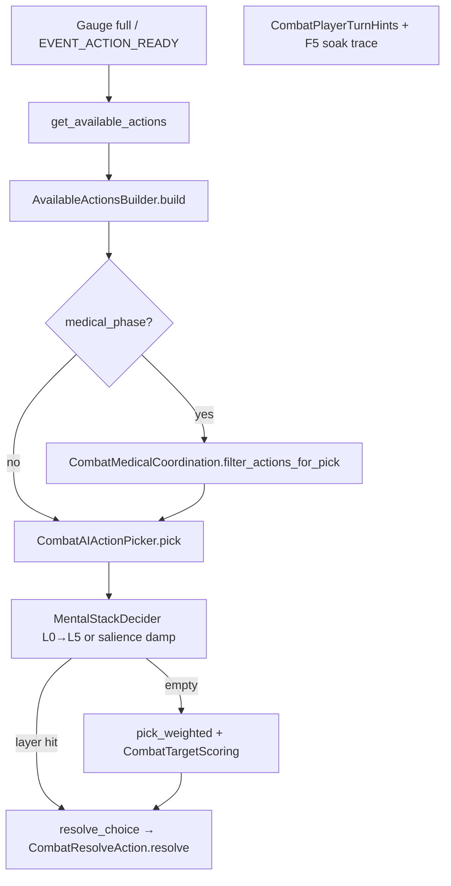

# Shipped combat live paths

<a id="milestone-summary"></a>

**Read:** [`PLANNING.md`](PLANNING.md) · [`CURSOR#what-to-do-next`](CURSOR.md#what-to-do-next) · [`SHIP_PLAN`](SHIP_PLAN.md) · [**mental stack §9b**](SHIP_PLAN.md#combat-mental-stack-shipped) · scripts [`../scripts/README.md`](../scripts/README.md). Tombstones: [#redirects-tombstones](#redirects-tombstones).

**III-4 Track A (shipped ☑):** engagement geometry bridge — mapped opposition, Skirmish compaction, L4+close, optional Skirmish **`rotate_file`**, campaign **`player_front_count`**, headless **`ii_envelop`** — [#iii-4](#iii-4--engagement-geometry-audit). **Track B (Expand):** IV-9 gap-column. **Expand (post–Camp-5):** [#phase-4--new-systems-formal-tracks](#phase-4--new-systems-formal-tracks) · [`SHIP_PLAN` §9c](SHIP_PLAN.md#combat-expand-registry). **No** player target picker.

<a id="tier-1-spec"></a>

## Tier 0–1 — formation / range

| Area | Modules | Harness |
|------|---------|---------|
| Plugs / flow | `CombatFormationFlow`, `CombatFormationVacancyPlugs` | `_run_vacancy_*`, `_run_plug_*` |
| Cohesion / mode | `CombatFormationEngagement`, `CombatEngagementMode` | `_run_posture_*`, `_run_engagement_*` |
| Lanes / ZoC | `CombatPairGeometry`, `CombatDistanceBands`, `TacticalCombat`, `ZoneOfControl` · **III-4:** `EngagementOpposition` (PR2 ☑) | `_run_lane_offset_*`, `_run_depth_polearm_*`, `_run_surround_*`, `_run_sector_surround_*` · III-4: `_run_opposition_offset_seeded_at_start`, `_run_geometry_skirmish_wide_line_no_compact`, `_run_skirmish_outnumber_allows_rotate_file`, `_run_mental_stack_hold_line_attempt_close_wing` |
| Close | `CombatMeleeListing`, `CombatEngagementResolver` | `_run_attempt_close_*`, `_run_close_slot_cap_*` |

<a id="development-gate-line-crash--intrusions-removed"></a>
<a id="d-005-surround"></a>
<a id="d-005--surround-arc-occupancy--shipped"></a>

`attempt_close` at LONG (max 3 CLOSE) · **D-008** no line crash · **D-005** `CombatSurroundArcOccupancy` / `FEATURE_SURROUND_ARC_OCCUPANCY` (±38°, blocked ×0.35; sector load when `is_feature_sector_surround_load()`).

<a id="tier-3--parry--bind--guards"></a>
<a id="tier-0--formation--parry-choice"></a>
<a id="d-006-guard-lines"></a>
<a id="d-006--hema-eight-guard-lines--shipped"></a>
<a id="d-007--parry-telegraph--shipped"></a>

## Tier 3 — parry / bind / guards

`DefenseChoiceResolver`, `CombatIncomingParryChoice` (**D-007**), `CombatGuardLines` (**D-006**) · `PARRY_DEFLECT_THRESHOLD` **1.08**, `PARRY_BIND_CONTROL_THRESHOLD` **0.65** · `_run_parry_*`, `_run_bind_*`, `_run_*guard*`.

<a id="tier-4--ai--footwork--flurry"></a>

## Tier 4 — AI / footwork / flurry

`CombatTargetScoring`, `CombatAIActionPicker`, `CombatFootwork`, `CounterTempo`, `CombatAttention`, `CombatFlurryBind`, `MentalStackDecider` · tails: `Tier1Tail`, `FeintTempoTail`, `AttentionFootworkTail`.

**Wiring order (turn pick, defense, UI):** [#combat-cognition-pipeline](#combat-cognition-pipeline) · anchors [#tier-43-mental-stack--combat-attention](#tier-43-mental-stack--combat-attention) · [#tier-44-spatial-footwork-deferred](#tier-44-spatial-footwork-deferred).

<a id="combat-cognition-pipeline"></a>
<a id="combat-turn-pipeline"></a>

## Combat cognition & turn pipeline (logical order)

Canonical map for **how combat variables connect**. Campaign ship ([`SHIP_PLAN`](SHIP_PLAN.md)) must **read** this when touching battle UI or med efficacy — do **not** fork listing/pick logic in `world/*`.

### A. Frame loop (every tick)

Order in **`CombatProcessTick.tick`** → **`CombatEventDispatch.process_event_queue`** (due events first) → per-combatant state:

| Step | Module | Updates |
|------|--------|---------|
| 1 | `CombatEventScheduler` / queue | `EVENT_ACTION_READY`, `EVENT_MELEE_ATTACK`, formation resolves, … |
| 2 | `EntityTimeAdvance` + wounds | `CoreEntity` blood, pain, bleed on scene nodes |
| 3 | `CombatStateHandlers.process_waiting` | `guard`, `stamina`, `CombatExhaustion`, `CounterTempo.process_waiting`, `CombatFlurryBind`, **`CombatUiHints.refresh_waiting_tick_stamps`** → **`CombatAttention.refresh_for_waiting_tick`** (`COMBATANT_KEY_ATTENTION_UI_HINT`) |
| 4 | `process_wind_up` / medical wind-up / recovering | Attacker telegraph + defender incoming keys; gauge for UI only until `EVENT_MELEE_ATTACK` |

**Rule:** Attention **load/yomi** refresh on **waiting** ticks and again inside **`MentalStackDecider.try_pick`** (`refresh_salience`). UI hints are **display**; they do not choose moves.

### B. Turn commitment (offensive choice) — one path for player and enemy



| Entry | Player | Enemy |
|-------|--------|-------|
| Ready signal | `EVENT_ACTION_READY` → `notify_turn_ready` → `ui/TurnReadyHandler` | `CombatEventDispatch.handle_action_ready` → picker inline |
| After list | `CombatPlayerTurnHints` + `CombatF5SoakTrace.log_turn_ready_player_ui` | — |
| Pick + commit | `CombatAIActionPicker.resolve_picked_turn_or_skip` | same |

**Design lock:** **No player target picking.** Player and enemy both use `CombatAIActionPicker`; the player chooses **doctrine / formation** at campaign level, not per-strike targets. Mental stack + weights shape *which listed action* fires.

### C. `get_available_actions` listing order

`CombatManager.get_available_actions` → vacancy reconcile → **`AvailableActionsBuilder.build`**:

| Order | Branch | Module |
|-------|--------|--------|
| 0 | Dead / wrong state / losing medical side | early `[]` |
| 1 | Receiving care → direct pressure only | `CombatMedicalActionListing` |
| 2 | Normal fight | `CombatMeleeListing` + `CombatFormationMoveListing` |
| 3 | Focus-line listing (companions; leader skips yomi drift) | `CombatAttention.append_focus_line_listing_actions` |
| 4 | `combat_wait` if needed | formation listing |
| 5 | Medical phase winner | medical listing branch |
| 6 | Counter-tempo filter | `CounterTempo.filter_actions_for_counter_tempo` when gauge &lt; 100% |
| 7 | Drop vs dead opponents | builder tail |

Listed action dicts may carry **`ACTION_KEY_COUNTER_TEMPO`**, `target_id`, `target_part`, `is_feint`, formation partner ids — consumed by picker weights and `opts_from_choice`.

### D. Pick order (after listing)

<a id="tier-43-mental-stack--combat-attention"></a>

#### Mental stack layers (shipped — `MentalStackDecider.gd`)

Priority is **strict top-to-bottom**; first non-empty pool wins. Each layer uses **`pick_weighted`** inside its pool (same medical urgency / target scoring as utility pick).

| Layer | Stamp | Trigger | Action pool |
|-------|-------|---------|-------------|
| **(retreat)** | — | `cannot_commit_melee` | Retreat-filtered list only |
| **L0** | `self_medical` | `manager._is_in_immediate_peril(self)` | Coordinated **self** medical (`CombatMedicalCoordination.medical_action_allowed`) |
| **L1** | `medical` | `CombatAttention.ally_in_immediate_peril` | Coordinated **ally** medical (not duplicate wind-up / compression rules) |
| **L2** | `counter` | `CounterTempo.can_act` | `ACTION_KEY_COUNTER_TEMPO` only |
| **L3** | `incoming` | Wind-up telegraph or incoming attacker id | Counter actions **or** melee vs that attacker (no med / no `attempt_close`) |
| **L4** | `hold_line` | Menu is reserve posture only (`wait`, focus, **`attempt_close`**) — **not** if `rotate_file` or melee listed | **Shipped:** focus, wait, or **`pick_weighted`** `attempt_close` when wing lacks mapped opposition + LONG — [§III-4](#iii-4--engagement-geometry-audit) · [§9b](SHIP_PLAN.md#combat-mental-stack-shipped). **3b:** `rotate_file` breaks reserve posture → utility pick |
| **L5** | `exhaustion` | `CombatExhaustion.exhaustion_tunnel_active` (**MS-L7**) | Wait, flee, fall_back, formation disengage, focus lines — not fresh offense |
| **—** | *(cleared)* | No layer matched | **`pick_weighted`** with **salience offense damp** + gradual exhaustion offense damp (below tunnel threshold) |

**Salience damp (utility pick):** when no layer fires and `attention_load` &gt; 0, offensive weights (attacks, feints, `attempt_close`) multiply by `lerp(1, 1 - MENTAL_STACK_SALIENCE_OFFENSE_DAMP_MAX, load)` — distracted fighters still act, but less eager to open new offense. Formation / wait / focus weights unchanged.

**Attention (parallel, not a pick layer):** `refresh_salience` sets `attention_load` from telegraph + ally peril + counter window; yomi + focus affect **defense** and feint **listing** weights. See §E.

| Stage | Module | Behavior |
|-------|--------|----------|
| 1 | `MentalStackDecider.try_pick` | Layers L0→L5 above |
| 2 | `CombatAIActionPicker.pick_weighted` | `_get_action_weight` + salience damp on offense |
| 3 | `_add_attack_target_part` | Pathway / unguarded part on chosen attack |
| 4 | `resolve_choice` | `opts_from_choice` → `CombatResolveAction` |

On stack pick: stamps **`COMBATANT_KEY_MENTAL_STACK_LAYER`**. **`try_pick`** clears the stamp before evaluating layers; only the winning layer remains for UI (`Stack %s`).

#### Mental stack — Expand backlog (realistic influence, no player targets)

| Item | Intent | Module |
|------|--------|--------|
| L5 formation plug | Vacancy / plug forward when line breaks | `MentalStackDecider` + formation listing |
| L6 rout / cohesion | `CombatFormationRout` thresholds → flee / fall_back layer | `CombatFormationRout`, stack |
| Medical mid-fight | If in-fight ally aid is listed later, L1 already coordinated | `CombatMedicalActionListing` |
| Campaign traits | Morale / stress → layer thresholds (post Camp-5) | bridge meta, not `CompanyState` in `combat/*` |

Harness: `CombatRegressionHarnessAttentionFootworkTail` — full `_run_mental_stack_*` list in [§G](#g-feature-flags-combatconstantsgd). Ship plan: [`SHIP_PLAN` §9b](SHIP_PLAN.md#combat-mental-stack-shipped).

### E. Passive defense (separate from turn pick)

Runs at **strike contact**, not on `turn_ready`:

| Step | Module |
|------|--------|
| Wind-up stamps `pending_attack` / telegraph on defender | `AttackWindUpStarter`, guard-line updater |
| Resolve hit | `AttackResolver` → **`DefenseChoiceResolver.choose_defense`** |
| Optional active parry branch | `CombatIncomingParryChoice` when `FEATURE_INCOMING_PARRY_CHOICE` |

**Uses attention state:** `focus_part`, `focus_intensity`, `attention_load`, `yomi_by_attacker`, feint read-through thresholds — tuned in **`CombatConstants`** (Tier 4.2–4.3). Yomi updates on parry outcomes; feeds later **listing** weights and focus drift (not party leader).

### F. Combatant dict keys (Tier 4.3 — do not rename without harness + F5)

| Key | Set by | Read by |
|-----|--------|---------|
| `focus_part`, `focus_intensity` | `CombatAttention.set_focus` / drift / focus moves | `DefenseChoiceResolver`, guard zone, UI |
| `attention_load` | `CombatAttention.refresh_salience` | Defense penalties, UI |
| `yomi_by_attacker` | `CombatAttention` on parry/memory | Feint listing, focus drift |
| `attention_ui_hint` | `refresh_for_waiting_tick` | `BattleUIUpdater` via `CombatUiHints` |
| `mental_stack_layer` | `MentalStackDecider` | Gauge suffix / soak `Stack *` |
| `incoming_attack_telegraph_part` | Wind-up / telegraph | Salience, L3 incoming, dodge eval |

### G. Feature flags (`CombatConstants.gd`)

| Flag | Affects |
|------|---------|
| `is_feature_mental_stack_ai_enabled()` | L0–L5 override + salience offense damp + MS-L7 exhaustion damp |
| `is_feature_combat_attention_enabled()` | Salience, yomi, focus listings, UI hints |
| `is_feature_position_angle_footwork_enabled()` | `CombatFootwork` — separate from [#tier-44-spatial-footwork-deferred](#tier-44-spatial-footwork-deferred) expansion |
| `is_feature_counter_tempo_load` | Counter window + L2 stack + gauge **Counter!** |
| Tier 3 | `FEATURE_INCOMING_PARRY_CHOICE`, `FEATURE_HEMA_EIGHT_GUARD_LINES`, … |

Harness: **`CombatRegressionHarnessAttentionFootworkTail`** — `_run_attention_*`, `_run_mental_stack_medical_overrides_attack`, `_run_mental_stack_self_peril_before_ally_medical`, `_run_mental_stack_hold_line_only_picks_focus_or_wait`, `_run_mental_stack_incoming_windup_prefers_defense`, `_run_mental_stack_counter_over_plain_attack_when_window_open`, `_run_mental_stack_attack_layer_baseline_weights`, `_run_mental_stack_stamps_layer_on_medical_pick`, `_run_attention_ui_hint_includes_mental_stack_layer`. F5: `turn_ready_gauge`, `tooltip_match=*`, `Stack *` on gauge. Plan: [`SHIP_PLAN` §9b](SHIP_PLAN.md#combat-mental-stack-shipped).

### H. Campaign ↔ combat boundaries (ship)

| Campaign touches | Combat reads | Do not |
|------------------|--------------|--------|
| `encounter_config` on world meta | `CombatManager.start` — doctrine, posture, depth mults, rout thresholds | Reimplement pick/listing in `world/*` |
| Camp-2.3 med supplies | `CoreEntity.get_medical_effectiveness()` → medical **weights** | Import `CompanyState` in `combat/*` |
| Camp-3.3 hints | `CombatUiHints`, `BattleUIUpdater` | Change `MentalStackDecider` order for tutorial |
| Camp-2.5 stabilize (shipped) | `stabilize_wound` in `MedicalPhaseController` / `CombatMedicalActionListing`; −1 med via `CompanyState.on_battle_medical_complete` | Bypass `CombatMedicalCoordination` overlap rules |

Mental-stack **Expand** items: table in [§D](#d-pick-order-after-listing) · [#post-expansion-backlog](#post-expansion-backlog). **Not** player target UI.

### I. Safe extension checklist

1. New **high-priority** behavior → new `MentalStackDecider` layer **above** weighted pick (or filter in builder if not a pick override).
2. New **listed move** → smallest listing module + weight in `_get_action_weight` + harness row.
3. New **defense reaction** → `DefenseChoiceResolver` / `AttackResolver`, not picker.
4. New **UI suffix** → stamp in `CombatAttention` or `CombatUiHints`; mirror in `CombatF5SoakTrace` if ship-gated.
5. One `FEATURE_*` per PR; run `run_all_combat_checks.ps1`.

<a id="tier-5--kinematic-delivery"></a>
<a id="closed-simulation-s11"></a>
<a id="closed-material-p3b"></a>

## Tier 5 — kinematic + simulation (maintain only)

Kinematic: `ImpactVelocityModel`, `WeaponSwingPhysics`, `AttackResolver` — `_run_kinematic_delivery_*`. Sim/P3b: `_run_sim_*`, `_run_mat_*`, `_run_mat_production_*` (`CombatRegressionHarnessSimulation.gd`). Gate: `p3b_full_including_energy_pool_joule_armor_and_literal_blood_ml` · lethality [#12-tuning-order](#12-tuning-order-keep-research-chain).

<a id="f5-combat-diagnostic-tiers"></a>
<a id="hit_resolve"></a>
<a id="strike_avoided"></a>

### F5 combat Output tiers (`main.tscn`)

Editor play session (`OperationalLog.begin_play_session`) layers diagnostics. Grep after each fight: `hit_resolve reason=` · `strike_avoided reason=` · `hit_outcome_stats` · `parry_stats` · `diagram_banner player:` · `diagram_banner enemy:` (II-8) · `engagement_transition` · `encounter_context` · `soak_fight_end` (not verbose `phase_end winner=` — headless D-001 keeps that) · `hit_coverage_hint` (when no hits landed).

| Tier | Inspector / const | Output grep | Use |
|------|-------------------|-------------|-----|
| **Play session** | F5 (default) | `[Combat.Flow]` turn picks · `FP_COMBAT` milestones | Formation, gauge, `diagram_banner`, `engagement_transition` |
| **Hit summary** | `dev_hit_summary` (default on) | `hit_resolve reason=` · `strike_avoided reason=` · `hit_outcome_stats` | Per-strike outcome without full debug spam |
| **Research feel** | `dev_research_feel` | `research_feel` | Q1 calibration: cut/blunt/bone, pen_mm, ke_frac (best with `dev_soak_encounter=ii2b`) |
| **Per-hit debug** | `COMBAT_DEBUG` or research feel | `[Combat.Debug]` · armor traces | Deep tuning; avoid piping to `grep` in PowerShell |

**Reading parry lines:** `parry_partial … rem=0.85` — **rem** is follow-through fraction (1.0 ≈ full damage continues), not blocked damage.

**Zero damage:** combat log and **`hit_resolve`** include **`reason=`** (e.g. `armor stopped`, `glancing — tissue below threshold`, `graze — rounds to 0 counted HP`, `attack missed`) — not bare `0 dmg`.

**Body UI:** battle row labels use one decimal when tissue HP chips below integer (`29.8|0.2`). Row **`last_hit_label`**: Hit/Graze/Deflected/Miss/Dodged/Partial parry with the same reason text when HP does not chip.

<a id="research-audit"></a>
<a id="every-session-step-0"></a>
<a id="enable-per-hit-research_feel-lines"></a>
<a id="f5-optional-crosswalk-feel-vs-headless"></a>

**Research audit:** `.calibration_audit.txt` · `CombatResearchAnchors.gd` · `_run_research_*` (`RESEARCH_HARNESS_GATE_IDS`, 35 gates). Fail → fix constants/anchors + [`CURSOR` decision log](CURSOR.md#decision-log). **`note`** rows: ignore (`cut_bone_pen_gate_mm`, `forearm_blunt_fracture_anchor_J`, `layer_rupture_subcut_bleed_mult`, `blunt_fracture_scaling`, `human_head_tissue_pct`). F5: [#playtest-q1](#playtest-q1-research-feel-duel) · `dev_research_feel`+ii2b · [#enable-per-hit-research_feel-lines](#enable-per-hit-research_feel-lines). **§1/§6/§10:** [#bleeding-physics](#bleeding-physics). **Edit:** `BleedingConstants` · `CombatResearchAnchors` · `species/*.tres` · `CombatCalibrationAudit` · [#production-flags](#production-flags). One `FEATURE_*` per PR.

<a id="tier-6--medical--flee"></a>
<a id="bleeding-units"></a>
<a id="d-003--medical-pack-bc--shipped"></a>

## Tier 6 — medical / flee

`EntityMedical`, `MedicalPhaseController`, `CombatMedicalCoordination`, `CombatFormationFlee` · `_run_medical_*`, `_run_pack_wound_*`, `_run_flee_*`, `_run_ambient_pain_shock_*` · `MedicalPhaseTail`.

**Bleeding (D-003):** `BleedingConstants.gd` — [#bleeding-physics](#bleeding-physics).

**Medical phase:** `medical_phase_winner` locks end-combat side; party wipe does not flip winner. Post-victory: losers `[]`; winner medical-only; losers blocked via `MedicalPhaseController.POST_VICTORY_BLOCKED_EVENT_TYPES`. Harness: `_run_medical_phase_winner_*`, `_run_medical_phase_winner_listing_medical_only`. Fast iteration (12 tests): `.\scripts\run_all_combat_checks.ps1 -HarnessMode medical`.

<a id="bleeding-physics"></a>

### Bleeding physics and units

`BleedingConstants.gd` · `CombatResearchAnchors.gd` · `.calibration_audit.txt` `[research_benchmarks]`.

| Quantity | Unit | Notes |
|----------|------|--------|
| `blood_volume` | **%** (0–100) | UI, ATLS class, death threshold |
| `blood_volume_ml` | **mL** | Pool when `FEATURE_LITERAL_BLOOD_ML` on |
| Wound `bleeding_rate` | **abstract HP/s** | Severity × part × sub-region × arterial |
| `BLOOD_LOSS_RATE_MULTIPLIER` | **dimensionless** | HP/s → % blood lost per second |

<a id="1-hemorrhage-and-atls-blood-volume-ttd"></a>

**ATLS (remaining blood %):** I ≥85 · II ≥70 · III ≥60 · IV death at **35%** remaining.

**Reference uncontrolled bleed:** `BLEEDING_RATES[cut][critical] × head × arterial` = **13.5 HP/s**.

**TTD:** `(blood_volume − threshold) / (rate × BLOOD_LOSS_RATE_MULTIPLIER × loss_mult)` → default **~48 s**; tune mult for **30–120 s** band. Direct pressure `loss_mult = 0.5` → ~2× TTD.

<a id="5-literal-blood-volume-ml"></a>

**Literal mL:** human **75 kg → 5250 mL** · goblin **38 kg → 2660 mL** (`species/*.tres`, `CombatDesignAnchors`).

<a id="6-gaps-and-recommended-follow-ups"></a>

**Arterial chance (cut):** critical **0.26** → severe **0.14** → moderate **0.06** → minor **0.01**; crush ×0.35. Triage **90 s** / **45 s** vs ref TTD **~48 s**.

<a id="10-blunt-fracture-j-vs-nm-biomechanics-note"></a>

**Clotting** `exp(-k×Δt)` · **pain** human ref **~3.0** / **~2** hits → NRS 4 · **blunt KE** oberhau **~137 J**, arm **22 J** (rank-order only).

<a id="12-tuning-order-keep-research-chain"></a>

**Tuning order:** (1) `BLEEDING_RATES` (2) `REFERENCE_UNCONTROLLED_BLEED_RATE` (3) `BLOOD_LOSS_RATE_MULTIPLIER` (4) part mults (5) death threshold + ATLS doc · then `run_all_combat_checks.ps1`.

<a id="d-004-exhaustion"></a>
<a id="d-004--exhaustion-index--shipped-mxm"></a>
<a id="mxm--exhaustion-index-d-004-m7a"></a>
<a id="mxm--exhaustion-index-d-004-m7a-extension"></a>
<a id="ii-4d--stamina-and-exhaustion-feel"></a>

**D-004:** `CombatExhaustion` · gauge **`Exh N%`** · F5 **ii4d** (3–5 min duel).

**MXm-3 (shipped):** burst **`Stm N%`** = `stamina_ratio()` vs `CombatExhaustion.effective_stamina_max()` (exhaustion + blood caps, floor 0.7 each). `clamp_stamina_to_effective_max` after spend. Refill rate scales down at high exhaustion. Progress bar always maps to burst stamina; counter-tempo readiness is label-only (`Rdy N%` / `Counter!`). `ZoneOfControl` opponent pressure and aggressive-stance gates use **`stamina_ratio`**, not absolute `/ STAMINA_MAX`.

**MS-L7 (shipped):** `MentalStackDecider` **L5** (`Stack exhaustion`) + gradual offense damp in `CombatAIActionPicker` below tunnel threshold — harness `_run_mental_stack_exhaustion_tunnel_*`; threshold tune in **p4a** only.

<a id="battle-ui"></a>

## Battle UI

Data sources: [#combat-cognition-pipeline](#combat-cognition-pipeline) (§F keys, §B turn path).

| UI piece | Combat source | When updated |
|----------|---------------|--------------|
| Gauge primary | `BattleUIUpdater.gauge_label_text_for_combatant` | `turn_ready`, `_update_ui`, waiting ticks |
| Progress bar | `BattleUIUpdater.gauge_bar_*` | always burst stamina (`effective_stamina_max`); never counter-tempo gauge |
| `Stm` / `Ready` / `Exh` / `Grd` | `stamina_ratio`, `effective_stamina_max`, turn gauge, `CombatExhaustion`, `CombatGuardLines` | waiting + turn ready |
| Attention suffix | `CombatUiHints.attention_hint_text` ← `CombatAttention` | `refresh_for_waiting_tick`; live on player `turn_ready` |
| Stack layer | `COMBATANT_KEY_MENTAL_STACK_LAYER` | last `MentalStackDecider` pick (incl. `exhaustion` MS-L7) |
| Formation line | `CombatPlayerTurnHints` vs row tooltip | player `turn_ready` only |
| Counter tempo | `CounterTempo` + `CombatUiHints.counter_tempo_*` | label `Rdy N%` / `Counter!` (bar stays stamina) |

F5 soak: `turn_ready_gauge`, `tooltip_match=`, `diagram_banner` — `_run_battle_ui_gauge_label_*`, `_run_battle_ui_gauge_bar_*` · validator **ii5a/ii8**.

**Camp-3.3** ([`SHIP_PLAN`](SHIP_PLAN.md#camp-33-battle-medical-phase-hints-combat-led)): one-shot combat-log copy + gauge tooltips in `CombatUiHints` (`emit_medical_phase_session_hints` from `BattleScene._on_enemies_eliminated`); receiving-care primary via `BattleUIUpdater`. Harness: `_run_medical_phase_hints_*`, `_run_medical_phase_gauge_tooltip_*`, `_run_battle_ui_gauge_label_receiving_care_*`. Does not alter §B–D pick order.

<a id="species-calibration"></a>

**Species:** `human.tres` **75 kg** · `goblin.tres` **38 kg** · `feature_derived_limb_capacity` — [#5-literal-blood-volume-ml](#5-literal-blood-volume-ml) · [#research-audit](#research-audit).

<a id="harness-prefixes"></a>

## Harness `_run_*` prefixes

**Run:** `.\scripts\run_all_combat_checks.ps1` (full gate) · fast paths: `-HarnessMode regression|d001|sanity|calibration|medical` ([`scripts/README`](../scripts/README.md)).

`grep '_run_' combat/CombatRegressionHarness.gd` (+ tails, `CombatRegressionHarnessSimulation.gd`). **No** `_run_crash_*` / `_run_intrusion_*`.

| Area | Prefixes |
|------|----------|
| 0–1 | `_run_formation_*`, `_run_vacancy_*`, `_run_engagement_*`, `_run_surround_*`, `_run_depth_polearm_*` |
| 3–4 | `_run_parry_*`, `_run_bind_*`, `_run_guard_*`, `_run_feint_*`, `_run_flurry_*`, `_run_battle_ui_*`, `_run_mental_stack_*`, `_run_attention_*` (`AttentionFootworkTail`) |
| 5 | `_run_kinematic_*`, `_run_sim_*`, `_run_mat_*` |
| 6–7 | `_run_medical_*`, `_run_flee_*`, `_run_research_*`, `_run_f5_headless_*`, `_run_exhaustion_*`, `_run_stamina_effective_*`, `_run_opponent_pressure_*` |

<a id="phase-0-gate"></a>
<a id="calibration-audit"></a>
<a id="headless-gate-authoritative"></a>
<a id="ii-0--baseline-soak-plan-p1"></a>
<a id="f5-d-001-preset-sweep"></a>
<a id="playtest-q1-research-feel-duel"></a>
<a id="playtest-q2-ii2b-bind-riposte-feel"></a>
<a id="d-001-mandatory-tracks-after-ii-0-scenarios"></a>
<a id="d-001--ii-2b--deflect--bind-calibration"></a>
<a id="d-001--ii-5a--formation-action-menu-labels"></a>
<a id="d-001--ii-5c--gauge-suffixes"></a>
<a id="d-001--ii-5b--combat-log-copy"></a>

## Phase 0 (D-001) · II-0 soak

Headless authoritative: `.d001_headless_signoff.txt` `ok=true`. F5 optional: [`Playtest` stream](PLANNING.md#stream-playtest).

`.\scripts\run_all_combat_checks.ps1` → `FP_HARNESS_OK: AllCombatChecks`. Outputs: `.d001_soak_out.txt`, `.f5_soak_validation.txt`, `.calibration_audit.txt`, `.d001_soak_sanity_out.txt`. `CombatD001SoakRunner` (incl. **ii7** pack-wound + **formation_move_f5** `rotate_file@` greps), `CombatD001SoakSanity`, `CombatF5SoakLogValidator`. Fast paths: `run_all_combat_checks.ps1 -HarnessMode regression|d001|sanity|calibration|medical` ([`scripts/README.md`](../scripts/README.md)). Summary: `print_phase0_status.ps1`. No harness piping to `grep`.

| # | Headless | F5 glance |
|---|----------|-----------|
| 1 | **ii2b** ×3 | duel feel |
| 3 | **ii3** + 7v7 | Arc overlap |
| 4 | **ii5a**/**ii8** | tooltips |
| 5 | **ii5** fall_back | cyan tile |
| 6 | **ii6** pain shock | wait |
| 7 | **ii7** medical | pack |
| 8 | **ii1e**/**ii8** | diagram |
| — | **ii4d** Exh | 3–5 min |

F5 workflow: optional `dev_soak_encounter` → `.f5_soak_in.txt` → `validate_f5_soak_log.ps1` (multi-fight: `append_f5_soak_log.ps1`). Validator smoke (no F5): copy `docs/f5_soak_log.example.txt` → `.f5_soak_in.txt`. Q helpers: `run_q_feel.ps1 -Track Q1|Q2` · `run_q_audit.ps1 -Track Track`. Mandatory II-2b/5a/5b/5c/4d: headless ☑.

<a id="integration-archive"></a>
<a id="run-this-plan-cursor"></a>
<a id="integration-wiring-index"></a>
<a id="phase-3--integration-depth-shipped--deeper-wiring"></a>
<a id="production-flags"></a>
<a id="tier-5-simulation-flags-2026-05"></a>
<a id="phase-4--new-systems-formal-tracks"></a>
<a id="before-you-add-a-new-combat-tier"></a>
<a id="iii-3--deflect--bind-calibration-loop-m3c"></a>
<a id="integration-depth-phase-3"></a>
<a id="p4-playbooks-expansion"></a>
<a id="combat-expand-registry"></a>

## Integration

POST **0–2** done · **Phase 3** (deepen shipped) + **Phase 4** (new systems) + **P4 playbooks** → [`Expand` stream](PLANNING.md#stream-expand) after [`Camp-5`](SHIP_PLAN.md#camp-5-ea-checklist) unless a Camp row needs map↔battle. **Ship plan mirror:** [`SHIP_PLAN` §9c](SHIP_PLAN.md#combat-expand-registry).

**Flags** (`CombatConstants.gd`): `is_feature_sector_surround_load`, `FEATURE_SURROUND_ARC_OCCUPANCY`, `FEATURE_HEMA_EIGHT_GUARD_LINES`, `FEATURE_FLURRY_BIND_EXCHANGE`, `FEATURE_INCOMING_PARRY_CHOICE`, `FEATURE_AMBIENT_PAIN_SHOCK`, position-angle footwork, `FEATURE_FIGHT_EXHAUSTION_INDEX`, `FEATURE_AUTOMATIC_DOCTRINE`, `FEATURE_JOULE_ARMOR_BUDGET`, **`is_feature_mental_stack_ai_enabled`**, **`is_feature_combat_attention_enabled`**. Cognition: [#combat-cognition-pipeline](#combat-cognition-pipeline). **D-tracks:** D-001 ☑ · D-003–007 shipped · D-008 removed.

New tier: harness row + one line in a tier table + row here — see [#redirects-tombstones](#redirects-tombstones) for deleted plan prose (full **IV-1…13** text was in `POST_MILESTONE_INTEGRATION_PLAN.md`).

### During Campaign ship (maintain only — not Expand)

| Area | Action | Doc |
|------|--------|-----|
| Phase 0 gate | `run_all_combat_checks.ps1` every merge | [#phase-0-gate](#phase-0-gate) |
| Tier 4.3 mental stack | L0–L4 + MS-L7 L5 + salience damp; no regress | [§9b `SHIP_PLAN`](SHIP_PLAN.md#combat-mental-stack-shipped) |
| Camp-3.3 | **Shipped** — maintain one-shot hints + busy gauge (`_run_medical_phase_*`) | [`SHIP_PLAN` Camp-3.3](SHIP_PLAN.md#camp-33-battle-medical-phase-hints-combat-led) |
| Camp-2.3 / 2.5 | **Shipped** — med efficacy + stabilize listing (maintain harness rows) | [`SHIP_PLAN` Camp-2](SHIP_PLAN.md#camp-2-sim-campaign-bridge) |
| Bleed / BMI / new `FEATURE_*` | **Frozen** unless user asks | [`PLANNING` harness policy](PLANNING.md#harness-and-flags) |

### Phase 3 — Integration depth (deepen shipped code)

Prefer harness + soak before constants churn. **III-4** is the active investigation for outnumber / wing engagement ([#iii-4](#iii-4--engagement-geometry-audit)); other III rows stay maintain-or-Expand unless listed below.

| ID | Status | Intent | Primary modules |
|----|--------|--------|-----------------|
| **III-1** | Partial | Surround sector load + **multi-incoming** parry target scoring | `CombatSurroundArcOccupancy`, `TacticalCombat`, `CombatIncomingParryChoice` |
| **III-2** | Partial | Guard-line fidelity (**D-006** eight lines shipped); BP6 interpose undecided | `CombatGuardLines`, `DefenseChoiceResolver` — blocks **IV-4** / **IV-5** |
| **III-3** | Active | Deflect/bind calibration loop (editor **ii2b** + Q2 + `.calibration_audit.txt`) | `DefenseChoiceResolver`, `PARRY_DEFLECT_THRESHOLD` — [#iii-3](#iii-3--deflect--bind-calibration-loop-m3c) |
| **III-4** | **Active (Track A ☑)** | Engagement geometry audit + **Track A bridge** (7v3 outnumber / wings) — [#iii-4](#iii-4--engagement-geometry-audit) | `EngagementOpposition`, `CombatTargetScoring`, `CombatFormationVacancyPlugs`, `MentalStackDecider`, `CombatEngagementMode` |
| **III-5** | Partial | Medical **pack** depth vs research table | `CombatMedicalActionListing`, `EntityWounds`, **ii7** |
| **III-6** | Open | Back-rank / depth scheduling vs wind-up abort | `CombatStateHandlers`, `CombatDepthPolearm` |
| **III-7** | Maintain | Physics ↔ entity coherence (sim **closed** — no new mat tier) | `AttackResolver`, `core/EntityWounds` |
| **III-8** | Partial | Recovery-cause → passive readiness / footwork mults | `PassiveParryContext`, `CombatFootwork`, feint dodge bias |

<a id="iii-4--engagement-geometry-audit"></a>

### III-4 — Engagement geometry audit & bridge (G2 → G1)

**Problem (example):** Border Skirmish **7 party vs 3 enemies** — campaign sets **`player_front_count: 7`** (single rank) and **`formation_doctrine_enemy: pinch_center`**; enemy `default_for_count(3)` → 3-wide front → **Skirmish**. Before **3a nearest-wing**, only center files matched strict offset `floor((7−3)/2)=2`; outer rank-0 files had no mapped opposition → **L4** **`wait`** / **`rotate_file`** loops. **Shipped:** nearest rank-0 hostile by mapped distance (outer party files ↔ outer enemy files) + enemy pinch (same as Escort).

**Symptom breakdown (pre–Track A baseline → shipped):**

| Unit class | Typical slot | Before Track A | Shipped (Track A) | Lever |
|------------|--------------|----------------|-------------------|-------|
| Rank-0 center (e.g. party files 2–4 on 7v3) | strict offset + nearest | melee or close | utility / L3 / close | **3a** mapped opposition |
| Rank-0 wings (e.g. party files 0–1, 5–6 on 7v3) | often LONG, no strict pair | L4 → **`wait`** | **nearest-wing** → file-opposed weight + melee; L4 close only when no rank-0 map (**3d**) | **3a** + **3d**; **3b** `rotate_file` optional |
| Rank-1 (files 0–1) | depth polearm or reserve | wait/focus or thrust lane | L4 or utility | **III-6** back-rank (later) |
| Skirmish compaction | any | slots repacked `0..n-1` | wider side keeps span when outnumbering | **2b** |

**Cognition path:** [#combat-cognition-pipeline](#combat-cognition-pipeline) → L4 when reserve posture only → `_pick_hold_line_action` may **`pick_weighted`** listed **`attempt_close`** when wing lacks mapped opposition + LONG ([#tier-43 L4](#tier-43-mental-stack--combat-attention)). **`rotate_file`** on menu exits L4 → utility pick (**3b**).

**Two tracks** (do not mix flags or stream ownership):

| Track | When | Deliverable | `FEATURE_*` |
|-------|------|-------------|-------------|
| **A — bridge** | Combat maintain (pre–Camp-5 OK) | Mapped opposition, compaction gate, Skirmish **`rotate_file`** exception (**3b**), L4+close (**3d**), campaign preset keys (**3c**) | **None** — harness only ([`PLANNING` policy](PLANNING.md#harness-and-flags)) |
| **B — IV-9** | Expand post–Camp-5 | Gap-column slot topology | `FEATURE_GAP_COLUMN_TOPOLOGY` (one per PR) |

**Model lock:** Each side has **independent** file indices `0..files-1` (`CombatFormationSetup`). There is **no shared slot grid**. Track A uses a **logical opposition offset** seeded at `start()` — not physical “move enemies into player columns.” **`CombatPairGeometry`** keeps raw `|Δfile|` for reach/bands until IV-9 (**I11**).

#### Terminology — two different “footwork” systems

Do **not** conflate these when reading PR slices or harness rows:

| Name in docs / code | Module | What it does | Track A? |
|---------------------|--------|--------------|----------|
| **Formation moves** (plan **3b**) | `CombatFormationMoveListing`, `CombatEngagementMode.movement_policy`, `CombatFormationFlow` | Rank/file reshuffle: `swap_rank`, `drag_back`, `fall_back`, **`rotate_file`**, `flee` | **3b** touches **`rotate_file` only** in Skirmish (see below) |
| **Position-angle footwork** (Tier 4.4 pilot) | `CombatFootwork.gd` | Abstract attack/defense **angle offset** on wind-up / parry / dodge (`FEATURE_POSITION_ANGLE_FOOTWORK`) | **No** — deferred [#tier-44-spatial-footwork-deferred](#tier-44-spatial-footwork-deferred); III-8 partial only |

Track A fixes **wing engagement** via mapped opposition (**3a**), compaction (**2b**), and L4 **`attempt_close`** (**3d**). **`rotate_file`** (**3b**) is optional lateral shuffle polish — not required for the minimum 7v3 wing fix.

#### Shipped constants (reference — do not churn without harness)

| Constant | Value | Effect on 7v3 |
|----------|-------|----------------|
| `FORMATION_MAX_FRONT_FILES_DEFAULT` | 5 | `default_for_count(7)` → 5 front, 2 rear |
| `ENGAGEMENT_FORMATION_MIN_ACTIVE_PER_SIDE` | 4 | 3 enemies → raw **Skirmish** (not Formation line) |
| `snapshot_is_true_duel` | `player_active == 1` **and** `enemy_active == 1` | 7v2 / 7v1 mop-up stays **Skirmish**; `rotate_file` when outnumbering files only |
| `can_stay_formation_from_snapshot` | active ≥ `ENGAGEMENT_FORMATION_MIN_ACTIVE_PER_SIDE` both sides | 7v5→7v2 drops formation hysteresis → Skirmish tools |
| `AI_ATTRITION_LOW_STANDING_MAX` | 2 | AI attrition offense damp per side only (not mode classifier) |
| `DEPTH_POLEARM_MAX_THRUST_LATERAL_FILES` | 1 | Depth thrust uses **raw** Δfile (unchanged Track A) |
| `CLOSE_SLOTS_PER_TARGET` | 3 (+ tight bonus) | Wings can share close slots on same defender |
| `DOCTRINE_PINCH_INWARD_BIAS_PER_FILE` | 0.18 | Weight-only pinch today; Escort enemy doctrine only |

**Track A constant (PR 3b ☑):** `SKIRMISH_ROTATE_OUTNUMBER_FILE_MARGIN` — minimum `player_files - enemy_files` before Skirmish allows **`rotate_file`** only (prefer exception over lowering `ENGAGEMENT_FORMATION_MIN_ACTIVE_PER_SIDE`). **`swap_rank`**, **`drag_back`**, and **`fall_back`** stay **Formation-mode only** — they need `formation_ranks > 1` and stable line; Skirmish 7v3 does not widen those gates in Track A.

#### Formation moves — shipped execution (read before **3b**)

**Listing order** (`AvailableActionsBuilder.build`): `CombatMeleeListing` first, then `CombatFormationMoveListing.append_formation_move_actions` (same `zone_geometry_line_context` cache per combatant).

**Policy gate (shipped):** `allow_swap_rank`, `allow_drag_back`, and `allow_fall_back` require **Formation** mode. **`rotate_file`** uses **`allow_rotate_file_for_formation(manager, formation_id)`** — Formation always; Skirmish when that side outnumbers (**3b**). Listing + resolve both call the helper (not raw `movement_policy` alone).

**Dual gate:** `CombatResolveAction` re-checks the same rotate helper at commit — listing alone is insufficient.

| Move | Listing rules (summary) | Skirmish outnumber (shipped) |
|------|-------------------------|------------------------------|
| `rotate_file` | rank 0, `files >= 2`, adjacent same-rank ally, not in cooldown | **Listed** when `our_files > opp_files + margin` (**3b**) |
| `swap_rank` / `drag_back` | `formation_ranks > 1`, partner fitness | **Not listed** (Formation only) |
| `fall_back` | loose discipline + empty rear, or cowering | **Not listed** |
| `flee` | `CombatFormationFlee.flee_action_legal` | Can list |

**After resolve** (`CombatFormationFlow`): formation moves swap rank/file indices, call `repack_lane_offset_after_rank_file_change` (lane offset → column center), then **`manager._recompute_zoc_and_distance()`** + `notify_formation_changed`. This is **contiguous-grid shuffle**, not gap-column envelopment (IV-9).

**AI weights (unchanged by Track A):** `CombatAIActionPicker` — `rotate_file` fixed **0.55** (× blocked-lane mult); `attempt_close` uses full **`hostile_pair_targeting_weight_mult`** when utility pick runs. **3b** only opens the menu; it does not retune weights.

#### Recompute pipeline (authoritative order)

```text
CombatManager.start()
  → CombatFormationSetup.build_formations_and_assign_slots
  → EngagementOpposition.seed_from_formations
  → mark_all_formations_vacancy_dirty
  → seed doctrine / encounter overlays
  → _reset_tactical_engagement_state (cohesion only — **not** full ZoC/bands)
  → vacancy_reconcile_pass(false) + _recompute_zoc_and_distance()  (**III-4 PR2 ☑**)

First geometry refresh (if not already at start):
  → CombatProcessTick frame 1: vacancy_reconcile_pass → [if changed_fids] _recompute_zoc_and_distance
  → or get_available_actions: mark_all dirty → vacancy_reconcile_pass → build()

get_available_actions (every turn list)
  → mark_all_formations_vacancy_dirty → vacancy_reconcile_pass → AvailableActionsBuilder.build

notify_formation_changed / CombatFormationFlow resolves (rotate, swap, drag, flee step)
  → vacancy_reconcile_pass and/or direct manager._recompute_zoc_and_distance

_recompute_zoc_and_distance:
  TacticalCombat.recompute_incursion_pressure
  → ZoneOfControl.recompute_all
  → CombatDistanceBands.update_distance_to_from_formations
  → CombatFormationEngagement.recompute_all  (+ evaluate_automatic_doctrine / pinch pilot)
```

**Turn-1 note:** empty `distance_to` defaults to **LONG** (`CombatantEntityAccess.distance_to_opponent_band`) — wings can list `attempt_close` before first recompute; pair reach still uses live `CombatPairGeometry` in listing.

**`attempt_close` resolve (shipped — Track A does not change):** `CombatEngagementResolver.resolve_close_attempt` — pressure vs evasion roll; on success writes **`distance_to` = CLOSE** inline for the pair. It does **not** call `_recompute_zoc_and_distance` (tactical band patch only). Melee listing on later turns still uses live `CombatPairGeometry` + updated band.

**Track A PR2 option (shipped ☑):** after opposition seed in `start()`, `vacancy_reconcile_pass(false)` then `_recompute_zoc_and_distance()` once before first `EVENT_ACTION_READY`.

**Listing invariant (I0):** Turn menus see slot placement **after** the latest vacancy reconcile on that path. ZoC/bands need not rerun if reconcile changed nothing — intentional.

#### Invariants (audit checklist)

| ID | Invariant |
|----|-----------|
| **I0** | Listing runs after vacancy reconcile on `get_available_actions` / tick paths |
| **I1** | Symmetric distance bands: if A sees B at band X, B sees A at X (existing tier-1 rows) |
| **I2** | `attempt_close` listed only at LONG + free close slot (`CombatMeleeListing`) |
| **I3** | Stamped `pa` pair geometry matches live pair at strike time |
| **I4** | Mapped opposition drives `is_melee_file_opposed_priority` / `wing_lacks_*` consistently (tier-1 pinch rows stay valid or fixtures updated) |
| **I5** | Depth polearm lateral thrust gate still uses raw Δfile until IV-9 (**I11**) |
| **I6** | Formation-move resolves call `_recompute_zoc_and_distance` even when vacancy reconcile returns empty |
| **I7** | Dual occupancy during adjacent-rank moves unchanged unless IV-9 doc says otherwise |
| **I8** | Skirmish wide line: when `player_files > enemy_files`, compaction must not collapse intentional frontage (**2b**) |
| **I9** | `CombatEngagementMode.snapshot` ↔ `TacticalCombat` mode telemetry aligned |
| **I10** | Opposition kind stamped on strike when calibration paths need it |
| **I11** | **Opposition mapping ≠ pair spacing** until IV-9 unifies column topology |

#### G2 consumer audit (functions → primary callers)

| Function / policy | Module | Consumers (non-exhaustive) | Track A touch |
|-------------------|--------|----------------------------|---------------|
| `is_file_opposed_rank0_pair` | `CombatTargetScoring` | `is_melee_file_opposed_priority`, `wing_lacks_file_opposed`, `pinch_score_mult`, `ordered_melee_opponents` | **→ EngagementOpposition** |
| `is_melee_file_opposed_priority` | `CombatTargetScoring` | `file_opposed_mult`, `hold_lane_mult`, `hostile_pair_targeting_weight_mult`, `ordered_melee_opponents` sort | **3a** delegate |
| `file_opposed_mult` / `hold_lane_mult` | `CombatTargetScoring` | `hostile_pair_targeting_weight_mult` → `CombatAIActionPicker._get_action_weight` | **3a** fixtures |
| `hostile_pair_targeting_weight_mult` | `CombatTargetScoring` | `CombatAIActionPicker`, `CombatDebug` targeting trace | **3a** verify weights |
| `pinch_score_mult` | `CombatTargetScoring` | `hostile_pair_targeting_weight_mult`, depth-spear AI mults | tier-1 compat |
| `soft_geometry_score` | `CombatTargetScoring` | `hostile_pair_targeting_weight_mult` | **no change** (uses `eff_dist`) |
| `engagement_mode_targeting_mult` | `CombatTargetScoring` | `hostile_pair_targeting_weight_mult`, AI pick cache | verify Skirmish 7v3 |
| `effective_pair_geometry` / `cached_eff_dist` | `CombatPairGeometry` | `CombatMeleeListing`, `CombatDistanceBands`, `CombatStrikeStamping`, `AttackResolver`, `ZoneOfControl` parry flank | **No change** Track A |
| `can_melee_threaten` | `CombatMeleeListing` | `CombatDistanceBands`, `AttackResolver` resolve gate, `TacticalCombat` surround scan, tier-1 depth rows | verify after bands stable |
| `mid_reach_files` / parry flank spacing | `ZoneOfControl` | `CombatDistanceBands`, flank parry mod (`PARRY_FLANK_EFFECTIVE_FILES_MIN`) | verify only (raw Δfile) |
| `movement_policy` | `CombatEngagementMode` | `CombatFormationMoveListing`, **`CombatResolveAction`** (resolve-time reject) | **3b** outnumber exception |
| `compact_native_line_files_if_thinned` | `CombatFormationVacancyPlugs` | every `reconcile_vacancy_plugs` pass | **2b** gate |
| `repack_lane_offset_after_rank_file_change` | `CombatFormationFlow`, `CombatFormationVacancyPlugs` | after plug / rotate / swap writes | verify only |
| `action_list_is_reserve_posture_only` | `CombatListedActions` | `MentalStackDecider` L4 trigger | doc + **3d** pick |
| `action_list_is_hold_line_only` | `CombatListedActions` | harness / UI hints only (**not** L4 trigger) | doc clarity |
| `_filter_hold_line_actions` | `MentalStackDecider` | L4 pick pool | **3d** add `attempt_close` branch |
| `attempt_close_listed_for_pair` | `CombatMeleeListing` | listing + `CombatAIActionPicker` weight zero at non-LONG | verify after **3a** |
| `zone_geometry_line_context*` | `ZoneOfControl` | listing sort cache (`AvailableActionsBuilder`, `CombatAIActionPicker`, `CombatDebug`) | verify cache invalidation on reconcile |
| `evaluate_automatic_doctrine` | `CombatDoctrine` | `CombatFormationEngagement.recompute_all` (hollow center only) | **p4c** (not Track A) |
| `enemy_line_hollow_center_for_pinch` | `CombatDoctrine` | auto-pinch pilot; uses rank-0 **raw** files on zone geometry fid | **p4c** |
| `refresh_party_formation_meta` | `CampaignEncounterBridge` | every `prepare_combat_from_encounter` | **3c** merge preset keys |

**Numeric superiority auto-pinch** (outnumber without hollow center) is **p4c**, not Track A — do not fold into **3a**.

#### Root-cause stack (7v3 Border Skirmish)

| Priority | Gate | Module | Track A fix |
|:--------:|------|--------|-------------|
| 1 | Skirmish file compaction | `CombatFormationVacancyPlugs._should_compact_native_line_files` (Skirmish → always pack `0..n-1`) | **2b:** skip when outnumbering |
| 2 | L4 ignores `attempt_close` | `MentalStackDecider._filter_hold_line_actions` | **3d:** pick close when reserve-only + wing lacks mapped opposition + LONG |
| 3 | Same-index file opposition | `CombatTargetScoring.is_file_opposed_rank0_pair` | **3a:** `EngagementOpposition` mapped offset + nearest wing |
| 4 | Skirmish **`rotate_file`** when outnumbering | `allow_rotate_file_for_formation` (**3b** ☑) |
| 5 | 5-wide default front | `FormationPreset.default_for_count` / bridge refresh | **3c:** encounter `player_front_count` or `for_front_count(7,7)` |
| 6 | Pinch weight only | `CombatDoctrine` (hollow center auto-pinch) | **p4c** — not Track A |
| 7 | Contiguous columns only | `FormationSlots` | **IV-9** Track B |

**Logical opposition (Track A 3a):** at `start()`, `offset = floor((player_files - enemy_files) / 2)`. Center pairs: `actor.file == opp.file + offset` (direction-aware). Wings: nearest living rank-0 enemy by `|actor.file - (opp.file + offset)|`. **`CombatPairGeometry`** unchanged in Track A.

**Storage contract (PR 2):** seed on manager after formation build — e.g. meta `_opposition_file_offset_by_side: { "player": int, "enemy": int }` (enemy offset = negation of player offset for symmetric queries). `EngagementOpposition.opposition_file_offset(manager, side)` is the only reader; do not scatter width math in consumers.

#### L4 reserve posture — listing vs pick (Track A 3d spec)

**Reserve posture definition** (`CombatListedActions.is_reserve_posture_listing_move_id`): `wait`, focus-line moves, **`attempt_close`**. Anything else — melee, medical, **`rotate_file`**, swap, flee, … — breaks reserve posture.

| Stage | Shipped behavior |
|-------|------------------|
| L4 **trigger** | `action_list_is_reserve_posture_only` — every listed move ∈ {wait, focus, `attempt_close`} |
| L4 **pick pool** | `_filter_hold_line_actions` + listed **`attempt_close`** when wing lacks mapped opposition |
| Pick order inside L4 | 1) focus if incoming telegraph needs retarget 2) **`pick_weighted`** on close pool when wing + LONG 3) else default **`wait`** |
| Harness | `_run_mental_stack_hold_line_only_picks_focus_or_wait` + `_run_mental_stack_hold_line_attempt_close_wing` |

Utility **`pick_weighted`** still applies `_get_action_weight` for `attempt_close` when L4 does not fire (center files with melee listed, or any menu that is not reserve-only).

#### L4 ↔ **3b** interaction (mental stack)

**3d** and **3b** share the same L4 trigger but behave differently once both ship:

| Wing menu (after Track A slices) | `reserve_posture_only`? | Pick layer for `attempt_close` / `rotate_file` |
|----------------------------------|-------------------------|------------------------------------------------|
| wait + focus + close only (**3d**, no **3b**) | **Yes** | **L4** — `pick_weighted` on close pool |
| wait + focus + close + **`rotate_file`** (**3d** + **3b**) | **No** — `rotate_file` ∉ reserve posture | **Utility** — `pick_weighted` on full menu; close vs rotate compete via `_get_action_weight` |
| center file: melee + … | **No** | **Utility** (unchanged) |

**Implementation order implication:** ship **3d (PR7) before or without 3b (PR5)** for Border Skirmish wing fix. **3b** is polish for lateral shuffle after wings already close/melee; it is **not** in the minimum slice. Do **not** add `rotate_file` to `is_reserve_posture_listing_move_id` — that would keep L4 firing and hide rotate from utility competition.

**F5 / hints:** when **3b** lists rotate on a wing, gauge may show utility pick (`Stack` cleared) rather than `Stack hold_line` — expected; soak greps in PR8 must allow both patterns.

#### Module plan

| Module | Role |
|--------|------|
| **`EngagementOpposition.gd`** ☑ | Offset seed, `is_mapped_file_opposed`, `wing_lacks_mapped_opposition` |
| **`CombatTargetScoring.gd`** ☑ | Delegate opposition + `wing_lacks_file_opposed` when meta seeded |
| **`CombatPairGeometry.gd`** | Raw spacing Track A; column graph Track B |
| **`CombatFormationVacancyPlugs.gd`** ☑ | Compaction gate (**2b**); IV-9 disables gap-mode compaction |
| **`CombatEngagementMode.gd`** ☑ | Skirmish outnumber **`rotate_file`** via `allow_rotate_file_for_formation` |
| **`MentalStackDecider.gd`** ☑ | L4+close (**3d**) + harness |
| **`CombatPlayerTurnHints.gd`** ☑ | Wing hint: “no mapped front; close in or adjust guard focus.” |

Do **not** add a monolithic `EngagementGeometry.gd` facade unless IV-9 forces it; prefer smallest owner per [`CURSOR`](CURSOR.md).

#### Secondary consumers (verify Track A — usually no code change)

| Area | Module | Why it matters |
|------|--------|----------------|
| **Pick entry** | `TurnReadyHandler`, `CombatEventDispatch` | Both call `CombatAIActionPicker.pick` after listing — no geometry logic, but F5 traces pass through |
| **Listing cache** | `AvailableActionsBuilder` | Builds one `zone_geometry_line_context` per combatant per list pass |
| **Resolve gate** | `CombatResolveAction` | Re-checks `movement_policy` for `rotate_file` / swap / drag at commit time (**3b** must match listing) |
| **Strike path** | `AttackResolver`, `CombatStrikeStamping` | Stamps `effective_pair_*` from live pair geometry; `can_melee_threaten` abort |
| **Surround / incursion** | `TacticalCombat`, `CombatSurroundArcOccupancy`, `AttackResolver` | Threat scan uses **`can_melee_threaten`** + arc occupancy — flank **pressure**, not opposition mapping |
| **Cohesion / posture** | `CombatFormationEngagement`, `CombatMoraleCohesion` | `front_fill`, `lane_stress_by_file`, posture thresholds on recompute — width affects fill ratio |
| **Depth lane** | `CombatDepthPolearm`, `CombatMeleeRankTargeting` | `depth_polearm_valid_line_threat`, same-file rank-0 ally — uses **raw** file + home fid |
| **Retreat gate** | `CombatMobilityRetreat` | `formation_retreat_only_for` skips melee listing entirely |
| **Scheduler** | `CombatEventScheduler` | Back-rank `action_ready` bump after vacancy; reads `zone_geometry_for_combatant` |
| **Lane stress** | `CombatFormationEngagement._avg_lane_stress` | Per-file `lane_stress_by_file` nested dict — IV-9 gap columns affect keys |
| **UI diagram** | `FormationDiagramBuilder`, `FormationLayoutBuilder`, `BattleUILayout` | Render **raw** rank/file from combatants; wings show empty cells correctly today |
| **F5 / Q4** | `CombatF5SoakTrace`, `scripts/run_q_track_audits.gd` | `tooltip_hold_line`, `turn_ready_formation_line`, Q4 **ii8** `diagram_banner` — update PR7/8 for close copy |
| **Debug** | `CombatDebug` | Targeting trace mirrors listing sort + pair geometry |

#### Explicitly out of scope (Track A)

| Item | Reason |
|------|--------|
| `CombatFootwork.gd` / position-angle pilot | Tier 4.4 deferred — not formation file movement |
| `CombatPairGeometry` / band math | I11 — wings stay LONG until IV-9 |
| Skirmish **`swap_rank` / `drag_back` / `fall_back`** | Need Formation stable line + ranks; **3b** is **`rotate_file` only** |
| `ZoneOfControl.mid_reach_files` retune | Layered tuning; verify only |
| Surround sector / arc occupancy retune | III-1 / D-005 — separate track |
| `PassiveParryContext` / `DefenseChoiceResolver` guard matrix | III-2 / IV-4 — flank **defense** not position |
| `CombatDoctrine` numeric-superiority auto-pinch | **p4c** Expand playbook |
| `FormationLayoutBuilder` grid reparent | Optional layout; not battle logic |
| `CombatEngagementResolver` close contest math | **3d** changes pick only; resolve unchanged |
| Player per-target UI | §9b wontfix |

#### Integration surfaces (by layer)

| Layer | Files |
|-------|-------|
| **Authority** | `FormationSlots`, `CombatFormationSetup`, `CombatFormationVacancyPlugs`, `CombatFormationFlow`, `CombatFormationFlee`, `CombatFormationRout`, `CombatManager`, `CombatantEntityAccess`, `FormationPreset`, `CombatFormationMoveDuration` |
| **Geometry** | `ZoneOfControl`, `CombatPairGeometry`, `CombatDistanceBands`, `TacticalCombat`, `CombatFormationEngagement`, `CombatMoraleCohesion`, `CombatEngagementMode`, `CombatConstants` |
| **Listing** | `CombatMeleeListing`, `CombatMeleeRankTargeting`, `CombatDepthPolearm`, `CombatFormationMoveListing`, `AvailableActionsBuilder`, `CombatListedActions`, `CombatMobilityRetreat` |
| **Cognition** | `CombatTargetScoring`, `CombatAIActionPicker`, `MentalStackDecider`, `CombatDoctrine`, `TurnReadyHandler`, `CombatEventDispatch` |
| **Resolution** | `CombatEngagementResolver`, `CombatResolveAction`, `AttackResolver`, `DefenseChoiceResolver`, `CombatStrikeStamping`, `CombatSurroundArcOccupancy`, `weapon/StrikeRealismProfile` |
| **Tick / schedule** | `CombatProcessTick`, `CombatManager.get_available_actions`, `CombatEventScheduler`, `CombatStateHandlers` (back-rank vs wind-up — **III-6**) |
| **UI / telemetry** | `FormationDiagramBuilder`, `FormationLayoutBuilder`, `BattleUILayout`, `BattleScene`, `CombatCombatantsSnapshot`, `CombatDebug`, `CombatF5SoakTrace`, `CombatPlayerTurnHints`, `CombatUiHints` |
| **Campaign (3c — Campaign leads)** | `PartySetup`, `CampaignEncounterBridge`, `ContractSpawner`, `CombatFlow`, `EncounterNode`, `SoakEncounterPresets` |
| **Harness / audits** | `CombatRegressionHarnessTier1Tail`, `CombatRegressionHarness`, `CombatRegressionHarnessAttentionFootworkTail`, `CombatRegressionHarnessFeintTempoTail`, `CombatRegressionHarnessMedicalMobilityTail` (`movement_policy`), `CombatD001SoakRunner`, `scripts/run_company_state_checks.gd`, `scripts/run_q_track_audits.gd` (Q4 ii8), vacancy / formation-move tails |

Shared files **`CampaignEncounterBridge.gd`**, **`CombatFlow.gd`**: Campaign stream owns Track A **3c**; Combat owns opposition + stack.

#### Track A — PR sequence (harness gate each)

**Hard order:** **PR3 (2b compaction) before PR4 (3a opposition)** — else mapped file span is undone every reconcile. PR2 (offset scaffold) can land with PR3 or PR4.

**Recommended player-visible order:** **PR3 → PR4 → PR7** (minimum slice) **before PR5 (3b)**. **3d** fixes wing `wait` via L4+close; **3b** only matters once wings have non-reserve menus or you want lateral shuffle — shipping **3b** before **3d** does not fix the primary 7v3 symptom.

| PR | Slice | Owner | Harness / soak |
|----|-------|-------|----------------|
| 1 | This section + consumer table (doc) | Combat | — |
| 2 | `EngagementOpposition.gd` + offset meta seed in setup/`start` | Combat | `_run_opposition_offset_seeded_at_start` ☑ |
| 3 | Skirmish compaction gate (**2b**) | Combat | `_run_geometry_skirmish_wide_line_no_compact` ☑ |
| 4 | Mapped opposition delegate (**3a**) | Combat | tier-1 pinch/file-opposed compat (~39 rows in `Tier1Tail`) ☑ |
| 5 | Skirmish outnumber **`rotate_file` only** (**3b**) — optional after PR7 | Combat | `_run_skirmish_outnumber_allows_rotate_file` ☑ |
| 6 | Campaign preset keys + bridge merge (**3c**) | **Campaign** | `_run_camp_3_player_front_count_encounter` ☑ |
| 7 | L4+close + [§9b](SHIP_PLAN.md#combat-mental-stack-shipped) + hints (**3d**) | Combat | `AttentionFootworkTail._run_mental_stack_hold_line_attempt_close_wing` ☑ |
| 8 | Soak preset + acceptance (**ii_envelop**) | Combat + Playtest | D001 `_run_ii_envelop` ☑ |

**Soak (PR 8):** add `SoakEncounterPresets` preset **`ii_envelop`** — 7 living party vs 3 enemies, `WORLD_META_LOCK_PARTY_FORMATION` or explicit `{files:7,ranks:1}` / `player_front_count: 7`; F5 hint line per existing soak pattern. Headless: extend `CombatD001SoakRunner` or tier harness with outnumber fixture.

**F5 grep targets (PR 7–8):** `Stack hold_line`, `pick move_id=attempt_close`, `turn_ready_formation_line`, `gauge_tooltip_formation`, `tooltip_match=hold_line` (extend for close copy), `note_formation_move_pick rotate_file` when **3b** on.

#### Pre-integration checklist (Track A — historical; all items ☑)

**Minimum player-visible slice (no campaign):** PR **3 → 4 → 7** (+ PR2 offset). Skips **3b** rotate and **3c** wider preset; still fixes wing wait on 5×2 vs 3 with default Border Skirmish.

| # | Item | Spec |
|---|------|------|
| 1 | **`EngagementOpposition` API** | `seed_from_formations(manager)` · `opposition_file_offset(manager, side)` · `is_mapped_file_opposed(manager, actor, opp)` · `wing_lacks_mapped_opposition(...)` (wraps rank-0 ref + depth lane like today) · delegate `CombatTargetScoring.is_file_opposed_rank0_pair` only |
| 2 | **Offset math** | `offset_player = floor((player_files - enemy_files) / 2)`; player rank-0 opposed to enemy rank-0 when `player.file == enemy.file + offset_player`; symmetric check from enemy POV with `-offset_player`. **Equal width → offset 0** (backward compatible). |
| 3 | **Meta lifecycle** | Seed after `build_formations_and_assign_slots`; **`CombatManager.stop()`** + **`start()`** clear opposition meta (mirror telemetry meta pattern). |
| 4 | **Compaction 2b (asymmetric)** | In Skirmish, skip `compact_native_line_files_if_thinned` for formation **fid** only when **`our_files > opposing_side_files`** (compare `formations[fid].files` vs opponent formation record). Narrower side may still compact. |
| 5 | **L4 close target (3d)** | Filter listed `attempt_close` into pick pool; use **`CombatAIActionPicker.pick_weighted`** on that pool (same targeting weights as utility) — not arbitrary first entry. Gate: `wing_lacks_mapped_opposition` + LONG band (reuse listing band check). |
| 6 | **Campaign 3c merge order** | `prepare_combat_from_encounter`: apply `ENCOUNTER_KEY_PLAYER_*` → **`world.party_formation` meta** before/alinstead of blind `refresh_party_formation_meta` default. **`CombatFlow`** / **`BattleScene`** read meta — encounter dict alone does not widen preset unless bridge copies it. |
| 7 | **`for_front_count` clamp** | `FormationPreset.for_front_count(n, front)` already clamps `files = mini(front, n)` — document in contract spawn, do not assume 7-wide with &lt;7 living fighters. |
| 8 | **Harness wiring** | Register new `_run_*` in `CombatRegressionHarnessTier1Tail` and/or `AttentionFootworkTail`; invoked from `CombatRegressionHarness.gd` `run_early` / `run` / `run_mid` as appropriate. |
| 9 | **Bootstrap recompute (PR2)** | Consider one-shot `_recompute_zoc_and_distance()` at end of `start()` after offset seed — avoids frame-1 Skirmish compaction racing first listing. |
| 10 | **Gate every PR** | `.\scripts\run_all_combat_checks.ps1` → **PHASE0: PASS**; tier-1 pinch/file-opposed rows green after PR4. |
| 11 | **3b scope** | Skirmish exception for **`allow_rotate_file` only** — update `movement_policy` (or shared helper) consumed by **`CombatFormationMoveListing`** and **`CombatResolveAction`**. Do not widen `allow_swap_rank` / `allow_drag_back` / `allow_fall_back` in Skirmish. |
| 12 | **L4 vs 3b** | Do not classify `rotate_file` as reserve posture. With **3b** on, wing menus leave L4 → utility pick handles close vs rotate. Test both **3d-only** and **3d+3b** in harness / F5. |
| 13 | **Close resolve** | **3d** does not change `CombatEngagementResolver` — success still patches `distance_to` only; no new recompute requirement. |

**Do not implement yet (Track B / other rows):** gap columns · numeric auto-pinch (**p4c**) · MS-L5 plug layer · lower `ENGAGEMENT_FORMATION_MIN_ACTIVE_PER_SIDE` · shared-grid slot moves · `CombatFootwork` tier 4.4 expansion.

#### Track B — IV-9 (post–Camp-5)

| Mode | `file` meaning | Compaction | Opposition |
|------|----------------|------------|------------|
| **Legacy** (flag off) | Contiguous column index | Skirmish packs unless **I8** gate | Mapped (Track A) or same-file |
| **Gap-column** (flag on) | Column id with intentional gaps | **Off** or gap-aware | Reach graph / column arc |

**IV-9 blockers to design first:** (1) disable `compact_native_line_files_if_thinned` in gap mode; (2) preserve vacancy reconcile loop + dual occupancy (`_run_vacancy_reconcile_*`). **MS-L5** plug cognition stays Expand — not Track A. **III-2** guard lines: flank **defense** may lag flank **position** until IV-4/5; not a Track A blocker.

**Dependencies:** IV-1 → IV-2 → IV-3; III-2 → IV-4/5; IV-7 → IV-8; **IV-9 last** (highest risk). Track A **does not** require IV-9.

**Track B sketch (Expand — one `FEATURE_*` per PR):** design doc → flag default off → gap `FormationSlots` + compaction off → setup/plugs/flow → pair geometry column graph → listing/bands → UI diagram gaps → dual-mode harness parity (all formation-move + tier-1 targeting with flag on/off).

#### F5 acceptance (Border Skirmish — optional manual; headless `[ii_envelop]` ☑)

| Check | Pass criterion |
|-------|----------------|
| Mode line | `mode=Skirmish`, `player_front` ≥ 5 (7 with Border Skirmish template), `enemy_front=3` |
| Wing activity | Outer rank-0: **`Stack hold_line`**, **`attempt_close@`**, and/or **`rotate_file@`** (not 100% idle **`wait`**) |
| Center | Rank-0 center files: melee or close vs mapped opponents |
| Hits / doctrine | Grep **`hit_resolve `** · **`engagement_debug`** (fight_start rank0_map + turn lines for reserve_only/rotate/close) · enemy **`pinch_center`** on one **`diagram_banner enemy:`** row |
| Regression | `run_all_combat_checks.ps1` → **PHASE0: PASS** + `[ii_envelop] pass=true` + **`ii_envelop_hit`** |
| L4 telegraph | `_run_mental_stack_hold_line_only_picks_focus_or_wait` + `_run_mental_stack_hold_line_attempt_close_wing` |
| Optional Q | Camp-3.4 `[Stack]` lines show reduced idle-wait ratio vs pre-Track-A baseline |

### P4 playbooks — expansion backlog ([`#expansion-backlog-p4-playbooks`](#expansion-backlog-p4-playbooks))

| ID | Tier anchor | Intent | Modules / notes |
|----|-------------|--------|-----------------|
| **p4a** | [7.2 / exhaustion](#d-004-exhaustion) | Stamina depletion pacing; **Exh** / MS-L7 threshold tune | `CombatExhaustion`, `MentalStackDecider`, **ii4d** |
| **p4b** | [0.1 formation duration](#tier-01-formation-move-duration-ui) | Formation move duration UI copy polish | `CombatFormationMoveDuration`, **ii5a** tooltips |
| **p4c** | [1.10 auto doctrine](#p4c--tier-110-automatic-doctrine-pilot) | Widen **`evaluate_automatic_doctrine`** beyond hollow-center pinch (e.g. numeric outnumber) — **not** III-4 Track A | `CombatDoctrine`, `CombatFormationEngagement` |
| **p4d** | [3.2 parry/bind](#tier-32-parry-bind-deflect) | Doc ↔ code sync for bind/deflect | Docs + harness parity |
| **p4e** | [4.2b feint](#tier-42-feint-d-telegraph-ai) | Feint listing ↔ reveal progress parity | `CombatAIActionPicker`, `DefenseChoiceResolver` |
| **p4f** | [6.2 flee](#tier-62-dedicated-flee-formation-action) | Dedicated **flee** formation action UX + AI | `CombatFormationFlee`, `CombatFormationRout` |
| **p4g** | [4.5 flurry](#tier-45-flurry-bind-exchange-deferred) | Deepen bind-exchange flurry (flag **on**; tune windows) | `CombatFlurryBind` |
| **p4h** | [3.2 bind riposte](#tier-32-parry-bind-deflect) | Bind riposte balance soak | Harness + **Q2** |

### Phase 4 — New systems (**IV-\***)

One **`FEATURE_*`** (or explicit “no flag”) per PR. **Dependency hints:** IV-1 → IV-2 → IV-3; III-2 → IV-4 / IV-5; IV-7 → IV-8; IV-9 last (high risk).

| ID | Status | Intent | Notes |
|----|--------|--------|-------|
| **IV-1** | Open / review | Plug vs incursion **contest** | Reconcile with **D-008 removed** — may archive as wontfix |
| **IV-2** | **Done** | Multi-target **close** slots | Shipped (spread at LONG) |
| **IV-3** | **Partial ☑** | Engagement **1v1** classifier (`snapshot_is_true_duel`) | Mop-up 7v2 stays Skirmish; equal-file endgame still uses wing `attempt_close` (III-4 **3d**) |
| **IV-4** | **Partial** | Guard **matrix** / eight-diagonal fidelity | **D-006** shipped; BP6 / matrix TBD after **III-2** |
| **IV-5** | Open | Arm **interpose** (BP6) | After **III-2** |
| **IV-6** | Open | Zone-specific guard | Lower priority than IV-4/5 |
| **IV-7** | Open | **Armor burden** on initiative/readiness | `armor/*`, stamina |
| **IV-7b** | Open | Stamina **engage floor** (`STAMINA_ENGAGE_MIN` investigate) | `CombatAIActionPicker` weights |
| **IV-8** | Open | Combat-start **initiative** ordering | Event scheduler |
| **IV-9** | Open | **Gap-column** slot topology | Highest risk — [**III-4 Track B**](LIVE_PATHS.md#iii-4--engagement-geometry-audit) |
| **IV-10** | Open | **Subregion** combat multipliers | `CombatHitSubRegion`, wounds |
| **IV-11** | Open | Leader formation **abilities** | Campaign-adjacent |
| **IV-12** | Open | Multi-unit same slot + distraction | Design-heavy |
| **IV-13** | Open | ZoC **reach** modifier | After IV-2/3 |
| **IV-INTR** | **Removed** | Line crash / intrusion | **D-008** — do not reschedule |

### Cognition & AI (Tier 4 — not IV)

| ID | Status | Intent |
|----|--------|--------|
| **MS-L5–L6** | Expand | Mental-stack layers — formation plug, rout |
| **MS-L7** | **Shipped** (tune **p4a**) | Exhaustion tunnel L5 + offense damp — [#tier-43](#tier-43-mental-stack--combat-attention) |
| **MS-MID** | Expand | Mid-fight ally medical listing + L1 coordination |
| **MS-CAMP** | Post-Camp-5 | Trait/morale → stack thresholds via bridge meta |
| **Tier 4.4** | Deferred | Spatial footwork beyond `position_angle` pilot | `CombatFootwork` — [#tier-44-spatial-footwork-deferred](#tier-44-spatial-footwork-deferred) |
| **Player targets** | **Wontfix** | Per-click target UI | [`SHIP_PLAN` §9b](SHIP_PLAN.md#combat-mental-stack-shipped) |

### Research / sim (explicitly not Expand unless asked)

| Item | Policy |
|------|--------|
| Bleed retune | [`§12` tuning order](#12-tuning-order-keep-research-chain) only |
| F1 BMI | Deferred |
| Organ surgery / ACE chains | Not scheduled |
| Full FEM / material curves expansion | **P3b closed** — maintain [`closed-material-p3b`](#closed-material-p3b) |
| Calibration `note` rows | Ignore per [#research-audit](#research-audit) |

<a id="legacy-anchors"></a>

## Legacy anchors (redirect targets)

<a id="development-gate-sector-surround-load-temporary"></a>
<a id="phase-a--sector-surround-enable-tier-31"></a>
<a id="dependency-chain-execution-logic"></a>
<a id="dependency-chain-shipped-build-order"></a>
<a id="dependency-chain-remaining-enablement"></a>
<a id="next-implementation-phase"></a>
<a id="tier-01-formation-move-duration-ui"></a>
<a id="tier-02-formation-hit-reaction-incoming-parry"></a>
<a id="tier-1--engagement-geometry-shipped--maintain--gated-intrusion"></a>
<a id="tier-1--engagement-geometry-active-track"></a>
<a id="iii-4"></a>
<a id="all-tiers-at-a-glance"></a>
<a id="next-coding-step"></a>
<a id="p1-editor-soak-checklist"></a>
<a id="expansion-backlog-p4-playbooks"></a>
<a id="p4a--tier-72-stamina-depletion-pacing"></a>
<a id="p4b--tier-01-formation-move-duration-ui"></a>
<a id="p4c--tier-110-automatic-doctrine-pilot"></a>
<a id="p4d--tier-32-parry-bind-doc-sync"></a>
<a id="p4e--tier-42b-feint-listing-reveal-parity"></a>
<a id="p4f--tier-62-flee-formation-action"></a>
<a id="p4g--tier-45-flurry-pilot"></a>
<a id="p4h--tier-32-bind-riposte-balance-soak"></a>
<a id="tier-110-automatic-doctrine-pilot"></a>
<a id="tier-45-flurry-bind-exchange-deferred"></a>
<a id="tier-62-dedicated-flee-formation-action"></a>
<a id="tier-7--research--fidelity-non-blocking"></a>
<a id="tier-63-medical-phase-coordination"></a>
<a id="implementation-phase-gate"></a>
<a id="tier-13-gate-p4"></a>
<a id="tier-2--tactical-docs--zoc-narrative-sync"></a>
<a id="tier-31-strike-measure-stamped-geometry"></a>
<a id="tier-32-parry-bind-deflect"></a>
<a id="tier-33-guard-line-afterblow"></a>
<a id="tier-4--ai--stance"></a>
<a id="tier-41-posture--stance-weights-ai-listing"></a>
<a id="tier-42-feint-d-telegraph-ai"></a>
<a id="tier-44-spatial-footwork-deferred"></a>
<a id="tier-5--damage--physics-polish"></a>
<a id="tier-51-angles-damage-flow-audits"></a>
<a id="tier-61-mobility-pain-shock-extensions"></a>
<a id="tier-19--p10-depth-rank-polearm-reach--spear-lanes"></a>
<a id="tier-7-live-path"></a>
<a id="tier-expansion-audit-2026-05-17"></a>
<a id="post-expansion-backlog"></a>

Status for shipped tiers → sections above · forward work → [`CURSOR#what-to-do-next`](CURSOR.md#what-to-do-next).

**Forward work:** full registry at [#phase-4--new-systems-formal-tracks](#phase-4--new-systems-formal-tracks) · [`SHIP_PLAN` §9c](SHIP_PLAN.md#combat-expand-registry). **No** player per-target picker.

<a id="redirects-tombstones"></a>

## Redirects (deleted `docs/*.md`)

**Policy:** Do not recreate files in this table — Phase 0 fails `check_doc_links.ps1` if they exist. **Canonical (4):** [`PLANNING.md`](PLANNING.md) · [`CURSOR.md`](CURSOR.md) · [`SHIP_PLAN.md`](SHIP_PLAN.md) · this file. Scripts: [`../scripts/README.md`](../scripts/README.md). Restore prose: `git log -- docs/<file>.md`.

| File | Anchor |
|------|--------|
| `BLEEDING_PHYSICS_AND_UNITS.md` | [bleeding-physics](LIVE_PATHS.md#bleeding-physics) · [§12 tuning](LIVE_PATHS.md#12-tuning-order-keep-research-chain) |
| `REDIRECTS.md` | [redirects-tombstones](LIVE_PATHS.md#redirects-tombstones) |
| `NEXT_DEVELOPMENT_PLAN.md` | [PLANNING](PLANNING.md) · [what-to-do-next](CURSOR.md#what-to-do-next) · [SHIP_PLAN](SHIP_PLAN.md) |
| `RESEARCH_AUDIT_CHECKLIST.md` | [research-audit](LIVE_PATHS.md#research-audit) · [enable-per-hit-research_feel-lines](LIVE_PATHS.md#enable-per-hit-research_feel-lines) |
| `README.md` (docs) | [scripts/README.md](../scripts/README.md) |
| `ENGAGEMENT_LINE_COHESION_PLAN.md` | [tier-1-spec](LIVE_PATHS.md#tier-1-spec) |
| `BATTLE_UI_DATA_FLOW.md` | [battle-ui](LIVE_PATHS.md#battle-ui) |
| `STAMINA_EXHAUSTION_INTEGRATION.md` | [d-004](LIVE_PATHS.md#d-004-exhaustion) |
| `SURROUND_GEOMETRY_INVESTIGATION.md` | [d-005](LIVE_PATHS.md#d-005-surround) |
| `HEMA_EIGHT_GUARD_LINES.md` | [d-006](LIVE_PATHS.md#d-006-guard-lines) |
| `D001_AUTOMATION_PLAN.md` | [phase-0](LIVE_PATHS.md#phase-0-gate) |
| `II_0_SOAK_RUNBOOK.md` | [phase-0 / II-0](LIVE_PATHS.md#headless-gate-authoritative) · [#playtest-q1](LIVE_PATHS.md#playtest-q1-research-feel-duel) |
| `IMPLEMENTATION_ORDER.md` | [legacy-anchors](LIVE_PATHS.md#legacy-anchors) |
| `REGRESSION_HARNESS_MAP_TIER19.md` | [harness-prefixes](LIVE_PATHS.md#harness-prefixes) |
| `SIMULATION_REALISM_*.md` | [closed-simulation-s11](LIVE_PATHS.md#closed-simulation-s11) |
| `MATERIAL_FAILURE_*.md` | [closed-material-p3b](LIVE_PATHS.md#closed-material-p3b) |
| `POST_MILESTONE_*.md` | [integration-archive](LIVE_PATHS.md#integration-archive) · IV [#phase-4](LIVE_PATHS.md#phase-4--new-systems-formal-tracks) |
| `COMBAT_PHYSICS_MEDICAL_*.md` | [research-audit](LIVE_PATHS.md#research-audit) |
| `PARRY_*` / `GUARDS_*` / `COMBAT_ROADMAP_*` | [tier-3](LIVE_PATHS.md#tier-3--parry--bind--guards) or [integration](LIVE_PATHS.md#integration-archive) |
