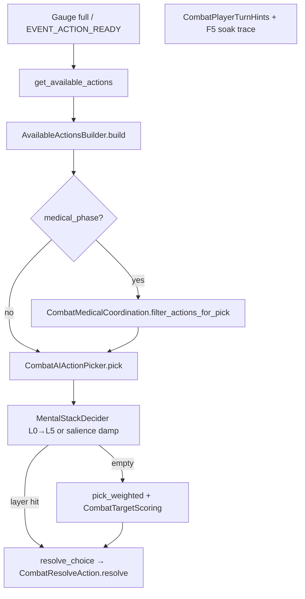

# Shipped combat live paths

**Section-only — do not open whole file.**

Entry: [`AGENTS_ENTRY`](AGENTS_ENTRY.md) · Expand: [#phase-4--new-systems-formal-tracks](#phase-4--new-systems-formal-tracks) · WF map: [#wf-footing-doc-map](#wf-footing-doc-map) · tombstones: [#redirects-tombstones](#redirects-tombstones).

**III-4 Track A ☑** — [#iii-4--engagement-geometry-audit](#iii-4--engagement-geometry-audit). **No** player target picker.

## Tier 0–1 — formation / range

| Area | Modules | Harness |
|------|---------|---------|
| Plugs / flow | `CombatFormationFlow`, `CombatFormationVacancyPlugs` | `_run_vacancy_*`, `_run_plug_*` |
| Cohesion / mode | `CombatFormationEngagement`, `CombatEngagementMode` | `_run_posture_*`, `_run_engagement_*` |
| Lanes / ZoC | `CombatPairGeometry`, `CombatDistanceBands`, `TacticalCombat`, `ZoneOfControl` · **III-4:** `EngagementOpposition` (PR2 ☑) | `_run_lane_offset_*`, `_run_depth_polearm_*`, `_run_surround_*`, `_run_sector_surround_*` · III-4: `_run_opposition_offset_seeded_at_start`, `_run_geometry_skirmish_wide_line_no_compact`, `_run_skirmish_outnumber_allows_rotate_file`, `_run_mental_stack_hold_line_attempt_close_wing`, **3e:** `_run_envelop_mop_up_*`, `_run_pincer_*`, `_run_mental_stack_hold_line_attempt_close_mop_up`, `_run_envelop_melee_strike_listed_close_mop_up_reach_gap` |
| Close | `CombatMeleeListing`, `CombatEngagementResolver` | `_run_attempt_close_*`, `_run_close_slot_cap_*` |

`attempt_close` at LONG (max 3 CLOSE) · **D-005** `CombatSurroundArcOccupancy` / `FEATURE_SURROUND_ARC_OCCUPANCY` (±38°, blocked ×0.35; sector load when `is_feature_sector_surround_load()`).

## Tier 3 — parry / bind / guards

`DefenseChoiceResolver`, `CombatIncomingParryChoice` (**D-007**), `CombatGuardLines` (**D-006**) · `PARRY_DEFLECT_THRESHOLD` **0.45**, `PARRY_BIND_CONTROL_THRESHOLD` **0.48** · `_run_parry_*`, `_run_bind_*`, `_run_*guard*`.

**D-006 + WF:** eight-line **`guard_line`** is moment posture (L3). **`CombatWeaponForm.assign_form`** sets **home** line on spawn/switch; outcomes drift via **`GuardLineUpdater`**. Parry alignment and Tier **4.4** PA step read **live** line — not **`weapon_form`**. Attachment: [#wf-footing-guards-stances](#wf-footing-guards-stances) · [#wf-layer-labels](#wf-layer-labels).

**Open-line openness (feint/deflect/circumscription):** `CombatGuardLines.open_line_openness(defender)` → 0.0–1.0. Replaces the binary flat-TTL model with **monotonic time decay**: eased `(1 − t)^OPEN_LINE_RECOVERY_EASE` (EASE=2.0 ease-out) 1.0→0.0 over the stamped window — the defender re-covers the acute off-line/blade-commitment quickly, so the opening is most exploitable the instant it appears (no guard-position dependence — a guard-distance axis inverted when the post-hit stagger guard coincided with the open line). The window itself is **commitment-scaled** (`CombatGuardLines.open_line_duration_s`): base `FEINT_OPEN_LINE_DURATION_S` = 3.0 s + intensity-scaled extension (`OPEN_LINE_DURATION_INTENSITY_SCALE_S`, heavier strike = longer off-line) + a circumscription extra (`CIRCUMSCRIPTION_OPEN_LINE_DURATION_EXTRA_S`), capped at `OPEN_LINE_DURATION_MAX_S`; the actual value is written to `PA_FEINT_OPEN_LINE_DURATION_S` at each stamp site and read back by the decay. Offensive side: `open_guard_line_weight_mult` scales the open/guarded lerp by `(1 − openness)`; `_feint_open_line_mult` lerps to `AI_FEINT_OPEN_LINE_FOLLOWUP_TOP_MULT` by `openness`. Defensive side: `_feint_open_line_parry_mult` lerps from 1.0 to the stored parry mult by `openness` (gradual recovery instead of snap-back). All three consumers return neutral (1.0) when no window is live, so pinned fixtures (feint/plain ratios, footwork invariants, D001) are unaffected. Stamps are centralized through **`CombatGuardLines.stamp_open_line`** (writes all four keys atomically; a lighter same-line re-stamp is a no-op — it preserves the longer live window so a lighter follow-up cannot close a heavier opening; a different line or strictly longer window re-stamps fresh). Re-coverage is graded by the defender's own action: **`close_open_line_on_recover`** clears the window on a full parry onto the open line (demonstrated re-coverage, wired in the `parry_deflect` branch), **`shrink_open_line_on_partial_recover`** (factor `OPEN_LINE_PARTIAL_RECOVER_FRACTION` = 0.5) halves the remaining window on a `parry_partial` (blade caught partway, line only partly re-covered), and a dodged/whiffed strike **deepens** the *attacker's* line — the `dodge`/`miss` branches stamp the attacker's open line so the defender can riposte (mirrors the `parry_deflect` attacker stamp; gated by `has_live_open_line`).

## Tier 4 — AI / footwork / flurry

`CombatTargetScoring`, `CombatAIActionPicker`, `CombatFootwork`, `CounterTempo`, `CombatAttention`, `CombatFlurryBind`, `MentalStackDecider` · tails: `Tier1Tail`, `FeintTempoTail`, `AttentionFootworkTail` · Expand: **`CombatWeaponForm`**, `CombatRegressionHarnessWeaponFormTail` ([#wf-weapon-form-stances](#wf-weapon-form-stances)).

**Wiring order (turn pick, defense, UI):** [#combat-cognition-pipeline](#combat-cognition-pipeline) · anchors [#tier-43-mental-stack--combat-attention](#tier-43-mental-stack--combat-attention) · [#tier-44-spatial-footwork-deferred](#tier-44-spatial-footwork-deferred) · **footing / guards / forms** [#wf-footing-guards-stances](#wf-footing-guards-stances).

**Tier 4.1 (superseded by WF-1b — maintain harness only):** Legacy **`stance`** / **`get_stance_modifier`** scaffold is **replaced in production** by **`CombatWeaponForm.mod`** + **`form_str`**. **`stance`** still syncs from **`pressure_class`** at assign for harness alias rows; roster **`stance_preference`** + encounter form keys shipped (**WF-4**). See [**WF implementation status**](#wf-implementation-status) · [**WF-1b**](#wf-1b--production-call-site-migration).

## Combat cognition & turn pipeline (logical order)

Canonical map for **how combat variables connect**. Campaign ship ([`SHIP_PLAN`](SHIP_PLAN.md)) must **read** this when touching battle UI or med efficacy — do **not** fork listing/pick logic in `world/*`.

### A. Frame loop (every tick)

Order in **`CombatProcessTick.tick`** → **`CombatEventDispatch.process_event_queue`** (due events first) → per-combatant state:

| Step | Module | Updates |
|------|--------|---------|
| 1 | `CombatEventScheduler` / queue | `EVENT_ACTION_READY`, `EVENT_MELEE_ATTACK`, formation resolves, … |
| 2 | `EntityTimeAdvance` + wounds | `CoreEntity` blood, pain, bleed on scene nodes |
| 3 | `CombatStateHandlers.process_waiting` | `guard`, `stamina`, `CombatExhaustion`, `CounterTempo.process_waiting`, `CombatFlurryBind`, **`CombatUiHints.refresh_waiting_tick_stamps`** → **`CombatAttention.refresh_for_waiting_tick`** (`COMBATANT_KEY_ATTENTION_UI_HINT`) |
| 4 | `process_wind_up` / medical wind-up / recovering | Attacker telegraph + defender incoming keys; gauge for UI only until `EVENT_MELEE_ATTACK` |

**Rule:** Attention **load/yomi** refresh on **waiting** ticks and again inside **`MentalStackDecider.try_pick`** (`refresh_salience`). UI hints are **display**; they do not choose moves.

### B. Turn commitment (offensive choice) — one path for player and enemy

| Entry | Player | Enemy |
|-------|--------|-------|
| Ready signal | `EVENT_ACTION_READY` → `notify_turn_ready` → `ui/TurnReadyHandler` | `CombatEventDispatch.handle_action_ready` → picker inline |
| After list | `CombatPlayerTurnHints` + `CombatF5SoakTrace.log_turn_ready_player_ui` | — |
| Pick + commit | `CombatAIActionPicker.resolve_picked_turn_or_skip` | same |

**Design lock:** **No player target picking.** Player and enemy both use `CombatAIActionPicker`; the player chooses **doctrine / formation** at campaign level, not per-strike targets. Mental stack + weights shape *which listed action* fires.

**Expand (WF-3 — shipped):** when mental stack returns empty, **`CombatWeaponForm.evaluate_automatic_form`** runs **before** **`pick_weighted`** (stamina→**`wall`**, surround, duel/yomi, counter-read; envelop mop-up blocks low-stamina switch). Does **not** insert a new stack layer. See [#wf-implementation-status](#wf-implementation-status).

### C. `get_available_actions` listing order

`CombatManager.get_available_actions` → vacancy reconcile → **`AvailableActionsBuilder.build`**:

| Order | Branch | Module |
|-------|--------|--------|
| 0 | Dead / wrong state / losing medical side | early `[]` |
| 1 | Receiving care → direct pressure only | `CombatMedicalActionListing` |
| 2 | Normal fight | `CombatMeleeListing` + `CombatFormationMoveListing` |
| 3 | Focus-line listing (companions; leader skips yomi drift) | `CombatAttention.append_focus_line_listing_actions` |
| 4 | `combat_wait` if needed | formation listing |
| 5 | Medical phase winner | medical listing branch |
| 6 | Counter-tempo filter | `CounterTempo.filter_actions_for_counter_tempo` when gauge &lt; 100% |
| 7 | Drop vs dead opponents | builder tail |

Listed action dicts may carry **`ACTION_KEY_COUNTER_TEMPO`**, `target_id`, `target_part`, `is_feint`, formation partner ids — consumed by picker weights and `opts_from_choice`.

### D. Pick order (after listing)

#### Mental stack layers (shipped — `MentalStackDecider.gd`)

Priority is **strict top-to-bottom**; first non-empty pool wins. Each layer uses **`pick_weighted`** inside its pool (same medical urgency / target scoring as utility pick).

| Layer | Stamp | Trigger | Action pool |
|-------|-------|---------|-------------|
| **(retreat)** | — | `cannot_commit_melee` | Retreat-filtered list only |
| **L0** | `self_medical` | `MedicalPhaseController.is_in_immediate_peril` | Coordinated **self** medical (`CombatMedicalCoordination.medical_action_allowed`) |
| **L1** | `medical` | `CombatAttention.ally_in_immediate_peril` | Coordinated **ally** medical (not duplicate wind-up / compression rules) |
| **L2** | `counter` | `CounterTempo.can_act` | `ACTION_KEY_COUNTER_TEMPO` only |
| **L3** | `incoming` | Wind-up telegraph or incoming attacker id | Counter actions **or** melee vs that attacker (no med / no `attempt_close`) |
| **L4G** | `guard_priority` | `CombatAttention.guard_priority_score` ≥ `GUARD_PRIORITY_MIN_SCORE` (0.5), not in fight-finish tail, priority line ≠ current guard, matching `focus_*` listed | `focus_*` toward the priority line (live wind-up telegraph, else engaged attacker's habitual yomi line) — `pick_weighted`. Telegraph score **decays with wind-up progress** (readability: only an early/mid wind-up is braceable; a committed strike is too late to shift stance to). Free per-tick drift aligns `guard_line` to the yomi line on waiting ticks and **holds the read** until the new line is observed more (count margin, no flicker); the drift drops its stamp during live wind-ups so L4G owns the brace — [#wf-guard-writers](#wf-guard-writers) |
| **L4** | `hold_line` | Menu is reserve posture only (`wait`, focus, **`attempt_close`**) — **not** if `rotate_file` or melee listed | **Shipped:** focus, wait, or **`pick_weighted`** `attempt_close` when wing lacks mapped opposition + LONG — [§III-4](#iii-4--engagement-geometry-audit) · [§9b](SHIP_PLAN.md#combat-mental-stack-shipped). **3b:** `rotate_file` breaks reserve posture → utility pick |
| **L5** | `exhaustion` | `CombatExhaustion.exhaustion_tunnel_active` (**MS-L7**) | Wait, flee, fall_back, formation disengage, focus lines — not fresh offense |
| **—** | *(cleared)* | No layer matched | **`pick_weighted`** with **salience offense damp** + gradual exhaustion offense damp (below tunnel threshold) |

**Salience damp (utility pick):** when no layer fires and `attention_load` &gt; 0, offensive weights (attacks, feints, `attempt_close`) multiply by `lerp(1, 1 - MENTAL_STACK_SALIENCE_OFFENSE_DAMP_MAX, load)` — distracted fighters still act, but less eager to open new offense. Formation / wait / focus weights unchanged.

**Attention (parallel, not a pick layer):** `refresh_salience` sets `attention_load` from telegraph + ally peril + counter window; yomi + focus affect **defense** and feint **listing** weights. See §E.

| Stage | Module | Behavior |
|-------|--------|----------|
| 1 | `MentalStackDecider.try_pick` | Layers L0→L5 above (L4G guard-priority sits between L3 and L4) |
| 2 | `CombatAIActionPicker.pick_weighted` | `_get_action_weight` + salience damp on offense; **`CombatWeaponForm.action_weight_mult`** / **`wait_action_weight_mult`** / focus **`preferred_guards`** |
| 2b | `CombatWeaponForm.evaluate_automatic_form` | After stack miss in **`pick`** — **`assign_form`** home guard only; **no** PA stamp — [#wf-pick-vs-strike](#wf-pick-vs-strike) |
| 3 | `_add_attack_target_part` | Pathway / unguarded part on chosen attack |
| 4 | `resolve_choice` | `opts_from_choice` → `CombatResolveAction` |

On stack pick: stamps **`COMBATANT_KEY_MENTAL_STACK_LAYER`**. **`try_pick`** clears the stamp before evaluating layers; only the winning layer remains for UI (`Stack %s`).

#### Mental stack — Expand backlog (realistic influence, no player targets)

**Shipped:** MS-L5 plug ☑ · MS-L6 rout ☑ · MS-L7 exhaustion tunnel ☑ · MS-L8 post-strike momentum ☑ · Feint resistance hard block ☑ · Exhaustion gradient (gradual descent) ☑ · Positional awareness / surrounded disengage ☑ · Medical escalation TCCC ladder ☑.

| Item | Intent | Module | Status |
|------|--------|--------|--------|
| **MS-L5** plug | Vacancy / plug forward when line breaks | `MentalStackDecider` + formation listing | **Shipped ☑** |
| **MS-L6** rout | `CombatFormationRout` thresholds → flee / fall_back layer | `CombatFormationRout`, stack | **Shipped ☑** |
| **MS-L7** exhaustion tunnel | High exhaustion → disengage before utility pick (shipped as MS-L7) | `CombatExhaustion`, stack | **Shipped ☑** |
| **MS-L8** post-strike | Press advantage after landing strike; don't linger aimlessly | `MentalStackDecider` + picker + `CombatPostStrike` | **Shipped ☑** |
| Feint resistance | High-readiness defender rejects feints (hard block, not damp) | `CombatAIActionPicker`, picker | **Shipped ☑** |
| Exhaustion gradient | Smooth degradation: fresh → fatigued → winded → exhausted | `CombatExhaustion` | **Shipped ☑** |
| Positional awareness | Surrounded + wounded → disengage trigger (MS-L9) | `ZoneOfControl`, stack | **Shipped ☑** |
| Medical escalation | TCCC ladder progression on repeated failure (bandage → pack → TK) | Picker + `MedicalPhaseController` | **Shipped ☑** |
| Medical mid-fight | If in-fight ally aid is listed later, L1 already coordinated | `CombatMedicalActionListing` | Deferred |
| Campaign traits | Morale / stress → layer thresholds (post Camp-5) | bridge meta, not `CompanyState` in `combat/*` | Deferred |

Harness: `CombatRegressionHarnessAttentionFootworkTail` — full `_run_mental_stack_*` list in [§G](#g-feature-flags-combatconstantsgd). Ship plan: [`SHIP_PLAN` §9b](SHIP_PLAN.md#combat-mental-stack-shipped).

**Footing boundary:** **MS-L4** (`hold_line` stamp) chooses **listed moves** only — it does **not** write **`guard_line`**, **`position_angle_offset_deg`**, or **`weapon_form`**. Reserve posture is orthogonal to WF L2–L3 and Tier 4.4 PA — [#wf-layer-labels](#wf-layer-labels) · [#wf-pick-vs-strike](#wf-pick-vs-strike) · [#wf-footing-guards-stances](#wf-footing-guards-stances).

### E. Passive defense (separate from turn pick)

### F. Combatant dict keys (Tier 4.3 — do not rename without harness + F5)

### G. Feature flags (`CombatConstants.gd`)

### H. Campaign ↔ combat boundaries (ship)

### I. Safe extension checklist

## Tier 5 — kinematic + simulation (maintain only)

Kinematic: `ImpactVelocityModel`, `WeaponSwingPhysics`, `AttackResolver` — `_run_kinematic_delivery_*`. Sim/P3b: `_run_sim_*`, `_run_mat_*`, `_run_mat_production_*` (`CombatRegressionHarnessSimulation.gd`). Gate: `p3b_full_including_energy_pool_joule_armor_and_literal_blood_ml` · lethality [#12-tuning-order](#12-tuning-order-keep-research-chain).

### F5 combat Output tiers (`scenes/campaign/main.tscn`)

Editor play session (`OperationalLog.begin_play_session`) layers diagnostics. Grep after each fight: `hit_resolve reason=` · `strike_avoided reason=` · `hit_outcome_stats` · `parry_stats` · `diagram_banner player:` · `diagram_banner enemy:` (II-8) · `engagement_transition` · `encounter_context` · `soak_fight_end` (not verbose `phase_end winner=` — headless D-001 keeps that) · `hit_coverage_hint` (when no hits landed).

| Tier | Inspector / const | Output grep | Use |
|------|-------------------|-------------|-----|
| **Play session** | F5 (default) | `[Combat.Flow]` turn picks · `FP_COMBAT` milestones | Formation, gauge, `diagram_banner`, `engagement_transition` |
| **Hit summary** | `dev_hit_summary` (default on) | `hit_resolve reason=` · `strike_avoided reason=` · `hit_outcome_stats` | Per-strike outcome without full debug spam |
| **Research feel** | `dev_research_feel` | `research_feel` | Q1 calibration: cut/blunt/bone, pen_mm, ke_frac (best with `dev_soak_encounter=ii2b`) |
| **Per-hit debug** | `COMBAT_DEBUG` or research feel | `[Combat.Debug]` · armor traces | Deep tuning; avoid piping to `grep` in PowerShell |

**Reading parry lines:** `parry_partial … rem=0.85` — **rem** is follow-through fraction (1.0 ≈ full damage continues), not blocked damage.

**Zero damage:** combat log and **`hit_resolve`** include **`reason=`** (e.g. `armor stopped`, `glancing — tissue below threshold`, `graze — rounds to 0 counted HP`, `attack missed`) — not bare `0 dmg`.

**Body UI:** battle row labels use one decimal when tissue HP chips below integer (`29.8|0.2`). Row **`last_hit_label`**: Hit/Graze/Deflected/Miss/Dodged/Partial parry with the same reason text when HP does not chip.

**Research audit:** `.calibration_audit.txt` · `CombatResearchAnchors.gd` · `_run_research_*` (`RESEARCH_HARNESS_GATE_IDS`, 40 gates). Fail → fix constants/anchors + [`AGENTS_ENTRY` decision log](AGENTS_ENTRY.md#decision-log). **`note`** rows: ignore (`cut_bone_pen_gate_mm`, `forearm_blunt_fracture_anchor_J`, `layer_rupture_subcut_bleed_mult`, `blunt_fracture_scaling`, `human_head_tissue_pct`, `riposte_chain_window`). **Footing / stances / PA offsets / form weights:** **not** in research audit — harness + F5 soak per [#wf-footing-improvement-backlog](#wf-footing-improvement-backlog). F5: [#playtest-q1](#playtest-q1-research-feel-duel) · `dev_research_feel`+ii2b · [#enable-per-hit-research_feel-lines](#enable-per-hit-research_feel-lines). **§1/§6/§10:** [#bleeding-physics](#bleeding-physics). **Edit:** `BleedingConstants` · `CombatResearchAnchors` · `resources/species/*.tres` · `CombatCalibrationAudit` · [#production-flags](#production-flags). One `FEATURE_*` per PR.

## Tier 6 — medical / flee

`EntityMedical`, `MedicalPhaseController`, `CombatMedicalCoordination`, `CombatFormationFlee` · `_run_medical_*`, `_run_pack_wound_*`, `_run_flee_*`, `_run_ambient_pain_shock_*` · `MedicalPhaseTail`.

**Bleeding (D-003):** `BleedingConstants.gd` — [#bleeding-physics](#bleeding-physics).

**Medical phase:** `medical_phase_winner` locks end-combat side; party wipe does not flip winner. Post-victory: losers `[]`; winner medical-only; losers blocked via `MedicalPhaseController.POST_VICTORY_BLOCKED_EVENT_TYPES`. Harness: `_run_medical_phase_winner_*`, `_run_medical_phase_winner_listing_medical_only`. Fast iteration (12 tests): `.\tools\ci\run_all_combat_checks.ps1 -HarnessMode medical`.

### Bleeding physics and units

`BleedingConstants.gd` · `CombatResearchAnchors.gd` · `.calibration_audit.txt` `[research_benchmarks]`.

| Quantity | Unit | Notes |
|----------|------|--------|
| `blood_volume` | **%** (0–100) | UI, ATLS class, death threshold |
| `blood_volume_ml` | **mL** | Pool when `FEATURE_LITERAL_BLOOD_ML` on |
| Wound `bleeding_rate` | **abstract HP/s** | Severity × part × sub-region × arterial |
|| `BLOOD_LOSS_RATE_MULTIPLIER` | **dimensionless** | HP/s → % blood lost per second |

### Bleeding feature flags (shipped)

Literal mL · layer tissue · material curves · ATLS consciousness · absolute severity — all default on in `BleedingConstants`. `FEATURE_TISSUE_DAMAGE_D` stays **false**.

**ATLS (remaining blood %):** I ≥85 · II ≥70 · III ≥60 · IV death at **50%** remaining (~45–50% loss, fatal untreated).

**Reference uncontrolled bleed:** `BLEEDING_RATES[cut][critical] × head × arterial` = **23.625 HP/s** (4.5 × 1.5 × 3.5) — clean calibration anchor (no ×1.4 vessel-damage amplifier). **Live worst-case** (with `get_bleeding_rate`'s ×1.4 critical amplifier): **33.075 HP/s** → TTD **~128 s** (within clinical 120–300 s band, realistic for major arterial bleed).

**TTD:** `(blood_volume − threshold) / (rate × BLOOD_LOSS_RATE_MULTIPLIER × loss_mult)` → default **~180 s** (clinical 120–300 s band; derived from `LITERATURE_TTD_TARGET_S`). **Sustained direct pressure** uses TCCC retained-flow fractions (**venous ~10%**, **arterial ~50%** of intrinsic wound rate for blood-loss integration) plus faster local clotting k (`CLOTTING_RATE_UNDER_DIRECT_PRESSURE`); constant-rate halving anchor (`clinical_ttd_seconds(0.5)`) ≈ **2×** TTD is the research gate only — live sim includes clotting `exp(-k×Δt)`.

**Bleed rate cap:** `MAX_TOTAL_BLOOD_LOSS_RATE` = **3.5 %/s** hard ceiling on the summed rate after all multipliers (injury type, body part, head, arterial, exertion). Prevents stacked wounds from pushing exsanguination below ~20 s.

**Vital-destruction grace:** a destroyed head/chest part does not register death immediately. `CoreEntity._vital_grace_remaining` (per-part: head **1.5 s**, chest **3.0 s**, fallback **2.5 s**) decrements each `process_blood_loss` tick; `is_dead()` returns true only when the countdown reaches 0. During the grace the fighter is incapacitated (consciousness capped at **4.0** for destroyed / **12.0** for critically-damaged vitals). `VITAL_GRACE` / `VITAL_GRACE_EXPIRED` lines appear in `FP_COMBAT` output.

**Field care:** `MapFieldCare` (pressure → bandage → stabilize). **Camp rest:** `CompanyState.try_camp_heal`.

**Literal mL:** human **75 kg → 5250 mL** · goblin **38 kg → 2660 mL** (`resources/species/*.tres`, `CombatDesignAnchors`).

**Arterial chance (cut):** critical **0.26** → severe **0.14** → moderate **0.06** → minor **0.01**; crush ×0.35. Triage **225 s** / **112.5 s** vs ref TTD **~180 s**.

**Clotting** `exp(-k×Δt)` — open moderate **k≈0.02** · sustained pressure **k=0.032** (half-life **~22 s**) · bandaged **k=0.006** (**~115 s**) · arterial ×**0.1** on k · **stabilize** trims rate only (no `is_stabilized` until dress/pack). **Pain** human ref **~3.0** / **~2** hits → NRS 4 · **blunt KE** oberhau **~137 J**, arm **22 J** (rank-order only).

**Tuning order:** (1) `BLEEDING_RATES` (2) `REFERENCE_UNCONTROLLED_BLEED_RATE` (3) `BLOOD_LOSS_RATE_MULTIPLIER` (4) part mults (5) death threshold + ATLS doc · then `run_all_combat_checks.ps1`.

**D-004:** `CombatExhaustion` · gauge **`Exh N%`** · F5 **ii4d** (3–5 min duel).

**MXm-3 (shipped):** burst **`Stm N%`** = `stamina_ratio()` vs `CombatExhaustion.effective_stamina_max()` (exhaustion + blood caps, floor 0.7 each). `clamp_stamina_to_effective_max` after spend. Refill rate scales down at high exhaustion. Progress bar always maps to burst stamina; counter-tempo readiness is label-only (`Rdy N%` / `Counter!`). `ZoneOfControl` opponent pressure and aggressive-stance gates use **`stamina_ratio`**, not absolute `/ STAMINA_MAX`.

**MS-L7 (shipped):** `MentalStackDecider` **L5** (`Stack exhaustion`) + gradual offense damp in `CombatAIActionPicker` — ramp to floor at **`MENTAL_STACK_EXHAUSTION_TUNNEL_THRESHOLD`** (0.55, 55% FP band). Harness `_run_mental_stack_exhaustion_tunnel_*` · **`_run_p4a_ms_l7_exhaustion_threshold_parity`** ☑ 2026-06-08.

## Composure (shipped)

`gauge` 0–100 (`DataKeys.COMBATANT_GAUGE`) — **event-driven**: no fill during WAITING/RECOVERING. `CombatEventDispatch.handle_action_ready` sets **100**; wind-up / recovery / medical / form-switch set **0**. Cowering idle fills **0.5/s** (`CombatStateHandlers.process_cowering_idle`). Counter-tempo ready ≥ `COUNTER_TEMPO_GAUGE_THRESHOLD` (**50**) · AI/action-list gated `< GAUGE_FULL_THRESHOLD` (**99**). **No** wind-up cost deduction, **no** quality/parry scaling. Gauge is session-local — **not** persisted between fights. APIs: [`AGENTS_API`](AGENTS_API.md) · [`COMPOSURE_PLAN`](COMPOSURE_PLAN.md).

## Muscle fatigue (shipped)

Per-limb exertion pools — **not** composure, **not** whole-body breath. Owner: `combat/flow/CombatMuscleFatigue.gd` · flag `FEATURE_MUSCLE_GROUP_FATIGUE` · harness `harness/CombatRegressionHarnessMuscleFatigueTail.gd`. Cleared at camp rest via `CoreEntity._restore_muscle_fatigue_at_camp` (wired in `CompanyCamp._restore_roster_muscle_fatigue`).

## Battle UI

Data sources: [#combat-cognition-pipeline](#combat-cognition-pipeline) (§F keys, §B turn path).

| UI piece | Combat source | When updated |
|----------|---------------|--------------|
| Gauge primary | `BattleUIUpdater.gauge_label_text_for_combatant` | `turn_ready`, `_update_ui`, waiting ticks |
| Progress bar | `BattleUIUpdater.gauge_bar_*` | always burst stamina (`effective_stamina_max`); never counter-tempo gauge |
| `Stm` / `Ready` / `Exh` / `Grd` | `stamina_ratio`, `effective_stamina_max`, turn gauge, `CombatExhaustion`, `CombatGuardLines` | waiting + turn ready |
| Attention suffix | `CombatUiHints.attention_hint_text` ← `CombatAttention` | `refresh_for_waiting_tick`; live on player `turn_ready` |
| Stack layer | `COMBATANT_KEY_MENTAL_STACK_LAYER` | last `MentalStackDecider` pick (incl. `exhaustion` MS-L7) |
| Formation line | `CombatPlayerTurnHints` vs row tooltip | player `turn_ready` only |
| Counter tempo | `CounterTempo` + `CombatUiHints.counter_tempo_*` | label `Rdy N%` / `Counter!` (bar stays stamina) |
| **Footwork / guard / form suffixes** | `BattleUIUpdater._compose_waiting_gauge_label` → `CombatUiHints` | See [#wf-footing-guards-stances](#wf-footing-guards-stances) · order locked **Step → Grd/Atk → Form** |
| **` · Step`** (Tier 4.4 PA) | `CombatFootwork.get_ui_hint` via `footwork_hint_suffix` | **`wind_up`** / **`recovering`** only; from line-key offset — not **`weapon_form`** |
| **` · Grd` / ` · Atk`** (L3) | `CombatUiHints.guard_line_gauge_suffix` ← **`active_line_for_ui`** | Waiting/recovering: live **`guard_line`**; wind-up: **`pending_attack`** line — **not** **`weapon_form`** |
| **`active_line_for_ui`** | `CombatUiHints.active_line_for_ui` | **`STATE_WIND_UP`** → attack line from **`pa`**; else **`guard_line`**; empty when eight-line feature off |
| **` · Form {name}`** (L2) | `CombatUiHints.weapon_form_gauge_suffix` ← **`form_str`** | Independent of guard drift — spawn/`assign_form` only for identity |
| Diagram **`[HiR]` `[Ox]`** | `FormationDiagramBuilder._cell_label_with_footwork` | Guard short then form; PA diagram suffix usually empty when flag on |

F5 soak: `turn_ready_gauge`, `tooltip_match=`, `diagram_banner` — trace path **`TurnReadyHandler`** / **`BattleScene`** → **`CombatF5SoakTrace`** → **`BattleUIUpdater`**; validators **ii5a/ii5c/ii8** · WF suffix **content** asserts **shipped** (D-001 **ii5c** + Q4 **ii8**) — [#wf-soak-audit-status](#wf-soak-audit-status) · doc map [#wf-footing-doc-map](#wf-footing-doc-map).

**Camp-3.3** ([`SHIP_PLAN`](SHIP_PLAN.md#camp-3-player-ready)): one-shot combat-log copy + gauge tooltips in `CombatUiHints` (`emit_medical_phase_session_hints` from `BattleScene._on_enemies_eliminated`); receiving-care primary via `BattleUIUpdater`. Harness: `_run_medical_phase_hints_*`, `_run_medical_phase_gauge_tooltip_*`, `_run_battle_ui_gauge_label_receiving_care_*`. Does not alter §B–D pick order.

**Species:** `human.tres` **75 kg** · `goblin.tres` **38 kg** · `feature_derived_limb_capacity` — [#5-literal-blood-volume-ml](#5-literal-blood-volume-ml) · [#research-audit](#research-audit).

## Harness `_run_*` prefixes

**Run:** `.\tools\ci\run_all_combat_checks.ps1` (full gate) · fast paths: `-HarnessMode regression|d001|sanity|calibration|medical` ([`tools/ci/README`](../tools/ci/README.md)).

`grep '_run_' harness/CombatRegressionHarness.gd` (+ tails, `CombatRegressionHarnessSimulation.gd`). **No** `_run_crash_*` / `_run_intrusion_*`.

| Area | Prefixes |
|------|----------|
| 0–1 | `_run_formation_*`, `_run_vacancy_*`, `_run_engagement_*`, `_run_surround_*`, `_run_depth_polearm_*` |
| 3–4 | `_run_parry_*`, `_run_bind_*`, `_run_guard_*`, `_run_feint_*`, `_run_flurry_*`, `_run_battle_ui_*`, `_run_mental_stack_*`, `_run_attention_*`, **`_run_footwork_*`** (`AttentionFootworkTail`) · Expand: **`_run_weapon_form_*`** (`WeaponFormTail`) — footing: [#wf-footing-guards-stances](#wf-footing-guards-stances) |
| 5 | `_run_kinematic_*`, `_run_sim_*`, `_run_mat_*` |
| 6–7 | `_run_medical_*`, `_run_flee_*`, `_run_research_*`, `_run_f5_headless_*`, `_run_exhaustion_*`, `_run_stamina_effective_*`, `_run_opponent_pressure_*` |

## Phase 0 (D-001) · II-0 soak

Headless authoritative: `.d001_headless_signoff.txt` `ok=true`. F5 optional: [`Playtest` stream](PLANNING.md#stream-playtest).

`.\tools\ci\run_all_combat_checks.ps1` → `FP_HARNESS_OK: AllCombatChecks`. Outputs: `.d001_soak_out.txt`, `.f5_soak_validation.txt`, `.calibration_audit.txt`, `.d001_soak_sanity_out.txt`. `CombatD001SoakRunner` (incl. **ii7** pack-wound + **formation_move_f5** `rotate_file@` greps), `CombatD001SoakSanity`, `CombatF5SoakLogValidator`. Fast paths: `run_all_combat_checks.ps1 -HarnessMode regression|d001|sanity|calibration|medical` ([`tools/ci/README.md`](../tools/ci/README.md)). Summary: `print_phase0_status.ps1`. No harness piping to `grep`.

| # | Headless | F5 glance |
|---|----------|-----------|
| 1 | **ii2b** ×3 | duel feel |
| 3 | **ii3** + 7v7 | Arc overlap |
| 4 | **ii5a**/**ii8** | tooltips |
| 5 | **ii5** fall_back | cyan tile |
| 6 | **ii6** pain shock | wait |
| 7 | **ii7** medical | pack |
| 8 | **ii1e**/**ii8** | diagram |
| — | **ii4d** Exh | 3–5 min |

F5 workflow: optional `dev_soak_encounter` → `.f5_soak_in.txt` → `run_playtest validate` (multi-fight: `run_playtest after-append`; Camp-5 status: `run_playtest closeout`). Validator smoke (no F5): copy `docs/f5_soak_log.camp_wf.example.txt` or `docs/f5_soak_log.camp_full.example.txt` → `.f5_soak_in.txt` (combat-only: `f5_soak_log.example.txt`). Q helpers: `run_q_feel` · `run_q_audit`. Mandatory II-2b/5a/5b/5c/4d: headless ☑. Camp-5 human ☑ (2026-06-07) — F5 on demand.

## Integration

POST 0–2 done. Phase 3/4 / P4 / WF → Expand after Camp-5 unless a Camp bridge row. Mirror: [`SHIP_PLAN` §9c](SHIP_PLAN.md#combat-expand-registry). Cognition: [#combat-cognition-pipeline](#combat-cognition-pipeline).

### During Campaign ship

Maintain Phase 0 · mental stack · Camp-2/3 medical UX · WF harness. Frozen: bleed/BMI / new `FEATURE_*` without ask — [`PLANNING#harness-and-flags`](PLANNING.md#harness-and-flags).

### Phase 3 — III rows

| ID | Status | Intent |
|----|--------|--------|
| III-1 | ☑ | Surround sector / multi-incoming parry |
| III-2 | Partial | Guard-line fidelity (D-006) |
| III-3 | ☑ | Deflect/bind calibration (ii2b) |
| III-4 | Track A ☑ | Engagement geometry — [#iii-4--engagement-geometry-audit](#iii-4--engagement-geometry-audit) |
| III-5…8 | ☑ / maintain | Pack depth · back-rank · sim coherence · recovery cause |

### III-4 — Engagement geometry (Track A ☑)

Mapped opposition · Skirmish compact/rotate · L4+close · mop-up **3e**. Track B = IV-9 Expand.

### P4 playbooks

| ID | Status |
|----|--------|
| p4a–p4h | Mostly ☑ — maintain / threshold tune only |

### Phase 4 — IV-* / WF / cognition

| Bucket | Status |
|--------|--------|
| IV-2…13 | Mostly ☑; open: IV-9 gap-column Track B if reopened |
| WF-1…4 | ☑ maintain — [#wf-implementation-status](#wf-implementation-status) |
| MS-L5–L7 | ☑ |
| Tier 4.4 PA | ☑ octant pilot |
| Doc-10 Issue 2 arm-grip | ☑ `FEATURE_ARM_WOUND_DEGRADATION` — sub-region/severity → weapon-function grip mult |
| Doc-9 parry counterstrike | ☑ `FEATURE_PARRY_COUNTERSTRIKE_WINDOW` — partial-parry bind grants riposte-chain window |
| HEMA measure-damage | ☑ `FEATURE_MEASURE_DAMAGE_COMMIT` — out-of-measure strike (over/under reach) deals reduced damage |
| XCamp-4 gladiator roster | ☑ fighter names · recruit quality/cost · gear commerce — [`AGENTS_API`](AGENTS_API.md) |
| XCamp-6 gladiatorial schools | ☑ playable — `scenes/gladiator/` screen: scout/dispatch dossier · appoint match + arena-day booking (scheduled bouts lock until the day arrives) · live 1v1 bouts via `CompanyMatch.build_current_bout_encounter` · purse/renown/fame + match-victory reward (`CompanyGladiator`) (☑ combat-side tendency hook) — [`AGENTS_ENTRY`](AGENTS_ENTRY.md) |

Open queue: [`EXPANSION_PLAN`](EXPANSION_PLAN.md). Policy: [`SHIP_PLAN` §9c](SHIP_PLAN.md#combat-expand-registry).

### WF — weapon forms (shipped)

**WF-1…4 ☑.** Harness: `WeaponFormTail` · D-001 ii5c · Q4 ii8. No player form pick. Prompts: `agent_combat` / `agent_playtest`.

#### Footing / guards / forms (do not conflate)

| Layer | Module | Notes |
|-------|--------|-------|
| L1 Doctrine | `CombatDoctrine` | Formation tactics — not form |
| L2 Form | `CombatWeaponForm` | `assign_form` → home `guard_line` only |
| L3 Guard | `guard_line` / `GuardLineUpdater` | Moment blade line |
| WF-L4 Moves | `WeaponConstants` | Form weights listed moves |
| Tier 4.4 PA | `CombatFootwork` | Exchange `Step` from line identity — not form id |
| Tier 4.2 | defense footwork mults | Spacing/state — not PA |
| Lane footing | `ZoneOfControl.get_footing_duration_multiplier` | Formation move duration only |

**Labels:** MS-L4 ≠ WF-L4 ≠ Tier 4.4 PA. UI order: Step → Grd/Atk → Form.

| Anchor | Use |
|--------|-----|
| [#wf-form-guard-pa-matrix](#wf-form-guard-pa-matrix) | PA lookup / home guard |
| [#wf-assign-form-contract](#wf-assign-form-contract) | What `assign_form` writes |
| [#wf-pick-vs-strike](#wf-pick-vs-strike) | Turn pick vs strike contact |
| [#wf-guard-writers](#wf-guard-writers) | `guard_line` writers |
| [#wf-tier-44-pa](#wf-tier-44-pa) | PA stamp / clear hub |
| [#wf-soak-audit-status](#wf-soak-audit-status) | ii5c / ii8 |
| [#spawn--reset-path-wf-1a](#spawn--reset-path-wf-1a) | `seed_combatant_form` |
| [#wf-footing-improvement-backlog](#wf-footing-improvement-backlog) | Maintain vs Expand |
| [#wf-m3-f5-playtest](#wf-m3-f5-playtest) | F5 suffix order |

**Footing/balance realism (leg + off-balance):** leg-wound parry bracing `leg_stance_parry_mult` (base weakens brace; `DefenseChoiceResolver` on-time + late/reflexive) · torso-wound parry bracing `torso_stance_parry_mult` (core weakens central brace; same two sites, via `BodyPartQuery.get_torso_core_functionality`) · leg-wound off-balance susceptibility `hit_off_balance_leg_susceptibility_mult` (narrower base tips easier; in `hit_off_balance_window`) · staggered guard-transition cost `guard_transition_off_balance_mult` (attacker re-centers blade slower; `DefenseResolutionHandler` parry recovery) · concussed balance → dodge `conc_balance` (evasive step degrades; `DefenseChoiceResolver` dodge) · arm-wound wind-up slowdown `arm_wound_windup_slow_mult` (wounded striking arm swings slower; `AttackWindUpStarter`, via `get_striking_arm_grip_mult`) · formation-move settling `formation_settle_off_balance_duration` (mid-replant off-balance window after line movement; `PassiveParryContext.apply_formation_settle` at the 4 successful-resolve sites in `CombatFormationFlow`, plug-forward settles at 0.0) · cower re-plant `cower_replant_off_balance_duration` (getting back to feet after cowering; `PassiveParryContext.apply_cower_replant` at the cower-exit in `CombatStateHandlers`, ×1.4 when legs still <0.9 functionality) · lead/trail foot asymmetry `get_lead_leg_functionality` (lead leg drives the step-in; `CoreEntity.lead_leg` correlates with `dominant_hand` so the asymmetry varies per fighter, + `BodyPartQuery.get_leg_functionality_for`, wired to wind-up drive in `AttackWindUpStarter` + close-advance pressure in `CombatEngagementResolver` via `close_advance_lead_leg_mult`) · persistent facing / turn-to posture `facing_turn_window_s` + `facing_turn_parry_capacity_mult` (flank/rear resolve stamps a decaying facing-turn window on the defender that piles on when already turned, capped by `FACING_TURN_MAX_WINDOW_S`; `AttackResolver` stamps via `PassiveParryContext.apply_facing_turn` (window scaled by `off_balance_recovery_mult` so compromised fighters stay turned longer), `DefenseChoiceResolver` on-time + late paths consume, gated by `FEATURE_PERSISTENT_FACING`). All D001-neutral.

**PA:** `CombatFootwork.guard_angle_deg` at contact · clear on exchange end. **Soak:** ii5c + ii8. **WF-M3:** Step → Grd/Atk → Form on `turn_ready_gauge`. **MS-CAMP:** mood → pick bias (`CombatCampaignMoodBias`).

## Legacy anchors (redirect targets)

Status for shipped tiers → sections above · forward work → [AGENTS_ENTRY#what-to-do-next](AGENTS_ENTRY.md#what-to-do-next).

**Forward work:** full registry at [#phase-4--new-systems-formal-tracks](#phase-4--new-systems-formal-tracks) · [`SHIP_PLAN` §9c](SHIP_PLAN.md#combat-expand-registry). Player target picker is a design lock — no per-strike UI.

## Redirects (deleted `docs/*.md`)

Canonical live docs: [`PLANNING`](PLANNING.md) · [`AGENTS_ENTRY`](AGENTS_ENTRY.md) · [`AGENTS_API`](AGENTS_API.md) · [`SHIP_PLAN`](SHIP_PLAN.md) · [`EXPANSION_PLAN`](EXPANSION_PLAN.md) · [`CAMPAIGN_DECISION_GUIDE`](CAMPAIGN_DECISION_GUIDE.md) · [`COMPOSURE_PLAN`](COMPOSURE_PLAN.md) · [`FEATURE_PRESERVATION`](FEATURE_PRESERVATION.md) · this file.

Deleted plan names must not reappear under `docs/`. Prefer section anchors in this file or `SHIP_PLAN` / `EXPANSION_PLAN`.

