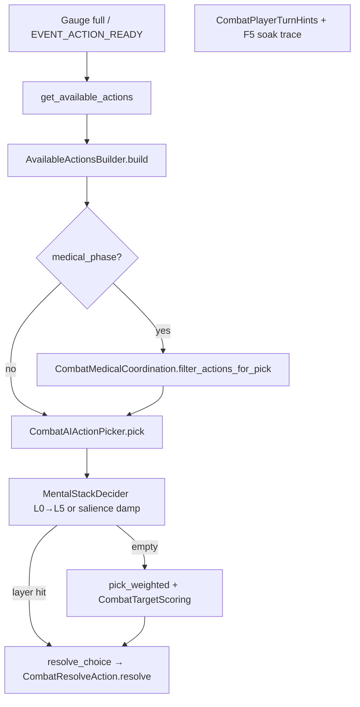
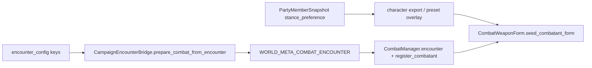

# Shipped combat live paths

<a id="milestone-summary"></a>

**Read:** [`PLANNING.md`](PLANNING.md) · [`CURSOR#what-to-do-next`](CURSOR.md#what-to-do-next) · [`SHIP_PLAN`](SHIP_PLAN.md) · [**mental stack §9b**](SHIP_PLAN.md#combat-mental-stack-shipped) · [**WF footing doc map**](LIVE_PATHS.md#wf-footing-doc-map) · scripts [`../scripts/README.md`](../scripts/README.md). Tombstones: [#redirects-tombstones](#redirects-tombstones).

**III-4 Track A (shipped ☑):** engagement geometry bridge — mapped opposition, Skirmish compaction, L4+close, optional Skirmish **`rotate_file`**, campaign **`player_front_count`**, headless **`ii_envelop`** — [#iii-4](#iii-4--engagement-geometry-audit). **Track B (Expand):** IV-9 gap-column. **Expand (post–Camp-5):** [#phase-4--new-systems-formal-tracks](#phase-4--new-systems-formal-tracks) · [`SHIP_PLAN` §9c](SHIP_PLAN.md#combat-expand-registry). **No** player target picker.

<a id="tier-1-spec"></a>

## Tier 0–1 — formation / range

| Area | Modules | Harness |
|------|---------|---------|
| Plugs / flow | `CombatFormationFlow`, `CombatFormationVacancyPlugs` | `_run_vacancy_*`, `_run_plug_*` |
| Cohesion / mode | `CombatFormationEngagement`, `CombatEngagementMode` | `_run_posture_*`, `_run_engagement_*` |
| Lanes / ZoC | `CombatPairGeometry`, `CombatDistanceBands`, `TacticalCombat`, `ZoneOfControl` · **III-4:** `EngagementOpposition` (PR2 ☑) | `_run_lane_offset_*`, `_run_depth_polearm_*`, `_run_surround_*`, `_run_sector_surround_*` · III-4: `_run_opposition_offset_seeded_at_start`, `_run_geometry_skirmish_wide_line_no_compact`, `_run_skirmish_outnumber_allows_rotate_file`, `_run_mental_stack_hold_line_attempt_close_wing`, **3e:** `_run_envelop_mop_up_*`, `_run_pincer_*`, `_run_mental_stack_hold_line_attempt_close_mop_up`, `_run_envelop_melee_strike_listed_close_mop_up_reach_gap` |
| Close | `CombatMeleeListing`, `CombatEngagementResolver` | `_run_attempt_close_*`, `_run_close_slot_cap_*` |

<a id="development-gate-line-crash--intrusions-removed"></a>
<a id="d-005-surround"></a>
<a id="d-005--surround-arc-occupancy--shipped"></a>

`attempt_close` at LONG (max 3 CLOSE) · **D-008** no line crash · **D-005** `CombatSurroundArcOccupancy` / `FEATURE_SURROUND_ARC_OCCUPANCY` (±38°, blocked ×0.35; sector load when `is_feature_sector_surround_load()`).

<a id="tier-3--parry--bind--guards"></a>
<a id="tier-0--formation--parry-choice"></a>
<a id="d-006-guard-lines"></a>
<a id="d-006--hema-eight-guard-lines--shipped"></a>
<a id="d-007--parry-telegraph--shipped"></a>

## Tier 3 — parry / bind / guards

`DefenseChoiceResolver`, `CombatIncomingParryChoice` (**D-007**), `CombatGuardLines` (**D-006**) · `PARRY_DEFLECT_THRESHOLD` **1.08**, `PARRY_BIND_CONTROL_THRESHOLD` **0.65** · `_run_parry_*`, `_run_bind_*`, `_run_*guard*`.

**D-006 + WF:** eight-line **`guard_line`** is moment posture (L3). **`CombatWeaponForm.assign_form`** sets **home** line on spawn/switch; outcomes drift via **`GuardLineUpdater`**. Parry alignment and Tier **4.4** PA step read **live** line — not **`weapon_form`**. Attachment: [#wf-footing-guards-stances](#wf-footing-guards-stances) · [#wf-layer-labels](#wf-layer-labels).

<a id="tier-4--ai--footwork--flurry"></a>

## Tier 4 — AI / footwork / flurry

`CombatTargetScoring`, `CombatAIActionPicker`, `CombatFootwork`, `CounterTempo`, `CombatAttention`, `CombatFlurryBind`, `MentalStackDecider` · tails: `Tier1Tail`, `FeintTempoTail`, `AttentionFootworkTail` · Expand: **`CombatWeaponForm`**, `CombatRegressionHarnessWeaponFormTail` ([#wf-weapon-form-stances](#wf-weapon-form-stances)).

**Wiring order (turn pick, defense, UI):** [#combat-cognition-pipeline](#combat-cognition-pipeline) · anchors [#tier-43-mental-stack--combat-attention](#tier-43-mental-stack--combat-attention) · [#tier-44-spatial-footwork-deferred](#tier-44-spatial-footwork-deferred) · **footing / guards / forms** [#wf-footing-guards-stances](#wf-footing-guards-stances).

<a id="tier-41-posture--stance-weights-ai-listing"></a>

**Tier 4.1 (superseded by WF-1b — maintain harness only):** Legacy **`stance`** / **`get_stance_modifier`** scaffold is **replaced in production** by **`CombatWeaponForm.mod`** + **`form_str`**. **`stance`** still syncs from **`pressure_class`** at assign for harness alias rows; roster **`stance_preference`** + encounter form keys shipped (**WF-4**). See [**WF implementation status**](#wf-implementation-status) · [**WF-1b**](#wf-1b--production-call-site-migration).

<a id="combat-cognition-pipeline"></a>
<a id="combat-turn-pipeline"></a>

## Combat cognition & turn pipeline (logical order)

Canonical map for **how combat variables connect**. Campaign ship ([`SHIP_PLAN`](SHIP_PLAN.md)) must **read** this when touching battle UI or med efficacy — do **not** fork listing/pick logic in `world/*`.

### A. Frame loop (every tick)

Order in **`CombatProcessTick.tick`** → **`CombatEventDispatch.process_event_queue`** (due events first) → per-combatant state:

| Step | Module | Updates |
|------|--------|---------|
| 1 | `CombatEventScheduler` / queue | `EVENT_ACTION_READY`, `EVENT_MELEE_ATTACK`, formation resolves, … |
| 2 | `EntityTimeAdvance` + wounds | `CoreEntity` blood, pain, bleed on scene nodes |
| 3 | `CombatStateHandlers.process_waiting` | `guard`, `stamina`, `CombatExhaustion`, `CounterTempo.process_waiting`, `CombatFlurryBind`, **`CombatUiHints.refresh_waiting_tick_stamps`** → **`CombatAttention.refresh_for_waiting_tick`** (`COMBATANT_KEY_ATTENTION_UI_HINT`) |
| 4 | `process_wind_up` / medical wind-up / recovering | Attacker telegraph + defender incoming keys; gauge for UI only until `EVENT_MELEE_ATTACK` |

**Rule:** Attention **load/yomi** refresh on **waiting** ticks and again inside **`MentalStackDecider.try_pick`** (`refresh_salience`). UI hints are **display**; they do not choose moves.

### B. Turn commitment (offensive choice) — one path for player and enemy



| Entry | Player | Enemy |
|-------|--------|-------|
| Ready signal | `EVENT_ACTION_READY` → `notify_turn_ready` → `ui/TurnReadyHandler` | `CombatEventDispatch.handle_action_ready` → picker inline |
| After list | `CombatPlayerTurnHints` + `CombatF5SoakTrace.log_turn_ready_player_ui` | — |
| Pick + commit | `CombatAIActionPicker.resolve_picked_turn_or_skip` | same |

**Design lock:** **No player target picking.** Player and enemy both use `CombatAIActionPicker`; the player chooses **doctrine / formation** at campaign level, not per-strike targets. Mental stack + weights shape *which listed action* fires.

**Expand (WF-3 — shipped):** when mental stack returns empty, **`CombatWeaponForm.evaluate_automatic_form`** runs **before** **`pick_weighted`** (stamina→**`wall`**, surround, duel/yomi, counter-read; envelop mop-up blocks low-stamina switch). Does **not** insert a new stack layer. See [#wf-implementation-status](#wf-implementation-status).

### C. `get_available_actions` listing order

`CombatManager.get_available_actions` → vacancy reconcile → **`AvailableActionsBuilder.build`**:

| Order | Branch | Module |
|-------|--------|--------|
| 0 | Dead / wrong state / losing medical side | early `[]` |
| 1 | Receiving care → direct pressure only | `CombatMedicalActionListing` |
| 2 | Normal fight | `CombatMeleeListing` + `CombatFormationMoveListing` |
| 3 | Focus-line listing (companions; leader skips yomi drift) | `CombatAttention.append_focus_line_listing_actions` |
| 4 | `combat_wait` if needed | formation listing |
| 5 | Medical phase winner | medical listing branch |
| 6 | Counter-tempo filter | `CounterTempo.filter_actions_for_counter_tempo` when gauge &lt; 100% |
| 7 | Drop vs dead opponents | builder tail |

Listed action dicts may carry **`ACTION_KEY_COUNTER_TEMPO`**, `target_id`, `target_part`, `is_feint`, formation partner ids — consumed by picker weights and `opts_from_choice`.

### D. Pick order (after listing)

<a id="tier-43-mental-stack--combat-attention"></a>

#### Mental stack layers (shipped — `MentalStackDecider.gd`)

Priority is **strict top-to-bottom**; first non-empty pool wins. Each layer uses **`pick_weighted`** inside its pool (same medical urgency / target scoring as utility pick).

| Layer | Stamp | Trigger | Action pool |
|-------|-------|---------|-------------|
| **(retreat)** | — | `cannot_commit_melee` | Retreat-filtered list only |
| **L0** | `self_medical` | `MedicalPhaseController.is_in_immediate_peril` | Coordinated **self** medical (`CombatMedicalCoordination.medical_action_allowed`) |
| **L1** | `medical` | `CombatAttention.ally_in_immediate_peril` | Coordinated **ally** medical (not duplicate wind-up / compression rules) |
| **L2** | `counter` | `CounterTempo.can_act` | `ACTION_KEY_COUNTER_TEMPO` only |
| **L3** | `incoming` | Wind-up telegraph or incoming attacker id | Counter actions **or** melee vs that attacker (no med / no `attempt_close`) |
| **L4** | `hold_line` | Menu is reserve posture only (`wait`, focus, **`attempt_close`**) — **not** if `rotate_file` or melee listed | **Shipped:** focus, wait, or **`pick_weighted`** `attempt_close` when wing lacks mapped opposition + LONG — [§III-4](#iii-4--engagement-geometry-audit) · [§9b](SHIP_PLAN.md#combat-mental-stack-shipped). **3b:** `rotate_file` breaks reserve posture → utility pick |
| **L5** | `exhaustion` | `CombatExhaustion.exhaustion_tunnel_active` (**MS-L7**) | Wait, flee, fall_back, formation disengage, focus lines — not fresh offense |
| **—** | *(cleared)* | No layer matched | **`pick_weighted`** with **salience offense damp** + gradual exhaustion offense damp (below tunnel threshold) |

**Salience damp (utility pick):** when no layer fires and `attention_load` &gt; 0, offensive weights (attacks, feints, `attempt_close`) multiply by `lerp(1, 1 - MENTAL_STACK_SALIENCE_OFFENSE_DAMP_MAX, load)` — distracted fighters still act, but less eager to open new offense. Formation / wait / focus weights unchanged.

**Attention (parallel, not a pick layer):** `refresh_salience` sets `attention_load` from telegraph + ally peril + counter window; yomi + focus affect **defense** and feint **listing** weights. See §E.

| Stage | Module | Behavior |
|-------|--------|----------|
| 1 | `MentalStackDecider.try_pick` | Layers L0→L5 above |
| 2 | `CombatAIActionPicker.pick_weighted` | `_get_action_weight` + salience damp on offense; **`CombatWeaponForm.action_weight_mult`** / **`wait_action_weight_mult`** / focus **`preferred_guards`** |
| 2b | `CombatWeaponForm.evaluate_automatic_form` | After stack miss in **`pick`** — **`assign_form`** home guard only; **no** PA stamp — [#wf-pick-vs-strike](#wf-pick-vs-strike) |
| 3 | `_add_attack_target_part` | Pathway / unguarded part on chosen attack |
| 4 | `resolve_choice` | `opts_from_choice` → `CombatResolveAction` |

On stack pick: stamps **`COMBATANT_KEY_MENTAL_STACK_LAYER`**. **`try_pick`** clears the stamp before evaluating layers; only the winning layer remains for UI (`Stack %s`).

#### Mental stack — Expand backlog (realistic influence, no player targets)

**Shipped:** MS-L5 plug ☑ · MS-L6 rout ☑ · MS-L7 exhaustion tunnel ☑ · MS-L8 post-strike momentum ☑ · Feint resistance hard block ☑ · Exhaustion gradient (gradual descent) ☑ · Positional awareness / surrounded disengage ☑ · Medical escalation TCCC ladder ☑. See [`MENTAL_STACK_IMPROVEMENT_PLAN.md`](MENTAL_STACK_IMPROVEMENT_PLAN.md).

| Item | Intent | Module | Status |
|------|--------|--------|--------|
| **MS-L5** plug | Vacancy / plug forward when line breaks | `MentalStackDecider` + formation listing | **Shipped ☑** |
| **MS-L6** rout | `CombatFormationRout` thresholds → flee / fall_back layer | `CombatFormationRout`, stack | **Shipped ☑** |
| **MS-L7** exhaustion tunnel | High exhaustion → disengage before utility pick (shipped as MS-L7) | `CombatExhaustion`, stack | **Shipped ☑** |
| **MS-L8** post-strike | Press advantage after landing strike; don't linger aimlessly | `MentalStackDecider` + picker + `CombatPostStrike` | **Shipped ☑** |
| Feint resistance | High-readiness defender rejects feints (hard block, not damp) | `CombatAIActionPicker`, picker | **Shipped ☑** |
| Exhaustion gradient | Smooth degradation: fresh → fatigued → winded → exhausted | `CombatExhaustion` | **Shipped ☑** |
| Positional awareness | Surrounded + wounded → disengage trigger (MS-L9) | `ZoneOfControl`, stack | **Shipped ☑** |
| Medical escalation | TCCC ladder progression on repeated failure (bandage → pack → TK) | Picker + `MedicalPhaseController` | **Shipped ☑** |
| Medical mid-fight | If in-fight ally aid is listed later, L1 already coordinated | `CombatMedicalActionListing` | Deferred |
| Campaign traits | Morale / stress → layer thresholds (post Camp-5) | bridge meta, not `CompanyState` in `combat/*` | Deferred |

Harness: `CombatRegressionHarnessAttentionFootworkTail` — full `_run_mental_stack_*` list in [§G](#g-feature-flags-combatconstantsgd). Ship plan: [`SHIP_PLAN` §9b](SHIP_PLAN.md#combat-mental-stack-shipped). Full spec + validation criteria: [`MENTAL_STACK_IMPROVEMENT_PLAN.md`](MENTAL_STACK_IMPROVEMENT_PLAN.md).

**Footing boundary:** **MS-L4** (`hold_line` stamp) chooses **listed moves** only — it does **not** write **`guard_line`**, **`position_angle_offset_deg`**, or **`weapon_form`**. Reserve posture is orthogonal to WF L2–L3 and Tier 4.4 PA — [#wf-layer-labels](#wf-layer-labels) · [#wf-pick-vs-strike](#wf-pick-vs-strike) · [#wf-footing-guards-stances](#wf-footing-guards-stances).

### E. Passive defense (separate from turn pick)

Runs at **strike contact**, not on `turn_ready`:

| Step | Module |
|------|--------|
| Wind-up stamps `pending_attack` / telegraph on defender | `AttackWindUpStarter`, `GuardLineUpdater` |
| Form wind-up tempo (not Tier 4.4 PA) | `AttackWindUpStarter` → `CombatWeaponForm.wind_up_transition_mult` |
| Position-angle step (optional flag) | `CombatFootwork.apply_attack_step_on_windup(attack_line, opponent_id, manager)` · preview: **`attack_eval_step_deg_for_attacker`** — T44 spatial mults when flags on |
| Resolve hit | `AttackResolver` → **`DefenseChoiceResolver.choose_defense`** |
| Parry/dodge step stamp | `apply_defender_step_on_parry(guard_line, attacker_id, manager)` / `apply_defender_step_on_dodge(part, attacker_id, manager)` |
| Angles on `pending_attack` | `AttackResolver` copies attacker offset into **`pa`** for arc/follow-through |
| Optional active parry branch | `CombatIncomingParryChoice` when `FEATURE_INCOMING_PARRY_CHOICE` |

**Footing attachment at strike time:** parry alignment uses **`CombatFootwork.guard_angle_deg`** = base guard angle from **`guard_line`** (+ wobble) ± **`position_angle_offset_deg`**. Form **`mod(..., parry/evasion)`** stacks separately — it does **not** replace guard line or offset. Tier 4.2 **`defense_footwork_*`** / feint spacing mults use **`distance_to`** and **`STATE_RECOVERING`** — not form. See [#wf-pick-vs-strike](#wf-pick-vs-strike) · [#wf-footing-guards-stances](#wf-footing-guards-stances).

**Uses attention state:** `focus_part`, `focus_intensity`, `attention_load`, `yomi_by_attacker`, feint read-through thresholds — tuned in **`CombatConstants`** (Tier 4.2–4.3). Yomi updates on parry outcomes; feeds later **listing** weights and focus drift (not party leader).

### F. Combatant dict keys (Tier 4.3 — do not rename without harness + F5)

| Key | Set by | Read by |
|-----|--------|---------|
| `weapon_form` | **`CombatWeaponForm.seed_combatant_form`** / **`assign_form`** | Picker, **`mod`**, UI form suffix — **not** PA offset |
| **`guard_line`** | **`GuardLineUpdater`**, form home | Parry alignment, Tier 4.4 parry step, **`active_line_for_ui`** — writers [#wf-guard-writers](#wf-guard-writers) |
| `guard_zone` | **`GuardLineUpdater._sync_guard_zone_from_line`** | Attention, feint guard-zone — synced from line, not PA offset |
| `focus_part`, `focus_intensity` | `CombatAttention.set_focus` / drift / focus moves | `DefenseChoiceResolver`, guard zone, UI |
| `attention_load` | `CombatAttention.refresh_salience` | Defense penalties, UI |
| `yomi_by_attacker` | `CombatAttention` on parry/memory | Feint listing, focus drift |
| `position_angle_offset_deg` | `CombatFootwork` on wind-up / parry / dodge commit | `guard_angle_deg`, strike assembly — cleared **`clear_on_exchange_end`** |
| `position_angle_ui_hint` | `CombatFootwork.refresh_ui_hint` | Gauge/diagram when feature off (exported snapshot) |
| `attention_ui_hint` | `refresh_for_waiting_tick` | `BattleUIUpdater` via `CombatUiHints` |
| `mental_stack_layer` | `MentalStackDecider` | Gauge suffix / soak `Stack *` |
| `incoming_attack_telegraph_part` | Wind-up / telegraph | Salience, L3 incoming, dodge eval |
| `form_switch_cooldown_until` | **`CombatWeaponForm.assign_form`** (WF-3) | Blocks rapid **`evaluate_automatic_form`** re-entry |
| `stance` (legacy) | **`assign_form`** → **`pressure_class`** alias | Harness **`get_stance_modifier`** only — production uses **`form_str`** |

### G. Feature flags (`CombatConstants.gd`)

| Flag | Affects |
|------|---------|
| `is_feature_mental_stack_ai_enabled()` | L0–L5 override + salience offense damp + MS-L7 exhaustion damp |
| `is_feature_combat_attention_enabled()` | Salience, yomi, focus listings, UI hints |
| `is_feature_position_angle_footwork_enabled()` | `CombatFootwork` — separate from [#tier-44-spatial-footwork-deferred](#tier-44-spatial-footwork-deferred) expansion |
| `is_feature_counter_tempo_load` | Counter window + L2 stack + gauge **Counter!** |
| Tier 3 | `FEATURE_INCOMING_PARRY_CHOICE`, `FEATURE_HEMA_EIGHT_GUARD_LINES`, … |

Harness: **`CombatRegressionHarnessAttentionFootworkTail`** — `_run_attention_*`, `_run_mental_stack_medical_overrides_attack`, `_run_mental_stack_self_peril_before_ally_medical`, `_run_mental_stack_hold_line_only_picks_focus_or_wait`, `_run_mental_stack_incoming_windup_prefers_defense`, `_run_mental_stack_counter_over_plain_attack_when_window_open`, `_run_mental_stack_attack_layer_matches_stance_alias_weights`, `_run_mental_stack_stamps_layer_on_medical_pick`, `_run_attention_ui_hint_includes_mental_stack_layer`. F5: `turn_ready_gauge`, `tooltip_match=*`, `Stack *` on gauge. Plan: [`SHIP_PLAN` §9b](SHIP_PLAN.md#combat-mental-stack-shipped).

<a id="tier-44-spatial-footwork-deferred"></a>

**Tier 4.4 — position-angle pilot (shipped) vs spatial Expand (slice 1–3 ☑; world-position still deferred):**

| Slice | Status | What it is | Module |
|-------|--------|------------|--------|
| **4.4 PA pilot** | **Shipped** | Single scalar **`position_angle_offset_deg`** per exchange from **line keys**; gauge **` · Step`**; no world positions | **`CombatFootwork.gd`** — hub [#wf-tier-44-pa](#wf-tier-44-pa) |
| **Octant PA lookup** | **Shipped** | Diagonal guard/attack lines get non-zero step when **`FEATURE_HEMA_EIGHT_GUARD_LINES`** | **`CombatGuardLines`** → **`CombatConstants.position_angle_offset_deg_for_attack_line`** — [#wf-form-guard-pa-matrix](#wf-form-guard-pa-matrix) |
| **4.4 spatial Expand** | **Slice 1–3 ☑** | Band ↔ PA · wing dodge bias · flurry bind PA boost | **`FEATURE_T44_SPATIAL_*`** (default off) · **`CombatFootwork`** + **`CombatFlurryBind`** · **`_run_t44_spatial_*`** ☑ 2026-06-08 |

Exchange **Step** is from **line keys** — not **`weapon_form`**, legacy **`stance`**, or formation file. Tier 4.2 **`defense_footwork_*`** is a **separate** name (spacing/state mults).

### H. Campaign ↔ combat boundaries (ship)

| Campaign touches | Combat reads | Do not |
|------------------|--------------|--------|
| `encounter_config` on world meta | `CombatManager.start` — doctrine, posture, depth mults, rout thresholds | Reimplement pick/listing in `world/*` |
| Camp-2.3 med supplies | `CoreEntity.get_medical_effectiveness()` → medical **weights** | Import `CompanyState` in `combat/*` |
| Camp-3.3 hints | `CombatUiHints`, `BattleUIUpdater` | Change `MentalStackDecider` order for tutorial |
| Camp-2.5 stabilize (shipped) | `stabilize_wound` in `MedicalPhaseController` / `CombatMedicalActionListing`; −1 med via `CompanyState.on_battle_medical_complete` | Bypass `CombatMedicalCoordination` overlap rules |

Mental-stack **Expand** items: table in [§D](#d-pick-order-after-listing) · [#post-expansion-backlog](#post-expansion-backlog). **Not** player target UI.

### I. Safe extension checklist

1. New **high-priority** behavior → new `MentalStackDecider` layer **above** weighted pick (or filter in builder if not a pick override).
2. New **listed move** → smallest listing module + weight in `_get_action_weight` + harness row.
3. New **defense reaction** → `DefenseChoiceResolver` / `AttackResolver`, not picker.
4. New **UI suffix** → stamp in `CombatAttention` or `CombatUiHints`; mirror in `CombatF5SoakTrace` if ship-gated.
5. One `FEATURE_*` per PR; run `run_all_combat_checks.ps1`.
6. **Footing / guard / form** → doc map [#wf-footing-doc-map](#wf-footing-doc-map) · PA hub [#wf-tier-44-pa](#wf-tier-44-pa) · **`assign_form`** → home **`guard_line`** only; tier-4.2 spacing orthogonal; gauge order **Step → Grd/Atk → Form**.

<a id="tier-5--kinematic-delivery"></a>
<a id="closed-simulation-s11"></a>
<a id="closed-material-p3b"></a>

## Tier 5 — kinematic + simulation (maintain only)

Kinematic: `ImpactVelocityModel`, `WeaponSwingPhysics`, `AttackResolver` — `_run_kinematic_delivery_*`. Sim/P3b: `_run_sim_*`, `_run_mat_*`, `_run_mat_production_*` (`CombatRegressionHarnessSimulation.gd`). Gate: `p3b_full_including_energy_pool_joule_armor_and_literal_blood_ml` · lethality [#12-tuning-order](#12-tuning-order-keep-research-chain).

<a id="f5-combat-diagnostic-tiers"></a>
<a id="hit_resolve"></a>
<a id="strike_avoided"></a>

### F5 combat Output tiers (`main.tscn`)

Editor play session (`OperationalLog.begin_play_session`) layers diagnostics. Grep after each fight: `hit_resolve reason=` · `strike_avoided reason=` · `hit_outcome_stats` · `parry_stats` · `diagram_banner player:` · `diagram_banner enemy:` (II-8) · `engagement_transition` · `encounter_context` · `soak_fight_end` (not verbose `phase_end winner=` — headless D-001 keeps that) · `hit_coverage_hint` (when no hits landed).

| Tier | Inspector / const | Output grep | Use |
|------|-------------------|-------------|-----|
| **Play session** | F5 (default) | `[Combat.Flow]` turn picks · `FP_COMBAT` milestones | Formation, gauge, `diagram_banner`, `engagement_transition` |
| **Hit summary** | `dev_hit_summary` (default on) | `hit_resolve reason=` · `strike_avoided reason=` · `hit_outcome_stats` | Per-strike outcome without full debug spam |
| **Research feel** | `dev_research_feel` | `research_feel` | Q1 calibration: cut/blunt/bone, pen_mm, ke_frac (best with `dev_soak_encounter=ii2b`) |
| **Per-hit debug** | `COMBAT_DEBUG` or research feel | `[Combat.Debug]` · armor traces | Deep tuning; avoid piping to `grep` in PowerShell |

**Reading parry lines:** `parry_partial … rem=0.85` — **rem** is follow-through fraction (1.0 ≈ full damage continues), not blocked damage.

**Zero damage:** combat log and **`hit_resolve`** include **`reason=`** (e.g. `armor stopped`, `glancing — tissue below threshold`, `graze — rounds to 0 counted HP`, `attack missed`) — not bare `0 dmg`.

**Body UI:** battle row labels use one decimal when tissue HP chips below integer (`29.8|0.2`). Row **`last_hit_label`**: Hit/Graze/Deflected/Miss/Dodged/Partial parry with the same reason text when HP does not chip.

<a id="research-audit"></a>
<a id="every-session-step-0"></a>
<a id="enable-per-hit-research_feel-lines"></a>
<a id="f5-optional-crosswalk-feel-vs-headless"></a>

**Research audit:** `.calibration_audit.txt` · `CombatResearchAnchors.gd` · `_run_research_*` (`RESEARCH_HARNESS_GATE_IDS`, 35 gates). Fail → fix constants/anchors + [`CURSOR` decision log](CURSOR.md#decision-log). **`note`** rows: ignore (`cut_bone_pen_gate_mm`, `forearm_blunt_fracture_anchor_J`, `layer_rupture_subcut_bleed_mult`, `blunt_fracture_scaling`, `human_head_tissue_pct`). **Footing / stances / PA offsets / form weights:** **not** in research audit — harness + F5 soak per [#wf-footing-improvement-backlog](#wf-footing-improvement-backlog). F5: [#playtest-q1](#playtest-q1-research-feel-duel) · `dev_research_feel`+ii2b · [#enable-per-hit-research_feel-lines](#enable-per-hit-research_feel-lines). **§1/§6/§10:** [#bleeding-physics](#bleeding-physics). **Edit:** `BleedingConstants` · `CombatResearchAnchors` · `species/*.tres` · `CombatCalibrationAudit` · [#production-flags](#production-flags). One `FEATURE_*` per PR.

<a id="tier-6--medical--flee"></a>
<a id="bleeding-units"></a>
<a id="d-003--medical-pack-bc--shipped"></a>

## Tier 6 — medical / flee

`EntityMedical`, `MedicalPhaseController`, `CombatMedicalCoordination`, `CombatFormationFlee` · `_run_medical_*`, `_run_pack_wound_*`, `_run_flee_*`, `_run_ambient_pain_shock_*` · `MedicalPhaseTail`.

**Bleeding (D-003):** `BleedingConstants.gd` — [#bleeding-physics](#bleeding-physics).

**Medical phase:** `medical_phase_winner` locks end-combat side; party wipe does not flip winner. Post-victory: losers `[]`; winner medical-only; losers blocked via `MedicalPhaseController.POST_VICTORY_BLOCKED_EVENT_TYPES`. Harness: `_run_medical_phase_winner_*`, `_run_medical_phase_winner_listing_medical_only`. Fast iteration (12 tests): `.\scripts\run_all_combat_checks.ps1 -HarnessMode medical`.

<a id="bleeding-physics"></a>

### Bleeding physics and units

`BleedingConstants.gd` · `CombatResearchAnchors.gd` · `.calibration_audit.txt` `[research_benchmarks]`.

| Quantity | Unit | Notes |
|----------|------|--------|
| `blood_volume` | **%** (0–100) | UI, ATLS class, death threshold |
| `blood_volume_ml` | **mL** | Pool when `FEATURE_LITERAL_BLOOD_ML` on |
| Wound `bleeding_rate` | **abstract HP/s** | Severity × part × sub-region × arterial |
|| `BLOOD_LOSS_RATE_MULTIPLIER` | **dimensionless** | HP/s → % blood lost per second |

### Bleeding feature flags (shipped)

All active `FEATURE_*` flags in `BleedingConstants.gd` are shipped and harness-verified. The harness simulation has explicit `_fail()` gates requiring them to be `true` for material-production, severity, and research test suites. `FEATURE_TISSUE_DAMAGE_D` is cancelled (M4) and must stay `false`.

| Flag | Value | Pilot / Feature | What it gates |
|------|-------|-----------------|---------------|
| `FEATURE_LITERAL_BLOOD_ML` | true | S6 pilot | Literal mL blood pool on entity (`BloodVolumeMl.gd`) |
| `FEATURE_LAYER_TISSUE` | true | S6 pilot | Soft-tissue penetration budget before bone (`CombatLayerTissue.gd`) |
| `FEATURE_MATERIAL_FAILURE_CURVES` | true | P3b M1–M2 | MaterialFailureCurves pen/KE laws → damage allocation (`MaterialFailureCurves.gd`) |
| `FEATURE_LAYER_TISSUE_CURVES` | true | M3 | Per-layer yield/rupture vs flat mm budget (`CombatLayerTissue.gd`) |
| `FEATURE_TISSUE_ENERGY_POOL` | true | M6 | Internal tissue J capacity; `body_cutting` display derived from J (`TissueEnergyCapacity.gd`) |
| `FEATURE_PENETRATION_DEPTH_SEVERITY` | true | S8 | Shallow cut track → lower severity/bleed; blunt KE absorbed in flesh before bone MFB |
| `FEATURE_BLUNT_TISSUE_KE_GATE` | true | S8 | Blunt kinetic energy absorbed in soft tissue before reaching bone |
| `FEATURE_ATLS_STEPPED_BLOOD_CONSCIOUSNESS` | true | S7 | Stepped consciousness curve by ATLS hemorrhage class (vs single linear ramp) |
| `FEATURE_ABSOLUTE_SEVERITY_BANDS` | true | P3b M1–M2 | Absolute tissue damage thresholds for severity mapping (independent of % body_max) |
| `FEATURE_TISSUE_DAMAGE_D` | **false** | M4 cancelled | Continuum damage memory per sub_region — reserved; do not enable |

<a id="1-hemorrhage-and-atls-blood-volume-ttd"></a>

**ATLS (remaining blood %):** I ≥85 · II ≥70 · III ≥60 · IV death at **35%** remaining.

**Reference uncontrolled bleed:** `BLEEDING_RATES[cut][critical] × head × arterial` = **13.5 HP/s**.

**TTD:** `(blood_volume − threshold) / (rate × BLOOD_LOSS_RATE_MULTIPLIER × loss_mult)` → default **~48 s**; tune mult for **30–120 s** band. **Sustained direct pressure** uses TCCC retained-flow fractions (**venous ~10%**, **arterial ~50%** of intrinsic wound rate for blood-loss integration) plus faster local clotting k (`CLOTTING_RATE_UNDER_DIRECT_PRESSURE`); constant-rate halving anchor (`clinical_ttd_seconds(0.5)`) ≈ **2×** TTD is the research gate only — live sim includes clotting `exp(-k×Δt)`.

**Field care vs camp rest:** `MapFieldCare` (Party menu, ~2 min procedure) advances **bleeding + blood loss only** — TCCC compress / dress / stabilize using `DIRECT_PRESSURE_HELD_FLOW_RETAINED_*` (venous ~10% flow, arterial ~50%) and dressing success from `BANDAGE_*` constants; failed dress keeps pressure (`EntityMedical`). Procedure order: **pressure** → sim advance; **tourniquet** when limb bleed is indicated (before dressings; apply occlusion **then** advance); **pack/bandage** advance under compression **then** dress at end; **stabilize** adjunct last (trim intrinsic rate under compression, non-TQ parts). **`can_apply_bandage` / `can_apply_stabilize`** block TQ-indicated limbs (combat listing parity). **Stabilize** (`apply_stabilize`) trims bleed only — no `is_stabilized` / `bandaged_parts` — **camp rest** still requires **bandage/pack/TQ** (`part_has_definitive_hemostasis`). **`EntityMedical.can_apply_bandage` / `can_apply_packing`** enforce compression on active bleeds at every call site (not listing-only). Local intrinsic clot under held compression still blocks pressure release until dressed. **Camp rest** (`CompanyState.try_camp_heal`, 600 s × 3) runs `process_healing` + day tick. Moderate venous bleeds may reach local hemostasis over the procedure window; arterial bleeds lose meaningful volume and stay undressed until bandage/pack/TQ.

<a id="5-literal-blood-volume-ml"></a>

**Literal mL:** human **75 kg → 5250 mL** · goblin **38 kg → 2660 mL** (`species/*.tres`, `CombatDesignAnchors`).

<a id="6-gaps-and-recommended-follow-ups"></a>

**Arterial chance (cut):** critical **0.26** → severe **0.14** → moderate **0.06** → minor **0.01**; crush ×0.35. Triage **90 s** / **45 s** vs ref TTD **~48 s**.

<a id="10-blunt-fracture-j-vs-nm-biomechanics-note"></a>

**Clotting** `exp(-k×Δt)` — open moderate **k≈0.02** · sustained pressure **k=0.032** (half-life **~22 s**) · bandaged **k=0.006** (**~115 s**) · arterial ×**0.15** on k · **stabilize** trims rate only (no `is_stabilized` until dress/pack). **Pain** human ref **~3.0** / **~2** hits → NRS 4 · **blunt KE** oberhau **~137 J**, arm **22 J** (rank-order only).

<a id="12-tuning-order-keep-research-chain"></a>

**Tuning order:** (1) `BLEEDING_RATES` (2) `REFERENCE_UNCONTROLLED_BLEED_RATE` (3) `BLOOD_LOSS_RATE_MULTIPLIER` (4) part mults (5) death threshold + ATLS doc · then `run_all_combat_checks.ps1`.

<a id="d-004-exhaustion"></a>
<a id="d-004--exhaustion-index--shipped-mxm"></a>
<a id="mxm--exhaustion-index-d-004-m7a"></a>
<a id="mxm--exhaustion-index-d-004-m7a-extension"></a>
<a id="ii-4d--stamina-and-exhaustion-feel"></a>

**D-004:** `CombatExhaustion` · gauge **`Exh N%`** · F5 **ii4d** (3–5 min duel).

**MXm-3 (shipped):** burst **`Stm N%`** = `stamina_ratio()` vs `CombatExhaustion.effective_stamina_max()` (exhaustion + blood caps, floor 0.7 each). `clamp_stamina_to_effective_max` after spend. Refill rate scales down at high exhaustion. Progress bar always maps to burst stamina; counter-tempo readiness is label-only (`Rdy N%` / `Counter!`). `ZoneOfControl` opponent pressure and aggressive-stance gates use **`stamina_ratio`**, not absolute `/ STAMINA_MAX`.

**MS-L7 (shipped):** `MentalStackDecider` **L5** (`Stack exhaustion`) + gradual offense damp in `CombatAIActionPicker` — ramp to floor at **`MENTAL_STACK_EXHAUSTION_TUNNEL_THRESHOLD`** (0.50, 50% FP band). Harness `_run_mental_stack_exhaustion_tunnel_*` · **`_run_p4a_ms_l7_exhaustion_threshold_parity`** ☑ 2026-06-08.

<a id="battle-ui"></a>

## Battle UI

Data sources: [#combat-cognition-pipeline](#combat-cognition-pipeline) (§F keys, §B turn path).

| UI piece | Combat source | When updated |
|----------|---------------|--------------|
| Gauge primary | `BattleUIUpdater.gauge_label_text_for_combatant` | `turn_ready`, `_update_ui`, waiting ticks |
| Progress bar | `BattleUIUpdater.gauge_bar_*` | always burst stamina (`effective_stamina_max`); never counter-tempo gauge |
| `Stm` / `Ready` / `Exh` / `Grd` | `stamina_ratio`, `effective_stamina_max`, turn gauge, `CombatExhaustion`, `CombatGuardLines` | waiting + turn ready |
| Attention suffix | `CombatUiHints.attention_hint_text` ← `CombatAttention` | `refresh_for_waiting_tick`; live on player `turn_ready` |
| Stack layer | `COMBATANT_KEY_MENTAL_STACK_LAYER` | last `MentalStackDecider` pick (incl. `exhaustion` MS-L7) |
| Formation line | `CombatPlayerTurnHints` vs row tooltip | player `turn_ready` only |
| Counter tempo | `CounterTempo` + `CombatUiHints.counter_tempo_*` | label `Rdy N%` / `Counter!` (bar stays stamina) |
| **Footwork / guard / form suffixes** | `BattleUIUpdater._compose_waiting_gauge_label` → `CombatUiHints` | See [#wf-footing-guards-stances](#wf-footing-guards-stances) · order locked **Step → Grd/Atk → Form** |
| **` · Step`** (Tier 4.4 PA) | `CombatFootwork.get_ui_hint` via `footwork_hint_suffix` | **`wind_up`** / **`recovering`** only; from line-key offset — not **`weapon_form`** |
| **` · Grd` / ` · Atk`** (L3) | `CombatUiHints.guard_line_gauge_suffix` ← **`active_line_for_ui`** | Waiting/recovering: live **`guard_line`**; wind-up: **`pending_attack`** line — **not** **`weapon_form`** |
| **`active_line_for_ui`** | `CombatUiHints.active_line_for_ui` | **`STATE_WIND_UP`** → attack line from **`pa`**; else **`guard_line`**; empty when eight-line feature off |
| **` · Form {name}`** (L2) | `CombatUiHints.weapon_form_gauge_suffix` ← **`form_str`** | Independent of guard drift — spawn/`assign_form` only for identity |
| Diagram **`[HiR]` `[Ox]`** | `FormationDiagramBuilder._cell_label_with_footwork` | Guard short then form; PA diagram suffix usually empty when flag on |

F5 soak: `turn_ready_gauge`, `tooltip_match=`, `diagram_banner` — trace path **`TurnReadyHandler`** / **`BattleScene`** → **`CombatF5SoakTrace`** → **`BattleUIUpdater`**; validators **ii5a/ii5c/ii8** · WF suffix **content** asserts **shipped** (D-001 **ii5c** + Q4 **ii8**) — [#wf-soak-audit-status](#wf-soak-audit-status) · doc map [#wf-footing-doc-map](#wf-footing-doc-map).

**Camp-3.3** ([`SHIP_PLAN`](SHIP_PLAN.md#camp-33-battle-medical-phase-hints-combat-led)): one-shot combat-log copy + gauge tooltips in `CombatUiHints` (`emit_medical_phase_session_hints` from `BattleScene._on_enemies_eliminated`); receiving-care primary via `BattleUIUpdater`. Harness: `_run_medical_phase_hints_*`, `_run_medical_phase_gauge_tooltip_*`, `_run_battle_ui_gauge_label_receiving_care_*`. Does not alter §B–D pick order.

<a id="species-calibration"></a>

**Species:** `human.tres` **75 kg** · `goblin.tres` **38 kg** · `feature_derived_limb_capacity` — [#5-literal-blood-volume-ml](#5-literal-blood-volume-ml) · [#research-audit](#research-audit).

<a id="harness-prefixes"></a>

## Harness `_run_*` prefixes

**Run:** `.\scripts\run_all_combat_checks.ps1` (full gate) · fast paths: `-HarnessMode regression|d001|sanity|calibration|medical` ([`scripts/README`](../scripts/README.md)).

`grep '_run_' combat/CombatRegressionHarness.gd` (+ tails, `CombatRegressionHarnessSimulation.gd`). **No** `_run_crash_*` / `_run_intrusion_*`.

| Area | Prefixes |
|------|----------|
| 0–1 | `_run_formation_*`, `_run_vacancy_*`, `_run_engagement_*`, `_run_surround_*`, `_run_depth_polearm_*` |
| 3–4 | `_run_parry_*`, `_run_bind_*`, `_run_guard_*`, `_run_feint_*`, `_run_flurry_*`, `_run_battle_ui_*`, `_run_mental_stack_*`, `_run_attention_*`, **`_run_footwork_*`** (`AttentionFootworkTail`) · Expand: **`_run_weapon_form_*`** (`WeaponFormTail`) — footing: [#wf-footing-guards-stances](#wf-footing-guards-stances) |
| 5 | `_run_kinematic_*`, `_run_sim_*`, `_run_mat_*` |
| 6–7 | `_run_medical_*`, `_run_flee_*`, `_run_research_*`, `_run_f5_headless_*`, `_run_exhaustion_*`, `_run_stamina_effective_*`, `_run_opponent_pressure_*` |

<a id="phase-0-gate"></a>
<a id="calibration-audit"></a>
<a id="headless-gate-authoritative"></a>
<a id="ii-0--baseline-soak-plan-p1"></a>
<a id="f5-d-001-preset-sweep"></a>
<a id="playtest-q1-research-feel-duel"></a>
<a id="playtest-q2-ii2b-bind-riposte-feel"></a>
<a id="d-001-mandatory-tracks-after-ii-0-scenarios"></a>
<a id="d-001--ii-2b--deflect--bind-calibration"></a>
<a id="d-001--ii-5a--formation-action-menu-labels"></a>
<a id="d-001--ii-5c--gauge-suffixes"></a>
<a id="d-001--ii-5b--combat-log-copy"></a>

## Phase 0 (D-001) · II-0 soak

Headless authoritative: `.d001_headless_signoff.txt` `ok=true`. F5 optional: [`Playtest` stream](PLANNING.md#stream-playtest).

`.\scripts\run_all_combat_checks.ps1` → `FP_HARNESS_OK: AllCombatChecks`. Outputs: `.d001_soak_out.txt`, `.f5_soak_validation.txt`, `.calibration_audit.txt`, `.d001_soak_sanity_out.txt`. `CombatD001SoakRunner` (incl. **ii7** pack-wound + **formation_move_f5** `rotate_file@` greps), `CombatD001SoakSanity`, `CombatF5SoakLogValidator`. Fast paths: `run_all_combat_checks.ps1 -HarnessMode regression|d001|sanity|calibration|medical` ([`scripts/README.md`](../scripts/README.md)). Summary: `print_phase0_status.ps1`. No harness piping to `grep`.

| # | Headless | F5 glance |
|---|----------|-----------|
| 1 | **ii2b** ×3 | duel feel |
| 3 | **ii3** + 7v7 | Arc overlap |
| 4 | **ii5a**/**ii8** | tooltips |
| 5 | **ii5** fall_back | cyan tile |
| 6 | **ii6** pain shock | wait |
| 7 | **ii7** medical | pack |
| 8 | **ii1e**/**ii8** | diagram |
| — | **ii4d** Exh | 3–5 min |

F5 workflow: optional `dev_soak_encounter` → `.f5_soak_in.txt` → `validate_f5_soak_log.ps1` (multi-fight: `append_f5_soak_log.ps1`; Camp-5 status: `run_camp_f5_closeout.ps1`). Validator smoke (no F5): copy `docs/f5_soak_log.camp_wf.example.txt` or `docs/f5_soak_log.camp_full.example.txt` → `.f5_soak_in.txt` (combat-only: `f5_soak_log.example.txt`). Q helpers: `run_q_feel.ps1 -Track Q1|Q2|Camp` · `run_q_audit.ps1 -Track Track`. Mandatory II-2b/5a/5b/5c/4d: headless ☑. Camp-5 human ☑ (2026-06-07) — F5 on demand.

<a id="integration-archive"></a>
<a id="run-this-plan-cursor"></a>
<a id="integration-wiring-index"></a>
<a id="phase-3--integration-depth-shipped--deeper-wiring"></a>
<a id="production-flags"></a>
<a id="tier-5-simulation-flags-2026-05"></a>
<a id="phase-4--new-systems-formal-tracks"></a>
<a id="before-you-add-a-new-combat-tier"></a>
<a id="iii-3--deflect--bind-calibration-loop-m3c"></a>
<a id="integration-depth-phase-3"></a>
<a id="p4-playbooks-expansion"></a>
<a id="combat-expand-registry"></a>

## Integration

POST **0–2** done · **Phase 3** (deepen shipped) + **Phase 4** (new systems) + **P4 playbooks** + **WF weapon forms** → [`Expand` stream](PLANNING.md#stream-expand) after [`Camp-5`](SHIP_PLAN.md#camp-5-ea-checklist) unless a Camp row needs map↔battle. **Ship plan mirror:** [`SHIP_PLAN` §9c](SHIP_PLAN.md#combat-expand-registry).

**Flags** (`CombatConstants.gd`): `is_feature_sector_surround_load`, `FEATURE_SURROUND_ARC_OCCUPANCY`, `FEATURE_HEMA_EIGHT_GUARD_LINES`, `FEATURE_IV6_ATTACK_PATH_OCTANT`, `FEATURE_ARM_INTERPOSE`, `FEATURE_MS_L6_ROUT`, `FEATURE_FLURRY_BIND_EXCHANGE`, `FEATURE_INCOMING_PARRY_CHOICE`, `FEATURE_AMBIENT_PAIN_SHOCK`, position-angle footwork, **`FEATURE_T44_SPATIAL_BAND_PA`** · **`FEATURE_T44_SPATIAL_FILE_DODGE_BIAS`** · **`FEATURE_T44_SPATIAL_FLURRY_PA`** (default off), `FEATURE_FIGHT_EXHAUSTION_INDEX`, `FEATURE_AUTOMATIC_DOCTRINE`, `FEATURE_JOULE_ARMOR_BUDGET`, **`is_feature_mental_stack_ai_enabled`**, **`is_feature_combat_attention_enabled`**. Cognition: [#combat-cognition-pipeline](#combat-cognition-pipeline). **D-tracks:** D-001 ☑ · D-003–007 shipped · D-008 removed.

New tier: harness row + one line in a tier table + row here — see [#redirects-tombstones](#redirects-tombstones) for deleted plan prose (full **IV-1…13** text was in `POST_MILESTONE_INTEGRATION_PLAN.md`).

### During Campaign ship (maintain only — not Expand)

| Area | Action | Doc |
|------|--------|-----|
| Phase 0 gate | `run_all_combat_checks.ps1` every merge | [#phase-0-gate](#phase-0-gate) |
| Tier 4.3 mental stack | L0–L4 + MS-L7 L5 + salience damp; no regress | [§9b `SHIP_PLAN`](SHIP_PLAN.md#combat-mental-stack-shipped) |
| Camp-3.3 | **Shipped** — maintain one-shot hints + busy gauge (`_run_medical_phase_*`) | [`SHIP_PLAN` Camp-3.3](SHIP_PLAN.md#camp-33-battle-medical-phase-hints-combat-led) |
| Camp-2.3 / 2.5 | **Shipped** — med efficacy + stabilize listing (maintain harness rows) | [`SHIP_PLAN` Camp-2](SHIP_PLAN.md#camp-2-sim-campaign-bridge) |
| Bleed / BMI / new `FEATURE_*` | **Frozen** unless user asks | [`PLANNING` harness policy](PLANNING.md#harness-and-flags) |
| **WF weapon forms** | **Shipped** (WF-1a–1c + WF-2/3/4 + soak tail) — maintain harness | [#wf-implementation-status](#wf-implementation-status) |

### Phase 3 — Integration depth (deepen shipped code)

Prefer harness + soak before constants churn. **III-4** is the active investigation for outnumber / wing engagement ([#iii-4](#iii-4--engagement-geometry-audit)); other III rows stay maintain-or-Expand unless listed below.

| ID | Status | Intent | Primary modules |
|----|--------|--------|-----------------|
| **III-1** | **Shipped ☑** | Surround sector load + multi-incoming parry target scoring | **`sector_weight_for_attacker_on_defender`** tie-break · **`can_parry_all`** live surround budget · **`_run_iii1_incoming_parry_sector_tiebreak`** ☑ 2026-06-08 |
| **III-2** | Partial | Guard-line fidelity (**D-006** eight lines shipped); BP6 interpose ☑ (**IV-5**) | `CombatGuardLines`, `DefenseChoiceResolver` |
| **III-3** | **Shipped ☑** | Deflect/bind calibration loop (editor **ii2b** + Q2 + `.calibration_audit.txt`) | **`PARRY_DEFLECT_THRESHOLD`** / **`PARRY_BIND_CONTROL_THRESHOLD`** · **`_run_iii3_deflect_bind_calibration_suite`** ☑ 2026-06-08 — Playtest maintain **ii2b** |
| **III-4** | **Active (Track A ☑)** | Engagement geometry audit + **Track A bridge** (7v3 outnumber / wings) — [#iii-4](#iii-4--engagement-geometry-audit) | `EngagementOpposition`, `CombatTargetScoring`, `CombatFormationVacancyPlugs`, `MentalStackDecider`, `CombatEngagementMode` |
| **III-5** | **Shipped ☑** | Medical **pack** depth vs research table | **`packing_channel_success_mult`** · **`get_treatment_channel_count`** · **`_run_iii5_packing_channel_success_depth`** ☑ 2026-06-08 · **ii7** |
| **III-6** | **Shipped ☑** | Back-rank / depth scheduling vs wind-up abort | **`reschedule_same_file_depth_*`** · wind-up **start/abort** mirrors **`turn_resolved`** · **`_run_windup_*_depth_recheck`** · **`_run_back_rank_depth_lane_skip_recheck`** |
| **III-7** | Maintain | Physics ↔ entity coherence (sim **closed** — no new mat tier) | `AttackResolver`, `core/EntityWounds` |
| **III-8** | **Shipped ☑** | Recovery-cause → passive readiness / footwork mults | **`normalize_recovery_cause`** · **`READINESS_BY_CAUSE`** / **`DEFENSE_FOOTWORK_*`** parity · **`_run_iii8_recovery_cause_table_parity`** |

<a id="iii-4--engagement-geometry-audit"></a>

### III-4 — Engagement geometry audit & bridge (G2 → G1)

**Problem (example):** Border Skirmish **7 party vs 3 enemies** — campaign sets **`player_front_count: 7`** (single rank) and **`formation_doctrine_enemy: pinch_center`**; enemy `default_for_count(3)` → 3-wide front → **Skirmish**. Before **3a nearest-wing**, only center files matched strict offset `floor((7−3)/2)=2`; outer rank-0 files had no mapped opposition → **L4** **`wait`** / **`rotate_file`** loops. **Shipped:** nearest rank-0 hostile by mapped distance (outer party files ↔ outer enemy files) + enemy pinch (same as Escort).

**Symptom breakdown (pre–Track A baseline → shipped):**

| Unit class | Typical slot | Before Track A | Shipped (Track A) | Lever |
|------------|--------------|----------------|-------------------|-------|
| Rank-0 center (e.g. party files 2–4 on 7v3) | strict offset + nearest | melee or close | utility / L3 / close | **3a** mapped opposition |
| Rank-0 wings (e.g. party files 0–1, 5–6 on 7v3) | often LONG, no strict pair | L4 → **`wait`** | **nearest-wing** → file-opposed weight + melee; L4 close when no rank-0 map (**3d**) or envelop mop-up (**3e**) | **3a** + **3d**; **3b** `rotate_file` optional |
| Post-rout mop-up (e.g. 4v1, `wing_lack=false`) | MID/CLOSE band, out of swing reach | **`rotate_file`** / focus loop, **`strikes=0`**, close-only stall | **3e:** suppress rotate without melee; **`attempt_close`** at LONG; at MID/CLOSE list **melee** via **`envelop_mop_up_strike_at_band`** + **`can_melee_threaten`** resolve parity; L4 close when reserve-only; utility pick once strikes list | **3e** (`CombatMeleeListing` + `CombatDoctrine` + picker) |
| Rank-1 (files 0–1) | depth polearm or reserve | wait/focus or thrust lane | L4 or utility | **III-6** depth scheduling ☑ (line plug = Combat maintain) |
| Skirmish compaction | any | slots repacked `0..n-1` | wider side keeps span when outnumbering | **2b** |

**Cognition path:** [#combat-cognition-pipeline](#combat-cognition-pipeline) → L4 when reserve posture only → `_pick_hold_line_action` may **`pick_weighted`** listed **`attempt_close`** when wing lacks mapped opposition + LONG ([#tier-43 L4](#tier-43-mental-stack--combat-attention)). **`rotate_file`** on menu exits L4 → utility pick (**3b**).

**Two tracks** (do not mix flags or stream ownership):

| Track | When | Deliverable | `FEATURE_*` |
|-------|------|-------------|-------------|
| **A — bridge** | Combat maintain (pre–Camp-5 OK) | Mapped opposition, compaction gate, Skirmish **`rotate_file`** exception (**3b**), L4+close (**3d**), campaign preset keys (**3c**) | **None** — harness only ([`PLANNING` policy](PLANNING.md#harness-and-flags)) |
| **B — IV-9** | Expand post–Camp-5 | Gap-column slot topology | `FEATURE_GAP_COLUMN_TOPOLOGY` (one per PR) |

**Model lock:** Each side has **independent** file indices `0..files-1` (`CombatFormationSetup`). There is **no shared slot grid**. Track A uses a **logical opposition offset** seeded at `start()` — not physical “move enemies into player columns.” **`CombatPairGeometry`** keeps raw `|Δfile|` for reach/bands until IV-9 (**I11**).

#### Terminology — footing, guards, stances, and forms {#wf-footing-terminology}

Do **not** conflate these when reading PR slices, harness rows, or UI suffixes. Full attachment model: [#wf-footing-guards-stances](#wf-footing-guards-stances).

| Name in docs / code | Module | What it moves | Attached to | **Not** attached to |
|---------------------|--------|---------------|-------------|---------------------|
| **Formation moves** (plan **3b**) | `CombatFormationMoveListing`, `CombatFormationFlow` | Rank/file reshuffle: `swap_rank`, `rotate_file`, `fall_back`, `flee` | Formation slot / file index | **`weapon_form`**, **`guard_line`**, position-angle offset |
| **Weapon form (L2)** | `CombatWeaponForm`, `assign_form` | Temperament + move-family weights; **home guard** on spawn/switch | **`guard_line`** home via **`GuardLineUpdater.set_guard_from_line`** | Position-angle offset; tier-4.2 spacing mults |
| **Moment guard (L3)** | `guard_line`, `GuardLineUpdater`, D-006 | Blade line after wind-up, parry deflect, hit finish | **Outcomes** + live **`guard_line`** dict field | Legacy **`stance`** string (harness alias only) |
| **Position-angle footwork (Tier 4.4 pilot)** | `CombatFootwork.gd` | **`position_angle_offset_deg`** on exchange | **`attack_line`** (wind-up step), **`guard_line`** (parry step), **body-part line** (dodge step) | **`weapon_form`**, **`stance`**, formation file |
| **Defense tempo “footwork” (III-8 / Tier 4.2)** | `CombatConstants.DEFENSE_*`, feint listing | Spacing + body-state mults on dodge / feint listing | **`distance_to`**, **`STATE_*`**, **`recovery_cause`** (`defense_footwork_recovering_dodge_mult_for_cause`, `AI_FEINT_LISTING_DEFENDER_*`) | Form id; home guard; **`position_angle_offset_deg`** |
| **Formation lane footing (Tier 1 / Phase 5)** | `ZoneOfControl.get_footing_duration_multiplier` | Step-over fallen bodies → **`swap_rank` / `rotate_file` / fall_back** duration mult | Formation file **`slot_obstacles`** column | **`weapon_form`**, **`guard_line`**, PA step, WF layers — grep **`get_lane_and_footing_duration_multiplier`**, not **`CombatFootwork`** |

**Layer label disambiguation:** **`MS-L4`** = mental-stack hold-line reserve posture (`attempt_close` pool) — [#tier-43](#tier-43-mental-stack--combat-attention). **`WF-L4`** = weapon-form move-family weights (four-layer table below). **`Tier 4.4` / PA** = position-angle exchange step — **not** the same as either. **Formation lane footing** = slot obstacle duration only — **not** any of the above. Full map: [#wf-layer-labels](#wf-layer-labels).

**UI suffix order (gauge — shipped):** primary → pick → attention → **position-angle footwork** → flurry → exhaustion → **`Grd`/`Atk` line** (`active_line_for_ui`) → **`Form`**. Diagram cell: **`[guard short]`** then **`[Form]`**; position-angle diagram suffix usually empty (gauge-only arc step).

Track A fixes **wing engagement** via mapped opposition (**3a**), compaction (**2b**), and L4 **`attempt_close`** (**3d**). **`rotate_file`** (**3b**) is optional lateral shuffle polish — not required for the minimum 7v3 wing fix.

#### Shipped constants (reference — do not churn without harness)

| Constant | Value | Effect on 7v3 |
|----------|-------|----------------|
| `FORMATION_MAX_FRONT_FILES_DEFAULT` | 5 | `default_for_count(7)` → 5 front, 2 rear |
| `ENGAGEMENT_FORMATION_MIN_ACTIVE_PER_SIDE` | 4 | 3 enemies → raw **Skirmish** (not Formation line) |
| `snapshot_is_true_duel` | `player_active == 1` **and** `enemy_active == 1` | 7v2 / 7v1 mop-up stays **Skirmish**; `rotate_file` when outnumbering files only |
| `can_stay_formation_from_snapshot` | active ≥ `ENGAGEMENT_FORMATION_MIN_ACTIVE_PER_SIDE` both sides | 7v5→7v2 drops formation hysteresis → Skirmish tools |
| `AI_ATTRITION_LOW_STANDING_MAX` | 2 | AI attrition offense damp per side only (not mode classifier) |
| `DEPTH_POLEARM_MAX_THRUST_LATERAL_FILES` | 1 | Depth thrust uses **raw** Δfile (unchanged Track A) |
| `CLOSE_SLOTS_PER_TARGET` | 3 (+ tight bonus) | Wings can share close slots on same defender |
| `DOCTRINE_PINCH_INWARD_BIAS_PER_FILE` | 0.18 | Weight-only pinch today; Escort enemy doctrine only |

**Track A constant (PR 3b ☑):** `SKIRMISH_ROTATE_OUTNUMBER_FILE_MARGIN` — minimum `player_files - enemy_files` before Skirmish allows **`rotate_file`** only (prefer exception over lowering `ENGAGEMENT_FORMATION_MIN_ACTIVE_PER_SIDE`). **`swap_rank`**, **`drag_back`**, and **`fall_back`** stay **Formation-mode only** — they need `formation_ranks > 1` and stable line; Skirmish 7v3 does not widen those gates in Track A.

#### Formation moves — shipped execution (read before **3b**)

**Listing order** (`AvailableActionsBuilder.build`): `CombatMeleeListing` first, then `CombatFormationMoveListing.append_formation_move_actions` (same `zone_geometry_line_context` cache per combatant).

**Policy gate (shipped):** `allow_swap_rank`, `allow_drag_back`, and `allow_fall_back` require **Formation** mode. **`rotate_file`** uses **`allow_rotate_file_for_formation(manager, formation_id)`** — Formation always; Skirmish when that side outnumbers (**3b**). Listing + resolve both call the helper (not raw `movement_policy` alone).

**Dual gate:** `CombatResolveAction` re-checks the same rotate helper at commit — listing alone is insufficient.

| Move | Listing rules (summary) | Skirmish outnumber (shipped) |
|------|-------------------------|------------------------------|
| `rotate_file` | rank 0, `files >= 2`, adjacent same-rank ally, not in cooldown | **Listed** when `our_files > opp_files + margin` (**3b**) |
| `swap_rank` / `drag_back` | `formation_ranks > 1`, partner fitness | **Not listed** (Formation only) |
| `fall_back` | loose discipline + empty rear, or cowering | **Not listed** |
| `flee` | `CombatFormationFlee.flee_action_legal` | Can list |

**After resolve** (`CombatFormationFlow`): formation moves swap rank/file indices, call `repack_lane_offset_after_rank_file_change` (lane offset → column center), then **`manager._recompute_zoc_and_distance()`** + `notify_formation_changed`. This is **contiguous-grid shuffle**, not gap-column envelopment (IV-9).

**AI weights (unchanged by Track A):** `CombatAIActionPicker` — `rotate_file` fixed **0.55** (× blocked-lane mult); `attempt_close` uses full **`hostile_pair_targeting_weight_mult`** when utility pick runs. **3b** only opens the menu; it does not retune weights.

#### Recompute pipeline (authoritative order)

```text
CombatManager.start()
  → CombatFormationSetup.build_formations_and_assign_slots
  → EngagementOpposition.seed_from_formations
  → mark_all_formations_vacancy_dirty
  → seed doctrine / encounter overlays
  → _reset_tactical_engagement_state (cohesion only — **not** full ZoC/bands)
  → vacancy_reconcile_pass(false) + _recompute_zoc_and_distance()  (**III-4 PR2 ☑**)

First geometry refresh (if not already at start):
  → CombatProcessTick frame 1: vacancy_reconcile_pass → [if changed_fids] _recompute_zoc_and_distance
  → or get_available_actions: mark_all dirty → vacancy_reconcile_pass → build()

get_available_actions (every turn list)
  → mark_all_formations_vacancy_dirty → vacancy_reconcile_pass → AvailableActionsBuilder.build

notify_formation_changed / CombatFormationFlow resolves (rotate, swap, drag, flee step)
  → vacancy_reconcile_pass and/or direct manager._recompute_zoc_and_distance

_recompute_zoc_and_distance:
  TacticalCombat.recompute_incursion_pressure
  → ZoneOfControl.recompute_all
  → CombatDistanceBands.update_distance_to_from_formations
  → CombatFormationEngagement.recompute_all  (+ evaluate_automatic_doctrine / pinch pilot)
```

**Turn-1 note:** empty `distance_to` defaults to **LONG** (`CombatantEntityAccess.distance_to_opponent_band`) — wings can list `attempt_close` before first recompute; pair reach still uses live `CombatPairGeometry` in listing.

**`attempt_close` resolve (shipped — Track A does not change):** `CombatEngagementResolver.resolve_close_attempt` — pressure vs evasion roll; on success writes **`distance_to` = CLOSE** inline for the pair. It does **not** call `_recompute_zoc_and_distance` (tactical band patch only). Melee listing on later turns still uses live `CombatPairGeometry` + updated band.

**Track A PR2 option (shipped ☑):** after opposition seed in `start()`, `vacancy_reconcile_pass(false)` then `_recompute_zoc_and_distance()` once before first `EVENT_ACTION_READY`.

**Listing invariant (I0):** Turn menus see slot placement **after** the latest vacancy reconcile on that path. ZoC/bands need not rerun if reconcile changed nothing — intentional.

#### Invariants (audit checklist)

| ID | Invariant |
|----|-----------|
| **I0** | Listing runs after vacancy reconcile on `get_available_actions` / tick paths |
| **I1** | Symmetric distance bands: if A sees B at band X, B sees A at X (existing tier-1 rows) |
| **I2** | `attempt_close` listed only at LONG + free close slot (`CombatMeleeListing`) |
| **I3** | Stamped `pa` pair geometry matches live pair at strike time |
| **I4** | Mapped opposition drives `is_melee_file_opposed_priority` / `wing_lacks_*` consistently (tier-1 pinch rows stay valid or fixtures updated) |
| **I5** | Depth polearm lateral thrust gate still uses raw Δfile until IV-9 (**I11**) |
| **I6** | Formation-move resolves call `_recompute_zoc_and_distance` even when vacancy reconcile returns empty |
| **I7** | Dual occupancy during adjacent-rank moves unchanged unless IV-9 doc says otherwise |
| **I8** | Skirmish wide line: when `player_files > enemy_files`, compaction must not collapse intentional frontage (**2b**) |
| **I9** | `CombatEngagementMode.snapshot` ↔ `TacticalCombat` mode telemetry aligned |
| **I10** | Opposition kind stamped on strike when calibration paths need it |
| **I11** | **Opposition mapping ≠ pair spacing** until IV-9 unifies column topology |

#### G2 consumer audit (functions → primary callers)

| Function / policy | Module | Consumers (non-exhaustive) | Track A touch |
|-------------------|--------|----------------------------|---------------|
| `is_file_opposed_rank0_pair` | `CombatTargetScoring` | `is_melee_file_opposed_priority`, `wing_lacks_file_opposed`, `pinch_score_mult`, `ordered_melee_opponents` | **→ EngagementOpposition** |
| `is_melee_file_opposed_priority` | `CombatTargetScoring` | `file_opposed_mult`, `hold_lane_mult`, `hostile_pair_targeting_weight_mult`, `ordered_melee_opponents` sort | **3a** delegate |
| `file_opposed_mult` / `hold_lane_mult` | `CombatTargetScoring` | `hostile_pair_targeting_weight_mult` → `CombatAIActionPicker._get_action_weight` | **3a** fixtures |
| `hostile_pair_targeting_weight_mult` | `CombatTargetScoring` | `CombatAIActionPicker`, `CombatDebug` targeting trace | **3a** verify weights |
| `pinch_score_mult` | `CombatTargetScoring` | `hostile_pair_targeting_weight_mult`, depth-spear AI mults | tier-1 compat |
| `soft_geometry_score` | `CombatTargetScoring` | `hostile_pair_targeting_weight_mult` | **no change** (uses `eff_dist`) |
| `engagement_mode_targeting_mult` | `CombatTargetScoring` | `hostile_pair_targeting_weight_mult`, AI pick cache | verify Skirmish 7v3 |
| `effective_pair_geometry` / `cached_eff_dist` | `CombatPairGeometry` | `CombatMeleeListing`, `CombatDistanceBands`, `CombatStrikeStamping`, `AttackResolver`, `ZoneOfControl` parry flank | **No change** Track A |
| `can_melee_threaten` | `CombatMeleeListing` | `CombatDistanceBands`, `AttackResolver` resolve gate, `TacticalCombat` surround scan, tier-1 depth rows | verify after bands stable |
| `mid_reach_files` / parry flank spacing | `ZoneOfControl` | `CombatDistanceBands`, flank parry mod (`PARRY_FLANK_EFFECTIVE_FILES_MIN`) | verify only (raw Δfile) |
| `movement_policy` | `CombatEngagementMode` | `CombatFormationMoveListing`, **`CombatResolveAction`** (resolve-time reject) | **3b** outnumber exception |
| `compact_native_line_files_if_thinned` | `CombatFormationVacancyPlugs` | every `reconcile_vacancy_plugs` pass | **2b** gate |
| `repack_lane_offset_after_rank_file_change` | `CombatFormationFlow`, `CombatFormationVacancyPlugs` | after plug / rotate / swap writes | verify only |
| `action_list_is_reserve_posture_only` | `CombatListedActions` | `MentalStackDecider` L4 trigger | doc + **3d** pick |
| `action_list_is_hold_line_only` | `CombatListedActions` | harness / UI hints only (**not** L4 trigger) | doc clarity |
| `_filter_hold_line_actions` | `MentalStackDecider` | L4 pick pool | **3d** add `attempt_close` branch |
| `attempt_close_listed_for_pair` | `CombatMeleeListing` | listing + `CombatAIActionPicker` weight zero at non-LONG | verify after **3a** |
| `zone_geometry_line_context*` | `ZoneOfControl` | listing sort cache (`AvailableActionsBuilder`, `CombatAIActionPicker`, `CombatDebug`) | verify cache invalidation on reconcile |
| `evaluate_automatic_doctrine` | `CombatDoctrine` | `CombatFormationEngagement.recompute_all` (hollow center only) | **p4c** (not Track A) |
| `enemy_line_hollow_center_for_pinch` | `CombatDoctrine` | auto-pinch pilot; uses rank-0 **raw** files on zone geometry fid | **p4c** |
| `refresh_party_formation_meta` | `CampaignEncounterBridge` | every `prepare_combat_from_encounter` | **3c** merge preset keys |

**Numeric superiority auto-pinch** (outnumber without hollow center) is **p4c**, not Track A — do not fold into **3a**.

#### Root-cause stack (7v3 Border Skirmish)

| Priority | Gate | Module | Track A fix |
|:--------:|------|--------|-------------|
| 1 | Skirmish file compaction | `CombatFormationVacancyPlugs._should_compact_native_line_files` (Skirmish → always pack `0..n-1`) | **2b:** skip when outnumbering |
| 2 | L4 ignores `attempt_close` | `MentalStackDecider._filter_hold_line_actions` | **3d:** pick close when reserve-only + wing lacks mapped opposition + LONG |
| 3 | Same-index file opposition | `CombatTargetScoring.is_file_opposed_rank0_pair` | **3a:** `EngagementOpposition` mapped offset + nearest wing |
| 4 | Skirmish **`rotate_file`** when outnumbering | `allow_rotate_file_for_formation` (**3b** ☑) |
| 4b | Post-rout **`rotate_file`** loop (4v1, no melee) | `should_suppress_skirmish_rotate_file` (melee-only; close-only still suppresses) + `CombatFormationMoveListing` | **3e** ☑ |
| 4c | Band/reach gap (MID/CLOSE, no geometric reach) | `CombatMeleeListing.envelop_mop_up_strike_at_band` + `can_melee_threaten`; `CombatEngagementResolver` close at LONG or **`envelop_close_allowed`** | **3e** ☑ |
| 4d | Pincer roles unwired | `CombatDoctrine` pincer APIs → `on_combat_commitment`, `pincer_preferred_flank_target_mult` | **3e** ☑ |
| 5 | 5-wide default front | `FormationPreset.default_for_count` / bridge refresh | **3c:** encounter `player_front_count` or `for_front_count(7,7)` |
| 6 | Pinch weight only | `CombatDoctrine` (hollow center auto-pinch) | **p4c** — not Track A |
| 7 | Contiguous columns only | `FormationSlots` | **IV-9** Track B |

**Logical opposition (Track A 3a):** at `start()`, `offset = floor((player_files - enemy_files) / 2)`. Center pairs: `actor.file == opp.file + offset` (direction-aware). Wings: nearest living rank-0 enemy by `|actor.file - (opp.file + offset)|`. **`CombatPairGeometry`** unchanged in Track A.

**Storage contract (PR 2):** seed on manager after formation build — e.g. meta `_opposition_file_offset_by_side: { "player": int, "enemy": int }` (enemy offset = negation of player offset for symmetric queries). `EngagementOpposition.opposition_file_offset(manager, side)` is the only reader; do not scatter width math in consumers.

#### L4 reserve posture — listing vs pick (Track A 3d spec)

**Reserve posture definition** (`CombatListedActions.is_reserve_posture_listing_move_id`): `wait`, focus-line moves, **`attempt_close`**. Anything else — melee, medical, **`rotate_file`**, swap, flee, … — breaks reserve posture.

| Stage | Shipped behavior |
|-------|------------------|
| L4 **trigger** | `action_list_is_reserve_posture_only` — every listed move ∈ {wait, focus, `attempt_close`} |
| L4 **pick pool** | `_filter_hold_line_actions` + listed **`attempt_close`** when `CombatDoctrine.hold_line_close_pick_eligible` (wing lacks map, pincer flank, or **3e** mop-up) |
| Pick order inside L4 | **3e** mop-up (reserve-only): **`pick_weighted`** close when eligible (beats focus) — **LONG band only** in utility weights; MID/CLOSE close weight **0** (finish with listed strikes). Else: 1) focus if incoming telegraph needs retarget 2) close when eligible + LONG 3) else **`wait`** |
| Harness | `_run_mental_stack_hold_line_only_picks_focus_or_wait` + `_run_mental_stack_hold_line_attempt_close_wing` + `_run_mental_stack_hold_line_attempt_close_mop_up` + `_run_mental_stack_close_beats_focus_mop_up_under_telegraph` + `_run_envelop_melee_strike_listed_close_mop_up_reach_gap` + `_run_attempt_close_ai_weight_mid_mop_up` (LONG boost / MID zero) |

Utility **`pick_weighted`** still applies `_get_action_weight` for `attempt_close` when L4 does not fire (center files with melee listed, or any menu that is not reserve-only).

#### L4 ↔ **3b** interaction (mental stack)

**3d** and **3b** share the same L4 trigger but behave differently once both ship:

| Wing menu (after Track A slices) | `reserve_posture_only`? | Pick layer for `attempt_close` / `rotate_file` |
|----------------------------------|-------------------------|------------------------------------------------|
| wait + focus + close only (**3d**, no **3b**) | **Yes** | **L4** — `pick_weighted` on close pool |
| wait + focus + close + **`rotate_file`** (**3d** + **3b**) | **No** — `rotate_file` ∉ reserve posture | **Utility** — `pick_weighted` on full menu; close vs rotate compete via `_get_action_weight` |
| center file: melee + … | **No** | **Utility** (unchanged) |

**Implementation order implication:** ship **3d (PR7) before or without 3b (PR5)** for Border Skirmish wing fix. **3b** is polish for lateral shuffle after wings already close/melee; it is **not** in the minimum slice. Do **not** add `rotate_file` to `is_reserve_posture_listing_move_id` — that would keep L4 firing and hide rotate from utility competition.

**F5 / hints:** when **3b** lists rotate on a wing, gauge may show utility pick (`Stack` cleared) rather than `Stack hold_line` — expected; soak greps in PR8 must allow both patterns.

#### Module plan

| Module | Role |
|--------|------|
| **`EngagementOpposition.gd`** ☑ | Offset seed, `is_mapped_file_opposed`, `wing_lacks_mapped_opposition` |
| **`CombatTargetScoring.gd`** ☑ | Delegate opposition + `wing_lacks_file_opposed` when meta seeded |
| **`CombatPairGeometry.gd`** | Raw spacing Track A; column graph Track B |
| **`CombatFormationVacancyPlugs.gd`** ☑ | Compaction gate (**2b**); IV-9 disables gap-mode compaction |
| **`CombatEngagementMode.gd`** ☑ | Skirmish outnumber **`rotate_file`** via `allow_rotate_file_for_formation` |
| **`MentalStackDecider.gd`** ☑ | L4+close (**3d**) + **3e** `hold_line_close_pick_eligible` |
| **`CombatDoctrine.gd`** ☑ (**3e**) | `envelop_mop_up_active`, `envelop_close_allowed`, rotate suppress, pincer role + wing commit propagation |
| **`CombatFormationMoveListing.gd`** ☑ (**3e**) | Gate `rotate_file` when `should_suppress_skirmish_rotate_file` |
| **`CombatResolveAction.gd`** ☑ (**3e**) | Resolve-time `rotate_file` reject when mop-up suppress active (listing parity) |
| **`CombatEngagementResolver.gd`** ☑ (**3e**) | Resolve close at MID/CLOSE when `envelop_close_allowed` (listing parity) |
| **`CombatMeleeListing.gd`** ☑ (**3e**) | `envelop_mop_up_strike_at_band` — list strikes + `can_melee_threaten` at MID/CLOSE during mop-up when band/reach gap |
| **`CombatPlayerTurnHints.gd`** ☑ | Wing hint (**3d**); **3e** mop-up hint (“finish the last enemy; close in or strike.”) |
| **`CombatAIActionPicker.gd`** ☑ (**3e**) | Mop-up damp `rotate_file` + focus-line; boost listed **`attempt_close`** at **LONG** only (`ENVELOP_MOP_UP_CLOSE_AI_WEIGHT_MULT`); weight **0** at MID/CLOSE during mop-up (strike finish) |

Do **not** add a monolithic `EngagementGeometry.gd` facade unless IV-9 forces it; prefer smallest owner per [`CURSOR`](CURSOR.md).

#### Secondary consumers (verify Track A — usually no code change)

| Area | Module | Why it matters |
|------|--------|----------------|
| **Pick entry** | `TurnReadyHandler`, `CombatEventDispatch` | Both call `CombatAIActionPicker.pick` after listing — no geometry logic, but F5 traces pass through |
| **Listing cache** | `AvailableActionsBuilder` | Builds one `zone_geometry_line_context` per combatant per list pass |
| **Resolve gate** | `CombatResolveAction` | Re-checks `movement_policy` for `rotate_file` / swap / drag at commit time (**3b** must match listing) |
| **Strike path** | `AttackResolver`, `CombatStrikeStamping` | Stamps `effective_pair_*` from live pair geometry; `can_melee_threaten` abort |
| **Surround / incursion** | `TacticalCombat`, `CombatSurroundArcOccupancy`, `AttackResolver` | Threat scan uses **`can_melee_threaten`** + arc occupancy — flank **pressure**, not opposition mapping |
| **Cohesion / posture** | `CombatFormationEngagement`, `CombatMoraleCohesion` | `front_fill`, `lane_stress_by_file`, posture thresholds on recompute — width affects fill ratio |
| **Depth lane** | `CombatDepthPolearm`, `CombatMeleeRankTargeting` | `depth_polearm_valid_line_threat`, same-file rank-0 ally — uses **raw** file + home fid |
| **Retreat gate** | `CombatMobilityRetreat` | `formation_retreat_only_for` skips melee listing entirely |
| **Scheduler** | `CombatEventScheduler` | Back-rank `action_ready` bump after vacancy; reads `zone_geometry_for_combatant` |
| **Lane stress** | `CombatFormationEngagement._avg_lane_stress` | Per-file `lane_stress_by_file` nested dict — IV-9 gap columns affect keys |
| **UI diagram** | `FormationDiagramBuilder`, `FormationLayoutBuilder`, `BattleUILayout` | Render **raw** rank/file from combatants; wings show empty cells correctly today |
| **F5 / Q4** | `CombatF5SoakTrace`, `scripts/run_q_track_audits.gd` | `tooltip_hold_line`, `turn_ready_formation_line`, Q4 **ii8** `diagram_banner` — update PR7/8 for close copy |
| **Debug** | `CombatDebug` | Targeting trace mirrors listing sort + pair geometry |

#### Explicitly out of scope (Track A)

| Item | Reason |
|------|--------|
| `CombatFootwork.gd` / position-angle pilot | Tier 4.4 deferred — not formation file movement |
| `CombatPairGeometry` / band math | I11 — wings stay LONG until IV-9 |
| Skirmish **`swap_rank` / `drag_back` / `fall_back`** | Need Formation stable line + ranks; **3b** is **`rotate_file` only** |
| `ZoneOfControl.mid_reach_files` retune | Layered tuning; verify only |
| Surround sector / arc occupancy retune | III-1 / D-005 — separate track |
| `PassiveParryContext` / `DefenseChoiceResolver` guard matrix | III-2 / IV-4 — flank **defense** not position |
| `CombatDoctrine` numeric-superiority auto-pinch | **p4c** Expand playbook |
| `FormationLayoutBuilder` grid reparent | Optional layout; not battle logic |
| `CombatEngagementResolver` close contest math | **3e** adds MID/CLOSE band gate only; contest math unchanged |
| Player per-target UI | §9b wontfix |

#### Integration surfaces (by layer)

| Layer | Files |
|-------|-------|
| **Authority** | `FormationSlots`, `CombatFormationSetup`, `CombatFormationVacancyPlugs`, `CombatFormationFlow`, `CombatFormationFlee`, `CombatFormationRout`, `CombatManager`, `CombatantEntityAccess`, `FormationPreset`, `CombatFormationMoveDuration` |
| **Geometry** | `ZoneOfControl`, `CombatPairGeometry`, `CombatDistanceBands`, `TacticalCombat`, `CombatFormationEngagement`, `CombatMoraleCohesion`, `CombatEngagementMode`, `CombatConstants` |
| **Listing** | `CombatMeleeListing`, `CombatMeleeRankTargeting`, `CombatDepthPolearm`, `CombatFormationMoveListing`, `AvailableActionsBuilder`, `CombatListedActions`, `CombatMobilityRetreat` |
| **Cognition** | `CombatTargetScoring`, `CombatAIActionPicker`, `MentalStackDecider`, `CombatDoctrine`, `TurnReadyHandler`, `CombatEventDispatch` |
| **Resolution** | `CombatEngagementResolver`, `CombatResolveAction`, `AttackResolver`, `DefenseChoiceResolver`, `CombatStrikeStamping`, `CombatSurroundArcOccupancy`, `weapon/StrikeRealismProfile` |
| **Tick / schedule** | `CombatProcessTick`, `CombatManager.get_available_actions`, `CombatEventScheduler`, `AttackWindUpStarter`, `CounterTempo` (III-6 depth recheck — **Partial ☑**) |
| **UI / telemetry** | `FormationDiagramBuilder`, `FormationLayoutBuilder`, `BattleUILayout`, `BattleScene`, `CombatCombatantsSnapshot`, `CombatDebug`, `CombatF5SoakTrace`, `CombatPlayerTurnHints`, `CombatUiHints` |
| **Campaign (3c — Campaign leads)** | `PartySetup`, `CampaignEncounterBridge`, `ContractSpawner`, `CombatFlow`, `EncounterNode`, `SoakEncounterPresets` |
| **Harness / audits** | `CombatRegressionHarnessTier1Tail`, `CombatRegressionHarness`, `CombatRegressionHarnessAttentionFootworkTail`, `CombatRegressionHarnessFeintTempoTail`, `CombatRegressionHarnessMedicalMobilityTail` (`movement_policy`), `CombatD001SoakRunner`, `scripts/run_company_state_checks.gd`, `scripts/run_q_track_audits.gd` (Q4 ii8), vacancy / formation-move tails |

Shared files **`CampaignEncounterBridge.gd`**, **`CombatFlow.gd`**: Campaign stream owns Track A **3c**; Combat owns opposition + stack.

#### Track A — PR sequence (harness gate each)

**Hard order:** **PR3 (2b compaction) before PR4 (3a opposition)** — else mapped file span is undone every reconcile. PR2 (offset scaffold) can land with PR3 or PR4.

**Recommended player-visible order:** **PR3 → PR4 → PR7** (minimum slice) **before PR5 (3b)**. **3d** fixes wing `wait` via L4+close; **3b** only matters once wings have non-reserve menus or you want lateral shuffle — shipping **3b** before **3d** does not fix the primary 7v3 symptom.

| PR | Slice | Owner | Harness / soak |
|----|-------|-------|----------------|
| 1 | This section + consumer table (doc) | Combat | — |
| 2 | `EngagementOpposition.gd` + offset meta seed in setup/`start` | Combat | `_run_opposition_offset_seeded_at_start` ☑ |
| 3 | Skirmish compaction gate (**2b**) | Combat | `_run_geometry_skirmish_wide_line_no_compact` ☑ |
| 4 | Mapped opposition delegate (**3a**) | Combat | tier-1 pinch/file-opposed compat (~39 rows in `Tier1Tail`) ☑ |
| 5 | Skirmish outnumber **`rotate_file` only** (**3b**) — optional after PR7 | Combat | `_run_skirmish_outnumber_allows_rotate_file` ☑ |
| 6 | Campaign preset keys + bridge merge (**3c**) | **Campaign** | `_run_camp_3_player_front_count_encounter` ☑ |
| 7 | L4+close + [§9b](SHIP_PLAN.md#combat-mental-stack-shipped) + hints (**3d**) | Combat | `AttentionFootworkTail._run_mental_stack_hold_line_attempt_close_wing` ☑ |
| 8 | Soak preset + acceptance (**ii_envelop**) | Combat + Playtest | D001 `_run_ii_envelop` ☑ |
| 9 | Post-rout mop-up + pincer wire (**3e**) | Combat | `_run_envelop_mop_up_*`, `_run_pincer_*`, `AttentionFootworkTail._run_mental_stack_hold_line_attempt_close_mop_up` ☑ |

**Soak (PR 8):** add `SoakEncounterPresets` preset **`ii_envelop`** — 7 living party vs 3 enemies, `WORLD_META_LOCK_PARTY_FORMATION` or explicit `{files:7,ranks:1}` / `player_front_count: 7`; F5 hint line per existing soak pattern. Headless: extend `CombatD001SoakRunner` or tier harness with outnumber fixture.

**F5 grep targets (PR 7–8):** `Stack hold_line`, `pick move_id=attempt_close`, `turn_ready_formation_line`, `gauge_tooltip_formation`, `tooltip_match=hold_line` (extend for close copy), `note_formation_move_pick rotate_file` when **3b** on.

**F5 grep targets (PR 9 / 3e):** `engagement_debug turn` with `mop_up=true`, `rotate_suppress=true`, `pick=attempt_close`; tail should not show long `rotate=1 strikes=0` loops on last enemy.

#### Pre-integration checklist (Track A — historical; all items ☑)

**Minimum player-visible slice (no campaign):** PR **3 → 4 → 7** (+ PR2 offset). Skips **3b** rotate and **3c** wider preset; still fixes wing wait on 5×2 vs 3 with default Border Skirmish.

| # | Item | Spec |
|---|------|------|
| 1 | **`EngagementOpposition` API** | `seed_from_formations(manager)` · `opposition_file_offset(manager, side)` · `is_mapped_file_opposed(manager, actor, opp)` · `wing_lacks_mapped_opposition(...)` (wraps rank-0 ref + depth lane like today) · delegate `CombatTargetScoring.is_file_opposed_rank0_pair` only |
| 2 | **Offset math** | `offset_player = floor((player_files - enemy_files) / 2)`; player rank-0 opposed to enemy rank-0 when `player.file == enemy.file + offset_player`; symmetric check from enemy POV with `-offset_player`. **Equal width → offset 0** (backward compatible). |
| 3 | **Meta lifecycle** | Seed after `build_formations_and_assign_slots`; **`CombatManager.stop()`** + **`start()`** clear opposition meta (mirror telemetry meta pattern). |
| 4 | **Compaction 2b (asymmetric)** | In Skirmish, skip `compact_native_line_files_if_thinned` for formation **fid** only when **`our_files > opposing_side_files`** (compare `formations[fid].files` vs opponent formation record). Narrower side may still compact. |
| 5 | **L4 close target (3d)** | Filter listed `attempt_close` into pick pool; use **`CombatAIActionPicker.pick_weighted`** on that pool (same targeting weights as utility) — not arbitrary first entry. Gate: `wing_lacks_mapped_opposition` + LONG band (reuse listing band check). |
| 6 | **Campaign 3c merge order** | `prepare_combat_from_encounter`: apply `ENCOUNTER_KEY_PLAYER_*` → **`world.party_formation` meta** before/alinstead of blind `refresh_party_formation_meta` default. **`CombatFlow`** / **`BattleScene`** read meta — encounter dict alone does not widen preset unless bridge copies it. |
| 7 | **`for_front_count` clamp** | `FormationPreset.for_front_count(n, front)` already clamps `files = mini(front, n)` — document in contract spawn, do not assume 7-wide with &lt;7 living fighters. |
| 8 | **Harness wiring** | Register new `_run_*` in `CombatRegressionHarnessTier1Tail` and/or `AttentionFootworkTail`; invoked from `CombatRegressionHarness.gd` `run_early` / `run` / `run_mid` as appropriate. |
| 9 | **Bootstrap recompute (PR2)** | Consider one-shot `_recompute_zoc_and_distance()` at end of `start()` after offset seed — avoids frame-1 Skirmish compaction racing first listing. |
| 10 | **Gate every PR** | `.\scripts\run_all_combat_checks.ps1` → **PHASE0: PASS**; tier-1 pinch/file-opposed rows green after PR4. |
| 11 | **3b scope** | Skirmish exception for **`allow_rotate_file` only** — update `movement_policy` (or shared helper) consumed by **`CombatFormationMoveListing`** and **`CombatResolveAction`**. Do not widen `allow_swap_rank` / `allow_drag_back` / `allow_fall_back` in Skirmish. |
| 12 | **L4 vs 3b** | Do not classify `rotate_file` as reserve posture. With **3b** on, wing menus leave L4 → utility pick handles close vs rotate. Test both **3d-only** and **3d+3b** in harness / F5. |
| 13 | **Close resolve** | **3d** pick-only; **3e** adds MID/CLOSE band gate in `CombatEngagementResolver` when `envelop_close_allowed` — contest math unchanged. |

**Do not implement yet (Track B / other rows):** gap columns · MS-L5 plug layer · lower `ENGAGEMENT_FORMATION_MIN_ACTIVE_PER_SIDE` · shared-grid slot moves · `CombatFootwork` tier 4.4 expansion.

#### Track B — IV-9 (post–Camp-5)

| Mode | `file` meaning | Compaction | Opposition |
|------|----------------|------------|------------|
| **Legacy** (flag off) | Contiguous column index | Skirmish packs unless **I8** gate | Mapped (Track A) or same-file |
| **Gap-column** (flag on) | Column id with intentional gaps | **Off** or gap-aware | Reach graph / column arc |

**IV-9 blockers to design first:** (1) disable `compact_native_line_files_if_thinned` in gap mode; (2) preserve vacancy reconcile loop + dual occupancy (`_run_vacancy_reconcile_*`). **MS-L5** plug cognition stays Expand — not Track A. **III-2** guard lines: flank path + zone fidelity ☑ (**IV-4/5/6**) — not a Track A blocker.

**Dependencies:** IV-1 → IV-2 → IV-3; III-2 → IV-4/5; IV-7 → IV-8; **IV-9 last** (highest risk). Track A **does not** require IV-9.

**Track B sketch (Expand — one `FEATURE_*` per PR):** design doc → flag default off → gap `FormationSlots` + compaction off → setup/plugs/flow → pair geometry column graph → listing/bands → UI diagram gaps → dual-mode harness parity (all formation-move + tier-1 targeting with flag on/off).

#### F5 acceptance (Border Skirmish — optional manual; headless `[ii_envelop]` ☑)

| Check | Pass criterion |
|-------|----------------|
| Mode line | `mode=Skirmish`, `player_front` ≥ 5 (7 with Border Skirmish template), `enemy_front=3` |
| Wing activity | Outer rank-0: **`Stack hold_line`**, **`attempt_close@`**, and/or **`rotate_file@`** (not 100% idle **`wait`**) |
| Center | Rank-0 center files: melee or close vs mapped opponents |
| Hits / doctrine | Grep **`hit_resolve `** · **`engagement_debug`** (fight_start rank0_map + turn lines for reserve_only/rotate/close) · enemy **`pinch_center`** on one **`diagram_banner enemy:`** row |
| Regression | `run_all_combat_checks.ps1` → **PHASE0: PASS** + `[ii_envelop] pass=true` + **`ii_envelop_hit`** + **`ii_envelop_mopup: PASS`** (`mop_up=true`) |
| **3e mop-up tail (combat phase)** | While last enemy standing: `engagement_debug turn` with `mop_up=true`, `rotate_suppress=true`, **`menu=strikes_listed`** and **`strikes>0`** (or utility pick = melee, not endless `attempt_close`). **Fail:** long runs of `menu=reserve_only` + `strikes=0` + `pick=attempt_close`. Post-victory **medical** may also show `mop_up=true` with strikes listed — that is triage, not the combat stall class. Optional gauge **`Mop-up`** hint · `validate_f5_soak_log.ps1`: **`ii_envelop_mopup`** / **`ii_envelop_mopup_rotate_suppress`** / optional **`camp_mopup_strike_finish`** |
| L4 telegraph | `_run_mental_stack_hold_line_only_picks_focus_or_wait` + `_run_mental_stack_hold_line_attempt_close_wing` + `_run_mental_stack_close_beats_focus_mop_up_under_telegraph` |
| Optional Q | Camp-3.4 `[Stack]` lines show reduced idle-wait ratio vs pre-Track-A baseline |

### P4 playbooks — expansion backlog ([`#expansion-backlog-p4-playbooks`](#expansion-backlog-p4-playbooks))

| ID | Tier anchor | Intent | Modules / notes |
|----|-------------|--------|-----------------|
| **p4a** | [7.2 / exhaustion](#d-004-exhaustion) | **☑ 2026-06-08** — tunnel 0.50 + offense damp ramp | `CombatExhaustion`, **ii4d** |
| **p4b** | [0.1 formation duration](#tier-01-formation-move-duration-ui) | **☑ 2026-06-08** — Formation duration UI copy polish | **`p4b_formation_duration_ui_copy_line`** · **`_run_p4b_formation_duration_ui_copy_suite`** · **ii5a** |
| **p4c** | [1.10 auto doctrine](#p4c--tier-110-automatic-doctrine-pilot) | **☑ 2026-06-08** — **`numeric_superiority_for_pinch`** + hollow center · **`_run_p4c_numeric_superiority_auto_pinch`** — **not** III-4 Track A | `CombatDoctrine`, `CombatFormationEngagement` |
| **p4d** | [3.2 parry/bind](#tier-32-parry-bind-deflect) | **☑ 2026-06-08** — Doc ↔ code sync for bind/deflect | **`p4d_parry_bind_doc_sync_line`** · **`_run_p4d_parry_bind_doc_code_parity_suite`** · calibration audit + **ii2b** |
| **p4e** | [4.2b feint](#tier-42-feint-d-telegraph-ai) | **☑ 2026-06-08** — Feint listing ↔ reveal progress parity | `CombatAIActionPicker` · `DefenseChoiceResolver._feint_readiness_reveal_mult` · **`_run_feint_move_listing_reveal_progress_dampens_early_wind_up`** |
| **p4f** | [6.2 flee](#tier-62-dedicated-flee-formation-action) | **☑ 2026-06-08** — Dedicated **flee** formation action UX + AI | `CombatFormationFlee`, `CombatFormationRout` · **`CombatRegressionHarnessFleeTail`** |
| **p4g** | [4.5 flurry](#tier-45-flurry-bind-exchange-deferred) | **☑ 2026-06-08** — Bind-exchange flurry depth (flag **on**) | `CombatFlurryBind` · **`_run_p4g_flurry_bind_depth_suite`** + existing **`_run_flurry_bind_*`** |
| **p4h** | [3.2 bind riposte](#tier-32-parry-bind-deflect) | **☑ 2026-06-08** — Bind riposte balance soak | **`_run_p4h_bind_riposte_balance_suite`** + existing **`_run_bind_riposte_*`** · Playtest **ii2b** / **Q2** maintain |

### Phase 4 — New systems (**IV-\***)

One **`FEATURE_*`** (or explicit “no flag”) per PR. **Dependency hints:** IV-1 → IV-2 → IV-3; III-2 → IV-4 / IV-5; IV-7 → IV-8; IV-9 last (high risk).

| ID | Status | Intent | Notes |
|----|--------|--------|-------|
| **IV-1** | **Archived ☑** | Plug vs incursion **contest** | **Wontfix** — **D-008 removed** · plug=`VacancyPlugs` · incursion=`TacticalCombat`+ZoC · **`iv1_plug_incursion_doc_sync_line`** · **`_run_iv1_plug_incursion_review_suite`** ☑ 2026-06-08 |
| **IV-2** | **Done** | Multi-target **close** slots | Shipped (spread at LONG) |
| **IV-3** | **Shipped ☑** | Engagement **1v1** classifier (`snapshot_is_true_duel`) | **`iv3_doc_sync_line`** · **`_run_iv3_true_duel_classifier_suite`** · **`_run_engagement_scenarios`** ☑ 2026-06-08 |
| **IV-4** | **Shipped ☑** | Guard **matrix** / eight-diagonal fidelity | **`guard_cardinal_for_attack_path`** · **`guard_zone_part_for_line`** · **`_run_iv4_guard_matrix_suite`** ☑ 2026-06-08 |
| **IV-5** | **Shipped ☑** | Arm **interpose** (BP6) | **`FEATURE_ARM_INTERPOSE`** · **`arm_interpose_eval`** ☑ 2026-06-08 · `_run_iv5_arm_interpose_suite` |
| **IV-6** | **Shipped ☑** | Zone-specific guard / octant attack paths | **`FEATURE_IV6_ATTACK_PATH_OCTANT`** · **`get_attack_path`** / **`_iv6_diagonal_attack_path`** · **`_run_iv6_attack_path_octant_suite`** ☑ 2026-06-08 |
| **IV-7** | **Shipped ☑** | **Armor burden** on initiative/readiness | **`FEATURE_ARMOR_BURDEN`** · **`armor_burden_action_ready_mult`** · **`armor_burden_passive_readiness_mult`** · **`_run_iv7_armor_burden_*`** ☑ 2026-06-08 |
| **IV-7b** | **Shipped ☑** | Stamina engage floor for offense listing | **`AI_STAMINA_ENGAGE_FLOOR_RATIO`** · **`ai_offense_stamina_weight_mult`** · **`_run_iv7b_stamina_engage_floor_suite`** ☑ 2026-06-08 |
| **IV-8** | **Shipped ☑** | Combat-start **initiative** ordering | **`FEATURE_INITIATIVE_ORDER`** · **`initiative_score_for_combatant`** · **`_run_iv8_initiative_order_*`** ☑ 2026-06-08 |
| **IV-9** | **Shipped ☑** | **Gap-column** slot topology (flag default **off**) | **`FEATURE_GAP_COLUMN_TOPOLOGY`** · compaction gate · **`FormationSlots`** column graph · **`CombatPairGeometry`** arc · diagram gaps · **`_run_iv9_gap_column_*`** ☑ 2026-06-08 |
| **IV-10** | **Shipped ☑** | **Subregion** combat multipliers | **`FEATURE_SUBREGION_COMBAT_MULT`** · **`CombatHitSubRegion.combat_damage_mult`** · **`_run_iv10_subregion_combat_mult_*`** ☑ 2026-06-08 |
| **IV-11** | **Slice 1–10 ☑** | Leader formation **abilities** | player + enemy commander · pinch outnumber AI · F5 **`leader_order=`** (validator **`iv11_leader_order`**) · encounter spawn |
| **IV-12** | **Shipped ☑** | Multi-unit same slot + distraction | **`FEATURE_IV12_SLOT_DISTRACTION`** (default off) · formation **slot cell** grouping · **`drag_back`** dual-occ · surround pad · **`iv12_offense_weight_mult`** · pile-on **`IV12_AI_COLOCATED_TARGET_BIAS_MULT`** · **`_run_iv12_*`** ☑ 2026-06-08 |
| **IV-13** | **Shipped ☑** | ZoC **weapon-reach** bonus at weak front | **`FEATURE_IV13_WEAPON_REACH_ZOC`** (default off) · **`ZoneOfControl.weapon_reach_zoc_bonus_m`** · **`CombatMeleeListing`** + **`CombatDistanceBands`** · **`_run_iv13_weapon_reach_zoc_*`** ☑ 2026-06-08 |
| **IV-INTR** | **Removed** | Line crash / intrusion | **D-008** — do not reschedule |

### Cognition & AI (Tier 4 — not IV)

| ID | Status | Intent | Modules / notes |
|----|--------|--------|-----------------|
| **MS-L5–L6** | **Shipped ☑** | Mental-stack layers — formation plug, rout | **`MENTAL_STACK_LAYER_FORMATION_PLUG`** · **`FEATURE_MS_L6_ROUT`** ☑ 2026-06-08 · `_run_mental_stack_*` |
| **MS-L7** | **Shipped ☑** | Exhaustion tunnel L5 + offense damp (p4a ☑ 2026-06-08) | [#tier-43](#tier-43-mental-stack--combat-attention) |
| **MS-MID** | **Shipped ☑** | Mid-fight ally medical listing + L1 coordination | **`FEATURE_MS_MID_INFIGHT_MED`** · **`_run_ms_mid_infight_med_depth_suite`** ☑ 2026-06-08 |
| **MS-CAMP** | **Shipped ☑** | Trait/morale → stack thresholds via bridge meta | **XCamp-3.8** · **`stance_preference_for_campaign_mood`** · **`apply_campaign_mood_stance_preferences`** · company checks **`_run_xcamp_38_ms_camp_bridge`** ☑ 2026-06-08 |
| **Tier 4.4 PA pilot** | **Shipped** | Line-key exchange step + octant lookup | [#wf-tier-44-pa](#wf-tier-44-pa) · maintain [#wf-footing-improvement-backlog](#wf-footing-improvement-backlog) |
| **Tier 4.4 spatial** | **Slice 1–3 ☑** | Band · wing dodge · flurry PA | **`FEATURE_T44_SPATIAL_*`** · **`_run_t44_spatial_*`** |
| **Player targets** | **Wontfix** | Per-click target UI | [`SHIP_PLAN` §9b](SHIP_PLAN.md#combat-mental-stack-shipped) |
| **WF-1a–1c** | **Shipped** | Module, picker **`mod`**, UI suffix, soak **ii5c**/**ii8** | [#wf-1a-shipped](#wf-1a-shipped) · [#wf-1b-shipped](#wf-1b-shipped) · [#wf-1c-shipped](#wf-1c-shipped) |
| **WF-2a–2b** | **Shipped** | Yomi inference + counter picks | [#wf-2-open](#wf-2-open) |
| **WF-3** | **Shipped** | Auto-switch (stamina, surround, duel/yomi, counter-read) | [#wf-3-open](#wf-3-open) |
| **WF-4** | **Shipped** | Roster / encounter spawn wiring | [#wf-4-open](#wf-4-open) |

<a id="weapon-form-stances"></a>
<a id="wf-weapon-form-stances"></a>

### WF — Weapon form stances (Expand, Tier 4)

**When:** Expand stream — **after** [`Camp-5`](SHIP_PLAN.md#camp-5-ea-checklist). **No** new `FEATURE_*` on WF-1 (harness-only gate). **Design lock:** player sets **formation doctrine** at campaign level; **AI picks** listed moves — **no** per-strike target UI and **no** player form-switch button (same as [`SHIP_PLAN` §9b](SHIP_PLAN.md#combat-mental-stack-shipped)).

**North star:** Stormlight-style **named fighting philosophies** (identity + move-family bias + in-fight reading + situational auto-switch), implemented on the existing **HEMA** stack (`guard_line`, move pool, strike-time `DefenseChoiceResolver`) — not a duplicate guard or doctrine system.

**Spec index:** [Status](#wf-implementation-status) · [Improvement backlog](#wf-footing-improvement-backlog) · [Doc map](#wf-footing-doc-map) · [Tier 4.4 PA hub](#wf-tier-44-pa) · [Layer labels](#wf-layer-labels) · [Terminology](#wf-footing-terminology) · [Footing ↔ guards ↔ forms](#wf-footing-guards-stances) · [Form×guard×PA](#wf-form-guard-pa-matrix) · [assign_form](#wf-assign-form-contract) · [Pick vs strike](#wf-pick-vs-strike) · [Guard writers](#wf-guard-writers) · [PA stamp](#wf-pa-stamp-callers) · [PA geometry](#wf-pa-geometry-callers) · [PA clear](#wf-pa-clear-callers) · [Soak audits](#wf-soak-audit-status) · [Footwork harness](#harness-footwork-catalog) · [PR checklists](#wf-pr-checklists) · [Agent prompts](#wf-agent-prompts) · [P0 lock](#p0--design-lock-before-wf-1-code) · [Phases](#implementation-phases-logical-order) · [Spawn path](#spawn--reset-path-wf-1a) · [Module API](#wf-combat-weapon-form-module) · [Picker hook](#wf-1b--picker-integration-exact) · [WF-2](#wf-2--reading--counters) · [WF-3 triggers](#wf-3--auto-switch-triggers-evaluate_automatic_form) · [UI](#wf-1c--ui-surfacing) · [WF-4](#wf-4--roster--encounter-wiring) · [Harness catalog](#harness-row-catalog-combatregressionharnessweaponformtailgd) · [Pitfalls](#wf-implementation-pitfalls)

<a id="wf-implementation-status"></a>

#### WF — implementation status (2026-06-05)

**Gate:** **`PHASE0: PASS`** + **`CombatRegressionHarnessWeaponFormTail`** (**18** rows **PASS**). **Policy:** no new **`FEATURE_*`** on WF-1.

**Code inventory (shipped paths):**

| Path | Role |
|------|------|
| `combat/CombatWeaponForm.gd` | Module owner — defs, seed, mod, yomi inference, counter mult, auto-switch |
| `combat/CombatRegressionHarnessWeaponFormTail.gd` | WF harness (registered after **`AttentionFootworkTail`**) |
| `weapon/WeaponConstants.gd` | Per-weapon **`default_form`** / **`allowed_forms[]`** — spawn step 4 ([#spawn--reset-path-wf-1a](#spawn--reset-path-wf-1a)) |
| `combat/CombatManager.gd` | **`seed_combatant_form`** on register; **`stance_preference`** copy; erase + re-seed on **`start()`** |
| `combat/CombatAttention.gd` · `combat/AttackResultApplier.gd` | Yomi tallies + resolved-strike hooks (**WF-2a**) |
| `character.gd` · `world/PartyMemberSnapshot.gd` · `world/CampaignEncounterBridge.gd` · `world/SoakEncounterPresets.gd` · `world/ContractSpawner.gd` | Roster **`stance_preference`** + encounter form keys (**WF-4**) |
| `combat/CombatantEntityAccess.gd` | **`form_str(c)`** |
| `combat/CombatAIActionPicker.gd` | **`form_move_m`**, **`form_counter_m`** slot, wait/focus, **`evaluate_automatic_form`** hook |
| `combat/AttackResolver.gd` · `DefenseChoiceResolver.gd` · `CombatEngagementResolver.gd` · `CombatTargetScoring.gd` · `ZoneOfControl.gd` · `AttackWindUpStarter.gd` | **`form_str`** / **`CombatWeaponForm`** reads |
| `combat/CombatUiHints.gd` · `ui/BattleUIUpdater.gd` · `ui/FormationDiagramBuilder.gd` · `ui/TurnReadyHandler.gd` · `combat/CombatF5SoakTrace.gd` | WF-1c suffix + F5 **`turn_ready_gauge`** trace ([#battle-ui](#battle-ui) · [#wf-soak-audit-status](#wf-soak-audit-status)) |
| `combat/CombatD001SoakRunner.gd` · `combat/CombatQTrackAudits.gd` | Headless **ii5c** / Q4 **ii8** — **` · Form`** / **`[Ox]`** / suffix-order content asserts |
| `combat/GuardLineUpdater.gd` | Outcome **`guard_line`** drift (L3) — form home via **`assign_form`** only |
| **`CombatFootwork.gd`** | Tier 4.4 PA owner — hub [#wf-tier-44-pa](#wf-tier-44-pa) |
| `combat/CombatGuardLines.gd` | D-006 normalize + octant PA step table — **`CombatConstants`** delegates when eight-guard on |
| `combat/CombatRegressionHarness.gd` | **`harness_sync_weapon_form_from_stance`**, **`_harness_reset_combatants_form_balanced`** |

| Phase | Status | Summary |
|-------|--------|---------|
| **WF-1a** | **Shipped** | Module, keys, weapon defaults, spawn/re-seed, **`form_str`**, home guard |
| **WF-1b** | **Shipped** | Production **`mod`** / **`form_move_mult`** / pressure / wait / focus / wind-up; harness baseline **`balanced`** |
| **WF-1c** | **Shipped** | Gauge/diagram/tooltip suffix + F5 **`form_switch`** log + D-001 **ii5c** / Q4 **ii8** soak tail |
| **WF-2a** | **Shipped** | Yomi tallies + **`infer_opponent_form`** + **`refresh_inferred_forms_for_observer`** |
| **WF-2b** | **Shipped** | **`form_counter_mult`** + picker slot + optional **`counter_readiness_nudge`** |
| **WF-3** | **Shipped** | Auto-switch: stamina, surround, duel/yomi, counter-read; envelop mop-up block |
| **WF-4** | **Shipped** | **`stance_preference`**, encounter keys, bridge normalize, soak presets |

**Maintain (post-ship):** harness rows · **ii5c**/**ii8** soak gates · octant PA ([#harness-footwork-catalog](#harness-footwork-catalog)).

<a id="wf-1a-shipped"></a>

##### WF-1a — shipped detail

| Deliverable | Module / artifact | Notes |
|-------------|-------------------|-------|
| **`CombatWeaponForm.gd`** | 7 forms, **`FORM_DEFS`**, **`normalize_form`**, legacy aliases | **`display_name`** for UI |
| **`WeaponConstants`** | **`default_form`**, **`allowed_forms[]`**, helpers per template | SWORD→**`ox`**, SPEAR→**`plow`**, DAGGER→**`fool`**, … |
| **`CombatConstants`** | **`COMBATANT_KEY_WEAPON_FORM`**, **`COMBATANT_KEY_FORM_SWITCH_COOLDOWN_UNTIL`**, encounter key *names* | **`get_stance_modifier`** delegates to **`mod(normalize_form(...))`** |
| **`CombatManager`** | **`seed_combatant_form`** on register + start erase/re-seed | Copies roster **`stance_preference`** on register (**WF-4**) |
| **`CombatantEntityAccess.form_str`** | **`weapon_form`** → else **`stance`** fallback | Normalize at use sites |
| Harness | **`_run_weapon_form_spawn_default_guard`**, **`_allowed_forms_clamp`**, **`_run_weapon_form_normalize_stance_alias`** | Registered after **`AttentionFootworkTail`** |

**Spawn resolution (live):** overlay **`weapon_form`** (WF-4) → encounter side key (WF-4) → **`stance_preference`** → weapon **`default_form`** → **`balanced`**, then **`form_allowed_for_weapon`** clamp.

<a id="wf-1b-shipped"></a>

##### WF-1b — shipped detail

| Deliverable | Migrated module(s) | Harness / fixture notes |
|-------------|-------------------|-------------------------|
| **`mod(form, effect)`** | **`AttackResolver`**, **`DefenseChoiceResolver`**, **`CombatEngagementResolver`**, feint listing | **`_run_weapon_form_mod_parity_stance_alias`** |
| **`action_weight_mult`** | **`CombatAIActionPicker._get_action_weight`** (after **`polearm_lane`**, before feint) | **`_run_weapon_form_move_weight_distribution`** |
| **`form_ai_targeting_mult`** | **`CombatTargetScoring`** | Tier1 **`stance_ai_targeting_mult`** rows use **`form_str`** |
| **`pressure_class`** | **`ZoneOfControl`**, close evasion | **`_pressure_class_zoc`**, **`_close_controlling_evasion`** |
| **`wait_action_weight_mult`** | **`MOVE_ID_WAIT`** branch in picker | **`_run_weapon_form_wait_weight_wall`** |
| **`AI_FOCUS_LINE_FORM_PREFERRED_MULT`** | **`_focus_line_action_weight`** when line ∈ **`preferred_guards`** | Tune constant **1.25** |
| **`wind_up_transition_mult`** | **`AttackWindUpStarter`** | **`_run_weapon_form_wind_up_native_line`** |
| **`evaluate_automatic_form` hook** | **`CombatAIActionPicker.pick`** after mental stack miss | Full trigger table — [#wf-3-open](#wf-3-open) |
| Harness baseline | **`_harness_reset_combatants_form_balanced`**, **`harness_sync_weapon_form_from_stance`**, **`_kin_expected_pre_armor`** uses **`form_str`** | Feint stance rows include **`form_move_mult`** ratio |

**WF-1b hygiene (WF-M5 ☑):** **`get_stance_modifier`** is harness-only alias → **`CombatWeaponForm.mod(form_str, …)`** in production; grandfather legacy harness rows until touched.

<a id="wf-1c-shipped"></a>

##### WF-1c — shipped detail + soak tail

| Surface | API | Call site | Harness |
|---------|-----|-----------|---------|
| Busy gauge | **`CombatUiHints.weapon_form_gauge_suffix`** → **`" · Form Ox"`** | **`BattleUIUpdater._compose_waiting_gauge_label`** | **`_run_weapon_form_ui_suffix`** |
| Formation diagram | **`weapon_form_diagram_suffix`** → **`" [Ox]"`** | **`FormationDiagramBuilder._cell_label_with_footwork`** | same row |
| Tooltip | **`weapon_form_tooltip_line`** → **`"Form: Ox"`** / **`"Form: Wall (defensive)"`** | **`gauge_tooltip_lines`**, **`formation_cell_tooltip_lines`** | same row |
| F5 soak | **`form_switch id=… old→new reason=…`** | **`CombatWeaponForm.assign_form`** via **`OperationalLog.play_combat`** (skips **`spawn`**, **`harness_baseline`**) | grep on F5 Output when WF-3 switches |
| D-001 **ii5c** | **`form_ox_gauge`**, **`suffix_order_grd_form`**, **`suffix_order_step_atk_form`** | **`CombatD001SoakRunner._run_ii5c_gauge_label_checks`** | headless sign-off |
| Q4 **ii8** | **`form_gauge_suffix`**, **`form_diagram_suffix`**, **`gauge_suffix_order`**, **`turn_ready_form_suffix`** | **`CombatQTrackAudits._append_q4_ii8`** | proxies D-001 ii8 report |
| Cross-row PA | **Step → Atk → Form** wind-up order | **`BattleUIUpdater`** compose | **`AttentionFootworkTail._run_battle_ui_gauge_suffix_step_atk_form_order`** |

**Design lock unchanged:** no player form button; display + soak only.

<a id="wf-2-open"></a>

##### WF-2 — reading & counters (shipped — reference plan)

**Goal:** Opponent habit → inferred form → counter-weighted picks + optional defense nudge. **Extends** existing yomi — no parallel memory dict.

**WF-2a deliverables:**

| # | Work | Module | Acceptance |
|---|------|--------|------------|
| 1 | Extend yomi entry per attacker on defender | **`CombatAttention.record_attack_toward_defender`** | **`move_id_counts`**, **`contact_type_counts`**, **`feint_resolved`** incremented on resolve |
| 2 | **`FORM_DEFS.signature`** weights per form | **`CombatWeaponForm`** | Seed table matches [form catalog](#form-catalog-initial--historical-ids-vorin-names-optional-flavor) habits |
| 3 | **`infer_opponent_form(manager, observer, opp_id)`** | **`CombatWeaponForm`** | Score vs signatures; margin ≥ **`WF_YOMI_FORM_INFERENCE_MARGIN`**; min obs ≥ **`WF_YOMI_FORM_INFERENCE_MIN_OBS`** |
| 4 | Cache **`COMBATANT_KEY_INFERRED_OPP_FORM_BY_ID`** on observer | **`CombatManager.start`** erase | Refresh when yomi changes (**`refresh_for_waiting_tick`**) |
| 5 | Harness **`_run_weapon_form_yomi_inference`** | **`WeaponFormTail`** | Scripted strikes → infer **`wrath`** (or **`fool`**) |

**WF-2b deliverables:**

| # | Work | Module | Acceptance |
|---|------|--------|------------|
| 1 | **`form_counter_mult(my, inferred, move_id)`** | **`CombatWeaponForm`** | **`counters`** table in **`FORM_DEFS`**; cap **~1.15**; **`""`** inference → **1.0** |
| 2 | Wire picker slot (already reserved) | **`CombatAIActionPicker._get_action_weight`** | Multiply after **`form_move_m`**, before feint chain |
| 3 | Optional **`counter_readiness_nudge`** | **`DefenseChoiceResolver`** | +0.03…0.06 on **`feint_readthrough`** product when defender form counters inferred attacker form |
| 4 | Harness **`_run_weapon_form_counter_pick`** | **`WeaponFormTail`** | Inferred **ox** → **fool** feint/thrust pick rises vs baseline |

**Dependencies:** tier-4.3 yomi must stay enabled in test fixtures; WF-3 duel trigger reads WF-2a inference when confidence margin passes.

**Record hooks (where to increment tallies — WF-2a implementation map):**

| Event | Owner | Suggested hook |
|-------|-------|----------------|
| Strike resolves on defender | **`AttackResultApplier`** or post-hit in **`AttackResolver`** | Increment **`move_id_counts[attack_type]`**, **`contact_type_counts`**, line bucket (existing) |
| Feint wind-up completes without full strike | **`MedicalWindUpHandler`** / feint resolve path | Increment **`feint_resolved`** on defender yomi entry for attacker id |
| Yomi refresh | **`CombatAttention.refresh_for_waiting_tick`** | Re-run **`infer_opponent_form`** for each visible opponent; write **`inferred_opp_form_by_id`** |

**Harness sketch (`_run_weapon_form_yomi_inference`):**

1. **`_harness_start_1v1()`** — attacker **`wrath`**, defender observer.
2. Loop **5×** **`AttackResolver.compute_and_apply_damage`** (or wind-up + resolve) with **`oberhau`** toward defender chest.
3. Call **`infer_opponent_form(mgr, defender, attacker_id)`** → expect **`wrath`** (margin ≥ **`WF_YOMI_FORM_INFERENCE_MARGIN`**).
4. Repeat with **`oberhau_feint`**-heavy script → expect **`fool`** or **`""`** if margin not met.

**WF-2b picker wiring (exact — slot already reserved in `_get_action_weight`):**

```gdscript
var form_counter_m: float = 1.0
var inferred: String = str(c.get(CombatConstants.COMBATANT_KEY_INFERRED_OPP_FORM_BY_ID, {}).get(str(tid), ""))
if inferred.is_empty():
    inferred = _WeaponForm.infer_opponent_form(manager, c, tid)
form_counter_m = _WeaponForm.form_counter_mult(_EntityAccess.form_str(c), inferred, mid)
```

<a id="wf-3-open"></a>

##### WF-3 — auto-switch (shipped — reference plan)

**Shipped (evaluate order):**

| Trigger | Target | `reason=` | Harness |
|---------|--------|-----------|---------|
| Stamina **`ratio < min_stamina_ratio(form)`** | **`wall`** | **`low_stamina`** | **`_run_weapon_form_auto_switch_duel`** |
| Surround / multi-threat ZoC | **`wall`** or **`tempest`** | **`surround_pressure`** | **`_run_weapon_form_auto_switch_surround`** |
| Isolated duel + yomi/stamina | **`fool` ↔ `wrath`** | **`duel_read`** | **`_run_weapon_form_auto_switch_duel_yomi`** |
| Counter vs primary threat | Best **`counters`** form | **`counter_read`** | (picker + yomi rows) |
| Envelop mop-up | Blocks low-stamina **`wall`** | — | **`_run_weapon_form_auto_switch_envelop_block`** |

**Hook:** **`CombatAIActionPicker.pick`** only — not **`process_waiting`**. **Suppression:** **`envelop_mop_up_active`**, **`cannot_commit_melee`**, **`form_switch_cooldown_until`**. **Optional stamina tick:** **`WF_FORM_SWITCH_STAMINA_COST`** (**0.0** today). **Write path:** **`assign_form`** — home guard, legacy **`stance`** sync, cooldown, F5 **`form_switch`** log.

Full trigger table: [#wf-3--auto-switch-triggers-evaluate_automatic_form](#wf-3--auto-switch-triggers-evaluate_automatic_form).

<a id="wf-4-open"></a>

##### WF-4 — roster & encounter wiring (shipped — reference plan)

**Shipped paths:**

| Step | File | Change |
|------|------|--------|
| 1 | **`PartyMemberSnapshot.gd`** | Snapshot **`stance_preference`** from character |
| 2 | **`character.gd`** | Export **`stance_preference`** |
| 3 | **`CampaignEncounterBridge.gd`** | **`_normalize_encounter_weapon_form_keys`** on encounter meta |
| 4 | **`CombatManager.gd`** | Copy **`stance_preference`** on register; default encounter form keys in **`start()`** |
| 5 | **`SoakEncounterPresets.gd`** · **`ContractSpawner.gd`** | Preset + escort enemy form keys |
| 6 | Harness **`_run_weapon_form_preference_spawn`** | Roster preference → active **`weapon_form`** |

**MS-CAMP (post–Camp-5):** bridge meta trait → **`stance_preference`** at spawn only — no combat-tick morale→form.

**Campaign PR boundary:** combat reads **`encounter`** + overlay; no **`CompanyState`** import in **`combat/*`**.

**Example `encounter_config` fragments (live via bridge):**

```gdscript
# Escort bruisers — enemy line default wrath
{ CombatConstants.ENCOUNTER_KEY_ENEMY_DEFAULT_WEAPON_FORM: "wrath" }

# Trial duel — both sides disciplined thrust
{
    CombatConstants.ENCOUNTER_KEY_PLAYER_DEFAULT_WEAPON_FORM: "ox",
    CombatConstants.ENCOUNTER_KEY_ENEMY_DEFAULT_WEAPON_FORM: "ox",
}

# Ambush skirmishers
{ CombatConstants.ENCOUNTER_KEY_ENEMY_DEFAULT_WEAPON_FORM: "fool" }
```

**Bridge sketch (`CampaignEncounterBridge` — mirror doctrine copy pattern):**

```gdscript
for key in [
    CombatConstants.ENCOUNTER_KEY_PLAYER_DEFAULT_WEAPON_FORM,
    CombatConstants.ENCOUNTER_KEY_ENEMY_DEFAULT_WEAPON_FORM,
]:
    if enc_cfg.has(key):
        mgr.encounter[key] = str(enc_cfg[key]).strip_edges()
```

**Per-combatant overlay (from roster / preset):**

```gdscript
CombatWeaponForm.seed_combatant_form(mgr, c, { "weapon_form": member.get("stance_preference", "") })
```

**Harness (`_run_weapon_form_preference_spawn`):** register entity with overlay **`stance_preference: fool`** (DAGGER allowed) → assert **`form_str(c) == fool`** after **`seed_combatant_form`**; encounter side key overrides when both set (document precedence in row).

<a id="wf-pr-checklists"></a>

##### WF — PR checklists (shipped — maintain)

| Phase | Gate on touch | Verify |
|-------|---------------|--------|
| **WF-1…4** | **`PHASE0: PASS`** (+ **`CAMPAIGN_SHIP_AUDIT`** if bridge/roster) | **`CombatRegressionHarnessWeaponFormTail`** (**18** rows) · D-001 **ii5c** · Q4 **ii8** |
| **WF maintain (Camp-5)** | Same | **M1/M2/M4/M5 ☑** · **M3** automated **`wf_m3_*`** + human glance [#wf-m3-f5-playtest](LIVE_PATHS.md#wf-m3-f5-playtest) |
| **WF-1c soak** | Same | **`AttentionFootworkTail._run_battle_ui_gauge_suffix_step_atk_form_order`** |
| **Campaign WF** | Bridge lead | Spawn **`guard_line == home_guard_line(form)`** · no **`CombatFootwork`** in `world/*` |

**Do not mix:** large Campaign bridge + combat inference refactors in one PR unless user explicitly asks.

<a id="wf-agent-prompts"></a>

##### WF — agent copy-paste prompts (maintain)

**WF maintain (Combat / Playtest)**

> Stream: **Combat** or **Playtest**. WF-1…4 **shipped** — extend **`CombatRegressionHarnessWeaponFormTail`** / D-001 **ii5c** / Q4 **ii8** only when suffix compose or auto-switch behavior changes. **No** new player form control · **no** `FEATURE_*`. Gate: **`PHASE0: PASS`**.

**Tier 4.4 PA maintain (Combat — Camp-5)**

> Stream: **Combat**. Octant PA lookup **shipped** — maintain **`AttentionFootworkTail._run_footwork_*`** when changing **`CombatGuardLines`** offsets or stamp/clear paths. **Do not** add form-id → PA table. Backlog: [#wf-footing-improvement-backlog](#wf-footing-improvement-backlog). Gate: **`PHASE0: PASS`**.

**WF-M3 playtest (Playtest — Camp-5 human)**

> Stream: **Playtest**. F5 [§8](SHIP_PLAN.md#camp-playtest-acceptance) with **`dev_soak_encounter` empty** — follow [#wf-m3-f5-playtest](#wf-m3-f5-playtest). Run **`run_q_feel.ps1 -Track Camp`** (invokes **`validate_f5_soak_log`**) — expect **`wf_m3_turn_ready_form`** + **`wf_m3_grd_before_form`** PASS; optional **`wf_m3_idle_step_leak`** PASS. Headless footing green (ii5c + **`AttentionFootworkTail`**). Record tick on [Camp-5](SHIP_PLAN.md#camp-5-ea-checklist).

#### Four layers (do not conflate)

| Layer | Module(s) | Scale | WF touches? | Footing / guard attachment |
|-------|-----------|-------|-------------|----------------------------|
| **L1 — Company tactics** | `CombatDoctrine`, `encounter_config` | Formation / line | **No** — pinch / hold / probe stay here | Formation **file/rank** moves only — not blade line or **Tier 4.4** step |
| **L2 — Weapon form** | **`CombatWeaponForm`**, combatant `weapon_form` | Per fighter | **Yes — this track** | **`assign_form`** → home **`guard_line`** + **`pressure_class`**; does **not** set **`position_angle_offset_deg`** |
| **L3 — Moment posture** | `guard_line`, focus moves, `GuardLineUpdater`, transition cost | Per exchange | Form sets **home guard** only; blade still drifts | Live **`guard_line`** feeds parry step + **`active_line_for_ui`** (**`Grd`**); wind-up **`attack_line`** feeds **`Atk`** |
| **L4 — Techniques (WF-L4)** | `WeaponConstants` moves, archetypes | Per strike | Form **weights** listed moves; does not add moves | Move **`attack_line`** → **Tier 4.4** PA stamp at wind-up; defense reads **`guard_line`** / dodge part |

**Reading (L5):** **`CombatAttention`** yomi → **`infer_opponent_form`** → **`form_counter_mult`** in picker (**WF-2 shipped**).

**Position-angle footwork (Tier 4.4, parallel to WF layers):** **`CombatFootwork`** stamps exchange **`Step`** on **`position_angle_offset_deg`** from **line identity** — not form id, not **MS-L4**. Full chain: [#wf-footing-guards-stances](#wf-footing-guards-stances).

<a id="wf-footing-guards-stances"></a>

#### WF — footing, guards, and forms (attachment model)

**Entry:** [#wf-footing-doc-map](#wf-footing-doc-map) (read order) · this section (attachment chain + strike-time stack).

<a id="wf-footing-doc-map"></a>

**Footing doc map (read order):** New agents → [#wf-footing-terminology](#wf-footing-terminology) (six names) → [#wf-tier-44-pa](#wf-tier-44-pa) (PA) or [#wf-assign-form-contract](#wf-assign-form-contract) (WF L2 home guard).

| Anchor | Use when |
|--------|----------|
| [#wf-layer-labels](#wf-layer-labels) | PR text overloads “L4” — MS-L4 vs WF-L4 vs Tier 4.4 |
| [#wf-footing-guards-stances](#wf-footing-guards-stances) | Attachment chain, debug table, strike-time stack |
| [#wf-footing-terminology](#wf-footing-terminology) | Six “footwork” names — incl. formation lane footing vs PA vs tier-4.2 |
| [#wf-form-guard-pa-matrix](#wf-form-guard-pa-matrix) | PA lookup tables, form home → parry step, octant expand |
| [#wf-assign-form-contract](#wf-assign-form-contract) | What **`assign_form`** writes / skips |
| [#wf-pick-vs-strike](#wf-pick-vs-strike) | Turn pick vs exchange — which layer reads form / guard / PA |
| [#wf-guard-writers](#wf-guard-writers) | Every **`guard_line`** writer — soft home vs drift |
| [#wf-production-call-sites](#wf-production-call-sites) | Grep checklist: form / PA / UI compose paths |
| [#wf-tier-44-pa](#wf-tier-44-pa) | Tier 4.4 PA hub — stamp / geometry / clear / lookup |
| [#wf-pa-stamp-callers](#wf-pa-stamp-callers) | Production **`apply_*_step_*`** paths (wind-up / parry / dodge) |
| [#wf-pa-geometry-callers](#wf-pa-geometry-callers) | **`guard_angle_deg`** / **`apply_offset_to_angle_deg`** at contact (read only) |
| [#wf-pa-clear-callers](#wf-pa-clear-callers) | Every **`clear_on_exchange_end`** production caller |
| [#spawn--reset-path-wf-1a](#spawn--reset-path-wf-1a) | **`seed_combatant_form`** / **`register_combatant`** resolution order |
| [#wf-soak-audit-status](#wf-soak-audit-status) | D-001 **ii5c** + Q4 **ii8** soak matrix (shipped) |
| [#wf-footing-improvement-backlog](#wf-footing-improvement-backlog) | Camp-5 maintain vs post–Camp-5 Expand — research boundary, priority order |
| [#harness-footwork-catalog](#harness-footwork-catalog) | **`_run_footwork_*`** + focus↔guard harness rows |
| [#battle-ui](#battle-ui) | Gauge/diagram suffix compose |
| [#wf-1c--ui-surfacing](#wf-1c--ui-surfacing) | Shipped UI + soak extension scope (→ [#wf-soak-audit-status](#wf-soak-audit-status)) |

<a id="wf-layer-labels"></a>

**Layer labels (grep / PR text — do not overload “L4”):**

| Label | Means | Module | **Not** |
|-------|--------|--------|---------|
| **MS-L4** | Mental-stack **hold-line** layer — reserve menu → focus / wait / **`attempt_close`** | `MentalStackDecider` | Blade **`guard_line`**, PA step, form weights |
| **WF-L1…L4** | Weapon-form **four layers** (doctrine → form → guard → move weights) | `CombatWeaponForm`, `GuardLineUpdater` | Formation file shuffle |
| **WF-L3** | Moment **`guard_line`** + focus | `GuardLineUpdater`, D-006 | **`weapon_form`** display suffix alone |
| **Tier 4.4 / PA** | Position-angle exchange **`Step`** | `CombatFootwork` | Tier 4.2 spacing mults, **MS-L4** close pick |
| **Tier 4.2 “footwork”** | Spacing + body-state mults on dodge / feint listing | `DefenseChoiceResolver`, feint listing constants | `CombatFootwork`, form home guard |
| **Formation lane footing** | Step-over bodies → formation-move **duration** mult only | `ZoneOfControl.get_footing_duration_multiplier` | **`guard_line`**, **`weapon_form`**, PA, WF, tier-4.2 spacing |

**Goal:** keep **weapon form**, **moment guard**, and **exchange footwork** wired to the right inputs — no form→offset shortcuts, no tier-4.2 spacing mults mistaken for **`CombatFootwork`**.

**Quick debug (symptom → layer):**

| Symptom | Check first | Not the cause |
|---------|-------------|---------------|
| Wrong blade line on diagram **`[HR]`** | Live **`guard_line`** + **`active_line_for_ui`** | **`weapon_form`** suffix |
| **` · Form Ox`** wrong but guard OK | **`CombatWeaponForm.assign_form`** / spawn seed | Tier 4.4 **`Step`** |
| Parry alignment off at contact | **`guard_line`** + **`position_angle_offset_deg`** + wobble | Form **`mod(..., parry)`** alone |
| Feint listing weight odd | **`distance_to`**, **`STATE_RECOVERING`**, tier-4.2 constants | **`CombatFootwork`** |
| Wind-up feels slow on “native” attack | **`wind_up_transition_mult`** (form × guard × attack line) | Tier 4.4 PA offset |
| **`Step`** missing on gauge | Feature flag + state **`wind_up`/`recovering`** only | Idle **`waiting`** |
| Offset stuck after fight | **`clear_on_exchange_end`** callers | Form auto-switch |
| **`rotate_file` / swap slow with bodies in column** | **`ZoneOfControl.get_footing_duration_multiplier`** | **`CombatFootwork`**, **`weapon_form`**, **`guard_line`** |
| **`ox` / `wrath` / `fool` home guard but PA step 0° on parry** | **`FEATURE_HEMA_EIGHT_GUARD_LINES`** off, or line not in lookup — [#wf-form-guard-pa-matrix](#wf-form-guard-pa-matrix) | Form id → offset table (rejected policy) |

**Attachment chain (shipped):**

```text
spawn / assign_form (L2)
  └─► home guard_line (GuardLineUpdater.set_guard_from_line)
  └─► pressure_class + legacy stance alias (harness only)

wind-up (attacker)
  └─► pending_attack.attack_line
  └─► CombatFootwork.apply_attack_step_on_windup(attack_line)  [flagged]
  └─► resolve may re-stamp if effective_attack_line rolled (AttackResolver)
  └─► UI: gauge "Atk {short}" via active_line_for_ui

choose_defense (defender)
  parry commit ─► apply_defender_step_on_parry(guard_line)
  dodge commit ─► apply_defender_step_on_dodge(part) ─► guard_line_for_body_part
  └─► guard_angle_deg = get_guard_angle(guard_line) ± position_angle_offset_deg

exchange end ─► clear_on_exchange_end (both sides) — offset does not persist on idle waiting
(Tier 4.4 detail: [#wf-tier-44-pa](#wf-tier-44-pa))
```

| Concern | Owner | Reads | Does **not** read |
|---------|-------|-------|-------------------|
| Home guard on form switch | **`CombatWeaponForm.assign_form`** | Form **`home_guard_line`** | Prior **`guard_line`** drift (soft home — focus/outcomes may override between switches) |
| Moment guard display | **`CombatUiHints.active_line_for_ui`** | **`STATE_WIND_UP`** → **`pending_attack`** line; else **`guard_line`** | **`weapon_form`**, **`stance`**, offset |
| Exchange step label | **`CombatFootwork.get_ui_hint`** | **`position_angle_offset_deg`** when state **`wind_up`** / **`recovering`** | Form id; formation slot |
| Parry alignment | **`CombatFootwork.guard_angle_deg`** | **`guard_line`** (+ wobble) ± offset | **`weapon_form`** directly (form **`mod(..., parry)`** stacks separately) |
| Feint / dodge spacing “footwork” | **`CombatConstants`** tier-4.2 | **`distance_to`**, **`STATE_RECOVERING`**, off-balance | **`guard_line`**, form, **`CombatFootwork`** |
| Legacy **`stance`** field | Sync on **`assign_form`** from **`pressure_class`** | Harness rows via **`get_stance_modifier` → mod(form)** | Production footwork, guard geometry, picker (use **`form_str`**) |

**`guard_line` vs `guard_zone` (L3 pair):**

| Field | Meaning | Set by | Footing note |
|-------|---------|--------|--------------|
| **`guard_line`** | D-006 eight-line blade posture | **`GuardLineUpdater`**, form home | Tier 4.4 parry step + **`get_guard_angle_deg`** read this |
| **`guard_zone`** | Body-part focus bucket for attention / feint | **`_sync_guard_zone_from_line`** on every guard write | Drifts with **`guard_line`**; focus moves may set **`guard_line`** via resolve — does **not** drive PA offset |
| **`guard_readiness_float`** (dict field) | 0..1 passive parry gauge | **`PassiveParryContext.guard_readiness_float`** — read only | **Not** **`guard_line`** — do not use for PA geometry or **`Grd`** suffix |

**Tier 4.4 offset lookup (pilot — line-key only, not form-id):** **`CombatConstants.position_angle_offset_deg_for_attack_line(line)`** delegates to **`CombatGuardLines.position_angle_offset_deg_for_line`** when **`FEATURE_HEMA_EIGHT_GUARD_LINES`** (production default **on**); else falls back to 4-cardinal **`POSITION_ANGLE_OFFSET_DEG_BY_LINE`** (`high`: 0°, `low`: +6°, `left`: +14°, `right`: −14°). Guard **geometry** always uses full line via **`line_to_angle`** regardless of PA stamp. Defender commit scales: parry **`×0.55`**, dodge **`×0.85`**. Tune octant table + harness before changing constants — [#wf-footing-improvement-backlog](#wf-footing-improvement-backlog).

<a id="wf-form-guard-pa-matrix"></a>

**Dual PA lookup (flag-gated — do not add form-id table):**

| Lookup | Module | Keys | Used by production footwork? |
|--------|--------|------|------------------------------|
| **4-cardinal (live)** | **`CombatConstants.POSITION_ANGLE_OFFSET_DEG_BY_LINE`** | `high`, `low`, `left`, `right` | **Yes** — **`CombatFootwork.apply_*_step_*`** |
| **8-octant (live when flag on)** | **`CombatGuardLines.POSITION_ANGLE_OFFSET_DEG_BY_LINE`** + **`normalize_line`** | D-006 octants (`high_right`, …) | **Yes** when **`FEATURE_HEMA_EIGHT_GUARD_LINES`** — **`CombatConstants.position_angle_offset_deg_for_attack_line`** delegates |

**Shipped (Tier 4.4):** octant lookup + **`AttentionFootworkTail._run_footwork_eight_line_home_guard_parry_step`** — **not** form-id table.

**Form home guard → PA parry step at home (lookup × `POSITION_ANGLE_DEFENDER_OFFSET_SCALE_PARRY` = 0.55):**

| Form | `home_guard_line` | Lookup (flag on) | Raw ° | Parry step ° (× 0.55) | UI short |
|------|-------------------|------------------|-------|------------------------|----------|
| `wall`, `balanced` | `high` | cardinal | 0 | 0 | Hi |
| `plow` | `low` | cardinal | +6 | +3.3 | Lo |
| `tempest` | `left` | cardinal | +14 | +7.7 | Lf |
| `ox` | `high_right` | octant | −8 | −4.4 | HiR |
| `wrath` | `high_left` | octant | +9 | +4.95 | HiL |
| `fool` | `low_left` | octant | +11 | +6.05 | LoL |

**Full octant raw table** (`CombatGuardLines.POSITION_ANGLE_OFFSET_DEG_BY_LINE`, **WF-T1 ☑ 2026-06-07**): `high_right` −8 · `low_right` −5 · `low_left` +11 · `high_left` +9 (cardinals match **`CombatConstants`** 4-key table).

**Policy:** form identity sets **home line** and **geometry angle** always; **PA stamp** follows **live line string** through the lookup above — never a form-id table. Wind-up PA uses move **`attack_line`**, not form home — e.g. **`thrust`** from **`high_right`** home still stamps from the move’s attack line key.

**Dodge PA step:** **`CombatConstants.guard_line_for_body_part(dodge_eval_part)`** → line → same Constants lookup × **`POSITION_ANGLE_DEFENDER_OFFSET_SCALE_DODGE`** (0.85). Octant example (WF-T1): **`left_leg`** → **`low_left`** (+11° × 0.85 = +9.35°) · **`right_leg`** → **`low_right`** (−5° × 0.85 = −4.25°).

**Focus moves → `guard_line` (L3 override — not form home):**

| Focus move | `guard_line` set on resolve | PA parry step (Constants × 0.55) |
|------------|----------------------------|----------------------------------|
| **`MOVE_ID_FOCUS_HIGH`** | `high` | 0 |
| **`MOVE_ID_FOCUS_LOW`** | `low` | +3.3 |
| **`MOVE_ID_FOCUS_LEFT`** | `left` | +7.7 |
| **`MOVE_ID_FOCUS_RIGHT`** | `right` | −7.7 |

Resolve: **`CombatResolveAction`** → **`GuardLineUpdater.set_guard_from_line`**. Listing weight boost when line ∈ **`preferred_guards(form)`** — separate from PA stamp.

<a id="wf-assign-form-contract"></a>

**`assign_form` contract (single write site for L2 → L3 home):**

| Writes | Does **not** write |
|--------|-------------------|
| **`weapon_form`** (normalized, weapon-clamped) | **`position_angle_offset_deg`** / **`position_angle_ui_hint`** |
| **`guard_line`** + **`guard_zone`** sync (home) | Clear PA offset (exchange paths only) |
| Legacy **`stance`** from **`pressure_class`** | **`pending_attack`**, formation slot |
| **`form_switch_cooldown_until`** (WF-3) | Turn pick / mental-stack layer |
| F5 **`form_switch`** log (non-spawn, non-harness baseline) | Tier 4.2 spacing mults |

Auto-switch (**WF-3**) and spawn (**WF-4**) both call **`assign_form`** — home guard refresh only; blade may already differ from home mid-fight until next outcome writer. Home **`guard_line`** is one row in [#wf-guard-writers](#wf-guard-writers); drift writers do **not** change **`weapon_form`**.

**`assign_form` reason strings (grep / F5):**

| Reason | Caller | **`OperationalLog.play_combat`** | Notes |
|--------|--------|----------------------------------|-------|
| **`spawn`** | **`seed_combatant_form`** | Skipped | Initial home guard only |
| **`harness_baseline`** | **`CombatRegressionHarness._harness_reset_combatants_form_balanced`** | Skipped | Harness default |
| **`low_stamina`** | **`evaluate_automatic_form`** (WF-3) | **Yes** when form changes | Stamina→**`wall`** |
| **`surround_pressure`** | **`evaluate_automatic_form`** (WF-3) | **Yes** | Multi-threat → **wall** / **tempest** |
| **`duel_read`** | **`evaluate_automatic_form`** (WF-3) | **Yes** | Isolated duel yomi/stamina → **fool** / **wrath** |
| **`counter_read`** | **`evaluate_automatic_form`** (WF-3) | **Yes** | Counter form vs inferred primary threat |
| **`test`**, **`harness_ui`** | **`CombatRegressionHarnessWeaponFormTail`** | Yes if form changes | Harness-only |

<a id="wf-pick-vs-strike"></a>

**Turn pick vs strike-time (which layer owns form / guard / PA):**

| Layer | Turn pick (`MentalStackDecider` → **`CombatAIActionPicker.pick`**) | Strike / exchange (`AttackWindUpStarter`, **`DefenseChoiceResolver`**, **`CombatFootwork`**) |
|-------|---------------------------------------------------------------------|-----------------------------------------------------------------------------------------------|
| **WF L2 form** | Move weights, **`wait_action_weight_mult`**, focus **`preferred_guards`** bias | **`mod(form, parry\|evasion\|feint_readthrough)`**; **`wind_up_transition_mult`** |
| **WF L3 guard** | Focus-line listing when move resolves later; **`CombatAttention.append_focus_line_listing_actions`** (listing only) | Live **`guard_line`** + **`GuardLineUpdater`** outcomes; **`active_line_for_ui`** on gauge |
| **Tier 4.4 PA** | **`attack_angle_deg_for_listing_preview`** when idle (eval + T44 mults); live stamp when wind-up/recovering — [#wf-pa-geometry-callers](#wf-pa-geometry-callers) | Stamp [#wf-pa-stamp-callers](#wf-pa-stamp-callers) · geometry [#wf-pa-geometry-callers](#wf-pa-geometry-callers) · clear [#wf-pa-clear-callers](#wf-pa-clear-callers) — hub [#wf-tier-44-pa](#wf-tier-44-pa) |
| **Tier 4.2 “footwork”** | Feint listing spacing mults (menu) | **`choose_defense`** dodge mults vs **`distance_to`**, **`STATE_RECOVERING`** |
| **MS-L4 hold-line** | **`attempt_close`**, reserve focus/wait | **Not** PA or form home |
| **Formation lane footing** | Formation move **duration** only (`get_lane_and_footing_duration_multiplier`) | **Not read** at strike contact |
| **Auto form switch** | **`evaluate_automatic_form`** after mental-stack miss — calls **`assign_form`** | Does not stamp/clear PA; home guard refresh only |

**Rule:** picker and mental stack never set **`position_angle_offset_deg`**; exchange paths never change **`weapon_form`** except via **`assign_form`**.

**F5 footing greps (playtest / soak):**

| Grep | Meaning |
|------|---------|
| `form_switch id=` | L2 form change — expect home **`guard_line`** refresh, not PA clear |
| `turn_ready_gauge` | Full suffix string — order **Step → Grd/Atk → Form** when present |
| `diagram_banner` | Formation labels — guard short before **`[Form]`** |
| `guard_line ` (debug) | L3 drift from **`GuardLineUpdater`** — independent of **` · Form`** suffix |

**Strike-time defense stack (orthogonal layers — do not merge):**

| Layer | Module | Inputs |
|-------|--------|--------|
| Alignment geometry | **`CombatConstants.get_alignment_from_angles`** | Attack angle: listing **`attack_angle_deg_for_listing_preview`** or strike **`apply_offset_to_angle_deg`** vs **`CombatFootwork.guard_angle_deg`** — [#wf-pa-geometry-callers](#wf-pa-geometry-callers) |
| Form temperament | **`CombatWeaponForm.mod(form, "parry"|"evasion"|"feint_readthrough")`** | **`form_str`** only — stacks on capacity/readiness, not line identity |
| Tier 4.2 spacing | **`DefenseChoiceResolver`**, feint listing | **`distance_to`**, **`STATE_RECOVERING`**, off-balance — **not** **`guard_line`** |
| Wind-up transition cost | **`AttackWindUpStarter`** | Angular guard→attack distance × **`wind_up_transition_mult(form, …)`** — separate from Tier 4.4 step |

**Tier 4.2 spacing constants (grep anchors — not `CombatFootwork`):**

| Constant / helper | Used for |
|-------------------|----------|
| `DEFENSE_SPACING_*` · `FEINT_TELEGRAPH_DODGE_EVAL_BIAS_SPACING_*` | Dodge telegraph + **`choose_defense`** spacing on **`distance_to`** |
| `DEFENSE_FOOTWORK_RECOVERING_DODGE_MULT*` · `defense_footwork_recovering_dodge_mult_for_cause` | Reported **`dodge_chance`** while **`STATE_RECOVERING`** |
| `DEFENSE_FOOTWORK_WAITING_DODGE_MULT` | Settled **`STATE_WAITING`** dodge (skipped when off-balance) |
| `AI_FEINT_LISTING_DEFENDER_READINESS_SPACING_*` | Feint-move listing readiness lerp vs **`distance_to`** |
| `AI_FEINT_LISTING_DEFENDER_SETTLED_FOOTWORK_MULT` · `AI_FEINT_LISTING_DEFENDER_RECOVERING_FOOTWORK_MULT` · `ai_feint_listing_defender_recovering_footwork_mult_for_cause` | Feint listing defender state mult — harness: **`FeintTempoTail._run_feint_move_listing_*_footwork_*`** |

**UI suffix order (gauge — `BattleUIUpdater._compose_waiting_gauge_label`):**

`primary` → last pick → attention → **Step** (Tier 4.4 PA) → flurry bind → exhaustion → **`Atk`/`Grd {line}`** (L3) → **`Form {Ox}`** (L2).

Formation diagram cell (`FormationDiagramBuilder._cell_label_with_footwork`): optional exported footwork when feature **off**; when **on**, diagram footwork suffix is intentionally empty — **`[HR]`** guard short then **`[Ox]`** form.

**WF expand policy (do not ship without harness):**

| Proposed change | Verdict |
|-----------------|---------|
| Form id → fixed **`position_angle_offset_deg`** | **Reject** — use line-driven steps; form influence is home guard + weights + **`mod`** |
| Auto-switch form clears offset mid-exchange | **Only** via existing **`clear_on_exchange_end`** paths — do not add form-switch clear unless harness proves double-step bugs |
| Tie tier-4.2 **`defense_footwork_*`** to **`weapon_form`** | **Reject** — spacing/state layer stays orthogonal |
| WF-2 counter picks bias guard **focus** lines | **OK** via existing focus weights when line ∈ **`preferred_guards`** — not a new footwork module |
| Wire **`CombatGuardLines`** octant PA into **`CombatFootwork`** | **Shipped ☑** — maintain **`_run_footwork_eight_line_home_guard_parry_step`** when changing octant table — **not** per-form offset table — [#wf-form-guard-pa-matrix](#wf-form-guard-pa-matrix) |

**Harness anchors:** Tier 4.4 PA — **`CombatRegressionHarnessAttentionFootworkTail`**; form suffix + home guard — **`CombatRegressionHarnessWeaponFormTail`** (**18** rows). Soak sign-off: D-001 **ii5c** + Q4 **ii8** — [#wf-soak-audit-status](#wf-soak-audit-status). Full PA row list: [#harness-footwork-catalog](#harness-footwork-catalog).

<a id="wf-soak-audit-status"></a>

**Soak / audit status — gauge & diagram footing (headless):**

| Audit | Runner | **Shipped** | **Open** |
|-------|--------|-------------|----------|
| **D-001 ii5c** | **`CombatD001SoakRunner._run_ii5c_gauge_label_checks`** | **`stm_ready`**, **`exh_grd_stack`**, **`grd_hir`**, **`stm_ready_exh_grd_row`**, **`form_ox_gauge`**, **`suffix_order_grd_form`**, **`suffix_order_step_atk_form`**, **`form_wrath_grd_hil`**, **`form_wrath_gauge`**, **`form_wrath_suffix_order`**, **`form_wrath_diagram`** (eight-guard) | — |
| **Q4 ii8** | **`CombatQTrackAudits._append_q4_ii8`** / D-001 ii8 proxy | Presence gates + **`form_gauge_suffix`**, **`form_diagram_suffix`**, **`gauge_suffix_order`**, **`turn_ready_form_suffix`** | — |
| **Regression (live)** | **`CombatRegressionHarnessWeaponFormTail`** | **18** rows — spawn through auto-switch + yomi/counter + UI suffix | — |
| **Regression (PA)** | **`AttentionFootworkTail`** | **`_run_footwork_*`** (incl. **`_run_footwork_wf_t1_octant_suite`**) + **`_run_battle_ui_gauge_suffix_step_atk_form_order`** | — |

Phase 0 **`run_q_track_audits`** proxies D-001 ii8 report checks (including WF suffix **content**). Trace modules: **`CombatD001SoakRunner`**, **`CombatQTrackAudits`**, **`CombatF5SoakTrace`**, **`TurnReadyHandler`**, **`BattleScene`** — compose via **`BattleUIUpdater`** / **`FormationDiagramBuilder`**.

<a id="wf-footing-improvement-backlog"></a>

#### WF / footing — improvement backlog (2026-06-06)

**At a glance:**

| Stream | Headless | Human F5 | Doc anchor |
|--------|----------|----------|------------|
| **Combat maintain** | **WF-M1/M2/M4/M5 ☑** · Phase 0 **`_run_footwork_*`** + ii5c | — | This section |
| **Expand** | One §9c row + harness per PR | — | [Post–Camp-5 Expand](#post-camp-5-expand-priority-order) below |
| **Playtest** | ii5c/ii8 + **`wf_m3_*`** validator ☑ | Camp §8 ☑ (2026-06-07); on demand [#wf-m3-f5-playtest](#wf-m3-f5-playtest) | [Camp-5](SHIP_PLAN.md#camp-5-ea-checklist) |

**Scope:** weapon forms (L2), moment guard (L3), Tier 4.4 PA step, tier-4.2 spacing mults, formation lane footing. **Not** formation doctrine (L1) or player form-switch UI (design lock).

##### Research boundary (double-checked)

| Domain | Calibrated how | In `CombatResearchAnchors`? |
|--------|----------------|----------------------------|
| Bleeding, pain, armor pen, blunt fracture, committed-strike KE | Literature / project anchors — 35-gate audit | **Yes** |
| D-006 eight-line guards (HEMA Method C, 45° octants) | Structural fidelity — alignment parry, deflect geometry | **No** — harness + F5 |
| Liechtenauer 4 cardinal attack lines | Move defs in **`WeaponConstants`** | **No** |
| PA offset degrees (cardinal + octant blend table) | Pilot constants — **`AttentionFootworkTail`** + soak feel | **No** — intentional |
| Form weights, counters, auto-switch triggers | Soak / **`WeaponFormTail`** | **No** |
| Parry-share band (~57–80%) | **`COMBAT_DEBUG_CALIBRATION`** tuning note only | **No gate** |

**Do not** add literature gates for PA step degrees or form tables without an explicit Expand decision. If research coverage is wanted post–Camp-5, start with **parry-outcome share bands** (aggregate F5 `parry_stats`) — not per-form offset tables.

##### Camp-5 maintain (before EA sign-off)

| ID | Priority | Work | Owner module | Gate / acceptance |
|----|----------|------|--------------|-------------------|
| **WF-M1** | **P0** | Doc sync: PA matrix, form catalog, soak table, agent prompts reflect octant lookup **shipped** | `docs/LIVE_PATHS.md` et al. | **☑ 2026-06-06** |
| **WF-M2** | **P1** | Harness: octant home parry step for **`ox`**, **`wrath`**, **`fool`** | **`AttentionFootworkTail._run_footwork_eight_line_home_guard_parry_step`** | **☑ 2026-06-06** · **`PHASE0: PASS`** |
| **WF-M3** | **P1** | F5 §8: gauge suffix readable + Camp loop markers in log | Playtest | **☑ 2026-06-07** — **`validate_f5_soak_log`** **`wf_m3_*`** (+ **`wf_m3_idle_step_leak`**) · human Camp §8 (`followup.log`) [#wf-m3-f5-playtest](#wf-m3-f5-playtest) |
| **WF-M4** | **P2** | D-001 **ii5c**: **`wrath`** gauge + diagram (`high_left` drift) | **`CombatD001SoakRunner._run_ii5c_gauge_label_checks`** | **☑ 2026-06-06** (`form_wrath_*` + **`form_wrath_diagram`**) |
| **WF-M5** | **P2** | Harness alias policy: **`get_stance_modifier`** harness-only; new rows use **`CombatWeaponForm.mod(form_str, …)`** | **`CombatConstants.get_stance_modifier`** doc + AGENTS anti-pattern | **☑ 2026-06-06** (grandfather existing harness rows) |

**Not Camp-5 blockers:** new `FEATURE_*` · player form button · form-id → PA table · tier-4.2 spacing tied to **`weapon_form`**.

##### Harness authoring (WF-M5 — new rows only)

| Do | Do not |
|----|--------|
| **`CombatWeaponForm.mod(_EntityAccess.form_str(c), effect)`** in new harness | New production reads of **`get_stance_modifier`** or raw **`stance`** for form effects |
| **`harness_sync_weapon_form_from_stance`** when a row still sets legacy **`stance`** | Assume **`stance`** string equals active **`weapon_form`** without sync |
| Grandfather existing **`FeintTempoTail`** / **`KinematicTail`** rows until touched | Bulk-rename legacy rows without a harness PR reason |

##### WF-M3 — F5 playtest protocol (Camp-5 / Playtest stream) {#wf-m3-f5-playtest}

Manual sign-off for gauge suffix readability — complements headless **ii5c/ii8**.

1. F5 with **`dev_soak_encounter` empty** — win or watch **≥2 fights** with sword combatants (escort / trial presets ok).
2. Grep Output for **`turn_ready_gauge`** during wind-up / recovery exchanges.
3. Confirm when present: order **`Step`** (if wind-up/recovering with offset) → **`Atk`/`Grd {short}`** → **` · Form {Name}`** — live **`guard_line`** may differ from form home (e.g. **`Grd HiL`** + **` · Form Wrath`**).
4. Formation diagram: **`[HiR]`** / **`[HiL]`** guard short before **`[Ox]`** / **`[Wrath]`** — PA diagram suffix usually empty when flag on.
5. Optional: grep **`form_switch id=`** when AI auto-switches — home guard refresh only; PA clears via exchange end, not form switch.
6. Automated: `.\scripts\validate_f5_soak_log.ps1` (or Camp track via `run_q_feel.ps1 -Track Camp`) — expects **`[wf_m3_turn_ready_form]`** + **`[wf_m3_grd_before_form]`** PASS when log includes **`turn_ready_gauge`**; optional **`[wf_m3_idle_step_leak]`** PASS (no **`Stm … Ready · Step`** idle leak).

**Pass:** suffixes readable at a glance in 2+ fights; no stuck **`Step`** on idle **`waiting`**. **Automated:** **`validate_f5_soak_log`** **`wf_m3_*`** PASS on paste (does not replace full Camp §8 playtest). Record in [Camp-5](SHIP_PLAN.md#camp-5-ea-checklist) tick row.

**Sign-off line (paste under Camp-5 WF row after F5):** `WF-M3: PASS — turn_ready_gauge Step→Grd/Atk→Form readable (N fights); diagram guard-before-form ok; no idle Step leak`

##### Tier 4.4 spatial Expand — scope sketch (post–Camp-5, design before code)

**In scope candidates (pick one PR at a time after IV-4/5):**

| Candidate | Meaning | **Not** | Status |
|-----------|---------|---------|--------|
| Engagement band ↔ step magnitude | Stronger PA offset at CLOSE vs LONG | Form-id table | **☑ slice 1** — **`FEATURE_T44_SPATIAL_BAND_PA`** |
| Lateral file context → dodge step bias | Wing file affects **`position_angle_defender_offset_deg_for_line`** scale | Formation **`rotate_file`** duration | **☑ slice 2** — **`FEATURE_T44_SPATIAL_FILE_DODGE_BIAS`** |
| Bind/flurry footwork window | **`CombatFlurryBind`** exchange adds transient step | World mesh / animation | **☑ slice 3** — **`FEATURE_T44_SPATIAL_FLURRY_PA`** |

**Out of scope unless explicit ask:** world-position locomotion · player form button · duplicate guard system.

##### Post–Camp-5 Expand (priority order)

| Order | ID | Intent | Depends on | Modules |
|------:|----|--------|------------|---------|
| 1 | **IV-4** / **IV-5** | Flank **guard matrix** + arm interpose | **III-2** partial | `DefenseChoiceResolver`, `CombatGuardLines` — **☑ 2026-06-08** |
| 2 | **WF-T1** | Soak-tune PA octant raw table + defender scales (0.55 / 0.85) — constants only, no new architecture | WF-M2 green | **`CombatGuardLines`**, **`CombatConstants`** — **☑ 2026-06-07** |
| 3 | **WF-T2** | Soak-tune form **`mod`**, counter mults, auto-switch thresholds | F5 **`form_switch`** logs | **`CombatWeaponForm`**, **`WeaponFormTail`** — **☑ 2026-06-08** |
| 4 | **III-8** | Close recovery-cause → passive readiness / feint footwork mult parity | — | **`PassiveParryContext`**, tier-4.2 constants |
| 5 | **Tier 4.4 spatial** | **Slice 1–3 ☑** | IV-9? | **`CombatFootwork`** · **`CombatFlurryBind`** |
| 6 | **IV-6** | Zone-specific guard / octant paths | IV-4/5 | **`CombatConstants.get_attack_path`** — **☑ 2026-06-08** |
| 7 | **MS-CAMP** | Campaign trait/morale → roster **`stance_preference`** at spawn | Camp-5 bridge | **`CampaignEncounterBridge`**, **`PartyMemberSnapshot`** |

**Frozen policy (unchanged):** no player form-switch control · **`evaluate_automatic_form`** in **`pick`** only · **`assign_form`** → home **`guard_line`** only · PA from line keys only.

##### Rejected proposals (do not reopen without user ask)

| Proposal | Verdict | Reason |
|----------|---------|--------|
| Form id → fixed **`position_angle_offset_deg`** | **Reject** | Duplicates line-driven PA; breaks drift model |
| Auto-switch clears PA mid-exchange | **Reject** unless harness proves double-step bug | **`clear_on_exchange_end`** owns scrub |
| Tier-4.2 **`defense_footwork_*`** × **`weapon_form`** | **Reject** | Spacing/state layer stays orthogonal |
| Literature gate on PA degree constants | **Defer** | Wrong tool — use soak + optional parry-share band |
| Merge WF auto-switch into **`evaluate_automatic_doctrine`** | **Reject** | Formation vs fighter conflated — [#wf-implementation-pitfalls](#wf-implementation-pitfalls) |

<a id="harness-footwork-catalog"></a>

**Harness — Tier 4.4 PA + guard attachment (`AttentionFootworkTail`, prefix `footwork:` / `focus_line:`):**

| Group | Rows | Asserts |
|-------|------|---------|
| **Stamp / clear** | `_run_footwork_attack_step_offset_stamped_on_windup` · `_run_footwork_defender_parry_step_stamps_offset` · `_run_footwork_defender_dodge_step_stamps_offset` · `_run_footwork_defender_offset_scrubbed_after_exchange` · `_run_footwork_abort_attacker_wind_up_clears_offset` · `_run_footwork_offset_scrubbed_on_combat_start` | Line-key stamp; exchange/combat start scrub |
| **Geometry** | `_run_footwork_offset_shifts_attack_angle_deg` · `_run_footwork_defender_offset_shifts_guard_angle_deg` · `_run_footwork_arc_contact_applies_offset_once` · `_run_footwork_windup_arc_intended_includes_attacker_step` · `_run_footwork_guard_line_for_body_part_maps_legs_and_chest` | Offset applied once; dodge part→line |
| **choose_defense / pick preview** | `_run_footwork_choose_defense_dodge_does_not_keep_parry_offset` · `_run_footwork_picker_preview_*` (idle eval · wind-up stamp · flurry bind) | Parry vs dodge exclusivity · listing preview eval vs live stamp · T44 flurry on idle pick |
| **UI / snapshot** | `_run_footwork_ui_hint_formats_offset` · `_run_footwork_waiting_hides_stale_step_ui` · `_run_footwork_diagram_label_suffix_compact` · `_run_footwork_snapshot_*` | Gauge **`Step`** visibility; diagram empty when flag on |
| **Flag off** | `_run_footwork_disabled_skips_windup_stamp` | No stamp when feature load **false** |
| **Octant PA (WF-T1 ☑)** | **`_run_footwork_wf_t1_octant_suite`** (bundle) | Lookup delegate · ox/wrath/fool home parry · diagonal wind-up + attack angle · leg dodge octants · **parry_eval + dodge_eval** (no stamp) · scale lock · guard geometry |
| **Tier 4.4 spatial (T44 ☑)** | **`_run_t44_spatial_*_suite`** (band · file dodge · flurry) | Band PA · wing dodge · flurry bind boost · **eval/stamp parity** (attack · parry · dodge) · stacked close+wing/flurry · flag-off parity |
| **Idle scrub** | `_run_footwork_process_waiting_scrubs_leaked_offset` · `_run_footwork_return_to_waiting_scrubs_leaked_offset` · `_run_footwork_return_to_cowering_scrubs_leaked_offset` · `_run_footwork_parry_idle_clears_pa_before_waiting` · `_run_footwork_medical_phase_halt_scrubs_leaked_offset` · `_run_footwork_flee_scrubs_leaked_offset` · `_run_footwork_death_tick_scrubs_leaked_offset` · `_run_footwork_finalize_dead_combatant_clears_offset` · `_run_footwork_formation_move_start_scrubs_leaked_offset` · `_run_footwork_medical_start_scrubs_target_receiving_offset` · `_run_footwork_enter_short_recovery_clears_offset` · `_run_footwork_parry_stamp_scrubs_leaked_idle_offset` · `_run_footwork_dodge_stamp_scrubs_leaked_idle_offset` · `_run_footwork_windup_stamp_scrubs_leaked_idle_offset` · `_run_footwork_medical_complete_scrubs_medic_offset` | Leaked PA on idle / transition; stamp entry scrubs before fresh step |
| **Focus ↔ guard (L3)** | `_run_focus_line_resolve_sets_guard_and_focus` · `_run_guard_from_move_syncs_focus_part_with_guard_line` · `_run_focus_line_noop_skips_without_guard_change` | Focus resolve sets **`guard_line`** — not form home |

**WF form rows touching guard (not Tier 4.4 PA):** `_run_weapon_form_spawn_default_guard` · `_run_weapon_form_wind_up_native_line` — see [weapon form harness catalog](#harness-row-catalog-combatregressionharnessweaponformtailgd).

**F5 paste validator (`CombatF5SoakLogValidator` / `CombatD001TrackSpecs`) — WF-M3 + Camp:**

| Track id | When active | Asserts |
|----------|-------------|---------|
| **`wf_m3_turn_ready_form`** | `turn_ready_gauge` present | Gauge label includes **`Form`** |
| **`wf_m3_grd_before_form`** | same | **`Grd`** or **`Atk`** before **`Form`** on gauge line |
| **`wf_m3_idle_step_leak`** | same (optional) | No idle **`Stm … Ready · Step`** leak |
| **`wf_m3_form_switch`** | always optional | AI **`form_switch id=`** when switching |
| **`camp_settlement_continue`** | **`camp_ea`** profile | **`settlement_continue`** or **`contract_victory pay=`** (pre-Continue) |
| **`camp_company_day`** | **`camp_ea`** profile | **`company_day_advanced`** |
| **`camp_field_care`** | **`camp_ea`** profile | **`field_care:`** hint |
| **`camp_field_care_action`** | **`camp_ea`** profile (optional) | **`field_care bandage`** or **`field_care pressure`** |
| **`camp_paid_loss`** | **`camp_ea`** profile (optional) | **`company_run_end reason=contract_failed`** + **`reload=true`** |
| **`camp_tutorial_soft_loss`** | **`camp_ea`** profile (optional) | **`tutorial_failed`** + **`reload=false`** |
| **`camp_wage_warn`** | **`camp_ea`** profile (optional) | **`company_wages: gold=`** |
| **`camp_desertion`** | **`camp_ea`** profile (optional) | **`desertion summary=`** |
| **`camp_run_end`** | **`camp_ea`** profile | **`company_run_end reason=`** |
| **`camp_mopup_strike_finish`** | **`7v7`** / **`camp_ea`** (optional) | **`engagement_debug turn`** + **`mop_up=true`** + **`strikes>0`** / **`menu=strikes_listed`** |

Smoke: **`docs/f5_soak_log.camp_wf.example.txt`** (minimal) or **`docs/f5_soak_log.camp_full.example.txt`** (steps 4–9 optional tracks) → **`.f5_soak_in.txt`** → **`validate_f5_soak_log.ps1`**. Merge real sessions: **`append_f5_soak_log.ps1 -AppendFrom chunk.txt`**.

<a id="wf-guard-writers"></a>

**`guard_line` writers (L3 — outcome drift, independent of form):**

| Writer | When | Line source | Footwork impact |
|--------|------|-------------|-----------------|
| **`CombatWeaponForm.assign_form`** | Spawn / auto-switch / harness | Form **`home_guard_line`** | Next parry step uses **new** line after switch; does **not** clear PA offset |
| **`CombatResolveAction`** (focus resolve) | Player/AI focus move completes | Chosen **focus line** | Overrides soft home until next outcome writer |
| **`GuardLineUpdater.set_guard_from_move`** | Attack/recovery completes | Move **`attack_line`** | Attacker blade ends on line used for PA wind-up step |
| **`GuardLineUpdater.set_guard_deflected`** | Parry deflect / bind | Clash geometry + defender guard at parry | Defender line may differ from form home |
| **`AttackResultApplier`** | Hit / partial dodge finish | **`low`** stagger, dodge guard, or move line | Dropped guard — parry step reads **live** dict, not form home |
| **`CombatStateHandlers`** | Parry branch on state transition | Deflect or move line | Same as applier/state pipeline |

**Policy:** form **home** is a **soft anchor** — any row above may move **`guard_line`** away from **`home_guard_line(form)`** mid-fight. Tier 4.4 **`apply_defender_step_on_parry`** always reads **current** **`guard_line`**, not form catalog.

**Wind-up bridge (form ↔ guard, not footwork):** **`CombatWeaponForm.wind_up_transition_mult(form, move_id, guard_line, attack_line)`** scales guard-transition component in **`AttackWindUpStarter`** when attack stays on home or **`preferred_guards`** — faster native-line wind-ups. Does **not** set **`position_angle_offset_deg`** (that remains **`CombatFootwork.apply_attack_step_on_windup(attack_line, opponent_id, manager)`**).

<a id="wf-production-call-sites"></a>

**Production call-site inventory (footing attachment — grep checklist):**

| Concern | Production paths |
|---------|------------------|
| `form_str` canonical read | `CombatantEntityAccess.form_str` → picker **`mod`**, UI **`Form`**, close pressure — **not** PA offset |
| Weapon form defaults | `WeaponConstants.default_form_for_weapon` / `allowed_forms_for_weapon` → spawn step 4 — [#spawn--reset-path-wf-1a](#spawn--reset-path-wf-1a) |
| Form → home guard | `CombatWeaponForm.assign_form` → `GuardLineUpdater.set_guard_from_line` |
| Form → wind-up tempo | `AttackWindUpStarter` → `wind_up_transition_mult` |
| Form → focus bias | `CombatAIActionPicker._focus_line_action_weight` × `preferred_guards` |
| Form → close pressure | `CombatEngagementResolver` → `mod(form, close_attempt|evasion)` — not **`guard_line`** |
| Form → AI target weight | `CombatTargetScoring` → `form_ai_targeting_mult` — listing/pick adjacent |
| Attack PA step | `AttackWindUpStarter`, `AttackResolver` → `apply_attack_step_on_windup` — hub [#wf-tier-44-pa](#wf-tier-44-pa) · detail [#wf-pa-stamp-callers](#wf-pa-stamp-callers) |
| Pick-time PA preview | `CombatAIActionPicker` → `attack_angle_deg_for_listing_preview` — [#wf-pick-vs-strike](#wf-pick-vs-strike) |
| Defense PA step | `DefenseChoiceResolver.choose_defense` → parry/dodge apply — [#wf-pa-stamp-callers](#wf-pa-stamp-callers) |
| PA clear | `AttackResultApplier`, `AttackResolver`, `AfterblowHandler`, `CombatStateHandlers`, `CombatManager`, `MedicalPhaseController`, `CounterTempo`, `DefenseChoiceResolver` → `clear_on_exchange_end` — [#wf-pa-clear-callers](#wf-pa-clear-callers) |
| Guard angle + offset | `CombatFootwork.guard_angle_deg` / `apply_offset_to_angle_deg` in strike assembly — [#wf-pa-geometry-callers](#wf-pa-geometry-callers) |
| Tier 4.2 spacing “footwork” | `DefenseChoiceResolver`, `CombatAIActionPicker` feint listing — **`distance_to`**, **`STATE_*`** only |
| Gauge suffix compose | `BattleUIUpdater._compose_waiting_gauge_label` → `CombatUiHints.footwork_hint_suffix` · `guard_line_gauge_suffix` · `weapon_form_gauge_suffix` |
| Diagram suffix compose | `FormationDiagramBuilder._cell_label_with_footwork` — order: footwork → guard → form |
| F5 gauge trace | `TurnReadyHandler`, `BattleScene`, `CombatF5SoakTrace.log_turn_ready_*` → full suffix string |
| Snapshot PA export | `CombatCombatantsSnapshot` → **`position_angle_offset_deg`** for UI only — does not stamp/clear |
| Formation lane footing | `ZoneOfControl.get_footing_duration_multiplier` → move duration only — **not** `guard_line` / PA / **`weapon_form`** ([#wf-footing-terminology](#wf-footing-terminology)) |

<a id="wf-tier-44-pa"></a>

**Tier 4.4 PA — attachment hub (line-key step, not form id):**

| Phase | Anchor | Module |
|-------|--------|--------|
| **Lookup** | [#wf-form-guard-pa-matrix](#wf-form-guard-pa-matrix) | **`CombatConstants`** 4-key (flag off) · **`CombatGuardLines`** octant (flag on) |
| **Eval (no stamp)** | [#wf-pa-geometry-callers](#wf-pa-geometry-callers) | **`attack_eval_step_deg_for_attacker`**, **`parry_eval_step_deg_for_defender`**, **`dodge_eval_step_deg_for_defender`** — stamps delegate to same helpers |
| **Stamp** | [#wf-pa-stamp-callers](#wf-pa-stamp-callers) | **`apply_attack_step_on_windup`**, **`apply_defender_step_on_parry/dodge`** |
| **Geometry** | [#wf-pa-geometry-callers](#wf-pa-geometry-callers) | **`guard_angle_deg`**, **`apply_offset_to_angle_deg`** at contact |
| **Clear** | [#wf-pa-clear-callers](#wf-pa-clear-callers) | **`clear_on_exchange_end`** on exchange / abort / combat start |
| **UI** | [#battle-ui](#battle-ui) | Gauge **` · Step`** via **`CombatUiHints.footwork_hint_suffix`** — not diagram (usually empty) |

**Invariant:** **`weapon_form`** influences **home **`guard_line`** and weights only** — never indexes PA lookup directly.

<a id="wf-pa-stamp-callers"></a>

**PA stamp callers (Tier 4.4 — production only, flag-gated):**

| Module | When | Line key source | Notes |
|--------|------|-----------------|-------|
| **`AttackWindUpStarter`** | Wind-up starts | Move **`attack_line`** | Optional **`opponent_id`**, **`manager`** → T44 band + flurry mult |
| **`AttackResolver`** | Strike resolve (non-passive-parry) | **`atk_line_base`** / rolled **`effective_attack_line`** | Re-stamps if diagonal **C** roll changed line vs wind-up |
| **`DefenseChoiceResolver.choose_defense`** | Parry commit | Live **`guard_line`** | × parry scale (0.55); T44 band + flurry via **`attacker_id`**, **`manager`** |
| **`DefenseChoiceResolver.choose_defense`** | Dodge commit | **`dodge_eval_part`** → line | × dodge scale (0.85); T44 band + wing file + flurry; **`dodge_eval_step_deg_for_defender`** for preview |

Lookup: **`CombatConstants.position_angle_offset_deg_for_attack_line`** (4-cardinal keys) — [#wf-form-guard-pa-matrix](#wf-form-guard-pa-matrix). **Not** **`weapon_form`**.

<a id="wf-pa-geometry-callers"></a>

**PA geometry readers (strike contact — read offset, do not stamp):**

| API | Inputs | Production callers |
|-----|--------|-------------------|
| **`CombatFootwork.guard_angle_deg`** | Live **`guard_line`** (+ wobble) ± **`position_angle_offset_deg`** | **`AttackResolver`**, **`DefenseResolutionHandler`**, **`AttackResultApplier`** (clash), wind-up arc debug |
| **`CombatFootwork.attack_angle_deg_for_listing_preview`** | Attack line × eval or live stamp | **`CombatAIActionPicker`** (idle → eval; wind-up/recovering → stamp) |
| **`CombatFootwork.attack_eval_step_deg_for_attacker`** | Attack line × spatial mults (no stamp) | Wind-up / listing preview; stamp via **`apply_attack_step_on_windup`** |
| **`CombatFootwork.guard_angle_deg_with_step_deg`** | Same + hypothetical step before commit | **`DefenseChoiceResolver.choose_defense`** (parry capacity preview via **`parry_eval_step_deg_for_defender`**) |
| **`CombatFootwork.dodge_eval_step_deg_for_defender`** | Dodge part → line × spatial mults (no stamp) | Available for dodge-path preview; stamp via **`apply_defender_step_on_dodge`** |
| **`CombatFootwork.apply_offset_to_angle_deg`** | Attacker **`position_angle_offset_deg`** on attack angle | **`AttackWindUpStarter`**, **`AttackResolver`**, **`DefenseChoiceResolver`**, **`DefenseResolutionHandler`**, **`CombatAIActionPicker`** (listing alignment) |
| **`CombatConstants.get_guard_angle_deg`** | **`guard_line`** only — **no PA offset** | Prefer **`CombatFootwork.guard_angle_deg`** at contact; raw use in harness / snapshot |

**Distinction:** [#wf-pa-stamp-callers](#wf-pa-stamp-callers) **writes** offset; this table **reads** it for alignment, path, and parry geometry. Base angle always from **`guard_line`**, not **`weapon_form`**.

<a id="wf-pa-clear-callers"></a>

**`clear_on_exchange_end` callers (Tier 4.4 PA scrub — grep checklist):** fatal paths prefer **`clear_on_death`** (alias).

| Module | When | Also re-seeds form? |
|--------|------|---------------------|
| **`AttackResolver`** | Exchange resolve completes | No |
| **`AttackResultApplier`** | Hit/miss/dodge/parry outcome applied | No |
| **`DefenseChoiceResolver.choose_defense`** | Dodge chosen (clears stale parry offset before dodge stamp) | No |
| **`CombatStateHandlers`** | Wind-up abort / parry recovery branch | No |
| **`AfterblowHandler`** | Afterblow follow-through | No |
| **`CounterTempo`** | Counter wind-up starts (scrubs defender stale step) | No |
| **`MedicalPhaseController`** | Medical phase halts pending wind-up | No |
| **`CombatManager.start()`** | Per-combatant erase loop before fight | **Yes** — **`seed_combatant_form`** same loop |
| **`CombatManager._on_combatant_died`** | Death cleanup | No |
| **`CombatStateHandlers.process_death_tick`** | Bleed-out / entity-dead tick before **`_on_combatant_died`** | No |
| **`AttackResolver`** / **`AttackResultApplier`** | Fatal wound sets **`STATE_DEAD`** — **`clear_on_death`** | No |
| **`CombatantEntityAccess.finalize_dead_combatant_if_node_dead`** | Entity dead on turn-ready / action build | No |
| **`CombatFormationFlee.apply_flee`** | Leave field | No |
| **`MedicalActionStarter.start`** | Medic wind-up / instant recovery entry | No |
| **`MedicalWindUpHandler.complete`** | Medic post-care **`STATE_RECOVERING`** | No |

**Idle reserve scrub (leaked keys — grep checklist):** **`reconcile_idle_offset`** on **`process_waiting`**, cowering, formation-move timer, medical wind-up / receiving ticks · **`return_to_waiting`** / **`return_to_cowering`** on immediate idle transitions · **`CombatFormationFlow._scrub_idle_footwork_for_formation_move`** on shuffle start · **`CombatFormationVacancyPlugs._apply_plug_move`** after rank/file plug · **`apply_attack_step_on_windup`** / **`apply_defender_step_*`** reconcile before fresh stamp · harness **`AttentionFootworkTail._run_footwork_*`**.

**Policy:** PA offset must not persist on idle **`waiting`** / **`cowering`** / **`fled`** / **`dead`** reserve. Form auto-switch (**`assign_form`**) does **not** clear offset — only these paths + exchange end.

```mermaid
flowchart TB
  subgraph L2["L2 weapon form"]
    WF[weapon_form]
    AF[assign_form]
    WF --> AF
  end
  subgraph L3["L3 moment guard"]
    GL[guard_line dict]
    AL[pending_attack.attack_line]
    GU[GuardLineUpdater outcomes]
    AF -->|home only| GL
    GU --> GL
  end
  subgraph PA["Tier 4.4 position-angle step"]
    PA[position_angle_offset_deg]
    CF[CombatFootwork apply_* / clear]
    AL -->|wind-up| CF
    GL -->|parry commit| CF
    CF --> PA
  end
  subgraph UI["UI suffixes"]
    GZ[gauge: Step · Grd/Atk · Form]
    PA --> GZ
    GL --> GZ
    AL --> GZ
    WF --> GZ
  end
  subgraph T42["Tier 4.2 spacing footwork"]
    DT[distance_to + STATE_*]
    DT -.->|orthogonal| GL
    DT -.->|orthogonal| PA
  end
```

Grep checklist for paths above: [#wf-production-call-sites](#wf-production-call-sites).

**Deferred (Tier 4.4 expand):** world-position footwork, file shuffle tied to blade line — see [#tier-44-spatial-footwork-deferred](#tier-44-spatial-footwork-deferred).

**Harness baseline (stance alias — do not read `stance` in production):** after **`_harness_start_1v1`**, **`CombatRegressionHarness._harness_reset_combatants_form_balanced`** sets **`weapon_form=balanced`**; legacy rows use **`harness_sync_weapon_form_from_stance(c, stance)`** so **`get_stance_modifier`** parity paths see matching **`form_str`**. Does **not** change PA lookup rules — see [#wf-form-guard-pa-matrix](#wf-form-guard-pa-matrix).

#### Shipped baseline (reuse, do not fork)

| Already live | Role for WF | WF status |
|--------------|-------------|-----------|
| `get_stance_modifier(stance, effect)` + `STANCE_MOD_*` | Delegate to **`CombatWeaponForm.mod(normalize_form(...))`** | **Done** (harness + legacy alias) |
| `_depth_polearm_action_weight_mult` in `CombatAIActionPicker` | Pattern for **`action_weight_mult`** | **Done** |
| `guard_line` + D-006 eight lines + focus resolves | Home guard on spawn/switch | **Done** |
| `CombatAttention` yomi + feint readthrough | WF-2 inference + counter mult | **Done** |
| `CombatDoctrine.evaluate_automatic_doctrine` | Pattern for WF-3 auto-switch | **Done** (separate **`evaluate_automatic_form`**) |
| `stance_preference` on combatant dict | Wire → spawn default | **Done** (WF-4) |

**Gaps today (post WF ship):** **`opponent_disengage_mult`** unwired until disengage moves land.

#### P0 — Design lock (reference — WF-1a/b shipped)

<a id="p0--design-lock-before-wf-1-code"></a>

Locked decisions below governed implementation; **do not reopen** without Expand approval.

| # | Decision | Choice |
|---|----------|--------|
| 1 | **Combatant fields** | Add active **`weapon_form`**; keep **`stance_preference`** as default-at-spawn (roster / encounter → active form). **Do not** overload `stance` with two meanings — harness may alias old ids one release (`defensive`→`wall`, `aggressive`→`wrath`, `controlling`→`fool`) via **`CombatWeaponForm.normalize_form()`**. |
| 2 | **Two modifier axes** | **Temperament** (`mod`: parry, evasion, damage, close_attempt, feint_readthrough) vs **move-family** (`action_weight_mult(form, move_id)` by contact_type / archetype / feint flag). Target-level `stance_ai_targeting_mult` → rename mentally to **form commit**; it must **not** be the only form expression. |
| 3 | **Picker stack order** | Lock multiply order in **`CombatAIActionPicker._get_action_weight`**: `base_stamina` × `ai_targeting_weight_mult` × `depth_polearm_lane` × **`form_move_mult`** × **`form_counter_mult`** (WF-2, yomi-gated) × feint × counter_tempo × attrition × exhaustion × envelop × salience. **Policy:** form + doctrine feint mults **stack** — tune form bands ~**0.7–1.35**. |
| 4 | **Pressure class** | Each form maps **`pressure_class`**: `aggressive` \| `neutral` \| `defensive` \| `controlling`. Centralize ZoC scan (`ZoneOfControl`), close-evasion penalty (`CombatEngagementResolver`), future disengage (`STANCE_MOD_OPPONENT_DISENGAGE`) — **no** string compares to legacy `STANCE_CONTROLLING` in production paths after WF-1. |
| 5 | **Home guard** | On form assign: **`GuardLineUpdater.set_guard_from_line`** + synced `guard_zone`. **Policy:** soft home — focus moves may override; boost `_focus_line_action_weight` when focus line ∈ form `preferred_guards[]`. |
| 6 | **Auto-switch (WF-3)** | **`CombatWeaponForm.evaluate_automatic_form`** — **primary hook:** [`CombatAIActionPicker.pick`](combat/CombatAIActionPicker.gd) after **`MentalStackDecider.try_pick`** returns empty, **before** **`pick_weighted`** (see [picker integration](#wf-1b--picker-integration-exact)). **Do not** double-call from **`process_waiting`** in v1. Mirror doctrine pilot shape. **No** `MOVE_ID_CHANGE_FORM`. Cost: `form_switch_cooldown_until` + optional stamina tick. |
| 7 | **Weapon scope** | Per-weapon `default_form` + `allowed_forms[]` in `WeaponConstants`; invalid encounter form → weapon default. |
| 8 | **Gates** | Suppress form offense bias when `cannot_commit_melee`, medical picks, cowering/flee pool; do not auto-switch to defensive during **`envelop_mop_up_active`**. |
| 9 | **IV-4** | **Not** a WF-1 blocker; deep flank guard matrix may refine WF-2b counters later. |
| 10 | **Footing attachment** | Form → **`home guard_line`** only; **Tier 4.4** PA step from **line keys**; tier-4.2 spacing mults **orthogonal**; UI order **Step → Grd/Atk → Form**; disambiguate **MS-L4** vs **WF-L4** vs **Tier 4.4** — [#wf-layer-labels](#wf-layer-labels) |

#### Form catalog (initial — historical ids; Vorin names optional flavor)

| Form id | Default `guard_line` | PA @ home parry (× 0.55, flag on) | Favored moves | Pressure | Weak vs (WF-2 counter bias) |
|---------|---------------------|-----------------------------------|---------------|----------|----------------------------|
| `ox` | `high_right` | −4.4° | thrust, parry_thrust | neutral | low feints, `unterhau` |
| `plow` | `low` | +3.3° | stab family, spear thrust | neutral | high cuts (`oberhau`) when guard misaligned |
| `wrath` | `high_left` | +4.95° | oberhau, diagonal cuts | aggressive | controlling / wall, long recovery |
| `fool` | `low_left` | +6.05° | feints, parry counters | controlling | committed thrust while extended |
| `wall` | `high` | 0 | wait, focus, parry moves | defensive | envelop / multi-close (existing III-4) |
| `tempest` | `left` | +7.7° | slash, quick_slash | aggressive | tight parry, focused thrust |
| `balanced` | `high` | 0 | even | neutral | no strong counter bonus |

PA column: octant/cardinal lookup via **`CombatConstants.position_angle_offset_deg_for_attack_line`** × **`POSITION_ANGLE_DEFENDER_OFFSET_SCALE_PARRY`**. Geometry always uses full octant angle. Maintain backlog: [#wf-footing-improvement-backlog](#wf-footing-improvement-backlog).

**Extended catalog (implementation seeds — tune in soak):**

| Form | `display_name` (UI) | `min_stamina_ratio` | `wait_weight_mult` | Notes |
|------|---------------------|---------------------|-------------------|-------|
| `ox` | Ox | 0.20 | 1.0 | Thrust-forward; parry_thrust family |
| `plow` | Plow | 0.22 | 1.0 | Low guard stab bias |
| `wrath` | Wrath | 0.28 | 0.85 | High cut commit; switches to **wall** below ratio |
| `fool` | Fool | 0.24 | 0.95 | Feint + controlling close evasion |
| `wall` | Wall | 0.18 | **1.35** | **`MOVE_ID_WAIT`** + focus bias — see [wall form](#wall--reserve-posture) |
| `tempest` | Tempest | 0.26 | 0.90 | Slash tempo |
| `balanced` | Balanced | 0.22 | 1.0 | Fallback |

<a id="wall--reserve-posture"></a>

**`wall` / reserve posture (WF-1b shipped):** **`wait_action_weight_mult`** on **`MOVE_ID_WAIT`** and **`AI_FOCUS_LINE_FORM_PREFERRED_MULT`** when focus line ∈ **`preferred_guards`** — **not** melee **`action_weight_mult`** alone. **Do not** conflate L2 form **`wall`** with **MS-L4** reserve posture (hold-line listing) or formation **`engagement_posture`**.

#### Weapon template defaults (WF-1a — seed in `WeaponConstants`)

Add to each entry in **`WeaponConstants._weapon_definitions_build()`** (and helpers **`default_form_for_weapon(weapon)`** / **`allowed_forms_for_weapon(weapon)`** reading weapon template id via **`Weapon.get_template_id()`** or def key):

| Template id (`weapon_id`) | In-game name | `default_form` | `allowed_forms[]` |
|---------------------------|--------------|----------------|-------------------|
| **`SWORD`** | Longsword / arming sword | `ox` | `ox`, `plow`, `wrath`, `fool`, `wall`, `tempest`, `balanced` |
| **`SPEAR`** | Spear | `plow` | `plow`, `wrath`, `wall`, `balanced` |
| **`MACE`** | Mace | `wrath` | `wrath`, `wall`, `balanced` |
| **`AXE`** | Battle axe | `wrath` | `wrath`, `tempest`, `wall`, `balanced` |
| **`DAGGER`** | Dagger | `fool` | `fool`, `wall`, `balanced` |
| *(no weapon / null)* | Unarmed | `balanced` | `balanced`, `wall` only |

**Harness fixture weapons:** use **`SoakEncounterPresets.ENCOUNTER_KEY_FORCE_WEAPON_ID`** (`SWORD`, `SPEAR`, …) in **`_run_weapon_form_*`** rows — same pattern as depth-polearm tier1 tests.

Exact bands land in WF-1b soak — this table is **spawn policy**, not picker tuning.

#### Implementation phases (logical order) {#implementation-phases-logical-order}

| Phase | ID | Status | Deliverable | Primary modules | Harness |
|-------|-----|--------|-------------|-----------------|---------|
| **1a** | **WF-1a** | **Shipped** | `CombatWeaponForm.gd` defs, `normalize_form`, weapon defaults, spawn: `weapon_form` + home guard | `CombatWeaponForm`, `CombatManager`, `CombatantEntityAccess.form_str` | `_run_weapon_form_spawn_default_guard` |
| **1b** | **WF-1b** | **Shipped** | **`form_move_mult`** in picker; **`form.mod`** replaces live reads; wait/focus/wind-up/pressure | `CombatAIActionPicker`, `AttackWindUpStarter`, `DefenseChoiceResolver`, `AttackResolver`, `CombatEngagementResolver` | mod parity, move distribution, ZoC, close, wait, wind-up rows |
| **1c** | **WF-1c** | **Shipped** | UI **`Form:`** gauge/diagram/tooltip; F5 **`form_switch`**; soak **ii5c**/**ii8** | `CombatUiHints`, `BattleUIUpdater`, `FormationDiagramBuilder` | `_run_weapon_form_ui_suffix` + D-001/Q4 suffix rows |
| **2a** | **WF-2a** | **Shipped** | Yomi tallies → `infer_opponent_form` | `CombatAttention`, `CombatWeaponForm` | `_run_weapon_form_yomi_inference` |
| **2b** | **WF-2b** | **Shipped** | **`form_counter_mult`** in picker + readiness nudge | `CombatWeaponForm`, `CombatAIActionPicker`, `DefenseChoiceResolver` | `_run_weapon_form_counter_pick` |
| **3** | **WF-3** | **Shipped** | Auto-switch: stamina, surround, duel/yomi, counter-read | `CombatWeaponForm`, `CombatAIActionPicker` | `_run_weapon_form_auto_switch_*` (**4** rows) |
| **4** | **WF-4** | **Shipped** | Roster **`stance_preference`**; encounter default form keys | `PartyMemberSnapshot`, bridge, presets | `_run_weapon_form_preference_spawn` |

**Maintain:** gate **`PHASE0: PASS`** when touching form spawn, picker, auto-switch, or suffix compose.

#### Combatant keys & legacy `stance` (WF-1a)

| Key | When set | Notes |
|-----|----------|-------|
| **`weapon_form`** | Spawn, auto-switch (WF-3) | Active form id; normalize via **`CombatWeaponForm.normalize_form`** |
| **`stance_preference`** | Roster / encounter (WF-4) | Default at spawn if no encounter override |
| **`form_switch_cooldown_until`** | After auto-switch (WF-3) | Combat clock; mirror **`close_block_until_by_target_id`** pattern |
| **`stance`** (legacy) | Synced from **`pressure_class`** on **`assign_form`** | Harness alias rows; production uses **`form_str`** |

#### Spawn & reset path (WF-1a — shipped) {#spawn--reset-path-wf-1a}

**When `weapon_form` is set:** immediately after combatant dict exists with weapon known — **`CombatWeaponForm.seed_combatant_form(manager, c)`** at end of **`CombatManager.register_combatant`** (line ~227) and again after **`start()`** erase loop (~321). Do **not** rely on stale dict keys across **`start()`** without re-seeding. Writes home guard via **`assign_form(..., "spawn")`** — [#wf-assign-form-contract](#wf-assign-form-contract).

**Resolution order** (first match wins):

1. Per-combatant spawn overlay from bridge / preset dict (WF-4)
2. Side encounter key — **`ENCOUNTER_KEY_*_DEFAULT_WEAPON_FORM`** (WF-4)
3. Combatant **`stance_preference`** (normalize via **`normalize_form`**)
4. Equipped weapon template **`default_form`** via **`WeaponConstants.default_form_for_weapon`**
5. **`balanced`**

Then: **`weapon_form`** written → **`GuardLineUpdater.set_guard_from_line`** for **`home_guard_line(form)`** → legacy **`stance`** sync from **`pressure_class`** on every **`assign_form`**:

| `pressure_class` | Legacy **`stance`** sync (harness) |
|------------------|-----------------------------------|
| `defensive` | `defensive` |
| `aggressive` | `aggressive` |
| `controlling` | `controlling` |
| `neutral` | `balanced` |

**`CombatManager.start()`** — extend the existing per-combatant erase loop (~lines 301–316) to clear form/yomi carryover on restart (same combatant dicts may persist):

| Key | Action |
|-----|--------|
| **`form_switch_cooldown_until`** | `erase` |
| **`weapon_form`** | Re-seed via spawn path (do not carry prior fight) |
| Yomi / telegraph keys | Already cleared — keep **`_Attention.clear_focus_and_yomi`** |

**`CombatantEntityAccess.form_str(c)`:** reads **`weapon_form`** key when set; else falls back to **`stance`** (normalize at use sites). Production damage/defense/picker paths use **`form_str`** only.

#### Cognition boundary (WF-1…WF-3)

| Rule | Detail |
|------|--------|
| **No new mental-stack layer** | Forms do **not** add MS-L5/L6; **`MentalStackDecider`** L3 counter / L4 reserve posture stay unchanged |
| **WF-3 hook** | **Primary:** **`CombatAIActionPicker.pick`** (~line 45) — call **`evaluate_automatic_form`** when **`try_pick`** returns **`{}`**, then **`pick_weighted`**. **Not** **`MentalStackDecider`** (no new layer). **Not** **`process_waiting`** in v1 (avoid double-switch same tick). |
| **CounterTempo / L3** | Form **`form_counter_mult`** (WF-2b) stacks **after** listed counter-tempo gate — forms must not bypass **`ACTION_KEY_COUNTER_TEMPO`** eligibility |
| **MS-CAMP (WF-4)** | Roster traits feed **`stance_preference`** at spawn only — no per-tick morale→form mapping in WF-3 |

#### WF-1b — production call-site migration (shipped)

Replace **`get_stance_modifier(_EntityAccess.stance_str(...), effect)`** with **`CombatWeaponForm.mod(_EntityAccess.form_str(...), effect)`**. Replace stance string compares with **`CombatWeaponForm.pressure_class(form)`** (or helper predicates).

| Module | Effect / behavior | Status |
|--------|---------------------|--------|
| **`AttackResolver.gd`** | `"damage"` | **Done** |
| **`DefenseChoiceResolver.gd`** | `"evasion"`, `"parry"`, `"feint_readthrough"` | **Done** |
| **`CombatEngagementResolver.gd`** | `"close_attempt"`, `"evasion"`; controlling pressure | **Done** |
| **`CombatAIActionPicker.gd`** | `"ai_feint_listing"` + **`form_move_mult`** + wait/focus | **Done** |
| **`CombatTargetScoring.gd`** | **`form_ai_targeting_mult`** | **Done** |
| **`ZoneOfControl.gd`** | Front-rank pressure via **`pressure_class`** | **Done** |
| **`AttackWindUpStarter.gd`** | **`wind_up_transition_mult`** | **Done** |
| **`CombatConstants.gd`** | **`get_stance_modifier`** delegates to **`mod`** | **Done** |

**Harness migration:** complete — see [harness migration](#harness-migration-wf-1b). **Hygiene:** remaining **`stance_str`** / **`get_stance_modifier`** reads are harness-only or delegate paths.

<a id="wf-1b--picker-integration-exact"></a>

#### WF-1b — picker integration (exact)

**WF-3 auto-switch** — insert in **`CombatAIActionPicker.pick`** after mental stack miss:

```gdscript
# After: var stacked = _MentalStack.try_pick(...)
# Before: return pick_weighted(...)
if stacked.is_empty():
    _WeaponForm.evaluate_automatic_form(manager, c_pick)
return pick_weighted(actions, combatant_id, manager)
```

**`form_move_mult` + `form_counter_mult`** — insert in **`_get_action_weight`** melee branch (~line 351), **after** `polearm_lane`, **before** `feint_list_m`:

```gdscript
var form_move_m: float = _WeaponForm.action_weight_mult(_EntityAccess.form_str(c), mid)
var form_counter_m: float = 1.0  # WF-2b: yomi-gated
# ... infer opp form from cache ...
form_counter_m = _WeaponForm.form_counter_mult(my_form, inferred, mid)
# ...
var w: float = base_stamina * ai_targeting * polearm_lane * form_move_m * form_counter_m * feint_list_m * ...
```

**`MOVE_ID_WAIT`** (~line 228) — replace **`return 1.0`** with **`CombatWeaponForm.wait_action_weight_mult(_EntityAccess.form_str(c))`**.

**Focus lines** — in **`_focus_line_action_weight`**, if `line in CombatWeaponForm.preferred_guards(form_str(c))`, multiply return by **`CombatConstants.AI_FOCUS_LINE_FORM_PREFERRED_MULT`** (new, start **1.25**).

**Feint listing** — replace **`get_stance_modifier(..., "ai_feint_listing")`** with **`CombatWeaponForm.mod(form_str(c), "ai_feint_listing")`** (~line 304).

**Targeting commit** — **`CombatTargetScoring.stance_ai_targeting_mult`** → delegate to **`CombatWeaponForm.form_ai_targeting_mult`** (thin wrapper one release).

**Wind-up** — in **`AttackWindUpStarter`**, multiply guard transition component by **`wind_up_transition_mult(form, move_id, guard_line, attack_line)`** before **`WIND_UP_DURATION_MAX_S`** clamp.

**Path preview (Tier 4.4)** — in **`CombatAIActionPicker`** attack path alignment (~line 930), use **`CombatFootwork.attack_angle_deg_for_listing_preview(atk, atk_line, base_deg, tgt_id, manager)`** — idle → **`attack_eval_step_deg_for_attacker`**; wind-up/recovering → live stamp ([#wf-pick-vs-strike](#wf-pick-vs-strike)).

#### Tuning constants (`CombatConstants`, WF-1a–3)

| Constant | Default | Status | Used by |
|----------|---------|--------|---------|
| `WF_FORM_SWITCH_COOLDOWN_S` | 8.0 | **Live** | **`form_switch_cooldown_until`** after auto-switch |
| `WF_FORM_SWITCH_STAMINA_COST` | 0.0 | **Defined** | Optional tick on switch (0 = off in v1) |
| `WF_YOMI_FORM_INFERENCE_MIN_OBS` | 4 | **Live** | **`infer_opponent_form`** (WF-2a) |
| `WF_YOMI_FORM_INFERENCE_MARGIN` | 0.15 | **Live** | **`infer_opponent_form`** (WF-2a) |
| `WF_FORM_COUNTER_MULT_CAP` | 1.15 | **Live** | **`form_counter_mult`** (WF-2b) |
| `WF_AUTO_SWITCH_DUEL_OFFENSE_STAMINA_PAD` | 0.12 | **Live** (WF-T2 ☑) | Block offensive **`duel_read`** from **wall** until stamina recovers |
| `WF_AUTO_SWITCH_DUEL_WRATH_PROMOTE_PAD` | 0.15 | **Live** (WF-T2 ☑) | Stamina band → **wrath** in isolated duel |
| `WF_AUTO_SWITCH_DUEL_WRATH_DEMOTE_PAD` | 0.10 | **Live** (WF-T2 ☑) | Low stamina **wrath** → **fool** |
| `WF_AUTO_SWITCH_SURROUND_WEIGHT_PAD` | 0.05 | **Live** (WF-T2 ☑) | **`_surround_pressure_high`** sector weight threshold |
| `WF_AUTO_SWITCH_ISOLATED_DUEL_WEIGHT_PAD` | 0.08 | **Live** (WF-T2 ☑) | **`_is_isolated_duel`** max flank weight |
| `AI_FOCUS_LINE_FORM_PREFERRED_MULT` | 1.25 | **Live** | Focus move when line ∈ **`preferred_guards`** |
| `ENCOUNTER_KEY_PLAYER_DEFAULT_WEAPON_FORM` | key name | **Live** | WF-4 — bridge + **`CombatManager.start`** |
| `ENCOUNTER_KEY_ENEMY_DEFAULT_WEAPON_FORM` | key name | **Live** | WF-4 — bridge + presets |

#### Gate matrix (P0 #8 — when form bias / auto-switch is suppressed)

| Gate | Offense bias (`action_weight_mult`, aggressive auto-switch) | Defensive auto-switch |
|------|--------------------------------------------------------------|------------------------|
| **`CombatMobilityRetreat.cannot_commit_melee(c)`** | **`_get_action_weight`** already **`0.0`** for non-retreat moves — form mult must not revive melee | Allow **wall** / **balanced** |
| **`manager.medical_phase`** + losing side | Medical listing only — no form offense | N/A |
| **`CombatFormationRout` / flee pool dominant** | No **wrath** / **tempest** switch | Allow **wall** if listed |
| **`envelop_mop_up_active`** | Close/offense bias OK (III-4) | **Block** switch to **wall** / **balanced** |
| **`form_switch_cooldown_until` > combat_clock** | — | Block all auto-switch |
| Weapon **`allowed_forms[]`** | Clamp target form on switch | same |

#### `seed_combatant_form` — pseudocode (WF-1a)

```gdscript
static func seed_combatant_form(manager, c: Dictionary, overlay: Dictionary = {}) -> void:
    var weapon = _EntityAccess.get_weapon(c)
    var raw: String = str(overlay.get("weapon_form", ""))
    if raw.is_empty():
        raw = _side_encounter_default_form(manager, c)  # WF-4 keys by formation_id side
    if raw.is_empty():
        raw = str(c.get("stance_preference", "balanced"))
    var form: String = normalize_form(raw)
    if not form_allowed_for_weapon(form, weapon):
        form = normalize_form(WeaponConstants.default_form_for_weapon(weapon))
    c[COMBATANT_KEY_WEAPON_FORM] = form
    _GuardLineUpdater.set_guard_from_line(c, home_guard_line(form))
    # Optional harness-only until WF-1b:
    c["stance"] = _stance_alias_from_pressure(pressure_class(form))
```

Call from **`CombatManager.register_combatant`** tail and again for each combatant in **`CombatManager.start()`** after erase loop (**shipped**).

#### Phase acceptance criteria

| Phase | Ship when | Status |
|-------|-----------|--------|
| **WF-1a** | Module + keys + spawn/home guard; harness spawn/clamp/alias rows **PASS**; **`PHASE0: PASS`** | **Done** |
| **WF-1b** | All [production call sites](#wf-1b--production-call-site-migration) migrated; picker stack order locked; mod parity + move distribution + ZoC + close controlling rows **PASS** | **Done** |
| **WF-1c** | Gauge/diagram/tooltip suffix; F5 **`form_switch`**; D-001 **ii5c** + Q4 **ii8** content | **Done** |
| **WF-2a** | Yomi tallies + inference row **PASS** | **Done** |
| **WF-2b** | **`form_counter_mult`** live + counter pick row **PASS** | **Done** |
| **WF-3** | Full [trigger table](#wf-3--auto-switch-triggers-evaluate_automatic_form) + **4** harness rows **PASS** | **Done** |
| **WF-4** | Bridge keys + roster preference row **PASS** | **Done** |

<a id="wf-implementation-pitfalls"></a>

#### WF — implementation pitfalls

| Pitfall | Symptom | Fix |
|---------|---------|-----|
| Form switch on **`process_waiting`** **and** **`pick`** same tick | Double switch / oscillation | **One** hook only (**`pick`**) in v1 |
| **`form_move_mult`** before **`ai_targeting_weight_mult`** | Target choice dominates form identity | Keep P0 stack order |
| **`wall`** only via melee weights | Wall fighters never **wait** | **`wait_action_weight_mult`** + focus boost |
| Re-seed skipped on **`start()`** | Prior fight form persists | Erase + **`seed_combatant_form`** in start loop |
| Encounter form on dagger → **wrath** | Illegal form stuck or crash | **`form_allowed_for_weapon`** clamp |
| Counter mult without inference margin | Random “counter” picks | Require **`WF_YOMI_FORM_INFERENCE_MARGIN`** |
| New **`FEATURE_WEAPON_FORM`** on WF-1 | Expand policy violation | Harness-only gate until user asks |
| **`stance`** still read in production after WF-1b | Dual meaning bugs | **`form_str`** only; delegate **`get_stance_modifier`** for harness |
| Conflate tier-4.2 **`defense_footwork_*`** with **`CombatFootwork`** | “Footwork” retune breaks form/guard | Spacing mults use **`distance_to`** / state — see [#wf-footing-guards-stances](#wf-footing-guards-stances) |
| Wire **`weapon_form`** → **`position_angle_offset_deg`** | Form identity duplicates line step | Steps stay on **attack_line** / **guard_line** / dodge part only |
| Expect Tier 4.4 **`Step`** from eight-line id **`high_right`** without octant delegate | Eight-guard flag on routes through **`CombatGuardLines`** — see [#wf-form-guard-pa-matrix](#wf-form-guard-pa-matrix) · **`_run_footwork_eight_line_home_guard_parry_step`** |
| Use **`CombatConstants.get_guard_angle_deg`** at strike contact when PA flag on | Parry/path misaligned vs stamped offset | **`CombatFootwork.guard_angle_deg`** — [#wf-pa-geometry-callers](#wf-pa-geometry-callers) |
| Show form suffix before guard on gauge | Misreads moment posture | Order locked: footwork Step → **`Grd`/`Atk`** → **`Form`** |
| Merge auto-switch into **`evaluate_automatic_doctrine`** | Formation + fighter conflated | Separate **`evaluate_automatic_form`** |
| Player **`Form:`** button | Design lock break | UI suffix only (WF-1c) |

#### WF-3 — auto-switch triggers (`evaluate_automatic_form`) {#wf-3--auto-switch-triggers-evaluate_automatic_form}

**Status:** **Shipped** — stamina, surround, duel/yomi, counter-read triggers live. Reference: [WF-3 shipped summary](#wf-3-open).

Mirror **`CombatDoctrine.evaluate_automatic_doctrine`** shape: read-only scan → single write **`weapon_form`** + cooldown + optional stamina tick + home guard refresh. **No** listed move. Suppressed when gates in P0 #8 apply.

| Trigger | Suggested switch | Cooldown |
|---------|------------------|----------|
| Duel / isolated front (`engaged_with_id` 1v1, no flank pressure) | `fool` ↔ `wrath` by yomi read (WF-2) or stamina band | `form_switch_cooldown_until` |
| Surrounded / multi **`engaged_with_id`** / high ZoC pressure | → `wall` or `tempest` (weapon **`allowed_forms`**) | same |
| Stamina below form **`min_stamina_ratio`** | → `wall` / `balanced` | same |
| **`cannot_commit_melee`** / medical / flee pool dominant | **No** offensive auto-switch | — |
| **`envelop_mop_up_active`** | **No** defensive auto-switch | — |
| Opponent inferred form (WF-2) + counter table | Counter form when yomi confidence ≥ threshold | same |

Log optional F5 line: **`form_switch`** `{id} {old}→{new} {reason}` in **`CombatF5SoakTrace`** (WF-1c / WF-3 harness).

<a id="wf-combat-weapon-form-module"></a>

#### `CombatWeaponForm.gd` — module spec

Flat **`combat/CombatWeaponForm.gd`** (`class_name CombatWeaponForm`). Owns form defs, normalization, spawn seeding, picker/defense helpers, and WF-3 auto-switch. **Does not** own turn listing, guard geometry math, or campaign roster persistence.

**Module header (required):**

```gdscript
## Per-fighter weapon form defs: temperament mods, move-family weights, pressure class, home guard, auto-switch.
## Read order: FORM_DEFS → normalize → seed → mod/action_weight_mult → pressure → evaluate_automatic_form.
## Canonical: CombatantEntityAccess.form_str · mod · action_weight_mult · home_guard_line · evaluate_automatic_form.
## Manager requires: combatants, encounter, combat_clock (auto-switch cooldown only).
```

**Static API:**

| Function | Phase | Status | Purpose |
|----------|-------|--------|---------|
| `normalize_form(raw: String) -> String` | 1a | **Shipped** | Lowercase, alias legacy stance ids → known form |
| `form_allowed_for_weapon(form, weapon) -> bool` | 1a | **Shipped** | Intersect with weapon **`allowed_forms[]`** |
| `default_form_for_weapon(weapon) -> String` | 1a | **Shipped** | Weapon template default |
| `seed_combatant_form(manager, c, spawn_overlay := {}) -> void` | 1a | **Shipped** | Resolution order → **`weapon_form`** → home guard → **`stance`** sync |
| `assign_form(manager, c, form, reason := "") -> void` | 1a/3 | **Shipped** | Shared write path; F5 **`form_switch`** when reason set |
| `display_name(form) -> String` | 1c | **Shipped** | UI label (**`Ox`**, **`Wall`**, …) |
| `home_guard_line(form) -> String` | 1a | **Shipped** | D-006 line for **`GuardLineUpdater`** |
| `preferred_guards(form) -> PackedStringArray` | 1a | **Shipped** | Focus-line boost set |
| `mod(form, effect: String) -> float` | 1b | **Shipped** | Temperament mult |
| `action_weight_mult(form, move_id: String) -> float` | 1b | **Shipped** | Move-family bias in picker |
| `pressure_class(form) -> String` | 1b | **Shipped** | ZoC / close-evasion predicates |
| `pressure_class_is(form, class_id) -> bool` | 1b | **Shipped** | Helper predicate |
| `opponent_close_evasion_divisor(form) -> float` | 1b | **Shipped** | **`fool`** controlling close penalty |
| `opponent_disengage_mult(form) -> float` | 1b+ | **Open** | Wire when disengage moves land |
| `wind_up_transition_mult(...)` | 1b | **Shipped** | Native-line wind-up discount |
| `form_ai_targeting_mult(actor) -> float` | 1b | **Shipped** | Targeting commit mult |
| `wait_action_weight_mult(form) -> float` | 1b | **Shipped** | **`MOVE_ID_WAIT`** listing |
| `infer_opponent_form(manager, observer, opponent_id) -> String` | 2a | **Shipped** | Yomi signature scoring + margin gate |
| `form_counter_mult(my_form, inferred, move_id) -> float` | 2b | **Shipped** | Cap **`WF_FORM_COUNTER_MULT_CAP`**; family filter |
| `counter_readiness_nudge(form, inferred) -> float` | 2b | **Shipped** | **`DefenseChoiceResolver`** feint readthrough nudge |
| `evaluate_automatic_form(manager, c) -> bool` | 3 | **Shipped** | Full trigger table + cooldown |

**`FORM_DEFS` entry shape (per form id):**

```gdscript
{
  "home_guard": "high_right",
  "preferred_guards": ["high_right", "high"],
  "pressure_class": "neutral",
  "min_stamina_ratio": 0.22,
  "mod": { "parry": 1.0, "evasion": 1.0, ... },
  "move_family_mult": { "thrust": 1.12, "high_cut": 0.92, "feint": 1.0, ... },
  "signature": { "move_ids": {}, "contact_types": {}, "feint_bias": 0.0 },  # WF-2a inference weights
  "counters": { "wrath": 1.08, "ox": 1.06, ... },  # WF-2b: inferred opp form → mult cap ~1.15
}
```

**`CombatConstants` combatant keys (shipped):**

| Constant | Dict key | Status | Notes |
|----------|----------|--------|-------|
| `COMBATANT_KEY_WEAPON_FORM` | `weapon_form` | **Live** | Active form id |
| `COMBATANT_KEY_FORM_SWITCH_COOLDOWN_UNTIL` | `form_switch_cooldown_until` | **Live** | Combat clock |
| `COMBATANT_KEY_INFERRED_OPP_FORM_BY_ID` | `inferred_opp_form_by_id` | **Live** | WF-2a cache — erase on **`CombatManager.start()`**; refresh on waiting tick |

#### `normalize_form()` — aliases & validation (WF-1a)

| Input | Output |
|-------|--------|
| `defensive`, `wall` | `wall` |
| `aggressive`, `wrath` | `wrath` |
| `controlling`, `fool` | `fool` |
| `balanced`, `""` | `balanced` (then weapon clamp if still invalid) |
| `ox`, `plow`, `tempest`, … | unchanged if in **`FORM_DEFS`** |
| unknown token | → weapon **`default_form`** → **`balanced` |

#### `mod(form, effect)` — temperament seeds (WF-1b)

**Live code** uses legacy parity for **wall / wrath / fool / balanced** (matches old **`STANCE_MOD_*`**) and **widened identity** for **ox / plow / tempest**. Harness **`_run_weapon_form_mod_parity_stance_alias`** locks wall/wrath/fool/balanced alias parity. Table below is the **design target** for future soak retune — do not churn constants without harness row.

| Form | parry | evasion | damage | close_attempt | ai_melee_focus | feint_readthrough | ai_feint_listing |
|------|-------|---------|--------|---------------|----------------|-------------------|------------------|
| **wall** | 1.22 | 1.18 | 0.82 | 0.88 | 0.90 | 1.08 | 0.92 |
| **balanced** | 1.00 | 1.00 | 1.00 | 1.00 | 1.00 | 1.00 | 1.00 |
| **wrath** | 0.78 | 0.82 | 1.22 | 1.12 | 1.12 | 0.92 | 1.00 |
| **fool** | 1.02 | 1.02 | 0.94 | 1.02 | 0.96 | 1.06 | 1.10 |
| **ox** | 1.08 | 1.04 | 1.04 | 1.00 | 1.02 | 1.02 | 0.98 |
| **plow** | 1.14 | 1.06 | 0.96 | 0.94 | 0.94 | 1.04 | 0.96 |
| **tempest** | 0.84 | 0.88 | 1.18 | 1.08 | 1.08 | 0.94 | 1.04 |

**`get_stance_modifier`** may remain as thin delegate to **`mod(normalize_form(stance), effect)`** one release for harness parity, then deprecate.

#### `action_weight_mult(form, move_id)` — move families (WF-1b)

Classify via **`WeaponConstants`**: `contact_type_for_move_id`, `is_feint_move`, `is_parry_move`, archetype id. **Policy:** multiply in picker only; plain **`1.0`** for unknown moves.

| Family | Detection | Example move ids | Seed bias (form highlights) |
|--------|-----------|------------------|----------------------------|
| **thrust** | `ATTACK_TYPE_STAB` | `thrust`, `spear_thrust`, parry thrusts | **ox** 1.15 · **plow** 1.20 · **wrath** 0.90 |
| **high_cut** | cut + high-line archetypes | `oberhau`, diagonal cuts | **wrath** 1.18 · **tempest** 1.12 · **plow** 0.88 |
| **low_cut** | cut + low-line | `unterhau` | **fool** 1.10 (bait) · **ox** 0.85 |
| **slash** | quick slash archetypes | `slash`, `quick_slash` | **tempest** 1.20 · **wall** 0.75 |
| **feint** | `is_feint_move` | feint variants | **fool** 1.25 · **wall** 0.80 (stacks with **`mod(..., ai_feint_listing)`**) |
| **parry** | `is_parry: true` | parry moves | **wall** 1.15 · **ox** 1.08 · **tempest** 0.90 |
| **close** | `MOVE_ID_ATTEMPT_CLOSE` | close | **wrath** 1.10 · **wall** 0.85 (doctrine/envelop gates unchanged) |
| **wait / focus** | `MOVE_ID_WAIT`, focus move ids | not melee pool | **`wall`** via **`_focus_line_action_weight`** + wait base weight — **not** this function |

**Stacking example:** pinch doctrine stab boost × **plow** thrust family × **form_move_mult** — keep each band ≤ **~1.35** so product stays bounded (same policy as doctrine feint stack).

#### `pressure_class` — per form (WF-1b)

| Form | `pressure_class` | ZoC front scan | Close evasion (defender) |
|------|------------------|----------------|--------------------------|
| wrath, tempest | `aggressive` | counts toward **`PRESSURE_MOD_AGGRESSIVE`** when stamina ≥ form **`min_stamina_ratio`** | standard |
| wall | `defensive` | counts toward all-defensive front | elevated **`mod(..., evasion)`** |
| fool | `controlling` | neutral unless wind-up/recovering | **`opponent_close_evasion_divisor`** (legacy **`STANCE_MOD_OPPONENT_CLOSE`**) |
| ox, plow, balanced | `neutral` | neither aggressive nor all-defensive alone | standard |

Replace **`ZoneOfControl`** stance string compares with **`CombatWeaponForm.pressure_class(_EntityAccess.form_str(c))`** + existing stamina ratio constants (**`STANCE_MIN_STAMINA_AGGRESSIVE_RATIO`**; add **`STANCE_MIN_STAMINA_CONTROLLING_RATIO`** for controlling pressure if needed).

#### WF-2 — reading & counters {#wf-2--reading--counters}

**Status:** **Shipped** — reference spec below; implementation: [#wf-2-open](#wf-2-open) (shipped detail).

**WF-2a — extend yomi (do not fork):** Today each yomi entry is `{ line_counts, parry_deflect }` per attacker id on the **defender** ([`CombatAttention.record_attack_toward_defender`](combat/CombatAttention.gd)). Add optional tallies on the same entry:

| Field | When incremented | Used for |
|-------|------------------|----------|
| `move_id_counts` | Each resolved strike **`attack_type`** toward defender | Signature match vs form **`signature.move_ids`** |
| `feint_resolved` | Feint wind-ups that completed | **fool** vs **wrath** discrimination |
| `contact_type_counts` | From **`WeaponConstants.contact_type_for_move_id`** | **plow** stab habit vs **wrath** cut habit |

**`infer_opponent_form` algorithm (sketch):**

1. Require minimum total observations (mirror **`YOMI_FEINT_LISTING_MIN_LINE_COUNT`** scale — e.g. ≥ **4** weighted hits).
2. Score each form in **`FORM_DEFS`** against observer's yomi entry for **`opponent_id`** (line dominance + move families + feint rate).
3. Return best form if score margin ≥ **`WF_YOMI_FORM_INFERENCE_MARGIN`** (constant in **`CombatConstants`**, start **0.15**); else **`""`**.
4. Cache on observer **`COMBATANT_KEY_INFERRED_OPP_FORM_BY_ID`** for UI + WF-3; refresh each **`CombatAttention.refresh_for_waiting_tick`** when yomi changes.

**WF-2b — counter matrix (`form_counter_mult`):** When **`infer_opponent_form`** non-empty and confidence met, multiply picker weight for moves that exploit the catalog “weak vs” column. Cap **`form_counter_mult`** at **~1.15**; stack **after** **`form_move_mult`**, before feint chain.

| Inferred opponent | Favored counter form | Boost move families |
|-------------------|---------------------|---------------------|
| **ox** (thrust habit) | **fool** | feints, low_cut bait |
| **plow** (low stab) | **wrath** / **tempest** | high_cut, oberhau |
| **wrath** (committed cuts) | **wall** / **fool** | parry, wait/focus, feint readthrough nudge |
| **fool** (feints) | **ox** | thrust while extended |
| **wall** | **tempest** / envelop pressure | slash, **`attempt_close`** (existing III-4) |
| **tempest** | **ox** / **wall** | thrust, tight parry |
| **balanced** | — | no counter bonus |

Optional **`counter_readiness_nudge`**: +**0.03…0.06** to **`feint_readthrough`** **`mod`** product in **`DefenseChoiceResolver`** when defender form counters inferred attacker form (WF-2b soak only if measurable).

#### WF-1c — UI surfacing {#wf-1c--ui-surfacing}

**Status:** **Shipped** — see [WF-1c shipped detail](#wf-1c-shipped). Soak: [#wf-soak-audit-status](#wf-soak-audit-status) (D-001 **ii5c** + Q4 **ii8** content asserts).

Mirror **`CombatUiHints.guard_line_*`** pattern ([`guard_line_gauge_suffix`](combat/CombatUiHints.gd) → **`" · Grd HR"`**):

**Combined suffix order (shipped — do not reorder without harness + Q ii8):**

| Surface | Order (left → right) | Owner |
|---------|------------------------|-------|
| Busy gauge | primary · pick · attention · **Step** (Tier 4.4 PA) · flurry · exhaustion · **Grd/Atk** (L3) · **Form** (L2) | **`BattleUIUpdater._compose_waiting_gauge_label`** |
| Formation diagram name | base · footwork (usually empty) · **`[HR]`** guard · **`[Ox]`** form | **`FormationDiagramBuilder._cell_label_with_footwork`** |
| Tooltip block | guard line row · form row · (medical/context lines) | **`CombatUiHints.gauge_tooltip_lines`** |

| Surface | Function | Example | Shipped |
|---------|----------|---------|---------|
| Busy gauge | `weapon_form_gauge_suffix(c) -> String` | **`" · Form Ox"`** | Yes — **`BattleUIUpdater`** |
| Formation diagram | `weapon_form_diagram_suffix(c) -> String` | **`" [Ox]"`** | Yes — **`FormationDiagramBuilder`** |
| Tooltip line | `weapon_form_tooltip_line(c) -> String` | **`"Form: Ox"`** / **`"Form: Wall (defensive)"`** | Yes — gauge + formation tooltips |
| F5 soak | **`form_switch`** via **`OperationalLog.play_combat`** | **`form_switch id=1 … wrath→wall reason=low_stamina`** | Yes — **`assign_form`** (not spawn/harness baseline) |
| Turn-ready parity | **`CombatF5SoakTrace.log_turn_ready_player_ui`** | Full gauge label includes form suffix via **`BattleUIUpdater`** | Implicit — grep **`turn_ready_gauge`** |

**Call sites:** **`BattleUIUpdater`**, **`FormationDiagramBuilder`**, **`CombatUiHints`**, D-001 **ii5c**, Q4 **ii8**, **`AttentionFootworkTail._run_battle_ui_gauge_suffix_step_atk_form_order`**.

**Soak status:** [#wf-soak-audit-status](#wf-soak-audit-status) — **` · Form`** / **`[Ox]`** / suffix-order content asserts **shipped**.

**No** new player control — display + soak only.

#### WF-4 — roster & encounter wiring {#wf-4--roster--encounter-wiring}

**Status:** **Shipped** — reference spec below; live detail: [#wf-4-open](#wf-4-open).

**Data flow (Campaign → combat spawn — no `CompanyState` in `combat/*`):**



| Step | Owner | Action |
|------|-------|--------|
| 1 | **`PartyMemberSnapshot`** / character | Add optional **`stance_preference`** on roster read (default **`balanced`**) |
| 2 | **`CampaignEncounterBridge`** | Copy **`ENCOUNTER_KEY_*_DEFAULT_WEAPON_FORM`** from encounter dict into world meta / manager encounter (same as doctrine keys) |
| 3 | **`CombatManager.register_combatant`** | Pass spawn overlay `{ weapon_form?: ... }` from preset / character |
| 4 | **`CombatWeaponForm.seed_combatant_form`** | Apply [resolution order](#spawn--reset-path-wf-1a) |
| 5 | **MS-CAMP** (post–Camp-5) | Bridge meta trait → **`stance_preference`** at spawn only — no combat-tick morale→form |

**Campaign touch files (WF-4 only — combat reads, does not import `CompanyState`):**

| File | Change |
|------|--------|
| **`world/PartyMemberSnapshot.gd`** | Optional **`stance_preference`** in **`_read_from_node`** / member dict |
| **`world/CampaignEncounterBridge.gd`** | Pass encounter form keys into manager encounter (mirror doctrine) |
| **`world/PartySetup.gd`** / **`PlayerCompanionSetup.gd`** | Spawn overlay `{ weapon_form?: ... }` per combatant preset |
| **`world/SoakEncounterPresets.gd`** | Optional soak rows with **`ENCOUNTER_KEY_ENEMY_DEFAULT_WEAPON_FORM`** |
| **`character.gd`** | Optional export **`stance_preference`** for player/companion nodes |

**Example encounter presets (WF-4 content — Expand):**

| Preset flavor | `ENCOUNTER_KEY_ENEMY_DEFAULT_WEAPON_FORM` | Notes |
|---------------|------------------------------------------|-------|
| Escort bruisers | `wrath` | Aggressive front |
| Trial duel instructors | `ox` | Thrust discipline |
| Ambush skirmishers | `fool` | Feint-heavy AI |
| Shield wall encounter | `wall` | Pairs with hold doctrine |

Player side: roster **`stance_preference`** per companion; party default encounter key when member field empty.

#### Harness row catalog (`CombatRegressionHarnessWeaponFormTail.gd`) {#harness-row-catalog-combatregressionharnessweaponformtailgd}

Register after **`AttentionFootworkTail`** in **`CombatRegressionHarness.gd`**. Prefix: **`weapon_form:`** in failure lines.

| Row | Phase | Status | Asserts |
|-----|-------|--------|---------|
| `_run_weapon_form_spawn_default_guard` | 1a | **PASS** | Spawn **`ox`** → **`guard_line == home_guard_line("ox")`** |
| `_run_weapon_form_allowed_forms_clamp` | 1a | **PASS** | Dagger + encounter **`wrath`** → clamp to weapon default |
| `_run_weapon_form_normalize_stance_alias` | 1a | **PASS** | **`defensive`→`wall`**, etc. |
| `_run_weapon_form_mod_parity_stance_alias` | 1b | **PASS** | **`mod("wall",*)`** matches old **`get_stance_modifier("defensive",*)`** per effect |
| `_run_weapon_form_move_weight_distribution` | 1b | **PASS** | **plow** prefers stab listing weight > cut over **balanced** fixture |
| `_run_weapon_form_pressure_class_zoc` | 1b | **PASS** | Two **wrath** rank-0 → aggressive pressure mod |
| `_run_weapon_form_close_controlling_evasion` | 1b | **PASS** | **fool** defender ÷ close evasion matches legacy controlling |
| `_run_weapon_form_wait_weight_wall` | 1b | **PASS** | **wall** **`MOVE_ID_WAIT`** weight > **balanced** |
| `_run_weapon_form_wind_up_native_line` | 1b | **PASS** | **ox** thrust from home guard → lower wind-up vs cross-line |
| `_run_weapon_form_ui_suffix` | 1c | **PASS** | Gauge/diagram/tooltip suffix for **ox** / **wall** |
| `_run_weapon_form_yomi_inference` | 2a | **PASS** | Scripted yomi → **`infer_opponent_form == "wrath"`** |
| `_run_weapon_form_counter_pick` | 2b | **PASS** | Counter mult increases feint/thrust pick vs inferred **ox** |
| `_run_weapon_form_auto_switch_duel` | 3 | **PASS** | Low stamina → **`wall`**, cooldown respected |
| `_run_weapon_form_auto_switch_duel_yomi` | 3 | **PASS** | Inferred **wrath** → switch toward **fool** (1v1) |
| `_run_weapon_form_auto_switch_surround` | 3 | **PASS** | Multi-threat → **wall** / **tempest** |
| `_run_weapon_form_auto_switch_envelop_block` | 3 | **PASS** | Envelop mop-up blocks low-stamina **wall** switch |
| `_run_weapon_form_preference_spawn` | 4 | **PASS** | Roster **`stance_preference: fool`** → active **`weapon_form`** |
| **`_run_weapon_form_wf_t2_suite`** | T2 | **PASS** ☑ 2026-06-08 | Mod identity bands · counter cap **1.15** · duel wall recovery pad · auto-switch threshold lock |

Migrate existing feint/tier1 stance rows per [harness migration](#harness-migration-wf-1b) — do not duplicate assertions in **`FeintTempoTail`**.

#### Harness registration (WF-1a)

See [harness row catalog](#harness-row-catalog-combatregressionharnessweaponformtailgd). Summary:

1. Create **`combat/CombatRegressionHarnessWeaponFormTail.gd`** with `run(failures)`.
2. In **`CombatRegressionHarness.gd`**, preload + invoke **after** **`_AttentionFootworkTail.run(failures)`** (~line 167), **before** **`_FeintTempoTail.run_after_attention`** — form spawn must run before feint stance migration rows consume fixtures.
3. Prefix failures **`weapon_form:`**; do **not** fold into **`FeintTempoTail`**.

#### Doc / code comment hygiene (WF-1b)

| Location | Action | Status |
|----------|--------|--------|
| `CombatConstants.gd` `# Stance modifiers` | Point to [`#wf-weapon-form-stances`](#wf-weapon-form-stances) | **Done** |
| `CombatRegressionHarnessFeintTempoTail.gd` tier 4.1 header | Point to WF harness rows | **Done** |
| **`AGENTS.md`** read order | Row **11b** documents live **`CombatWeaponForm`** | **Done** |

#### WF-4 — `encounter_config` keys (shipped)

*(Also listed under [WF-4 roster wiring](#wf-4--roster--encounter-wiring) — keep keys in sync with [`SHIP_PLAN` §10](SHIP_PLAN.md#data-contracts).)*

Mirror **`ENCOUNTER_KEY_FORMATION_DOCTRINE_*`** style in **`CombatConstants`** (Campaign sets in templates; **`CombatManager.start`** reads):

| Key | Purpose |
|-----|---------|
| `ENCOUNTER_KEY_PLAYER_DEFAULT_WEAPON_FORM` | Party default when roster has no preference |
| `ENCOUNTER_KEY_ENEMY_DEFAULT_WEAPON_FORM` | Enemy line default (e.g. escort **`wrath`**, trial **`ox`**) |

Bridge: **`CampaignEncounterBridge.prepare_combat_from_encounter`** copies into combatant spawn path only — same boundary as doctrine keys ([`SHIP_PLAN` §10](SHIP_PLAN.md#data-contracts)).

#### Dependencies (do not skip)

| Track | Relationship |
|-------|----------------|
| **Formation doctrine** (L1) | Orthogonal — form weights **stack** with doctrine feint / depth-polearm mults; tune form bands lower |
| **III-4 envelop mop-up** | **`envelop_mop_up_active`**: suppress defensive auto-switch; close/focus weights already scaled — do not double-penalize **wall** form |
| **III-2 / IV-4** | Not WF-1 blocker; WF-2b counter **readiness** may gain from guard matrix later |
| **MS-CAMP** | WF-4 roster traits share bridge meta; no `CompanyState` in `combat/*` |
| **p4c auto doctrine** | Unit tactics only — do not fold form switch into **`evaluate_automatic_doctrine`** |
| **Tier 4.3 yomi** | WF-2a **extends** same yomi dict — do not add parallel “form memory” on defender |

#### Harness migration (WF-1b)

| Existing row | Action | Status |
|--------------|--------|--------|
| `_run_feint_move_listing_stance_ai_feint_mult_ordering` | Map controlling/defensive → form ids; assert **`form_move_mult`** ratio × **`mod(..., ai_feint_listing")`** | **Done** |
| Feint readthrough fixtures with `"stance": "defensive"` | Synthetic dicts OK via **`form_str`** fallback; live rows use **`harness_sync_weapon_form_from_stance`** | **Done** |
| `stance_ai_targeting_mult` tier1 test | Assert **`form_ai_targeting_mult`** | **Done** (via **`form_str`**) |
| **`CombatRegressionHarness.gd`** kinematic pre-armor helper | **`form_str`** for damage mult | **Done** |
| **`CombatRegressionHarnessKinematicTail.gd`** tier 5.1 / infer arch | **`_harness_reset_combatants_form_balanced`** on manual mgr paths | **Done** |
| **`_harness_start_1v1`** baseline | Reset all combatants to **`balanced`** after start | **Done** |

New tail file: **`combat/CombatRegressionHarnessWeaponFormTail.gd`** (colocate per repo flat `combat/` policy).

#### Canonical APIs ([`AGENTS.md`](../AGENTS.md) — WF-1a…1c shipped)

| Need | Use |
|------|-----|
| Active form | `CombatantEntityAccess.form_str(c)` → `CombatWeaponForm.normalize_form` |
| Spawn / reset | `CombatWeaponForm.seed_combatant_form(manager, c, overlay?)` |
| Form modifiers | `CombatWeaponForm.mod(form, effect)` · `CombatWeaponForm.action_weight_mult(form, move_id)` |
| Targeting commit | `CombatWeaponForm.form_ai_targeting_mult(actor)` (replaces **`stance_ai_targeting_mult`**) |
| Home guard | `CombatWeaponForm.home_guard_line(form)` · `preferred_guards(form)` |
| Pressure / close | `CombatWeaponForm.pressure_class(form)` · `opponent_close_evasion_divisor(form)` |
| Wind-up native line | `CombatWeaponForm.wind_up_transition_mult(form, move_id, guard_line, attack_line)` |
| Tier 4.4 PA exchange step | `CombatFootwork.apply_attack_step_on_windup` / `apply_defender_step_on_parry` / `apply_defender_step_on_dodge` · `guard_angle_deg` · `clear_on_exchange_end` |
| Guard / form UI | `CombatUiHints.active_line_for_ui` · `guard_line_gauge_suffix` · `footwork_hint_suffix` · `weapon_form_gauge_suffix` |
| Reading | `CombatWeaponForm.infer_opponent_form(manager, observer, opp_id)` |
| Counter pick | `CombatWeaponForm.form_counter_mult(my_form, inferred_opp, move_id)` |
| Auto-switch | `CombatWeaponForm.evaluate_automatic_form(manager, c)` · `assign_form(...)` |
| Wait / focus bias | `CombatWeaponForm.wait_action_weight_mult(form)` · `preferred_guards(form)` |
| Weapon allow-list | `WeaponConstants.default_form_for_weapon(weapon)` · `allowed_forms_for_weapon(weapon)` (WF-1a) |

Full module surface: [#wf-combat-weapon-form-module](#wf-combat-weapon-form-module).

**Anti-patterns:** merge form into `guard_line`; player form menu; duplicate doctrine weights in `world/*`; new move pool per form; `FEATURE_*` without Expand approval; read formation **`engagement_posture`** (LINE/OPEN/DUEL) as weapon form; add **`MOVE_ID_CHANGE_FORM`**; fold auto-switch into **`evaluate_automatic_doctrine`**; new **`MentalStackDecider`** layer for forms; wire **`weapon_form`** → **`position_angle_offset_deg`**; use **`get_guard_angle_deg`** at contact instead of **`CombatFootwork.guard_angle_deg`** when PA enabled; retune tier-4.2 **`defense_footwork_*`** expecting **Tier 4.4 PA** step changes; conflate **MS-L4** hold-line with **Tier 4.4** / **WF-L4** in PR text; read **`stance`** for guard/footwork in production; reorder gauge suffixes without Q **ii8** harness.

### Research / sim (explicitly not Expand unless asked)

| Item | Policy |
|------|--------|
| Bleed retune | [`§12` tuning order](#12-tuning-order-keep-research-chain) only |
| F1 BMI | Deferred |
| Organ surgery / ACE chains | Not scheduled |
| Full FEM / material curves expansion | **P3b closed** — maintain [`closed-material-p3b`](#closed-material-p3b) |
| Calibration `note` rows | Ignore per [#research-audit](#research-audit) |

<a id="legacy-anchors"></a>

## Legacy anchors (redirect targets)

<a id="development-gate-sector-surround-load-temporary"></a>
<a id="phase-a--sector-surround-enable-tier-31"></a>
<a id="dependency-chain-execution-logic"></a>
<a id="dependency-chain-shipped-build-order"></a>
<a id="dependency-chain-remaining-enablement"></a>
<a id="next-implementation-phase"></a>
<a id="tier-01-formation-move-duration-ui"></a>
<a id="tier-02-formation-hit-reaction-incoming-parry"></a>
<a id="tier-1--engagement-geometry-shipped--maintain--gated-intrusion"></a>
<a id="tier-1--engagement-geometry-active-track"></a>
<a id="iii-4"></a>
<a id="all-tiers-at-a-glance"></a>
<a id="next-coding-step"></a>
<a id="p1-editor-soak-checklist"></a>
<a id="expansion-backlog-p4-playbooks"></a>
<a id="p4a--tier-72-stamina-depletion-pacing"></a>
<a id="p4b--tier-01-formation-move-duration-ui"></a>
<a id="p4c--tier-110-automatic-doctrine-pilot"></a>
<a id="p4d--tier-32-parry-bind-doc-sync"></a>
<a id="p4e--tier-42b-feint-listing-reveal-parity"></a>
<a id="p4f--tier-62-flee-formation-action"></a>
<a id="p4g--tier-45-flurry-pilot"></a>
<a id="p4h--tier-32-bind-riposte-balance-soak"></a>
<a id="tier-110-automatic-doctrine-pilot"></a>
<a id="tier-45-flurry-bind-exchange-deferred"></a>
<a id="tier-62-dedicated-flee-formation-action"></a>
<a id="tier-7--research--fidelity-non-blocking"></a>
<a id="tier-63-medical-phase-coordination"></a>
<a id="implementation-phase-gate"></a>
<a id="tier-13-gate-p4"></a>
<a id="tier-2--tactical-docs--zoc-narrative-sync"></a>
<a id="tier-31-strike-measure-stamped-geometry"></a>
<a id="tier-32-parry-bind-deflect"></a>
<a id="tier-33-guard-line-afterblow"></a>
<a id="tier-4--ai--stance"></a>
<a id="tier-42-feint-d-telegraph-ai"></a>
<a id="tier-5--damage--physics-polish"></a>
<a id="tier-51-angles-damage-flow-audits"></a>
<a id="tier-61-mobility-pain-shock-extensions"></a>
<a id="tier-19--p10-depth-rank-polearm-reach--spear-lanes"></a>
<a id="tier-7-live-path"></a>
<a id="tier-expansion-audit-2026-05-17"></a>
<a id="post-expansion-backlog"></a>

Status for shipped tiers → sections above · forward work → [`CURSOR#what-to-do-next`](CURSOR.md#what-to-do-next).

**Forward work:** full registry at [#phase-4--new-systems-formal-tracks](#phase-4--new-systems-formal-tracks) · [`SHIP_PLAN` §9c](SHIP_PLAN.md#combat-expand-registry). **No** player per-target picker.

<a id="redirects-tombstones"></a>

## Redirects (deleted `docs/*.md`)

**Policy:** Do not recreate files in this table — Phase 0 fails `check_doc_links.ps1` if they exist. **Canonical (6):** [`PLANNING.md`](PLANNING.md) · [`CURSOR.md`](CURSOR.md) · [`SHIP_PLAN.md`](SHIP_PLAN.md) · [`EXPANSION_PLAN.md`](EXPANSION_PLAN.md) · [`CAMPAIGN_DECISION_GUIDE.md`](CAMPAIGN_DECISION_GUIDE.md) · this file. Scripts: [`../scripts/README.md`](../scripts/README.md). Restore prose: `git log -- docs/<file>.md`.

| File | Anchor |
|------|--------|
| `BLEEDING_PHYSICS_AND_UNITS.md` | [bleeding-physics](LIVE_PATHS.md#bleeding-physics) · [§12 tuning](LIVE_PATHS.md#12-tuning-order-keep-research-chain) |
| `REDIRECTS.md` | [redirects-tombstones](LIVE_PATHS.md#redirects-tombstones) |
| `NEXT_DEVELOPMENT_PLAN.md` | [PLANNING](PLANNING.md) · [what-to-do-next](CURSOR.md#what-to-do-next) · [SHIP_PLAN](SHIP_PLAN.md) |
| `RESEARCH_AUDIT_CHECKLIST.md` | [research-audit](LIVE_PATHS.md#research-audit) · [enable-per-hit-research_feel-lines](LIVE_PATHS.md#enable-per-hit-research_feel-lines) |
| `README.md` (docs) | [scripts/README.md](../scripts/README.md) |
| `ENGAGEMENT_LINE_COHESION_PLAN.md` | [tier-1-spec](LIVE_PATHS.md#tier-1-spec) |
| `BATTLE_UI_DATA_FLOW.md` | [battle-ui](LIVE_PATHS.md#battle-ui) |
| `STAMINA_EXHAUSTION_INTEGRATION.md` | [d-004](LIVE_PATHS.md#d-004-exhaustion) |
| `SURROUND_GEOMETRY_INVESTIGATION.md` | [d-005](LIVE_PATHS.md#d-005-surround) |
| `HEMA_EIGHT_GUARD_LINES.md` | [d-006](LIVE_PATHS.md#d-006-guard-lines) |
| `D001_AUTOMATION_PLAN.md` | [phase-0](LIVE_PATHS.md#phase-0-gate) |
| `II_0_SOAK_RUNBOOK.md` | [phase-0 / II-0](LIVE_PATHS.md#headless-gate-authoritative) · [#playtest-q1](LIVE_PATHS.md#playtest-q1-research-feel-duel) |
| `IMPLEMENTATION_ORDER.md` | [legacy-anchors](LIVE_PATHS.md#legacy-anchors) |
| `REGRESSION_HARNESS_MAP_TIER19.md` | [harness-prefixes](LIVE_PATHS.md#harness-prefixes) |
| `SIMULATION_REALISM_*.md` | [closed-simulation-s11](LIVE_PATHS.md#closed-simulation-s11) |
| `MATERIAL_FAILURE_*.md` | [closed-material-p3b](LIVE_PATHS.md#closed-material-p3b) |
| `POST_MILESTONE_*.md` | [integration-archive](LIVE_PATHS.md#integration-archive) · IV [#phase-4](LIVE_PATHS.md#phase-4--new-systems-formal-tracks) |
| `COMBAT_PHYSICS_MEDICAL_*.md` | [research-audit](LIVE_PATHS.md#research-audit) |
| `PARRY_*` / `GUARDS_*` / `COMBAT_ROADMAP_*` | [tier-3](LIVE_PATHS.md#tier-3--parry--bind--guards) or [integration](LIVE_PATHS.md#integration-archive) |
