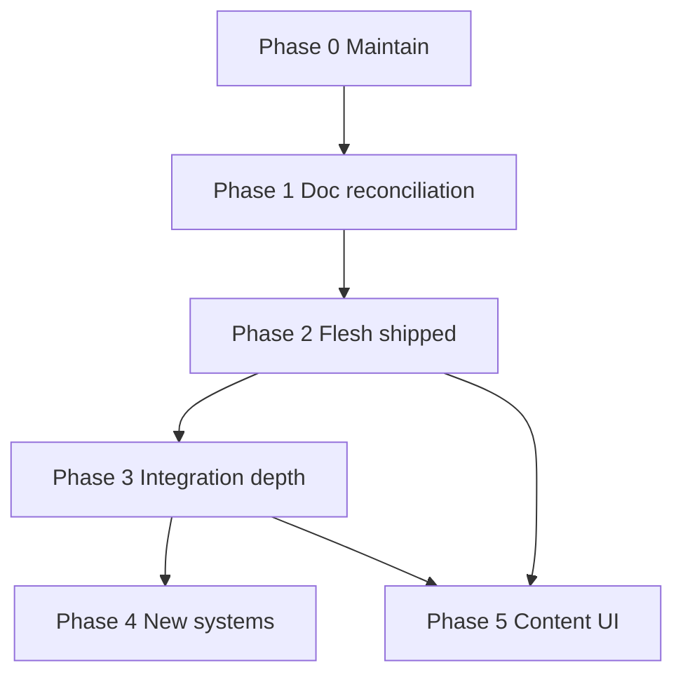

# Post-milestone integration plan (Fallen Paths combat)

**Purpose:** Single **forward plan** after [`IMPLEMENTATION_ORDER.md`](IMPLEMENTATION_ORDER.md) milestones **0–7** and expansion **P4a–P4h** are **Done**. It orders (1) **doc ↔ code reconciliation** across **all** combat bundles, (2) **fleshing** shipped systems via soak + calibration, and (3) **new integration tracks** where investigations were never promoted to milestones.

**Status source:** Milestone **Done / Todo** remains only in [`IMPLEMENTATION_ORDER.md`](IMPLEMENTATION_ORDER.md#milestone-summary). **This file** owns **integration phase** status (`[ ]` / `[x]` per track).

**Last plan pass:** 2026-05-19 (pass 3: final audit — harness green, III-1/MXl wording, Phase 0.5 flag names).

**Plan / code:** Milestone **Status** → [`IMPLEMENTATION_ORDER.md`](IMPLEMENTATION_ORDER.md#milestone-summary) only. **Integration track status** (`[ ]` / `[x]`) → **this file**.

---

## How to use this plan

| Symbol | Meaning |
|--------|---------|
| **Phase** | Ordered stage (do not skip Phase 0–1 before gameplay expansion) |
| **Track** | Named slice (e.g. **III-2**, **II-1e**) with investigation + integration points |
| **Investigation** | Questions to answer *before* coding; record answers under the track in a **Decision log** bullet list (date + choice) |
| **Integration points** | Concrete code/doc/harness/UI touchpoints |
| **Exit** | Checklist to mark `[x]` when the track is complete |

**When shipping integration work:**

1. Mark the track **Exit** here `[x]`.
2. Update the relevant bundle **live path** (or add one).
3. Append **`_run_*`** names to [`REGRESSION_HARNESS_MAP_TIER19.md`](REGRESSION_HARNESS_MAP_TIER19.md).
4. If behavior is a **new milestone**, add a row to [`IMPLEMENTATION_ORDER.md` all tiers at a glance](IMPLEMENTATION_ORDER.md#all-tiers-at-a-glance) — do not fork status here.

**Harness:** `godot -s res://scripts/run_combat_regression_harness.gd` · VS Code task **Run Combat Regression Harness (headless)** · see [`AGENTS.md`](../AGENTS.md).

### Decision log (copy into each track)

When you answer an investigation question, append under that track:

```markdown
**Decision log**
- YYYY-MM-DD — *question* → *choice* (owner)
```

Phase **3** / **4** tracks below include an empty **Decision log** stub — fill before marking **Exit** `[x]`.

### Phase exit gates (summary)

| Phase | Gate before marking phase complete |
|-------|-------------------------------------|
| **0** | Steps **0.1** + **0.2** `[x]` |
| **1** | **I-G1** + all **I-1…I-14** `[x]` (may keep **I-G2–G4**, **I-13** already done) |
| **2** | **II-0** all rows + `run_all()` green (**II-1…II-5** optional unless you scope them in) |
| **3** | Chosen **III-*** tracks `[x]`; **III-2** decision recorded before **IV-4** |
| **4** | Each shipped **IV-*** has plan row + harness + live path |
| **5** | Per **V-*** needs; does not block Phase 3 |

---

## Document map

| # | Section | Use |
|---|---------|-----|
| 1 | [Dependency overview](#dependency-overview) | Phase order (mermaid) |
| 2 | [Master inventory](#master-inventory-all-systems) | Every system — nothing omitted |
| 3 | [Phase 0 — Maintain](#phase-0--maintain-and-harness-governance) | CI green, tail harness |
| 4 | [Phase 1 — Doc reconciliation](#phase-1--documentation-reconciliation-all-bundles) | **12** topic bundles + registry + IDE (**I-1…I-14**) |
| 5 | [Phase 2 — Flesh shipped](#phase-2--flesh-shipped-systems-tuning--soak) | Per-tier tuning (no new mechanics) |
| 6 | [Phase 3 — Integration depth](#phase-3--integration-depth-shipped--deeper-wiring) | Deeper wiring on existing code |
| 7 | [Phase 4 — New systems](#phase-4--new-systems-formal-tracks) | Deferred roadmap / investigations |
| 8 | [Phase 5 — Content & world](#phase-5--content-species-encounters-ui) | Data + presentation |
| 9 | [Investigation appendix](#investigation-appendix-by-bundle) | Per-bundle open questions |
| 10 | [Rejected / archived](#rejected--archived-do-not-schedule) | Explicit non-goals |

---

<a id="dependency-overview"></a>

## Dependency overview



**Rules:**

- **Phase 1** can run in parallel with **Phase 0** but must finish before **Phase 3** (agents read bundles before extending APIs).
- **Phase 2** (soak) may start during **Phase 1** for bundles already accurate; finish **II-0** before claiming integration depth done.
- **Phase 3** tracks are mostly independent after Phase 1; **III-2** (guard decision) blocks **IV-4** / **IV-5**.
- **Phase 4** items need an **`IMPLEMENTATION_ORDER`** row before merge.
- **Phase 5** is ongoing (content/data/UI) and does **not** require Phase 4 completion — only avoid conflicting constants without a Phase 4 design.

**Track ID convention:** **I-** = doc reconciliation · **II-** = flesh/tune shipped · **III-** = integration depth · **IV-** = new systems · **V-** = content. Do not confuse **II-2b** (deflect calibration soak) with **II-3** (Tier 4 AI soak) or **III-3** (deflect integration loop).

---

<a id="master-inventory-all-systems"></a>

## Master inventory (all systems)

**55 rows** below (**M0**–**M7** + **MX**); **M7e** (gauge migration) is archived only.

| ID | System | Shipped milestone | Integration need | Primary phase | Bundle(s) |
|----|--------|-------------------|------------------|---------------|-----------|
| M0a | Event queue + gauge hybrid | Tier 0 | Maintain | 0, 2 | `COMBAT_ROADMAP` |
| M0b | Formation move duration UI | 0.1 | UI labels | 2, 5 | plan, `COMBAT_ROADMAP` |
| M0c | Hit-cancel + incoming parry | 0.2 | Editor soak | 2 | plan |
| M0d | Weapon near-body / extension | 0 / FF4 4b | Doc sync | 1, 2 | `TACTICAL_FORMATIONS_FF4` |
| M1a | Intrusion slots + vacancy plug | 1.2 | Gate on change | 0, 3 | `ENGAGEMENT_*` |
| M1b | Wedge + lane_offset + eff dist | 1.3 | Editor crash soak | 2, 3 | `ENGAGEMENT_*`, `TACTICAL_ZONES` |
| M1c | Cohesion + posture + morale | 1.4–1.5 | Tune | 2 | `ENGAGEMENT_*` |
| M1d | AI targeting + crash weights | 1.6 | Tune | 2 | `AI_ENGAGEMENT` |
| M1e | Engagement mode + telemetry | 1.7–1.8 | Maintain | 0 | `ENGAGEMENT_*` |
| M1f | Depth polearm + spear lanes | 1.9 | Tune doctrine | 2 | plan, `COMBAT_ROADMAP` |
| M1g | Automatic doctrine | 1.10 | 4v4 soak | 2 | plan |
| M1h | Plug vs incursion **contest** | — design | **New** | 4 | `COMBAT_ROADMAP`, `TACTICAL_FORMATIONS_FF4` |
| M1i | Gap-column slot topology | — deferred | **New** | 4 | `ENGAGEMENT_*` §4.2 |
| M2a | ZoC / breach narrative sync | Tier 2 | Re-sync on tune | 1, 2 | `TACTICAL_ZONES` |
| M2b | FF4 formation blurb | 2.2 | Part 4 sync | 1 | `TACTICAL_FORMATIONS_FF4` |
| M3a | Kinematic delivery | 3.0 | Maintain tail | 0 | `PHYSICS_*` |
| M3b | Strike measure + surround sector | 3.1 | P1′ soak | 2 | `PARRY_BIND`, `TACTICAL_ZONES` |
| M3c | Parry / bind / deflect / parts | 3.2 | Calibration + doc | 1, 2, 3 | `PARRY_BIND`, `PARRY_DEFLECT` |
| M3d | Guard line + afterblow | 3.3 | Guard depth | 3, 4 | `GUARDS_*` |
| M3e | Guard matrix / 8 diagonals | — investigation | **New** | 3–4 | `GUARDS_*`, `HEMA_*` |
| M3f | Arm interpose (BP6) | — not in code | **New** | 4 | `GUARDS_*` |
| M3g | Zone-specific guard (KCD) | — investigation | **New** | 4 | `GUARDS_*` |
| M4a | Posture + stance AI | 4.1 | Tune | 2 | `AI_ENGAGEMENT` |
| M4b | Feint D + tempo + listing×reveal | 4.2, 4.2b | Soak | 2 | `AI_ENGAGEMENT` |
| M4c | Mental stack + attention + yomi | 4.3 | UI soak | 2 | `AI_ENGAGEMENT` |
| M4d | Position-angle footwork | 4.4 | Soak | 2 | `AI_ENGAGEMENT` |
| M4e | Flurry bind exchange | 4.5 | Soak | 2 | `AI_ENGAGEMENT`, `HEMA_*` |
| M4f | Multi-target **close slots** | — deferred | **New** | 4 | `TACTICAL_FORMATIONS_FF4`, `COMBAT_ROADMAP` |
| M4g | Engagement 1v1 rule (2v1 clarity) | — design | **New** | 4 | `COMBAT_ROADMAP` |
| M5a | Kinematic audit harness | 5.1 | Tail + TestBattle | 0, 2 | `PHYSICS_*` |
| M5b | Pipeline narrative checklist | 5.1 | Mark done in bundle | 1 | `PHYSICS_*` |
| M5c | Subregion combat multipliers | — entity only | **New** | 4 | `PHYSICS_*` |
| M5d | Species / pain reference | core | Maintain | 5 | `PHYSICS_*`, `species/*.tres` |
| M6a | Mobility + cowering + pain shock | 6.1 | Soak | 2 | `MEDICAL_*` |
| M6b | Flee + rout | 6.2 | Balance | 2 | `MEDICAL_*`, `TACTICAL_ZONES` |
| M6c | Medical coordination | 6.3 | Soak | 2 | `MEDICAL_*` |
| M6d | Wound packing **depth** | partial | Flesh + tune | 3 | `MEDICAL_*` |
| M7a | Stamina costs + delay + bind bonus | 7.1 | Tune | 2 | `COMBAT_ROADMAP`, plan |
| M7b | Stamina depletion pacing | 7.2 | Maintain | 0 | plan |
| M7c | Weapon part + impact station catalog | 7.5 | Maintain | 0 | `PARRY_BIND`, `HEMA_*` |
| M7d | Armor burden + initiative | — roadmap | **New** | 4 | `COMBAT_ROADMAP` |
| M7f | `STAMINA_ENGAGE_MIN` attack/close floor | — not in code | Investigate **IV-7b** | 4 | `COMBAT_ROADMAP` Part 4 |
| M7e | Stamina migration (remove gauge) | — **cancelled** | Archive doc | 1 | `COMBAT_ROADMAP` |
| MXl | Recovery-cause → readiness curve | partial (`READINESS_BY_CAUSE`, footwork dodge mults) | Tune / extend **III-8** | 3 | `AI_ENGAGEMENT`, `PassiveParryContext`, `DefenseChoiceResolver` |
| MXa | Back-rank scheduling | shipped hybrid | Optional max-wait | 3 | `COMBAT_ROADMAP` |
| MXb | Modularization / entity split | ongoing | Maintain map | 1 | `COMBAT_ROADMAP`, `AGENTS.md` |
| MXc | Combat debug / operational log | shipped | Dev UX | 2 | `core/OperationalLog.gd` |
| MXd | Battle UI / formation diagram | shipped | Labels + soak | 2, 5 | `ui/*` |
| MXe | Regression harness map | living | Sync on add | 0 | `REGRESSION_HARNESS_MAP_*` |
| MXf | World → combat entry | shipped | Encounter meta, presets | 5 | `world/CombatFlow.gd`, `CampaignEncounterBridge.gd` |
| MXg | Engagement mode skirmish / breach clog | 1.7–1.8 | Maintain | 0, 2 | `CombatEngagementMode`, `ENGAGEMENT_*` §2.0 |
| MXh | Skirmish unclog breach moves | shipped | Flag + listing | 0 | `FEATURE_SKIRMISH_UNCLOG_BREACH_MOVES`, `FormationBreachRules` |
| MXi | Parry target choice (multi-incoming) | 0.2 partial | Extend scoring (III-1) | 3 | `CombatIncomingParryChoice.choose_parry_target_attacker_id` |
| MXj | Production feature flags | gates shipped | Soak + doc | 0, 2 | `CombatConstants` (intrusion, surround, flurry, incoming parry, ambient shock, footwork) |
| MXk | `scripts/run_combat_regression_harness.sh` | shipped | CI path on Windows | 0 | `AGENTS.md`, `.vscode/tasks.json` |

### Track cross-reference (quick lookup)

| Track | Section |
|-------|---------|
| I-G1…I-14 | [Phase 1](#phase-1--documentation-reconciliation-all-bundles) |
| II-0…II-5 (incl. **II-1e**, **II-3e**) | [Phase 2](#phase-2--flesh-shipped-systems-tuning--soak) |
| III-1…III-8 | [Phase 3](#phase-3--integration-depth-shipped--deeper-wiring) |
| IV-1…IV-13 (incl. **IV-7b**) | [Phase 4](#phase-4--new-systems-formal-tracks) |
| V-1…V-5 | [Phase 5](#phase-5--content-species-encounters-ui) |

---

<a id="phase-0--maintain-and-harness-governance"></a>

## Phase 0 — Maintain and harness governance

**Goal:** No integration work proceeds on a red harness.

| Step | Action | Owner | Exit |
|:----:|--------|-------|:----:|
| 0.1 | `CombatRegressionHarness.run_all()` green; afterblow seeds **0 / 1 / 2** if RNG drifts | harness | [ ] |
| 0.2 | Run `CombatRegressionHarnessKinematicTail.run` (via main harness) | harness | [ ] |
| 0.3 | Document **Last verified** date in [`IMPLEMENTATION_ORDER.md`](IMPLEMENTATION_ORDER.md) header when 0.1–0.2 pass | plan | [ ] |
| 0.4 | On any new `_run_*`, append registry row in [`REGRESSION_HARNESS_MAP_TIER19.md`](REGRESSION_HARNESS_MAP_TIER19.md) | docs | [ ] |
| 0.5 | Confirm production flags match soak checklist (**MXj**): `FEATURE_LINE_CRASH_INTRUSION`, `is_feature_sector_surround_load()` (default **true**), `FEATURE_FLURRY_BIND_EXCHANGE`, `FEATURE_INCOMING_PARRY_CHOICE`, `FEATURE_AMBIENT_PAIN_SHOCK`, `is_feature_position_angle_footwork_enabled()` | `CombatConstants.gd` | [ ] |

---

<a id="phase-1--documentation-reconciliation-all-bundles"></a>

## Phase 1 — Documentation reconciliation (all bundles)

**Goal:** Every consolidated doc reflects **live code** or is explicitly marked **historical / investigation / cancelled**. Eliminate “missing feature” prose for shipped paths.

### Phase 1 — Global

| Track | Work | Exit |
|-------|------|:----:|
| **I-G1** | Add **Plan / integration** banner to each topic bundle: `ENGAGEMENT_*`, `COMBAT_ROADMAP`, `TACTICAL_ZONES`, `TACTICAL_FORMATIONS_FF4`, `PARRY_BIND`, `PARRY_DEFLECT`, `GUARDS_*`, `PHYSICS_*`, `AI_ENGAGEMENT`, `MEDICAL_*`, `HEMA_*` (copy template below; `PHYSICS_*` already has a partial banner — extend to match) | [ ] |

**I-G1 banner template** (paste under bundle title):

```markdown
**Plan / integration:** Milestone **Status** → [`IMPLEMENTATION_ORDER.md`](IMPLEMENTATION_ORDER.md#milestone-summary) only. Forward tracks → [`POST_MILESTONE_INTEGRATION_PLAN.md`](POST_MILESTONE_INTEGRATION_PLAN.md) (Phase 1 **I-*** row for this bundle). **Live paths** → (link anchors in this file). Harness → [`REGRESSION_HARNESS_MAP_TIER19.md`](REGRESSION_HARNESS_MAP_TIER19.md).
```
| **I-G2** | [`README.md`](README.md): post-milestone row + file table includes this plan | [x] |
| **I-G3** | [`AGENTS.md`](../AGENTS.md) + [`.cursor/rules/fallen-paths.mdc`](../.cursor/rules/fallen-paths.mdc): forward-work pointer | [x] |
| **I-G4** | [`IMPLEMENTATION_ORDER.md`](IMPLEMENTATION_ORDER.md): post-expansion backlog + plan inventory row | [x] |

### Phase 1 — Per document

| Track | Document | Reconciliation tasks | Exit |
|-------|----------|----------------------|:----:|
| **I-1** | `IMPLEMENTATION_ORDER.md` | P1 soak checklist dates; optional “integration tracks” pointer only | [ ] |
| **I-2** | `ENGAGEMENT_LINE_COHESION_INTRUSION_PLAN.md` | §2 mirror = plan table; §4.2 gap-column = **deferred Phase 4**; §2.8 = Done | [ ] |
| **I-3** | `PARRY_BIND_AND_WEAPON_GEOMETRY.md` | §2.2–§3 → **Historical (pre-parts)** or rewrite; live path wins | [ ] |
| **I-4** | `PARRY_DEFLECT_AND_CALIBRATION.md` | Index → Phase 2 **II-2b** + Phase 3 **III-3** (not Tier 4 **II-3**) | [ ] |
| **I-5** | `GUARDS_LINES_AFTERBLOW.md` | BP6 “not in code”; §4.5 → Phase 3 **III-2**; live path at top | [ ] |
| **I-6** | `AI_ENGAGEMENT_STANCE_AND_FEINTS.md` | Investigation §1–§3: banner **shipped vs open**; counter-tempo ≠ “gauge 100 only” | [ ] |
| **I-7** | `PHYSICS_DAMAGE_AND_FLOW.md` | [pipeline checklist](PHYSICS_DAMAGE_AND_FLOW.md#tier-51-angles-pipeline-remaining) = audited; TestBattle row → Phase 2; subregion → Phase 4 | [ ] |
| **I-8** | `MEDICAL_PAIN_INCAPACITATION.md` | Wound-packing research → **III-5** live vs proposed table (not **III-6** back-rank) | [ ] |
| **I-9** | `COMBAT_ROADMAP_AND_STAMINA.md` | Part 4 Pre-Switch → **cancelled**; Part 5 deferred → **IV-1…IV-13** + **IV-7b**; snapshot = truth; link **COMBAT_SYSTEM_ISSUES** → **I-14** | [ ] |
| **I-10** | `TACTICAL_ZONES_BREACH_MOVEMENT.md` | `tactical_penetration_depth` checklists → **shipped** (crash path); surround § = sector path | [ ] |
| **I-11** | `TACTICAL_FORMATIONS_FF4.md` | Part 4 multi-target + weapon_extension → **shipped** (`TacticalCombat`, `CombatWeaponPosition`); Part 3.11 close slots → Phase 4 **IV-2** (not IV-4) | [ ] |
| **I-12** | `HEMA_ROADMAP_AND_SOURCES.md` | Method C eight lines → Phase 3 **III-2** decision; bind hardness → shipped 4.5 / 3.2 | [ ] |
| **I-13** | `REGRESSION_HARNESS_MAP_TIER19.md` | **Post-milestone integration** paragraph + track → `_run_*` prefixes (extend when tracks ship) | [x] |
| **I-14** | `COMBAT_ROADMAP` § [COMBAT_SYSTEM_ISSUES](COMBAT_ROADMAP_AND_STAMINA.md#combat-system-issues) | Triage each open item → **fix** / **defer (IV-*)** / **wontfix** / **done**; no stale “blocking” without owner | [ ] |

**Phase 1 complete when:** **0.1** + **0.2** green and **I-G1** + **I-1…I-14** all `[x]`.

---

<a id="phase-2--flesh-shipped-systems-tuning--soak"></a>

## Phase 2 — Flesh shipped systems (tuning + soak)

**Goal:** Shipped mechanics feel intentional in F5 play; constants defended by playtest notes (not only harness).

### II-0 — Baseline soak (plan P1)

| # | Scenario | Modules | Pass | Notes field |
|---|----------|---------|:----:|-------------|
| 1 | Bind deflect → riposte → flurry | `CombatFlurryBind`, `AttackWindUpStarter`, UI | [ ] | |
| 2 | Crash → wedge → intruder slot | `CombatEngagementResolver`, diagram | [ ] | |
| 3 | Multi-threat surround (2+ attackers) | `TacticalCombat`, `DefenseChoiceResolver` | [ ] | |
| 4 | Formation move crowded lane | `CombatFormationMoveDuration`, `CombatPlayerTurnHints` | [ ] | |
| 5 | Mobile cowering → fall_back / flee | `CombatMobilityRetreat`, `CombatFormationFlee` | [ ] | |
| 6 | Ambient pain shock (no new hits) | `EntityPainConsciousness`, `CombatProcessTick`; compare `CombatConstants.set_feature_ambient_pain_shock(false)` | [ ] | |
| 7 | Ally bandage / pack medical phase | `MedicalPhaseController`, log formatter | [ ] | |
| 8 | Skirmish vs line engagement labels | `CombatEngagementMode`, `BattleScene` formation labels (**MXg**) | [ ] | |

**Exit:** All rows checked + `run_all()` green → [ ]

**Requires Phase 0:** steps **0.1** + **0.2** `[x]` before claiming Phase 2 complete.

### II-1 — Tier 0–1

| Track | Flesh-out work | Investigation (before tune) | Integration points | Exit |
|-------|----------------|----------------------------|--------------------|:----:|
| **II-1a** | Incoming parry: heavy+heavy fails, weak pair passes | Document mass/intensity thresholds in constants comment | `CombatIncomingParryChoice`, harness `_run_incoming_parry_*` | [ ] |
| **II-1b** | Crash→wedge readability | What should player see in log + diagram at B-rep? | `CombatLogFormatter`, `FormationDiagramBuilder`, `FP_COMBAT` | [ ] |
| **II-1c** | Automatic doctrine 4v4 | Hollow-center predicate false positives? | `CombatDoctrine`, `CombatFormationEngagement` | [ ] |
| **II-1d** | `rotate_file` blocked lane | AI weight feels fair when lane timing blocks | `CombatAIActionPicker`, `AI_FORMATION_MOVE_BLOCKED_LANE_MULT` | [ ] |
| **II-1e** | Engagement mode + skirmish labels (**MXg**) | LINE vs SKIRMISH vs duel reads correctly in UI + `raw_mode` telemetry | `CombatEngagementMode`, `CombatFormationEngagement`, `BattleScene` | [ ] |

### II-2 — Tier 2–3 (melee)

| Track | Flesh-out work | Investigation | Integration points | Exit |
|-------|----------------|---------------|--------------------|:----:|
| **II-2a** | Sector surround tuning (**P1′**) | Compare `SURROUND_SECTOR_LOAD_*` vs integer path at 2 and 3 threats; harness `_run_surround_production_path_*` | `CombatConstants`, `TacticalCombat`, `AttackResolver` stamp on `pa` | [ ] |
| **II-2b** | Deflect calibration pass (editor + harness) | Target bind:deflect ratio per weapon class (HEMA 57–80% blade contact); pairs with **III-3** | `DefenseResolutionHandler`, `PARRY_DEFLECT` investigations | [ ] |
| **II-2c** | Bind riposte feel | Spear vs mace ordering matches table | `PARRY_BIND_RIPOSTE_BY_PART_CONTACT`, P4h constants | [ ] |
| **II-2d** | Afterblow seeds | Re-pick if `run_all` fails on seeds 0/1/2 | `AfterblowHandler`, harness `_run_afterblow_*` | [ ] |
| **II-2e** | Geometric leak vs alignment | Is `GEOMETRIC_LEAK_MAX` visible in play? | `DefenseResolutionHandler` partial path | [ ] |

### II-3 — Tier 4 (AI / tempo)

| Track | Flesh-out work | Investigation | Integration points | Exit |
|-------|----------------|---------------|--------------------|:----:|
| **II-3a** | Bind flurry window readability | Max exchanges / stamina cost fair? | `CombatFlurryBind`, `CombatUiHints`, gauge suffix | [ ] |
| **II-3b** | Counter-tempo vs AI pick | Does AI over-counter? | `MentalStackDecider`, `CounterTempo` | [ ] |
| **II-3c** | Footwork step UI | Stale step hidden when waiting? | `CombatFootwork`, `BattleUIUpdater` | [ ] |
| **II-3d** | Feint chain readability | Early wind-up feint vs reveal threshold | `_feint_readiness_reveal_mult`, listing parity | [ ] |
| **II-3e** | Recovery-cause readiness feel (**MXl**) | Does miss vs deflect vs hit recovery *feel* different enough with today’s uniform lerp? | `recovery_cause` on combatant, `DefenseChoiceResolver`, off-balance | [ ] |

### II-4 — Tier 5–7 + medical

| Track | Flesh-out work | Investigation | Integration points | Exit |
|-------|----------------|---------------|--------------------|:----:|
| **II-4a** | Kinematic editor calibration | KE/pen at “typical” intensities for sword/spear/mace | `WeaponDamageHelper`, optional `tools/simulate_weapon_ke_velocity.py` | [ ] |
| **II-4b** | Flee rout thresholds | Cohesion + casualty % per encounter type | `CombatFormationRout`, encounter `flee_*` keys | [ ] |
| **II-4c** | Packing success vs severity | Should pack require critical/deep wound? | `EntityMedical`, `BleedingConstants` | [ ] |
| **II-4d** | Stamina depletion ~2 min | `STAMINA_REFILL_RATE` + costs in long fight | `CombatConstants`, Tier 7.2 harness | [ ] |

### II-5 — UI / presentation

| Track | Flesh-out work | Integration points | Exit |
|-------|----------------|--------------------|:----:|
| **II-5a** | Formation action **menu labels** (not only tooltips) | `BattleScene`, action list builder consumers | [ ] |
| **II-5b** | Combat log consistency (fled, pack ally, crash depth) | `CombatLogFormatter` | [ ] |
| **II-5c** | Gauge: Fled / cowering / bind / attention / footwork | `BattleUIUpdater`, `CombatUiHints` | [ ] |

---

<a id="phase-3--integration-depth-shipped--deeper-wiring"></a>

## Phase 3 — Integration depth (shipped → deeper wiring)

**Goal:** Connect existing subsystems that investigations describe but code only partially wires. Each track ends with harness + live-path update.

### III-1 — Surround + multi-incoming defense (M3b, **MXi**, M4f partial)

**Current:** `TacticalCombat` sector weight + split + perception awareness; `CombatIncomingParryChoice.can_parry_all` + **`choose_parry_target_attacker_id`** (intensity-ordered today — verify vs FF4 damage-weighted C); `CombatWeaponPosition` for extended blade.

| Investigation questions | Record answer in |
|-------------------------|-----------------|
| Should **perception** also affect **reaction time** when `num_threats > 1` (not only surround mult)? | Decision log |
| Should **threat scoring** upgrade to damage-weighted C from FF4 §3.11 (vs current intensity sort)? | Decision log |
| Is `surround_threat_weight_sum` on every defender `pa` before `choose_defense`? Trace and document | Live path |

| Integration points | Module |
|--------------------|--------|
| Stamp consistency | `AttackResolver` → `pa` |
| Defense multiply | `DefenseChoiceResolver.choose_defense` |
| AI target pick | `CombatAIActionPicker`, `CombatTargetScoring` |
| Docs | `TACTICAL_FORMATIONS_FF4` Part 4, `TACTICAL_ZONES` §4.5 |

| Deliverable | Exit |
|-------------|:----:|
| Live-path blurb in `TACTICAL_FORMATIONS_FF4` + harness or trace doc | [ ] |
| Optional: `_run_incoming_parry_threat_order_*` if scoring added | [ ] |

**Decision log**

- (fill before Exit)

---

### III-2 — Guard line fidelity (M3d, M3e partial)

**Current:** 4-line `guard_line`; `get_line_alignment_with_deflect`; `geometric_leak`; diagonal `DIAGONAL_WEIGHTS`; `guard_deflect_blend`.

| Investigation questions | |
|-------------------------|--|
| **Option A:** Add explicit 4×4 `PARRY_LINE_EFFICACY[attack][guard]` vs tighten alignment curve? | |
| **Option B:** Eight diagonals (HEMA Method C) — table size vs UI cost? | |
| Does wrong-line **increase variance** separately from leak (GUARDS Approach 2)? | |
| Bind → `guard_line = attack_line` — **partially shipped** in `GuardLineUpdater.set_guard_deflected` when `parry_control` ≥ bind threshold; document vs dynamics D | |

| Integration points | |
|--------------------|--|
| `CombatConstants.get_line_alignment*` | |
| `DefenseChoiceResolver` capacity + variance | |
| `DefenseResolutionHandler` partial + leak | |
| `GuardLineUpdater` on parry outcomes | |
| Move defs `attack_line` in `WeaponConstants` | |

| Deliverable | Exit |
|-------------|:----:|
| **Decision:** matrix **or** eight-line **or** alignment-only (reject others) | [ ] |
| If matrix: constants + `_run_guard_line_matrix_*` | [ ] |
| Update `GUARDS_*` §4.5 + `HEMA_*` Method C status | [ ] |

**Decision log**

- (fill before Exit)

---

### III-3 — Deflect / bind calibration loop (M3c)

**Relationship:** Editor soak **II-2b**; doc index **I-4**. Same workstream — **III-3** = locked constants + worksheet; **II-2b** = playtest pass.

| Investigation questions | |
|-------------------------|--|
| Target % bind vs deflect per longsword vs spear vs mace? | |
| Does `parry_clash_context` logging suffice for editor calibration? | |

| Integration points | |
|--------------------|--|
| `DefenseResolutionHandler`, `CombatDebug.calibration_log` | |
| `PARRY_DEFLECT` investigation tables | |
| Harness: extend `_run_parry_clash_*`, `_run_bind_*` | |

| Deliverable | Exit |
|-------------|:----:|
| Calibration worksheet in `PARRY_DEFLECT` with **filled** target rates | [ ] |
| Constants changed + `run_all()` green | [ ] |

**Decision log**

- (fill before Exit)

---

### III-4 — Engagement geometry consumers audit (M1a–M1b)

| Investigation questions | |
|-------------------------|--|
| Does every `formations.get(fid)` for tactics use `ZoneOfControl.formation_dict_for_zone_geometry`? Grep audit list | |
| Wedge cleared on intruder death / flee — all writers? | |

| Integration points | |
|--------------------|--|
| `ZoneOfControl`, `CombatFormationFlow`, `CombatPairGeometry` | |
| `AvailableActionsBuilder`, `CombatTargetScoring`, `BreachResolver` | |

| Deliverable | Exit |
|-------------|:----:|
| Checklist in `ENGAGEMENT_*` §2 or here with grep results dated | [ ] |
| Fix stragglers if any | [ ] |

**Decision log**

- (fill before Exit)

---

### III-5 — Medical packing depth (M6d)

**Current:** `pack_wound` head/chest; pack-then-bandage; `PACKING_*` constants.

| Investigation questions | |
|-------------------------|--|
| Pack only when wound severity ≥ X? | |
| Consumable linen or abstract unlimited? | |
| Pack + bandage + pressure ordering for junctional? | |

| Integration points | |
|--------------------|--|
| `EntityMedical`, `BleedingConstants`, `CombatMedicalActionListing` | |
| `MedicalPhaseController`, `CombatLogFormatter` | |

| Deliverable | Exit |
|-------------|:----:|
| Table **shipped vs proposed** in `MEDICAL_*` § wound-packing | [ ] |
| Implement chosen gates + `_run_pack_wound_severity_*` if gated | [ ] |

**Decision log**

- (fill before Exit)

---

### III-6 — Back-rank scheduling (MXa)

**Current:** `CombatEventScheduler` + `READY_DELAY_*` + `formation_changed` recheck (see `COMBAT_ROADMAP` investigation).

| Investigation questions | |
|-------------------------|--|
| Is 4s max-wait fallback needed for standoff stalemate? | |
| Cancel pending `EVENT_ACTION_READY` on plug — implemented? | |

| Integration points | |
|--------------------|--|
| `CombatEventScheduler`, `CombatFormationFlow.notify` | |
| `CombatConstants.READY_DELAY_*` | |

| Deliverable | Exit |
|-------------|:----:|
| Document chosen policy in `COMBAT_ROADMAP` investigation § | [ ] |
| Harness `_run_back_rank_*` if behavior changes | [ ] |

**Decision log**

- (fill before Exit)

---

### III-7 — Physics / entity coherence (M5b, M5d)

| Investigation questions | |
|-------------------------|--|
| Any move still missing `impact_station_mean` after catalog pass? | |
| Species pain_reference tuned for goblin vs human TTK? | |

| Integration points | |
|--------------------|--|
| `WeaponConstants`, `species/*.tres`, `CoreEntity` | |
| `_run_impact_station_mean_*` | |

| Deliverable | Exit |
|-------------|:----:|
| `PHYSICS_*` researched numbers table updated | [ ] |

**Decision log**

- (fill before Exit)

---

### III-8 — Recovery-cause readiness shaping (MXl)

**Current:** `recovery_cause` stamped on attacker; **`CombatConstants.READINESS_BY_CAUSE`** + **`PassiveParryContext`** per-cause curves; **`defense_footwork_recovering_dodge_mult_for_cause`** on reported dodge while **`STATE_RECOVERING`**. Open question is **tuning / extending** tables, not greenfield wiring.

| Investigation questions | |
|-------------------------|--|
| Are existing per-cause curves sufficient after **II-3e** soak, or add new causes / mults? | |
| Tie to **II-3e** — doc-only “shipped as intentional” vs constant pass? | |

| Integration points | |
|--------------------|--|
| `AttackResultApplier` (stamp causes), `DefenseChoiceResolver`, `CombatAIActionPicker` feint listing | |
| `AI_ENGAGEMENT` investigation §4 | |

| Deliverable | Exit |
|-------------|:----:|
| Decision: ship per-cause table **or** document uniform as intentional | [ ] |
| If ship: constants + `_run_recovery_cause_readiness_*` | [ ] |

**Decision log**

- (fill before Exit)

---

<a id="phase-4--new-systems-formal-tracks"></a>

## Phase 4 — New systems (formal tracks)

**Goal:** Promote deferred designs to **`IMPLEMENTATION_ORDER` rows** before coding. Each track: investigation doc section → design decision → implementation → harness → live path.

**Dependency order within Phase 4:**

```text
IV-1 plug contest → IV-2 close slots → IV-3 engagement 1v1 rule
IV-4 guard eight/matrix (after III-2 decision)
IV-5 BP6 interpose (after III-2)
IV-6 zone-specific guard (optional; after IV-4)
IV-7 armor burden → IV-8 initiative; IV-7b stamina engage floor (investigate first)
IV-9 gap-column topology (last; highest risk)
IV-10 subregion combat multipliers (parallel entity/wound team)
IV-11 leader abilities (parallel; low priority)
IV-12 multi-unit same slot (parallel; design-only today)
IV-13 ZoC reach modifier (optional; after IV-2/IV-3)
```

### IV-1 — Plug vs incursion contest (M1h)

| Field | Content |
|-------|---------|
| **Problem** | Death leaves gap; plug and crash are separate code paths — FF4 wanted **contest** |
| **Investigation** | `TACTICAL_FORMATIONS_FF4` Part 9; `COMBAT_ROADMAP` Part 5 |
| **Questions** | Single roll vs priority queue? Morale affects plug only or both? Incursion rate cap <20%? |
| **Modules** | `CombatFormationFlow`, `FormationBreachRules`, `BreachResolver`, `CombatEngagementResolver` |
| **Harness** | `_run_plug_incursion_contest_*` |
| **Exit** | [ ] Row in `IMPLEMENTATION_ORDER` + behavior + harness |

**Decision log**

- (fill before Exit)

### IV-2 — Multi-target close slots (M4f)

| Field | Content |
|-------|---------|
| **Problem** | Unlimited closers → unrealistic surround; defense split ≠ slot cap |
| **Investigation** | `COMBAT_ROADMAP` CLOSE_SLOTS_PER_TARGET; FF4 §3.11 |
| **Questions** | Cap = 2 or 3? External attackers at mid only? |
| **Modules** | `CombatEngagementResolver`, `AvailableActionsBuilder`, `CombatMeleeListing` |
| **Harness** | `_run_close_slot_cap_*` |
| **Exit** | [ ] |

**Decision log**

- (fill before Exit)

### IV-3 — Engagement 1v1 rule (M4g)

| Field | Content |
|-------|---------|
| **Problem** | Who is “primary” engaged pair when 2v1; flurry/interrupt rules |
| **Investigation** | `COMBAT_ROADMAP` Pre-Switch §6 |
| **Modules** | `CombatManager`, `CombatEngagementResolver`, event scheduling |
| **Exit** | [ ] Design doc subsection + code or explicit “solo pair only” stamp |

**Decision log**

- (fill before Exit)

### IV-4 — Guard matrix or eight diagonals (M3e)

| Field | Content |
|-------|---------|
| **Depends on** | III-2 decision |
| **Investigation** | `GUARDS_*` §4, `HEMA_*` Method C |
| **Exit** | [ ] |

**Decision log**

- (fill before Exit)

### IV-5 — Arm interpose BP6 (M3f)

| Field | Content |
|-------|---------|
| **Investigation** | `GUARDS_*` Approach 6; Option P6 |
| **Modules** | `AttackPathResolver`, `AttackResolver` |
| **Exit** | [ ] |

**Decision log**

- (fill before Exit)

### IV-6 — Zone-specific guard (M3g)

| Field | Content |
|-------|---------|
| **Investigation** | `GUARDS_*` zone-specific; KCD comparison |
| **Note** | Lower priority than IV-4/5 unless game direction requires |
| **Exit** | [ ] |

**Decision log**

- (fill before Exit)

### IV-7 — Armor burden (M7d)

| Field | Content |
|-------|---------|
| **Investigation** | `COMBAT_ROADMAP` Part 4 §4.1 #5; armor piece mass |
| **Modules** | armor resources, `CombatantEntityAccess`, evasion/close/cooldown |
| **Data** | `ArmorPiece` mobility_penalty or derived from mass |
| **Exit** | [ ] |

**Decision log**

- (fill before Exit)

### IV-7b — Stamina engage minimum (M7f)

| Field | Content |
|-------|---------|
| **Problem** | Roadmap proposed `STAMINA_ENGAGE_MIN` — **not in code** today |
| **Investigation** | `COMBAT_ROADMAP` Part 4 §4.1 #4; stance min stamina already exists |
| **Questions** | Block only attack+close or all actions? Same threshold as stance gates? |
| **Modules** | `CombatConstants`, `AvailableActionsBuilder`, `CombatEngagementResolver` |
| **Exit** | [ ] Ship constant + gates **or** move to [Rejected](#rejected--archived-do-not-schedule) with rationale |

**Decision log**

- (fill before Exit)

### IV-8 — Combat start initiative (M7d)

| Field | Content |
|-------|---------|
| **Depends on** | IV-7 optional |
| **Investigation** | agility + armor_burden delay table |
| **Modules** | `CombatManager.start`, `CombatEventScheduler` |
| **Exit** | [ ] |

**Decision log**

- (fill before Exit)

### IV-9 — Gap-column slot topology (M1i)

| Field | Content |
|-------|---------|
| **Risk** | High — touches all formation consumers |
| **Investigation** | `ENGAGEMENT_*` §4.2 explicit defer |
| **Exit** | [ ] Only if seam occupancy puzzles require |

**Decision log**

- (fill before Exit)

### IV-10 — Subregion combat multipliers (M5c)

| Field | Content |
|-------|---------|
| **Investigation** | `PHYSICS_*` subregion audit |
| **Modules** | `EntityWounds`, `AttackResolver` path, `BodyPartConstants` |
| **Exit** | [ ] |

**Decision log**

- (fill before Exit)

### IV-11 — Leader formation abilities (roadmap)

| Field | Content |
|-------|---------|
| **Investigation** | `TACTICAL_FORMATIONS_FF4` rotate/leader deferred |
| **Exit** | [ ] |

**Decision log**

- (fill before Exit)

### IV-12 — Multi-unit same slot + distraction (roadmap)

| Field | Content |
|-------|---------|
| **Investigation** | `COMBAT_ROADMAP` checkbox |
| **Exit** | [ ] |

**Decision log**

- (fill before Exit)

### IV-13 — ZoC extent modifier on reach (optional)

| Field | Content |
|-------|---------|
| **Investigation** | `COMBAT_ROADMAP` Part 5 |
| **Exit** | [ ] |

**Decision log**

- (fill before Exit)

---

<a id="phase-5--content-species-encounters-ui"></a>

## Phase 5 — Content, species, encounters, UI

| Track | Work | Integration points | Exit |
|-------|------|--------------------|:----:|
| **V-1** | `species/human.tres` + others: pain_reference, proportions vs design | `SpeciesResource`, `CoreEntity.apply_species` | [ ] |
| **V-2** | Encounter presets: `flee_*`, doctrine, depth polearm mults | `CombatConstants`, world meta | [ ] |
| **V-3** | Weapon move coverage: feint moves, polearm, bind_riposte per archetype | `WeaponConstants` | [ ] |
| **V-4** | Editor intrusion/breach fixture | **No `IncursionBreachTest` scene in repo today** — locate legacy scene, recreate, or rely on headless harness + document in `ENGAGEMENT_*` §2 | harness `_run_resolve_crash_*`, plan Tier 1.2 gate | [ ] |
| **V-5** | `TestBattle` scripted scenarios (`PHYSICS_*` checklist) | editor test scene | [ ] |

---

<a id="investigation-appendix-by-bundle"></a>

## Investigation appendix (by bundle)

Use this when starting a track — copy questions into the track **Decision log**, answer, then implement.

### `ENGAGEMENT_LINE_COHESION_INTRUSION_PLAN.md`

- Gap-column vs wedge-only: when is offset insufficient?
- Intruder `lane_offset` repack on rotate_file / flee?
- `breached_files` vs `intrusion_wedge_by_file` canonical severity — any drift?

### `TACTICAL_ZONES_BREACH_MOVEMENT.md`

- `tactical_penetration_depth` vs narrative `penetration_depth` naming
- Surround “price” while deep — double-count with sector load?
- Breach TTL / reform — needed?

### `TACTICAL_FORMATIONS_FF4.md`

- Close-slot cap value; AI weighting when cap hit
- Phalanx vs loose spacing reach (doc gap ~0.9 m vs 1.8 m)
- Ambush partial vs full — all keys wired on encounter?

### `PARRY_BIND_AND_WEAPON_GEOMETRY.md`

- Part lengths cm for leverage beyond mass fractions?
- Bind hardness scalar on riposte beyond contact-type table?
- Shaft parry on spear — all harness cases?

### `PARRY_DEFLECT_AND_CALIBRATION.md`

- Margin vs decisiveness thresholds per weapon
- Block parry vs Vier Versetzen — point offline penalty
- Rate targets from HEMA sources vs actual harness samples

### `GUARDS_LINES_AFTERBLOW.md`

- Approaches 1+2+3 vs current alignment+leak only
- BP6 interpose vs path resolver
- Guard transition costs (dynamics A–D)
- Afterblow vs flurry priority when both available

### `AI_ENGAGEMENT_STANCE_AND_FEINTS.md`

- Probabilistic feint — **rejected**
- Full hide-target-until-reveal without `feint_part` split — still worth it?
- Stamina spend on dodge/parry beyond current parry cost
- Recovery cause → readiness: tune **`READINESS_BY_CAUSE`** / footwork dodge mults (**III-8**)
- Melee AI investigation — target part vs line targeting

### `PHYSICS_DAMAGE_AND_FLOW.md`

- Arc_start from blended guard for diagonals
- Contact-type multipliers fully on damage path?
- Goblin vs human audit numbers
- Modularization: further `CombatManager` splits?

### `MEDICAL_PAIN_INCAPACITATION.md`

- Pain shock: this-hit vs total pain — tune susceptibility band
- Incapacitation vs cowering edge cases
- TCCC pressure rebound when two medics — stack assist only path tested?
- Medieval packing materials / time / failure modes

### `COMBAT_ROADMAP_AND_STAMINA.md`

- Hybrid gauge kept — archive remove-gauge migration
- `STAMINA_ENGAGE_MIN` — still desired?
- Continuous drain vs event-only — design stance
- Formation action modularization in UI layer
- Combat system issues list — triage via Phase 1 **I-14** (fix / defer **IV-*** / wontfix / done)

### `HEMA_ROADMAP_AND_SOURCES.md`

- Eight-line guard vs bind blend Method A
- Hard vs soft bind riposte — already split via bind + flurry
- Feint/flurry KCD comparison — 4.5 shipped slice sufficient?

### `REGRESSION_HARNESS_MAP_TIER19.md`

- Tail file split policy — when to move tests to tail
- Flaky seeds registry — afterblow, feint windup

---

<a id="rejected--archived-do-not-schedule"></a>

## Rejected / archived (do not schedule)

| Item | Reason | Doc action |
|------|--------|------------|
| Probabilistic plain-attack feint | Rejected Tier 4.2 | Mark in `AI_ENGAGEMENT` |
| Remove gauge / full stamina migration | Hybrid shipped | Banner `COMBAT_ROADMAP` Part 4 |
| Re-gate surround + intrusion + flurry in one PR | Plan warning | — |
| Reopen Tier 1–7 rows without new sub-step | Audit rule | `IMPLEMENTATION_ORDER` |
| `STAMINA_ENGAGE_MIN` (optional) | Only if **IV-7b** rejects — else implement | See **IV-7b** decision log |

---

## Changelog

- **2026-05-19 (pass 3):** Final audit — `run_all()` green (Godot 4.6 headless); **III-1** inventory tags (**MXi** not **M0d**); **III-8** / **MXl** reflect shipped per-cause tables; Phase **0.5** explicit flag API names; Phase **2** gate clarifies **II-1…II-5** optional.
- **2026-05-19 (pass 2):** **I-8** → **III-5** (was wrongly III-6); **I-14** issues triage; **II-1e** skirmish soak; **II-3e** / **III-8** recovery-cause; **IV-7b** stamina floor; decision log template + stubs (all **IV-***); phase exit gates; **II-0** #8; inventory **M7f**, **MXl** (**55** rows); Phase 1 completion rule; appendix **I-14** pointer.
- **2026-05-19 (review):** Fixed wrong track refs (I-4→II-2b, I-5/I-12→III-2, I-11→IV-2); removed bogus **I-3b**; Phase 5 not blocked on Phase 4; inventory **MXf–MXk**; track ID convention; **III-1** parry-target partial; bind guard-line note; **V-4** IncursionBreachTest absent; I-G2–G4/I-13 partial **[x]**.
- **2026-05-19:** Initial plan — master inventory, Phases 0–5, investigation appendix, tracks I/II/III/IV/V.
