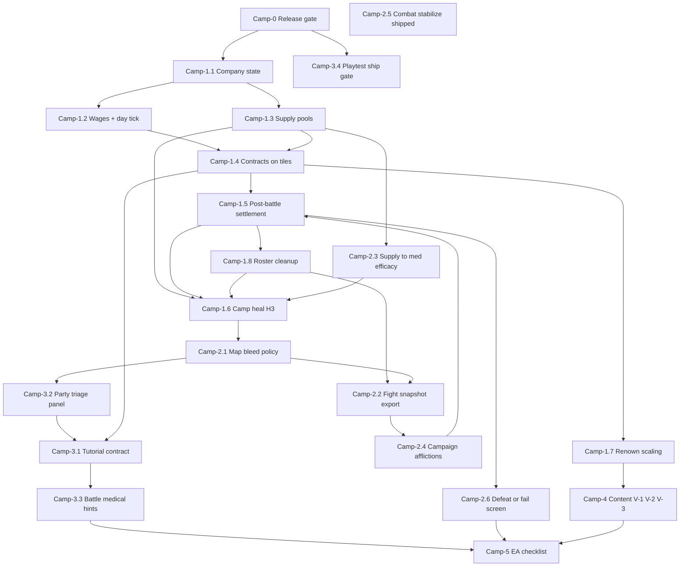

# Ship plan — merc company loop (Battle Brothers parity)

**Purpose:** Close the gap between **shipped combat/medical simulation** and a **shippable mercenary campaign** players can run for hours without dev soak presets.

**Entry:** [`PLANNING.md`](PLANNING.md) · [`CURSOR.md`](CURSOR.md) · combat map [`LIVE_PATHS.md`](LIVE_PATHS.md) · bleeding [`LIVE_PATHS#bleeding-units`](LIVE_PATHS.md#bleeding-units).

**Implementation appendices:** [§9 wiring](SHIP_PLAN.md#implementation-reference) · [**§9b mental stack (shipped)**](SHIP_PLAN.md#combat-mental-stack-shipped) · [**§9c combat Expand registry**](SHIP_PLAN.md#combat-expand-registry) · [§10 contracts](SHIP_PLAN.md#data-contracts) · [§11 encounters](SHIP_PLAN.md#encounter-lifecycle) · [§12 tuning](SHIP_PLAN.md#ea-tuning-defaults) · [§13 save](SHIP_PLAN.md#persistence-scope) · [§14 roster](SHIP_PLAN.md#roster-casualties) · [§15 dev soak](SHIP_PLAN.md#dev-vs-campaign-mode) · [§17 supplies](SHIP_PLAN.md#battle-supply-consumption) · [§18 templates](SHIP_PLAN.md#camp-4-config-examples) · [§19 gate constants](SHIP_PLAN.md#implementation-stubs) · [§20 pitfalls](SHIP_PLAN.md#implementation-pitfalls) · [decision guide (shipped bundle)](CAMPAIGN_DECISION_GUIDE.md#user-bundle-2026-05-22)

**Decisions:** **Closed (2026-05-22)** — canonical summary in [`CAMPAIGN_DECISION_GUIDE` user bundle](CAMPAIGN_DECISION_GUIDE.md#user-bundle-2026-05-22) + [§19 gate constants](SHIP_PLAN.md#implementation-stubs). Gate research appendix in the guide; [decision log](SHIP_PLAN.md#decision-log). New gates only post-EA.

**Comparables (design inputs only):** Battle Brothers (company loop), RimWorld CE (stabilize + supply quality), ACE3 (triage clarity), Phoenix Command (bleed-out time), CDDA (map bleed + self-aid constraints), Dominions/BB (campaign afflictions), Chains on Sand (between-fight choices). Combat depth stays; **campaign + UX** carry the product.

---

<a id="target-definition"></a>

## 1. Target definition

### Shippable means

A new player can, without reading harness docs:

1. Start a run with a small roster and starting **gold + medical/tools supplies**.
2. Take **paid contracts** on the overworld (not anonymous red tiles).
3. Fight using existing formation / HEMA / medical-phase systems (**AI picks** moves and targets via mental stack + weights — **no** per-click target UI).
4. See a **post-battle settlement** (pay, wounds, supply use).
5. **Heal or stabilize** on the map (Party menu + camp tile `(0,0)`) using supplies and time.
6. Feel **economic pressure** (wages, upkeep, bad fights cost med kits).
7. Lose the run on **party wipe**, **contract failure (R3)**, or **company collapse (B3 desertion / empty roster)** with a clear screen.

### Not required for first ship (EA scope)

- Full town UI, hiring hall, inventory grid, crafting economy.
- Neurotrauma-style organ surgery or ACE cardiac arrest chains.
- POST Phase 3 **III-*** integration depth + Phase 4 **IV-*** + **P4** playbooks ([§9c](SHIP_PLAN.md#combat-expand-registry) · [`LIVE_PATHS` phase 4](LIVE_PATHS.md#phase-4--new-systems-formal-tracks)).
- Mental-stack **L5–L6** only ([§9b](SHIP_PLAN.md#combat-mental-stack-shipped)). (**MS-L7** baseline shipped; **p4a** threshold tune optional.)
- New `FEATURE_*` flags, bleed retune, F1 BMI ([`PLANNING`](PLANNING.md) / [`CURSOR`](CURSOR.md) policy).
- Player per-target picking (design lock: [`LIVE_PATHS` tier 4.3](LIVE_PATHS.md#tier-43-mental-stack--combat-attention)).

### Success metric

**2–4 hour playtest:** complete ≥3 contracts, pay ≥2 wage days, recover from one “bloody win” via camp heal, and lose once to wipe or B3 economic collapse with understandable cause.

---

<a id="current-state"></a>

## 2. Current state (repo truth)

**Campaign bundle (2026-05-22):** Camp-1 + Camp-2 + Camp-3 (headless) + Camp-4 implemented; gates closed in [`CompanyState`](world/CompanyState.gd) ([§19](SHIP_PLAN.md#implementation-stubs)). **Remaining EA:** Camp-3.4 F5 human sign-off, Camp-5 checklist close-out.

| Area | Shipped | Gap vs BB-like ship |
|------|---------|---------------------|
| **Combat** | Tiers 0–6, D-001–D-007, Phase 0 harness | Maintain only (**Combat** stream). Turn pick / attention / mental stack wiring: [`LIVE_PATHS#combat-cognition-pipeline`](LIVE_PATHS.md#combat-cognition-pipeline) — do not fork in campaign code. |
| **Medical sim** | Wounds, ATLS blood, TCCC ladder, medical phase | E3 supply floor + map field care shipped; Expand only |
| **Overworld** | 3×3 map, `ContractSpawner`, R3 pool, move → fight | Larger map / hire at inn (post-EA) |
| **Party** | `PartyMenu` + `PartyRowFormatter` triage ETA; HUD supplies; K3 cleanup ([§14](SHIP_PLAN.md#roster-casualties)) | Hiring replacements |
| **Time on map** | Hybrid day (5 steps) + camp End day; bleed warn/block; field care | — |
| **Post-battle** | `SettlementPanel`; paid loss → `CompanyRunEndPanel`; tutorial soft defeat | — |
| **Economy** | Gold, wages, med/tools, renown pay scale, desertion (B3) | Save/load (P2 post-EA) |
| **Campaign injuries** | Post-victory afflictions (`CampaignAfflictions`) | Full affliction catalog |
| **Med skill** | `get_medical_effectiveness()` × company med pool (Camp-2.3) | — |
| **Combat AI cognition** | Tier 4.3 L0–L4 + salience damp + **MS-L7** (L5 exhaustion) shipped | Expand: MS-L5–L6, tier-4.4 footwork; **p4a** tunes MS-L7 thresholds ([§9b](SHIP_PLAN.md#combat-mental-stack-shipped)) |
| **Combat systems depth** | Tiers 0–6 + D-001–007 in harness | Expand: III-*, IV-*, P4* ([§9c](SHIP_PLAN.md#combat-expand-registry)) |

**Existing integration hooks (extend, don’t replace):**

- `world/ContractSpawner.gd` / `EncounterNode.gd` — contract templates, markers, spawn on step-in.
- `world/CampaignEncounterBridge.gd` — `prepare_combat_from_encounter`, `can_enter_combat`, `party_has_untreated_wounds`, vitality logging.
- `world/CombatFlow.gd` / `BattleEndHandler.gd` — battle end pipeline.
- `world/PartyMemberSnapshot.gd` / `ui/PartyMenu.gd` — roster display.
- `core/EntityTimeAdvance.gd` / `core/EntityHealing.gd` — map time + healing.
- `world/MapFieldCare.gd` / `world/MapBleedPolicy.gd` — Party field care + map bleed policy.
- `ui/CompanyHud.gd` — overworld economy strip.

---

<a id="dependency-overview"></a>

## 3. Phase order (logical dependencies)



**Rules:**

- **Camp-1 build order** is [§3d](#camp-1-build-order) (not strict 1.5→1.6 numeric order — gates and settlement deps).
- **Camp-2** after **Camp-1.5** (settlement exists); **2.2** can follow **1.8** (snapshot enriches settlement).
- **Camp-3.2** before **Camp-3.1**; **D-bleed** closed (`warn_eta` + tutorial block + Party field care).
- **Camp-4** after **Camp-1.4**; parallels late **Camp-2**.
- **Expand** / **III-*** / **IV-*** / **P4** frozen until [Camp-5](SHIP_PLAN.md#camp-5-ea-checklist) unless map↔battle (see [§6](#work-streams-during-campaign) · [§9c](#combat-expand-registry)).

---

<a id="decision-gates-at-implementation"></a>

## 3b. Decision gates (closed 2026-05-22)

**Rule:** Closed gates are in [`CompanyState`](world/CompanyState.gd) + [§19](SHIP_PLAN.md#implementation-stubs); branch via `read_stub_*()`. **Read first:** [guide user bundle](CAMPAIGN_DECISION_GUIDE.md#user-bundle-2026-05-22). New gates only: guide research section → log → implement.

| Order | Camp row | Gate ID | Status | Const (§19) |
|-------|----------|---------|--------|-------------|
| — | **Camp-1.1** | — | Shipped | §12 defaults |
| — | **Camp-1.3** (map/camp) | — | Shipped | Camp heal −1 med; tools abstract |
| 1 | **Camp-1.2** | **D-day** | Closed 2026-05-22 | `DAY_TICK_MODE` / `STEPS_PER_DAY` |
| 2 | **Camp-1.4** | **D-encounter** | Closed 2026-05-22 | `ENCOUNTER_LIFECYCLE` (R3) |
| 3 | **Camp-1.5** | — | Shipped | `SettlementPanel` |
| 4 | **Camp-1.8** | **D-casualty** | Closed 2026-05-22 | `CASUALTY_ON_SETTLEMENT` (K3) |
| 5 | **Camp-1.6** | **D-camp-ui** | Closed 2026-05-22 | `CAMP_HEAL_ENTRY` / `CAMP_HEAL_SECONDS` |
| 6 | **Camp-1.7** | — | Shipped | `RENOWN_PAY_SCALE` |
| 7 | **Camp-2.1** | **D-bleed** | Closed 2026-05-22 | `MAP_BLEED_POLICY` + tutorial block |
| 8 | **Camp-2.3** (+ **2.5**) | **D-supply-battle** | Closed 2026-05-22 | `MED_BATTLE_MODE` (E3 hybrid) |
| 9 | **Camp-2.2** | — | Shipped | `last_battle_summary` |
| 10 | **Camp-2.4** | **D-affliction** | Closed 2026-05-22 | `AFFLICTIONS_ENABLED` |
| 11 | **Camp-2.6** | **D-bankrupt** | Closed 2026-05-22 | `BANKRUPT_MODE` (B3) |
| 12 | **Camp-3.2** | — | Shipped | Party triage / field care UI |
| 13 | **Camp-3.1** | — | Shipped | Tutorial marker + `MapBleedPolicy` block until first win |
| — | **Camp-3.3** | — | Shipped (Combat-led) | Medical-phase hints |
| — | **Camp-3.4** | — | Headless shipped · F5 human open | `run_campaign_ship_audit` tail |
| — | **Camp-5** | **D-persistence** | Closed P1 EA | **P2** only if adding save |

**Parallel agents (EA close-out):** Camp product gates are closed — default pairing is **Combat maintain** + **Playtest (F5 §8)**; **Campaign** agent only for [Camp-5](SHIP_PLAN.md#camp-5-ea-checklist) sign-off or optional **P2** save. See [§6](#work-streams-during-campaign) · [`PLANNING#parallel-agents`](PLANNING.md#parallel-agents).

---

<a id="pre-start-checklist"></a>

## 3c. Pre-start checklist (historical — greenfield Camp-1)

> **EA (2026-05-22):** Camp-1–4 shipped. Use [§8 F5 playtest](SHIP_PLAN.md#camp-playtest-acceptance) + [Camp-5](SHIP_PLAN.md#camp-5-ea-checklist) for close-out. Keep this table for replaying Camp-1 from scratch or onboarding new agents.

| Step | Action |
|------|--------|
| 1 | `.\scripts\run_all_combat_checks.ps1` → **Camp-0** PASS |
| 2 | Read [§9](SHIP_PLAN.md#implementation-reference) (boot / battle / party paths) |
| 3 | Create `world/CompanyState.gd` with [§19 gate constants](SHIP_PLAN.md#implementation-stubs) — **no product decisions yet** |
| 4 | Campaign agent: **Camp-1.1** only · Combat agent: one [CURSOR backlog](CURSOR.md#stream-combat) item (respect [§9b](SHIP_PLAN.md#combat-mental-stack-shipped) — no stack reorder unless Expand) |
| 5 | Follow [§3d Camp-1 build order](SHIP_PLAN.md#camp-1-build-order); closed choices in [guide user bundle](CAMPAIGN_DECISION_GUIDE.md#user-bundle-2026-05-22) |
| 6 | Skim [§20 pitfalls](SHIP_PLAN.md#implementation-pitfalls) before editing `main.gd` / bridge |

**First gate you would hit (greenfield):** **Camp-1.2** (D-day) after Camp-1.1.

---

<a id="camp-1-build-order"></a>

## 3d. Camp-1 build order (code sequence)

**Historical** — Camp-1 shipped 2026-05-22. Use this row order when replaying greenfield implementation (differs from numeric labels **1.5 before 1.6** only):

| Step | Row | Gate | Notes |
|------|-----|------|-------|
| 1 | **Camp-1.1** | — | `CompanyState` + HUD; `PartySetup` calls `init_from_defaults()` |
| 2 | **Camp-1.2** | D-day | `overworld_step_count`, wages |
| 3 | **Camp-1.3** | — | consume helpers only |
| 4 | **Camp-1.4** | D-encounter | `ContractSpawner`; contract markers |
| 5 | **Camp-1.5** | — | `SettlementPanel`; pay from `active_contract` |
| 6 | **Camp-1.8** | D-casualty | Same PR as 1.5 if possible |
| 7 | **Camp-1.6** | D-camp-ui | Needs med pools from 1.3 |
| 8 | **Camp-1.7** | — | renown on win in settlement or bridge |

**Camp-1 phase exit (§8 steps 1–6):** after steps 1–7 above.

---

<a id="camp-0-release-gate"></a>

## Camp-0 — Release gate (always)

| ID | Work | Modules / commands | Exit |
|----|------|-------------------|------|
| **Camp-0.1** | Phase 0 green | `.\scripts\run_all_combat_checks.ps1` | `.phase0_combat_checks.txt` **`PHASE0: PASS`** + **`CAMPAIGN_SHIP_AUDIT: PASS (headless)`**; `.d001_headless_signoff.txt` **`ok=true`** |
| **Camp-0.2** | Doc links | `check_doc_links.ps1` (in Phase 0) | No broken links to this file |

**Parallel:** **Combat** stream maintenance ([§9b](SHIP_PLAN.md#combat-mental-stack-shipped) regression: `_run_mental_stack_*` in `AttentionFootworkTail`); **Playtest** only when validating feel (not required every Camp-0 pass).

---

<a id="camp-1-company-loop"></a>

## Camp-1 — Minimum merc company loop

Goal: **motivation + resources** on the existing 3×3 map.

### Camp-1.1 — Company state

**Decision gate:** None — use [§12](SHIP_PLAN.md#ea-tuning-defaults) provisional numbers (tune later, not a design fork).

| Field | Detail |
|-------|--------|
| **Deliverable** | World-persistent `CompanyState`: `gold`, `medical_supplies`, `tool_supplies`, `renown`, `day_index`, `bankrupt` flag. |
| **Storage** | `world.set_meta("company_state", …)` from **`CompanyState.gd`** helpers — **no save/load in EA** ([D-persistence P1](CAMPAIGN_DECISION_GUIDE.md#d-persistence); optional **P2** at [Camp-5](SHIP_PLAN.md#camp-5-ea-checklist)). |
| **Init** | `PartySetup.setup_party` → `CompanyState.attach_to_world(world)` after roster exists. |
| **Meta keys** | Add to `CompanyState` or `CombatConstants`: `WORLD_META_COMPANY_STATE := "company_state"`, `WORLD_META_ACTIVE_CONTRACT := "active_contract"`, `WORLD_META_LAST_BATTLE_SUMMARY := "last_battle_summary"` ([§10](SHIP_PLAN.md#data-contracts)). |
| **UI** | Minimal HUD on **`UIOverlayLayer`**: gold + supplies + day (+ `Next wage` after 1.2). |
| **Input** | Settlement/defeat modals must **`set_process_input(false)`** on player until dismissed ([§20](SHIP_PLAN.md#implementation-pitfalls)). |
| **Harness** | `.\scripts\run_company_state_checks.ps1` (**174** tests: Camp-1 + Camp-2 field-care e2e pressure→bandage→camp rest + P2 persistence); gate greps `FP_HARNESS_OK: CompanyStateChecks`. |
| **Exit** | [x] HUD updates when gold/supplies change (`refresh_hud` on economy writes; headless Camp-1.1). |

> **Historical (greenfield Camp-1.1):** first PR was `CompanyState` shell + HUD only ([§3d](SHIP_PLAN.md#camp-1-build-order) step 1). Full Camp-1 shipped 2026-05-22 — no separate slice table needed for EA work.

### Camp-1.2 — Wages + day tick

> **Closed 2026-05-22 — D-day → T3:** hybrid `5` steps + End day at camp; wages via `CompanyState.try_advance_day`.  
> **Code touch:** `main._on_player_moved` · `PartyMenu` End day · `CompanyState.on_overworld_step`.

| Field | Detail |
|-------|--------|
| **Deliverable** | Once per **day**: deduct `wage_per_member × living roster` (living = not `is_dead()`, valid `node_ref`). |
| **Comparable** | BB noon wages. |
| **Touch** | `CompanyState`, `PartyManager.get_members()`. Map step already runs **`advance_party_overworld_minute`** (60s) — **do not** tie wages to that hook unless D-day = per-step. |
| **UI** | HUD: `Next wage: Ng` when gold low. |
| **Exit** | [x] Wage warn when gold &lt; bill (`_warn_if_gold_below_next_wage` + HUD hint; desertion at Camp-2.6). |
| **Log** | `YYYY-MM-DD — D-day → …` in [decision log](#decision-log) |

### Camp-1.3 — Supply pools

**Decision gate:** None for pools; battle spend **shipped** at **Camp-2.3** ([D-supply-battle](CAMPAIGN_DECISION_GUIDE.md#d-supply-battle) **E3**).

| Field | Detail |
|-------|--------|
| **Deliverable** | Medical supplies consumed by map heal (Camp-1.6) + settlement; tool supplies for abstract repair (Camp-1.5). |
| **Comparable** | BB med supplies + tools. |
| **Touch** | `CompanyState.consume_medical` / `consume_tool`; camp heal; settlement repair line. |
| **Tools** | **No armor durability** — repair is abstract (−1 tool if offered). |
| **Exit** | [x] Camp heal blocked at 0 med; settlement **Repair gear (−1 tool)** when wounded. |

### Camp-1.4 — Contracts on encounter tiles

> **Closed 2026-05-22 — D-encounter → R3:** marker `queue_free` on step-in; paid loss ends run; tutorial soft retry.  
> **Code touch:** `CampaignEncounterBridge.begin_contract_encounter` · `ContractSpawner` · `CombatFlow.handle_battle_ended`.

| Field | Detail |
|-------|--------|
| **Deliverable** | `encounter_config`: `contract_title`, `pay_gold`, `difficulty_rating`, scaled `enemy_count` / gear. |
| **Comparable** | BB contract board → map jobs. |
| **Touch** | `EncounterNode`, `EncounterSpawner` / **`ContractSpawner`**, `prepare_combat_from_encounter`. |
| **Spawner** | Replace random reds when not in [dev soak mode](SHIP_PLAN.md#dev-vs-campaign-mode); exclude `Vector2i(0,0)`. |
| **UI** | Marker label: title + pay + difficulty. |
| **Exit** | [x] Win pays scaled `pay_gold`; loss pays 0; ≥2 templates (headless Camp-1.4). |
| **Log** | `YYYY-MM-DD — D-encounter → …` |

### Camp-1.5 — Post-battle settlement screen

**Decision gate:** None (layout); **D-casualty** applies to **Camp-1.8** on same PR if possible.

| Field | Detail |
|-------|--------|
| **Deliverable** | Modal after player victory (before map input): contract pay, wound summary per brother, optional tool repair cost, “Continue”. |
| **Comparable** | BB post-fight review. |
| **Touch** | `CombatFlow.handle_battle_ended`: after `BattleEndHandler.handle_victory` and **`CampaignEncounterBridge.on_return_from_combat`** (summary + transient meta), **`SettlementPanel.show_and_await`** before map input. Data: `PartyManager.get_members()` → **`PartyMemberSnapshot.snapshot_from_member`** + `health_entity_from_character` (same as `PartyMenu`). |
| **Contract context** | Stash active contract id/pay on world meta at `prepare_combat_from_encounter`; read in settlement. |
| **Exit** | [x] Settlement: pay, supplies line, triage rows, optional tool repair; HUD refresh on continue. |

### Camp-1.6 — Camp heal (H3, shipped)

> **Closed 2026-05-22 — D-camp-ui → H3:** Party menu anywhere + camp tile; `600s` heal × `3` mult, −1 med.  
> **Code touch:** `ui/PartyMenu.gd` · `CompanyState.try_camp_heal` · `main._maybe_camp_tile_hint`.

| Field | Detail |
|-------|--------|
| **Deliverable** | Spend **1 med** + advance game time → `process_healing` on party entities. |
| **Comparable** | BB town heal. |
| **Exit** | [x] Camp rest (Party menu or camp tile, H3) −1 med, 600s×3 heal **+ day tick (wages)**; field care on map (pressure → bandage). |
| **Log** | `YYYY-MM-DD — D-camp-ui → …` · heal seconds |

### Camp-1.7 — Renown scaling

| Field | Detail |
|-------|--------|
| **Deliverable** | `renown` increases on contract win; scales `pay_gold` and enemy `enemy_count` / equipment tier caps. |
| **Comparable** | BB renown → pay + difficulty. |
| **Exit** | [x] Templates + renown spawn bonus (`scale_template_for_renown`); pay scales with renown. |

### Camp-1.8 — Post-battle roster cleanup (with Camp-1.5)

> **Closed 2026-05-22 — D-casualty → K3:** memorial + kill recap; `memorial_then_remove` on settlement / soft defeat.  
> **Code touch:** `SettlementPanel` · `CompanyState.apply_casualty_cleanup` · `format_last_battle_death_lines`.

| Field | Detail |
|-------|--------|
| **Deliverable** | Settlement lists dead/unconscious; apply chosen removal policy. |
| **Touch** | `PartyManager`, `SettlementPanel`, [§14](SHIP_PLAN.md#roster-casualties) |
| **Exit** | [x] `apply_casualty_cleanup` removes dead; fightable = living (headless Camp-1.8). |
| **Log** | `YYYY-MM-DD — D-casualty → …` |

**Phase Camp-1 exit:** Playtest script in [§8](#camp-playtest-acceptance) steps 1–6 pass (step 8 waits for Camp-2.6).

---

<a id="camp-2-sim-campaign-bridge"></a>

## Camp-2 — Simulation ↔ campaign bridge

Goal: deep combat/medical **constrains** the merc loop without a second minigame.

### Camp-2.1 — Map bleed policy

> **Closed 2026-05-22 — D-bleed → B + tutorial block:** `warn_eta` on map; tutorial incomplete blocks move/combat; Party field care.  
> **Code touch:** `MapBleedPolicy` · `MapFieldCare` · `PartyRowFormatter` triage lines.

| Field | Detail |
|-------|--------|
| **Deliverable** | Implement chosen policy; document in UI. |
| **Touch** | `party_has_untreated_wounds`, `BleedingConstants`, `CombatResearchAnchors`. |
| **Exit** | [x] No silent bleed death without warning (block tutorial / warn+ETA campaign + Party field care). |
| **Log** | `2026-05-22 — D-bleed → B` (+ map field care; tutorial block until first win) |

### Camp-2.2 — Post-fight snapshot export

| Field | Detail |
|-------|--------|
| **Deliverable** | `CampaignEncounterBridge` builds `last_battle_summary`: per-member blood %, total bleed, untreated parts, worst ATLS band. |
| **Touch** | `on_return_from_combat`, `SettlementPanel`. |
| **Exit** | [x] Settlement uses `last_battle_summary.members[].snapshot` + same `PartyRowFormatter` vitals as `PartyMenu`. |

### Camp-2.3 — Supplies → medical effectiveness

> **Closed 2026-05-22 — D-supply-battle → E3:** efficacy floor `0.5` at 0 med; −1 med on pack/stabilize (battle + field stabilize).  
> **Code touch:** `CompanyState.wire_party_medical_supply` · `MedicalWindUpHandler` · `CombatUiHints`.

| Field | Detail |
|-------|--------|
| **Deliverable** | `get_medical_effectiveness()` = INT curve × supply factor (e.g. 0.5 if 0 med, 1.0 if ≥1 med reserved). |
| **Comparable** | RimWorld CE medicine quality. |
| **Touch** | `CoreEntity.get_medical_effectiveness`, `CompanyState`, battle medical actions. |
| **Split PR contract** | **Combat first:** optional `supply_factor: float = 1.0` (or read from bridge) in `CoreEntity` — no `CompanyState` import in `core/`. **Campaign second:** pass factor from `CompanyState` via bridge / entity context. |
| **Exit** | [x] `wire_party_medical_supply` + medical-phase combat-log hint when med=0. |

### Camp-2.4 — Campaign afflictions (permanent layer)

> **Closed 2026-05-22 — D-affliction:** `CampaignAfflictions` post-victory; `AFFLICTIONS_ENABLED` true.  
> **Code touch:** `CoreEntity.campaign_afflictions` · `PartyMemberSnapshot` · `EntityPainConsciousness`.

| Field | Detail |
|-------|--------|
| **Deliverable** | `campaign_afflictions` on **`CoreEntity`** — criteria and effects per guide. **Acute `wounds[]` unchanged.** |
| **Apply** | **Combat** PR: `EntityWounds` / post-battle hook reads criteria; **Campaign** PR: display in `PartyMemberSnapshot` + settlement. |
| **Comparable** | BB permanent injuries; Dominions afflictions. |
| **Harness** | `_run_campaign_affliction_*` before enabling in contracts. |
| **Exit** | [x] `CampaignAfflictions` post-victory; Party + settlement scar lines; `pain_mult` in `EntityPainConsciousness`. |

### Camp-2.5 — Combat stabilize (shipped)

| Field | Detail |
|-------|--------|
| **Deliverable** | Battle action `stabilize_wound`: spend 1 med supply ([§17](#battle-supply-consumption) **E3 hybrid**). |
| **Comparable** | RimWorld CE stabilize. |
| **Touch** | `MedicalPhaseController` / `CombatMedicalActionListing` listing; `MedicalWindUpHandler` → `CompanyState.on_battle_medical_complete` (−1 med on success). |
| **Cognition** | Listing only — **`MentalStackDecider` L0/L1** + `CombatMedicalCoordination.medical_action_allowed`; do not bypass coordination ([§9b](SHIP_PLAN.md#combat-mental-stack-shipped)). |
| **Exit** | [x] `stabilize_wound` (pressure held, −1 med); does not set `bandaged_parts` — full dressings still required for map/end phase. |

### Camp-2.6 — Company fail / defeat screens

> **Closed 2026-05-22 — D-bankrupt → B3:** desertion at low mood; bankrupt modal when roster empty; `CompanyRunEndPanel` + `main.tscn` restart.  
> **Code touch:** `ui/CompanyRunEndPanel.gd` · `PartySetup` (dedupe stale **`PartyManager`** on `main` before re-init on scene reload) · `CompanyState._run_daily_desertion_pass`.

| Field | Detail |
|-------|--------|
| **Deliverable** | **Wipe:** `CompanyRunEndPanel` + restart. **Bankrupt:** B3 desertion + insolvency warns (not instant gold wipe). |
| **Exit** | [x] Contract fail / bankrupt / training reload explain cause; restart returns to `main.tscn`. |
| **Log** | `YYYY-MM-DD — D-bankrupt → …` |

**Phase Camp-2 exit:** Playtest steps 7–9 pass; one affliction applied in test fight.

---

<a id="camp-3-player-ready"></a>

## Camp-3 — Player-ready UX

### Camp-3.1 — Tutorial contract

> **Shipped (2026-05-22):** Tutorial contract on green tile (`ContractSpawner.TUTORIAL_TILE`); **`MapBleedPolicy`** blocks map move/combat until first win when bleed risk present; after first win, policy **B** (`warn_eta`) + Party field care (Camp-3.2).

| Field | Detail |
|-------|--------|
| **Deliverable** | Fixed first encounter: 2v2, low bleed mult, `SoakEncounterPresets`-style config flagged `tutorial`; tooltips for Stm/Exh/Grd/blood. |
| **Cognition UX** | Optional one-liner when gauge shows **`Tel` / `Focus` / `Load` / `Stack`** ([`LIVE_PATHS` battle-ui](LIVE_PATHS.md#battle-ui)) — explain AI priority, not “click a target”. |
| **Comparable** | Chains on Sand downtime teach; BB first contracts. |
| **Exit** | [x] Tutorial marker on map (`ContractSpawner` green tile); no `dev_soak_encounter` required. |

### Camp-3.2 — Party triage panel

| Field | Detail |
|-------|--------|
| **Deliverable** | Extend `PartyMenu` / `PartyRowFormatter`: ATLS band label, `~Xs to danger` from bleed rate + `MEDICAL_TRIAGE_*`, untreated banner. |
| **Helpers** | `BleedingConstants.atls_hemorrhage_class_from_remaining_pct(blood_pct)`; ETA: `CombatResearchAnchors.clinical_ttd_seconds(bleed_mult)` or seconds until `blood_pct` crosses `MEDICAL_TRIAGE_DANGER_BLOOD_REMAINING` at current `total_bleeding_rate` (0 rate → no ETA). |
| **Comparable** | ACE triage card. |
| **Exit** | [x] Matches headless triage thresholds within one band (`PartyRowFormatter` + `_run_party_row_triage_formatter`). |

### Camp-3.3 — Battle medical phase hints (Combat-led)

| Field | Detail |
|-------|--------|
| **Lead agent** | **Combat** ([`PLANNING#file-ownership`](PLANNING.md#file-ownership)) — not Campaign agent that week |
| **Deliverable** | First medical phase: one-shot hints (pressure before pack on arterial; winner-lock). |
| **Touch** | `combat/CombatUiHints.gd`, `ui/BattleUIUpdater.gd` |
| **Wiring** | Hook **medical phase** UI only ([`LIVE_PATHS` battle-ui](LIVE_PATHS.md#battle-ui)); do **not** reorder `MentalStackDecider` or `AvailableActionsBuilder` for tutorial. |
| **Exit** | [x] Hint dismisses; doesn’t repeat every fight (session meta on world; per-fight without world). Harness: `_run_medical_phase_hints_*`, `_run_medical_phase_gauge_tooltip_*`, `_run_battle_ui_gauge_label_receiving_care_*`, `_run_battle_ui_gauge_label_medical_wind_up_primary`. |

<a id="camp-34-playtest-ship-gate"></a>

### Camp-3.4 — Playtest ship gate (human or third lane)

| Field | Detail |
|-------|--------|
| **Who** | **Not** a third parallel code agent by default — you (F5) or a dedicated **Playtest** session after Campaign+Combat merge that week |
| **Deliverable** | Ship gate: **Q1** duel + **Q2** bind feel checklists; **ii7** medical smoke (**headless** in Phase 0 via `CombatD001SoakRunner` — not a cyan F5 preset). Optional F5: `dev_soak_encounter=ii2b` + manual medical phase once. |
| **Cognition** | In medical-phase F5, spot-check allies pick pressure/pack when **`Stack medical`** / **`self_medical`** appears on gauge ([§9b](SHIP_PLAN.md#combat-mental-stack-shipped)) — feel only, not a new gate ID. |
| **Commands** | `run_campaign_ship_audit.ps1` (standalone) or `run_all_combat_checks.ps1` (includes Camp-3.4 tail); `run_q_feel.ps1 -Track Camp` (§8 checklist) or `-Track Q1` / `Q2` for soak feel |
| **Headless** | `CompanyStateChecks` maps [§8](#camp-playtest-acceptance) steps 1–10; `[ii7]` + `[ii_envelop] pass=true` in `.d001_soak_out.txt`; Q1/Q2 via `run_q_audit.ps1 -Track Track` |
| **Exit** | [x] Headless: `CAMPAIGN_SHIP_AUDIT: PASS` (tail of `run_all_combat_checks.ps1` · `run_campaign_ship_audit.ps1`). [ ] Human: F5 campaign mode + record in [`Camp-5`](SHIP_PLAN.md#camp-5-ea-checklist). Optional F5: **`dev_soak_encounter=ii_envelop`** + `validate_f5_soak_log.ps1`. |

**Phase Camp-3 exit:** External playtester completes tutorial + 1 contract without agent docs.

---

<a id="camp-4-content"></a>

## Camp-4 — Content (POST Phase 5 alignment)

Run after **Camp-1.4** works. No new combat `FEATURE_*`.

| ID | Work | Source track | Exit |
|----|------|--------------|------|
| **Camp-4.1** | Species in contracts (human vs goblin enemies, pain/blood pools) | POST **V-1** | [x] Human skirmish/escort/spear + goblin raid pools |
| **Camp-4.2** | Encounter presets: doctrine, flee, depth polearm | POST **V-2** | [x] Escort flee+pinch; Spear Trial depth mults + hold_lane |
| **Camp-4.3** | Weapon archetypes per contract tier | POST **V-3** | [x] SWORD / SPEAR / AXE `soak_force_weapon_id` on contracts |

---

<a id="camp-5-ea-checklist"></a>

## Camp-5 — EA ship checklist

> **EA close-out (2026-05-22):** Camp-1–4 + headless Camp-3.4 **implemented**. Remaining human sign-off: F5 [§8](SHIP_PLAN.md#camp-playtest-acceptance) (`dev_soak_encounter` empty) + tick rows below. Gate defaults: [guide user bundle](CAMPAIGN_DECISION_GUIDE.md#user-bundle-2026-05-22).

> **Optional code gate:** [**D-persistence P2**](CAMPAIGN_DECISION_GUIDE.md#d-persistence) — add autosave on settlement continue; default **P1** (no save code).

| Must ship | Headless gate | Nice for EA |
|-----------|---------------|-------------|
| Camp-0 Phase 0 PASS | `run_all_combat_checks.ps1` | Larger overworld |
| Camp-1 full loop (+ Camp-1.8 roster cleanup) | `CompanyStateChecks` | Hire at inn |
| Camp-2.1 **D-bleed closed** + Camp-2.3 + Camp-2.5 stabilize | Camp-2.1/2.3/2.5 harness rows | Full affliction catalog |
| Camp-2.4 ≥1 affliction | Camp-2.4 harness | Full affliction catalog |
| Camp-2.6 fail screens | Camp-2.6 harness | Narrative events |
| Camp-3.1–Camp-3.2 tutorial + triage | Camp-3.1/3.2 harness | Extra tutorial tooltips |
| Camp-3.4 Q + **§8 F5** sign-off | `run_all_combat_checks.ps1` (Q + `[ii7]` + `[ii_envelop]`) or `run_campaign_ship_audit.ps1`; **F5 human** still required |
| Camp-4.1–4.3 contract presets | Camp-4 harness | More template variety |
| **Tier 4.3 mental stack** L0–L4 + salience damp + **MS-L7** shipped | Phase 0 `_run_mental_stack_*` | MS-L5–L6 (Expand); **p4a** tune |
| **III-4 Track A** (7v3 wings / mapped opposition) | Phase 0 `[ii_envelop] pass=true` + tier-1 opposition/rotate harness ☑ | IV-9 gap-column (Track B) |
| **WF footing / forms** (WF-1…4 + PA pilot shipped) | Phase 0 **`AttentionFootworkTail`** + **`WeaponFormTail`** + D-001 **ii5c** | F5 **WF-M3**: **`validate_f5_soak_log`** **`wf_m3_*`** on paste ☑ · full Camp §8 human — [#wf-m3-f5-playtest](LIVE_PATHS.md#wf-m3-f5-playtest) |
| No dev soak required for normal play | `dev_soak_encounter` empty | Optional F5 **`ii_envelop`** wing feel |

**Explicitly defer (post-EA Expand):** [§9c](SHIP_PLAN.md#combat-expand-registry) — III-*, IV-1,3,5–13, P4a–h, MS-L5–L6 · organ surgery · BMI F1 · bleed retune · new `FEATURE_*`. (**WF-1…WF-4** + tier-4.4 octant PA **shipped** — maintain harness.) (**MS-L7** baseline shipped — **p4a** is threshold tune only.)

---

<a id="work-streams-during-campaign"></a>

## 6. Other work streams (EA close-out)

| Work stream | During EA close-out |
|-------------|---------------------|
| **Campaign** | F5 [§8](SHIP_PLAN.md#camp-playtest-acceptance) + [Camp-5](SHIP_PLAN.md#camp-5-ea-checklist) sign-off — not new `Camp-*` code unless **P2** save |
| **Combat** | Phase 0 maintain; [`LIVE_PATHS` tier 4.3](LIVE_PATHS.md#tier-43-mental-stack--combat-attention) regression (L0–L4 + MS-L7 L5 + salience damp; no player targets). |
| **Playtest** | **Required before EA:** Camp-3.4 F5 human + Q1/Q2 feel; headless already in Phase 0. |
| **Expand** | **WF shipped** — maintain only until Camp-5; new Expand tiers frozen. Registry: [§9c](SHIP_PLAN.md#combat-expand-registry) · [`LIVE_PATHS` phase 4](LIVE_PATHS.md#phase-4--new-systems-formal-tracks). |

**Session default until Camp-5 done:** **Combat maintain** + **Playtest (F5 §8)** in parallel; **Campaign** agent only for Camp-5 checklist / optional **P2** save. Single-agent fallback: F5 sign-off **or** one Combat fix ([`PLANNING#parallel-agents`](PLANNING.md#parallel-agents)).

---

<a id="camp-7-session-order"></a>

## 7. Recommended session order (historical greenfield)

> **EA close-out (2026-05-22):** F5 [§8](SHIP_PLAN.md#camp-playtest-acceptance) + [Camp-5](SHIP_PLAN.md#camp-5-ea-checklist). Table below is the original week-by-week build plan (Camp-1–4 **done**).

**Parallel:** assign **Campaign column** to agent A and **Combat column** to agent B each week ([`PLANNING#parallel-agents`](PLANNING.md#parallel-agents)).

| Week | Campaign agent | Combat agent (parallel) |
|------|----------------|-------------------------|
| 1 | Camp-0.1 + Camp-1.1 | Phase 0 hygiene; verify [§9b](SHIP_PLAN.md#combat-mental-stack-shipped) harness green |
| 2 | Camp-1.2 + Camp-1.3 | `BattleUIUpdater` medical busy ([Combat backlog](CURSOR.md#stream-combat)) |
| 3 | Camp-1.4 | D-001 / small LIVE_PATHS maintain (preserve mental-stack pick order) |
| 4 | Camp-1.5 + Camp-1.8 ([§3d](SHIP_PLAN.md#camp-1-build-order)) | `CombatUiHints` prep (no `MentalStackDecider` reorder) |
| 5 | Camp-1.6 + Camp-1.7 | Combat maintain / [§9b](SHIP_PLAN.md#combat-mental-stack-shipped) regression if touched pick path |
| 6 | Camp-2.2 + Camp-2.3 (close **D-supply** gate) | `CoreEntity` efficacy PR if split |
| 7 | Camp-2.1 (close **D-bleed** gate) + Camp-3.2 | Camp-3.3 medical-phase hints |
| 8 | Camp-3.1 + Camp-2.4 | Camp-2.4 affliction rules (Combat split) |
| 9 | Camp-2.6 + Camp-3.4 Playtest | ii7 / F5; optional **`Stack *`** feel in medical phase |
| 10 | Camp-4.1–Camp-4.3 + Camp-5 | Final Phase 0 + regression (incl. `_run_mental_stack_*`) |

**Single-agent fallback:** run Campaign rows first (column 1), Combat when blocked on UI.

---

<a id="camp-playtest-acceptance"></a>

## 8. Playtest script (EA / Camp ship acceptance)

**Headless:** `.\scripts\run_campaign_ship_audit.ps1` (or Phase 0 `CompanyStateChecks` + `run_q_audit.ps1 -Track Track` + `[ii7]` + `[ii_envelop]`). **F5:** same steps below with `dev_soak_encounter` empty. **Checklist helper:** `.\scripts\run_q_feel.ps1 -Track Camp` (paste Output → `.f5_soak_in.txt` → re-run; invokes **`validate_f5_soak_log`** for **`wf_m3_*`** + **`camp_*`**). **Smoke (no editor):** `Copy-Item docs\f5_soak_log.camp_wf.example.txt .f5_soak_in.txt` → `validate_f5_soak_log.ps1`. **Optional III-4 F5:** `dev_soak_encounter=ii_envelop` → `.f5_soak_in.txt` → `validate_f5_soak_log.ps1`.

| Step | Headless harness |
|------|------------------|
| 1–2 | Camp-1.1 defaults; Camp-1.4 marker pay/skulls + `active_contract` |
| 3 | Camp-1.4 pay + Camp-1.5 settlement snapshots |
| 4–5 | Camp-2.1 bleed block/warn + field care; Camp-1.6 camp heal |
| 6–7 | Camp-1.2 hybrid day; Camp-1.7 renown pay |
| 8–9 | Camp-1.4 R3 loss + Camp-2.6 soft defeat / wage debt |
| 10 | Camp-3.2 triage formatter |
| 11 | Combat harness medical-phase hints (not F5) |

1. Start run — note starting gold, med, tools, roster size.
2. Move to contract tile — confirm pay and difficulty shown.
3. Win fight — settlement shows pay and wounds; gold increases; **Continue** logs `settlement_continue` in Output.
4. Move 1 step with untreated bleed — tutorial incomplete: move blocked; after first win: `warn_eta` log + Party field care (**pressure free → bandage −1 med**; stabilize optional).
5. Camp rest (Party, all wounds dressed) — −1 med, heal, **day advances + wages**; or **End day** on camp tile (wages only).
6. Advance 5 overworld steps (hybrid day) until wages deduct if you did not camp rest.
7. Win second contract — renown increases pay or enemy tier.
8. Deliberately lose a **paid** contract — run-end modal (EA: not saved) + kill recap; dismiss logs `company_run_end reason=contract_failed reload=true`; restart loads `main.tscn`. Tutorial loss — `reason=tutorial_failed reload=false` + marker respawns.
9. Advance days with gold below wages — wage warning + debt warning; desertion at low mood; bankrupt modal when no living brothers remain.
10. Open Party — triage lines match fight outcome.
11. *(Camp-3+)* Win a fight with medical phase — winners’ gauges may show **`Stack medical`** / **`self_medical`**; medics prioritize pressure before pack (AI, not player target clicks).
12. *(Camp-5 WF-M3)* During sword fights, grep **`turn_ready_gauge`** — when wind-up/recovery shows footing, order should read **`Step`** → **`Atk`/`Grd`** → **` · Form`**; diagram cells show guard short (**`[HiR]`**) before form (**`[Wrath]`**). Spec: [`LIVE_PATHS#wf-m3-f5-playtest`](LIVE_PATHS.md#wf-m3-f5-playtest).
13. *(Optional III-4)* `dev_soak_encounter=ii_envelop` — Skirmish 7v3; grep **`rotate_file@`**, **`Stack hold_line`**, **`attempt_close@`**; `validate_f5_soak_log.ps1`. **Campaign alternative (3e):** paid 7v3+ fight where one enemy survives standing — grep **`mop_up=true`** + **`strikes>0`** / **`menu=strikes_listed`** on combat-phase `engagement_debug turn` lines (not post-victory medical triage only).

#### §8 F5 close-out bundle (Camp-5 human + `run_camp_f5_closeout`)

**Automated minimum** (`.\scripts\run_camp_f5_closeout.ps1` exit 0): headless **PHASE0 + CAMPAIGN_SHIP_AUDIT** + F5 paste with **`wf_m3_turn_ready_form`** + **`wf_m3_grd_before_form`** + **`camp_settlement_continue`** + **`camp_company_day`**.

**Full Camp-5 human** still requires separate runs or merged log for steps **4, 8–10** (field care action, paid loss, wage/desertion, Party triage). Merge sessions: `.\scripts\append_f5_soak_log.ps1 -AppendFrom fight2.log` → **`validate_f5_soak_log.ps1`**.

| Marker / step | Grep / validator | Notes |
|---------------|------------------|-------|
| Tutorial + paid win | `settlement_continue` | `[camp_settlement_continue]` when `camp_ea` profile detected |
| Wage / day tick | `company_day_advanced` | Needs overworld walk or camp rest — not every single-fight paste |
| Field care | `field_care:` hint · **`field_care bandage`** / **`field_care pressure`** action | Optional `[camp_field_care]` / `[camp_field_care_action]` |
| Paid loss | `company_run_end reason=contract_failed reload=true` | Optional `[camp_paid_loss]` |
| Tutorial soft loss | `company_run_end reason=tutorial_failed reload=false` | Optional `[camp_tutorial_soft_loss]` |
| Wage / desertion (step 9) | `company_wages: gold=` · `desertion summary=` | Optional `[camp_wage_warn]` · `[camp_desertion]` |
| Party triage (step 10) | Human Party menu glance | No automated grep marker yet |
| Mop-up anti-stall (3e) | `engagement_debug turn` + `mop_up=true` + `strikes=[1-9]` | Optional `[camp_mopup_strike_finish]`; rout-only wins OK for settlement but weaker 3e signal |
| Fight end | `soak_fight_end` | In-editor **`soak_coverage`** includes fight-end line in trace; deferred until first medical pick when `medical_phase=true` |
| WF-M3 | `turn_ready_gauge` · `Grd` before `Form` | Step 12 |

After medical, **`FP_WORLD`** **`settlement_continue`** triggers **`soak_coverage camp`** supplement in Output. Paste full session for **`validate_f5_soak_log.ps1`**.

---

<a id="implementation-reference"></a>

## 9. Implementation reference (repo wiring)

Use this when fleshing out Camp rows — extends [§2](#current-state) hooks.

### Boot (`main._ready`)

1. Tilemap 3×3. **Campaign** (`dev_soak_encounter` empty): **`ContractSpawner.spawn_campaign_contracts`** — tutorial (green) + paid jobs (red) on free tiles. **Dev soak:** optional cyan preset tile + **`EncounterSpawner.spawn_encounters`** (red soak markers).
2. `PlayerCompanionSetup` → `PartySetup.setup_party` → world meta: **`party_manager`**, **`party_menu`**, **`party_formation`**; **`CompanyState.attach_to_world`** (HUD on root **`UIOverlayLayer`**).
3. **`UIOverlayLayer`** on **tree root** (not `main`): **Party** button + popup. **`PartyManager`** is a **child of `main`** (same scene as `Character`); roster **`node_ref`** survives soft defeat; paid R3 loss reloads `main.tscn` via **`CompanyRunEndPanel`**.

### Overworld step (`main._on_player_moved`)

| Branch | Behavior |
|--------|----------|
| Encounter on tile | `can_enter_combat` → bleed policy (`warn_eta` / tutorial **block**) → contract label warn → `begin_contract_encounter` (R3: `queue_free` marker) → `CombatFlow.start_combat` |
| Empty tile | `advance_party_overworld_minute` — **60s**, bleed + heal on player + companions |

### Battle end (`CombatFlow.handle_battle_ended`)

| Outcome | Today | Camp adds |
|---------|-------|-----------|
| **Defeat** | `build_last_battle_summary` → `CompanyRunEndPanel` (paid R3: `contract_failed` + restart; tutorial/other: `tutorial_failed` / `soft_defeat_resume` — no reload) · `BattleEndHandler.handle_defeat` | Kill recap; mood witness/loss only on soft-resume paths |
| **Victory** | `handle_victory` → `on_return_from_combat` → **`SettlementPanel`** (pay, scars, memorials, live roster) → HUD refresh | Paid win: marker stays consumed — tile empty ([§11](#encounter-lifecycle) R3). **Tutorial loss only:** `ContractSpawner.ensure_special_encounter_present` respawns marker (not on victory). |

### Health / display path

`character` → `get_medical_entity()` → **`CoreEntity`** wounds/blood. Party UI: **`PartyMemberSnapshot`** + **`PartyRowFormatter`**. Bridge: **`CampaignEncounterBridge.health_entity_from_character`**.

### Combat encounter dict

`EncounterNode.encounter_config` → world meta **`CombatConstants.WORLD_META_COMBAT_ENCOUNTER`** → `BattleScene.start` → **`CombatManager`** (doctrine, posture, depth polearm mults, …). Keys: see [§10](#data-contracts).

### Combat cognition (read-only for Campaign agents)

Full logical order: [`LIVE_PATHS#combat-cognition-pipeline`](LIVE_PATHS.md#combat-cognition-pipeline). Summary for ship work:

| Layer | What it does | Campaign may |
|-------|----------------|--------------|
| **Listing** | `get_available_actions` → `AvailableActionsBuilder` | Set encounter doctrine/posture only (weights), not move list shape |
| **Turn pick** | `CombatAIActionPicker` + `MentalStackDecider` (L0 self-med → L1 ally med → L2 counter → L3 incoming → L4 hold line → salience-damped weighted) | **Never** player target UI; expand stack per [`LIVE_PATHS` tier 4.3](LIVE_PATHS.md#tier-43-mental-stack--combat-attention) |
| **Waiting tick** | `CombatAttention.refresh_for_waiting_tick` → gauge hints | Camp-3.3: one-shot medical-phase copy only |
| **Strike defense** | `DefenseChoiceResolver` on contact | Camp-2.3: `get_medical_effectiveness()` only |
| **Bridge** | World meta med factor at `prepare_combat_from_encounter` | Camp-2.3; no `CompanyState` in `combat/*` |

**Camp rows that touch this graph:** Camp-2.3 (med weights), Camp-2.5 (stabilize listing, shipped), Camp-3.1 (gauge copy), Camp-3.3 (hints), Camp-3.4 (F5 Stack feel optional). All other Camp work stays in `world/*` / settlement / party UI.

<a id="combat-mental-stack-shipped"></a>

### §9b — Mental stack & attention (Tier 4.3 — shipped baseline)

**Canonical detail:** [`LIVE_PATHS#tier-43-mental-stack--combat-attention`](LIVE_PATHS.md#tier-43-mental-stack--combat-attention) · pipeline [`#combat-cognition-pipeline`](LIVE_PATHS.md#combat-cognition-pipeline).

**Design lock:** No player per-target picker. `TurnReadyHandler` and `CombatEventDispatch` both call `CombatAIActionPicker.pick`.

| Shipped layer | Stamp | Code | Realistic behavior |
|---------------|-------|------|-------------------|
| Retreat gate | — | `cannot_commit_melee` → retreat pool only | Cowering / no arms: no fake offense |
| **L0** | `self_medical` | `MentalStackDecider` | Self in immediate peril → coordinated self-aid before ally help |
| **L1** | `medical` | + `CombatMedicalCoordination` | Ally peril → medical only; respects overlap / compression / wind-up |
| **L2** | `counter` | + `CounterTempo` | Open counter window → counter-tempo listings only |
| **L3** | `incoming` | + telegraph / attacker id | Wind-up on self → counter or melee vs that attacker |
| **L4** | `hold_line` | + `CombatListedActions` | **Shipped:** reserve posture (`wait`, focus, `attempt_close`) → focus, wait, or L4 **`pick_weighted`** close when wing lacks mapped opposition + LONG — [`LIVE_PATHS#iii-4`](LIVE_PATHS.md#iii-4--engagement-geometry-audit). **3b:** Skirmish **`rotate_file`** exits L4 → utility pick |
| **L5** | `exhaustion` | + `CombatExhaustion` | High fight exhaustion → wait / disengage before utility pick (**MS-L7**) |
| **Utility** | *(cleared)* | `pick_weighted` + `_salience_offense_weight_mult` + exhaustion offense damp | High `attention_load` dampens attack/feint/close; gradual offense damp below MS-L7 tunnel threshold |

**Parallel systems (not pick layers):** `CombatAttention` — salience, yomi, focus drift, UI `Tel`/`Focus`/`Load`/`Stack`; `DefenseChoiceResolver` — strike-time defense.

| Module | Role |
|--------|------|
| `MentalStackDecider.gd` | Layer order L0→L5 (L5 = MS-L7 exhaustion tunnel) |
| `CombatAIActionPicker.gd` | `pick` → stack → `pick_weighted` |
| `CombatAttention.gd` | `refresh_salience`, UI hints, yomi |
| `CombatConstants.gd` | `MENTAL_STACK_LAYER_*`, `MENTAL_STACK_SALIENCE_OFFENSE_DAMP_MAX`, feature flags |
| `CombatRegressionHarnessAttentionFootworkTail.gd` | `_run_mental_stack_*` (incl. self, hold_line, coordination) |

**Expand after Camp-5 (Combat / Expand stream — not Campaign):**

| ID | Layer | Intent |
|----|-------|--------|
| MS-L5 | Formation plug | Vacancy / plug-forward when line breaks |
| MS-L6 | Rout | Cohesion / casualty → flee / fall_back priority |
| MS-MID | In-fight ally med | If mid-fight medical listing added, wire L1 coordination |
| MS-CAMP | Trait hooks | Morale/stress → thresholds via bridge meta (no `CompanyState` in `combat/*`) |

**Campaign agents:** read-only — do not fork pick/listing. **Combat agents:** new layers only per [LIVE_PATHS §I](LIVE_PATHS.md#combat-cognition-pipeline) + harness row.

**III-4 Track A L4 (shipped PR7):** see [L4 reserve posture spec](LIVE_PATHS.md#iii-4--engagement-geometry-audit) — listing trigger unchanged; pick pool gains `attempt_close` for wing + LONG via **`pick_weighted`**. **3b** (`rotate_file` in Skirmish, PR5 ☑) **exits L4** when listed — close then competes in utility pick. Track A bridge complete — F5 **`ii_envelop`** soak for manual sign-off ([PR8](LIVE_PATHS.md#iii-4--engagement-geometry-audit)).

<a id="combat-expand-registry"></a>

### §9c — Combat Expand registry (post–Camp-5 default)

**Canonical tables:** [`LIVE_PATHS#phase-4--new-systems-formal-tracks`](LIVE_PATHS.md#phase-4--new-systems-formal-tracks) (III-*, P4a–h, IV-*, **WF-1…WF-4**, MS-L5–L6, tier-4.4). **MS-L7** shipped in [§9b](#combat-mental-stack-shipped); **p4a** tunes thresholds only.

| Bucket | When | Examples |
|--------|------|----------|
| **Maintain during Camp** | Parallel Combat agent | Phase 0 · mental stack L0–L4 + MS-L7 · Camp-3.3 UI · regression harness · [**III-4 Track A ☑**](LIVE_PATHS.md#iii-4--engagement-geometry-audit) (no new `FEATURE_*`) |
| **Camp bridge (not Expand)** | Campaign stream | Camp-1 economy · Camp-2.3 med efficacy · Camp-2.5 stabilize · Camp-4 `encounter_config` rows · III-4 **3c** player front preset keys ☑ |
| **Phase 3 depth** | Expand after Camp-5 | III-1 surround/parry target · III-3 deflect soak · III-5 pack depth · III-6 back-rank · III-4 **Track B** (IV-9 gap-column) |
| **P4 playbooks** | Expand | p4a exhaustion pacing · p4c auto doctrine · p4f flee action · p4g flurry tune |
| **Phase 4 IV** | Expand | IV-3 1v1 rule · IV-4/5 guards · IV-7 armor burden · **IV-9 gap-column** ([III-4 Track B](LIVE_PATHS.md#iii-4--engagement-geometry-audit)) · IV-10 subregion |
| **Weapon forms (WF)** | **Maintain** (Camp-5) | [**WF status**](LIVE_PATHS.md#wf-implementation-status) — **WF-1…4 shipped** · **M3** automated validator ☑ / Camp §8 human open · M1·M2·M4·M5 ☑ · post–Camp-5 [**WF-T1/T2**](LIVE_PATHS.md#wf-footing-improvement-backlog) |
| **Cognition** | Expand | MS-L5–L6 · tier-4.4 spatial footwork · **no** player targets (**MS-L7** shipped — **p4a** tune) |
| **Wontfix / closed** | — | IV-INTR (D-008) · P3b mat sim expand · bleed retune unless asked · F1 BMI |

**Pick one row per Expand PR:** harness `_run_*` + live path line + optional `FEATURE_*` ([`PLANNING` policy](PLANNING.md#harness-and-flags)).

**Camp-4 content** maps POST **V-1…V-3** into `encounter_config` only — does **not** implement IV tracks.

---

<a id="data-contracts"></a>

## 10. Data contracts

### `encounter_config` — campaign keys (Camp-1+)

| Key | Type | Purpose |
|-----|------|---------|
| `contract_title` | String | Marker + settlement header |
| `contract_type` | String | e.g. `skirmish`, `escort` (flavor + template id) |
| `pay_gold` | int | Settlement on win |
| `difficulty_rating` | int | 1–3 UI skulls; scales `enemy_count` / gear |
| `tutorial` | bool | Camp-3.1 — low bleed, tooltips, no pay |

### `encounter_config` — combat keys (existing; Camp-4)

Use **`CombatConstants.ENCOUNTER_KEY_*`** / `CombatManager` defaults: formation doctrine, posture deltas, depth polearm AI mults, ambush, protection circle, etc. Campaign sets these per contract tier in **`ContractSpawner.CONTRACT_TEMPLATES`** (copied into `EncounterNode.encounter_config`) — do not fork combat logic.

**III-4 Track A encounter keys (shipped PR6 ☑):**

| Key | Type | Purpose |
|-----|------|---------|
| `player_formation` | Dictionary | Full preset dict passed to `CombatManager.start` (wins over `refresh_party_formation_meta` default) |
| `player_front_count` | int | Shorthand: `FormationPreset.for_front_count(party_n, front_count)` before combat |

Canonical names (`CombatConstants`, PR6 ☑): `ENCOUNTER_KEY_PLAYER_FORMATION`, `ENCOUNTER_KEY_PLAYER_FRONT_COUNT` (mirror existing `ENCOUNTER_KEY_FORMATION_DOCTRINE_*` style).

**Soak mirror (PR 8):** `SoakEncounterPresets.WORLD_META_LOCK_PARTY_FORMATION` skips `refresh_party_formation_meta` overwrite; use for **`ii_envelop`** headless + F5.

**Bridge merge (PR6 ☑):** `refresh_party_formation_meta` applies `ENCOUNTER_KEY_PLAYER_*` before default width — see [`LIVE_PATHS#iii-4`](LIVE_PATHS.md#iii-4--engagement-geometry-audit).

**WF-4 (shipped — maintain):**

| Key | Type | Status | Purpose |
|-----|------|--------|---------|
| `ENCOUNTER_KEY_PLAYER_DEFAULT_WEAPON_FORM` | String | **Live** | Party default when roster has no **`stance_preference`** |
| `ENCOUNTER_KEY_ENEMY_DEFAULT_WEAPON_FORM` | String | **Live** | Enemy line default (e.g. escort **`wrath`**, trial **`ox`**) |

Bridge: **`CampaignEncounterBridge._normalize_encounter_weapon_form_keys`** + roster **`stance_preference`** — see [`LIVE_PATHS#wf-implementation-status`](LIVE_PATHS.md#wf-implementation-status).

### `encounter_config` — soak keys (existing)

| Key | Source |
|-----|--------|
| `soak_preset_id` | `SoakEncounterPresets.ENCOUNTER_KEY_SOAK_PRESET_ID` |
| `soak_force_weapon_id` | `SoakEncounterPresets.ENCOUNTER_KEY_FORCE_WEAPON_ID` |

### `company_state` meta (Camp-1.1+)

| Field | Type | Notes |
|-------|------|-------|
| `gold` | int | |
| `medical_supplies` | int | Camp heal + battle med factor (Camp-2.3) |
| `tool_supplies` | int | Post-fight repair (Camp-1.3) |
| `renown` | int | Camp-1.7 scaling |
| `day_index` | int | Wage tick (Camp-1.2) |
| `bankrupt` | bool | Camp-2.6 |
| `active_contract` | Dictionary | From step-in until battle end: title, pay, `encounter_config` copy (marker consumed on entry — R3) |
| `overworld_step_count` | int | Hybrid day: map steps since last wage day (`STEPS_PER_DAY` = 5) |
| `contract_deck_index` | int | **Unused in EA** — reserved key in defaults; R3 places the finite template deck once at boot (`spawn_campaign_contracts`), not a rolling index |

**Meta key names (add to `CombatConstants` or `CompanyState`):** `company_state`, `active_contract`, `last_battle_summary`, optional `camp_tile`.

### `last_battle_summary` (Camp-2.2)

Built in **`CampaignEncounterBridge`**, consumed by **`SettlementPanel`**: per `node_ref` / name: `blood_pct`, `bleed_rate`, `untreated`, `worst_atls_band` (derive from `BleedingConstants` + entity blood).

### Med efficacy bridge (Camp-2.3)

Combat implements factor on **`CoreEntity.get_medical_effectiveness()`**; Campaign sets **`world` meta** or per-entity context at `prepare_combat_from_encounter` from `company_state.medical_supplies` (no `CompanyState` import in `core/`).

---

<a id="encounter-lifecycle"></a>

## 11. Encounter lifecycle (contract tiles)

**Shipped (2026-05-22 — R3):** `CampaignEncounterBridge.begin_contract_encounter` copies contract to `active_contract` + combat meta, spawns enemies, **`queue_free`s marker** (tile empty). Spawn/combat abort rolls back meta and keeps marker. **Paid loss** ends run; **tutorial** soft defeat respawns marker via `CombatFlow`.

| Policy | Behavior | Status |
|--------|----------|--------|
| **R1 — Respawn on win** | New marker at same tile after victory | Not used |
| **R1b — Defer destroy** | Marker survives until victory | Not used |
| **R2 — Cooldown tile** | Cooldown meta until day advances | Not used |
| **R3 — Pool** | Finite pool per run; consumed tiles stay empty | **Shipped** (`ENCOUNTER_LIFECYCLE` = `r3`) |

**Soak cyan tiles** stay dev-only; contract tiles use red marker + contract label (distinct color optional).

---

<a id="ea-tuning-defaults"></a>

## 12. EA tuning defaults (provisional — adjust in playtest)

| Knob | Starter | Notes |
|------|---------|-------|
| `gold` | 500 | ~2 wage cycles buffer |
| `wage_per_member` | 15 / day | × living roster |
| `day_length` | **T3 hybrid:** `STEPS_PER_DAY` = 5 + End day at camp | `CompanyState.on_overworld_step` |
| `medical_supplies` | 3 | 1 per camp heal; efficacy floor at 0 |
| `tool_supplies` | 2 | 1 per post-fight repair |
| `renown` | 0 | +1 per contract win |
| `pay_gold` base | 100–140 shipped templates (skirmish 100 … spear trial 140) | × `(1 + renown * 0.05)`; tutorial **0** |
| `enemy_count` | 3–7 by difficulty + renown cap | Uses existing spawner cap |

Record changes in [decision log](#decision-log) when playtest shifts lethality/economy.

---

<a id="persistence-scope"></a>

## 13. Persistence scope (EA)

| In scope | Out of scope |
|----------|----------------|
| Company + wounds persist for **one** `main.tscn` session until defeat/restart | Disk save, campaign map seed persistence |
| Entity wounds on **`CoreEntity`** across fights | Roguelike meta-progression |
| Re-run `main` = new company | Cloud / Steam stats |

Camp-5 “ship” assumes players finish a session in one sitting (2–4h); add save in post-EA if needed.

---

<a id="roster-casualties"></a>

## 14. Roster and casualties

| Topic | Behavior |
|-------|----------|
| **Fight eligibility** | `can_enter_combat` blocks **unconscious**; `get_fightable_party_nodes` skips **`is_dead()`** |
| **After victory** | `SettlementPanel` → `apply_casualty_cleanup` (K3 memorial + kill recap) removes dead from roster |
| **Paid defeat** | `CompanyRunEndPanel` + death lines; **`change_scene_to_file(main.tscn)`** reload — `PartySetup` dedupes stale **`PartyManager`** on `main` |
| **Soft defeat** | Tutorial: living roster kept; casualties cleaned; tutorial marker respawn (`ensure_special_encounter_present`); camp nudge |
| **Wages** | Living roster only; hybrid day tick ([Camp-1.2](#camp-1-company-loop)) |
| **Bankrupt** | B3 desertion at low mood; insolvency warns — not instant gold wipe |

**Out of EA:** hiring replacements, burial costs, morale from deaths.

---

<a id="dev-vs-campaign-mode"></a>

## 15. Dev soak vs campaign mode

| Mode | When | Map markers |
|------|------|-------------|
| **Campaign** | `dev_soak_encounter` empty (shipping default) | Contract markers from `ContractSpawner`; red = job, labeled |
| **Dev soak** | Editor `dev_soak_encounter` or F5 testing | Cyan preset tile + optional reduced random reds (`main` already spawns 1 red if soak set) |

**Rule:** Campaign ship checklist (Camp-3.4, §8) uses **campaign mode** — no `dev_soak_encounter` required. Keep soak path for Combat/Playtest streams only.

---

<a id="battle-supply-consumption"></a>

## 17. Battle supply consumption (Camp-1.3 / 2.3 / 2.5)

| Event | Med supply | Tool supply |
|-------|------------|-------------|
| **Camp heal** (map) | −1 | — |
| **Settlement repair** | — | −1 if repair accepted |
| **Battle bandage/pack / stabilize** (Camp-2.3 + 2.5, **E3 hybrid**) | −1 med per **successful** `pack_wound` / `stabilize_wound` in battle (`CompanyState.on_battle_medical_complete`); efficacy floor **`SUPPLY_FACTOR_AT_ZERO_MED`** (0.5) when pool empty | — |

**Wiring:** At `prepare_combat_from_encounter`, copy `medical_supplies` into world meta; battle UI reads efficacy factor; on battle end, write back remaining count to `company_state`. Combat code must not import `CompanyState` — use meta + bridge static methods.

---

<a id="camp-4-config-examples"></a>

## 18. Camp-4 `encounter_config` examples (templates)

Minimal rows for **`ContractSpawner`** / `EncounterNode` (combat keys abbreviated):

| `contract_type` | `pay_gold` | `difficulty` | `enemy_count` | Combat flavor keys |
|-----------------|------------|--------------|---------------|-------------------|
| `skirmish` | 100 | 1 | 3 | `soak_force_weapon_id` = SWORD · **`player_front_count`: 7** · **`formation_doctrine_enemy`: pinch_center** (III-4 ☑ — [`#iii-4`](LIVE_PATHS.md#iii-4--engagement-geometry-audit)) |
| `escort` | 120 | 2 | 5 | `formation_doctrine_enemy` = pinch_center; flee rout keys |
| `polearm_trial` | 140 | 2 | 4 | `ENCOUNTER_KEY_DEPTH_POLEARM_AI_MULTS_ENEMY` ≠ {}; SPEAR |
| `goblin_raid` | 110 | 2 | 6 | `enemy_species_pool` = goblin |
| `tutorial` | 0 | 1 | 2 | `tutorial: true`, `map_bleed_mult` low (no pay) |

Camp-4.1–4.3 = more rows in this table, not new combat systems.

---

## 19. Gate constants (`CompanyState.gd`)

<a id="implementation-stubs"></a>
<a id="implementation-gate-constants"></a>

Single place for **closed gate constants** (2026-05-22 bundle). Human-readable summary: [guide user bundle](CAMPAIGN_DECISION_GUIDE.md#user-bundle-2026-05-22). `read_stub_*()` forwards here for harness and legacy callers — **not** provisional placeholders anymore.

```gdscript
# world/CompanyState.gd — closed gates (2026-05-22 bundle); read_stub_*() forwards here.
const DAY_TICK_MODE := "hybrid"                # Camp-1.2 T3: N=5 steps, End day at camp
const STEPS_PER_DAY := 5
const ENCOUNTER_LIFECYCLE := "r3_loss_ends_run"  # Camp-1.4 R3: paid loss ends run
const CAMP_HEAL_ENTRY := "both"                # Camp-1.6 H3: party menu + camp tile
const CAMP_HEAL_SECONDS := 600.0
const CAMP_HEAL_MULTIPLIER := 3.0
const CASUALTY_ON_SETTLEMENT := "memorial_then_remove"  # Camp-1.8 K3
const MAP_BLEED_POLICY := "warn_eta"           # Camp-2.1 D-bleed B
const MED_BATTLE_MODE := "hybrid"              # Camp-2.3 E3 + pack/stabilize −1 med
const SUPPLY_FACTOR_AT_ZERO_MED := 0.5
const AFFLICTIONS_ENABLED := true              # Camp-2.4 pain mult on scars
const BANKRUPT_MODE := "desertion"             # Camp-2.6 B3 (not instant gold wipe)
const PERSISTENCE_MODE := "P1"                 # Camp-5 D-persistence: session-only EA (P2 = autosave)
```

**§12 economy** (gold 500, wage 15, med 3, tools 2) lives in `init_from_defaults()` — not stubs; retune in playtest without a gate.

**Agents:** branch via `read_stub_*()` in `main.gd` / bridge — do not duplicate magic strings. New gates: add const + reader, log in [decision log](#decision-log).

---

<a id="implementation-pitfalls"></a>

## 20. Implementation pitfalls (pre-code review)

| Pitfall | Mitigation |
|---------|------------|
| **Expect R1b marker on paid loss** | R3 consumes marker on entry; paid loss = run end — no same-tile retry ([§11](SHIP_PLAN.md#encounter-lifecycle)) |
| **Wages on same hook as 60s bleed** | Separate `CompanyState.on_overworld_step` from `advance_party_overworld_minute` unless D-day says otherwise |
| **Settlement with map input live** | Pause player movement / hide Party button until modal closes |
| **Defeat leaves `PartyManager` stale refs** | Paid R3 loss reloads `main.tscn`; `PartySetup.setup_party` sync-frees duplicate **`PartyManager`** children and tears down stale **`party_menu`** / **`PartyButton`** on **`UIOverlayLayer`** before re-init |
| **Parallel PR on `CampaignEncounterBridge`** | Campaign owns; Combat only via meta API |
| **Bleed retune for “easier campaign”** | Use tutorial `map_bleed_mult` / encounter mult, not `BleedingConstants` ([LIVE_PATHS §12](LIVE_PATHS.md#12-tuning-order-keep-research-chain)) |
| **Camp-5 ship with tutorial-only bleed** | Post-tutorial: `warn_eta` + Party field care; tutorial blocks until first win |
| **Two agents edit `CompanyState.gd`** | One owner Campaign; gate const changes only when closing a **new** gate |
| **Tutorial adds player target UI** | Forbidden — use doctrine/formation + [§9b](SHIP_PLAN.md#combat-mental-stack-shipped); gauge copy only |
| **Camp PR reorders L0–L5** | Combat-only; requires harness + Camp-3.3 review |
| **III-4 L4+close without harness + §9b** | ☑ shipped — `AttentionFootworkTail._run_mental_stack_hold_line_attempt_close_wing` + [§9b](SHIP_PLAN.md#combat-mental-stack-shipped) |
| **Skirmish compaction undoes wide line** | ☑ gated — `CombatFormationVacancyPlugs._skirmish_wide_line_skip_compact` (**2b**) |
| **Physical center-align via slots** | Wrong model — per-side file indices; use logical opposition offset at `start()` |
| **`refresh_party_formation_meta` drops width** | ☑ fixed — merge `ENCOUNTER_KEY_PLAYER_*` before default (**3c**); Camp-4 harness |
| **Track A adds `FEATURE_*`** | Forbidden pre–Camp-5 — harness-only behavior change ([`PLANNING` flags](PLANNING.md#harness-and-flags)) |
| **Listing allows rotate but resolve rejects** | ☑ both use `allow_rotate_file_for_formation` (**3b**) |
| **Only `CombatFormationMoveListing` for footwork** | Skirmish policy also gates **`CombatResolveAction`**; **3b** is **`rotate_file` only** |
| **3b before 3d on 7v3** | Historical ship order — **PR7 before PR5**; both ☑ shipped |
| **3b lists rotate but L4 still fires** | **`rotate_file`** must **not** be in `is_reserve_posture_listing_move_id` — utility pick when rotate listed |
| **Confuse formation moves with `CombatFootwork`** | Tier 4.4 position-angle pilot is separate — Track A does not touch [`CombatFootwork.gd`](../combat/CombatFootwork.gd) |
| **Confuse `get_footing_duration_multiplier` with blade footwork** | Lane step-over **duration** only — not **`guard_line`** / PA / weapon form — [`LIVE_PATHS#wf-layer-labels`](LIVE_PATHS.md#wf-layer-labels) |
| **Confuse tier-4.2 `defense_footwork_*` with L4 step or weapon form** | Spacing/state mults ≠ **`position_angle_offset_deg`**; form → home **`guard_line`** only — [`LIVE_PATHS#wf-footing-doc-map`](LIVE_PATHS.md#wf-footing-doc-map) · [`#wf-tier-44-pa`](LIVE_PATHS.md#wf-tier-44-pa) · [`#wf-guard-writers`](LIVE_PATHS.md#wf-guard-writers) |
| **Overload “L4” in PR / soak notes** | **MS-L4** = hold-line stack · **WF-L4** = move weights · **Tier 4.4** = PA step — [`LIVE_PATHS#wf-layer-labels`](LIVE_PATHS.md#wf-layer-labels) |
| **Wire `CombatGuardLines` octant PA without harness** | Production uses **`CombatConstants`** 4-key lookup only — [`LIVE_PATHS#wf-form-guard-pa-matrix`](LIVE_PATHS.md#wf-form-guard-pa-matrix) |
| **Encounter width key never reaches battle** | ☑ bridge copies into `world.party_formation` meta; `BattleScene` reads meta not raw config |
| **Duplicate medic on same part** | L1 uses `medical_action_allowed` — do not bypass in listing |
| **Harness `user://` save leaks into F5** | P1: `main` clears slot on campaign boot; run-end reload clears slot ([§13](SHIP_PLAN.md#persistence-scope)) |

---

<a id="decision-log"></a>

## Decision log

**Camp D-* gates closed 2026-05-22** — canonical choices in [guide user bundle](CAMPAIGN_DECISION_GUIDE.md#user-bundle-2026-05-22) + [§19](SHIP_PLAN.md#implementation-stubs). Append **one line per new gate** only (combat fixes still log here when merged). Research: [guide appendix](CAMPAIGN_DECISION_GUIDE.md#gate-research-appendix). Historical paste template: [recommended-bundle](CAMPAIGN_DECISION_GUIDE.md#recommended-bundle) (superseded).

```markdown
# New gate template (post-EA only)
- YYYY-MM-DD — D-* (Camp-x.y) → choice — rationale one line
```

**Started:** 2026-05-22 — plan created from BB/peer gap analysis + repo audit (`CampaignEncounterBridge`, `PartyMenu`, `EncounterNode`, POST Phase 5 V-tracks).

- **2026-06-05** — **WF-1…WF-4** weapon form stances (Expand): P0 design lock + phased plan — `weapon_form` field, move-level picker mult, pressure class, home guard, yomi counters, auto-switch (no player form pick) — [`LIVE_PATHS#wf-weapon-form-stances`](LIVE_PATHS.md#wf-weapon-form-stances).
- **2026-06-05** (audit pass 2) — WF spec hardened: spawn/reset path, `form_str` resolution order, WF-1b production call-site table, weapon `default_form` seeds, WF-3 trigger table, cognition boundary (no new mental-stack layer), `engagement_posture` ≠ form anti-pattern; PLANNING duplicate WF row removed.
- **2026-06-05** (audit pass 3) — WF spec expanded: `CombatWeaponForm` module API + `FORM_DEFS` shape, `mod()` seed table, move-family weights, pressure class mapping, WF-2 yomi/counter matrix, UI suffix spec, WF-4 data-flow diagram, harness row catalog, cognition pipeline WF-3 hook.
- **2026-06-05** (plan pass 2) — WF: code inventory, PR checklists, agent prompts, module API status column, WF-2/3/4 implementation maps + pseudocode, stale "planned" text cleaned, **`WF_FORM_SWITCH_STAMINA_COST`** doc sync (**0.0** live).
- **2026-06-06** — Camp §8 extended validator tracks (steps 4–9): **`camp_field_care_action`**, **`camp_paid_loss`**, **`camp_wage_warn`**, **`camp_desertion`** + **`docs/f5_soak_log.camp_full.example.txt`** — [`§8 close-out bundle`](SHIP_PLAN.md#camp-playtest-acceptance)
- **2026-06-06** — III-4 **3e** mop-up strike finish: `envelop_mop_up_strike_at_band` (MID/CLOSE band/reach gap) + F5/validator **`camp_mopup_strike_finish`**; §8 close-out bundle table — [`LIVE_PATHS#iii-4`](LIVE_PATHS.md#iii-4--engagement-geometry-audit)
- **2026-06-06** — Footing pass 9: regression harness **form_health_bar** freed-node read fix; **`run_camp_f5_closeout`** — [`#wf-m3-f5-playtest`](LIVE_PATHS.md#wf-m3-f5-playtest)
- **2026-06-06** — Footing pass 8: **`append_f5_soak_log`**; Camp+WF F5 smoke example; EA sign-off summary — [`#wf-m3-f5-playtest`](LIVE_PATHS.md#wf-m3-f5-playtest)
- **2026-06-06** — Footing pass 7: **`wf_m3_idle_step_leak`** optional F5 track; **`camp_ea`** synthetic markers + sanity fixtures; EA close-out F5 section in **`print_phase0_status`** — [`#wf-m3-f5-playtest`](LIVE_PATHS.md#wf-m3-f5-playtest)
- **2026-06-06** — Footing pass 6: D-001 sanity **`wf_m3_*`** / **`camp_ea`** validator fixtures — [`#wf-footing-improvement-backlog`](LIVE_PATHS.md#wf-footing-improvement-backlog)
- **2026-06-06** — Footing pass 5: **`CombatF5SoakLogValidator`** WF-M3 tracks; Camp profile markers; `run_q_feel` invokes validator — [`#wf-m3-f5-playtest`](LIVE_PATHS.md#wf-m3-f5-playtest)
- **2026-06-06** — Footing pass 3: WF-M5 harness policy; ii5c diagram wrath row; octant wind-up harness — [`#wf-footing-improvement-backlog`](LIVE_PATHS.md#wf-footing-improvement-backlog)
- **2026-05-23** — **III-4** plan clarification: formation-move vs `CombatFootwork` terminology; **3b** = Skirmish **`rotate_file` only**; L4↔3b pick-layer interaction; PR7 before PR5; close resolve / dual-gate docs — [`LIVE_PATHS#iii-4`](LIVE_PATHS.md#iii-4--engagement-geometry-audit).
- **2026-05-23** — **III-4** engagement geometry audit: Track A bridge (mapped opposition, compaction gate, L4+close, Skirmish rotate) maintain pre–Camp-5 without `FEATURE_*`; IV-9 gap-column Track B post–Camp-5 — [`LIVE_PATHS#iii-4`](LIVE_PATHS.md#iii-4--engagement-geometry-audit).
- **2026-05-22** — Tier 4.3 mental stack shipped baseline integrated: L0–L4 + salience damp + coordination-aware L1; no player targets — [§9b](SHIP_PLAN.md#combat-mental-stack-shipped), [`LIVE_PATHS` tier 4.3](LIVE_PATHS.md#tier-43-mental-stack--combat-attention).
- **2026-05-22** — D-004 MXm-3 + MS-L7: burst stamina bar/label decoupled from counter-tempo; `effective_stamina_max` / ratio wiring; L5 exhaustion tunnel — [`LIVE_PATHS` D-004](LIVE_PATHS.md#d-004-exhaustion), [§9b](SHIP_PLAN.md#combat-mental-stack-shipped).
- **2026-05-22** — D-day (Camp-1.2) → **T3** (N=5 steps or End day at camp tile `(0,0)`).
- **2026-05-22** — D-encounter (Camp-1.4) → **R3** finite contract pool per run; **contract loss = run end** (no retry on same tile).
- **2026-05-22** — D-camp-ui (Camp-1.6) → **H3** (Party menu + camp tile); heal rates: on-move **1×** passive / camp **3×** + 600 s + −1 med (see [`CAMPAIGN_DECISION_GUIDE` user bundle](CAMPAIGN_DECISION_GUIDE.md#user-bundle-2026-05-22)).
- **2026-05-22** — D-casualty (Camp-1.8) → **K3** memorial line + **kill recap** from `last_battle_summary` per fallen brother.
- **2026-05-22** — D-bleed (Camp-2.1) → **B** (`warn_eta` after first win) + **tutorial block** until first win; Party field care (pressure/bandage/stabilize).
- **2026-05-22** — D-supply-battle (Camp-2.3) → **E3** (efficacy floor + −1 med for pack/stabilize).
- **2026-05-22** — D-affliction (Camp-2.4) → severity-tier RNG (peril ~30%, danger ~12%, bone cripple ~45%); see guide bundle.
- **2026-05-22** — D-bankrupt (Camp-2.6) → **B3** desertion cascade (company mood → desertion; not instant gold&lt;0 wipe).
- **2026-05-22** — D-persistence (Camp-5) → **P1** for EA testing; **P2** single-slot autosave when ship complete.

---

<a id="external-comparables-index"></a>

## External comparables (quick index)

| Peer | Borrow for ship |
|------|-----------------|
| Battle Brothers | Contracts, wages, supplies, settlement, permanent injuries |
| RimWorld CE | Stabilize, med quality, pen armor (already in combat) |
| ACE3 | Triage summary, treatment order clarity |
| Phoenix Command | Bleed-out ETA display |
| CDDA | Pressure during treatment; tourniquet efficacy |
| Dominions 6 | Persistent afflictions |
| Chains on Sand | Between-fight choices, active defense teaching |
| Hellish Quart / Exanima | Measured lethal openings (tutorial tooltips) |

Do **not** block ship on MENACE EA or full DF tissue sim.
