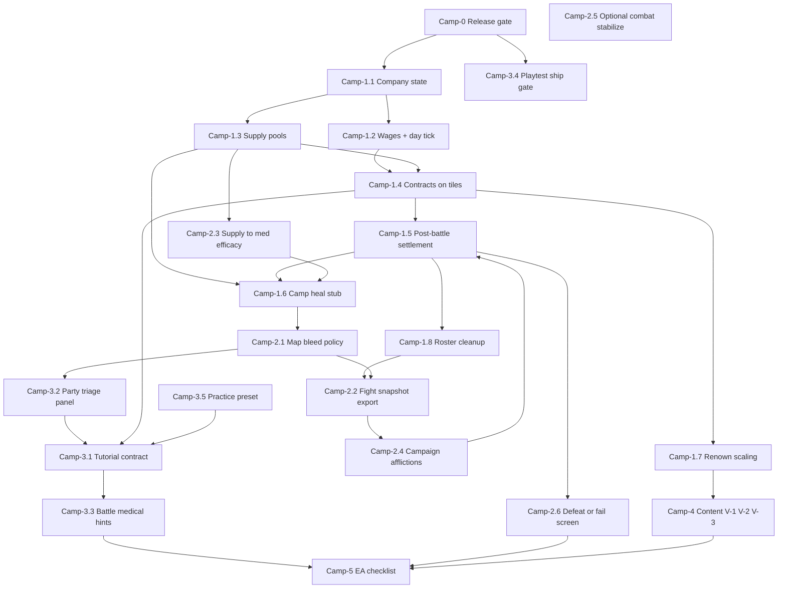

# Ship plan — merc company loop (Battle Brothers parity)

**Purpose:** Close the gap between **shipped combat/medical simulation** and a **shippable mercenary campaign** players can run for hours without dev soak presets.

**Entry:** [`PLANNING.md`](PLANNING.md) · [`CURSOR.md`](CURSOR.md) · combat map [`LIVE_PATHS.md`](LIVE_PATHS.md) · bleeding [`LIVE_PATHS#bleeding-units`](LIVE_PATHS.md#bleeding-units).

**Implementation appendices:** [§9 wiring](SHIP_PLAN.md#implementation-reference) · [§10 contracts](SHIP_PLAN.md#data-contracts) · [§11 encounters](SHIP_PLAN.md#encounter-lifecycle) · [§12 tuning](SHIP_PLAN.md#ea-tuning-defaults) · [§13 save scope](SHIP_PLAN.md#persistence-scope) · [§14 roster](SHIP_PLAN.md#roster-casualties) · [§15 dev soak](SHIP_PLAN.md#dev-vs-campaign-mode) · [§17 templates](SHIP_PLAN.md#camp-4-config-examples) · [§18 supplies](SHIP_PLAN.md#battle-supply-consumption) · [§19 stubs](SHIP_PLAN.md#implementation-stubs)

**Decisions:** Resolve at [**decision gates**](SHIP_PLAN.md#decision-gates-at-implementation) when each Camp row is implemented — research in [`CAMPAIGN_DECISION_GUIDE.md`](CAMPAIGN_DECISION_GUIDE.md). Not upfront.

**Comparables (design inputs only):** Battle Brothers (company loop), RimWorld CE (stabilize + supply quality), ACE3 (triage clarity), Phoenix Command (bleed-out time), CDDA (map bleed + self-aid constraints), Dominions/BB (campaign afflictions), Chains on Sand (between-fight choices). Combat depth stays; **campaign + UX** carry the product.

---

<a id="target-definition"></a>

## 1. Target definition

### Shippable means

A new player can, without reading harness docs:

1. Start a run with a small roster and starting **gold + medical/tools supplies**.
2. Take **paid contracts** on the overworld (not anonymous red tiles).
3. Fight using existing formation / HEMA / medical-phase systems.
4. See a **post-battle settlement** (pay, wounds, supply use).
5. **Heal or stabilize** on the map (camp/town stub) using supplies and time.
6. Feel **economic pressure** (wages, upkeep, bad fights cost med kits).
7. Lose the run on **company bankruptcy** or **party wipe** with a clear screen.

### Not required for first ship (EA scope)

- Full town UI, hiring hall, inventory grid, crafting economy.
- Neurotrauma-style organ surgery or ACE cardiac arrest chains.
- POST Phase 4 **IV-1,3,5–13** combat expansions.
- New `FEATURE_*` flags, bleed retune, F1 BMI ([`PLANNING`](PLANNING.md) / [`CURSOR`](CURSOR.md) policy).

### Success metric

**2–4 hour playtest:** complete ≥3 contracts, pay ≥2 wage days, recover from one “bloody win” via camp heal, and lose once to wipe or bankruptcy with understandable cause.

---

<a id="current-state"></a>

## 2. Current state (repo truth)

| Area | Shipped | Gap vs BB-like ship |
|------|---------|---------------------|
| **Combat** | Tiers 0–6, D-001–D-007, Phase 0 harness | Maintain only (**Combat** stream) |
| **Medical sim** | Wounds, ATLS blood, TCCC ladder, medical phase | Integrate into economy/supplies |
| **Overworld** | 3×3 map, `EncounterNode`, move → fight | No contract pay/goal/difficulty |
| **Party** | `PartyManager`, `PartyMenu` (blood, parts, untreated flag) | No triage ETA, no supplies line; **dead stay in roster** until removed ([§14](SHIP_PLAN.md#roster-casualties)) |
| **Time on map** | `advance_party_overworld_minute` (60s/step, bleed + heal) | No supply-gated heal; warn-only untreated |
| **Post-battle** | `CombatFlow` → `BattleEndHandler` → `on_return_from_combat` | No settlement UI; defeat = node wipe |
| **Economy** | — | No gold, wages, med/tools pools |
| **Campaign injuries** | Acute `wounds[]` + `process_healing` | No permanent **afflictions** roster layer |
| **Med skill** | `CoreEntity.get_medical_effectiveness()` (INT-based) | Not tied to supplies on hand |

**Existing integration hooks (extend, don’t replace):**

- `world/EncounterNode.gd` — `encounter_config`, `enemy_count`, formation presets.
- `world/CampaignEncounterBridge.gd` — `prepare_combat_from_encounter`, `can_enter_combat`, `party_has_untreated_wounds`, vitality logging.
- `world/CombatFlow.gd` / `BattleEndHandler.gd` — battle end pipeline.
- `world/PartyMemberSnapshot.gd` / `ui/PartyMenu.gd` — roster display.
- `core/EntityTimeAdvance.gd` / `core/EntityHealing.gd` — map time + healing.
- `world/SoakEncounterPresets.gd` — preset encounters (tutorial candidate).

---

<a id="dependency-overview"></a>

## 3. Phase order (logical dependencies)



**Rules:**

- Do **Camp-1** in numeric order; **Camp-2** after **Camp-1.5** (settlement exists).
- **Camp-3.2** (triage UI) before **Camp-3.1** (tutorial) so the tutorial teaches real UI.
- **Camp-4** parallels late **Camp-2** once one contract type works.
- **Expand** stream / **IV-\*** stays **below** this plan unless a row supports map↔battle (see [§6](#work-streams-during-campaign)).

---

<a id="decision-gates-at-implementation"></a>

## 3b. Decision gates at implementation

**Rule:** Implement the Camp row with [**§19 stubs**](SHIP_PLAN.md#implementation-stubs) until you hit that row’s gate. **Stop, read** the linked guide section, pick an option, log it, replace stubs, then finish the row’s exit criteria.

| Order | Camp row | Gate ID | Blocks without choice? | Stub until chosen |
|-------|----------|---------|------------------------|-------------------|
| — | **Camp-1.1** | — | No | §12 defaults only |
| — | **Camp-1.3** (map/camp) | — | No | Camp heal −1 med; tools abstract |
| 1 | **Camp-1.2** | **D-day** | Yes (wage tick behavior) | `STUB_DAY_*` |
| 2 | **Camp-1.4** | **D-encounter** | Yes (`queue_free` vs R1b) | `STUB_ENCOUNTER_LIFECYCLE` |
| 3 | **Camp-1.6** | **D-camp-ui** + heal seconds | Yes (entry point + time cost) | `STUB_CAMP_*` |
| 4 | **Camp-1.5** + **1.8** | **D-casualty** (1.8) | 1.8 yes; 1.5 can ship without 1.8 | `STUB_CASUALTY_*` |
| 5 | **Camp-2.3** (+ 2.5) | **D-supply-battle** | Yes (efficacy vs spend) | `STUB_MED_BATTLE_*` |
| 6 | **Camp-2.1** | **D-bleed** | Yes (move block vs warn) | `STUB_MAP_BLEED_*` — interim: keep today’s log warn |
| 7 | **Camp-2.4** | **D-affliction** | Yes (triggers + effect) | `STUB_AFFLICTION_*` |
| 8 | **Camp-2.6** | **D-bankrupt** | Yes (fail UX) | `STUB_BANKRUPT_*` |
| 9 | **Camp-3.1** | Uses **D-bleed** if tutorial ≠ campaign | Only if **C** picked at 2.1 | tutorial flag on contract |
| — | **Camp-3.2** | — | No (implements ETA for B/C) | — |
| 10 | **Camp-5** | **D-persistence** | Only if adding save | default **P1** = no code |

**Parallel agents:** Campaign agent may implement **stubbed** rows; must not merge final behavior past a gate without the decision log line.

---

<a id="pre-start-checklist"></a>

## 3c. Pre-start checklist (before Camp-1.1 code)

| Step | Action |
|------|--------|
| 1 | `.\scripts\run_all_combat_checks.ps1` → **Camp-0** PASS |
| 2 | Read [§9](SHIP_PLAN.md#implementation-reference) (boot / battle / party paths) |
| 3 | Create `world/CompanyState.gd` with [§19 stubs](SHIP_PLAN.md#implementation-stubs) — **no product decisions yet** |
| 4 | Campaign agent: **Camp-1.1** only · Combat agent: one [CURSOR backlog](CURSOR.md#stream-combat) item |
| 5 | Do **not** block on [`CAMPAIGN_DECISION_GUIDE`](CAMPAIGN_DECISION_GUIDE.md) until a gate row above |

**First gate you will hit in sequence:** **Camp-1.2** (D-day) after HUD + `CompanyState` init exist.

---

<a id="camp-0-release-gate"></a>

## Camp-0 — Release gate (always)

| ID | Work | Modules / commands | Exit |
|----|------|-------------------|------|
| **Camp-0.1** | Phase 0 green | `.\scripts\run_all_combat_checks.ps1` | `.phase0_combat_checks.txt` **`PHASE0: PASS`**; `.d001_headless_signoff.txt` **`ok=true`** |
| **Camp-0.2** | Doc links | `check_doc_links.ps1` (in Phase 0) | No broken links to this file |

**Parallel:** **Combat** stream maintenance; **Playtest** only when validating feel (not required every Camp-0 pass).

---

<a id="camp-1-company-loop"></a>

## Camp-1 — Minimum merc company loop

Goal: **motivation + resources** on the existing 3×3 map.

### Camp-1.1 — Company state

**Decision gate:** None — use [§12](SHIP_PLAN.md#ea-tuning-defaults) provisional numbers (tune later, not a design fork).

| Field | Detail |
|-------|--------|
| **Deliverable** | World-persistent `CompanyState`: `gold`, `medical_supplies`, `tool_supplies`, `renown`, `day_index`, `bankrupt` flag. |
| **Storage** | `world.set_meta("company_state", …)` from **`CompanyState.gd`** helpers — **no save/load in EA** until [Camp-5 / D-persistence](#decision-gates-at-implementation). |
| **Init** | `PartySetup.setup_party` after roster exists; `CompanyState.init_from_defaults()` reads §12 + [§19 stubs](SHIP_PLAN.md#implementation-stubs). |
| **UI** | Minimal HUD on existing **`UIOverlayLayer`** (`PartySetup` creates it): gold + supplies + day beside **Party** button. |
| **Harness** | Optional: `_run_company_state_*` when payout/wage logic exists (Camp-1.2+). |
| **Exit** | [ ] HUD updates when gold/supplies change; state survives between encounters on same map session. |

### Camp-1.2 — Wages + day tick

> **Decision gate — resolve before merge:** [**D-day**](CAMPAIGN_DECISION_GUIDE.md#d-day) (T1 / T2 / T3 + steps per day).  
> **Until chosen:** wire wages to `CompanyState.STUB_DAY_TICK_MODE` + `STUB_STEPS_PER_DAY` ([§19](SHIP_PLAN.md#implementation-stubs)).  
> **Code touch:** `main._on_player_moved` (step counter) and/or camp “End day” · `CompanyState.try_advance_day(world)`.

| Field | Detail |
|-------|--------|
| **Deliverable** | Once per **day**: deduct `wage_per_member × living roster` (living = not `is_dead()`, valid `node_ref`). |
| **Comparable** | BB noon wages. |
| **Touch** | `CompanyState`, `PartyManager.get_members()`. Map step already runs **`advance_party_overworld_minute`** (60s) — **do not** tie wages to that hook unless D-day = per-step. |
| **UI** | HUD: `Next wage: Ng` when gold low. |
| **Exit** | [ ] Broke company after N days without income; log/warn when gold &lt; next wage bill. |
| **Log** | `YYYY-MM-DD — D-day → …` in [decision log](#decision-log) |

### Camp-1.3 — Supply pools

**Decision gate:** None for pools; **battle spend** deferred to **Camp-2.3** ([D-supply-battle](CAMPAIGN_DECISION_GUIDE.md#d-supply-battle)).

| Field | Detail |
|-------|--------|
| **Deliverable** | Medical supplies consumed by map heal (Camp-1.6) + settlement; tool supplies for abstract repair (Camp-1.5). |
| **Comparable** | BB med supplies + tools. |
| **Touch** | `CompanyState.consume_medical` / `consume_tool`; camp heal; settlement repair line. |
| **Tools** | **No armor durability** — repair is abstract (−1 tool if offered). |
| **Exit** | [ ] Cannot camp-heal at 0 med; post-battle repair reduces tools when offered. |

### Camp-1.4 — Contracts on encounter tiles

> **Decision gate — resolve before merge:** [**D-encounter**](CAMPAIGN_DECISION_GUIDE.md#d-encounter) (R1 / **R1b** / R2 / R3).  
> **Until chosen:** `main._on_player_moved` uses `CompanyState.STUB_ENCOUNTER_LIFECYCLE` ([§19](SHIP_PLAN.md#implementation-stubs)).  
> **Code touch:** `main.gd` (destroy vs stash) · `CampaignEncounterBridge.prepare_combat_from_encounter` (`active_contract` meta) · `ContractSpawner.gd`.

| Field | Detail |
|-------|--------|
| **Deliverable** | `encounter_config`: `contract_title`, `pay_gold`, `difficulty_rating`, scaled `enemy_count` / gear. |
| **Comparable** | BB contract board → map jobs. |
| **Touch** | `EncounterNode`, `EncounterSpawner` / **`ContractSpawner`**, `prepare_combat_from_encounter`. |
| **Spawner** | Replace random reds when not in [dev soak mode](SHIP_PLAN.md#dev-vs-campaign-mode); exclude `Vector2i(0,0)`. |
| **UI** | Marker label: title + pay + difficulty. |
| **Exit** | [ ] Win pays `pay_gold`; loss pays 0; ≥2 templates. |
| **Log** | `YYYY-MM-DD — D-encounter → …` |

### Camp-1.5 — Post-battle settlement screen

| Field | Detail |
|-------|--------|
| **Deliverable** | Modal after player victory (before map input): contract pay, wound summary per brother, optional tool repair cost, “Continue”. |
| **Comparable** | BB post-fight review. |
| **Touch** | Insert **`SettlementPanel`** in victory path **before** `on_return_from_combat` returns control — e.g. `CombatFlow.handle_battle_ended` after `BattleEndHandler.handle_victory`, or inside victory handler. Data: `PartyManager.get_members()` → **`PartyMemberSnapshot.snapshot_from_member`** + `health_entity_from_character` (same as `PartyMenu`). |
| **Contract context** | Stash active contract id/pay on world meta at `prepare_combat_from_encounter`; read in settlement. |
| **Exit** | [ ] Player always sees pay and worst triage state; gold/supplies update before map. |

### Camp-1.6 — Camp / town heal stub

> **Decision gate — resolve before merge:** [**D-camp-ui**](CAMPAIGN_DECISION_GUIDE.md#d-camp-ui) (H1/H2/H3) + heal duration (180 / **300** / 600 s).  
> **Until chosen:** `STUB_CAMP_HEAL_ENTRY` + `STUB_CAMP_HEAL_SECONDS` in `CompanyState`.  
> **Code touch:** `ui/PartyMenu.gd` and/or `main.gd` + `camp_tile` meta · `CompanyState.camp_heal_party(world)`.

| Field | Detail |
|-------|--------|
| **Deliverable** | Spend **1 med** + advance game time → `process_healing` on party entities. |
| **Comparable** | BB town heal. |
| **Exit** | [ ] After bloody win, camp heal prevents map bleed death if supplies remain. |
| **Log** | `YYYY-MM-DD — D-camp-ui → …` · heal seconds |

### Camp-1.7 — Renown scaling

| Field | Detail |
|-------|--------|
| **Deliverable** | `renown` increases on contract win; scales `pay_gold` and enemy `enemy_count` / equipment tier caps. |
| **Comparable** | BB renown → pay + difficulty. |
| **Exit** | [ ] Third contract fight is observably harder than first with higher pay. |

### Camp-1.8 — Post-battle roster cleanup (with Camp-1.5)

> **Decision gate — resolve before merge (Camp-1.8):** [**D-casualty**](CAMPAIGN_DECISION_GUIDE.md#d-casualty) (K1/K2/K3).  
> **Until chosen:** `STUB_CASUALTY_ON_SETTLEMENT` — default `"memorial_then_remove"` for playtest.  
> **Code touch:** `SettlementPanel` continue · `PartyManager.remove_member_by_name`.

| Field | Detail |
|-------|--------|
| **Deliverable** | Settlement lists dead/unconscious; apply chosen removal policy. |
| **Touch** | `PartyManager`, `SettlementPanel`, [§14](SHIP_PLAN.md#roster-casualties) |
| **Exit** | [ ] Living roster matches fightable nodes after continue. |
| **Log** | `YYYY-MM-DD — D-casualty → …` |

**Phase Camp-1 exit:** Playtest script in [§8](#camp-playtest-acceptance) steps 1–6 pass (step 8 waits for Camp-2.6).

---

<a id="camp-2-sim-campaign-bridge"></a>

## Camp-2 — Simulation ↔ campaign bridge

Goal: deep combat/medical **constrains** the merc loop without a second minigame.

### Camp-2.1 — Map bleed policy

> **Decision gate — resolve before merge:** [**D-bleed**](CAMPAIGN_DECISION_GUIDE.md#d-bleed) (A / B / C).  
> **Until chosen:** keep current **log warn** in `main._on_player_moved`; `STUB_MAP_BLEED_POLICY` = `"warn_only"`.  
> **Depends on:** Camp-3.2 for option **B/C** (ETA UI). Safe to merge interim warn-only before 3.2.  
> **Code touch:** `main.gd` `_on_player_moved` · `PartyMenu` / `PartyRowFormatter` (if B/C).

| Field | Detail |
|-------|--------|
| **Deliverable** | Implement chosen policy; document in UI. |
| **Touch** | `party_has_untreated_wounds`, `BleedingConstants`, `CombatResearchAnchors`. |
| **Exit** | [ ] No silent bleed death without warning (block and/or ETA). |
| **Log** | `YYYY-MM-DD — D-bleed → …` |

### Camp-2.2 — Post-fight snapshot export

| Field | Detail |
|-------|--------|
| **Deliverable** | `CampaignEncounterBridge` builds `last_battle_summary`: per-member blood %, total bleed, untreated parts, worst ATLS band. |
| **Touch** | `on_return_from_combat`, `SettlementPanel`. |
| **Exit** | [ ] Settlement shows same numbers as `PartyMenu` after continue. |

### Camp-2.3 — Supplies → medical effectiveness

> **Decision gate — resolve before merge:** [**D-supply-battle**](CAMPAIGN_DECISION_GUIDE.md#d-supply-battle) (E1/E2/E3).  
> **Until chosen:** `STUB_MED_BATTLE_MODE` = `"efficacy_only"`; `STUB_SUPPLY_FACTOR_AT_ZERO_MED` = `0.5`.  
> **Code touch:** `CoreEntity.get_medical_effectiveness` (Combat PR) · `CampaignEncounterBridge` meta (Campaign PR).

| Field | Detail |
|-------|--------|
| **Deliverable** | `get_medical_effectiveness()` = INT curve × supply factor (e.g. 0.5 if 0 med, 1.0 if ≥1 med reserved). |
| **Comparable** | RimWorld CE medicine quality. |
| **Touch** | `CoreEntity.get_medical_effectiveness`, `CompanyState`, battle medical actions. |
| **Split PR contract** | **Combat first:** optional `supply_factor: float = 1.0` (or read from bridge) in `CoreEntity` — no `CompanyState` import in `core/`. **Campaign second:** pass factor from `CompanyState` via bridge / entity context. |
| **Exit** | [ ] Bandage/pack success drops when out of med supplies; UI shows why. |

### Camp-2.4 — Campaign afflictions (permanent layer)

> **Decision gate — resolve before merge:** [**D-affliction**](CAMPAIGN_DECISION_GUIDE.md#d-affliction) (trigger + first affliction stat).  
> **Until chosen:** feature flag `CompanyState.STUB_AFFLICTIONS_ENABLED` = `false` or harness-only path.  
> **Code touch:** `CoreEntity` / post-battle hook (Combat) · `PartyMemberSnapshot` (Campaign).

| Field | Detail |
|-------|--------|
| **Deliverable** | `campaign_afflictions` on **`CoreEntity`** — criteria and effects per guide. **Acute `wounds[]` unchanged.** |
| **Apply** | **Combat** PR: `EntityWounds` / post-battle hook reads criteria; **Campaign** PR: display in `PartyMemberSnapshot` + settlement. |
| **Comparable** | BB permanent injuries; Dominions afflictions. |
| **Harness** | `_run_campaign_affliction_*` before enabling in contracts. |
| **Exit** | [ ] One affliction type end-to-end; visible in Party + settlement. |

### Camp-2.5 — Combat stabilize (optional)

| Field | Detail |
|-------|--------|
| **Deliverable** | One battle action: spend 1 med supply (see [§18](#battle-supply-consumption)), multiply bleed rates ×0.5 for 60s or until medical phase. |
| **Comparable** | RimWorld CE stabilize. |
| **Touch** | `CombatMedicalActionListing`, `EntityMedical` / wound rates; deduct from `company_state` on success via bridge callback at battle end or per action. |
| **Exit** | [ ] Reduces “won fight, died on map” without replacing TCCC ladder. |

### Camp-2.6 — Company fail / defeat screens

> **Decision gate — resolve before merge:** [**D-bankrupt**](CAMPAIGN_DECISION_GUIDE.md#d-bankrupt) (B1/B2/B3). Wipe UX is fixed (restart `main.tscn`).  
> **Until chosen:** `STUB_BANKRUPT_MODE` = `"hard_loss"`.  
> **Code touch:** `ui/DefeatScreen.gd` · `BattleEndHandler` / `CompanyState` after wages · clear stale `PartyManager` refs on restart.

| Field | Detail |
|-------|--------|
| **Deliverable** | **Wipe:** `DefeatScreen` + restart. **Bankrupt:** per D-bankrupt. |
| **Exit** | [ ] Both ends explain cause; restart returns to main scene. |
| **Log** | `YYYY-MM-DD — D-bankrupt → …` |

**Phase Camp-2 exit:** Playtest steps 7–9 pass; one affliction applied in test fight.

---

<a id="camp-3-player-ready"></a>

## Camp-3 — Player-ready UX

### Camp-3.1 — Tutorial contract

> **Uses closed gate:** If **D-bleed = C**, tutorial contract sets `tutorial: true` and applies policy **A** on map until first win. If **B** only, tutorial still teaches Camp-3.2 UI.

| Field | Detail |
|-------|--------|
| **Deliverable** | Fixed first encounter: 2v2, low bleed mult, `SoakEncounterPresets`-style config flagged `tutorial`; tooltips for Stm/Exh/Grd/blood. |
| **Comparable** | Chains on Sand downtime teach; BB first contracts. |
| **Exit** | [ ] New player completes tutorial without `dev_soak_encounter`. |

### Camp-3.2 — Party triage panel

| Field | Detail |
|-------|--------|
| **Deliverable** | Extend `PartyMenu` / `PartyRowFormatter`: ATLS band label, `~Xs to danger` from bleed rate + `MEDICAL_TRIAGE_*`, untreated banner. |
| **Helpers** | `BleedingConstants.atls_hemorrhage_class_from_remaining_pct(blood_pct)`; ETA: `CombatResearchAnchors.clinical_ttd_seconds(bleed_mult)` or seconds until `blood_pct` crosses `MEDICAL_TRIAGE_DANGER_BLOOD_REMAINING` at current `total_bleeding_rate` (0 rate → no ETA). |
| **Comparable** | ACE triage card. |
| **Exit** | [ ] Matches headless triage thresholds within one band. |

### Camp-3.3 — Battle medical phase hints (Combat-led)

| Field | Detail |
|-------|--------|
| **Lead agent** | **Combat** ([`PLANNING#file-ownership`](PLANNING.md#file-ownership)) — not Campaign agent that week |
| **Deliverable** | First medical phase: one-shot hints (pressure before pack on arterial; winner-lock). |
| **Touch** | `combat/CombatUiHints.gd`, `ui/BattleUIUpdater.gd` |
| **Exit** | [ ] Hint dismisses; doesn’t repeat every fight. |

<a id="camp-34-playtest-ship-gate"></a>

### Camp-3.4 — Playtest ship gate (human or third lane)

| Field | Detail |
|-------|--------|
| **Who** | **Not** a third parallel code agent by default — you (F5) or a dedicated **Playtest** session after Campaign+Combat merge that week |
| **Deliverable** | Ship gate: **Q1** duel + **Q2** bind feel checklists; **ii7** medical smoke (**headless** in Phase 0 via `CombatD001SoakRunner` — not a cyan F5 preset). Optional F5: `dev_soak_encounter=ii2b` + manual medical phase once. |
| **Commands** | `.\scripts\run_q_feel.ps1 -Track Q1` and `-Track Q2`; `.\scripts\run_q_audit.ps1`; Phase 0 must show **`[ii7]`** ok in `.d001_headless_signoff.txt` / `print_phase0_status.ps1` |
| **Exit** | [ ] Recorded in [`Camp-5`](SHIP_PLAN.md#camp-5-ea-checklist) sign-off. |

### Camp-3.5 — Practice preset

| Field | Detail |
|-------|--------|
| **Deliverable** | Menu or cyan preset: `training` — reduced `BLOOD_LOSS_RATE_MULTIPLIER` or no map bleed. |
| **Comparable** | Hellish Quart sparring. |
| **Exit** | [ ] Listed in party or map UI as non-contract fight. |

**Phase Camp-3 exit:** External playtester completes tutorial + 1 contract without agent docs.

---

<a id="camp-4-content"></a>

## Camp-4 — Content (POST Phase 5 alignment)

Run after **Camp-1.4** works. No new combat `FEATURE_*`.

| ID | Work | Source track | Exit |
|----|------|--------------|------|
| **Camp-4.1** | Species in contracts (human vs goblin enemies, pain/blood pools) | POST **V-1** | [ ] At least one contract per species |
| **Camp-4.2** | Encounter presets: doctrine, flee, depth polearm | POST **V-2** | [ ] 3+ distinct `encounter_config` rows |
| **Camp-4.3** | Weapon archetypes per contract tier | POST **V-3** | [ ] Polearm vs sword contracts differ in listings |

---

<a id="camp-5-ea-checklist"></a>

## Camp-5 — EA ship checklist

> **Decision gate (optional):** [**D-persistence**](CAMPAIGN_DECISION_GUIDE.md#d-persistence) — default **P1** (no save code) unless you add autosave here.

| Must ship | Nice for EA |
|-----------|-------------|
| Camp-0 Phase 0 PASS | Larger overworld |
| Camp-1 full loop (+ Camp-1.8 roster cleanup) | Hire at inn |
| Camp-2.1 policy + Camp-2.3 supplies | Camp-2.5 stabilize |
| Camp-2.4 ≥1 affliction | Full affliction catalog |
| Camp-2.6 fail screens | Narrative events |
| Camp-3.1–Camp-3.2 tutorial + triage | Camp-3.5 practice |
| Camp-3.4 Q sign-off | |
| Camp-4.2 three contract presets | Camp-4.1 species variety |
| No dev soak required for normal play | |

**Explicitly defer:** IV-1,3,5–13 · organ surgery · BMI F1 · bleed retune · POST Phase 3 depth unless map↔battle.

---

<a id="work-streams-during-campaign"></a>

## 6. Other work streams during Campaign ship

| Work stream | During Campaign ship |
|-------------|----------------------|
| **Combat** | Fix regressions; `BattleUIUpdater` medical busy (feeds Camp-3.3). |
| **Playtest** | Camp-3.4 makes Q1/Q2/ii7 **ship gates**, not optional. |
| **Expand** | **Freeze** IV rows unless: (a) supports Camp-1–Camp-2, or (b) Camp-5 done. IV-2 already done. |

**Session default until Camp-5 done:** [**parallel agents**](PLANNING.md#parallel-agents) — **Campaign** (`Camp-*`) + **Combat** (maintain) at the same time, with [file ownership](PLANNING.md#file-ownership). Single-agent fallback: one Camp row **or** one Combat fix. Add **Playtest** (Camp-3.4) before EA sign-off.

---

<a id="camp-7-session-order"></a>

## 7. Recommended session order

**Parallel:** assign **Campaign column** to agent A and **Combat column** to agent B each week ([`PLANNING#parallel-agents`](PLANNING.md#parallel-agents)).

| Week | Campaign agent | Combat agent (parallel) |
|------|----------------|-------------------------|
| 1 | Camp-0.1 + Camp-1.1 | Phase 0 hygiene / harness regression fix |
| 2 | Camp-1.2 + Camp-1.3 | `BattleUIUpdater` medical busy ([Combat backlog](CURSOR.md#stream-combat)) |
| 3 | Camp-1.4 | D-001 / small LIVE_PATHS maintain |
| 4 | Camp-1.5 + Camp-1.8 + Camp-1.6 | `CombatUiHints` prep for medical phase |
| 5 | Camp-1.7 + Camp-2.1 decision | Unrelated Combat maintain (harness / LIVE_PATHS) — no Camp-2 files |
| 6 | Camp-2.2 + Camp-2.3 | Camp-2.3 efficacy hook in `CoreEntity` if split |
| 7 | Camp-3.2 + Camp-3.1 | Camp-3.3 battle medical hints |
| 8 | Camp-2.4 + Camp-2.6 | Camp-2.4 affliction apply rules (if split) |
| 9 | Camp-3.4 Playtest gate | ii7 / F5 medical smoke support |
| 10 | Camp-4.1–Camp-4.3 + Camp-5 sign-off | Final Phase 0 + regression |

**Single-agent fallback:** run Campaign rows first (column 1), Combat when blocked on UI.

---

<a id="camp-playtest-acceptance"></a>

## 8. Playtest script (Camp-1–Camp-2 acceptance)

1. Start run — note starting gold, med, tools, roster size.
2. Move to contract tile — confirm pay and difficulty shown.
3. Win fight — settlement shows pay and wounds; gold increases.
4. Move 1 step with untreated bleed — policy **A/B/C** behaves as documented.
5. Camp heal — med supply decreases; bleed or band state improves.
6. Advance day or steps until wages deduct.
7. Win second contract — renown increases pay or enemy tier.
8. Deliberately lose third fight — defeat screen, restart works (**blocked until Camp-2.6**; today defeat only `queue_free`s roster).
9. Spend to 0 gold + wages — bankrupt screen.
10. Open Party — triage lines match fight outcome.

---

<a id="implementation-reference"></a>

## 9. Implementation reference (repo wiring)

Use this when fleshing out Camp rows — extends [§2](#current-state) hooks.

### Boot (`main._ready`)

1. Tilemap 3×3, `EncounterSpawner.spawn_encounters` (red markers) + optional cyan soak tile.
2. `PlayerCompanionSetup` → `PartySetup.setup_party` → world meta: **`party_manager`**, **`party_menu`**, **`party_formation`**.
3. `UIOverlayLayer` on **tree root** (not `main`): **Party** button + popup. **`PartyManager`** is also a **root child** (not under `main`) — survives battle scene swap; stale `node_ref` after defeat is a known bug until Camp-2.6 restart flow.

### Overworld step (`main._on_player_moved`)

| Branch | Behavior |
|--------|----------|
| Encounter on tile | `can_enter_combat` → warn if `party_has_untreated_wounds` (log only today) → `prepare_combat_from_encounter` → `spawn_enemies` → **`encounter.queue_free()`** → `CombatFlow.start_combat` |
| Empty tile | `advance_party_overworld_minute` — **60s**, bleed + heal on player + companions |

### Battle end (`CombatFlow.handle_battle_ended`)

| Outcome | Today | Camp adds |
|---------|-------|-----------|
| **Defeat** | `BattleEndHandler.handle_defeat` — prints, **queue_free** player + companions; camera to world | **`ui/DefeatScreen`** + restart `main.tscn` (Camp-2.6) |
| **Victory** | `handle_victory` → `on_return_from_combat` (formation refresh + vitality log) | **SettlementPanel** + gold/pay + contract respawn (Camp-1.5, Camp-1.4) |

### Health / display path

`character` → `get_medical_entity()` → **`CoreEntity`** wounds/blood. Party UI: **`PartyMemberSnapshot`** + **`PartyRowFormatter`**. Bridge: **`CampaignEncounterBridge.health_entity_from_character`**.

### Combat encounter dict

`EncounterNode.encounter_config` → world meta **`CombatConstants.WORLD_META_COMBAT_ENCOUNTER`** → `BattleScene.start` → **`CombatManager`** (doctrine, posture, depth polearm mults, …). Keys: see [§10](#data-contracts).

---

<a id="data-contracts"></a>

## 10. Data contracts

### `encounter_config` — campaign keys (new, Camp-1+)

| Key | Type | Purpose |
|-----|------|---------|
| `contract_title` | String | Marker + settlement header |
| `contract_type` | String | e.g. `skirmish`, `escort` (flavor + template id) |
| `pay_gold` | int | Settlement on win |
| `difficulty_rating` | int | 1–3 UI skulls; scales `enemy_count` / gear |
| `tutorial` | bool | Camp-3.1 — low bleed, tooltips |
| `training` | bool | Camp-3.5 — no pay, reduced map bleed |

### `encounter_config` — combat keys (existing; Camp-4)

Use **`CombatConstants.ENCOUNTER_KEY_*`** / `CombatManager` defaults: formation doctrine, posture deltas, depth polearm AI mults, ambush, protection circle, etc. Campaign sets these per contract tier in **`EncounterSpawner`** or preset tables — do not fork combat logic.

### `encounter_config` — soak keys (existing)

| Key | Source |
|-----|--------|
| `soak_preset_id` | `SoakEncounterPresets.ENCOUNTER_KEY_SOAK_PRESET_ID` |
| `soak_force_weapon_id` | `SoakEncounterPresets.ENCOUNTER_KEY_FORCE_WEAPON_ID` |

### `company_state` meta (new, Camp-1.1)

| Field | Type | Notes |
|-------|------|-------|
| `gold` | int | |
| `medical_supplies` | int | Camp heal + battle med factor (Camp-2.3) |
| `tool_supplies` | int | Post-fight repair (Camp-1.3) |
| `renown` | int | Camp-1.7 scaling |
| `day_index` | int | Wage tick (Camp-1.2) |
| `bankrupt` | bool | Camp-2.6 |
| `active_contract` | Dictionary | During fight / R1b: title, pay, tile, `encounter_config` copy |
| `overworld_step_count` | int | Optional: map steps since last wage day (if D-day = N steps) |
| `contract_deck_index` | int | R3 pool: next template id |

**Meta key names (add to `CombatConstants` or `CompanyState`):** `company_state`, `active_contract`, `last_battle_summary`, optional `camp_tile`.

### `last_battle_summary` (Camp-2.2)

Built in **`CampaignEncounterBridge`**, consumed by **`SettlementPanel`**: per `node_ref` / name: `blood_pct`, `bleed_rate`, `untreated`, `worst_atls_band` (derive from `BleedingConstants` + entity blood).

### Med efficacy bridge (Camp-2.3)

Combat implements factor on **`CoreEntity.get_medical_effectiveness()`**; Campaign sets **`world` meta** or per-entity context at `prepare_combat_from_encounter` from `company_state.medical_supplies` (no `CompanyState` import in `core/`).

---

<a id="encounter-lifecycle"></a>

## 11. Encounter lifecycle (contract tiles)

**Repo truth:** stepping on a marker **destroys** the `EncounterNode` (`main.gd` line ~120). Random red spawns do not respawn.

| Policy | Behavior | Pick |
|--------|----------|------|
| **R1 — Respawn on win** | On victory, spawn new `EncounterNode` at same `Vector2i` with next contract template | |
| **R1b — Defer destroy** | Copy contract to `active_contract` meta; **do not `queue_free` until victory**; on defeat, marker still there (same pay/difficulty) | Stub default until gate closed |
| **R2 — Cooldown tile** | Meta `tile_cooldown_until_day` — no marker until day advances | |
| **R3 — Pool** | Finite contract pool per run; empty tiles stay empty | BB-like scarcity |

**Camp-1.4 gate:** pick R1 / R1b / R2 / R3 in [D-encounter](CAMPAIGN_DECISION_GUIDE.md#d-encounter) before merging; stub default in [§19](SHIP_PLAN.md#implementation-stubs) until then.

**Soak cyan tiles** stay dev-only; contract tiles use red marker + contract label (distinct color optional).

---

<a id="ea-tuning-defaults"></a>

## 12. EA tuning defaults (provisional — adjust in playtest)

| Knob | Starter | Notes |
|------|---------|-------|
| `gold` | 500 | ~2 wage cycles buffer |
| `wage_per_member` | 15 / day | × living roster |
| `day_length` | 3 overworld steps **or** 1 “End day” (D-day) | Steps already advance 60s bleed/heal each |
| `medical_supplies` | 3 | 1 per camp heal; efficacy floor at 0 |
| `tool_supplies` | 2 | 1 per post-fight repair |
| `renown` | 0 | +1 per contract win |
| `pay_gold` base | 80–150 by difficulty | × `(1 + renown * 0.05)` |
| `enemy_count` | 3–7 by difficulty + renown cap | Uses existing spawner cap |

Record changes in [decision log](#decision-log) when playtest shifts lethality/economy.

---

<a id="persistence-scope"></a>

## 13. Persistence scope (EA)

| In scope | Out of scope |
|----------|----------------|
| Company + wounds persist for **one** `main.tscn` session until defeat/restart | Disk save, campaign map seed persistence |
| Entity wounds on **`CoreEntity`** across fights | Roguelike meta-progression |
| Re-run `main` = new company | Cloud / Steam stats |

Camp-5 “ship” assumes players finish a session in one sitting (2–4h); add save in post-EA if needed.

---

<a id="roster-casualties"></a>

## 14. Roster and casualties (missing from Camp-1)

**Repo truth today:**

| Topic | Behavior |
|-------|----------|
| **Fight eligibility** | `can_enter_combat` blocks **unconscious**; `get_fightable_party_nodes` skips **`is_dead()`** |
| **After victory** | Dead/unconscious brothers stay in **`PartyManager.members`** until removed — formation refresh uses **living count only** |
| **After defeat** | `BattleEndHandler` **queue_free**s player + all companion nodes; **`party_manager` on tree root** may still list stale `node_ref`s |

**Camp work to specify:**

| Topic | Where specified |
|-------|-----------------|
| **Casualties** | [Camp-1.8](#camp-1-company-loop) + **D-casualty** gate |
| **Wages** | Camp-1.2: living roster only · **D-day** gate |
| **Defeat** | Camp-2.6: **company wipe** screen — reload `main.tscn`, clear `company_state`, new `PartySetup` |
| **Bankrupt** | Not wipe — roster intact, modal + restart or retry last save (session = restart run) |

**Out of EA:** hiring replacements, burial costs, morale from deaths.

---

<a id="dev-vs-campaign-mode"></a>

## 15. Dev soak vs campaign mode

| Mode | When | Map markers |
|------|------|-------------|
| **Campaign** | `dev_soak_encounter` empty (shipping default) | Contract markers from `ContractSpawner`; red = job, labeled |
| **Dev soak** | Editor `dev_soak_encounter` or F5 testing | Cyan preset tile + optional reduced random reds (`main` already spawns 1 red if soak set) |

**Rule:** Campaign ship checklist (Camp-3.4, §8) uses **campaign mode** — no `dev_soak_encounter` required. Keep soak path for Combat/Playtest streams only.

**Camp-3.5 practice:** `training: true` contract or dedicated cyan-free tile; must not pay gold or advance renown.

---

<a id="battle-supply-consumption"></a>

## 18. Battle supply consumption (Camp-1.3 / 2.3 / 2.5)

| Event | Med supply | Tool supply |
|-------|------------|-------------|
| **Camp heal** (map) | −1 | — |
| **Settlement repair** | — | −1 if repair accepted |
| **Battle bandage/pack** (Camp-2.3) | Optional −1 per **successful** treatment phase OR efficacy floor only at 0 (pick one in D-supply-battle) | — |
| **Combat stabilize** (Camp-2.5) | −1 on action resolve | — |

**Wiring:** At `prepare_combat_from_encounter`, copy `medical_supplies` into world meta; battle UI reads efficacy factor; on battle end, write back remaining count to `company_state`. Combat code must not import `CompanyState` — use meta + bridge static methods.

---

<a id="camp-4-config-examples"></a>

## 17. Camp-4 `encounter_config` examples (templates)

Minimal rows for **`ContractSpawner`** / `EncounterNode` (combat keys abbreviated):

| `contract_type` | `pay_gold` | `difficulty` | `enemy_count` | Combat flavor keys |
|-----------------|------------|--------------|---------------|-------------------|
| `skirmish` | 100 | 1 | 3 | default doctrine |
| `escort` | 120 | 2 | 5 | `FORMATION_DOCTRINE_ENEMY` = aggressive |
| `polearm_trial` | 140 | 2 | 4 | `ENCOUNTER_KEY_DEPTH_POLEARM_AI_MULTS_ENEMY` ≠ {} |
| `goblin_raid` | 110 | 2 | 6 | species paths goblin in spawner |
| `tutorial` | 50 | 1 | 2 | `tutorial: true`, low bleed via meta or preset |

Camp-4.1–4.3 = more rows in this table, not new combat systems.

---

<a id="implementation-stubs"></a>

## 19. Implementation stubs (`CompanyState.gd`)

Single place for **provisional behavior** until a [decision gate](#decision-gates-at-implementation) closes. Agents: **do not** scatter magic strings in `main.gd`.

```gdscript
# world/CompanyState.gd — DECISION STUBS (replace when gate closes; grep TODO(decision-))
const STUB_DAY_TICK_MODE := "hybrid"           # Gate Camp-1.2  → D-day: steps | end_day | hybrid
const STUB_STEPS_PER_DAY := 5
const STUB_ENCOUNTER_LIFECYCLE := "r1b"        # Gate Camp-1.4  → r1 | r1b | r2 | r3
const STUB_CAMP_HEAL_ENTRY := "party_menu"     # Gate Camp-1.6  → party_menu | tile | both
const STUB_CAMP_HEAL_SECONDS := 300.0
const STUB_CASUALTY_ON_SETTLEMENT := "memorial_then_remove"  # Gate Camp-1.8 → D-casualty
const STUB_MAP_BLEED_POLICY := "warn_only"     # Gate Camp-2.1  → block | warn_only | tutorial_block
const STUB_MED_BATTLE_MODE := "efficacy_only"  # Gate Camp-2.3  → efficacy_only | per_treatment | hybrid
const STUB_SUPPLY_FACTOR_AT_ZERO_MED := 0.5
const STUB_AFFLICTIONS_ENABLED := false        # Gate Camp-2.4
const STUB_BANKRUPT_MODE := "hard_loss"          # Gate Camp-2.6  → hard_loss | grace_loan | desertion
```

**§12 economy** (gold 500, wage 15, med 3, tools 2) lives in `init_from_defaults()` — not stubs; retune in playtest without a gate.

**After a gate closes:** rename stub → real const, remove `TODO(decision-*)`, append one line to [decision log](#decision-log).

---

<a id="decision-log"></a>

## Decision log

Append **one line per closed gate** (not upfront). Research when the gate opens: [`CAMPAIGN_DECISION_GUIDE.md`](CAMPAIGN_DECISION_GUIDE.md). Optional fast path: [recommended-bundle](CAMPAIGN_DECISION_GUIDE.md#recommended-bundle).

```markdown
- YYYY-MM-DD — D-day (Camp-1.2) → …
- YYYY-MM-DD — D-encounter (Camp-1.4) → …
- YYYY-MM-DD — D-camp-ui (Camp-1.6) → …
- YYYY-MM-DD — D-casualty (Camp-1.8) → …
- YYYY-MM-DD — D-supply-battle (Camp-2.3) → …
- YYYY-MM-DD — D-bleed (Camp-2.1) → …
- YYYY-MM-DD — D-affliction (Camp-2.4) → …
- YYYY-MM-DD — D-bankrupt (Camp-2.6) → …
- YYYY-MM-DD — D-persistence (Camp-5) → P1 | P2 | …
```

**Started:** 2026-05-22 — plan created from BB/peer gap analysis + repo audit (`CampaignEncounterBridge`, `PartyMenu`, `EncounterNode`, POST Phase 5 V-tracks).

---

<a id="external-comparables-index"></a>

## External comparables (quick index)

| Peer | Borrow for ship |
|------|-----------------|
| Battle Brothers | Contracts, wages, supplies, settlement, permanent injuries |
| RimWorld CE | Stabilize, med quality, pen armor (already in combat) |
| ACE3 | Triage summary, treatment order clarity |
| Phoenix Command | Bleed-out ETA display |
| CDDA | Pressure during treatment; tourniquet efficacy |
| Dominions 6 | Persistent afflictions |
| Chains on Sand | Between-fight choices, active defense teaching |
| Hellish Quart / Exanima | Practice mode, measured lethal openings (Camp-3.5 / tooltips) |

Do **not** block ship on MENACE EA or full DF tissue sim.
